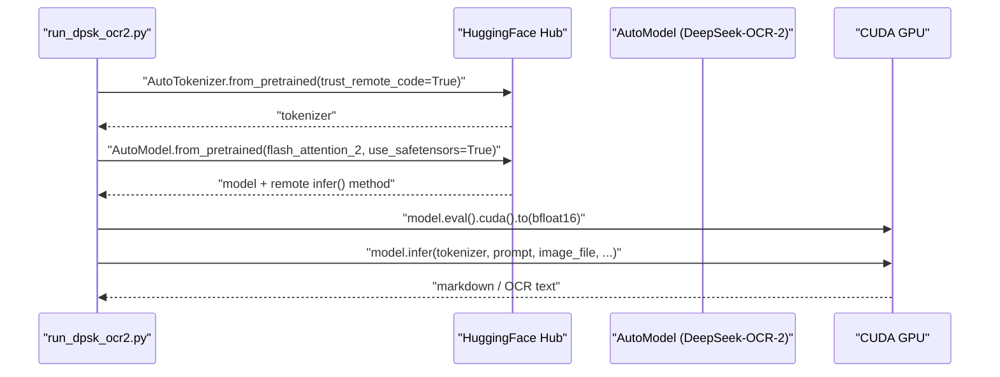

<!-- source: DeepWiki mcp.deepwiki.com · repo deepseek-ai/DeepSeek-OCR-2 · page 2 Getting Started · fetched 2026-10-30 -->

# Getting Started

<details>
<summary>Relevant source files</summary>

The following files were used as context for generating this wiki page:

- [README.md](README.md)

</details>


This page covers environment setup and minimal working examples for running DeepSeek-OCR-2. It is the entry point before diving into deeper topics. For detailed parameter documentation of the transformers path, see [Transformers Inference](#3.1). For detailed vLLM configuration, see [vLLM Configuration](#3.2.1). For architecture details, see [Core Architecture](#4).

---

## Prerequisites

The following prerequisites are required before installation.

| Requirement | Version |
|---|---|
| CUDA | 11.8 |
| PyTorch | 2.6.0 |
| Python | 3.12.9 (via conda) |
| vLLM wheel | 0.8.5+cu118 (manual download) |
| flash-attn | 2.7.3 |

The vLLM wheel must be downloaded manually from the [vllm-project releases page](https://github.com/vllm-project/vllm/releases/tag/v0.8.5) before running the install commands.

Sources: [README.md:64-83]()

---

## Installation

**Step 1 — Clone the repository**

```bash
git clone https://github.com/deepseek-ai/DeepSeek-OCR-2.git
```

**Step 2 — Create and activate the conda environment**

```bash
conda create -n deepseek-ocr2 python=3.12.9 -y
conda activate deepseek-ocr2
```

**Step 3 — Install packages**

```bash
pip install torch==2.6.0 torchvision==0.21.0 torchaudio==2.6.0 --index-url https://download.pytorch.org/whl/cu118
pip install vllm-0.8.5+cu118-cp38-abi3-manylinux1_x86_64.whl
pip install -r requirements.txt
pip install flash-attn==2.7.3 --no-build-isolation
```

> **Note:** If you run both vLLM and transformers inference in the same environment, you may see the warning `vllm 0.8.5+cu118 requires transformers>=4.51.1`. This can be safely ignored when using the two backends together.

For more on flash-attn and `_attn_implementation`, see [Flash Attention](#8.2).

Sources: [README.md:64-84]()

---

## Choosing an Inference Backend

Two independent inference paths are available. The table below summarizes when to use each.

| | **Transformers (`DeepSeek-OCR2-hf/`)** | **vLLM (`DeepSeek-OCR2-vllm/`)** |
|---|---|---|
| Entry point | `run_dpsk_ocr2.py` | `run_dpsk_ocr2_image.py`, `run_dpsk_ocr2_pdf.py`, `run_dpsk_ocr2_eval_batch.py` |
| Model loading | `AutoModel.from_pretrained()` | `LLM` / `AsyncLLMEngine` via vLLM plugin |
| Best for | Single images, prototyping | Batch PDFs, throughput-sensitive workloads, evaluation |
| Output | Markdown / text returned from `model.infer()` | `.mmd` files, annotated images, `_layouts.pdf` |

For a detailed comparison, see [Inference Backends](#3).

**Setup flow (both paths share the same model checkpoint):**

```mermaid
flowchart TD
    HUB["\"deepseek-ai/DeepSeek-OCR-2\n(HuggingFace Hub)\""]

    subgraph hf_path["\"DeepSeek-OCR2-hf/\""]
        RUN_HF["\"run_dpsk_ocr2.py\""]
        AUTO["\"AutoModel.from_pretrained()\nAutoTokenizer.from_pretrained()\""]
        INFER_M["\"model.infer()\""]
        RUN_HF --> AUTO --> INFER_M
    end

    subgraph vllm_path["\"DeepSeek-OCR2-vllm/\""]
        CFG["\"config.py\""]
        SCRIPTS["\"run_dpsk_ocr2_image.py\nrun_dpsk_ocr2_pdf.py\nrun_dpsk_ocr2_eval_batch.py\""]
        ENGINE["\"LLM / AsyncLLMEngine\nDeepseekOCR2ForCausalLM\""]
        CFG --> SCRIPTS --> ENGINE
    end

    HUB -->|"weights + remote code"| AUTO
    HUB -->|"weights loaded by vLLM"| ENGINE
```

Sources: [README.md:86-129]()

---

## Quick Start: Transformers Path

The HuggingFace transformers path uses `AutoModel` and `AutoTokenizer` with `trust_remote_code=True`. The custom `infer()` method is delivered from the remote model repository.

```python
from transformers import AutoModel, AutoTokenizer
import torch
import os

os.environ["CUDA_VISIBLE_DEVICES"] = '0'
model_name = 'deepseek-ai/DeepSeek-OCR-2'

tokenizer = AutoTokenizer.from_pretrained(model_name, trust_remote_code=True)
model = AutoModel.from_pretrained(
    model_name,
    _attn_implementation='flash_attention_2',
    trust_remote_code=True,
    use_safetensors=True
)
model = model.eval().cuda().to(torch.bfloat16)

prompt = "<image>\n<|grounding|>Convert the document to markdown. "
image_file = 'your_image.jpg'
output_path = 'your/output/dir'

res = model.infer(
    tokenizer,
    prompt=prompt,
    image_file=image_file,
    output_path=output_path,
    base_size=1024,
    image_size=768,
    crop_mode=True,
    save_results=True
)
```

Alternatively, run the provided script directly:

```bash
cd DeepSeek-OCR2-master/DeepSeek-OCR2-hf
python run_dpsk_ocr2.py
```

**Key call chain for the transformers path:**



Sources: [README.md:105-129]()

---

## Quick Start: vLLM Path

Before running any vLLM script, edit `DeepSeek-OCR2-vllm/config.py` to set `INPUT_PATH` and `OUTPUT_PATH` for your environment. The `TOKENIZER` instance in `config.py` is created eagerly at import time. See [vLLM Configuration](#3.2.1) for all available parameters.

```bash
cd DeepSeek-OCR2-master/DeepSeek-OCR2-vllm
```

**Single image with streaming output:**
```bash
python run_dpsk_ocr2_image.py
```

**PDF batch inference (concurrent processing):**
```bash
python run_dpsk_ocr2_pdf.py
```

**OmniDocBench evaluation:**
```bash
python run_dpsk_ocr2_eval_batch.py
```

**vLLM runner-to-output mapping:**

```mermaid
flowchart LR
    CFG["\"config.py\nMODEL_PATH, PROMPT\nINPUT_PATH, OUTPUT_PATH\nBASE_SIZE, IMAGE_SIZE\""]

    subgraph runners["\"Runner Scripts\""]
        RI["\"run_dpsk_ocr2_image.py\n(AsyncLLMEngine, streaming)\""]
        RP["\"run_dpsk_ocr2_pdf.py\n(pdf_to_images, batch)\""]
        RE["\"run_dpsk_ocr2_eval_batch.py\n(ThreadPoolExecutor)\""]
    end

    subgraph outputs["\"Output Files\""]
        O1["\"result.mmd\nannotated images\""]
        O2["\".mmd, _det.mmd\n_layouts.pdf\""]
        O3["\"markdown per image\""]
    end

    CFG --> RI --> O1
    CFG --> RP --> O2
    CFG --> RE --> O3
```

Sources: [README.md:86-103]()

---

## Prompt Formats

Two standard prompts control model behavior. Select one based on your task.

| Task | Prompt |
|---|---|
| Document to Markdown (with layout) | `<image>\n<|grounding|>Convert the document to markdown.` |
| Free OCR (text only, no layout) | `<image>\nFree OCR.` |

The `<|grounding|>` token activates bounding-box output in the model response. See [Task-Specific Prompts](#7.2) and [Special Tokens](#7.1) for full details.

Sources: [README.md:134-138]()

---

## Dynamic Resolution

Both inference paths use the same tiling strategy by default.

| Parameter | Default | Meaning |
|---|---|---|
| `base_size` | `1024` | Global thumbnail resolution |
| `image_size` | `768` | Per-tile resolution |
| `crop_mode` | `True` | Enable local tile crops |
| `MIN_CROPS` | `2` | Minimum number of local tiles |
| `MAX_CROPS` | `6` | Maximum number of local tiles |

This produces `(0–6) × 144 + 256` visual tokens per image. See [Dynamic Resolution System](#6) for the full tiling implementation.

Sources: [README.md:131-132]()

---

