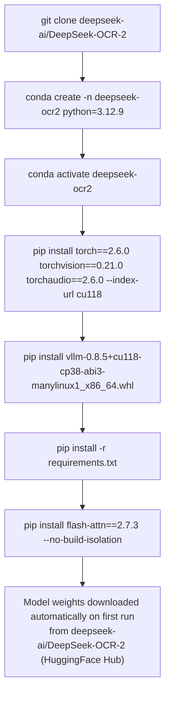
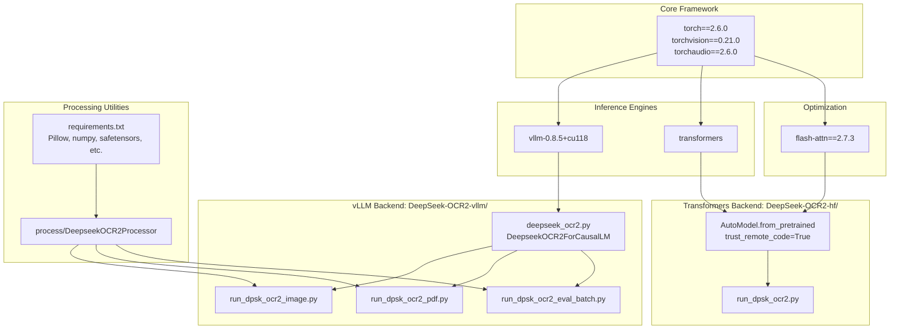
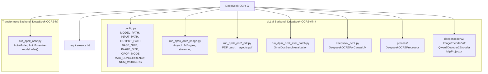

<!-- source: DeepWiki mcp.deepwiki.com · repo deepseek-ai/DeepSeek-OCR-2 · page 2.1 Installation · fetched 2026-10-30 -->

# Installation

<details>
<summary>Relevant source files</summary>

The following files were used as context for generating this wiki page:

- [README.md](README.md)

</details>


Step-by-step environment setup for DeepSeek-OCR-2. The same environment supports both inference backends (vLLM and Transformers). See page 2.2 for quick-start usage after installation.

## Prerequisites and System Requirements

DeepSeek-OCR-2 requires a CUDA-capable GPU and specific versions of key dependencies:

| Component | Required Version | Purpose |
|-----------|-----------------|---------|
| CUDA | 11.8 | GPU acceleration |
| Python | 3.12.9 | Runtime environment |
| PyTorch | 2.6.0 | Deep learning framework |
| vLLM | 0.8.5+cu118 | High-throughput inference |
| Flash Attention | 2.7.3 | Optimized attention computation |

**Sources:** [README.md:65]()

## Installation Workflow

**Installation step sequence**



Sources: [README.md:64-83]()

## Step 1: Repository Clone

Clone the DeepSeek-OCR-2 repository from GitHub:

```bash
git clone https://github.com/deepseek-ai/DeepSeek-OCR-2.git
cd DeepSeek-OCR-2
```

This creates the local directory structure:
- `DeepSeek-OCR2-master/DeepSeek-OCR2-vllm/` - vLLM inference backend
- `DeepSeek-OCR2-master/DeepSeek-OCR2-hf/` - Transformers inference backend
- `requirements.txt` - Python dependencies

**Sources:** [README.md:66-69]()

## Step 2: Conda Environment Setup

Create and activate a dedicated conda environment with Python 3.12.9:

```bash
conda create -n deepseek-ocr2 python=3.12.9 -y
conda activate deepseek-ocr2
```

The specific Python version (3.12.9) ensures compatibility with all required packages, particularly vLLM's pre-built wheel which targets Python 3.8+ ABI.

**Sources:** [README.md:70-74]()

## Step 3: PyTorch Installation

Install PyTorch 2.6.0 with CUDA 11.8 support:

```bash
pip install torch==2.6.0 torchvision==0.21.0 torchaudio==2.6.0 \
    --index-url https://download.pytorch.org/whl/cu118
```

- `torch==2.6.0` is the tested version; other versions are untested.
- The `cu118` index URL is required for CUDA 11.8 compatibility.
- `torchvision==0.21.0` and `torchaudio==2.6.0` must match the torch version.

Sources: [README.md:79]()

## Step 4: vLLM Installation

### Obtaining the Wheel File

Download the vLLM 0.8.5 wheel from the official release:

```bash
# Download from: https://github.com/vllm-project/vllm/releases/tag/v0.8.5
# File: vllm-0.8.5+cu118-cp38-abi3-manylinux1_x86_64.whl
```

### Installing vLLM

```bash
pip install vllm-0.8.5+cu118-cp38-abi3-manylinux1_x86_64.whl
```

### Dependency Conflict Resolution

The vLLM wheel declares `transformers>=4.51.1` as a requirement. This version constraint may not be satisfied by the `transformers` version installed by `requirements.txt`. **This conflict can be safely ignored.** Both the vLLM and Transformers inference backends function correctly regardless of this pip warning.

> `vllm 0.8.5+cu118 requires transformers>=4.51.1` — safe to ignore when running both backends in the same environment.

Sources: [README.md:84]()

## Step 5: Additional Dependencies

Install remaining dependencies:

```bash
pip install -r requirements.txt
```

`requirements.txt` includes packages for HuggingFace model loading (`transformers`), image processing (`Pillow`), numerical operations (`numpy`), weight loading (`safetensors`), and utilities for PDF processing and evaluation.

Sources: [README.md:81]()

## Step 6: Flash Attention Installation

Install Flash Attention 2.7.3:

```bash
pip install flash-attn==2.7.3 --no-build-isolation
```

- `--no-build-isolation` is required for correct CUDA kernel compilation against the installed torch.
- This enables `_attn_implementation='flash_attention_2'` when loading via `AutoModel.from_pretrained()` in the Transformers path.
- Note: Flash Attention is **not** used by `CustomQwen2Decoder` (the vision encoder's decoder-as-encoder component), which requires `sdpa` or `eager` attention. See page 8.2 and page 5.2 for details.

Sources: [README.md:82]()

## Dependency and Entry Point Map

This diagram maps installed packages to the code entities that depend on them.

**Package-to-code-entity dependency map**



Sources: [README.md:75-83](), [README.md:86-129]()

## Step 7: Model Download

Model weights are downloaded automatically from HuggingFace Hub on first use, by either inference backend. No explicit download step is required.

The model identifier is `deepseek-ai/DeepSeek-OCR-2`. The `trust_remote_code=True` flag is required because the repository bundles custom modeling and preprocessing code (e.g., `modeling_*.py`, `processing_*.py`).

For offline environments, pre-download with:

```bash
huggingface-cli download deepseek-ai/DeepSeek-OCR-2
```

The vLLM backend reads the model path from `MODEL_PATH` in `DeepSeek-OCR2-vllm/config.py`, which defaults to `'deepseek-ai/DeepSeek-OCR-2'`. See page 3.2.1 for configuration details.

Sources: [README.md:36](), [README.md:108-116]()

## Installation Verification

Verify the installation by running the Transformers inference script as described in [README.md:107-116](). The script loads `DeepseekOCR2ForCausalLM` via `AutoModel.from_pretrained` with `trust_remote_code=True`, moves the model to CUDA, and calls `model.infer()`. A successful run confirms that torch, flash-attn, and the HuggingFace stack are all correctly installed.

For the vLLM backend, verify by running:

```bash
cd DeepSeek-OCR2-master/DeepSeek-OCR2-vllm
python run_dpsk_ocr2_image.py
```

after setting `INPUT_PATH` and `OUTPUT_PATH` in `config.py`.

Sources: [README.md:86-103](), [README.md:107-116]()

## Repository File Structure

After cloning, the relevant files for each inference path are:

**Repository layout mapped to inference paths**



Sources: [README.md:88-103](), [README.md:126-129]()

## Backend Selection

Choose an inference backend based on your use case:

| Use Case | Backend | Entry Point | Configuration |
|----------|---------|-------------|---------------|
| Development, custom Python workflows | Transformers | `DeepSeek-OCR2-hf/run_dpsk_ocr2.py` | Script parameters |
| Production, high-throughput image OCR | vLLM | `DeepSeek-OCR2-vllm/run_dpsk_ocr2_image.py` | `config.py` |
| PDF batch processing | vLLM | `DeepSeek-OCR2-vllm/run_dpsk_ocr2_pdf.py` | `config.py` |
| OmniDocBench evaluation | vLLM | `DeepSeek-OCR2-vllm/run_dpsk_ocr2_eval_batch.py` | `config.py` |

For detailed usage:
- Page 3.1 — Transformers inference path, `model.infer()` parameters
- Page 3.2 — vLLM inference path overview
- Page 3.2.1 — All `config.py` parameters

Sources: [README.md:86-103](), [README.md:105-129]()

## Troubleshooting

### CUDA Version Mismatch

**Symptom:** `RuntimeError: CUDA error: no kernel image is available`

**Solution:** Ensure CUDA 11.8 is installed and `torch` uses the cu118 index:
```bash
nvcc --version  # Should show CUDA 11.8
python -c "import torch; print(torch.version.cuda)"  # Should show 11.8
```

### Flash Attention Build Failure

**Symptom:** Compilation errors during `flash-attn` installation

**Solution:** Install build dependencies:
```bash
conda install -c conda-forge cudatoolkit-dev=11.8
pip install ninja
pip install flash-attn==2.7.3 --no-build-isolation
```

### vLLM Transformers Version Warning

**Symptom:** `WARNING: vllm 0.8.5+cu118 requires transformers>=4.51.1`

**Solution:** This warning can be safely ignored. Both backends function correctly with the installed transformers version.

### Model Download Timeout

**Symptom:** HuggingFace Hub connection timeout

**Solution:** Set alternative mirror or pre-download:
```bash
export HF_ENDPOINT=https://hf-mirror.com
# Or manually download and set local path
export MODEL_PATH=/path/to/local/model
```

**Sources:** [README.md:84]()

## Next Steps

After successful installation:
1. Configure inference backend - see [vLLM Configuration](#3.2.1)
2. Run basic OCR examples - see [Quick Start Examples](#2.2)
3. Understand prompt templates - see [Prompt Engineering](#7)
4. Optimize performance - see [Performance Optimization](#8)

**Sources:** [README.md:55-142]()

---

