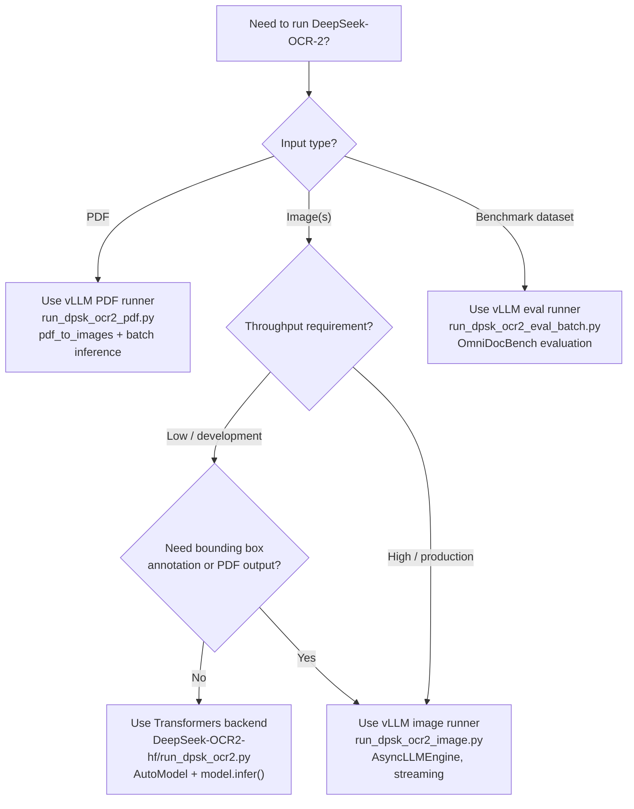
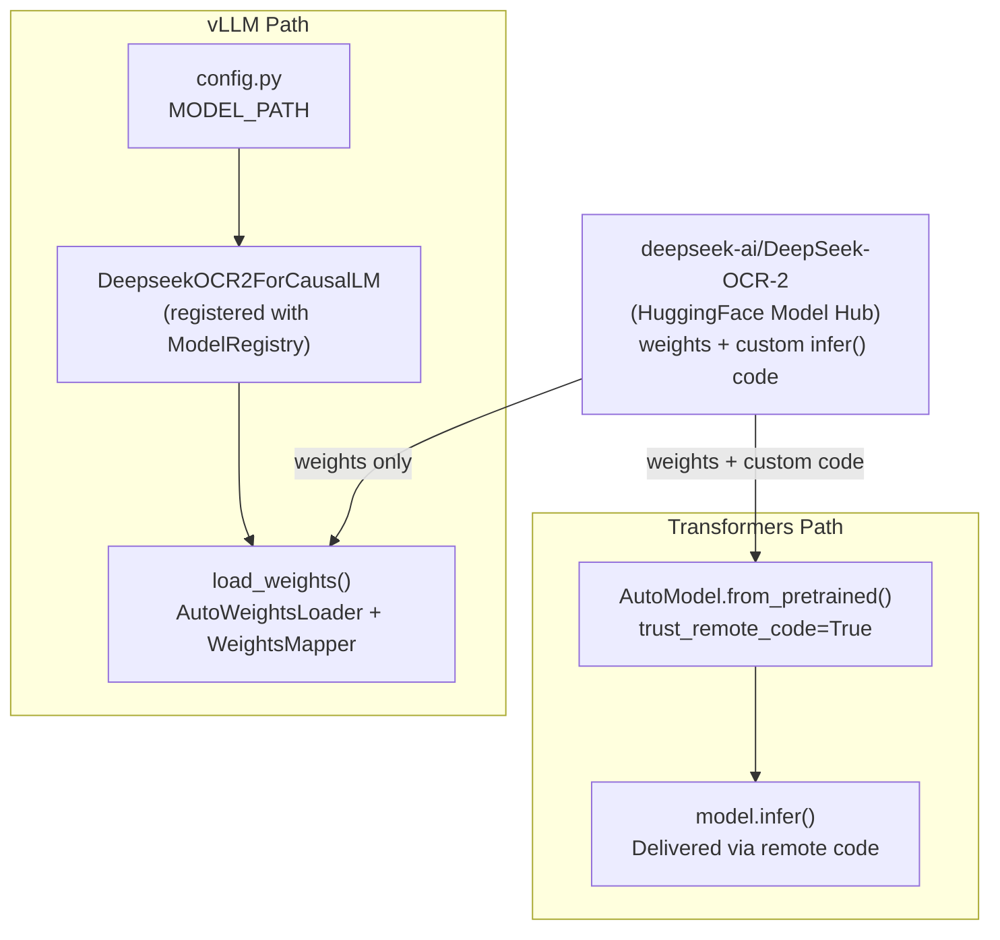

<!-- source: DeepWiki mcp.deepwiki.com · repo deepseek-ai/DeepSeek-OCR-2 · page 3 Inference Backends · fetched 2026-10-30 -->

# Inference Backends

<details>
<summary>Relevant source files</summary>

The following files were used as context for generating this wiki page:

- [README.md](README.md)

</details>


This page introduces the two inference paths available in DeepSeek-OCR-2 and explains when to use each. Both paths load from the same model checkpoint (`deepseek-ai/DeepSeek-OCR-2`) but differ significantly in throughput, configuration complexity, and feature set.

- For detailed parameter references, see the child pages: Transformers Inference ([3.1](#3.1)) and vLLM Inference ([3.2](#3.2)).
- For the underlying model architecture that both paths execute, see Core Architecture ([4](#4)).
- For image preprocessing details shared by both paths, see Dynamic Resolution System ([6](#6)).

---

## Overview

DeepSeek-OCR-2 ships two self-contained inference directories. They do not share runtime code with each other, but both depend on the same HuggingFace model repository for weights and the custom `infer()` method.

| Aspect | Transformers (`DeepSeek-OCR2-hf/`) | vLLM (`DeepSeek-OCR2-vllm/`) |
|---|---|---|
| Entry point | `run_dpsk_ocr2.py` | `run_dpsk_ocr2_image.py`, `run_dpsk_ocr2_pdf.py`, `run_dpsk_ocr2_eval_batch.py` |
| Engine | `AutoModel` via `transformers` | `LLM` / `AsyncLLMEngine` via `vllm` |
| Concurrency | Single image per call | Up to `MAX_CONCURRENCY=100` concurrent requests |
| PDF support | No | Yes (`run_dpsk_ocr2_pdf.py`) |
| Streaming output | No | Yes (`run_dpsk_ocr2_image.py`) |
| Bounding box annotation | No | Yes (grounding mode) |
| Configuration | Parameters passed to `model.infer()` | Centralized `config.py` |
| Attention backend | `flash_attention_2` required | vLLM manages internally |
| Primary use case | Development, single-document inference | Production serving, batch evaluation |

Sources: [README.md:86-129]()

---

## Repository Structure

**Directory layout for inference backends:**

```
DeepSeek-OCR2-hf/
└── run_dpsk_ocr2.py          ← Transformers entry point

DeepSeek-OCR2-vllm/
├── config.py                 ← Central configuration
├── run_dpsk_ocr2_image.py    ← Single image, async streaming
├── run_dpsk_ocr2_pdf.py      ← PDF batch inference
├── run_dpsk_ocr2_eval_batch.py  ← OmniDocBench evaluation
├── deepseek_ocr2.py          ← DeepseekOCR2ForCausalLM (vLLM plugin)
├── process/                  ← DeepseekOCR2Processor
└── deepencoderv2/            ← Vision encoder package
```

Sources: [README.md:86-129]()

---

## Backend Decision Flow

**Diagram: Choosing an Inference Backend**



Sources: [README.md:86-129]()

---

## Shared Model Checkpoint

Both backends load from the same source: `deepseek-ai/DeepSeek-OCR-2` on HuggingFace Hub.

- The Transformers path fetches weights and custom remote code (including the `infer()` method) via `AutoModel.from_pretrained(..., trust_remote_code=True)`.
- The vLLM path loads weights through `DeepseekOCR2ForCausalLM.load_weights()`, which maps HuggingFace weight names to vLLM sub-module names.

The `MODEL_PATH` constant in `config.py` (vLLM path) and the `model_name` variable in `run_dpsk_ocr2.py` (Transformers path) both reference `'deepseek-ai/DeepSeek-OCR-2'`.

**Diagram: Both Backends Share One Checkpoint**



Sources: [README.md:107-129]()

---

## Two Standard Prompts

Both backends support the same two prompt formats. The prompt controls the output mode.

| Mode | Prompt | Output |
|---|---|---|
| Document-to-Markdown | `<image>\n<|grounding|>Convert the document to markdown.` | Markdown with layout, `<|ref|>...<|det|>` bounding box tags |
| Free OCR | `<image>\nFree OCR. ` | Plain text, no layout structure |

The `<|grounding|>` token activates bounding box prediction. The vLLM path configures this via the `PROMPT` constant in `config.py`. The Transformers path passes it directly to `model.infer()`.

For a full explanation of special tokens and prompt formats, see Special Tokens ([7.1](#7.1)) and Task-Specific Prompts ([7.2](#7.2)).

Sources: [README.md:134-138]()

---

## Installation Requirements

Both backends share a common base installation. The vLLM backend requires the additional vLLM wheel.

```
# Common (both backends)
torch==2.6.0  torchvision==0.21.0  torchaudio==2.6.0  (CUDA 11.8)
requirements.txt
flash-attn==2.7.3  (required by Transformers backend; installed with --no-build-isolation)

# vLLM backend only
vllm-0.8.5+cu118 wheel (manual install from GitHub releases)
```

> **Note:** The `transformers>=4.51.1` version conflict reported during vLLM installation can be safely ignored when running both backends in the same environment. See [README.md:84]().

For full installation steps, see Installation ([2.1](#2.1)).

Sources: [README.md:64-84]()

---

