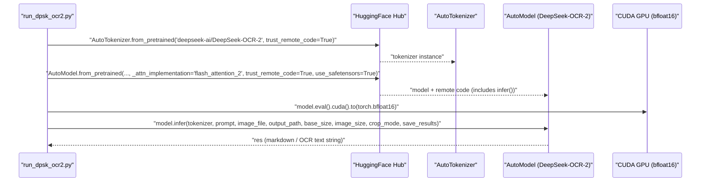
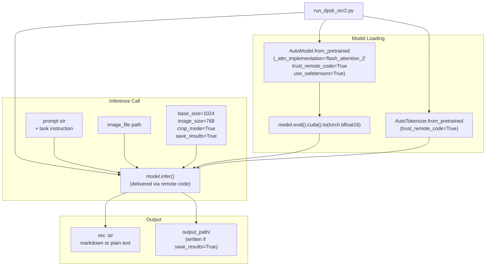

<!-- source: DeepWiki mcp.deepwiki.com · repo deepseek-ai/DeepSeek-OCR-2 · page 3.1 Transformers Inference · fetched 2026-10-30 -->

# Transformers Inference

<details>
<summary>Relevant source files</summary>

The following files were used as context for generating this wiki page:

- [DeepSeek-OCR2-master/DeepSeek-OCR2-hf/run_dpsk_ocr2.py](DeepSeek-OCR2-master/DeepSeek-OCR2-hf/run_dpsk_ocr2.py)
- [README.md](README.md)

</details>


This page documents the HuggingFace `transformers`-based inference path for DeepSeek-OCR-2. It covers model loading, setup, the `model.infer()` method signature and parameters, and the `run_dpsk_ocr2.py` entry point script.

This is the simpler of the two inference backends — it targets single-image, interactive use cases. For the high-throughput, batch-oriented path, see the vLLM Inference page ([3.2](#3.2)). For details on how the prompts are structured, see [7.2](#7.2).

---

## Overview

The transformers inference path loads the model through the standard HuggingFace `AutoModel` / `AutoTokenizer` API with `trust_remote_code=True`. The model repository (`deepseek-ai/DeepSeek-OCR-2`) ships custom Python code that is downloaded and executed locally, including the `infer()` method. No local model definition file is required beyond the runner script.

**Entry point:** [`DeepSeek-OCR2-master/DeepSeek-OCR2-hf/run_dpsk_ocr2.py`](DeepSeek-OCR2-master/DeepSeek-OCR2-hf/run_dpsk_ocr2.py)

---

## Call Flow

**Diagram: Transformers Inference Call Flow**



Sources: [`DeepSeek-OCR2-master/DeepSeek-OCR2-hf/run_dpsk_ocr2.py:1-25`](), [`README.md:107-124`]()

---

## Loading the Model

### AutoTokenizer

```
AutoTokenizer.from_pretrained(model_name, trust_remote_code=True)
```

- `model_name` is `'deepseek-ai/DeepSeek-OCR-2'` ([`run_dpsk_ocr2.py:8`]()).
- `trust_remote_code=True` is required because the tokenizer configuration lives in the remote repository.

### AutoModel

```
AutoModel.from_pretrained(
    model_name,
    _attn_implementation='flash_attention_2',
    trust_remote_code=True,
    use_safetensors=True
)
```

| Parameter | Value | Effect |
|---|---|---|
| `_attn_implementation` | `'flash_attention_2'` | Enables FlashAttention-2 in the language model layers. Requires `flash-attn==2.7.3`. |
| `trust_remote_code` | `True` | Allows the HuggingFace Hub to download and execute model-specific Python code, including the `infer()` method. |
| `use_safetensors` | `True` | Loads weights from `.safetensors` files rather than `.bin` pickle files. |

See [8.2](#8.2) for flash attention details, and [9.3](#9.3) for `trust_remote_code` implications.

### Device Setup

After loading, the model is moved to the GPU and cast to `bfloat16`:

[`DeepSeek-OCR2-master/DeepSeek-OCR2-hf/run_dpsk_ocr2.py:13`]()

```
model = model.eval().cuda().to(torch.bfloat16)
```

| Step | Method | Purpose |
|---|---|---|
| Disable gradients | `.eval()` | Puts model in inference mode; disables dropout. |
| Move to GPU | `.cuda()` | Defaults to the device specified by `CUDA_VISIBLE_DEVICES`. |
| Cast dtype | `.to(torch.bfloat16)` | Reduces memory footprint; bfloat16 is numerically stable for large language models. |

`CUDA_VISIBLE_DEVICES` is set to `'0'` at line [`run_dpsk_ocr2.py:6`]() to restrict to GPU 0. Adjust this to target different devices.

Sources: [`DeepSeek-OCR2-master/DeepSeek-OCR2-hf/run_dpsk_ocr2.py:1-13`](), [`README.md:108-116`]()

---

## The `model.infer()` Method

`infer()` is a custom method delivered by the remote model code (not part of the standard `transformers` `AutoModel` API). It wraps image preprocessing, tokenization, forward pass, and result saving into a single call.

### Method Signature

```
model.infer(
    tokenizer,
    prompt,
    image_file,
    output_path,
    base_size,
    image_size,
    crop_mode,
    save_results
)
```

### Parameters

| Parameter | Type | Example Value | Description |
|---|---|---|---|
| `tokenizer` | tokenizer object | (from `AutoTokenizer`) | The tokenizer instance loaded earlier. |
| `prompt` | `str` | `"<image>\n<|grounding|>Convert the document to markdown. "` | Instruction string including the `<image>` placeholder token. See [7.1](#7.1) and [7.2](#7.2). |
| `image_file` | `str` | `'your_image.jpg'` | Path to the input image file. |
| `output_path` | `str` | `'your/output/dir'` | Directory where output files are written when `save_results=True`. |
| `base_size` | `int` | `1024` | Resolution of the global thumbnail view (pixels). See [6.2](#6.2). |
| `image_size` | `int` | `768` | Resolution of each local crop tile (pixels). See [6.2](#6.2). |
| `crop_mode` | `bool` | `True` | Enables dynamic tiling (up to 6 local crops). Set to `False` for the global-view-only mode. |
| `save_results` | `bool` | `True` | If `True`, writes the result markdown/text to `output_path`. |

### Return Value

`infer()` returns `res`, a string containing the generated OCR output — either markdown (with grounding prompt) or plain text (with Free OCR prompt).

Sources: [`DeepSeek-OCR2-master/DeepSeek-OCR2-hf/run_dpsk_ocr2.py:17-25`](), [`README.md:118-123`]()

---

## Prompt Formats

Two standard prompts are used with this inference path:

| Mode | Prompt String | Output |
|---|---|---|
| Document-to-Markdown | `"<image>\n<|grounding|>Convert the document to markdown. "` | Structured markdown with layout, tables, formulas, and `<|ref|>`/`<|det|>` bounding box tags. |
| Free OCR | `"<image>\nFree OCR. "` | Plain text OCR without layout structure. |

The `<image>` token is the placeholder replaced by vision embeddings during the forward pass. See [7.1](#7.1) for full special token documentation.

Sources: [`DeepSeek-OCR2-master/DeepSeek-OCR2-hf/run_dpsk_ocr2.py:17-18`](), [`README.md:135-138`]()

---

## Component Map

**Diagram: Code Entities in the Transformers Inference Path**



Sources: [`DeepSeek-OCR2-master/DeepSeek-OCR2-hf/run_dpsk_ocr2.py:1-25`](), [`README.md:107-129`]()

---

## Running the Script

The full working example is in [`DeepSeek-OCR2-master/DeepSeek-OCR2-hf/run_dpsk_ocr2.py`](). Before running:

1. Set `image_file` to your input image path ([`run_dpsk_ocr2.py:19`]()).
2. Set `output_path` to your desired output directory ([`run_dpsk_ocr2.py:20`]()).
3. Select the appropriate `prompt` ([`run_dpsk_ocr2.py:17-18`]()).
4. Optionally adjust `CUDA_VISIBLE_DEVICES` ([`run_dpsk_ocr2.py:6`]()).

Then execute:

```
cd DeepSeek-OCR2-master/DeepSeek-OCR2-hf
python run_dpsk_ocr2.py
```

Sources: [`README.md:126-129`](), [`DeepSeek-OCR2-master/DeepSeek-OCR2-hf/run_dpsk_ocr2.py:1-25`]()

---

## Notes and Limitations

- **Single-image, synchronous**: This path processes one image per call with no concurrency support. For batch or PDF processing, use the vLLM path ([3.2](#3.2)).
- **`transformers` version conflict**: Installing `flash-attn==2.7.3` alongside vLLM 0.8.5 may raise a `transformers>=4.51.1` requirement error from vLLM. This error can be safely ignored if only using the transformers path. See [2.1](#2.1) for installation details.
- **`flash_attention_2` in vision encoder**: `flash_attention_2` is not supported in the `CustomQwen2Decoder` (part of the vision encoder). That component requires `sdpa` or `eager` attention. The `_attn_implementation='flash_attention_2'` flag applies only to the language model backbone layers. See [5.2](#5.2) and [8.2](#8.2).

Sources: [`README.md:64-84`]()

---

