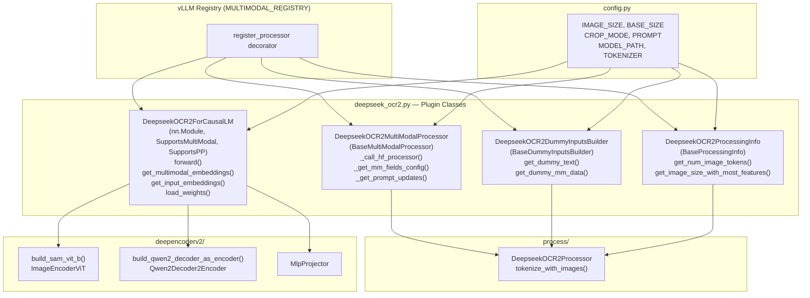
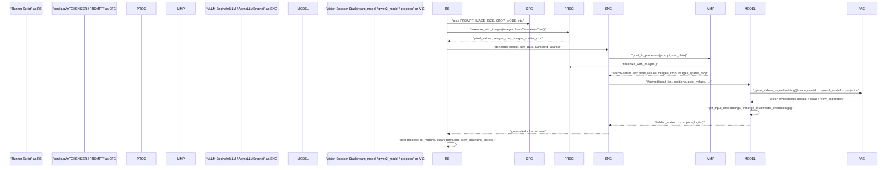
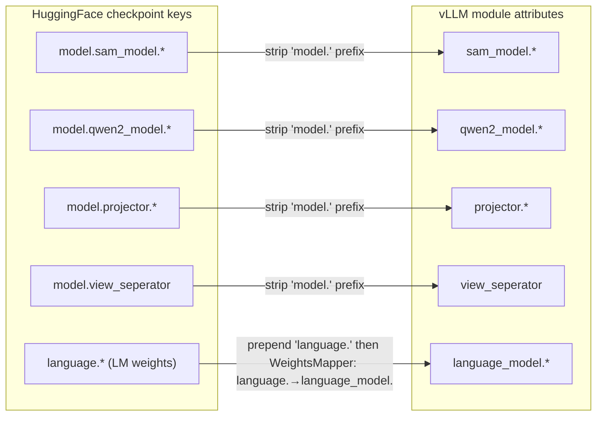

<!-- source: DeepWiki mcp.deepwiki.com · repo deepseek-ai/DeepSeek-OCR-2 · page 3.2 vLLM Inference · fetched 2026-10-30 -->

# vLLM Inference

<details>
<summary>Relevant source files</summary>

The following files were used as context for generating this wiki page:

- [DeepSeek-OCR2-master/DeepSeek-OCR2-vllm/config.py](DeepSeek-OCR2-master/DeepSeek-OCR2-vllm/config.py)
- [DeepSeek-OCR2-master/DeepSeek-OCR2-vllm/deepseek_ocr2.py](DeepSeek-OCR2-master/DeepSeek-OCR2-vllm/deepseek_ocr2.py)
- [README.md](README.md)

</details>


This page describes the vLLM-based inference path for DeepSeek-OCR-2: how the model is registered with vLLM, how configuration flows from `config.py` into the runner scripts, and how inputs are processed into outputs. It covers the shared model plugin (`deepseek_ocr2.py`) and the three runner scripts that sit on top of it.

- For the configuration parameters in detail, see [vLLM Configuration](#3.2.1).
- For the individual runner scripts and their post-processing steps, see [vLLM Entry Points](#3.2.2).
- For the Transformers-based inference path, see [Transformers Inference](#3.1).
- For the vision encoder internals, see [Vision Encoders](#5).

---

## Overview

The vLLM path is organized as a self-contained package under `DeepSeek-OCR2-master/DeepSeek-OCR2-vllm/`. It exposes a custom vLLM model plugin that wraps the vision encoder stack and a DeepSeek language model backend, plus three runner scripts that target different use cases.

| Script | Use Case | Engine Type |
|---|---|---|
| `run_dpsk_ocr2_image.py` | Single image, streaming output | `AsyncLLMEngine` |
| `run_dpsk_ocr2_pdf.py` | PDF batch processing | `LLM` (concurrent) |
| `run_dpsk_ocr2_eval_batch.py` | OmniDocBench evaluation | `LLM` + `ThreadPoolExecutor` |

All three share the same `config.py` values and the same `DeepseekOCR2ForCausalLM` model plugin.

Sources: [DeepSeek-OCR2-master/DeepSeek-OCR2-vllm/config.py:1-31](), [README.md:86-103]()

---

## vLLM Model Registration

The model is registered with vLLM's multimodal system via the `@MULTIMODAL_REGISTRY.register_processor` decorator. This is how vLLM learns to treat `DeepseekOCR2ForCausalLM` as a multimodal model capable of accepting image inputs.

**Registration decorator** — [DeepSeek-OCR2-master/DeepSeek-OCR2-vllm/deepseek_ocr2.py:260-264]():

```
@MULTIMODAL_REGISTRY.register_processor(
    DeepseekOCR2MultiModalProcessor,
    info=DeepseekOCR2ProcessingInfo,
    dummy_inputs=DeepseekOCR2DummyInputsBuilder)
class DeepseekOCR2ForCausalLM(nn.Module, SupportsMultiModal, SupportsPP):
```

The three classes passed to the decorator have distinct roles in the vLLM plugin system:

| Class | Base Class | Role |
|---|---|---|
| `DeepseekOCR2ProcessingInfo` | `BaseProcessingInfo` | Reports token counts, image size limits, and supported modalities to vLLM's scheduler |
| `DeepseekOCR2DummyInputsBuilder` | `BaseDummyInputsBuilder` | Generates synthetic inputs for vLLM's memory profiling pass |
| `DeepseekOCR2MultiModalProcessor` | `BaseMultiModalProcessor` | Calls `DeepseekOCR2Processor`, maps multimodal field configs, and handles prompt token replacement |

Sources: [DeepSeek-OCR2-master/DeepSeek-OCR2-vllm/deepseek_ocr2.py:53-263]()

---

## Component Relationship Diagram

**Diagram: vLLM Plugin Class Hierarchy and Data Flow**



Sources: [DeepSeek-OCR2-master/DeepSeek-OCR2-vllm/deepseek_ocr2.py:1-582](), [DeepSeek-OCR2-master/DeepSeek-OCR2-vllm/config.py:1-31]()

---

## Inference Flow

The following diagram traces a request from a raw image file through preprocessing, vLLM engine dispatch, and into the model's forward pass.

**Diagram: End-to-End vLLM Inference Flow**



Sources: [DeepSeek-OCR2-master/DeepSeek-OCR2-vllm/deepseek_ocr2.py:372-551](), [DeepSeek-OCR2-master/DeepSeek-OCR2-vllm/config.py:1-31]()

---

## DeepseekOCR2ForCausalLM — Model Plugin

`DeepseekOCR2ForCausalLM` is the central model class. It owns the three stages of the vision pipeline and delegates language modeling to one of the DeepSeek language model variants.

### Submodules

| Attribute | Created By | Type |
|---|---|---|
| `sam_model` | `build_sam_vit_b()` | `ImageEncoderViT` (SAM ViT-B) |
| `qwen2_model` | `build_qwen2_decoder_as_encoder()` | `Qwen2Decoder2Encoder` |
| `projector` | `MlpProjector(...)` | Linear projector, input dim 896 → 1280 |
| `language_model` | `init_vllm_registered_model(...)` | One of: `DeepseekV3ForCausalLM`, `DeepseekV2ForCausalLM`, `DeepseekForCausalLM` |
| `view_seperator` | `nn.Parameter(...)` | Learnable 1280-dim separator token appended between local and global features |

See [Language Model Variants](#4.4) for how `language_model` is selected based on `text_config`.

Sources: [DeepSeek-OCR2-master/DeepSeek-OCR2-vllm/deepseek_ocr2.py:270-338]()

### Key Methods

| Method | Signature | Role |
|---|---|---|
| `_parse_and_validate_image_input` | `(**kwargs) → list or None` | Extracts `pixel_values`, `images_crop`, `images_spatial_crop` from kwargs; returns `None` if no image is present |
| `_pixel_values_to_embedding` | `(pixel_values, images_crop, images_spatial_crop) → list[Tensor]` | Runs the three-stage vision pipeline per image; concatenates local features, global features, and `view_seperator` |
| `get_multimodal_embeddings` | `(**kwargs) → MultiModalEmbeddings or None` | Calls the above two methods in sequence |
| `get_input_embeddings` | `(input_ids, multimodal_embeddings) → Tensor` | Merges vision embeddings into the language model token stream at `<image>` token positions using `merge_multimodal_embeddings` |
| `forward` | `(input_ids, positions, ...) → hidden_states` | Orchestrates the full forward pass |
| `compute_logits` | `(hidden_states, sampling_metadata) → Tensor` | Delegates to `language_model.compute_logits()` |
| `load_weights` | `(weights) → Set[str]` | Remaps HuggingFace weight names to vLLM sub-module names; uses `AutoWeightsLoader` and `WeightsMapper` |

Sources: [DeepSeek-OCR2-master/DeepSeek-OCR2-vllm/deepseek_ocr2.py:341-582]()

---

## Image Token Placeholder Mechanism

The `<image>` token in the input prompt acts as a placeholder. During preprocessing, `DeepseekOCR2MultiModalProcessor._get_prompt_updates()` replaces each `<image>` token ID with a repeated sequence of `image_token_id` values whose length equals the computed visual token count for that image.

The token count is determined by `DeepseekOCR2ProcessingInfo.get_num_image_tokens()`, which uses `count_tiles()` to determine the tiling grid, then applies this formula:

```
global_tokens = ceil((BASE_SIZE / patch_size) / downsample_ratio) ^ 2   # = 256
local_tokens  = (num_height_tiles × h2) × (num_width_tiles × w2)        # = 0–864
total         = global_tokens + local_tokens + 1  (for view_seperator)
```

Where `patch_size = 16` and `downsample_ratio = 4`.

For details on the tiling logic, see [Global and Local Views](#6.2) and [Image Preprocessing](#6.1).

Sources: [DeepSeek-OCR2-master/DeepSeek-OCR2-vllm/deepseek_ocr2.py:53-116](), [DeepSeek-OCR2-master/DeepSeek-OCR2-vllm/deepseek_ocr2.py:193-232]()

---

## Weight Loading

`load_weights()` handles the mismatch between HuggingFace checkpoint key names and the vLLM sub-module layout:

- Weights whose names contain `sam_model`, `qwen2_model`, `projector`, or `view_seperator` have the leading `model.` prefix stripped.
- All other weights (the language model) are prefixed with `language.`.
- A `WeightsMapper` then converts `language.` → `language_model.` via `hf_to_vllm_mapper`.

**Diagram: Weight Name Remapping**



Sources: [DeepSeek-OCR2-master/DeepSeek-OCR2-vllm/deepseek_ocr2.py:562-582]()

---

## Configuration Summary

All runner scripts import their parameters from `config.py` at startup. The `TOKENIZER` instance is constructed eagerly at import time. See [vLLM Configuration](#3.2.1) for the full parameter reference.

| Parameter | Default | Purpose |
|---|---|---|
| `MODEL_PATH` | `'deepseek-ai/DeepSeek-OCR-2'` | Model checkpoint location |
| `PROMPT` | `'<image>\n<|grounding|>Convert the document to markdown.'` | Default inference prompt |
| `TOKENIZER` | `AutoTokenizer.from_pretrained(MODEL_PATH)` | Eagerly instantiated tokenizer |
| `BASE_SIZE` | `1024` | Global thumbnail resolution |
| `IMAGE_SIZE` | `768` | Local tile resolution |
| `CROP_MODE` | `True` | Enable dynamic tiling |
| `MIN_CROPS` | `2` | Minimum number of local tiles |
| `MAX_CROPS` | `6` | Maximum number of local tiles |
| `MAX_CONCURRENCY` | `100` | Maximum in-flight inference requests |
| `NUM_WORKERS` | `64` | CPU preprocessing thread count |
| `SKIP_REPEAT` | `True` | Skip already-processed outputs |

Sources: [DeepSeek-OCR2-master/DeepSeek-OCR2-vllm/config.py:1-31]()

---

