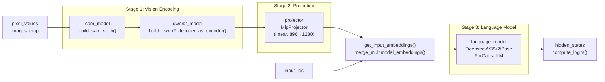
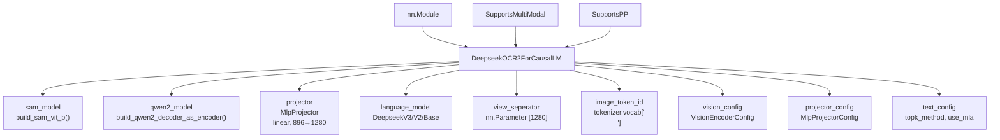
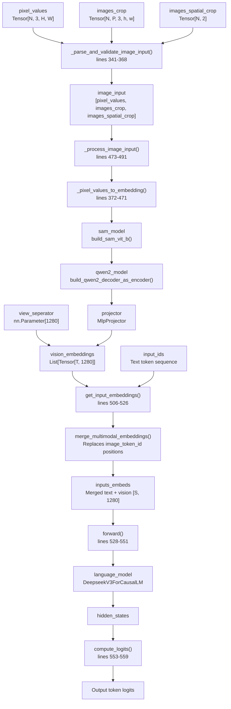
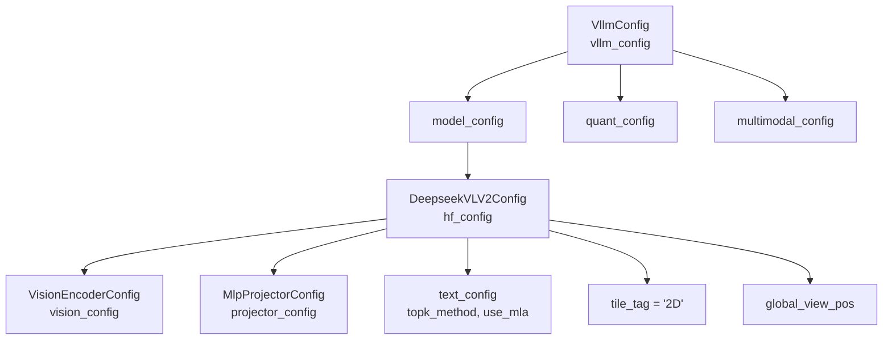
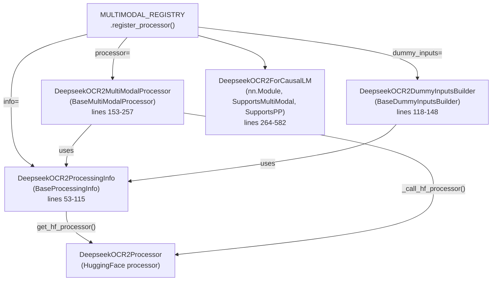
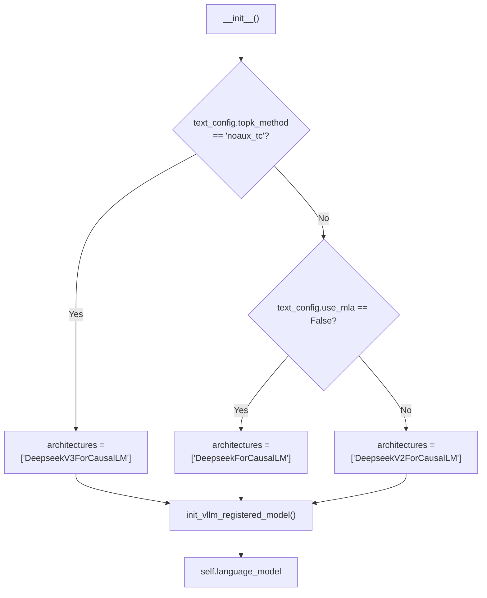

<!-- source: DeepWiki mcp.deepwiki.com · repo deepseek-ai/DeepSeek-OCR-2 · page 4.1 Model Overview · fetched 2026-10-30 -->

# Model Overview

<details>
<summary>Relevant source files</summary>

The following files were used as context for generating this wiki page:

- [DeepSeek-OCR2-master/DeepSeek-OCR2-vllm/__pycache__/deepseek_ocr2.cpython-312.pyc](DeepSeek-OCR2-master/DeepSeek-OCR2-vllm/__pycache__/deepseek_ocr2.cpython-312.pyc)
- [DeepSeek-OCR2-master/DeepSeek-OCR2-vllm/deepseek_ocr2.py](DeepSeek-OCR2-master/DeepSeek-OCR2-vllm/deepseek_ocr2.py)
- [README.md](README.md)

</details>


## Purpose and Scope

This page provides a high-level overview of the `DeepseekOCR2ForCausalLM` model architecture, including its three-stage pipeline (vision encoding → projection → language model), the vLLM registration system, and how the supporting processor classes fit together. For detailed information about specific components, see:

- Vision processing pipeline details: page 4.2
- Multimodal integration mechanics: page 4.3
- Language model variants and differences: page 4.4
- Individual vision encoder architectures: pages 5.1, 5.2, 5.3
</thinking>
</old_str>
<new_str>
## Purpose and Scope

This page provides a high-level overview of the `DeepseekOCR2ForCausalLM` model architecture, including its three-stage pipeline (vision encoding → projection → language model), the vLLM registration system, and how the supporting processor classes fit together. For detailed information about specific components, see:

- Vision processing pipeline details: page 4.2
- Multimodal integration mechanics: page 4.3
- Language model variants and differences: page 4.4
- Individual vision encoder architectures: pages 5.1, 5.2, 5.3

---

## Three-Stage Pipeline

`DeepseekOCR2ForCausalLM` ([DeepSeek-OCR2-master/DeepSeek-OCR2-vllm/deepseek_ocr2.py:264]()) is the primary model class. It implements a three-stage pipeline:

1. **Vision Encoding** — Two stacked encoders (`sam_model` → `qwen2_model`) extract and refine spatial and semantic features from image tiles.
2. **Projection** — `MlpProjector` maps 896-dimensional vision features into the language model's 1280-dimensional embedding space.
3. **Language Model** — A DeepSeek language model (V3, V2, or base) generates text conditioned on the merged vision + text embeddings.

The following diagram shows the three stages and their code-level identities:

**Diagram: Three-Stage Pipeline**



Sources: [DeepSeek-OCR2-master/DeepSeek-OCR2-vllm/deepseek_ocr2.py:264-340]()

---

## Model Architecture Overview

The `DeepseekOCR2ForCausalLM` class ([DeepSeek-OCR2-master/DeepSeek-OCR2-vllm/deepseek_ocr2.py:264]()) serves as the primary model implementation for OCR tasks. It inherits from `nn.Module`, `SupportsMultiModal`, and `SupportsPP`, providing a unified interface for multimodal processing with pipeline parallelism support.

### Core Components

The model consists of four major subsystems:

| Component | Attribute | Implementation | Dimensions | Purpose |
|-----------|-----------|---------------|------------|---------|
| Vision Encoder Stage 1 | `self.sam_model` | `build_sam_vit_b()` | Input → Features | Initial spatial feature extraction from images |
| Vision Encoder Stage 2 | `self.qwen2_model` | `build_qwen2_decoder_as_encoder()` | Features → Refined Features | Semantic feature refinement and contextualization |
| Feature Projector | `self.projector` | `MlpProjector` | 896 → 1280 | Aligns vision features to language model embedding space |
| Language Model | `self.language_model` | `init_vllm_registered_model()` | 1280 embeddings | Generates text output from multimodal embeddings |

Sources: [DeepSeek-OCR2-master/DeepSeek-OCR2-vllm/deepseek_ocr2.py:264-340]()

---

## Model Class Hierarchy

**Diagram: DeepseekOCR2ForCausalLM Internals**



Sources: [DeepSeek-OCR2-master/DeepSeek-OCR2-vllm/deepseek_ocr2.py:264-340]()

---

## Vision Encoder Stack

The model uses a two-stage vision encoding pipeline that progressively refines visual features:

### Stage 1: SAM-ViT-B Encoder

`self.sam_model` ([DeepSeek-OCR2-master/DeepSeek-OCR2-vllm/deepseek_ocr2.py:291]()) provides initial spatial feature extraction via a Vision Transformer (ViT-B) architecture originally from the SAM model family. It processes raw image tensors and outputs spatial feature maps used by the second stage.

### Stage 2: Qwen2 Decoder-as-Encoder

`self.qwen2_model` ([DeepSeek-OCR2-master/DeepSeek-OCR2-vllm/deepseek_ocr2.py:292]()) applies learned query embeddings to the SAM feature maps to produce dense visual embeddings. Despite being a decoder architecture, it is used purely for feature refinement here (the "Visual Causal Flow" concept referenced in the paper). See page 5.2 for details on its hybrid attention mechanism.

### Processing Flow

The two-stage pipeline ([DeepSeek-OCR2-master/DeepSeek-OCR2-vllm/deepseek_ocr2.py:398-411]()) runs identically for both local crops and the global view:

```
patches / image_ori
    → sam_model(...)        → features_1
    → qwen2_model(...)      → features_2
    → projector(...)        → features (1280-dim)
```

Sources: [DeepSeek-OCR2-master/DeepSeek-OCR2-vllm/deepseek_ocr2.py:291-292](), [DeepSeek-OCR2-master/DeepSeek-OCR2-vllm/deepseek_ocr2.py:398-411]()

---

## Feature Projection

### MLP Projector Configuration

`self.projector` ([DeepSeek-OCR2-master/DeepSeek-OCR2-vllm/deepseek_ocr2.py:295]()) bridges vision and language embedding spaces. It is instantiated with:

- `projector_type = "linear"` — direct linear transformation
- `input_dim = 896` — output dimension from `qwen2_model`
- `n_embed = 1280` — input dimension expected by the language model

The `MlpProjector` class supports 8 projector variants (see page 5.3 for details). The `"linear"` type is the configuration used by the released checkpoint.

Sources: [DeepSeek-OCR2-master/DeepSeek-OCR2-vllm/deepseek_ocr2.py:294-295]()

---

## Language Model Integration

### Architecture Selection

The language model is selected dynamically based on configuration parameters ([DeepSeek-OCR2-master/DeepSeek-OCR2-vllm/deepseek_ocr2.py:317-323]()):

| Condition | Selected Architecture |
|-----------|----------------------|
| `text_config.topk_method == "noaux_tc"` | `DeepseekV3ForCausalLM` |
| `not text_config.use_mla` | `DeepseekForCausalLM` |
| Default (`use_mla == True`) | `DeepseekV2ForCausalLM` |

The released `deepseek-ai/DeepSeek-OCR-2` checkpoint uses `DeepseekV3ForCausalLM`. See page 4.4 for documentation of all three variants.

### Language Model Initialization

`self.language_model` is initialized via `init_vllm_registered_model()` ([DeepSeek-OCR2-master/DeepSeek-OCR2-vllm/deepseek_ocr2.py:325-330]()), which delegates to vLLM's internal model registry. The `"language"` prefix is applied so that weight names like `language.model.*` are resolved correctly.

`make_empty_intermediate_tensors` is delegated to the language model, enabling pipeline parallelism ([DeepSeek-OCR2-master/DeepSeek-OCR2-vllm/deepseek_ocr2.py:332-333]()).

Sources: [DeepSeek-OCR2-master/DeepSeek-OCR2-vllm/deepseek_ocr2.py:317-333]()

---

## Special Token Handling

### View Separator Token

`self.view_seperator` is a learnable `nn.Parameter` of shape `[1280]` ([DeepSeek-OCR2-master/DeepSeek-OCR2-vllm/deepseek_ocr2.py:311]()). It marks the boundary between local tile features and the global thumbnail features in the embedding sequence. It is appended via `torch.cat` at the end of each image's embedding list ([DeepSeek-OCR2-master/DeepSeek-OCR2-vllm/deepseek_ocr2.py:442](), [DeepSeek-OCR2-master/DeepSeek-OCR2-vllm/deepseek_ocr2.py:467]()).

The separator is initialized to small random values scaled by `1 / sqrt(n_embed)` to match the typical embedding scale.

### Image Token ID

`self.image_token_id` ([DeepSeek-OCR2-master/DeepSeek-OCR2-vllm/deepseek_ocr2.py:289]()) is resolved from `tokenizer.vocab["<image>"]` at initialization. This ID marks positions in the token sequence where vision embeddings are to be spliced in by `merge_multimodal_embeddings()`.

`_IMAGE_TOKEN = "<image>"` is defined at module level ([DeepSeek-OCR2-master/DeepSeek-OCR2-vllm/deepseek_ocr2.py:50]()).

Sources: [DeepSeek-OCR2-master/DeepSeek-OCR2-vllm/deepseek_ocr2.py:50](), [DeepSeek-OCR2-master/DeepSeek-OCR2-vllm/deepseek_ocr2.py:289](), [DeepSeek-OCR2-master/DeepSeek-OCR2-vllm/deepseek_ocr2.py:311](), [DeepSeek-OCR2-master/DeepSeek-OCR2-vllm/deepseek_ocr2.py:442-467]()

---

## Data Flow Through Model

**Diagram: Full Inference Data Flow (DeepseekOCR2ForCausalLM)**



Sources: [DeepSeek-OCR2-master/DeepSeek-OCR2-vllm/deepseek_ocr2.py:341-559]()

---

## Model Configuration

### Configuration Hierarchy

**Diagram: vllm_config → DeepseekVLV2Config Hierarchy**



### Key Configuration Parameters

The model extracts configuration values during `__init__` ([DeepSeek-OCR2-master/DeepSeek-OCR2-vllm/deepseek_ocr2.py:273-297]()):

| Parameter | Source | Effect |
|-----------|--------|--------|
| `config.vision_config` | `DeepseekVLV2Config` | Vision encoder configuration |
| `config.projector_config` | `DeepseekVLV2Config` | Projector configuration |
| `config.text_config` | `DeepseekVLV2Config` | Language model selection |
| `config.tile_tag` | `DeepseekVLV2Config` | Must be `"2D"`; raises `ValueError` otherwise |
| `config.global_view_pos` | `DeepseekVLV2Config` | Positioning of global vs local view embeddings |
| `text_config.topk_method` | `text_config` | Selects `DeepseekV3ForCausalLM` if `"noaux_tc"` |
| `text_config.use_mla` | `text_config` | Selects `DeepseekV2ForCausalLM` if `True` |

Sources: [DeepSeek-OCR2-master/DeepSeek-OCR2-vllm/deepseek_ocr2.py:270-297]()

---

## Weight Loading Strategy

### Weight Name Mapping

`hf_to_vllm_mapper` ([DeepSeek-OCR2-master/DeepSeek-OCR2-vllm/deepseek_ocr2.py:266-268]()) translates HuggingFace checkpoint names to vLLM internal names:

```
"language.*"  →  "language_model.*"
```

### Custom Loading Logic in `load_weights()`

`load_weights()` ([DeepSeek-OCR2-master/DeepSeek-OCR2-vllm/deepseek_ocr2.py:562-582]()) applies two transformations before passing weights to `AutoWeightsLoader`:

| Weight name contains | Transformation |
|----------------------|----------------|
| `sam_model`, `qwen2_model`, `projector`, `view_seperator` | Strip `"model."` prefix (once) |
| Everything else (language model) | Prepend `"language."` prefix |

After renaming, `AutoWeightsLoader.load_weights()` is called with `mapper=self.hf_to_vllm_mapper` to apply the final prefix substitution. This allows loading directly from HuggingFace safetensors checkpoints without manual weight surgery. See page 9.2 for full details.

Sources: [DeepSeek-OCR2-master/DeepSeek-OCR2-vllm/deepseek_ocr2.py:266-268](), [DeepSeek-OCR2-master/DeepSeek-OCR2-vllm/deepseek_ocr2.py:562-582]()

---

## Key Methods

### Embedding Generation

| Method | Lines | Purpose |
|--------|-------|---------|
| `_parse_and_validate_image_input()` | [341-368]() | Pops `pixel_values`, `images_spatial_crop`, `images_crop` from kwargs; returns `None` if no image data |
| `_pixel_values_to_embedding()` | [372-471]() | Runs each image through `sam_model` → `qwen2_model` → `projector`; concatenates local + global + `view_seperator` |
| `_process_image_input()` | [473-491]() | Applies dtype conversions; delegates to `_pixel_values_to_embedding()` |
| `get_multimodal_embeddings()` | [496-502]() | Public entry point: calls `_parse_and_validate_image_input()` then `_process_image_input()` |
| `get_input_embeddings()` | [506-526]() | Fetches text embeddings from `language_model`; calls `merge_multimodal_embeddings()` to splice vision at `<image>` positions |

### Forward Pass

| Method | Lines | Purpose |
|--------|-------|---------|
| `forward()` | [528-551]() | Orchestrates full pass; calls `get_multimodal_embeddings()` + `get_input_embeddings()` then delegates to `language_model` |
| `compute_logits()` | [553-559]() | Delegates to `language_model.compute_logits()` |

### Model Access

| Method | Lines | Purpose |
|--------|-------|---------|
| `get_language_model()` | [493-494]() | Returns `self.language_model` |
| `make_empty_intermediate_tensors` | [332-333]() | Alias for `language_model.make_empty_intermediate_tensors` |

Sources: [DeepSeek-OCR2-master/DeepSeek-OCR2-vllm/deepseek_ocr2.py:341-559]()

---

## vLLM Registration System

The model integrates with vLLM's multimodal processing system through a decorator registration ([DeepSeek-OCR2-master/DeepSeek-OCR2-vllm/deepseek_ocr2.py:260-263]()) that binds three auxiliary classes to `DeepseekOCR2ForCausalLM`:

**Diagram: vLLM Registration Class Relationships**



### Class Roles

| Class | Base Class | Role |
|-------|-----------|------|
| `DeepseekOCR2MultiModalProcessor` | `BaseMultiModalProcessor` | Calls `DeepseekOCR2Processor`, produces `pixel_values`, `images_spatial_crop`, `images_crop` fields; handles prompt token replacement for `<image>` |
| `DeepseekOCR2ProcessingInfo` | `BaseProcessingInfo` | Computes per-image visual token counts (`get_num_image_tokens()`), returns max feature image size, declares support for unlimited images |
| `DeepseekOCR2DummyInputsBuilder` | `BaseDummyInputsBuilder` | Generates dummy text and image data used by vLLM's profiler to estimate memory requirements |

### `DeepseekOCR2ProcessingInfo` Key Methods

`DeepseekOCR2ProcessingInfo` ([DeepSeek-OCR2-master/DeepSeek-OCR2-vllm/deepseek_ocr2.py:53-115]()) provides information vLLM needs to plan memory and token budgets:

| Method | What it returns |
|--------|----------------|
| `get_hf_config()` | The `DeepseekVLV2Config` config object |
| `get_hf_processor()` | A `DeepseekOCR2Processor` instance |
| `get_supported_mm_limits()` | `{"image": None}` — unlimited images supported |
| `get_num_image_tokens()` | Integer token count for an image of given width/height, using `count_tiles()` to determine tiling |
| `get_image_size_with_most_features()` | `ImageSize` representing the maximum resolution used for profiling |

### `DeepseekOCR2MultiModalProcessor` Key Methods

`DeepseekOCR2MultiModalProcessor` ([DeepSeek-OCR2-master/DeepSeek-OCR2-vllm/deepseek_ocr2.py:153-257]()) bridges HuggingFace preprocessing with vLLM's batching system:

| Method | Role |
|--------|------|
| `_call_hf_processor()` | Calls `DeepseekOCR2Processor` when images present; falls back to tokenizer-only for text |
| `_get_mm_fields_config()` | Declares `pixel_values`, `images_spatial_crop`, `images_crop` as batched image fields |
| `_get_prompt_updates()` | Replaces each `<image>` token with `num_image_tokens` repetitions of `image_token_id` |
| `_cached_apply_hf_processor()` | Disables caching for requests with more than 2 images |

### `DeepseekOCR2DummyInputsBuilder`

`DeepseekOCR2DummyInputsBuilder` ([DeepSeek-OCR2-master/DeepSeek-OCR2-vllm/deepseek_ocr2.py:118-148]()) implements two methods:

- `get_dummy_text()` — Returns a string of `<image>` tokens (one per image slot)
- `get_dummy_mm_data()` — Calls `DeepseekOCR2Processor().tokenize_with_images()` with maximum-size dummy images to profile peak memory usage

Sources: [DeepSeek-OCR2-master/DeepSeek-OCR2-vllm/deepseek_ocr2.py:53-263]()

---

## Model Variants and Architecture Selection

**Diagram: Language Model Variant Selection**



| Architecture | Condition | Notes |
|-------------|-----------|-------|
| `DeepseekV3ForCausalLM` | `topk_method == "noaux_tc"` | Released checkpoint uses this |
| `DeepseekForCausalLM` | `use_mla == False` | Standard attention, no MLA |
| `DeepseekV2ForCausalLM` | Default (`use_mla == True`) | Multi-head Latent Attention |

Sources: [DeepSeek-OCR2-master/DeepSeek-OCR2-vllm/deepseek_ocr2.py:317-330]()

---

## Dtype Management

The model enforces specific data types for different components:

### Vision Components

The SAM model is explicitly cast to `bfloat16` after initialization ([deepseek_ocr2.py:337]()):

```python
self.sam_model.to(dtype=torch.bfloat16)
```

### Processing Conversions

During inference, tensors are converted as needed:
- Input pixel values: converted to `bfloat16` ([deepseek_ocr2.py:390](), [deepseek_ocr2.py:479]())
- Spatial crop information: converted to `long` (int64) ([deepseek_ocr2.py:484]())
- Image crop tensors: processed with minimal conversion ([deepseek_ocr2.py:482]())

This mixed-precision approach balances computational efficiency (bfloat16 for vision) with precision requirements (int64 for indices).

**Sources:** [deepseek_ocr2.py:337](), [deepseek_ocr2.py:390](), [deepseek_ocr2.py:479-484]()

---

