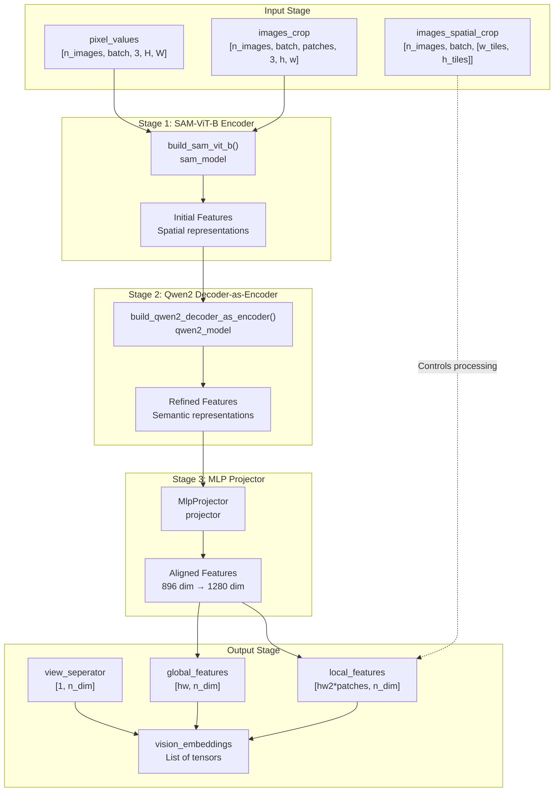
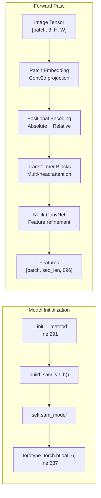
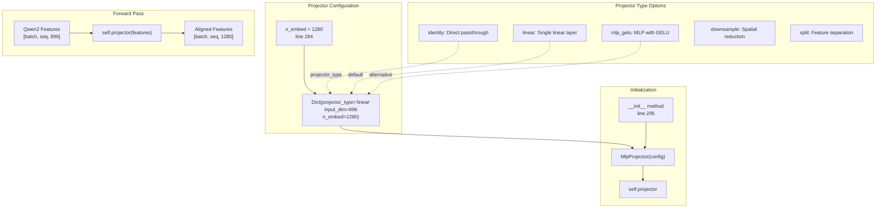
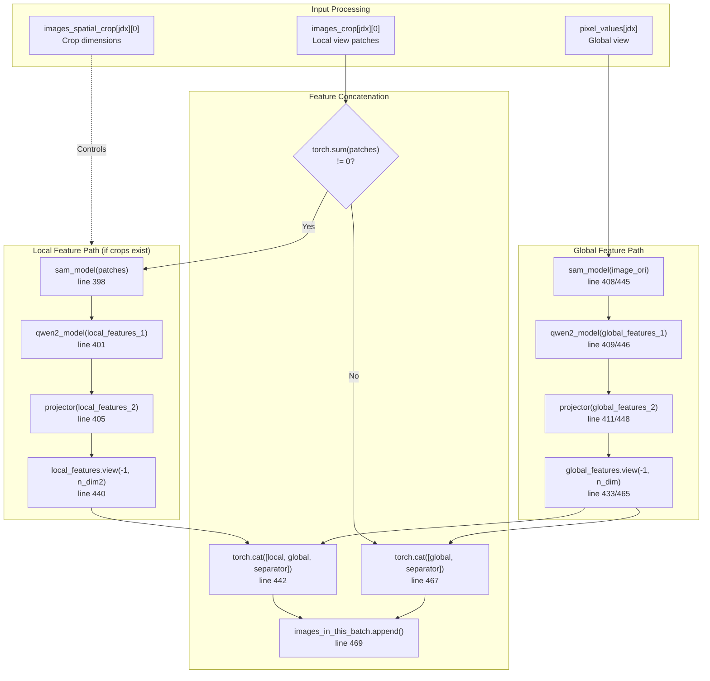
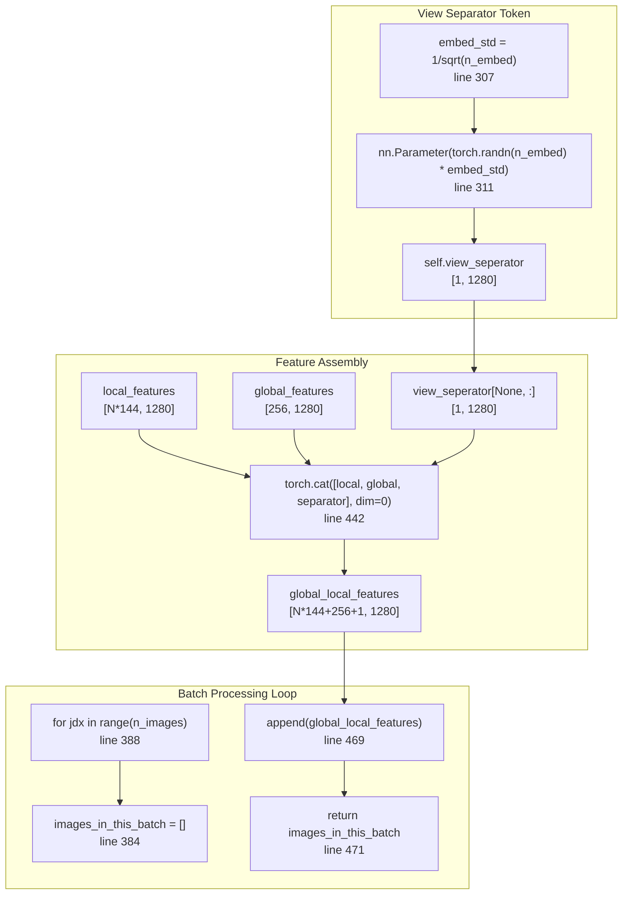
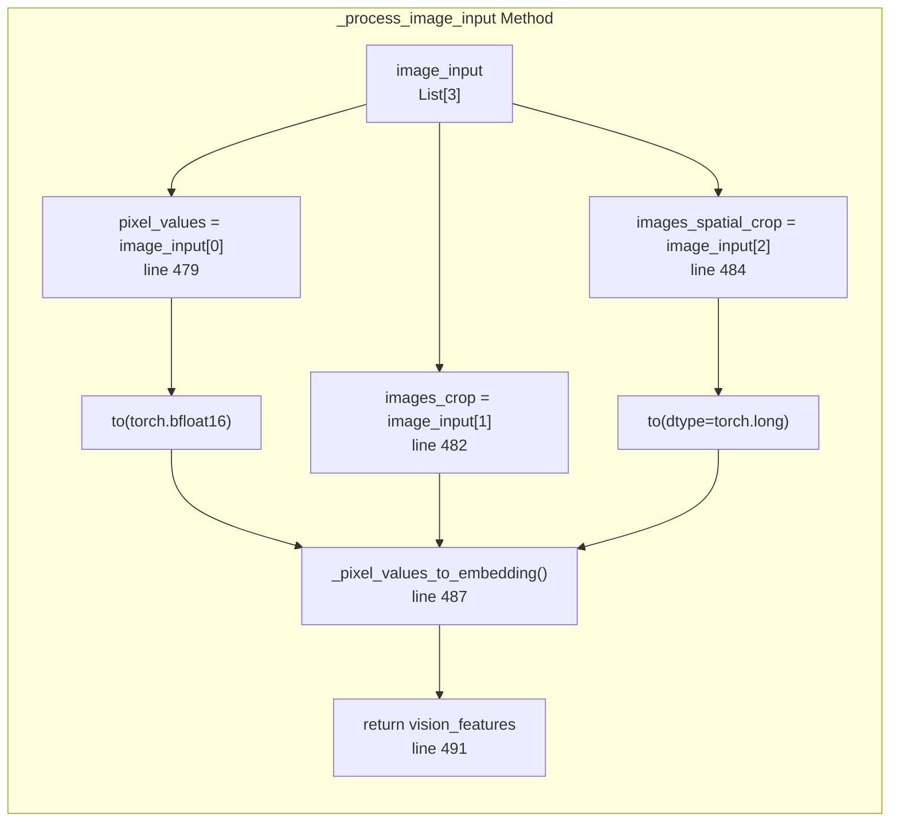

<!-- source: DeepWiki mcp.deepwiki.com · repo deepseek-ai/DeepSeek-OCR-2 · page 4.2 Vision Processing Pipeline · fetched 2026-10-30 -->

# Vision Processing Pipeline

<details>
<summary>Relevant source files</summary>

The following files were used as context for generating this wiki page:

- [DeepSeek-OCR2-master/DeepSeek-OCR2-vllm/__pycache__/deepseek_ocr2.cpython-312.pyc](DeepSeek-OCR2-master/DeepSeek-OCR2-vllm/__pycache__/deepseek_ocr2.cpython-312.pyc)
- [DeepSeek-OCR2-master/DeepSeek-OCR2-vllm/deepencoderv2/__init__.py](DeepSeek-OCR2-master/DeepSeek-OCR2-vllm/deepencoderv2/__init__.py)
- [DeepSeek-OCR2-master/DeepSeek-OCR2-vllm/deepseek_ocr2.py](DeepSeek-OCR2-master/DeepSeek-OCR2-vllm/deepseek_ocr2.py)

</details>


## Purpose and Scope

This document describes the complete vision processing pipeline in DeepSeek-OCR-2, from raw pixel values through multi-stage encoding to final vision embeddings that can be integrated with the language model. The pipeline transforms images into feature representations through three sequential stages: SAM-ViT-B encoding, Qwen2 decoder-as-encoder refinement, and MLP projection.

For information about dynamic resolution and multi-crop processing that feeds into this pipeline, see [Dynamic Resolution System](#6). For details on how vision embeddings are merged with text tokens, see [Multimodal Integration](#4.3). For detailed architecture specifications of individual encoder components, see [Vision Encoders](#5).

**Sources:** [DeepSeek-OCR2-master/DeepSeek-OCR2-vllm/deepseek_ocr2.py:1-583]()

---

## Pipeline Overview

The vision processing pipeline consists of three sequential encoding stages that progressively refine visual features before they are integrated with the language model.



**Core Pipeline Flow**: `_pixel_values_to_embedding` method

The pipeline is invoked through the `_pixel_values_to_embedding` method which processes each image independently and returns a list of vision embedding tensors.

| Stage | Component | Input Dimension | Output Dimension | Purpose |
|-------|-----------|-----------------|------------------|---------|
| 1 | `sam_model` | [batch, 3, H, W] | [batch, seq, 896] | Spatial feature extraction |
| 2 | `qwen2_model` | [batch, seq, 896] | [batch, seq, 896] | Semantic feature refinement |
| 3 | `projector` | [batch, seq, 896] | [batch, seq, 1280] | Alignment to language model dimension |

**Sources:** [DeepSeek-OCR2-master/DeepSeek-OCR2-vllm/deepseek_ocr2.py:372-471]()

---

## Stage 1: SAM-ViT-B Encoder

The first stage uses a Segment Anything Model (SAM) Vision Transformer with Base configuration to extract initial visual features from pixel values.



**Initialization**: The SAM model is instantiated during `DeepseekOCR2ForCausalLM.__init__` and immediately converted to `bfloat16` precision for memory efficiency.

```python
# Model initialization [line 291]
self.sam_model = build_sam_vit_b()

# Precision conversion [line 337]
self.sam_model.to(dtype=torch.bfloat16)
```

**Usage in Pipeline**: The SAM encoder is called directly on pixel values to extract initial spatial features. Both global views (base image) and local views (crops) are processed through the same encoder.

```python
# Processing global features [line 408]
global_features_1 = self.sam_model(image_ori)

# Processing local features [line 398]
local_features_1 = self.sam_model(patches)
```

**Key Characteristics**:
- **Architecture**: Vision Transformer with Base configuration from SAM
- **Output Dimension**: 896-dimensional features per spatial token
- **Precision**: bfloat16 for reduced memory footprint
- **Scope**: Extracts low-level spatial representations

**Sources:** [DeepSeek-OCR2-master/DeepSeek-OCR2-vllm/deepseek_ocr2.py:291](), [DeepSeek-OCR2-master/DeepSeek-OCR2-vllm/deepseek_ocr2.py:337](), [DeepSeek-OCR2-master/DeepSeek-OCR2-vllm/deepseek_ocr2.py:398-408]()

---

## Stage 2: Qwen2 Decoder-as-Encoder

The second stage uses a Qwen2 decoder architecture repurposed as an encoder to refine the spatial features from SAM into more semantic representations.


**Initialization**: The Qwen2 decoder-as-encoder is built using the `build_qwen2_decoder_as_encoder()` function.

```python
# Model initialization [line 292]
self.qwen2_model = build_qwen2_decoder_as_encoder()
```

**Architectural Innovation**: This component repurposes a decoder architecture as an encoder by using hybrid attention mechanisms. Token type IDs distinguish between image tokens (bidirectional attention) and query tokens (causal attention), allowing the model to extract information from spatial features iteratively.

**Usage in Pipeline**: The Qwen2 model refines features from the SAM encoder, processing both global and local features.

```python
# Refining local features [line 401]
local_features_2 = self.qwen2_model(local_features_1)

# Refining global features [line 409]
global_features_2 = self.qwen2_model(global_features_1)
```

**Key Characteristics**:
- **Input/Output Dimension**: 896 (preserves SAM output dimension)
- **Layers**: 24 decoder layers with 896 hidden dimensions
- **Attention**: Hybrid bidirectional/causal attention mechanism
- **Purpose**: Transforms spatial features into semantic representations

**Sources:** [DeepSeek-OCR2-master/DeepSeek-OCR2-vllm/deepseek_ocr2.py:292](), [DeepSeek-OCR2-master/DeepSeek-OCR2-vllm/deepseek_ocr2.py:401](), [DeepSeek-OCR2-master/DeepSeek-OCR2-vllm/deepseek_ocr2.py:409]()

---

## Stage 3: MLP Projector

The final stage projects the refined 896-dimensional features to the language model's embedding dimension (1280) using a configurable MLP projector.



**Configuration**: The projector is configured with a linear projection type that maps from 896 dimensions (Qwen2 output) to 1280 dimensions (language model input).

```python
# Projector initialization [lines 294-295]
n_embed = 1280
self.projector = MlpProjector(Dict(projector_type="linear", 
                                   input_dim=896, 
                                   n_embed=n_embed))
```

**Usage in Pipeline**: The projector is applied to both global and local features after they have been refined by the Qwen2 model.

```python
# Projecting local features [line 405]
local_features = self.projector(local_features_2)

# Projecting global features [line 411]
global_features = self.projector(global_features_2)
```

**Projector Types**: While the default configuration uses `"linear"`, the `MlpProjector` class supports 8 different architecture variants:
- `identity`: Direct passthrough
- `linear`: Single linear transformation
- `mlp_gelu`: Multi-layer perceptron with GELU activation
- `downsample`: Includes spatial downsampling
- `split`: Processes high/low frequency features separately
- Additional fusion variants for multi-resolution processing

**Key Characteristics**:
- **Dimension Transformation**: 896 → 1280
- **Default Type**: Linear projection
- **Purpose**: Aligns vision features to language model embedding space
- **Flexibility**: Supports multiple projection architectures

**Sources:** [DeepSeek-OCR2-master/DeepSeek-OCR2-vllm/deepseek_ocr2.py:294-295](), [DeepSeek-OCR2-master/DeepSeek-OCR2-vllm/deepseek_ocr2.py:405](), [DeepSeek-OCR2-master/DeepSeek-OCR2-vllm/deepseek_ocr2.py:411]()

---

## Global and Local Feature Processing

The pipeline processes images at two resolutions: a global view (base image) and multiple local views (crops), processing each independently through all three stages.



**Conditional Processing**: The pipeline checks whether local crops exist by testing if `torch.sum(patches).item() != 0`. If crops exist, both paths are executed; otherwise, only the global path is used.

**Processing Logic**:

1. **With Crops** [lines 395-442]():
   - Process patches through SAM → Qwen2 → Projector
   - Process base image through SAM → Qwen2 → Projector
   - Flatten both to [seq_len, dim]
   - Concatenate: `[local_features, global_features, view_seperator]`

2. **Without Crops** [lines 444-467]():
   - Process only base image through SAM → Qwen2 → Projector
   - Flatten to [seq_len, dim]
   - Concatenate: `[global_features, view_seperator]`

**Feature Dimensions**:

| Feature Type | Source | Typical Shape | Notes |
|--------------|--------|---------------|-------|
| Global features | Base image (1024×1024) | [256, 1280] | 16×16 grid after downsampling |
| Local features | Crops (768×768 each) | [144×N, 1280] | 12×12 grid per crop, N crops |
| View separator | Learnable parameter | [1, 1280] | Marks boundary between views |

**Sources:** [DeepSeek-OCR2-master/DeepSeek-OCR2-vllm/deepseek_ocr2.py:387-471]()

---

## Feature Concatenation and Output

The final step concatenates processed features with a special view separator token before returning the complete vision embeddings.



**View Separator Token**: A learnable parameter initialized with random values scaled by the embedding standard deviation. This token serves as a boundary marker between local and global features.

```python
# View separator initialization [lines 307-311]
embed_std = 1 / torch.sqrt(torch.tensor(n_embed, dtype=torch.float32))
self.view_seperator = nn.Parameter(torch.randn(n_embed) * embed_std)
```

**Concatenation Order**: Features are concatenated in the order: local features → global features → view separator. This ordering places detailed local information first, followed by broader context, and finally the separator token.

**Batch Processing**: The pipeline processes each image in the batch independently within a `torch.no_grad()` context and accumulates results in a list.

```python
# Batch iteration [lines 384-471]
images_in_this_batch = []
with torch.no_grad():
    for jdx in range(images_spatial_crop.size(0)):
        # ... process single image ...
        images_in_this_batch.append(global_local_features)
return images_in_this_batch
```

**Output Format**:
- **Type**: `List[torch.Tensor]`
- **Length**: Number of images in batch
- **Element Shape**: Variable `[total_tokens, 1280]` where:
  - `total_tokens` = local_tokens + global_tokens + 1 (separator)
  - Typical range: 257 tokens (no crops) to 1121 tokens (6 crops)

**Debug Output**: When `PRINT_NUM_VIS_TOKENS` is enabled, the pipeline prints feature shapes for debugging.

```python
# Debug printing [lines 413-417]
if PRINT_NUM_VIS_TOKENS:
    print('=====================')
    print('BASE: ', global_features.shape)
    print('PATCHES: ', local_features.shape)
    print('=====================')
```

**Sources:** [DeepSeek-OCR2-master/DeepSeek-OCR2-vllm/deepseek_ocr2.py:307-311](), [DeepSeek-OCR2-master/DeepSeek-OCR2-vllm/deepseek_ocr2.py:384-471](), [DeepSeek-OCR2-master/DeepSeek-OCR2-vllm/deepseek_ocr2.py:413-417]()

---

## Pipeline Entry Point

The vision processing pipeline is accessed through the `_process_image_input` method, which serves as the main entry point and handles input format conversion.



**Input Format**: The `image_input` parameter is a list containing three tensors produced by preprocessing:
1. `pixel_values`: Base images `[n_images, batch, 3, H, W]`
2. `images_crop`: Local crop patches `[n_images, batch, patches, 3, h, w]`
3. `images_spatial_crop`: Crop dimensions `[n_images, batch, [w_tiles, h_tiles]]`

**Type Conversions**: The method performs necessary type conversions before invoking the pipeline:
- `pixel_values`: Converted to `torch.bfloat16` for precision
- `images_spatial_crop`: Converted to `torch.long` for indexing operations
- `images_crop`: Used directly without conversion

**Method Signature**:
```python
def _process_image_input(self, image_input) -> torch.Tensor:
    # [lines 473-491]
```

**Invocation Chain**: This method is called by `get_multimodal_embeddings`, which is in turn called during the forward pass to extract vision features for multimodal fusion.

**Sources:** [DeepSeek-OCR2-master/DeepSeek-OCR2-vllm/deepseek_ocr2.py:473-491]()

---

