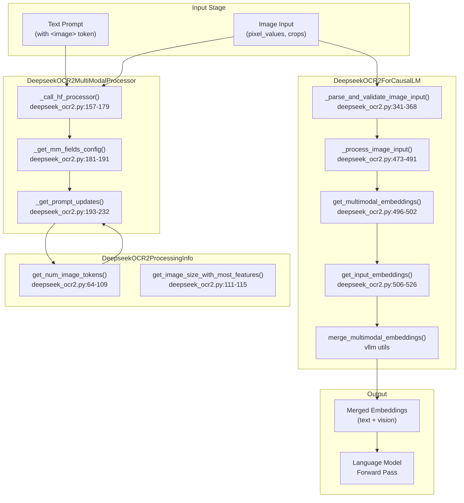
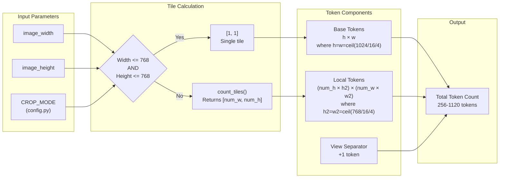
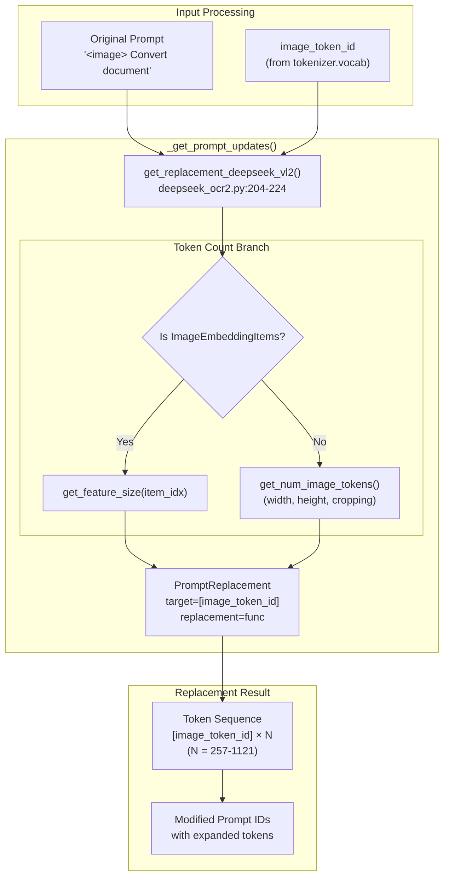
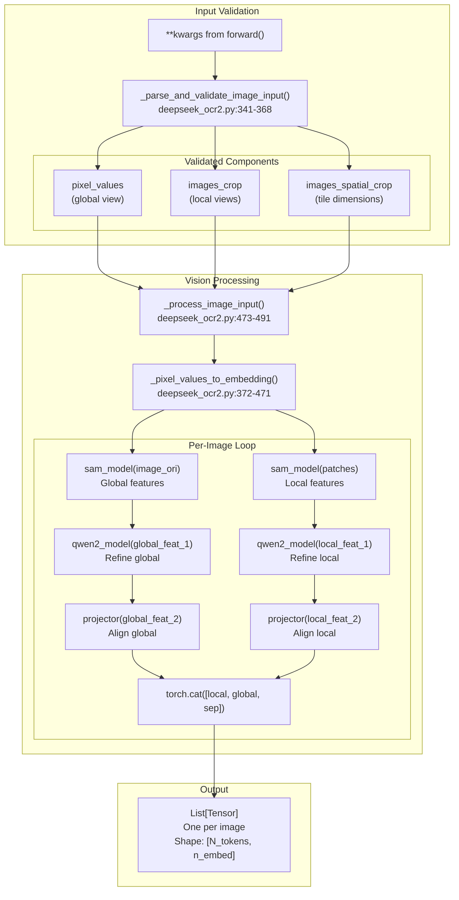
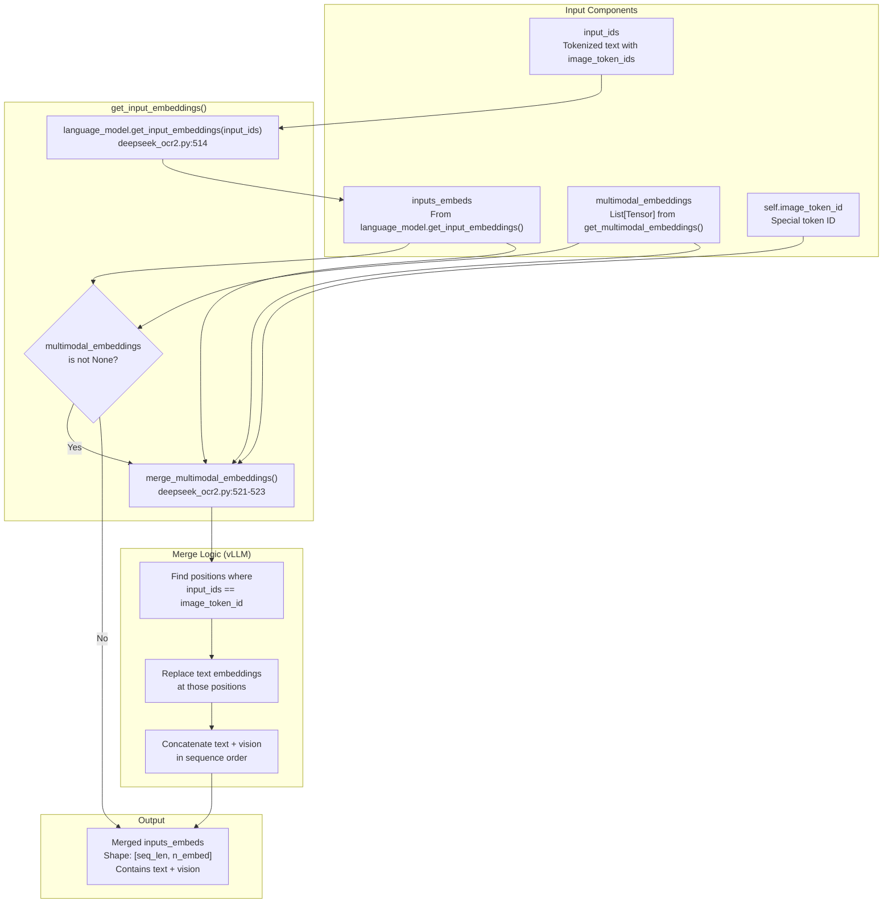
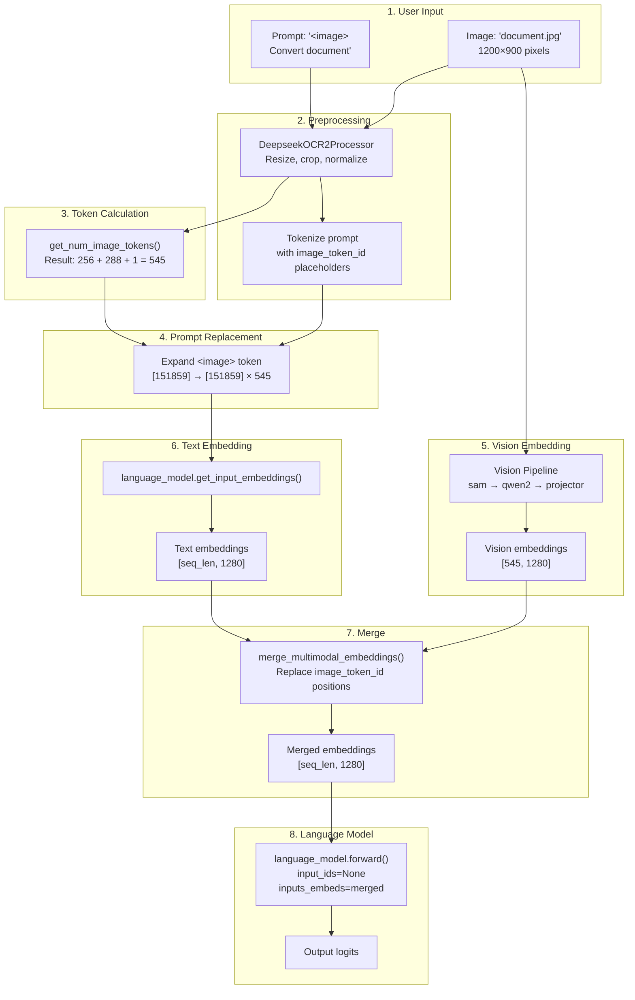

<!-- source: DeepWiki mcp.deepwiki.com · repo deepseek-ai/DeepSeek-OCR-2 · page 4.3 Multimodal Integration · fetched 2026-10-30 -->

# Multimodal Integration

<details>
<summary>Relevant source files</summary>

The following files were used as context for generating this wiki page:

- [DeepSeek-OCR2-master/DeepSeek-OCR2-vllm/__pycache__/deepseek_ocr.cpython-312.pyc](DeepSeek-OCR2-master/DeepSeek-OCR2-vllm/__pycache__/deepseek_ocr.cpython-312.pyc)
- [DeepSeek-OCR2-master/DeepSeek-OCR2-vllm/__pycache__/deepseek_ocr2.cpython-312.pyc](DeepSeek-OCR2-master/DeepSeek-OCR2-vllm/__pycache__/deepseek_ocr2.cpython-312.pyc)
- [DeepSeek-OCR2-master/DeepSeek-OCR2-vllm/deepseek_ocr2.py](DeepSeek-OCR2-master/DeepSeek-OCR2-vllm/deepseek_ocr2.py)

</details>


## Purpose and Scope

This document describes how DeepSeek-OCR-2 integrates vision and language modalities by merging vision embeddings with text embeddings at runtime. The integration process involves three primary operations: (1) calculating dynamic token counts based on image dimensions, (2) replacing `<image>` placeholder tokens with variable-length vision token sequences, and (3) merging vision embeddings into the text embedding stream before language model processing.

For information about the vision processing pipeline that produces these embeddings, see [Vision Processing Pipeline](#4.2). For details on the language models that consume the merged embeddings, see [Language Model Variants](#4.4). For prompt engineering techniques using special tokens, see [Prompt Engineering](#7).

---

## Multimodal Integration Architecture

The multimodal integration system consists of three interconnected components that transform raw image and text inputs into a unified embedding sequence for language model processing.



**Sources**: [DeepSeek-OCR2-master/DeepSeek-OCR2-vllm/deepseek_ocr2.py:53-583]()

---

## Dynamic Token Count Calculation

The system calculates the exact number of vision tokens needed for each image based on its dimensions and cropping configuration. This count determines how many token positions the single `<image>` placeholder will occupy after replacement.

### Token Count Formula

The `get_num_image_tokens()` method in `DeepseekOCR2ProcessingInfo` implements the dynamic token calculation:



| Resolution Type | Size | Patch Size | Downsample Ratio | Formula | Token Count |
|----------------|------|------------|------------------|---------|-------------|
| Base (global) | 1024×1024 | 16 | 4 | `ceil(1024/16/4) × ceil(1024/16/4)` | 256 |
| Local crop | 768×768 | 16 | 4 | `ceil(768/16/4) × ceil(768/16/4)` | 144 per crop |
| View separator | N/A | N/A | N/A | Constant | 1 |

**Calculation Logic** [deepseek_ocr2.py:64-109]():

1. **Base tokens** (line 98-102): Always 256 tokens from 1024×1024 global view
2. **Local tokens** (line 100-106): 144 tokens per crop tile, 0-6 crops depending on image dimensions
3. **View separator** (line 109): Single token separating global and local features

Total range: `256 + 1 = 257` (no crops) to `256 + (6 × 144) + 1 = 1121` (maximum crops)

**Sources**: [DeepSeek-OCR2-master/DeepSeek-OCR2-vllm/deepseek_ocr2.py:64-109](), [DeepSeek-OCR2-master/DeepSeek-OCR2-vllm/config.py]()

---

## Prompt Replacement Mechanism

The `DeepseekOCR2MultiModalProcessor` replaces each `<image>` token in the prompt with the calculated number of vision tokens before language model processing.

### Replacement Flow



**Key Implementation Details** [deepseek_ocr2.py:193-232]():

1. **Target identification** (line 229): The `PromptReplacement` targets the `image_token_id`
2. **Replacement function** (line 204-224): `get_replacement_deepseek_vl2()` generates token sequence
3. **Dynamic sizing** (line 215-223): Extracts image dimensions from `ImageProcessorItems` or uses pre-computed embeddings
4. **Token generation** (line 224): Returns list of `image_token_id` repeated N times

The replacement transforms:
```
"<image>\nConvert document"  →  [151859, 151859, ..., 151859, 198, 29369, ...]
                                  ↑_________ N tokens _________↑
```

**Sources**: [DeepSeek-OCR2-master/DeepSeek-OCR2-vllm/deepseek_ocr2.py:193-232]()

---

## Vision Embedding Extraction

Before merging can occur, the model extracts vision embeddings from preprocessed image data through the vision pipeline.

### Embedding Extraction Pipeline



**Embedding Structure** [deepseek_ocr2.py:432-467]():

Each image produces a concatenated feature tensor:

| Component | Source | Shape | Description |
|-----------|--------|-------|-------------|
| Local features | Lines 398-405, 440 | `[num_crops × 144, n_embed]` | Flattened crop embeddings |
| Global features | Lines 408-411, 433 | `[256, n_embed]` | Flattened base embeddings |
| View separator | Lines 311, 442, 467 | `[1, n_embed]` | `self.view_seperator` parameter |

**Processing Path** [deepseek_ocr2.py:387-471]():

1. **Batch iteration** (line 388): Loop over `images_spatial_crop.size(0)` images
2. **Crop detection** (line 395): Check if `torch.sum(patches) != 0` to detect crops
3. **Dual-path processing**:
   - **With crops** (lines 398-442): Process both local crops and global view
   - **Without crops** (lines 445-467): Process only global view
4. **Concatenation** (line 442 or 467): Combine features with view separator
5. **Batch collection** (line 469): Append to `images_in_this_batch` list

**Sources**: [DeepSeek-OCR2-master/DeepSeek-OCR2-vllm/deepseek_ocr2.py:341-491]()

---

## Embedding Merge Process

The final integration step merges vision embeddings into the text embedding sequence at positions corresponding to `<image>` tokens.

### Merge Implementation



**Merge Execution** [deepseek_ocr2.py:506-526]():

The `get_input_embeddings()` method orchestrates the merge:

1. **Text embedding extraction** (line 514):
   ```python
   inputs_embeds = self.language_model.get_input_embeddings(input_ids)
   ```

2. **Vision embedding insertion** (lines 518-523):
   ```python
   if multimodal_embeddings is not None:
       inputs_embeds = merge_multimodal_embeddings(
           input_ids, inputs_embeds, multimodal_embeddings,
           self.image_token_id)
   ```

3. **Result**: Single tensor with vision features replacing `image_token_id` positions

**Example Merge Scenario**:

```
Input sequence:     [BOS] [IMG] [IMG] ... [IMG] \n Convert document [EOS]
                     ^     ^________________^    ^_____________________^
                     |            257 tokens              Text tokens
                     
Text embeddings:    [1×E] [257×E (placeholder)] [N×E (text)]
Vision embeddings:  [257×E (actual features)]

Merged result:      [1×E] [257×E (vision)] [N×E (text)]
```

**Sources**: [DeepSeek-OCR2-master/DeepSeek-OCR2-vllm/deepseek_ocr2.py:506-526]()

---

## View Separator Token

The view separator is a learnable parameter that marks the boundary between concatenated vision features in the embedding sequence.

### Separator Initialization

[deepseek_ocr2.py:307-315]():

```python
embed_std = 1 / torch.sqrt(torch.tensor(n_embed, dtype=torch.float32))
if self.tile_tag == "2D":
    self.view_seperator = nn.Parameter(torch.randn(n_embed) * embed_std)
```

| Property | Value | Location |
|----------|-------|----------|
| Initialization | `torch.randn(n_embed) * embed_std` | Line 311 |
| Shape | `[n_embed]` (1280-dimensional) | Line 311 |
| Type | `nn.Parameter` (trainable) | Line 311 |
| Tile tag | "2D" (required) | Line 308-314 |

**Concatenation Points**:

- **With crops** [deepseek_ocr2.py:442]():
  ```python
  global_local_features = torch.cat([local_features, global_features, self.view_seperator[None, :]], dim=0)
  ```
  Structure: `[local_crops_features | global_features | view_separator]`

- **Without crops** [deepseek_ocr2.py:467]():
  ```python
  global_local_features = torch.cat([global_features, self.view_seperator[None, :]], dim=0)
  ```
  Structure: `[global_features | view_separator]`

The separator's learned embedding allows the language model to distinguish between different views of the same image in the feature sequence.

**Sources**: [DeepSeek-OCR2-master/DeepSeek-OCR2-vllm/deepseek_ocr2.py:307-315](), [DeepSeek-OCR2-master/DeepSeek-OCR2-vllm/deepseek_ocr2.py:442](), [DeepSeek-OCR2-master/DeepSeek-OCR2-vllm/deepseek_ocr2.py:467]()

---

## End-to-End Integration Flow

The complete multimodal integration process from user input to language model forward pass.



**Key Method Invocations**:

| Step | Method | File Location | Purpose |
|------|--------|---------------|---------|
| 1 | `model.infer()` | [run_dpsk_ocr2.py:25]() | Entry point |
| 2 | `_call_hf_processor()` | [deepseek_ocr2.py:157-179]() | Preprocess inputs |
| 3 | `get_num_image_tokens()` | [deepseek_ocr2.py:64-109]() | Calculate token count |
| 4 | `_get_prompt_updates()` | [deepseek_ocr2.py:193-232]() | Replace tokens |
| 5 | `get_multimodal_embeddings()` | [deepseek_ocr2.py:496-502]() | Extract vision features |
| 6 | `get_input_embeddings()` | [deepseek_ocr2.py:506-526]() | Merge embeddings |
| 7 | `forward()` | [deepseek_ocr2.py:528-551]() | Language model processing |

**Sources**: [DeepSeek-OCR2-master/DeepSeek-OCR2-hf/run_dpsk_ocr2.py:1-25](), [DeepSeek-OCR2-master/DeepSeek-OCR2-vllm/deepseek_ocr2.py:53-583]()

---

## Configuration Parameters

The multimodal integration behavior is controlled by several configuration parameters that affect token counting and processing modes.

### Integration-Related Parameters

| Parameter | Default | Location | Effect |
|-----------|---------|----------|--------|
| `IMAGE_SIZE` | 768 | [config.py]() | Local crop size; affects token calculation (line 76, 100) |
| `BASE_SIZE` | 1024 | [config.py]() | Global view size; affects token calculation (line 77, 98) |
| `CROP_MODE` | True | [config.py]() | Enables multi-crop processing (line 81-96) |
| `PRINT_NUM_VIS_TOKENS` | False | [config.py]() | Debug output for token counts (lines 413-417, 450-454) |
| `image_token` | `"<image>"` | Tokenizer | Placeholder in prompts |
| `image_token_id` | 151859 | Tokenizer | Token ID for replacement (line 289) |

**Token Count Examples**:

| Configuration | Image Size | Crops | Token Count |
|--------------|-----------|-------|-------------|
| `CROP_MODE=False` | Any | 0 | 256 + 1 = 257 |
| `CROP_MODE=True` | 768×768 | 0 | 256 + 1 = 257 |
| `CROP_MODE=True` | 1536×1024 | 2×1 | 256 + 288 + 1 = 545 |
| `CROP_MODE=True` | 2304×1536 | 3×2 | 256 + 864 + 1 = 1121 |

**Sources**: [DeepSeek-OCR2-master/DeepSeek-OCR2-vllm/config.py](), [DeepSeek-OCR2-master/DeepSeek-OCR2-vllm/deepseek_ocr2.py:48-50](), [DeepSeek-OCR2-master/DeepSeek-OCR2-vllm/deepseek_ocr2.py:76-109]()

---

## Implementation Notes

### Type Conversions

The integration pipeline involves multiple dtype conversions to ensure compatibility:

- **Input images** [deepseek_ocr2.py:479](): Converted to `torch.bfloat16` for vision processing
- **Vision models** [deepseek_ocr2.py:337](): SAM model operates in `torch.bfloat16`
- **Embeddings**: Maintain `torch.bfloat16` through merge operation
- **Spatial crops** [deepseek_ocr2.py:484](): Converted to `torch.long` for indexing

### Memory Management

[deepseek_ocr2.py:387-471]():

Vision processing uses `torch.no_grad()` context (line 387) to prevent gradient computation during embedding extraction, reducing memory usage during inference.

### Batch Processing

[deepseek_ocr2.py:388]():

The current implementation processes images sequentially within a batch (`for jdx in range(...)`), with each image producing a separate tensor in the output list. The vLLM framework handles batching at a higher level.

**Sources**: [DeepSeek-OCR2-master/DeepSeek-OCR2-vllm/deepseek_ocr2.py:337](), [DeepSeek-OCR2-master/DeepSeek-OCR2-vllm/deepseek_ocr2.py:387-491]()

---

