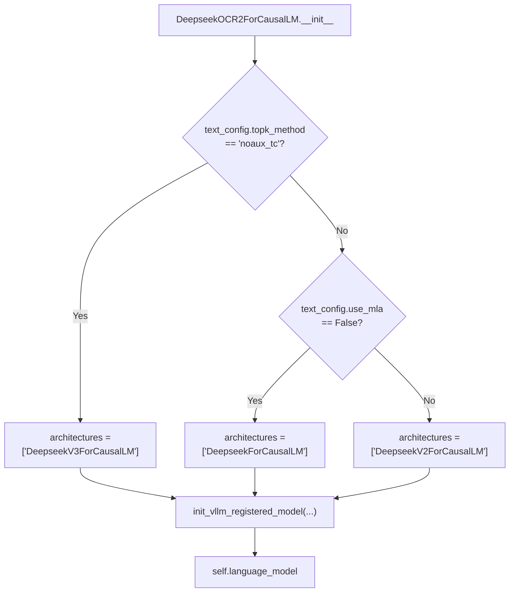
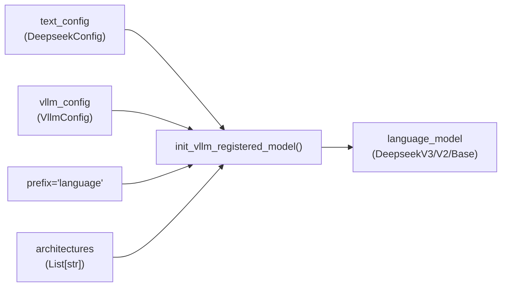
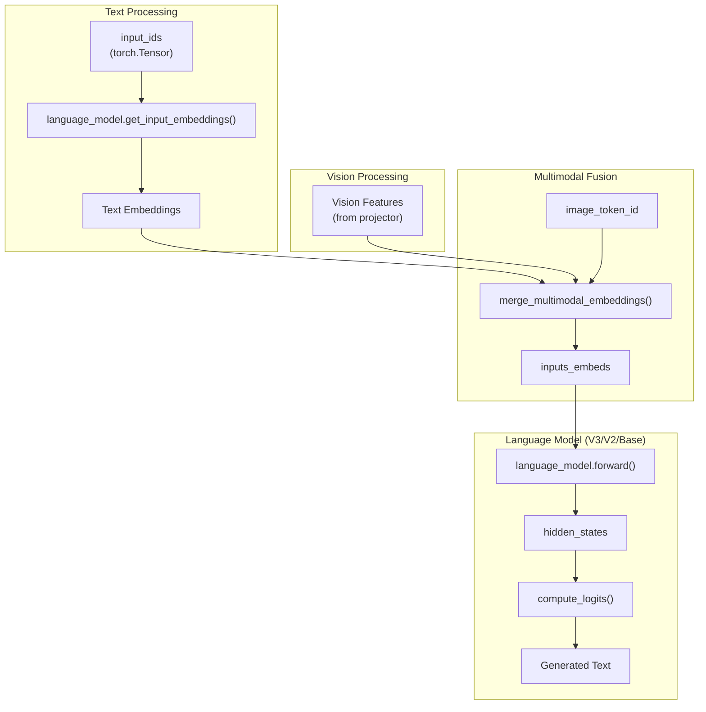
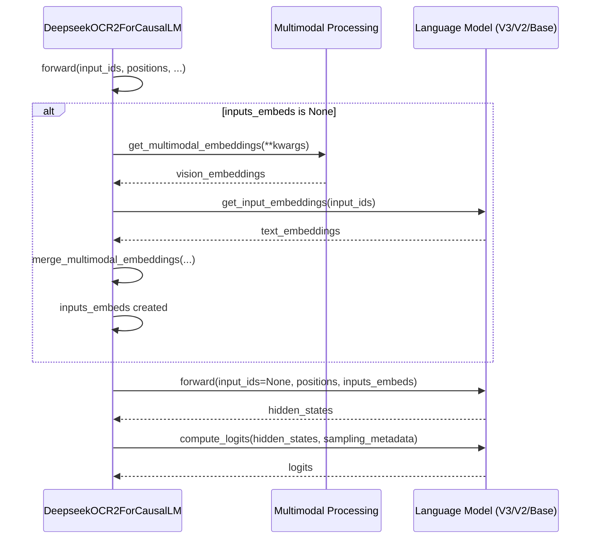
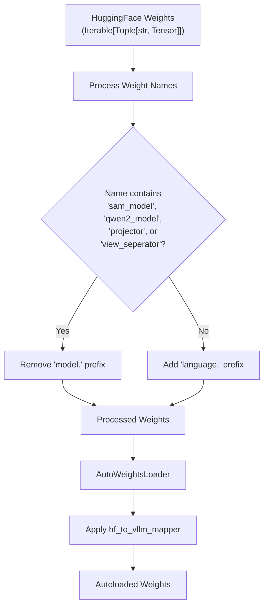

<!-- source: DeepWiki mcp.deepwiki.com · repo deepseek-ai/DeepSeek-OCR-2 · page 4.4 Language Model Variants · fetched 2026-10-30 -->

# Language Model Variants

<details>
<summary>Relevant source files</summary>

The following files were used as context for generating this wiki page:

- [DeepSeek-OCR2-master/DeepSeek-OCR2-vllm/__pycache__/deepseek_ocr2.cpython-312.pyc](DeepSeek-OCR2-master/DeepSeek-OCR2-vllm/__pycache__/deepseek_ocr2.cpython-312.pyc)
- [DeepSeek-OCR2-master/DeepSeek-OCR2-vllm/deepseek_ocr2.py](DeepSeek-OCR2-master/DeepSeek-OCR2-vllm/deepseek_ocr2.py)

</details>


## Purpose and Scope

This document describes the three language model architectures supported by DeepSeek-OCR-2: `DeepseekV3ForCausalLM`, `DeepseekV2ForCausalLM`, and `DeepseekForCausalLM`. These variants represent different generations of the Deepseek language model family, each with distinct architectural features. The system automatically selects the appropriate variant based on configuration parameters at model initialization.

For information about how vision features are processed before reaching the language model, see [Vision Processing Pipeline](#4.2). For details on how vision and text embeddings are merged, see [Multimodal Integration](#4.3).

**Sources:** [DeepSeek-OCR2-master/DeepSeek-OCR2-vllm/deepseek_ocr2.py:317-330]()

## Architecture Selection Logic

The DeepSeek-OCR-2 system determines which language model architecture to instantiate based on two configuration parameters from `text_config`:

| Configuration Parameter | Value | Selected Architecture |
|------------------------|-------|----------------------|
| `text_config.topk_method` | `"noaux_tc"` | `DeepseekV3ForCausalLM` |
| `text_config.use_mla` | `False` | `DeepseekForCausalLM` |
| (default) | Any other combination | `DeepseekV2ForCausalLM` |

The selection logic is implemented in the `DeepseekOCR2ForCausalLM.__init__` method:



**Sources:** [DeepSeek-OCR2-master/DeepSeek-OCR2-vllm/deepseek_ocr2.py:317-330]()

## Language Model Initialization

All three language model variants are instantiated through the same initialization process using `init_vllm_registered_model`. This function dynamically loads the appropriate architecture from vLLM's model registry based on the `architectures` parameter.



The initialization parameters are:
- `vllm_config`: The main vLLM configuration containing model and quantization settings
- `hf_config`: Set to `self.text_config`, which contains architecture-specific configurations
- `prefix`: Set to `"language"` via `maybe_prefix(prefix, "language")` for proper weight mapping
- `architectures`: A list containing the selected architecture name

**Sources:** [DeepSeek-OCR2-master/DeepSeek-OCR2-vllm/deepseek_ocr2.py:325-330]()

## DeepseekV3ForCausalLM

`DeepseekV3ForCausalLM` is the most recent architecture variant, selected when `text_config.topk_method == "noaux_tc"`. This architecture represents the latest generation of the Deepseek language model family.

### Key Characteristics

- **Selection Condition:** Activated when `topk_method` configuration is set to `"noaux_tc"` (no auxiliary token classification)
- **Architecture Name:** `"DeepseekV3ForCausalLM"`
- **Use Case:** Latest-generation model with advanced attention mechanisms

The "noaux_tc" (no auxiliary token classification) method indicates a specific approach to top-k routing or attention mechanisms that differentiates V3 from earlier versions.

**Sources:** [DeepSeek-OCR2-master/DeepSeek-OCR2-vllm/deepseek_ocr2.py:317-319]()

## DeepseekV2ForCausalLM

`DeepseekV2ForCausalLM` represents the second-generation architecture and is selected as the default when neither the V3 condition (`topk_method == "noaux_tc"`) nor the base condition (`use_mla == False`) is met.

### Key Characteristics

- **Selection Condition:** Default architecture when `use_mla == True` and `topk_method != "noaux_tc"`
- **Architecture Name:** `"DeepseekV2ForCausalLM"`
- **MLA Support:** Explicitly requires Multi-head Latent Attention (`use_mla == True`)

The Multi-head Latent Attention (MLA) mechanism is a key feature that distinguishes V2 from the base architecture. This is typically used for improved efficiency and performance in attention computation.

**Sources:** [DeepSeek-OCR2-master/DeepSeek-OCR2-vllm/deepseek_ocr2.py:320-323]()

## DeepseekForCausalLM

`DeepseekForCausalLM` is the base architecture variant, selected when `use_mla == False`. This represents the foundational Deepseek language model architecture without Multi-head Latent Attention.

### Key Characteristics

- **Selection Condition:** Activated when `text_config.use_mla == False`
- **Architecture Name:** `"DeepseekForCausalLM"`
- **Attention Mechanism:** Standard attention without MLA

This variant is suitable for scenarios where MLA is not required or when compatibility with the base architecture is needed.

**Sources:** [DeepSeek-OCR2-master/DeepSeek-OCR2-vllm/deepseek_ocr2.py:320-321]()

## Integration with Multimodal Pipeline

All three language model variants integrate identically with the vision pipeline through a common interface. The language model receives merged embeddings from both text tokens and vision features.



### Common Interface Methods

Regardless of which variant is selected, all language models expose the same interface methods:

| Method | Purpose | Return Type |
|--------|---------|-------------|
| `get_input_embeddings(input_ids)` | Convert token IDs to embeddings | `torch.Tensor` |
| `forward(input_ids, positions, ...)` | Process inputs and generate hidden states | `torch.Tensor` |
| `compute_logits(hidden_states, sampling_metadata)` | Convert hidden states to token probabilities | `torch.Tensor` |
| `make_empty_intermediate_tensors()` | Create intermediate tensor placeholders for pipeline parallelism | Function reference |

**Sources:** [DeepSeek-OCR2-master/DeepSeek-OCR2-vllm/deepseek_ocr2.py:493-495](), [DeepSeek-OCR2-master/DeepSeek-OCR2-vllm/deepseek_ocr2.py:506-526](), [DeepSeek-OCR2-master/DeepSeek-OCR2-vllm/deepseek_ocr2.py:528-551](), [DeepSeek-OCR2-master/DeepSeek-OCR2-vllm/deepseek_ocr2.py:553-559](), [DeepSeek-OCR2-master/DeepSeek-OCR2-vllm/deepseek_ocr2.py:332-333]()

## Forward Pass Sequence

The forward pass through the language model follows this sequence, which is consistent across all three variants:



Key observations:
1. The `input_ids` are set to `None` after embeddings are generated (line 544)
2. The language model processes `inputs_embeds` instead of raw token IDs
3. All three variants handle `intermediate_tensors` for pipeline parallelism support

**Sources:** [DeepSeek-OCR2-master/DeepSeek-OCR2-vllm/deepseek_ocr2.py:528-551]()

## Weight Loading and Mapping

When loading weights from HuggingFace checkpoints, the system applies a prefix mapping to ensure compatibility with vLLM's internal structure. This mapping is consistent across all three language model variants.

### Weight Prefix Mapping

The `hf_to_vllm_mapper` defines the transformation:

```python
hf_to_vllm_mapper = WeightsMapper(orig_to_new_prefix={
    "language.": "language_model.",
})
```

### Weight Loading Process



The weight loading logic (lines 562-582) performs two transformations:

1. **Vision component weights:** For names containing `'sam_model'`, `'qwen2_model'`, `'projector'`, or `'view_seperator'`, the `'model.'` prefix is stripped
2. **Language model weights:** For all other weights, a `'language.'` prefix is added

After preprocessing, the `hf_to_vllm_mapper` further transforms `"language."` → `"language_model."` to match vLLM's internal naming convention.

**Sources:** [DeepSeek-OCR2-master/DeepSeek-OCR2-vllm/deepseek_ocr2.py:266-268](), [DeepSeek-OCR2-master/DeepSeek-OCR2-vllm/deepseek_ocr2.py:562-582]()

## Configuration Parameters Reference

The following table summarizes the key configuration parameters that control language model variant selection:

| Parameter | Type | Location | Effect |
|-----------|------|----------|--------|
| `text_config.topk_method` | `str` | `DeepseekVLV2Config.text_config` | When `"noaux_tc"`, selects DeepseekV3 |
| `text_config.use_mla` | `bool` | `DeepseekVLV2Config.text_config` | When `False`, selects base Deepseek; when `True`, enables V2 |
| `text_config.architectures` | `List[str]` | Model initialization | Passed to `init_vllm_registered_model` |

These parameters are read from the model's HuggingFace configuration file and used during initialization to select the appropriate architecture.

**Sources:** [DeepSeek-OCR2-master/DeepSeek-OCR2-vllm/deepseek_ocr2.py:273-285](), [DeepSeek-OCR2-master/DeepSeek-OCR2-vllm/deepseek_ocr2.py:317-330]()

---

