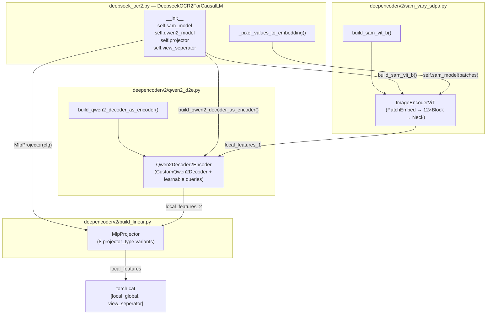
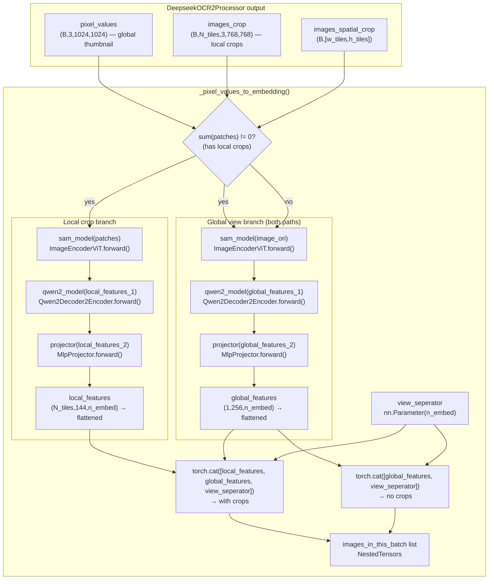
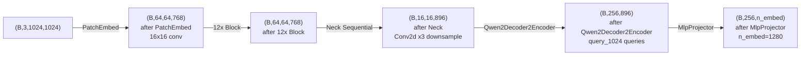

<!-- source: DeepWiki mcp.deepwiki.com · repo deepseek-ai/DeepSeek-OCR-2 · page 5 Vision Encoders · fetched 2026-10-30 -->

# Vision Encoders

<details>
<summary>Relevant source files</summary>

The following files were used as context for generating this wiki page:

- [DeepSeek-OCR2-master/DeepSeek-OCR2-vllm/deepencoderv2/__init__.py](DeepSeek-OCR2-master/DeepSeek-OCR2-vllm/deepencoderv2/__init__.py)
- [DeepSeek-OCR2-master/DeepSeek-OCR2-vllm/deepseek_ocr2.py](DeepSeek-OCR2-master/DeepSeek-OCR2-vllm/deepseek_ocr2.py)

</details>


## Purpose and Scope

The `deepencoderv2/` package implements a three-stage vision encoding pipeline that transforms raw image tensors into embeddings aligned with the language model's embedding space. The three stages correspond to three separate modules instantiated in `DeepseekOCR2ForCausalLM`:

| Stage | Module Field | Factory Function | Source File | Wiki Page |
|-------|-------------|------------------|-------------|-----------|
| 1 — Spatial feature extraction | `sam_model` | `build_sam_vit_b()` | `sam_vary_sdpa.py` | Page 5.1 |
| 2 — Semantic feature refinement | `qwen2_model` | `build_qwen2_decoder_as_encoder()` | `qwen2_d2e.py` | Page 5.2 |
| 3 — Language model alignment | `projector` | `MlpProjector(cfg)` | `build_linear.py` | Page 5.3 |

For information on how images are preprocessed before entering the vision encoders, see page 6.1.

Sources: [DeepSeek-OCR2-master/DeepSeek-OCR2-vllm/deepseek_ocr2.py:291-295](), [DeepSeek-OCR2-master/DeepSeek-OCR2-vllm/deepencoderv2/__init__.py]()

## Architecture Overview

The three stages are wired together in `_pixel_values_to_embedding()` inside `DeepseekOCR2ForCausalLM`. The same pipeline runs independently on local crop patches and on the global thumbnail:

**Diagram: deepencoderv2 Package — Code Entity Map**



Sources: [DeepSeek-OCR2-master/DeepSeek-OCR2-vllm/deepseek_ocr2.py:291-295](), [DeepSeek-OCR2-master/DeepSeek-OCR2-vllm/deepseek_ocr2.py:372-471]()

## Vision Encoding Pipeline

The entry point for vision encoding is `_pixel_values_to_embedding()` in `DeepseekOCR2ForCausalLM`. It processes each image in the batch, running local crops and the global thumbnail through the same three-stage stack, then concatenating their outputs with the `view_seperator` learnable parameter.

### Stage 1: SAM-ViT-B Spatial Feature Extraction

`ImageEncoderViT` (instantiated via `build_sam_vit_b()`) converts image tensors to spatial feature maps. Its internal structure:

| Component | Class/Function | Configuration | Purpose |
|-----------|---------------|---------------|---------|
| `PatchEmbed` | `PatchEmbed.forward()` | 16×16 conv, out=768 | Image → patch tokens |
| Positional encoding | `get_abs_pos()` | Absolute, interpolated | Spatial awareness |
| Transformer blocks | `Block` × 12 | 768 dim, 12 heads | Feature extraction |
| Attention | `Attention` (SDPA) | Optional windowing (size=14) | Efficient self-attention |
| Neck | `net` Sequential | Conv2d 768→256→512→896 | Feature refinement |

Output shape: `(B, H/4, W/4, 896)` (for 1024×1024 input: `(B, 16, 16, 896)`).

For full detail see page 5.1.

Sources: [DeepSeek-OCR2-master/DeepSeek-OCR2-vllm/deepencoderv2/sam_vary_sdpa.py:77-184](), [DeepSeek-OCR2-master/DeepSeek-OCR2-vllm/deepencoderv2/sam_vary_sdpa.py:481-488]()

### Stage 2: Qwen2 Decoder-as-Encoder Semantic Refinement

`Qwen2Decoder2Encoder` (instantiated via `build_qwen2_decoder_as_encoder()`) wraps `CustomQwen2Decoder` and prepends learnable query embeddings (`query_768` for 768×768 input → 144 queries; `query_1024` for 1024×1024 input → 256 queries). The hybrid attention mask assigns:

- **`token_type_ids = 0`** (image tokens): bidirectional attention — can attend to all positions
- **`token_type_ids = 1`** (query tokens): causal attention — attend only to preceding positions

This is computed by `_create_custom_4d_mask()`. Flash attention is explicitly unsupported; only `sdpa` and `eager` implementations are allowed.

Output shape: `(B, N_queries, 896)` where `N_queries` is 144 or 256.

For full detail see page 5.2.

Sources: [DeepSeek-OCR2-master/DeepSeek-OCR2-vllm/deepseek_ocr2.py:400-411]()

### Stage 3: MLP Projection for Language Alignment

`MlpProjector` (in `build_linear.py`) maps the 896-dim vision features to the language model's embedding dimension (`n_embed = 1280` in the default configuration). The active `DeepseekOCR2ForCausalLM` instantiation uses `projector_type="linear"` with `input_dim=896`:

```
MlpProjector(Dict(projector_type="linear", input_dim=896, n_embed=1280))
```

`MlpProjector` supports 8 `projector_type` values; the others are available for alternate configurations. For the full variant table and `forward()` logic, see page 5.3.

Sources: [DeepSeek-OCR2-master/DeepSeek-OCR2-vllm/deepseek_ocr2.py:295](), [DeepSeek-OCR2-master/DeepSeek-OCR2-vllm/deepencoderv2/build_linear.py:7-174]()

## Component Integration

### Data Flow Through Vision Encoders

The diagram below traces the complete call sequence within `_pixel_values_to_embedding()`, from raw tensors to the final concatenated embedding list.

**Diagram: _pixel_values_to_embedding() — Full Data Flow**



Sources: [DeepSeek-OCR2-master/DeepSeek-OCR2-vllm/deepseek_ocr2.py:372-471]()

### Token Count Calculation

The number of visual tokens produced per image is determined by the query count in `Qwen2Decoder2Encoder`:

| Image Type | Resolution | Qwen2 Queries | Tokens contributed |
|------------|------------|---------------|--------------------|
| Global thumbnail | 1024×1024 | `query_1024` → 256 | 256 tokens |
| Local crop (each) | 768×768 | `query_768` → 144 | 144 tokens per tile |

For a complete image:
- **Global view**: 256 tokens (always present)
- **Local crops**: 0–6 tiles × 144 = 0–864 tokens
- **`view_seperator`**: 1 token (always appended)
- **Total range**: 257–1121 tokens

The number of tiles is determined by `dynamic_preprocess()` in the preprocessor. See page 6.2 for the tiling strategy and page 6.1 for `count_tiles()`.

Sources: [DeepSeek-OCR2-master/DeepSeek-OCR2-vllm/deepseek_ocr2.py:96-109](), [DeepSeek-OCR2-master/DeepSeek-OCR2-vllm/deepseek_ocr2.py:442-467]()

### Feature Dimension Transformations

**Diagram: Tensor Shape Through the Vision Stack (global view, 1024×1024 input)**



For 768×768 local crops, the same pipeline applies with `query_768` (144 queries), yielding shape `(B, 144, n_embed)` after the projector.

Sources: [DeepSeek-OCR2-master/DeepSeek-OCR2-vllm/deepencoderv2/sam_vary_sdpa.py:166-183](), [DeepSeek-OCR2-master/DeepSeek-OCR2-vllm/deepencoderv2/build_linear.py:18-27]()

## Key Design Notes

### Attention Mechanisms Per Stage

| Stage | Attention Type | Key Classes/Functions |
|-------|----------------|-----------------------|
| `ImageEncoderViT` | SDPA + relative position bias; optional windowing | `Attention`, `window_partition()`, `window_unpartition()`, `add_decomposed_rel_pos()` |
| `Qwen2Decoder2Encoder` | Hybrid causal/bidirectional via `token_type_ids` | `CustomQwen2Decoder`, `_create_custom_4d_mask()` |

`flash_attention_2` is explicitly blocked in `CustomQwen2Decoder`; only `sdpa` and `eager` are supported. See page 5.2 and page 8.2 for details.

Sources: [DeepSeek-OCR2-master/DeepSeek-OCR2-vllm/deepencoderv2/sam_vary_sdpa.py:252-323](), [DeepSeek-OCR2-master/DeepSeek-OCR2-vllm/deepencoderv2/sam_vary_sdpa.py:326-444]()

### view_seperator Parameter

After projecting both local and global features, they are concatenated with a learnable `view_seperator` embedding (`nn.Parameter` of shape `(n_embed,)`), appended as a single token at the end of every image's embedding sequence. This boundary token is initialized with `embed_std = 1 / sqrt(n_embed)` scale.

Sources: [DeepSeek-OCR2-master/DeepSeek-OCR2-vllm/deepseek_ocr2.py:307-311](), [DeepSeek-OCR2-master/DeepSeek-OCR2-vllm/deepseek_ocr2.py:442-467]()

### Configurable Projection Layer

`MlpProjector` supports 8 `projector_type` values. The active deployment uses `"linear"` (single `nn.Linear`, 896 → 1280). Other variants include downsampling types (`downsample_mlp_gelu`, `normlayer_downsample_mlp_gelu`) and split-feature types (`low_high_hybrid_split_mlp_gelu`, `hybrid_split_feature_mlp_gelu`, `low_high_split_mlp_gelu`). Full documentation in page 5.3.

Sources: [DeepSeek-OCR2-master/DeepSeek-OCR2-vllm/deepencoderv2/build_linear.py:7-174](), [DeepSeek-OCR2-master/DeepSeek-OCR2-vllm/deepseek_ocr2.py:295]()

## Weight Loading

Vision encoder weights are loaded in `DeepseekOCR2ForCausalLM.load_weights()`. Weight names containing `sam_model`, `qwen2_model`, `projector`, or `view_seperator` are stripped of the leading `model.` prefix and loaded directly into the corresponding sub-modules. All other names are routed to `language_model` via the prefix `language.`.

`build_sam_vit_b()` also supports an optional `checkpoint` argument for standalone loading from a file; the loader strips `vision_tower_high.` key prefixes when present. `get_abs_pos()` handles positional embedding interpolation when the runtime resolution differs from the pre-trained resolution.

Sources: [DeepSeek-OCR2-master/DeepSeek-OCR2-vllm/deepseek_ocr2.py:562-582](), [DeepSeek-OCR2-master/DeepSeek-OCR2-vllm/deepencoderv2/sam_vary_sdpa.py:19-38](), [DeepSeek-OCR2-master/DeepSeek-OCR2-vllm/deepencoderv2/sam_vary_sdpa.py:517-527]()

## Performance Optimizations

### Flash Attention Support

The `Attention` class includes support for Flash Attention through the `flash_attn_qkvpacked_func` import at [DeepSeek-OCR2-master/DeepSeek-OCR2-vllm/deepencoderv2/sam_vary_sdpa.py:13](). While commented out in the default implementation, Flash Attention can be enabled for faster attention computation on supported hardware.

The current implementation uses PyTorch's `scaled_dot_product_attention`, which provides automatic optimization including Flash Attention when available.

### Windowed Attention

For large images, the encoder supports windowed attention through the `window_size` parameter. When `window_size > 0`, the `Block` class partitions the input into non-overlapping windows before computing attention, reducing computational complexity from O(n²) to O(w²×n/w²) where w is the window size and n is the sequence length.

Window operations are implemented through:
- `window_partition()` at [DeepSeek-OCR2-master/DeepSeek-OCR2-vllm/deepencoderv2/sam_vary_sdpa.py:326-347]()
- `window_unpartition()` at [DeepSeek-OCR2-master/DeepSeek-OCR2-vllm/deepencoderv2/sam_vary_sdpa.py:350-372]()

### Relative Position Encoding

The attention mechanism uses decomposed relative positional embeddings that are computed dynamically rather than stored as a full attention bias matrix. The `add_decomposed_rel_pos()` function at [DeepSeek-OCR2-master/DeepSeek-OCR2-vllm/deepencoderv2/sam_vary_sdpa.py:410-444]() computes relative position biases efficiently by separating height and width components.

**Sources:** [DeepSeek-OCR2-master/DeepSeek-OCR2-vllm/deepencoderv2/sam_vary_sdpa.py:252-323](), [DeepSeek-OCR2-master/DeepSeek-OCR2-vllm/deepencoderv2/sam_vary_sdpa.py:326-444]()

---

