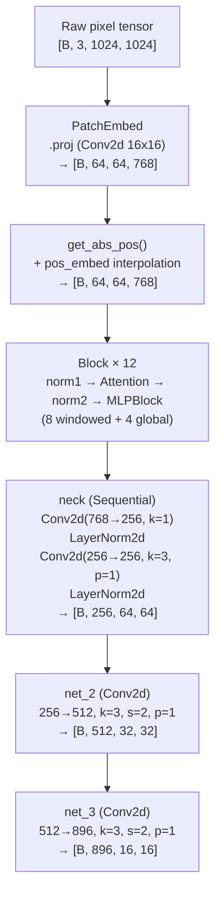
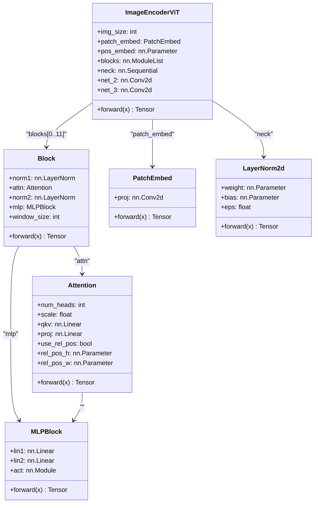

<!-- source: DeepWiki mcp.deepwiki.com · repo deepseek-ai/DeepSeek-OCR-2 · page 5.1 SAM-ViT-B Encoder · fetched 2026-10-30 -->

# SAM-ViT-B Encoder

<details>
<summary>Relevant source files</summary>

The following files were used as context for generating this wiki page:

- [DeepSeek-OCR2-master/DeepSeek-OCR2-vllm/deepencoderv2/__pycache__/sam_vary_sdpa.cpython-312.pyc](DeepSeek-OCR2-master/DeepSeek-OCR2-vllm/deepencoderv2/__pycache__/sam_vary_sdpa.cpython-312.pyc)
- [DeepSeek-OCR2-master/DeepSeek-OCR2-vllm/deepencoderv2/sam_vary_sdpa.py](DeepSeek-OCR2-master/DeepSeek-OCR2-vllm/deepencoderv2/sam_vary_sdpa.py)

</details>


## Purpose and Scope

This page documents the SAM-ViT-B vision encoder component of DeepSeek-OCR-2. It covers all classes and functions defined in `DeepSeek-OCR2-vllm/deepencoderv2/sam_vary_sdpa.py`, which is the first stage of the three-stage vision encoding pipeline (`sam_model → qwen2_model → projector`). This encoder takes raw pixel tensors and produces spatial feature maps that are passed to the Qwen2 decoder-as-encoder.

For the second stage (Qwen2 decoder-as-encoder), see [Section 5.2](#5.2). For the projection layer that adapts features to the language model's embedding dimension, see [Section 5.3](#5.3). For how the full pipeline is wired together inside `DeepseekOCR2ForCausalLM`, see [Section 4.2](#4.2).

---

## Overview

The encoder is a Vision Transformer (ViT-B) adapted from Meta's Segment Anything Model (SAM). It has been extended with two additional strided convolution layers (`net_2`, `net_3`) that further downsample spatial features for consumption by the decoder-as-encoder stage.

**Architecture summary for the ViT-B configuration:**

| Parameter | Value |
|---|---|
| Input image size | 1024 × 1024 |
| Patch size | 16 × 16 |
| Input channels | 3 (RGB) |
| Embedding dimension | 768 |
| Transformer depth | 12 blocks |
| Attention heads | 12 |
| MLP ratio | 4.0 |
| Window size (local blocks) | 14 |
| Global attention block indexes | 2, 5, 8, 11 |
| Neck output channels | 256 |
| `net_2` output channels | 512 |
| `net_3` output channels | 896 |

---

## Class and Function Inventory

**Data flow through the module:**



Sources: [DeepSeek-OCR2-master/DeepSeek-OCR2-vllm/deepencoderv2/sam_vary_sdpa.py:77-183]()

---

## Component Reference

### `PatchEmbed`

[DeepSeek-OCR2-master/DeepSeek-OCR2-vllm/deepencoderv2/sam_vary_sdpa.py:447-478]()

Converts a raw image tensor into a sequence of patch embeddings.

- Contains a single `nn.Conv2d` named `proj` with `kernel_size` and `stride` both equal to `patch_size` (16).
- The `forward` method applies the projection and permutes the output from `[B, C, H, W]` to `[B, H, W, C]` for compatibility with the subsequent transformer blocks.

**Default configuration (from `_build_sam`):**

| Argument | Value |
|---|---|
| `kernel_size` | (16, 16) |
| `stride` | (16, 16) |
| `padding` | (0, 0) |
| `in_chans` | 3 |
| `embed_dim` | 768 |

---

### `get_abs_pos`

[DeepSeek-OCR2-master/DeepSeek-OCR2-vllm/deepencoderv2/sam_vary_sdpa.py:19-38]()

Handles absolute positional embedding at sizes different from the pretraining size. If the target spatial size (`tgt_size`) differs from the stored embedding's spatial size, it bicubic-interpolates the embedding to match. This allows the encoder to process images of varying resolution without retraining positional embeddings.

- Uses `F.interpolate` with `mode='bicubic'` and `antialias=True`.
- Temporarily casts to `float32` for stable interpolation, then restores the original dtype.

---

### `LayerNorm2d`

[DeepSeek-OCR2-master/DeepSeek-OCR2-vllm/deepencoderv2/sam_vary_sdpa.py:61-73]()

A channel-wise layer normalization for spatial feature maps in `[B, C, H, W]` layout. Standard `nn.LayerNorm` expects channel-last layout; `LayerNorm2d` applies normalization along the channel dimension (dim=1) directly.

- Learnable `weight` (initialized to ones) and `bias` (initialized to zeros) parameters.
- `eps` defaults to `1e-6`.
- Used in the `neck` sequential block after each `Conv2d`.

---

### `MLPBlock`

[DeepSeek-OCR2-master/DeepSeek-OCR2-vllm/deepencoderv2/sam_vary_sdpa.py:43-56]()

Two-layer feed-forward network used within each transformer `Block`.

- `lin1`: `nn.Linear(embedding_dim, mlp_dim)`
- `lin2`: `nn.Linear(mlp_dim, embedding_dim)`
- Default activation: `nn.GELU`

With `mlp_ratio=4.0` and `embed_dim=768`, `mlp_dim = 3072`.

---

### `Attention`

[DeepSeek-OCR2-master/DeepSeek-OCR2-vllm/deepencoderv2/sam_vary_sdpa.py:252-323]()

Multi-head self-attention with optional decomposed relative positional embeddings.

**Key attributes:**

| Attribute | Description |
|---|---|
| `qkv` | `nn.Linear(dim, dim * 3, bias=qkv_bias)` |
| `proj` | `nn.Linear(dim, dim)` — output projection |
| `scale` | `head_dim ** -0.5` |
| `rel_pos_h` | `nn.Parameter` of shape `(2 * H - 1, head_dim)` |
| `rel_pos_w` | `nn.Parameter` of shape `(2 * W - 1, head_dim)` |

**Attention mechanism:**

The `forward` method uses `torch.nn.functional.scaled_dot_product_attention` (SDPA). When `use_rel_pos=True`, it calls `add_decomposed_rel_pos` to compute an attention bias from relative positional embeddings, which is passed as the `attn_mask` argument to SDPA.

Note: The file name `sam_vary_sdpa.py` reflects this SDPA-based implementation (as opposed to an older flash-attention variant).

---

### Relative Positional Embedding Utilities

[DeepSeek-OCR2-master/DeepSeek-OCR2-vllm/deepencoderv2/sam_vary_sdpa.py:375-444]()

Two helper functions implement decomposed relative position biases from the MViTv2 paper:

**`get_rel_pos(q_size, k_size, rel_pos)`**

Extracts a positional embedding table for a given query/key size pair. If the stored table length does not match `2 * max(q_size, k_size) - 1`, it performs 1D linear interpolation to resize the table. Coordinates are scaled when query and key sizes differ.

**`add_decomposed_rel_pos(q, rel_pos_h, rel_pos_w, q_size, k_size)`**

Computes separate height and width relative biases using `torch.einsum`, then returns them as `(rel_h, rel_w)` tensors to be summed and added to the attention logits. This decomposed approach avoids storing a full 2D relative embedding table.

---

### Window Attention Utilities

[DeepSeek-OCR2-master/DeepSeek-OCR2-vllm/deepencoderv2/sam_vary_sdpa.py:326-372]()

**`window_partition(x, window_size)`**

Splits a spatial feature map `[B, H, W, C]` into non-overlapping windows `[B * num_windows, window_size, window_size, C]`. Pads height and width to be divisible by `window_size` before partitioning.

**`window_unpartition(windows, window_size, pad_hw, hw)`**

Reverses `window_partition`: reconstructs `[B, H, W, C]` from windows, removing any padding that was added.

---

### `Block`

[DeepSeek-OCR2-master/DeepSeek-OCR2-vllm/deepencoderv2/sam_vary_sdpa.py:186-249]()

A single transformer block. Contains:

- `norm1`: pre-attention layer norm
- `attn`: `Attention` module
- `norm2`: pre-MLP layer norm
- `mlp`: `MLPBlock`
- `window_size`: if `> 0`, applies window attention; if `== 0`, applies global attention

**Forward pass logic:**

```
shortcut = x
x = norm1(x)
if window_size > 0:
    x, pad_hw = window_partition(x, window_size)
x = attn(x)
if window_size > 0:
    x = window_unpartition(x, window_size, pad_hw, (H, W))
x = shortcut + x
x = x + mlp(norm2(x))
```

The distinction between windowed and global blocks is set at construction time in `ImageEncoderViT.__init__`: blocks at indexes `[2, 5, 8, 11]` receive `window_size=0` (global), while the remaining 8 blocks receive `window_size=14` (windowed).

---

### `ImageEncoderViT`

[DeepSeek-OCR2-master/DeepSeek-OCR2-vllm/deepencoderv2/sam_vary_sdpa.py:77-183]()

The top-level encoder class. Composes all sub-components into the complete encoding pipeline.

**Sub-modules:**

| Attribute | Type | Role |
|---|---|---|
| `patch_embed` | `PatchEmbed` | Convert image to patch tokens |
| `pos_embed` | `nn.Parameter` or `None` | Absolute position embedding `[1, H/P, W/P, embed_dim]` |
| `blocks` | `nn.ModuleList` of `Block` | 12 transformer blocks |
| `neck` | `nn.Sequential` | Two Conv2d + LayerNorm2d to compress to 256 channels |
| `net_2` | `nn.Conv2d` | 256→512, stride=2 |
| `net_3` | `nn.Conv2d` | 512→896, stride=2 |

**Neck structure (detail):**

```
Conv2d(embed_dim→256, kernel_size=1, bias=False)
LayerNorm2d(256)
Conv2d(256→256, kernel_size=3, padding=1, bias=False)
LayerNorm2d(256)
```

**Forward pass:**

1. `patch_embed` produces `[B, 64, 64, 768]`
2. `get_abs_pos` adds or interpolates absolute position embedding
3. All 12 `Block`s are applied sequentially
4. Transpose to `[B, C, H, W]` for `neck`: output `[B, 256, 64, 64]`
5. `net_2` downsamples: `[B, 512, 32, 32]`
6. `net_3` downsamples: `[B, 896, 16, 16]` — **this is the final output**

Sources: [DeepSeek-OCR2-master/DeepSeek-OCR2-vllm/deepencoderv2/sam_vary_sdpa.py:148-183]()

---

## Attention Block Map: Windowed vs. Global

**Block types in the 12-block stack:**

```mermaid
flowchart LR
    B0["Block 0\nwindow_size=14"] --> B1["Block 1\nwindow_size=14"]
    B1 --> B2["Block 2\nwindow_size=0\n(global)"]
    B2 --> B3["Block 3\nwindow_size=14"]
    B3 --> B4["Block 4\nwindow_size=14"]
    B4 --> B5["Block 5\nwindow_size=0\n(global)"]
    B5 --> B6["Block 6\nwindow_size=14"]
    B6 --> B7["Block 7\nwindow_size=14"]
    B7 --> B8["Block 8\nwindow_size=0\n(global)"]
    B8 --> B9["Block 9\nwindow_size=14"]
    B9 --> B10["Block 10\nwindow_size=14"]
    B10 --> B11["Block 11\nwindow_size=0\n(global)"]
```



Sources: [DeepSeek-OCR2-master/DeepSeek-OCR2-vllm/deepencoderv2/sam_vary_sdpa.py:481-515]()

---

## Factory Functions

### `build_sam_vit_b`

[DeepSeek-OCR2-master/DeepSeek-OCR2-vllm/deepencoderv2/sam_vary_sdpa.py:481-488]()

Public entry point. Calls `_build_sam` with fixed ViT-B hyperparameters:

```
encoder_embed_dim=768
encoder_depth=12
encoder_num_heads=12
encoder_global_attn_indexes=[2, 5, 8, 11]
```

Takes an optional `checkpoint` path.

### `_build_sam`

[DeepSeek-OCR2-master/DeepSeek-OCR2-vllm/deepencoderv2/sam_vary_sdpa.py:491-527]()

Internal builder. Constructs `ImageEncoderViT` with fixed constants:

| Constant | Value |
|---|---|
| `prompt_embed_dim` | 256 |
| `image_size` | 1024 |
| `vit_patch_size` | 16 |
| `image_embedding_size` | 64 (`image_size // vit_patch_size`) |
| `use_rel_pos` | `True` |
| `window_size` | 14 |
| `qkv_bias` | `True` |
| `norm_layer` | `partial(torch.nn.LayerNorm, eps=1e-6)` |

**Checkpoint loading:**

If a `checkpoint` path is provided, `_build_sam` loads the state dict with `torch.load` and filters keys containing `'vision_tower_high'`, stripping the first 30 characters of each key before calling `load_state_dict(..., strict=True)`.

```python
image_encoder.load_state_dict(
    {k[30:]: v for k, v in state_dict.items() if 'vision_tower_high' in k},
    strict=True
)
```

This key prefix convention (`vision_tower_high`) reflects the parameter naming used in the combined checkpoint on the model hub.

Sources: [DeepSeek-OCR2-master/DeepSeek-OCR2-vllm/deepencoderv2/sam_vary_sdpa.py:516-527]()

---

## Code Entity Map

The following diagram maps the main code entities to their roles and relationships:



Sources: [DeepSeek-OCR2-master/DeepSeek-OCR2-vllm/deepencoderv2/sam_vary_sdpa.py:43-478]()

---

## Spatial Dimension Walkthrough

For a standard 1024×1024 input, dimensions at each stage:

| Stage | Tensor shape | Notes |
|---|---|---|
| Input | `[B, 3, 1024, 1024]` | Raw RGB |
| After `PatchEmbed` | `[B, 64, 64, 768]` | 16×16 patches, channel-last |
| After `pos_embed` add | `[B, 64, 64, 768]` | Same shape |
| After 12 `Block`s | `[B, 64, 64, 768]` | Same shape |
| After `.permute(0,3,1,2)` | `[B, 768, 64, 64]` | Channel-first for Conv2d |
| After `neck` | `[B, 256, 64, 64]` | Compressed channels |
| After `net_2` | `[B, 512, 32, 32]` | Stride-2 downsample |
| After `net_3` | `[B, 896, 16, 16]` | Final output to stage 2 |

The `[B, 896, 16, 16]` tensor is what `Qwen2Decoder2Encoder` receives as input in the vision encoding pipeline. See [Section 5.2](#5.2) for how it is consumed.

Sources: [DeepSeek-OCR2-master/DeepSeek-OCR2-vllm/deepencoderv2/sam_vary_sdpa.py:166-183]()

---

