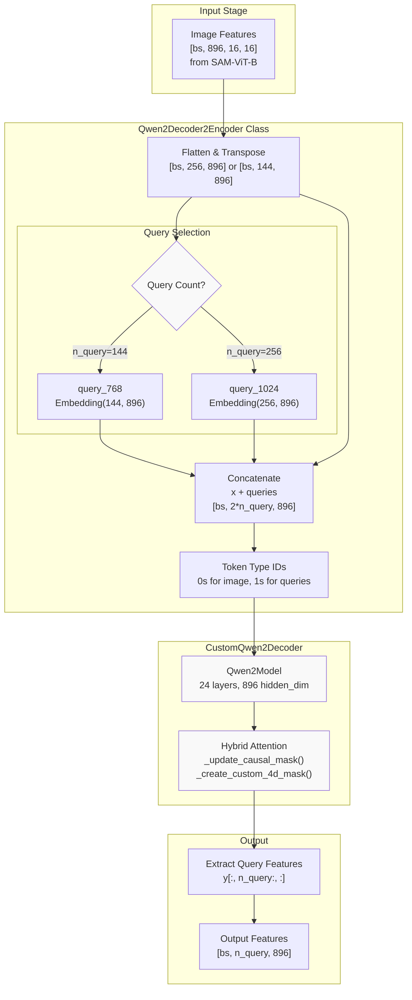
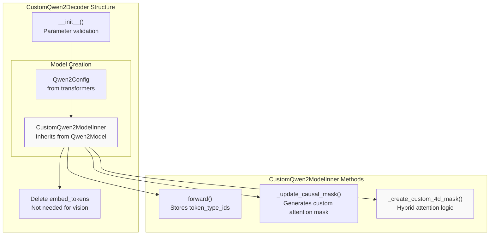
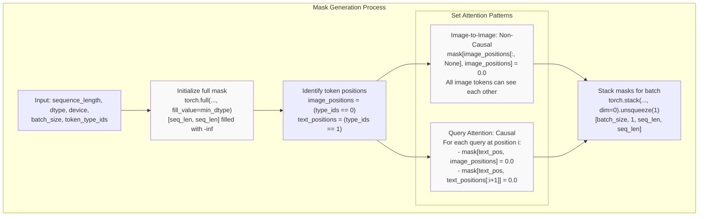
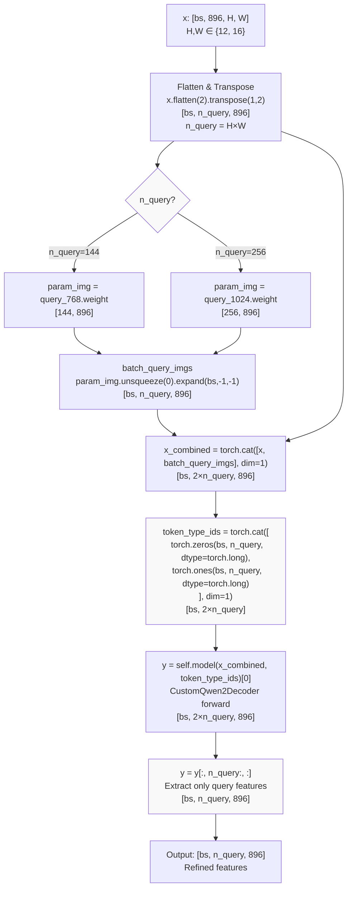
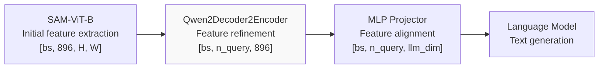

<!-- source: DeepWiki mcp.deepwiki.com · repo deepseek-ai/DeepSeek-OCR-2 · page 5.2 Qwen2 Decoder-as-Encoder · fetched 2026-10-30 -->

# Qwen2 Decoder-as-Encoder

<details>
<summary>Relevant source files</summary>

The following files were used as context for generating this wiki page:

- [DeepSeek-OCR2-master/DeepSeek-OCR2-vllm/deepencoderv2/__pycache__/qwen2_d2e.cpython-312.pyc](DeepSeek-OCR2-master/DeepSeek-OCR2-vllm/deepencoderv2/__pycache__/qwen2_d2e.cpython-312.pyc)
- [DeepSeek-OCR2-master/DeepSeek-OCR2-vllm/deepencoderv2/qwen2_d2e.py](DeepSeek-OCR2-master/DeepSeek-OCR2-vllm/deepencoderv2/qwen2_d2e.py)

</details>


## Purpose and Scope

This document details the **Qwen2 Decoder-as-Encoder** component, a novel vision feature refinement module that repurposes a Qwen2 decoder architecture to act as an encoder with hybrid attention capabilities. This component sits between the SAM-ViT-B encoder and the MLP projector in the vision processing pipeline, performing feature refinement through learnable query embeddings.

For information about the preceding SAM-ViT-B encoder stage, see [SAM-ViT-B Encoder](#5.1). For the subsequent projection stage, see [MLP Projector](#5.3). For the complete vision processing flow, see [Vision Processing Pipeline](#4.2).

---

## Architecture Overview

The Qwen2 Decoder-as-Encoder implements a two-stage feature extraction strategy using a modified Qwen2 decoder with custom attention mechanisms:



**Sources:** [DeepSeek-OCR2-master/DeepSeek-OCR2-vllm/deepencoderv2/qwen2_d2e.py:217-284]()

The architecture processes image features through learnable queries using a custom attention mechanism that combines bidirectional (non-causal) attention for image tokens and autoregressive (causal) attention for query tokens.

---

## Core Components

### CustomQwen2Decoder Class

The `CustomQwen2Decoder` class ([qwen2_d2e.py:8-194]()) provides the foundational decoder architecture with hybrid attention capabilities.

#### Initialization Parameters

| Parameter | Default Value | Purpose |
|-----------|---------------|---------|
| `decoder_layer` | 24 | Number of transformer layers |
| `max_position_embeddings` | 131072 | Maximum sequence length |
| `hidden_dimension` | 896 | Hidden state dimension |
| `num_attention_heads` | 14 | Number of attention heads |
| `num_key_value_heads` | 2 | Number of key-value heads (GQA) |
| `intermediate_size` | 4864 | FFN intermediate dimension |
| `vocab_size` | 151936 | Vocabulary size (unused after embed_tokens deletion) |
| `attn_implementation` | "sdpa" | Attention implementation ("sdpa" or "eager") |
| `rms_norm_eps` | 1e-06 | RMS normalization epsilon |
| `rope_theta` | 1000000.0 | RoPE base frequency |
| `attention_dropout` | 0.0 | Attention dropout probability |
| `hidden_act` | "silu" | Activation function |
| `initializer_range` | 0.02 | Weight initialization range |

**Critical Design Constraint:** The `attn_implementation` parameter **cannot** be set to `"flash_attention_2"` because the custom attention mask logic requires either `"sdpa"` or `"eager"` implementations ([qwen2_d2e.py:34-38]()).

**Sources:** [DeepSeek-OCR2-master/DeepSeek-OCR2-vllm/deepencoderv2/qwen2_d2e.py:15-64]()

#### Internal Architecture

The class creates a custom Qwen2Model through the `_create_custom_model()` method:



**Sources:** [DeepSeek-OCR2-master/DeepSeek-OCR2-vllm/deepencoderv2/qwen2_d2e.py:62-64](), [DeepSeek-OCR2-master/DeepSeek-OCR2-vllm/deepencoderv2/qwen2_d2e.py:66-174]()

---

### Token Type IDs and Hybrid Attention

The core innovation of this architecture is the use of **token_type_ids** to control attention patterns:

- **Type 0 (Image tokens):** Bidirectional attention - can attend to all image tokens
- **Type 1 (Query tokens):** Causal attention - attend to all image tokens and previous query tokens

#### Attention Mask Creation Logic

The `_create_custom_4d_mask()` method ([qwen2_d2e.py:135-172]()) generates the hybrid attention mask:



**Mask Value Semantics:**
- `0.0`: Tokens can attend (attention weight is preserved)
- `min_dtype` (≈ -inf for float16/bfloat16): Tokens cannot attend (attention weight masked out)

**Sources:** [DeepSeek-OCR2-master/DeepSeek-OCR2-vllm/deepencoderv2/qwen2_d2e.py:135-172]()

#### Attention Pattern Example

For a sequence with 4 image tokens (type 0) and 3 query tokens (type 1):

```
Sequence: [I0, I1, I2, I3, Q0, Q1, Q2]
Types:    [ 0,  0,  0,  0,  1,  1,  1]

Attention Mask (0 = can attend, X = masked):
       I0  I1  I2  I3  Q0  Q1  Q2
I0  |  0   0   0   0   X   X   X  |  Image tokens see all images
I1  |  0   0   0   0   X   X   X  |  but not queries
I2  |  0   0   0   0   X   X   X  |
I3  |  0   0   0   0   X   X   X  |
Q0  |  0   0   0   0   0   X   X  |  Query tokens see all images
Q1  |  0   0   0   0   0   0   X  |  and previous queries (causal)
Q2  |  0   0   0   0   0   0   0  |
```

**Sources:** [DeepSeek-OCR2-master/DeepSeek-OCR2-vllm/deepencoderv2/qwen2_d2e.py:159-167]()

---

## Qwen2Decoder2Encoder Class

The `Qwen2Decoder2Encoder` class ([qwen2_d2e.py:217-284]()) wraps `CustomQwen2Decoder` and adds learnable query embeddings for feature extraction.

### Query Embeddings

Two separate learnable embeddings are maintained for different spatial resolutions:

```python
self.query_768 = nn.Embedding(144, hidden_dimension)   # For 12×12 patches (768×768 crops)
self.query_1024 = nn.Embedding(256, hidden_dimension)  # For 16×16 patches (1024×1024 base)
```

**Resolution Mapping:**
- **144 queries** → Used for local crops processed at 768×768 pixels → produces 12×12 spatial grid
- **256 queries** → Used for base image processed at 1024×1024 pixels → produces 16×16 spatial grid

**Sources:** [DeepSeek-OCR2-master/DeepSeek-OCR2-vllm/deepencoderv2/qwen2_d2e.py:247-248]()

### Forward Pass Data Flow



**Sources:** [DeepSeek-OCR2-master/DeepSeek-OCR2-vllm/deepencoderv2/qwen2_d2e.py:254-284]()

### Key Design Insights

1. **Input Splitting:** Image features (type 0) and query embeddings (type 1) are concatenated before processing
2. **Bidirectional Image Processing:** Image tokens can attend to each other bidirectionally, enabling global context understanding
3. **Autoregressive Query Extraction:** Query tokens extract features from images in an autoregressive manner, allowing each query to build upon previous queries
4. **Feature Selection:** Only the query features (`y[:, n_query:, :]`) are returned, discarding the processed image features

**Sources:** [DeepSeek-OCR2-master/DeepSeek-OCR2-vllm/deepencoderv2/qwen2_d2e.py:254-284]()

---

## Factory Function and Weight Loading

### build_qwen2_decoder_as_encoder()

The `build_qwen2_decoder_as_encoder()` function ([qwen2_d2e.py:287-316]()) provides a convenient interface for model instantiation:

```python
decoder_as_encoder = build_qwen2_decoder_as_encoder(
    decoder_layer=24,                # Number of transformer layers
    hidden_dimension=896,            # Hidden state dimension
    num_attention_heads=14,          # Attention head count
    num_key_value_heads=2,           # KV heads for GQA
    intermediate_size=4864,          # FFN intermediate size
    max_query=400,                   # Maximum query count (unused in current impl)
    checkpoint=None,                 # Optional checkpoint path
)
```

**Checkpoint Loading:**
If a `checkpoint` path is provided, the function loads pretrained weights using `torch.load()` and applies them with `load_state_dict(state_dict, strict=True)` ([qwen2_d2e.py:309-315]()).

**Sources:** [DeepSeek-OCR2-master/DeepSeek-OCR2-vllm/deepencoderv2/qwen2_d2e.py:287-316]()

---

## Integration with Vision Pipeline

### Position in Processing Chain



**Sources:** Referenced from system architecture diagrams

### Spatial Resolution Flow

The Qwen2 Decoder-as-Encoder handles two distinct spatial resolutions corresponding to the dynamic resolution system:

| Input Source | Spatial Dim | Query Count | Output Shape |
|--------------|-------------|-------------|--------------|
| Base image (1024×1024) | 16×16 | 256 | [bs, 256, 896] |
| Local crop (768×768) | 12×12 | 144 | [bs, 144, 896] |

Each resolution uses its own learned query embedding to extract features optimally for that scale.

**Sources:** [DeepSeek-OCR2-master/DeepSeek-OCR2-vllm/deepencoderv2/qwen2_d2e.py:259-262]()

---

## Implementation Details

### Memory and Performance Considerations

1. **Attention Implementation:** Must use `"sdpa"` or `"eager"` (not `"flash_attention_2"`) due to custom mask requirements
2. **Query Embeddings:** Learnable parameters that are NOT frozen during training
3. **Computational Cost:** Full attention over concatenated sequence (2×n_query tokens) before extraction
4. **Output Efficiency:** Only query features are returned, reducing downstream computation

**Sources:** [DeepSeek-OCR2-master/DeepSeek-OCR2-vllm/deepencoderv2/qwen2_d2e.py:34-38](), [DeepSeek-OCR2-master/DeepSeek-OCR2-vllm/deepencoderv2/qwen2_d2e.py:281]()

### Deleted Components

The `embed_tokens` layer is explicitly deleted from the Qwen2Model after initialization ([qwen2_d2e.py:64]()), as this component operates on visual embeddings rather than token IDs:

```python
del self.model.embed_tokens
```

This deletion reduces memory footprint and prevents accidental misuse of the text embedding layer.

**Sources:** [DeepSeek-OCR2-master/DeepSeek-OCR2-vllm/deepencoderv2/qwen2_d2e.py:64]()

---

## Configuration Summary

### Default Architectural Parameters

| Component | Value | Purpose |
|-----------|-------|---------|
| Transformer Layers | 24 | Depth of feature refinement |
| Hidden Dimension | 896 | Feature vector size |
| Attention Heads | 14 | Multi-head attention parallelism |
| KV Heads | 2 | Grouped query attention efficiency |
| Intermediate Size | 4864 | FFN expansion factor (≈5.4×) |
| Max Position Embeddings | 131072 | RoPE scaling capacity |
| RoPE Theta | 1,000,000.0 | Base frequency for rotary embeddings |
| Attention Dropout | 0.0 | No dropout during attention |
| Hidden Activation | silu | SiLU/Swish activation function |

**Sources:** [DeepSeek-OCR2-master/DeepSeek-OCR2-vllm/deepencoderv2/qwen2_d2e.py:15-30]()

---

This Qwen2 Decoder-as-Encoder component represents a novel approach to vision feature extraction, leveraging the architectural strengths of transformer decoders with hybrid attention patterns to enable effective query-based feature extraction from image representations.

---

