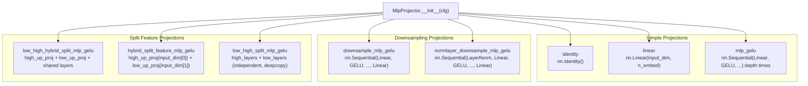
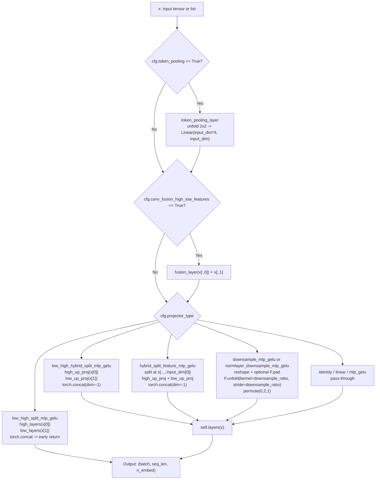
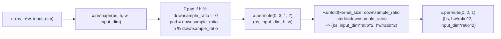
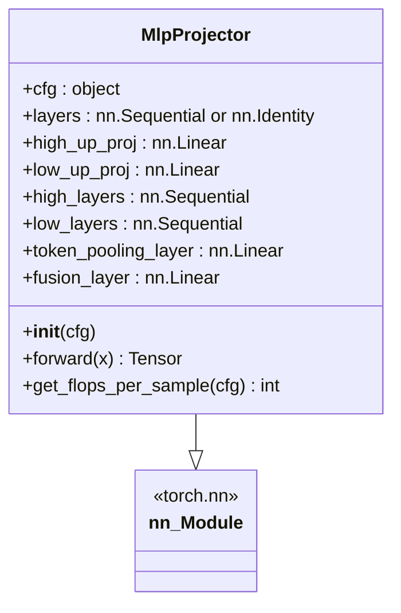
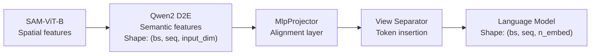

<!-- source: DeepWiki mcp.deepwiki.com · repo deepseek-ai/DeepSeek-OCR-2 · page 5.3 MLP Projector · fetched 2026-10-30 -->

# MLP Projector

<details>
<summary>Relevant source files</summary>

The following files were used as context for generating this wiki page:

- [DeepSeek-OCR2-master/DeepSeek-OCR2-vllm/deepencoderv2/__pycache__/build_linear.cpython-312.pyc](DeepSeek-OCR2-master/DeepSeek-OCR2-vllm/deepencoderv2/__pycache__/build_linear.cpython-312.pyc)
- [DeepSeek-OCR2-master/DeepSeek-OCR2-vllm/deepencoderv2/build_linear.py](DeepSeek-OCR2-master/DeepSeek-OCR2-vllm/deepencoderv2/build_linear.py)

</details>


## Overview

The **MLP Projector** is a critical component that bridges the vision encoding pipeline and the language model in DeepSeek-OCR-2. It transforms vision features extracted by the SAM-ViT-B encoder and Qwen2 decoder-as-encoder into embeddings compatible with the language model's input space. The projector supports 8 distinct architecture variants, enabling flexible adaptation to different model sizes, tasks, and performance requirements.

For information about the upstream vision encoders that produce features for this projector, see pages 5.1 (SAM-ViT-B Encoder) and 5.2 (Qwen2 Decoder-as-Encoder). For the complete vision processing pipeline, see page 4.2.

Sources: [DeepSeek-OCR2-master/DeepSeek-OCR2-vllm/deepencoderv2/build_linear.py:7-95]()

## Architecture Variants

The `MlpProjector` class implements 8 distinct projection architectures, selected via the `cfg.projector_type` parameter. Each variant is optimized for different use cases:

**Diagram: `MlpProjector` — `projector_type` variants and associated modules**



### Variant Details

| Variant | Description | Key Parameters | Use Case |
|---------|-------------|----------------|----------|
| `identity` | Pass-through (no transformation) | None | When `input_dim == n_embed` |
| `linear` | Single linear layer | `input_dim`, `n_embed` | Lightweight alignment |
| `mlp_gelu` | Multi-layer perceptron with GELU | `depth` (default: 1) | General-purpose projection |
| `normlayer_downsample_mlp_gelu` | LayerNorm + spatial reduction + MLP | `downsample_ratio`, `mlp_ratio` | Spatial compression with normalization |
| `downsample_mlp_gelu` | Spatial reduction + MLP | `downsample_ratio`, `mlp_ratio` | Spatial compression |
| `low_high_hybrid_split_mlp_gelu` | Separate projections for high/low features | `high_up_proj`, `low_up_proj` | Dual-resolution processing |
| `hybrid_split_feature_mlp_gelu` | Channel-wise split projection | `channel_div` (default: 0.5) | Channel-split dual features |
| `low_high_split_mlp_gelu` | Independent processing chains | `high_layers`, `low_layers` | Separate high/low pathways |

Sources: [DeepSeek-OCR2-master/DeepSeek-OCR2-vllm/deepencoderv2/build_linear.py:15-95]()

## Configuration Parameters

The projector is initialized with a configuration object (`cfg`) that contains the following key parameters:

### Core Parameters

- **`projector_type`** (str): Selects the architecture variant (required)
- **`input_dim`** (int or list[int]): Dimension of input features
  - Single int for most variants
  - List of 2 ints for `hybrid_split_feature_mlp_gelu`: `[high_dim, low_dim]`
- **`n_embed`** (int): Target embedding dimension (language model dimension)

### Variant-Specific Parameters

- **`depth`** (int, default: 1): Number of MLP layers for `mlp_gelu` variants
- **`mlp_ratio`** (int, default: 1): Intermediate dimension multiplier for downsample variants
- **`downsample_ratio`** (int): Spatial downsampling factor (e.g., 2 for 2×2 reduction)
- **`channel_div`** (float, default: 0.5): Channel split ratio for `hybrid_split_feature_mlp_gelu`

### Optional Features

- **`token_pooling`** (bool, default: False): Enable 2×2 token pooling before projection
- **`conv_fusion_high_low_features`** (bool, default: False): Fuse high and low resolution features

Sources: [DeepSeek-OCR2-master/DeepSeek-OCR2-vllm/deepencoderv2/build_linear.py:9-95]()

## Forward Pass Processing

The `forward()` method implements the projection logic with conditional processing based on the configuration:

**Diagram: `MlpProjector.forward(x)` — conditional branching logic**



### Processing Details

#### Token Pooling (Optional)
When `token_pooling=True`, the projector performs 2×2 spatial pooling:
1. Reshape input from `(batch, w×h, channels)` to `(batch, w, h, channels)`
2. Apply `unfold` operation with kernel=2, stride=2
3. Concatenate 4 neighboring tokens along channel dimension
4. Project with `token_pooling_layer`: `Linear(input_dim × 4, input_dim)`

Sources: [DeepSeek-OCR2-master/DeepSeek-OCR2-vllm/deepencoderv2/build_linear.py:98-113]()

#### Feature Fusion (Optional)
When `conv_fusion_high_low_features=True`:
- Expects input with shape `(batch, 2, seq_len, channels)` (two feature views)
- Applies: `fusion_layer(x[:, 0]) + x[:, 1]`

Sources: [DeepSeek-OCR2-master/DeepSeek-OCR2-vllm/deepencoderv2/build_linear.py:115-116]()

#### Split Feature Processing
For variants with "split" in their name, the input is processed as separate high-resolution and low-resolution features:

**`low_high_hybrid_split_mlp_gelu`:**
- Input: `x` as list `[high_features, low_features]`
- Projects each independently: `high_up_proj(x[0])`, `low_up_proj(x[1])`
- Concatenates on last dimension
- Passes through shared MLP layers

**`hybrid_split_feature_mlp_gelu`:**
- Input: `x` with concatenated features
- Splits along last dimension at `input_dim[0]`
- Projects each part with different dimensions
- Concatenates and passes through shared MLP

**`low_high_split_mlp_gelu`:**
- Input: list `[high_features, low_features]`
- Processes through separate `high_layers` and `low_layers`
- Concatenates and returns immediately (no shared layers)

Sources: [DeepSeek-OCR2-master/DeepSeek-OCR2-vllm/deepencoderv2/build_linear.py:118-136]()

#### Downsample Processing
For `downsample_mlp_gelu` and `normlayer_downsample_mlp_gelu`:

**Diagram: Spatial downsampling in `downsample_mlp_gelu` / `normlayer_downsample_mlp_gelu`**



`F.unfold` concatenates `downsample_ratio × downsample_ratio` spatial patches along the channel dimension, reducing spatial resolution by `ratio²` while multiplying the channel dimension by the same factor. This prepared tensor is then passed to `self.layers`.

Sources: [DeepSeek-OCR2-master/DeepSeek-OCR2-vllm/deepencoderv2/build_linear.py:138-155]()

## Implementation Details

### Class Structure

**Diagram: `MlpProjector` — class members and inheritance**



All attributes except `cfg` and `layers` are conditionally assigned: `high_up_proj` / `low_up_proj` only for split variants, `token_pooling_layer` only when `cfg.token_pooling=True`, and `fusion_layer` only when `cfg.conv_fusion_high_low_features=True`. `low_layers` is created via `copy.deepcopy` of `modules` for `low_high_split_mlp_gelu`.

### Layer Construction by Variant

| `projector_type` | `self.layers` structure |
|---|---|
| `identity` | `nn.Identity()` |
| `linear` | `nn.Linear(input_dim, n_embed)` |
| `mlp_gelu` (depth=d) | `Linear(input_dim, n_embed)`, then `(d-1)` × `[GELU, Linear(n_embed, n_embed)]` |
| `downsample_mlp_gelu` (depth=d, ratio=r, mlp_ratio=m) | `Linear(input_dim*r², n_embed*m)`, `(d-2)` × `[GELU, Linear(n_embed*m, n_embed*m)]`, `GELU`, `Linear(n_embed*m, n_embed)` |
| `normlayer_downsample_mlp_gelu` (same params) | Prepends `LayerNorm(input_dim*r²)` before the first `Linear` |
| `low_high_hybrid_split_mlp_gelu` | `(depth-1)` × `[GELU, Linear(n_embed, n_embed)]` — shared after separate up-projections |
| `hybrid_split_feature_mlp_gelu` | Same as above but up-projections use `channel_div` split |
| `low_high_split_mlp_gelu` | `high_layers` and `low_layers` each: `(depth-1)` × `[GELU, Linear(n_embed//2, n_embed//2)]` |

Sources: [DeepSeek-OCR2-master/DeepSeek-OCR2-vllm/deepencoderv2/build_linear.py:21-88]()

## FLOPS Calculation

The `get_flops_per_sample()` static method on `MlpProjector` estimates computational cost per sample.

### Formulae

| Condition | Formula |
|---|---|
| `projector_type == "linear"` | `fwd = 2 × input_dim × n_embed` |
| `"mlp_gelu" in projector_type` | `fwd = 2 × (input_dim × downsample_ratio²) × n_embed + (depth - 1) × 2 × n_embed × n_embed` |
| All other types | `fwd = 0` |

The returned value is always `fwd * 3`. The factor of 2 in each term counts multiply-add operations. The `× 3` multiplier is a fixed convention in the implementation.

### Special Handling

- `downsample_ratio` defaults to 1 via `cfg.get("downsample_ratio", 1)` if not set.
- When `cfg.input_dim` is a list (used by `hybrid_split_feature_mlp_gelu`), `input_dim = sum(cfg.input_dim)`.

Sources: [DeepSeek-OCR2-master/DeepSeek-OCR2-vllm/deepencoderv2/build_linear.py:158-172]()

## Integration in Vision Pipeline

The MLP Projector sits between the Qwen2 decoder-as-encoder output and the language model input:



**Diagram: MLP Projector Position in Vision-Language Pipeline**

The projector ensures that vision features from the Qwen2 encoder (which may have dimension `input_dim`) are transformed to match the language model's expected embedding dimension (`n_embed`). This alignment is critical for seamless multimodal fusion.

**Sources:** [DeepSeek-OCR2-master/DeepSeek-OCR2-vllm/deepencoderv2/build_linear.py:1-174]()

## Usage Example

```python
# Configuration for a standard MLP projector
class ProjectorConfig:
    projector_type = "mlp_gelu"
    input_dim = 896  # Qwen2 output dimension
    n_embed = 4096   # Language model dimension
    depth = 2        # 2-layer MLP

# Initialize projector
projector = MlpProjector(ProjectorConfig())

# Forward pass
vision_features = torch.randn(2, 256, 896)  # (batch, seq_len, input_dim)
projected = projector(vision_features)       # (batch, seq_len, 4096)
```

**Sources:** [DeepSeek-OCR2-master/DeepSeek-OCR2-vllm/deepencoderv2/build_linear.py:9-156]()

---

