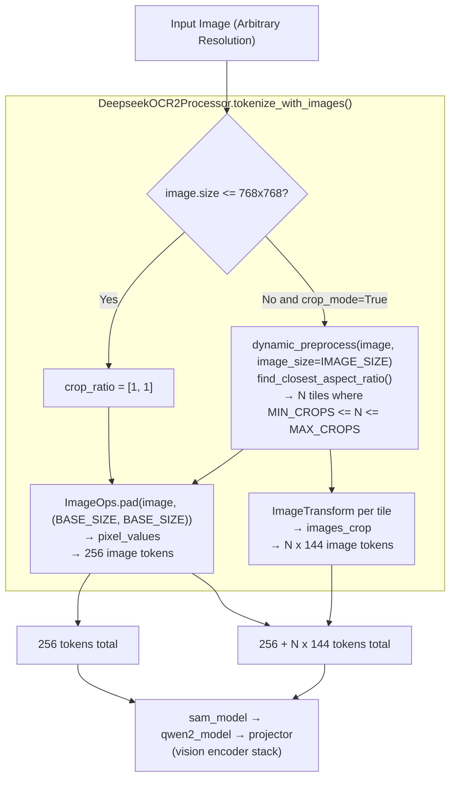
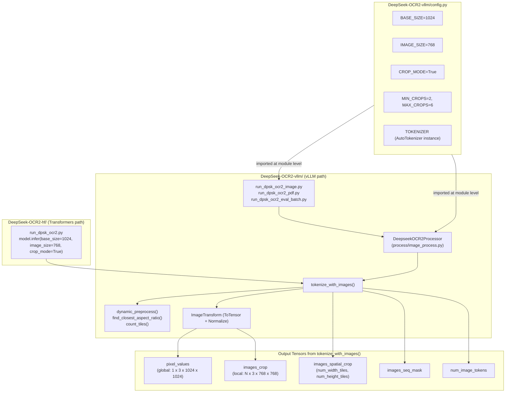
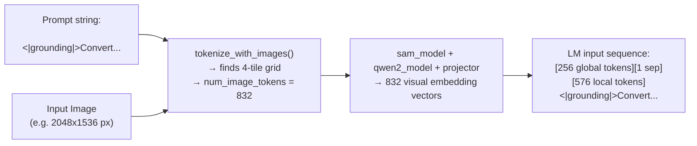

<!-- source: DeepWiki mcp.deepwiki.com · repo deepseek-ai/DeepSeek-OCR-2 · page 6 Dynamic Resolution System · fetched 2026-10-30 -->

# Dynamic Resolution System

<details>
<summary>Relevant source files</summary>

The following files were used as context for generating this wiki page:

- [DeepSeek-OCR2-master/DeepSeek-OCR2-vllm/process/image_process.py](DeepSeek-OCR2-master/DeepSeek-OCR2-vllm/process/image_process.py)
- [README.md](README.md)

</details>


## Purpose and Scope

This document describes the dynamic resolution system in DeepSeek-OCR-2, which adaptively processes images at multiple scales to generate between 256 and 1120 visual tokens based on image content and complexity. This system enables the model to efficiently handle images of varying sizes and aspect ratios while maintaining high recognition accuracy.

For detailed information about `DeepseekOCR2Processor`, its output tensors, and the internal preprocessing steps, see page 6.1. For the tiling strategy, token counts, and how `MIN_CROPS`/`MAX_CROPS` control the budget, see page 6.2.

## Overview

The dynamic resolution system implements a multi-scale image processing approach that generates a variable number of visual tokens rather than using a fixed resolution. This design allows the model to allocate more computational resources to complex images while processing simpler images more efficiently.

The system processes each input image through two complementary views:

1. **Base/Global View**: A 1024×1024 downsampled representation of the entire image, producing 256 visual tokens
2. **Local Crop Views**: 0 to 6 additional 768×768 crops focusing on detailed regions, each producing 144 visual tokens

This results in a total token range of **256 tokens** (no crops) to **1,120 tokens** (6 crops + base), with the number of crops determined automatically based on image characteristics.

**Dynamic resolution flow through `DeepseekOCR2Processor.tokenize_with_images()`**



Sources: [DeepSeek-OCR2-master/DeepSeek-OCR2-vllm/process/image_process.py:45-83](), [DeepSeek-OCR2-master/DeepSeek-OCR2-vllm/process/image_process.py:363-435](), [README.md:131-132]()

## Resolution Configuration Parameters

The dynamic resolution system is controlled by a set of configuration parameters that determine how images are processed. These parameters are defined in the configuration file and used consistently across both inference backends.

| Parameter | Default | Purpose | Consumed By |
|-----------|---------|---------|-------------|
| `BASE_SIZE` | 1024 | Resolution for the global/base image view | `DeepseekOCR2Processor.__init__` |
| `IMAGE_SIZE` | 768 | Resolution for each local crop tile | `dynamic_preprocess()`, `tokenize_with_images()` |
| `CROP_MODE` | `True` | Enable/disable multi-crop processing | `tokenize_with_images()` (the `cropping` arg) |
| `MIN_CROPS` | 2 | Minimum tile count (`i*j`) in candidate grids | `dynamic_preprocess()`, `count_tiles()` |
| `MAX_CROPS` | 6 | Maximum tile count (`i*j`) in candidate grids | `dynamic_preprocess()`, `count_tiles()` |

These parameters can be configured for different use cases:

- **Maximum quality**: `CROP_MODE=True`, `MAX_CROPS=6` — up to 1,120 tokens
- **Balanced**: `CROP_MODE=True`, `MIN_CROPS=2`, `MAX_CROPS=4` — 544–832 tokens
- **Speed-optimized**: `CROP_MODE=False` — 256 base tokens only

Sources: [DeepSeek-OCR2-master/DeepSeek-OCR2-vllm/config.py](), [DeepSeek-OCR2-master/DeepSeek-OCR2-vllm/process/image_process.py:9](), [DeepSeek-OCR2-master/DeepSeek-OCR2-hf/run_dpsk_ocr2.py]()

## Token Calculation Formula

The system calculates the total number of visual tokens based on the image processing configuration. Understanding this formula is critical for memory estimation and performance tuning.

### Base Token Calculation

The base image is padded to `BASE_SIZE × BASE_SIZE` (1024×1024) and always produces a fixed number of query tokens. In `tokenize_with_images()` [DeepSeek-OCR2-master/DeepSeek-OCR2-vllm/process/image_process.py:424-429]():

```
num_queries_base = ceil((BASE_SIZE // patch_size) / downsample_ratio)
                 = ceil((1024 // 16) / 4) = ceil(16) = 16

Base Tokens = num_queries_base × num_queries_base = 16 × 16 = 256
```

A single separator token is appended after the base tokens before the local crop tokens.

### Crop Token Calculation

Each local tile is processed at `IMAGE_SIZE × IMAGE_SIZE` (768×768):

```
num_queries = ceil((IMAGE_SIZE // patch_size) / downsample_ratio)
            = ceil((768 // 16) / 4) = ceil(12) = 12

Tokens per tile grid (W_tiles × H_tiles) = (num_queries × W_tiles) × (num_queries × H_tiles)
```

For a 1×N arrangement: `12 × 12 × N = 144 × N` tokens.

### Total Token Formula

```
Total Visual Tokens ≈ 256 + (Number of Tiles × 144)

where: MIN_CROPS ≤ Number of Tiles ≤ MAX_CROPS
```

### Token Count Examples

| Number of Tiles (N) | Calculation | Total Tokens |
|---------------------|-------------|--------------|
| 0 (base only, small image) | 256 + (0 × 144) | 256 |
| 2 (MIN_CROPS default) | 256 + (2 × 144) | 544 |
| 4 | 256 + (4 × 144) | 832 |
| 6 (MAX_CROPS default) | 256 + (6 × 144) | 1,120 |

These token counts directly affect GPU memory consumption, inference latency, and recognition quality.

Sources: [README.md:132](), [DeepSeek-OCR2-master/DeepSeek-OCR2-vllm/process/image_process.py:424-435]()

## Processing Pipeline Architecture

The dynamic resolution system integrates with both inference backends. The following diagram maps configuration constants to the functions and classes that consume them.

**Configuration-to-code mapping for the dynamic resolution system**



Sources: [DeepSeek-OCR2-master/DeepSeek-OCR2-vllm/config.py](), [DeepSeek-OCR2-master/DeepSeek-OCR2-vllm/process/image_process.py:111-499](), [DeepSeek-OCR2-master/DeepSeek-OCR2-hf/run_dpsk_ocr2.py]()

## Prompt Integration

The dynamic resolution system seamlessly integrates with the prompt-based control system. When users include the `<image>` token in their prompt, the system automatically:

1. Calculates the required number of visual tokens based on the input image
2. Processes the image through base and crop pipelines
3. Replaces the single `<image>` token with the actual visual embeddings (256-1,120 tokens)

### Example: Token Replacement Flow

**`<image>` placeholder expansion via `get_input_embeddings()` / `get_multimodal_embeddings()`**



The `<image>` token ID in `input_ids` is used as a mask in `get_multimodal_embeddings()` to locate where vision embeddings are injected. The language model receives only the fully merged embedding sequence.

Sources: [README.md:118-123](), [DeepSeek-OCR2-master/DeepSeek-OCR2-vllm/process/image_process.py:330-499]()

## Configuration in Practice

### Transformers Backend Configuration

In the Transformers backend, dynamic resolution parameters are passed directly to the `model.infer()` method:

```python
# From run_dpsk_ocr2.py:23
res = model.infer(
    tokenizer, 
    prompt=prompt, 
    image_file=image_file, 
    output_path=output_path, 
    base_size=1024,      # BASE_SIZE - global view resolution
    image_size=768,      # IMAGE_SIZE - local crop resolution
    crop_mode=True,      # CROP_MODE - enable multi-crop
    save_results=True
)
```

The `crop_mode=True` parameter enables the dynamic resolution system. When set to `False`, only the base 256 tokens are generated.

**Sources**: [run_dpsk_ocr2.py:23]()

### vLLM Backend Configuration

In the vLLM backend, dynamic resolution parameters are centralized in `config.py` and imported directly by `process/image_process.py` [DeepSeek-OCR2-master/DeepSeek-OCR2-vllm/process/image_process.py:9]():

```python
# DeepSeek-OCR2-vllm/config.py
BASE_SIZE = 1024      # Global view resolution
IMAGE_SIZE = 768      # Local crop resolution
CROP_MODE = True      # Enable dynamic crops
MIN_CROPS = 2         # Minimum tile count (i*j)
MAX_CROPS = 6         # Maximum tile count (i*j)
```

All three vLLM entry points (`run_dpsk_ocr2_image.py`, `run_dpsk_ocr2_pdf.py`, `run_dpsk_ocr2_eval_batch.py`) import from `config.py`, so changing these values affects all runners uniformly.

Sources: [DeepSeek-OCR2-master/DeepSeek-OCR2-vllm/config.py](), [README.md:88-103]()

## Memory and Performance Implications

The dynamic resolution system has direct implications for GPU memory usage and inference performance:

### Memory Consumption

Token count is the primary driver of GPU memory per image during vision encoding. More tiles mean larger intermediate feature tensors passed through `sam_model`, `qwen2_model`, and `projector`.

| Tiles (N) | Total Tokens | Relative Memory |
|-----------|-------------|-----------------|
| 0 | 256 | Low |
| 2 | 544 | Moderate |
| 4 | 832 | High |
| 6 | 1,120 | Maximum |

Note: these figures cover the vision processing stage only; the language model's KV cache scales with the full sequence length.

### Concurrency Considerations

The `MAX_CONCURRENCY` parameter in `config.py` controls how many images are processed concurrently in the vLLM path. Higher tile counts consume more GPU memory per request, so this value should be reduced when using high `MAX_CROPS`:

```python
MAX_CONCURRENCY = 100  # Lower this if GPU memory is limited
```

Sources: [DeepSeek-OCR2-master/DeepSeek-OCR2-vllm/config.py](), [README.md:131-132]()

## Adaptive Crop Selection

The number of tiles selected per image is determined geometrically — not by content analysis. The selection algorithm in `dynamic_preprocess()` and `find_closest_aspect_ratio()` works as follows:

1. **Build candidate grids**: All `(i, j)` pairs where `MIN_CROPS ≤ i*j ≤ MAX_CROPS` and `1 ≤ i, j ≤ MAX_CROPS`.
2. **Match aspect ratio**: `find_closest_aspect_ratio()` selects the grid whose aspect ratio `i/j` is closest to the input image's `width/height` ratio.
3. **Small image bypass**: In `tokenize_with_images()`, if `image.size[0] <= 768 and image.size[1] <= 768`, the image is assigned `crop_ratio = [1, 1]` and `dynamic_preprocess()` is skipped entirely — the image gets no local crops.

The result is that:
- A square image tends toward a square tile grid (e.g., 2×2 or 3×2).
- A wide landscape image tends toward a wide grid (e.g., 3×1 or 3×2).
- A tall portrait image tends toward a tall grid (e.g., 1×3 or 2×3).

The tile count `i*j` is always between `MIN_CROPS` and `MAX_CROPS`, giving a visual token budget in the range `256 + MIN_CROPS×144` to `256 + MAX_CROPS×144`.

See page 6.1 for the full implementation details of `find_closest_aspect_ratio()` and `count_tiles()`.

Sources: [DeepSeek-OCR2-master/DeepSeek-OCR2-vllm/process/image_process.py:11-43](), [DeepSeek-OCR2-master/DeepSeek-OCR2-vllm/process/image_process.py:45-83](), [DeepSeek-OCR2-master/DeepSeek-OCR2-vllm/process/image_process.py:363-376]()

## Best Practices

### When to Use High Resolution

Enable maximum crops (`MAX_CROPS=6`) for:
- Dense document layouts with small text
- Multi-column documents
- Documents with tables and figures
- High-resolution scanned images
- Documents requiring high accuracy

### When to Use Low Resolution

Reduce crops (`MAX_CROPS=2` or `CROP_MODE=False`) for:
- Simple single-column text
- Low-resolution images
- Speed-critical applications
- Batch processing with memory constraints
- Preview or draft OCR passes

### Tuning Guidelines

1. **Start with defaults**: `BASE_SIZE=1024`, `IMAGE_SIZE=768`, `CROP_MODE=True`, `MAX_CROPS=6`
2. **Monitor GPU memory**: If encountering OOM errors, reduce `MAX_CROPS` first
3. **Profile latency**: If speed is insufficient, reduce `MAX_CROPS` or set `CROP_MODE=False`
4. **Evaluate quality**: If accuracy is insufficient, increase `MAX_CROPS` or `BASE_SIZE`
5. **Balance concurrency**: Adjust `MAX_CONCURRENCY` inversely with `MAX_CROPS`

**Sources**: [config.py:1-8](), [README.md:88-103]()

---

