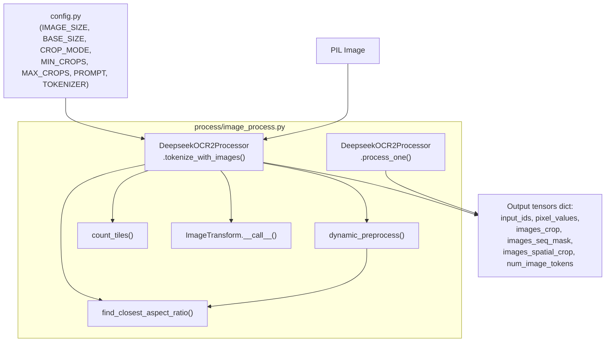
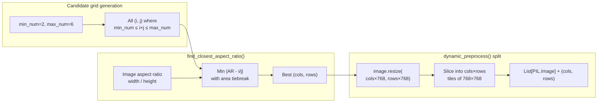
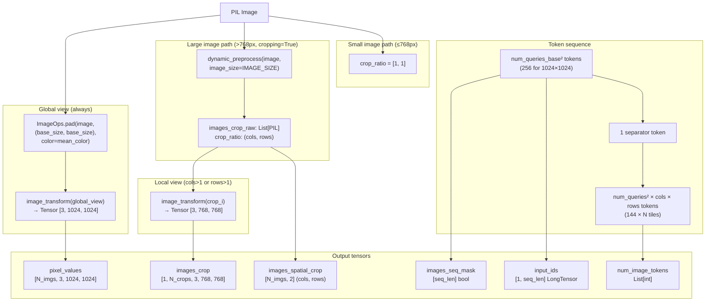

<!-- source: DeepWiki mcp.deepwiki.com · repo deepseek-ai/DeepSeek-OCR-2 · page 6.1 Image Preprocessing · fetched 2026-10-30 -->

# Image Preprocessing

<details>
<summary>Relevant source files</summary>

The following files were used as context for generating this wiki page:

- [DeepSeek-OCR2-master/DeepSeek-OCR2-vllm/process/__pycache__/image_process.cpython-312.pyc](DeepSeek-OCR2-master/DeepSeek-OCR2-vllm/process/__pycache__/image_process.cpython-312.pyc)
- [DeepSeek-OCR2-master/DeepSeek-OCR2-vllm/process/__pycache__/image_process_gpu.cpython-312.pyc](DeepSeek-OCR2-master/DeepSeek-OCR2-vllm/process/__pycache__/image_process_gpu.cpython-312.pyc)
- [DeepSeek-OCR2-master/DeepSeek-OCR2-vllm/process/__pycache__/image_process_pre.cpython-312.pyc](DeepSeek-OCR2-master/DeepSeek-OCR2-vllm/process/__pycache__/image_process_pre.cpython-312.pyc)
- [DeepSeek-OCR2-master/DeepSeek-OCR2-vllm/process/image_process.py](DeepSeek-OCR2-master/DeepSeek-OCR2-vllm/process/image_process.py)

</details>


This page documents the image preprocessing subsystem used in the vLLM inference path of DeepSeek-OCR-2. It covers every class and function in `DeepSeek-OCR2-vllm/process/`, describing how raw PIL images are converted into the structured tensor inputs consumed by the vision encoder.

For the tiling strategy and token budget reasoning (how tile counts map to visual token counts), see [Global and Local Views](#6.2). For the vision encoder that consumes the tensors produced here, see [Vision Processing Pipeline](#4.2). For the configuration constants (`BASE_SIZE`, `IMAGE_SIZE`, etc.) that parameterize this module, see [vLLM Configuration](#3.2.1).

---

## Module Overview

The `process/` directory contains three Python source files:

| File | Key Contents | Role |
|---|---|---|
| `process/image_process.py` | `DeepseekOCR2Processor`, `ImageTransform`, `dynamic_preprocess`, `find_closest_aspect_ratio`, `count_tiles` | Primary CPU preprocessing path used by all vLLM runners |
| `process/image_process_gpu.py` | `DeepseekOCRProcessor`, `ImageTransformGPU`, `dynamic_preprocess_gpu`, `pad_image_gpu_optimized` | GPU-accelerated variant; replaces PIL resizing with torchvision tensor ops |
| `process/image_process_pre.py` | `DeepseekOCRProcessor`, `process_pre` | Standalone batch preprocessing helper; used by `run_dpsk_ocr2_eval_batch.py` via `ThreadPoolExecutor` |

All three files share the same tiling geometry logic. The primary path documented here is `image_process.py`.

**Preprocessing data flow — file-level**



Sources: [DeepSeek-OCR2-master/DeepSeek-OCR2-vllm/process/image_process.py:1-10]()

---

## Configuration Inputs

`DeepseekOCR2Processor` reads sizing parameters directly from `config.py` at import time rather than accepting them as arguments at call time.

| Config Constant | Value | Used For |
|---|---|---|
| `IMAGE_SIZE` | 768 | Local tile size in pixels; also the `image_size` arg to `dynamic_preprocess` |
| `BASE_SIZE` | 1024 | Global thumbnail size; controls the 1024×1024 padded view |
| `CROP_MODE` | True | Whether to apply tiling at all |
| `MIN_CROPS` | 2 | Minimum tile count in `count_tiles` / `dynamic_preprocess` |
| `MAX_CROPS` | 6 | Maximum tile count |
| `PROMPT` | `"<image>\n<|grounding|>Convert the document to markdown."` | Hardcoded conversation template used inside `tokenize_with_images` |
| `TOKENIZER` | `AutoTokenizer` instance | Eagerly instantiated at import; used as the default tokenizer |

Sources: [DeepSeek-OCR2-master/DeepSeek-OCR2-vllm/process/image_process.py:9]()

---

## `ImageTransform`

**File:** [DeepSeek-OCR2-master/DeepSeek-OCR2-vllm/process/image_process.py:89-108]()

A thin wrapper around a `torchvision.transforms.Compose` pipeline.

**Constructor parameters:**

| Parameter | Default | Effect |
|---|---|---|
| `mean` | `(0.5, 0.5, 0.5)` | Per-channel normalization mean |
| `std` | `(0.5, 0.5, 0.5)` | Per-channel normalization std |
| `normalize` | `True` | If False, skips `T.Normalize` step |

**Pipeline built in `__init__`:**

```
T.ToTensor()           # PIL → float tensor in [0, 1], shape [3, H, W]
T.Normalize(mean, std) # → values in [-1, 1] given default mean/std
```

`__call__(pil_img)` applies this pipeline and returns the resulting `torch.Tensor`.

The GPU variant `ImageTransformGPU` (in `image_process_gpu.py`) skips `T.ToTensor()` and operates on tensors already on device, using `torchvision.transforms.functional.normalize` and converting back to CPU at the end.

Sources: [DeepSeek-OCR2-master/DeepSeek-OCR2-vllm/process/image_process.py:89-108]()

---

## Tiling Geometry Functions

These three standalone functions encapsulate the aspect-ratio matching logic. They are called by `tokenize_with_images` and can be used independently.

### `find_closest_aspect_ratio`

**Signature:** `find_closest_aspect_ratio(aspect_ratio, target_ratios, width, height, image_size)`

**File:** [DeepSeek-OCR2-master/DeepSeek-OCR2-vllm/process/image_process.py:11-25]()

Selects the best `(cols, rows)` tile grid from `target_ratios` by minimizing the absolute difference between the image's aspect ratio and the grid's aspect ratio. In a tie, it prefers the larger grid when the image area exceeds half the grid area.

**Returns:** `(cols, rows)` tuple, e.g. `(2, 1)` for a 2-wide, 1-tall grid.

---

### `count_tiles`

**Signature:** `count_tiles(orig_width, orig_height, min_num=MIN_CROPS, max_num=MAX_CROPS, image_size=768, use_thumbnail=False)`

**File:** [DeepSeek-OCR2-master/DeepSeek-OCR2-vllm/process/image_process.py:28-42]()

Constructs the set of candidate `(cols, rows)` grids satisfying `min_num ≤ cols×rows ≤ max_num`, then calls `find_closest_aspect_ratio`. Returns only the `(cols, rows)` tuple; does not split the image. Used when you need only the tile count without actually processing image data.

---

### `dynamic_preprocess`

**Signature:** `dynamic_preprocess(image, min_num=MIN_CROPS, max_num=MAX_CROPS, image_size=768, use_thumbnail=False)`

**File:** [DeepSeek-OCR2-master/DeepSeek-OCR2-vllm/process/image_process.py:45-83]()

Performs the full tiling operation:

1. Computes candidate grids and calls `find_closest_aspect_ratio` to select `(cols, rows)`.
2. Resizes the image to `(cols × image_size, rows × image_size)`.
3. Slices the resized image into `cols × rows` non-overlapping tiles of `image_size × image_size`.
4. Optionally appends a `(image_size, image_size)` thumbnail (when `use_thumbnail=True` and `blocks > 1`).

**Returns:** `(processed_images: List[PIL.Image], target_aspect_ratio: Tuple[int, int])`

**Tiling logic diagram:**



Sources: [DeepSeek-OCR2-master/DeepSeek-OCR2-vllm/process/image_process.py:28-83]()

---

## `DeepseekOCR2Processor`

**File:** [DeepSeek-OCR2-master/DeepSeek-OCR2-vllm/process/image_process.py:111-502]()

Extends `transformers.ProcessorMixin`. This is the single class used by all three vLLM runner scripts to convert (prompt, image) pairs into model inputs.

### `__init__`

**File:** [DeepSeek-OCR2-master/DeepSeek-OCR2-vllm/process/image_process.py:115-187]()

| Parameter | Default | Stored As |
|---|---|---|
| `tokenizer` | `TOKENIZER` (config) | `self.tokenizer` |
| `candidate_resolutions` | `[[1024, 1024]]` | unused (placeholder) |
| `patch_size` | 16 | `self.patch_size` (hardcoded to 16) |
| `downsample_ratio` | 4 | `self.downsample_ratio` (hardcoded to 4) |
| `image_mean` | `(0.5, 0.5, 0.5)` | `self.image_mean` |
| `image_std` | `(0.5, 0.5, 0.5)` | `self.image_std` |
| `normalize` | `True` | `self.normalize` |
| `image_token` | `"<image>"` | `self.image_token` |
| `pad_token` | `"<｜▁pad▁｜>"` | `self.pad_token` |
| `ignore_id` | `-100` | `self.ignore_id` |

Also reads from `config.py`:
- `self.image_size = IMAGE_SIZE` (768)
- `self.base_size = BASE_SIZE` (1024)

Side effects during `__init__`:
- Sets `tokenizer.padding_side = 'left'` (required for correct batch inference).
- Registers the `pad_token` as a special token if not already present.
- Looks up `image_token_id` via `tokenizer.vocab.get("<image>")`.
- Creates an `ImageTransform` instance stored as `self.image_transform`.

---

### `tokenize_with_images`

**File:** [DeepSeek-OCR2-master/DeepSeek-OCR2-vllm/process/image_process.py:330-499]()

This is the core preprocessing method. It is always invoked with a pre-loaded list of PIL images; the text prompt is taken from `PROMPT` (config), not from the caller.

**Signature:**
```
tokenize_with_images(images, bos=True, eos=True, cropping=True)
```

**Processing steps per image:**

1. **Small image fast-path**: If `image.width ≤ 768 and image.height ≤ 768`, sets `crop_ratio = [1, 1]` with no tiling.

2. **Tiling** (when `cropping=True` and image exceeds 768px): Calls `dynamic_preprocess(image, image_size=IMAGE_SIZE)` to get local crops and `crop_ratio = (cols, rows)`.

3. **Global view**: Pads the original image to `(base_size, base_size)` using `ImageOps.pad` with the mean color as fill. Applies `image_transform` to produce a `[3, 1024, 1024]` tensor added to `images_list`.

4. **Local crops**: If `cols > 1 or rows > 1`, each crop from step 2 is passed through `image_transform` and appended to `images_crop_list`.

5. **Token accounting**:

    | Symbol | Formula | Value |
    |---|---|---|
    | `num_queries_base` | `ceil((base_size // patch_size) / downsample_ratio)` | `ceil(64/4)` = 16 |
    | `num_queries` | `ceil((image_size // patch_size) / downsample_ratio)` | `ceil(12)` = 12 |
    | Global tokens | `num_queries_base²` | 256 |
    | Separator token | 1 | 1 |
    | Tile tokens | `(num_queries × cols) × (num_queries × rows)` | `144 × (cols × rows)` |

6. **Assembly**: After all images are processed, the last text segment (after the final `<image>`) is tokenized and appended.

**Returns:**
```
[[input_ids, pixel_values, images_crop, images_seq_mask, images_spatial_crop, num_image_tokens, image_shapes]]
```
(Wrapped in a double list so `process_one` can unpack as `images[0]`.)

---

**Full preprocessing data flow inside `tokenize_with_images`:**



Sources: [DeepSeek-OCR2-master/DeepSeek-OCR2-vllm/process/image_process.py:330-499]()

---

### `process_one` and `__call__`

**File:** [DeepSeek-OCR2-master/DeepSeek-OCR2-vllm/process/image_process.py:241-328]()

These are thin adapters used by runner scripts. The `images` argument passed to them is the double-list returned by `tokenize_with_images`, not raw PIL images.

`process_one` unpacks `images[0]` into named keys and returns a plain `dict`:

```python
{
    "input_ids":             input_ids,
    "pixel_values":          pixel_values,
    "images_crop":           images_crop,
    "images_seq_mask":       images_seq_mask,
    "images_spatial_crop":   images_spatial_crop,
    "num_image_tokens":      num_image_tokens,
}
```

`__call__` is a direct delegation to `process_one`.

Sources: [DeepSeek-OCR2-master/DeepSeek-OCR2-vllm/process/image_process.py:241-328]()

---

## Output Tensor Reference

| Tensor Key | Dtype | Shape | Description |
|---|---|---|---|
| `input_ids` | `torch.LongTensor` | `[1, seq_len]` | Full token sequence; image positions hold `image_token_id` |
| `pixel_values` | `torch.FloatTensor` | `[N_imgs, 3, 1024, 1024]` | Normalized global thumbnails |
| `images_crop` | `torch.FloatTensor` | `[1, N_crops, 3, 768, 768]` | Normalized local tile crops; zeros if no tiling |
| `images_seq_mask` | `torch.BoolTensor` | `[seq_len]` | `True` at every image-token position |
| `images_spatial_crop` | `torch.LongTensor` | `[N_imgs, 2]` | `(cols, rows)` tile grid per image |
| `num_image_tokens` | `List[int]` | `[N_imgs]` | Total image token count per image (global + tiles) |

Zero tensors are used for `pixel_values`, `images_crop`, and `images_spatial_crop` when no images are present.

Sources: [DeepSeek-OCR2-master/DeepSeek-OCR2-vllm/process/image_process.py:484-499]()

---

## GPU-Optimized Variant

`process/image_process_gpu.py` provides `dynamic_preprocess_gpu` and `ImageTransformGPU` for environments where image data is already on GPU. Key differences from the CPU path:

- `dynamic_preprocess_gpu` accepts a `torch.Tensor` instead of a PIL image.
- Resizing uses `torchvision.transforms.functional.resize` with `InterpolationMode.BILINEAR`.
- Tiling is performed via tensor slice operations (`tensor[..., start_h:end_h, start_w:end_w]`) rather than `PIL.Image.crop`.
- `pad_image_gpu_optimized` handles padding directly on device using `torch.Tensor.expand` and `clone`.
- `ImageTransformGPU.__call__` normalizes on GPU and calls `.cpu()` at the end.
- This variant is used by `DeepseekOCRProcessor` (note: different class name) in `image_process_gpu.py`, which also registers special tokens (`<|ref|>`, `<|/ref|>`, `<|det|>`, etc.) in its `__init__`.

Sources: [DeepSeek-OCR2-master/DeepSeek-OCR2-vllm/process/__pycache__/image_process_gpu.cpython-312.pyc:1-10]()

---

## Processor Registration

`image_process.py` registers `DeepseekOCR2Processor` with the HuggingFace `AutoProcessor` registry at module load time:

```python
AutoProcessor.register("DeepseekVLV2Processor", DeepseekOCR2Processor)
```

[DeepSeek-OCR2-master/DeepSeek-OCR2-vllm/process/image_process.py:502]()

This allows the processor to be loaded via `AutoProcessor.from_pretrained(...)` using the alias `"DeepseekVLV2Processor"`.

---

