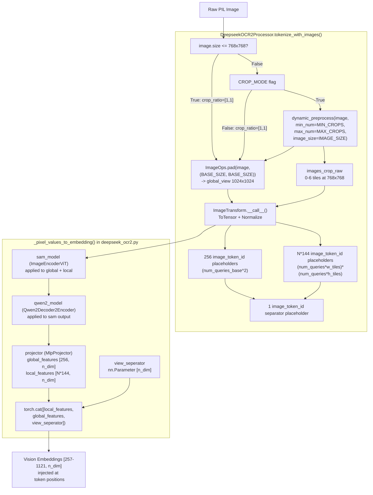
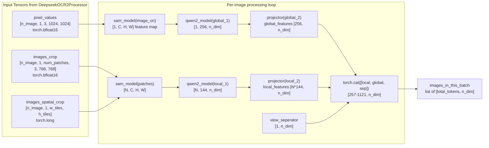

<!-- source: DeepWiki mcp.deepwiki.com · repo deepseek-ai/DeepSeek-OCR-2 · page 6.2 Global and Local Views · fetched 2026-10-30 -->

# Global and Local Views

<details>
<summary>Relevant source files</summary>

The following files were used as context for generating this wiki page:

- [DeepSeek-OCR2-master/DeepSeek-OCR2-vllm/config.py](DeepSeek-OCR2-master/DeepSeek-OCR2-vllm/config.py)
- [DeepSeek-OCR2-master/DeepSeek-OCR2-vllm/process/image_process.py](DeepSeek-OCR2-master/DeepSeek-OCR2-vllm/process/image_process.py)
- [README.md](README.md)

</details>


## Purpose and Scope

This page documents DeepSeek-OCR-2's dual-view processing strategy, where images are encoded into both **global features** (from a base 1024×1024 thumbnail) and **local features** (from 0–6 crops at 768×768 resolution). The tiling logic is implemented in `dynamic_preprocess()` and `find_closest_aspect_ratio()` in [DeepSeek-OCR2-master/DeepSeek-OCR2-vllm/process/image_process.py](), and the budget is controlled by `MIN_CROPS`, `MAX_CROPS`, and `CROP_MODE` in [DeepSeek-OCR2-master/DeepSeek-OCR2-vllm/config.py]().

For information about the full preprocessing pipeline, see page 6.1 (Image Preprocessing). For the overall token budget and dynamic resolution mechanism, see page 6 (Dynamic Resolution System).
</thinking>

Sources: [DeepSeek-OCR2-master/DeepSeek-OCR2-vllm/process/image_process.py:1-10](), [DeepSeek-OCR2-master/DeepSeek-OCR2-vllm/config.py:1-8]()

---

## Overview

DeepSeek-OCR-2 processes each input image at two resolutions simultaneously:

| View Type | Resolution | Visual Tokens | Key Config | Driven By |
|-----------|------------|---------------|------------|-----------|
| **Global view** | `BASE_SIZE` × `BASE_SIZE` (1024×1024) | 256 | `BASE_SIZE=1024` | `ImageOps.pad` to base size |
| **Local views** | `IMAGE_SIZE` × `IMAGE_SIZE` (768×768) per crop | 144 per crop | `IMAGE_SIZE=768`, `MIN_CROPS`–`MAX_CROPS` | `dynamic_preprocess()` |
| **View separator** | N/A | 1 | — | `view_seperator` learnable param |

The total number of visual tokens per image:

```
total_tokens = 256 + (N × 144) + 1
```

where `N` is the number of local crops selected by `dynamic_preprocess()`. `N` is `0` for small images (≤768×768) or when `CROP_MODE=False`, and in the range `[MIN_CROPS, MAX_CROPS]` (default 2–6) for all other images.

| Case | Crops (N) | Total Tokens |
|------|-----------|--------------|
| Small image or `CROP_MODE=False` | 0 | 257 |
| Minimum crop grid (e.g., 1×2) | 2 | 545 |
| 2×2 grid | 4 | 833 |
| Maximum crop grid (e.g., 2×3 or 1×6) | 6 | 1121 |

Sources: [README.md:132](), [DeepSeek-OCR2-master/DeepSeek-OCR2-vllm/config.py:1-8](), [DeepSeek-OCR2-master/DeepSeek-OCR2-vllm/process/image_process.py:45-83]()

---

## Dual-View Architecture

The diagram below maps the global/local view pipeline to the actual code entities responsible for each stage.

**Diagram: Global and Local View Processing — Code Entity Map**



Sources: [DeepSeek-OCR2-master/DeepSeek-OCR2-vllm/process/image_process.py:45-83](), [DeepSeek-OCR2-master/DeepSeek-OCR2-vllm/process/image_process.py:330-499]()

---

## Tiling Strategy

### Grid Candidate Generation in `dynamic_preprocess()`

The function `dynamic_preprocess()` ([DeepSeek-OCR2-master/DeepSeek-OCR2-vllm/process/image_process.py:45-83]()) selects a crop grid by enumerating all `(i, j)` pairs whose product `i*j` falls in `[MIN_CROPS, MAX_CROPS]`:

```
target_ratios = {
    (i, j)
    for n in range(MIN_CROPS, MAX_CROPS + 1)
    for i in range(1, n + 1)
    for j in range(1, n + 1)
    if MIN_CROPS <= i*j <= MAX_CROPS
}
```

With defaults `MIN_CROPS=2, MAX_CROPS=6`, the candidate grids are:

| Grid (w×h) | Total Tiles | Candidate? |
|------------|-------------|------------|
| 1×2, 2×1 | 2 | ✓ |
| 1×3, 3×1 | 3 | ✓ |
| 2×2 | 4 | ✓ |
| 1×5, 5×1 | 5 | ✓ |
| 2×3, 3×2, 1×6, 6×1 | 6 | ✓ |
| 1×1 | 1 | ✗ (below MIN_CROPS) |
| 3×3 | 9 | ✗ (above MAX_CROPS) |

`find_closest_aspect_ratio()` ([DeepSeek-OCR2-master/DeepSeek-OCR2-vllm/process/image_process.py:11-25]()) then picks the `(i, j)` whose aspect ratio `i/j` is closest to the image's aspect ratio `width/height`, with a tie-breaker that prefers the larger grid when the image area exceeds half of `i*j*image_size²`.

Sources: [DeepSeek-OCR2-master/DeepSeek-OCR2-vllm/process/image_process.py:11-83](), [DeepSeek-OCR2-master/DeepSeek-OCR2-vllm/config.py:3-6]()

### Crop Extraction

After selecting the best `(num_width_tiles, num_height_tiles)` grid, `dynamic_preprocess()` resizes the image to `(num_width_tiles × IMAGE_SIZE, num_height_tiles × IMAGE_SIZE)` and slices it into `num_width_tiles × num_height_tiles` non-overlapping tiles of size `IMAGE_SIZE × IMAGE_SIZE` (768×768).

The resulting list of PIL images (`images_crop_raw`) is then passed through `ImageTransform` and stacked into the `images_crop` tensor.

Sources: [DeepSeek-OCR2-master/DeepSeek-OCR2-vllm/process/image_process.py:58-83]()

### Global Thumbnail

Independently of tiling, the original image is always padded to `BASE_SIZE × BASE_SIZE` (1024×1024) using `ImageOps.pad()` with the mean color as fill, producing a single global thumbnail. This occurs unconditionally in `tokenize_with_images()`.

Sources: [DeepSeek-OCR2-master/DeepSeek-OCR2-vllm/process/image_process.py:386-388]()

### Small Image Short-Circuit

If the image is at most 768×768, `tokenize_with_images()` sets `crop_ratio = [1, 1]` without calling `dynamic_preprocess()` at all. This bypasses all tiling and results in 0 local crops regardless of `MIN_CROPS`.

Sources: [DeepSeek-OCR2-master/DeepSeek-OCR2-vllm/process/image_process.py:363-375]()

---

## Token Calculation Logic

### Global View Tokens

Computed in `tokenize_with_images()` using:

```
patch_size = 16
downsample_ratio = 4
num_queries_base = ceil((BASE_SIZE // patch_size) / downsample_ratio)
                 = ceil((1024 // 16) / 4)
                 = ceil(16) = 16

global_tokens = num_queries_base × num_queries_base = 16 × 16 = 256
```

Sources: [DeepSeek-OCR2-master/DeepSeek-OCR2-vllm/process/image_process.py:424-428]()

### Local View Tokens

```
num_queries = ceil((IMAGE_SIZE // patch_size) / downsample_ratio)
            = ceil((768 // 16) / 4)
            = ceil(12) = 12

local_tokens = (num_queries × num_width_tiles) × (num_queries × num_height_tiles)
             = (12 × w) × (12 × h)
             = 144 × (w × h)   — where w×h = number of crops
```

Local tokens are only added when `num_width_tiles > 1 or num_height_tiles > 1`.

Sources: [DeepSeek-OCR2-master/DeepSeek-OCR2-vllm/process/image_process.py:424-434]()

### View Separator Token

A single `image_token_id` placeholder separates the two view types in the token sequence. On the model side, this position is filled by `view_seperator`, an `nn.Parameter` initialized as:

```
embed_std = 1 / sqrt(n_embed)
view_seperator ~ Normal(0, embed_std)   shape: [n_embed]
```

Sources: [DeepSeek-OCR2-master/DeepSeek-OCR2-vllm/process/image_process.py:429]()

---

## Feature Concatenation Strategy

After encoding, the model's `_pixel_values_to_embedding()` method (in `deepseek_ocr2.py`) produces the final embedding sequence by concatenating in this order:

| Position | Content | Shape |
|----------|---------|-------|
| First | `local_features` (if crops exist) | `[N×144, n_dim]` |
| Second | `global_features` | `[256, n_dim]` |
| Last | `view_seperator` | `[1, n_dim]` |

**With local crops** (`torch.sum(patches).item() != 0`): both paths run through `sam_model` → `qwen2_model` → `projector`, and the result is `torch.cat([local_features, global_features, view_seperator[None, :]], dim=0)`.

**Without local crops**: only the global path runs, and the result is `torch.cat([global_features, view_seperator[None, :]], dim=0)`.

The ordering means the language model sees fine-grained local detail first, followed by global context, followed by the separator that signals the end of all visual tokens.

Sources: [DeepSeek-OCR2-master/DeepSeek-OCR2-vllm/deepseek_ocr2.py:397-467]()

---

## Implementation Details

### Tensor Shapes Through the Pipeline

**Diagram: Tensor Shape Flow — `_pixel_values_to_embedding()`**



Sources: [DeepSeek-OCR2-master/DeepSeek-OCR2-vllm/deepseek_ocr2.py:372-471](), [DeepSeek-OCR2-master/DeepSeek-OCR2-vllm/process/image_process.py:488-499]()

### Feature Dimensions

After `projector`, all features share the language model's embedding dimension `n_embed` (typically 1280 for DeepseekV3):

| Tensor | Shape | Notes |
|--------|-------|-------|
| `global_features` | `[256, n_embed]` | Always present |
| `local_features` | `[N×144, n_embed]` | Omitted if no crops |
| `view_seperator` | `[1, n_embed]` | Always appended last |
| `global_local_features` | `[257–1121, n_embed]` | Final concatenation |

Sources: [DeepSeek-OCR2-master/DeepSeek-OCR2-vllm/deepseek_ocr2.py:419-442]()

---

## Token Count Examples

### Example 1: Small Image (No Crops)

For images ≤768×768 that require no cropping:

```
Global view:    256 tokens  (1024×1024 base image)
Local views:      0 tokens  (no crops)
View separator:   1 token
────────────────────────────
Total:          257 tokens
```

**Sources:** [DeepSeek-OCR2-master/DeepSeek-OCR2-vllm/deepseek_ocr2.py:82-83](), [DeepSeek-OCR2-master/DeepSeek-OCR2-vllm/deepseek_ocr2.py:105-106]()

### Example 2: Medium Image (2×2 Grid)

For an image requiring a 2×2 crop grid:

```
Global view:    256 tokens  (1024×1024 base image)
Local views:    576 tokens  (4 crops × 144 tokens each)
View separator:   1 token
────────────────────────────
Total:          833 tokens
```

**Sources:** [DeepSeek-OCR2-master/DeepSeek-OCR2-vllm/deepseek_ocr2.py:98-109]()

### Example 3: Large Image (2×3 Grid)

For a complex document requiring a 2×3 crop grid (maximum crops):

```
Global view:    256 tokens  (1024×1024 base image)
Local views:    864 tokens  (6 crops × 144 tokens each)
View separator:   1 token
────────────────────────────
Total:         1121 tokens
```

**Sources:** [README.md:132](), [DeepSeek-OCR2-master/DeepSeek-OCR2-vllm/deepseek_ocr2.py:98-109]()

---

## View Separator Token

### Purpose

The `view_seperator` token serves as a learned delimiter that:

1. **Separates feature types**: Marks the boundary between local and global features
2. **Provides context**: Signals to the language model when to transition from fine-grained to coarse-grained reasoning
3. **Learned representation**: Optimized during training to encode the relationship between views

### Initialization

The separator is initialized as a learnable parameter:

```python
n_embed = 1280  # Language model embedding dimension
embed_std = 1 / torch.sqrt(torch.tensor(n_embed, dtype=torch.float32))
self.view_seperator = nn.Parameter(torch.randn(n_embed) * embed_std)
```

This initialization follows a normal distribution with standard deviation scaled by `1/√n_embed`, matching typical embedding initialization strategies.

**Sources:** [DeepSeek-OCR2-master/DeepSeek-OCR2-vllm/deepseek_ocr2.py:307-311]()

### Usage in Concatenation

The separator is always appended at the end of the concatenated features:

```python
# With crops: [local_features, global_features, view_seperator]
# Without crops: [global_features, view_seperator]
```

This placement ensures the language model receives a clear signal when all visual information has been processed.

**Sources:** [DeepSeek-OCR2-master/DeepSeek-OCR2-vllm/deepseek_ocr2.py:442](), [DeepSeek-OCR2-master/DeepSeek-OCR2-vllm/deepseek_ocr2.py:467]()

---

## Debug Output

When `PRINT_NUM_VIS_TOKENS` is enabled in configuration, the model prints token counts during inference:

```python
if PRINT_NUM_VIS_TOKENS:
    print('=====================')
    print('BASE: ', global_features.shape)
    print('PATCHES: ', local_features.shape)
    print('=====================')
```

Example output with crops:
```
=====================
BASE:  torch.Size([1, 256, 1280])
PATCHES:  torch.Size([6, 144, 1280])
=====================
```

Example output without crops:
```
=====================
BASE:  torch.Size([1, 256, 1280])
NO PATCHES
=====================
```

**Sources:** [DeepSeek-OCR2-master/DeepSeek-OCR2-vllm/deepseek_ocr2.py:413-417](), [DeepSeek-OCR2-master/DeepSeek-OCR2-vllm/deepseek_ocr2.py:450-454]()

---

## Integration with Language Model

After concatenation, the vision embeddings are merged with text embeddings in the `get_input_embeddings` method:

```python
def get_input_embeddings(
    self,
    input_ids: torch.Tensor,
    multimodal_embeddings: Optional[MultiModalEmbeddings] = None,
) -> torch.Tensor:
    inputs_embeds = self.language_model.get_input_embeddings(input_ids)
    
    if multimodal_embeddings is not None:
        inputs_embeds = merge_multimodal_embeddings(
            input_ids, inputs_embeds, multimodal_embeddings,
            self.image_token_id)
    
    return inputs_embeds
```

The `merge_multimodal_embeddings` function replaces `<image>` token positions with the concatenated global+local+separator embeddings.

**Sources:** [DeepSeek-OCR2-master/DeepSeek-OCR2-vllm/deepseek_ocr2.py:506-526]()

---

## Configuration Parameters

The following parameters from `config.py` control the dual-view system:

| Parameter | Default | Description |
|-----------|---------|-------------|
| `BASE_SIZE` | 1024 | Resolution for global view |
| `IMAGE_SIZE` | 768 | Resolution for local view crops |
| `CROP_MODE` | `True` | Enable/disable local view processing |
| `PRINT_NUM_VIS_TOKENS` | `False` | Debug output for token counts |

When `CROP_MODE=False`, only the global view is processed, resulting in a fixed 257 tokens per image.

**Sources:** [DeepSeek-OCR2-master/DeepSeek-OCR2-vllm/deepseek_ocr2.py:48]()

---

