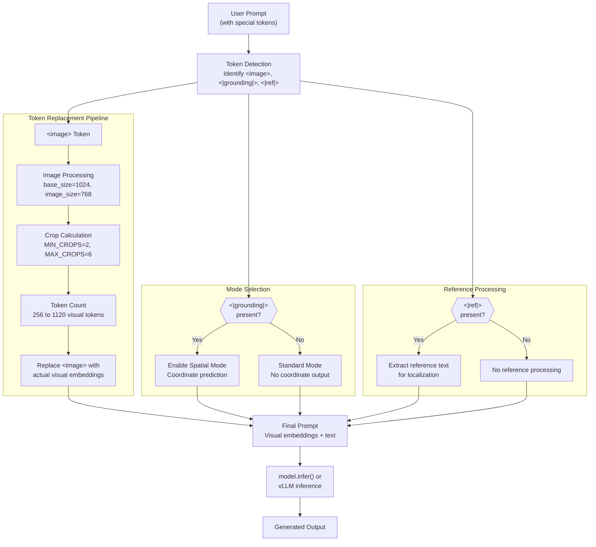
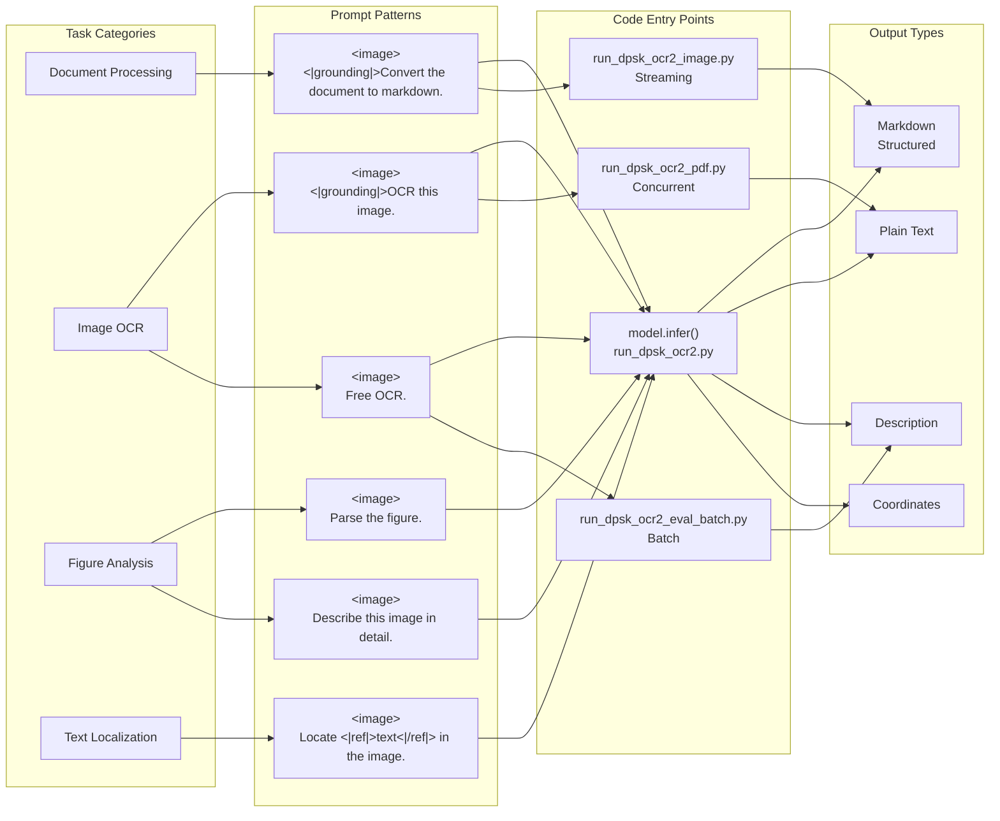
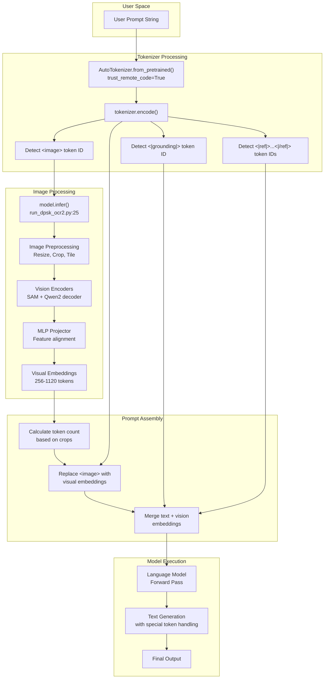

<!-- source: DeepWiki mcp.deepwiki.com · repo deepseek-ai/DeepSeek-OCR-2 · page 7 Prompt Engineering · fetched 2026-10-30 -->

# Prompt Engineering

<details>
<summary>Relevant source files</summary>

The following files were used as context for generating this wiki page:

- [DeepSeek-OCR2-master/DeepSeek-OCR2-vllm/config.py](DeepSeek-OCR2-master/DeepSeek-OCR2-vllm/config.py)
- [README.md](README.md)

</details>


This page documents the prompt engineering system for DeepSeek-OCR-2, which uses special control tokens and task-specific templates to direct model behavior at inference time. The system enables a single model to perform diverse OCR tasks through declarative prompt specifications rather than task-specific fine-tuning.

For information about the underlying vision processing that responds to these prompts, see [Dynamic Resolution System](#6). For implementation details of the model's inference methods, see [Transformers Inference](#3.1) and [vLLM Inference](#3.2).

---

## System Overview

DeepSeek-OCR-2 uses a prompt-based control system where the model's behavior is determined by the combination of special tokens and natural language instructions in the input prompt. The system supports three primary control tokens that modify model processing:

| Token | Purpose | Effect |
|-------|---------|--------|
| `<image>` | Visual input placeholder | Replaced with 256-1120 visual tokens based on image complexity |
| `<|grounding|>` | Spatial awareness mode | Enables coordinate prediction and structured output |
| `<|ref|>...<|/ref|>` | Text reference wrapper | Specifies target text for localization tasks |

Sources: [README.md:134-142](), [DeepSeek-OCR2-master/DeepSeek-OCR2-hf/run_dpsk_ocr2.py:17-18]()

### Prompt Processing Flow

The following diagram shows how prompts are processed from user input to model execution:



Sources: [README.md:134-142](), [DeepSeek-OCR2-master/DeepSeek-OCR2-hf/run_dpsk_ocr2.py:17-25]()

---

## Special Tokens

### `<image>` Token

The `<image>` token marks the position where visual embeddings will be inserted into the prompt. This token is replaced during preprocessing with variable-length visual embeddings.

**Token Replacement Process:**

1. **Detection**: The tokenizer identifies `<image>` tokens in the input prompt
2. **Image Processing**: The image undergoes multi-crop processing (see [Global and Local Views](#6.2))
3. **Token Calculation**: System calculates exact token count:
   - Base image (1024×1024): 256 tokens
   - Local crops (0-6 at 768×768): 144 tokens each
   - Total range: 256-1120 tokens
4. **Embedding Replacement**: Single `<image>` token replaced with actual visual embeddings

**Key Parameters:**

| Parameter | Default | Description |
|-----------|---------|-------------|
| `base_size` | 1024 | Base image resolution for global view |
| `image_size` | 768 | Resolution for local crop tiles |
| `crop_mode` | True | Enable/disable multi-crop processing |

**Example Usage:**

```python
# Basic usage with model.infer()
prompt = "<image>\nDescribe this image in detail."
res = model.infer(
    tokenizer, 
    prompt=prompt, 
    image_file=image_file,
    base_size=1024,
    image_size=768,
    crop_mode=True
)
```

Sources: [README.md:118-124](), [DeepSeek-OCR2-master/DeepSeek-OCR2-hf/run_dpsk_ocr2.py:17-25]()

### `<|grounding|>` Token

The `<|grounding|>` token enables spatial awareness mode, allowing the model to predict coordinates and produce structured outputs with layout information.

**Effects of Grounding Mode:**

1. **Coordinate Prediction**: Model can output bounding box coordinates
2. **Structured Output**: Enables markdown with layout preservation
3. **Spatial Relationships**: Better understanding of document structure
4. **Layout Awareness**: Maintains reading order and spatial hierarchy

**When to Use:**

- **Use `<|grounding|>`** for:
  - Document-to-markdown conversion
  - Structured OCR with layout preservation
  - Tasks requiring spatial coordinates
  - Document understanding with positional information

- **Omit `<|grounding|>`** for:
  - Layout-free text extraction
  - General image description
  - Figure parsing (when layout is not critical)
  - Simple text recognition without coordinates

**Example Comparison:**

```python
# With grounding (structured output)
prompt_grounded = "<image>\n<|grounding|>Convert the document to markdown."

# Without grounding (layout-free)
prompt_free = "<image>\nFree OCR."
```

Sources: [README.md:119, 136-138]()

### `<|ref|>...<|/ref|>` Token Pair

The `<|ref|>...<|/ref|>` token pair wraps reference text for localization tasks. The model searches for the specified text in the image and returns its location.

**Usage Pattern:**

```python
prompt = "<image>\nLocate <|ref|>target text<|/ref|> in the image."
```

**Output Format:**

The model returns bounding box coordinates or location descriptions for the referenced text.

**Use Cases:**

- Finding specific text strings in documents
- Locating keywords or phrases
- Text-based region extraction
- Document navigation by content

Sources: [README.md:141]()

---

## Task-Specific Prompts

The following table provides production-ready prompt templates for common OCR tasks. These templates combine special tokens with natural language instructions to achieve specific behaviors.

### Prompt Template Reference

| Task | Prompt Template | Special Tokens | Output Type |
|------|----------------|----------------|-------------|
| **Document to Markdown** | `<image>\n<|grounding|>Convert the document to markdown.` | `<image>`, `<|grounding|>` | Structured markdown with layout |
| **General OCR** | `<image>\n<|grounding|>OCR this image.` | `<image>`, `<|grounding|>` | Text with layout information |
| **Layout-Free OCR** | `<image>\nFree OCR.` | `<image>` | Plain text without layout |
| **Figure Parsing** | `<image>\nParse the figure.` | `<image>` | Figure description and data |
| **Image Description** | `<image>\nDescribe this image in detail.` | `<image>` | Detailed image description |
| **Text Localization** | `<image>\nLocate <|ref|>text<|/ref|> in the image.` | `<image>`, `<|ref|>` | Bounding box coordinates |

Sources: [README.md:134-142]()

### Task Flow Diagram

The following diagram maps task types to their prompt patterns and code entry points:



Sources: [README.md:86-103, 134-142](), [DeepSeek-OCR2-master/DeepSeek-OCR2-hf/run_dpsk_ocr2.py:17-25]()

---

## Document-to-Markdown Conversion

This is the primary use case for structured document processing. The prompt enables full layout preservation and markdown formatting.

**Prompt Template:**

```python
prompt = "<image>\n<|grounding|>Convert the document to markdown."
```

**Configuration:**

```python
res = model.infer(
    tokenizer, 
    prompt=prompt, 
    image_file=image_file,
    output_path=output_path,
    base_size=1024,        # Global view resolution
    image_size=768,        # Local crop resolution
    crop_mode=True,        # Enable multi-crop processing
    save_results=True      # Save to file
)
```

**Output Characteristics:**

- Preserves document structure (headings, paragraphs, lists)
- Maintains table formatting
- Captures text hierarchy
- Includes spatial layout information
- Produces valid markdown syntax

Sources: [README.md:119-124, 136](), [DeepSeek-OCR2-master/DeepSeek-OCR2-hf/run_dpsk_ocr2.py:18, 25]()

---

## General OCR with Layout

For general images requiring OCR with spatial awareness.

**Prompt Template:**

```python
prompt = "<image>\n<|grounding|>OCR this image."
```

**Use Cases:**

- Natural scene text recognition
- Mixed content images
- Images with complex layouts
- When coordinate information is needed

**Differences from Document Conversion:**

- Less structured than markdown output
- May not follow strict markdown syntax
- Better for non-document images
- Still maintains spatial relationships

Sources: [README.md:137]()

---

## Layout-Free OCR

For extracting text without preserving spatial layout or structure.

**Prompt Template:**

```python
prompt = "<image>\nFree OCR."
```

**Configuration:**

```python
res = model.infer(
    tokenizer, 
    prompt=prompt, 
    image_file=image_file,
    base_size=1024,
    image_size=768,
    crop_mode=True,        # Still recommended for quality
    save_results=True
)
```

**Characteristics:**

- No `<|grounding|>` token
- Plain text output
- No coordinate information
- No layout preservation
- Faster processing (no spatial computations)
- Reading order may vary

**When to Use:**

- Simple text extraction needs
- When layout is not important
- When processing speed is critical
- For text-only applications

Sources: [README.md:118, 138]()

---

## Figure Parsing

Specialized prompt for extracting information from figures, charts, and diagrams.

**Prompt Template:**

```python
prompt = "<image>\nParse the figure."
```

**Output Content:**

- Figure type identification
- Data extraction from charts/graphs
- Legend interpretation
- Axis labels and values
- Visual element descriptions

**Best For:**

- Scientific figures
- Charts and graphs
- Diagrams with labels
- Infographics

Sources: [README.md:139]()

---

## Image Description

General-purpose visual understanding without OCR focus.

**Prompt Template:**

```python
prompt = "<image>\nDescribe this image in detail."
```

**Output Characteristics:**

- Comprehensive visual description
- Scene understanding
- Object detection and relationships
- May include text if present
- Natural language narrative

**Differences from OCR:**

- Focus on visual content, not text extraction
- Describes what is seen, not transcribing text
- Useful for accessibility or content understanding
- Can complement OCR tasks

Sources: [README.md:140]()

---

## Text Localization

Finding and locating specific text strings within images.

**Prompt Template:**

```python
target_text = "specific phrase to find"
prompt = f"<image>\nLocate <|ref|>{target_text}<|/ref|> in the image."
```

**Example:**

```python
prompt = "<image>\nLocate <|ref|>Chapter 3<|/ref|> in the image."
```

**Output Format:**

The model returns bounding box coordinates or location descriptions:
- Top-left and bottom-right coordinates
- Relative position descriptions
- Multiple locations if text appears multiple times

**Use Cases:**

- Document navigation
- Keyword search in images
- Form field location
- Template matching

Sources: [README.md:141]()

---

## Code Integration Examples

### Transformers Backend Integration

The following example shows complete prompt usage with the Transformers backend:

```python
from transformers import AutoModel, AutoTokenizer
import torch
import os

os.environ["CUDA_VISIBLE_DEVICES"] = '0'

# Load model
model_name = 'deepseek-ai/DeepSeek-OCR-2'
tokenizer = AutoTokenizer.from_pretrained(model_name, trust_remote_code=True)
model = AutoModel.from_pretrained(
    model_name, 
    _attn_implementation='flash_attention_2', 
    trust_remote_code=True, 
    use_safetensors=True
)
model = model.eval().cuda().to(torch.bfloat16)

# Document to markdown
prompt_doc = "<image>\n<|grounding|>Convert the document to markdown."

# Layout-free OCR
prompt_free = "<image>\nFree OCR."

# Execute inference
res = model.infer(
    tokenizer, 
    prompt=prompt_doc,          # Or prompt_free
    image_file='document.jpg',
    output_path='output/',
    base_size=1024,
    image_size=768,
    crop_mode=True,
    save_results=True
)
```

Sources: [DeepSeek-OCR2-master/DeepSeek-OCR2-hf/run_dpsk_ocr2.py:1-25]()

### vLLM Backend Prompt Usage

For vLLM inference, prompts are configured in the entry point scripts. The configuration parameters affect how the `<image>` token is processed:

**Configuration in `config.py`:**

```python
# Image processing parameters affecting <image> token expansion
BASE_SIZE = 1024      # Global view resolution
IMAGE_SIZE = 768      # Local crop resolution
CROP_MODE = True      # Enable multi-crop processing
MIN_CROPS = 2         # Minimum local crops
MAX_CROPS = 6         # Maximum local crops
```

**Usage in entry scripts:**

The vLLM scripts (`run_dpsk_ocr2_image.py`, `run_dpsk_ocr2_pdf.py`, `run_dpsk_ocr2_eval_batch.py`) use prompts internally based on the task type. The `<image>` token replacement happens automatically through the `DeepseekOCR2MultiModalProcessor` class.

Sources: [README.md:86-103]()

---

## Prompt Engineering Best Practices

### Token Order

The standard token order is:

1. `<image>` - Always first
2. Line break (`\n`)
3. Optional: `<|grounding|>` - If spatial awareness needed
4. Task instruction
5. Optional: `<|ref|>...<|/ref|>` - For localization

**Correct:**
```python
"<image>\n<|grounding|>Convert the document to markdown."
```

**Incorrect:**
```python
"<|grounding|><image>\nConvert the document to markdown."  # Wrong order
```

### Natural Language Instructions

After the special tokens, use clear, concise natural language:

**Effective Instructions:**
- `Convert the document to markdown.`
- `OCR this image.`
- `Parse the figure.`
- `Describe this image in detail.`

**Less Effective:**
- Overly verbose instructions
- Ambiguous phrasing
- Multiple conflicting requests

### Token Combination Rules

| Combination | Valid | Use Case |
|-------------|-------|----------|
| `<image>` only | ✓ | Layout-free tasks, descriptions |
| `<image>` + `<|grounding|>` | ✓ | Structured OCR, documents |
| `<image>` + `<|ref|>` | ✓ | Text localization |
| `<|grounding|>` + `<|ref|>` | ✓ | Localization with coordinates |
| `<|grounding|>` only | ✗ | Invalid (requires `<image>`) |
| `<|ref|>` only | ✗ | Invalid (requires `<image>`) |

### Processing Parameters

The prompt works in conjunction with processing parameters:

```python
# For high-quality results
res = model.infer(
    tokenizer,
    prompt=prompt,
    image_file=image_file,
    base_size=1024,      # Higher = better quality
    image_size=768,      # Higher = more detail in crops
    crop_mode=True       # Enable for complex layouts
)

# For faster processing
res = model.infer(
    tokenizer,
    prompt=prompt,
    image_file=image_file,
    base_size=512,       # Lower = faster
    image_size=512,      # Lower = less detail
    crop_mode=False      # Disable for simple images
)
```

Sources: [DeepSeek-OCR2-master/DeepSeek-OCR2-hf/run_dpsk_ocr2.py:25]()

---

## Prompt-to-Code Mapping

The following diagram shows how prompts map to internal processing code:



Sources: [DeepSeek-OCR2-master/DeepSeek-OCR2-hf/run_dpsk_ocr2.py:1-25](), [README.md:118-124]()

---

## Summary

DeepSeek-OCR-2's prompt engineering system provides:

1. **Three special tokens** (`<image>`, `<|grounding|>`, `<|ref|>...<|/ref|>`) for control
2. **Six primary task templates** covering document conversion, OCR, figure parsing, description, and localization
3. **Unified architecture** where behavior is controlled by prompts, not model architecture
4. **Dynamic token expansion** where `<image>` becomes 256-1120 visual tokens
5. **Declarative task specification** through natural language instructions

The system's strength lies in its simplicity: developers specify tasks through clear prompts rather than managing multiple models or complex configuration. This approach enables rapid prototyping and easy adaptation to new OCR tasks without retraining.

Sources: [README.md:134-142](), [DeepSeek-OCR2-master/DeepSeek-OCR2-hf/run_dpsk_ocr2.py:1-25]()

---

