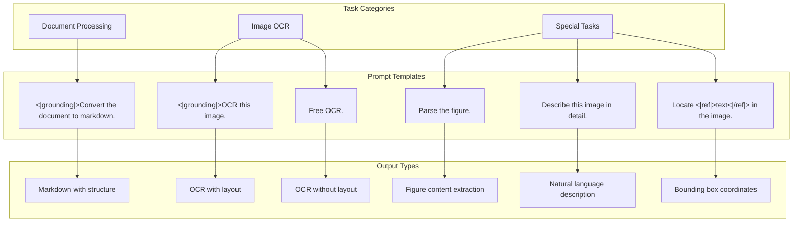
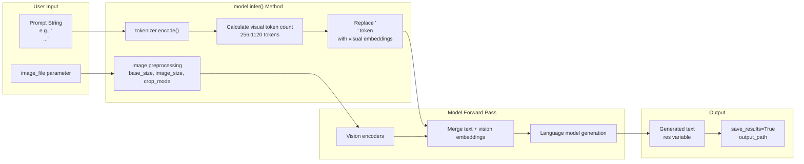

<!-- source: DeepWiki mcp.deepwiki.com · repo deepseek-ai/DeepSeek-OCR-2 · page 7.2 Task-Specific Prompts · fetched 2026-10-30 -->

# Task-Specific Prompts

<details>
<summary>Relevant source files</summary>

The following files were used as context for generating this wiki page:

- [DeepSeek-OCR2-master/DeepSeek-OCR2-vllm/config.py](DeepSeek-OCR2-master/DeepSeek-OCR2-vllm/config.py)
- [README.md](README.md)

</details>


## Purpose and Scope

This document provides comprehensive prompt templates for the six primary OCR tasks supported by DeepSeek-OCR-2. Each template combines the `<image>` token with optional control tokens (`<|grounding|>`, `<|ref|>`) and task-specific instructions to enable different processing modes. For documentation of the control tokens themselves, see [Special Tokens](#7.1). For information about how these prompts are processed at the model level, see [Multimodal Integration](#4.3).

---

## Prompt Template Overview

The following diagram maps each task type to its corresponding prompt template and expected output format:



**Sources:** [README.md:134-142]()

---

## Prompt Processing Flow

The following diagram shows how task-specific prompts are processed through the inference pipeline:



**Sources:** [run_dpsk_ocr2.py:1-25](), [README.md:107-124]()

---

## Task-Specific Templates

### Document-to-Markdown Conversion

**Prompt Template:**
```python
prompt = "<image>\n<|grounding|>Convert the document to markdown."
```

**Use Case:** Converting structured documents (PDFs, scanned papers, reports) into markdown format while preserving document structure including headings, lists, tables, and hierarchical organization.

**Characteristics:**
- **Requires:** `<|grounding|>` token for spatial awareness
- **Output:** Markdown text with preserved document structure
- **Best For:** Documents with clear hierarchical structure, academic papers, technical reports

**Example Usage:**
```python
# From run_dpsk_ocr2.py
prompt = "<image>\n<|grounding|>Convert the document to markdown."
res = model.infer(
    tokenizer, 
    prompt=prompt, 
    image_file=image_file, 
    output_path=output_path,
    base_size=1024, 
    image_size=768, 
    crop_mode=True, 
    save_results=True
)
```

**Sources:** [README.md:136](), [run_dpsk_ocr2.py:18]()

---

### General Image OCR

**Prompt Template:**
```python
prompt = "<image>\n<|grounding|>OCR this image."
```

**Use Case:** Extracting text from general images (screenshots, photos, diagrams) while maintaining spatial layout and text positioning information.

**Characteristics:**
- **Requires:** `<|grounding|>` token for layout preservation
- **Output:** OCR text with layout structure maintained
- **Best For:** Images with complex layouts, multi-column text, forms, infographics

**Key Differences from Document Conversion:**
- More generic than document-to-markdown (doesn't assume document structure)
- Maintains spatial relationships without enforcing markdown hierarchy
- Suitable for images that aren't traditional documents

**Sources:** [README.md:137]()

---

### Layout-Free OCR

**Prompt Template:**
```python
prompt = "<image>\nFree OCR."
```

**Use Case:** Extracting text content without preserving layout or spatial relationships. Text is returned in reading order without structure preservation.

**Characteristics:**
- **No Control Tokens:** Omits `<|grounding|>` token
- **Output:** Plain text stream in reading order
- **Best For:** Simple text extraction where layout doesn't matter, single-column documents, captions

**Performance Note:**
- Faster processing than layout-aware modes
- Lower token count in output
- No spatial metadata

**Example:**
```python
# From run_dpsk_ocr2.py comment
prompt = "<image>\nFree OCR."
res = model.infer(tokenizer, prompt=prompt, image_file=image_file)
```

**Sources:** [README.md:138](), [run_dpsk_ocr2.py:17]()

---

### Figure Parsing

**Prompt Template:**
```python
prompt = "<image>\nParse the figure."
```

**Use Case:** Extracting information from figures, charts, diagrams, and graphs within documents. Interprets visual elements beyond just text.

**Characteristics:**
- **No `<|grounding|>` Token:** Focuses on content interpretation
- **Output:** Structured description of figure content, data, labels, legends
- **Best For:** Scientific figures, charts, technical diagrams, flowcharts

**Interpretation Behavior:**
- Extracts text labels from axes, legends, annotations
- Describes visual relationships (e.g., "line graph showing...")
- May infer data values from visual representation

**Sources:** [README.md:139]()

---

### Image Description

**Prompt Template:**
```python
prompt = "<image>\nDescribe this image in detail."
```

**Use Case:** Generating natural language descriptions of image content for general visual understanding tasks (not OCR-specific).

**Characteristics:**
- **No Control Tokens:** Pure vision-language understanding
- **Output:** Natural language description of visual content
- **Best For:** General images, photos, scenes where text extraction isn't the goal

**Scope:**
- Describes visual elements, objects, scenes, actions
- May include text if visible, but not the primary focus
- More holistic than OCR-specific prompts

**Sources:** [README.md:140]()

---

### Text Localization

**Prompt Template:**
```python
prompt = "<image>\nLocate <|ref|>target_text<|/ref|> in the image."
```

**Use Case:** Finding specific text within an image and returning its spatial coordinates (bounding boxes).

**Characteristics:**
- **Requires:** `<|ref|>...<|/ref|>` tokens enclosing target text
- **Output:** Coordinate information (bounding box) for the specified text
- **Best For:** Text search, verification, region-of-interest extraction

**Template Variables:**
- `target_text`: The specific text string to locate in the image

**Example:**
```python
prompt = "<image>\nLocate <|ref|>Section 3.2<|/ref|> in the image."
# Returns coordinates of where "Section 3.2" appears
```

**Sources:** [README.md:141]()

---

## Prompt Template Summary Table

| Task | Prompt Template | Control Tokens | Output Format |
|------|----------------|----------------|---------------|
| Document → Markdown | `<image>\n<\|grounding\|>Convert the document to markdown.` | `<\|grounding\|>` | Markdown with structure |
| General Image OCR | `<image>\n<\|grounding\|>OCR this image.` | `<\|grounding\|>` | OCR text with layout |
| Layout-Free OCR | `<image>\nFree OCR.` | None | Plain text stream |
| Figure Parsing | `<image>\nParse the figure.` | None | Figure content description |
| Image Description | `<image>\nDescribe this image in detail.` | None | Natural language description |
| Text Localization | `<image>\nLocate <\|ref\|>text<\|/ref\|> in the image.` | `<\|ref\|>` | Bounding box coordinates |

**Sources:** [README.md:134-142]()

---

## Prompt Construction Guidelines

### Token Placement Rules

1. **`<image>` Token Position:**
   - Always place at the beginning of the prompt
   - Must appear before any control tokens or instructions
   - Replaced with 256-1120 visual embeddings during processing

2. **Newline Separation:**
   - Use `\n` to separate `<image>` token from subsequent text
   - Example: `"<image>\n<|grounding|>..."` not `"<image><|grounding|>..."`

3. **Control Token Order:**
   - `<|grounding|>` comes immediately after `<image>\n`
   - `<|ref|>` encloses specific text in localization tasks
   - Instruction text follows control tokens

### Common Patterns

**Pattern 1: Structured Output (with grounding)**
```python
"<image>\n<|grounding|>[instruction]"
```
- Used when spatial layout matters
- Enables coordinate prediction and structure preservation

**Pattern 2: Content Extraction (no grounding)**
```python
"<image>\n[instruction]"
```
- Used when only content matters, not layout
- Faster processing, simpler output

**Pattern 3: Search/Localization**
```python
"<image>\n[instruction] <|ref|>[target]<|/ref|> [continuation]"
```
- Used for finding specific text
- Returns spatial coordinates

**Sources:** [README.md:134-142](), [run_dpsk_ocr2.py:17-18]()

---

## Integration with model.infer() Method

All prompt templates are passed to the `model.infer()` method defined in the DeepSeek-OCR-2 model class. The method signature and key parameters:

```python
res = model.infer(
    tokenizer,                    # AutoTokenizer instance
    prompt=prompt,                # Task-specific prompt string
    image_file=image_file,        # Path to input image
    output_path=output_path,      # Directory for saving results
    base_size=1024,               # Base resolution (default: 1024)
    image_size=768,               # Crop resolution (default: 768)
    crop_mode=True,               # Enable multi-crop (default: True)
    save_results=True             # Save output to file (default: True)
)
```

### Parameter Impact on Prompts

- **crop_mode:** When `True`, enables 0-6 local crops (768×768) in addition to base image (1024×1024), increasing visual token count from 256 to up to 1120 tokens
- **base_size, image_size:** Control resolution of processed images, affecting detail level available to prompt instructions
- **save_results:** When `True`, saves generated text to `output_path`, useful for batch processing with different prompts

**Sources:** [run_dpsk_ocr2.py:25](), [README.md:123]()

---

## Customizing Prompts

While the six standard templates cover most use cases, prompts can be customized by:

1. **Modifying Instructions:** Change the text after control tokens
   ```python
   # Instead of "Convert the document to markdown."
   prompt = "<image>\n<|grounding|>Convert to markdown, preserving all tables."
   ```

2. **Adding Context:** Provide additional context in the instruction
   ```python
   prompt = "<image>\n<|grounding|>OCR this scientific paper, paying attention to equations."
   ```

3. **Combining Modes:** Mix control tokens with custom instructions
   ```python
   prompt = "<image>\n<|grounding|>Extract all table data and describe the figures."
   ```

**Note:** Custom prompts should maintain the token ordering rules (see Token Placement Rules above) to ensure correct model behavior.

**Sources:** [README.md:134-142]()

---

