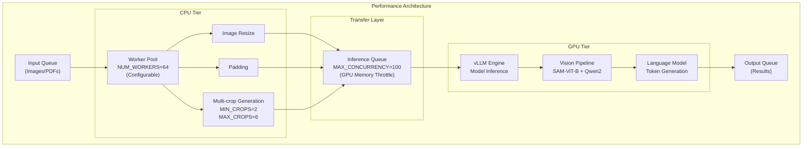
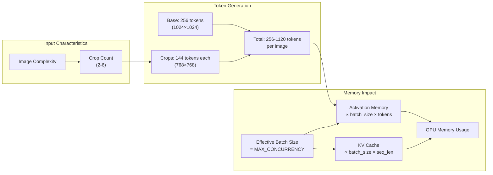
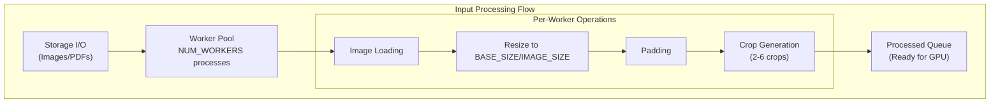
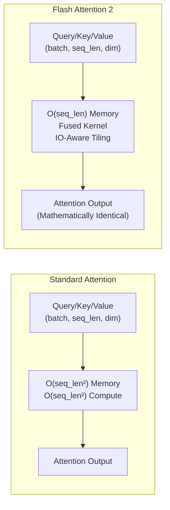
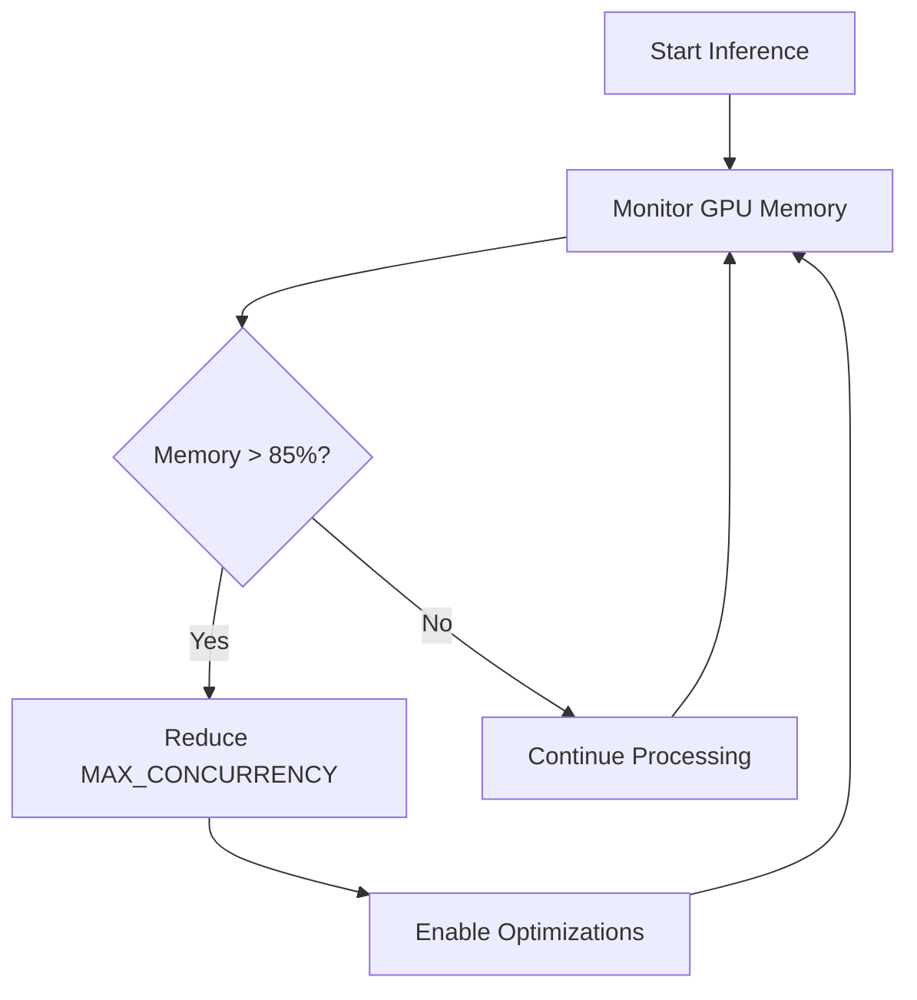
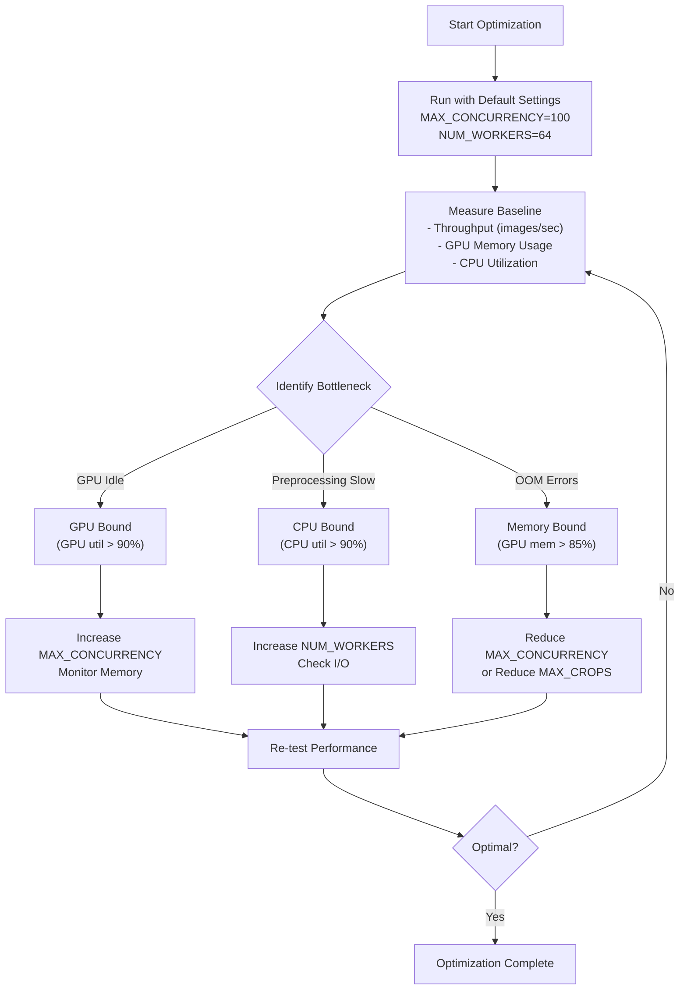

<!-- source: DeepWiki mcp.deepwiki.com · repo deepseek-ai/DeepSeek-OCR-2 · page 8 Performance Optimization · fetched 2026-10-30 -->

# Performance Optimization

<details>
<summary>Relevant source files</summary>

The following files were used as context for generating this wiki page:

- [DeepSeek-OCR2-master/DeepSeek-OCR2-vllm/config.py](DeepSeek-OCR2-master/DeepSeek-OCR2-vllm/config.py)
- [README.md](README.md)

</details>


This document covers performance optimization strategies for DeepSeek-OCR-2, including concurrency tuning, worker configuration, memory management, and attention mechanism optimizations. The focus is on maximizing throughput for production workloads while maintaining stability across different hardware configurations.

For backend-specific configuration details, see [vLLM Inference](#3.2) and [Transformers Inference](#3.1). For image processing parameters that affect performance, see [Image Preprocessing](#6.1).

## Overview

DeepSeek-OCR-2's performance is governed by a two-tier parallelism model that separates CPU-bound preprocessing operations from GPU-bound inference. Understanding this architecture is essential for optimal tuning:



**Sources**: [DeepSeek-OCR2-master/DeepSeek-OCR2-vllm/config.py:7-8](), [README.md:86-103]()

## Two-Tier Parallelism Model

The system implements distinct parallelism strategies for different computational bottlenecks:

| Tier | Resource | Operations | Parallelism Control | Bottleneck Type |
|------|----------|------------|---------------------|-----------------|
| CPU | Multi-core CPUs | Image resize, padding, crop generation | `NUM_WORKERS` | I/O + computation |
| GPU | CUDA devices | Vision encoding, language model inference | `MAX_CONCURRENCY` | GPU memory + computation |

### CPU Tier: Preprocessing Workers

The `NUM_WORKERS` parameter controls the number of parallel processes handling image preprocessing operations defined in [DeepSeek-OCR2-master/DeepSeek-OCR2-vllm/config.py:8](). These workers perform:

- Image resizing to `BASE_SIZE=1024` and `IMAGE_SIZE=768`
- Padding to uniform dimensions
- Multi-crop generation (2-6 crops per image based on `MIN_CROPS` and `MAX_CROPS`)

**Default Configuration**: `NUM_WORKERS = 64`

**Tuning Considerations**:
- CPU core count: Set to available CPU cores minus system overhead (e.g., 64 for a 128-core system)
- I/O bandwidth: Reduce if reading from slow storage to prevent worker starvation
- Memory pressure: Each worker holds image buffers; reduce if experiencing CPU memory exhaustion

### GPU Tier: Inference Concurrency

The `MAX_CONCURRENCY` parameter in [DeepSeek-OCR2-master/DeepSeek-OCR2-vllm/config.py:7]() controls the maximum number of simultaneous inference requests submitted to the vLLM engine. This acts as a throttle to prevent GPU out-of-memory (OOM) errors.

**Default Configuration**: `MAX_CONCURRENCY = 100`

**Critical Note**: The configuration file explicitly warns: "If you have limited GPU memory, lower the concurrency count."

**Sources**: [DeepSeek-OCR2-master/DeepSeek-OCR2-vllm/config.py:1-11]()

## Concurrency Configuration

### MAX_CONCURRENCY Tuning

The `MAX_CONCURRENCY` parameter must be carefully balanced against GPU memory capacity and dynamic visual token counts:



### Hardware-Specific Recommendations

| GPU Configuration | Recommended MAX_CONCURRENCY | Notes |
|-------------------|----------------------------|-------|
| Single A100 (80GB) | 100 (default) | Optimal for standard workloads |
| Single A100 (40GB) | 40-60 | Reduce for complex images with high crop counts |
| 8×A100 (80GB) | 800 (100 per GPU) | Scale linearly with GPU count |
| Consumer GPUs (24GB) | 20-30 | Significantly reduce; monitor OOM errors |
| Consumer GPUs (12GB) | 10-15 | Minimal concurrency; consider Transformers backend |

### Dynamic Adjustment Strategy

For workloads with variable image complexity, implement adaptive concurrency:

1. **Start Conservative**: Begin with `MAX_CONCURRENCY = 50` for unknown workloads
2. **Monitor GPU Memory**: Track `nvidia-smi` memory utilization during inference
3. **Iterate Upward**: Increase by 10-20 until memory utilization reaches 85-90%
4. **Leave Headroom**: Maintain 10-15% memory buffer for peak token counts (images with 6 crops)

**Sources**: [DeepSeek-OCR2-master/DeepSeek-OCR2-vllm/config.py:7](), [README.md:86-103]()

## Worker Configuration

### NUM_WORKERS Optimization

The `NUM_WORKERS` parameter defined in [DeepSeek-OCR2-master/DeepSeek-OCR2-vllm/config.py:8]() controls CPU preprocessing parallelism. This is independent of GPU concurrency and should be tuned based on CPU resources:



### Balancing Workers with Inference

The optimal `NUM_WORKERS` depends on the preprocessing-to-inference time ratio:

**Formula**: `NUM_WORKERS ≈ (avg_inference_time / avg_preprocess_time) × MAX_CONCURRENCY`

**Example Calculation**:
- Average preprocessing time: 0.5s per image
- Average inference time: 2.0s per image
- `MAX_CONCURRENCY = 100`
- Optimal `NUM_WORKERS = (2.0 / 0.5) × 100 = 400`

However, practical constraints limit this:
- **CPU cores**: Cannot exceed available CPU threads
- **Memory**: Each worker consumes RAM for image buffers (~100MB per worker)
- **I/O bandwidth**: Disk throughput may bottleneck at high worker counts

**Recommended Range**: 32-128 workers for most systems

**Sources**: [DeepSeek-OCR2-master/DeepSeek-OCR2-vllm/config.py:8]()

## Flash Attention Integration

DeepSeek-OCR-2 leverages Flash Attention 2 for optimized attention computation in both SAM-ViT-B and language model components. This provides significant speedup and memory reduction for the attention mechanism.

### Installation and Configuration

Flash Attention 2 is installed via [README.md:82]():

```bash
pip install flash-attn==2.7.3 --no-build-isolation
```

### Transformers Backend Activation

In the Transformers backend, Flash Attention 2 is activated via the `_attn_implementation` parameter in [README.md:115]():

```python
model = AutoModel.from_pretrained(
    model_name, 
    _attn_implementation='flash_attention_2',
    trust_remote_code=True,
    use_safetensors=True
)
```

### vLLM Backend Activation

The vLLM backend automatically detects and uses Flash Attention 2 when available. No explicit configuration is required beyond installation.

### Performance Impact



| Metric | Standard Attention | Flash Attention 2 | Improvement |
|--------|-------------------|-------------------|-------------|
| Memory Complexity | O(seq_len²) | O(seq_len) | ~4-8× reduction |
| Speed (seq_len=2048) | Baseline | 2-4× faster | 2-4× |
| Speed (seq_len=4096) | Baseline | 3-5× faster | 3-5× |
| Numerical Accuracy | Standard | Identical | No loss |

### Compatibility Notes

- **CUDA Requirement**: Flash Attention 2 requires CUDA 11.8 or higher
- **GPU Architecture**: Requires Ampere (A100, A10) or newer (H100, H200)
- **Precision**: Optimized for `bfloat16` and `float16` datatypes
- **PyTorch Version**: Requires PyTorch 2.0 or higher (system uses 2.6.0)

**Sources**: [README.md:82](), [README.md:115]()

## Memory Management

### GPU Memory Allocation

DeepSeek-OCR-2's GPU memory consumption consists of three primary components:

| Component | Size | Scaling Factor |
|-----------|------|----------------|
| Model Weights | Fixed (~10-40GB depending on language model) | N/A |
| KV Cache | Variable | `MAX_CONCURRENCY × max_seq_len × 2 × num_layers × hidden_dim` |
| Activation Memory | Variable | `MAX_CONCURRENCY × (256-1120) tokens × hidden_dim` |

### Memory Estimation Formula

**Total GPU Memory** ≈ Model Weights + KV Cache + Activations + Overhead

Where:
- **Model Weights**: 10-40GB (language model dependent)
- **KV Cache**: `MAX_CONCURRENCY × 2048 × 2 × 28 × 5120 × 2 bytes` (example for DeepseekV3)
- **Activations**: `MAX_CONCURRENCY × avg_tokens × 5120 × 2 bytes`
- **Overhead**: ~20% for CUDA operations

### Preventing OOM Errors



**Recommended Monitoring**:
```bash
# Real-time GPU memory monitoring
watch -n 1 nvidia-smi

# Per-process memory tracking
nvidia-smi pmon -s m -d 1
```

**Sources**: [DeepSeek-OCR2-master/DeepSeek-OCR2-vllm/config.py:7]()

## Crop Mode Optimization

The `CROP_MODE` parameter in [DeepSeek-OCR2-master/DeepSeek-OCR2-vllm/config.py:4]() controls whether the system generates local crops for enhanced detail. This has significant performance implications:

| Configuration | Visual Tokens | Memory Usage | Inference Time | Recommended For |
|--------------|---------------|--------------|----------------|-----------------|
| `CROP_MODE=False` | 256 (fixed) | Minimal | Fastest | Simple documents, low-resolution images |
| `CROP_MODE=True, MIN_CROPS=2` | 544-1120 | Moderate | Moderate | General OCR workloads |
| `CROP_MODE=True, MAX_CROPS=6` | 256-1120 | High | Slower | Complex documents, fine detail preservation |

### Tuning MIN_CROPS and MAX_CROPS

From [DeepSeek-OCR2-master/DeepSeek-OCR2-vllm/config.py:5-6]():

```python
MIN_CROPS = 2  # Minimum number of local crops
MAX_CROPS = 6  # Maximum number of local crops
```

**Trade-offs**:
- **Higher MAX_CROPS**: Better detail preservation, higher memory usage, slower inference
- **Lower MIN_CROPS**: Faster processing for simple images, may miss fine details
- **Adaptive Range**: System automatically determines crop count between MIN and MAX based on image complexity

**Sources**: [DeepSeek-OCR2-master/DeepSeek-OCR2-vllm/config.py:4-6](), [README.md:131-132]()

## Performance Profiling

### Entry Point Performance Characteristics

| Entry Point | Script | Optimization Focus | Recommended MAX_CONCURRENCY |
|-------------|--------|-------------------|----------------------------|
| Image Streaming | `run_dpsk_ocr2_image.py` | Low latency, real-time output | 50-100 |
| PDF Concurrent | `run_dpsk_ocr2_pdf.py` | High throughput, batch processing | 100-200 |
| Batch Evaluation | `run_dpsk_ocr2_eval_batch.py` | Consistent timing, reproducibility | 100 |

### Benchmark Configuration

From [README.md:100-102](), the batch evaluation script is optimized for benchmarking workloads like OmniDocBench v1.5:

**Recommended Settings for Benchmarking**:
```python
MAX_CONCURRENCY = 100  # Stable, reproducible performance
NUM_WORKERS = 64       # Consistent preprocessing
CROP_MODE = True       # Full quality evaluation
MIN_CROPS = 2
MAX_CROPS = 6
```

**Sources**: [README.md:92-102](), [DeepSeek-OCR2-master/DeepSeek-OCR2-vllm/config.py:1-11]()

## Configuration File Reference

The central configuration hub at [DeepSeek-OCR2-master/DeepSeek-OCR2-vllm/config.py:1-38]() consolidates all performance-related parameters:

```mermaid
graph TB
    CONFIG["config.py<br/>Central Configuration"]
    
    subgraph "Image Processing"
        BASE["BASE_SIZE = 1024"]
        IMG["IMAGE_SIZE = 768"]
        CROP["CROP_MODE = True"]
        MINC["MIN_CROPS = 2"]
        MAXC["MAX_CROPS = 6"]
    end
    
    subgraph "Parallelism"
        CONC["MAX_CONCURRENCY = 100"]
        WORK["NUM_WORKERS = 64"]
    end
    
    subgraph "Debugging"
        PRINT["PRINT_NUM_VIS_TOKENS = False"]
        SKIP["SKIP_REPEAT = True"]
    end
    
    subgraph "Paths"
        MODEL["MODEL_PATH"]
        INPUT["INPUT_PATH"]
        OUTPUT["OUTPUT_PATH"]
        PROMPT["PROMPT"]
    end
    
    CONFIG --> BASE
    CONFIG --> IMG
    CONFIG --> CROP
    CONFIG --> MINC
    CONFIG --> MAXC
    CONFIG --> CONC
    CONFIG --> WORK
    CONFIG --> PRINT
    CONFIG --> SKIP
    CONFIG --> MODEL
    CONFIG --> INPUT
    CONFIG --> OUTPUT
    CONFIG --> PROMPT
```



### Parameter Summary

| Parameter | Default | Type | Performance Impact |
|-----------|---------|------|-------------------|
| `BASE_SIZE` | 1024 | int | Affects base image token count (256 tokens) |
| `IMAGE_SIZE` | 768 | int | Affects crop token count (144 tokens each) |
| `CROP_MODE` | True | bool | Enables/disables local crops (major impact) |
| `MIN_CROPS` | 2 | int | Minimum visual tokens: 544 |
| `MAX_CROPS` | 6 | int | Maximum visual tokens: 1120 |
| `MAX_CONCURRENCY` | 100 | int | GPU batch size (memory critical) |
| `NUM_WORKERS` | 64 | int | CPU preprocessing parallelism |
| `PRINT_NUM_VIS_TOKENS` | False | bool | Debug output (minimal impact) |
| `SKIP_REPEAT` | True | bool | Enables n-gram repetition prevention |

**Sources**: [DeepSeek-OCR2-master/DeepSeek-OCR2-vllm/config.py:1-11]()

## Performance Optimization Workflow



**Optimization Checklist**:
1. ✅ Install Flash Attention 2 (`flash-attn==2.7.3`)
2. ✅ Configure `MAX_CONCURRENCY` based on GPU memory
3. ✅ Set `NUM_WORKERS` based on CPU core count
4. ✅ Enable `CROP_MODE=True` for quality, `False` for speed
5. ✅ Adjust `MIN_CROPS` and `MAX_CROPS` based on detail requirements
6. ✅ Monitor GPU memory with `nvidia-smi`
7. ✅ Profile with batch evaluation script for reproducible metrics
8. ✅ Use `_attn_implementation='flash_attention_2'` in Transformers backend

**Sources**: [DeepSeek-OCR2-master/DeepSeek-OCR2-vllm/config.py:1-11](), [README.md:82](), [README.md:115]()

---

