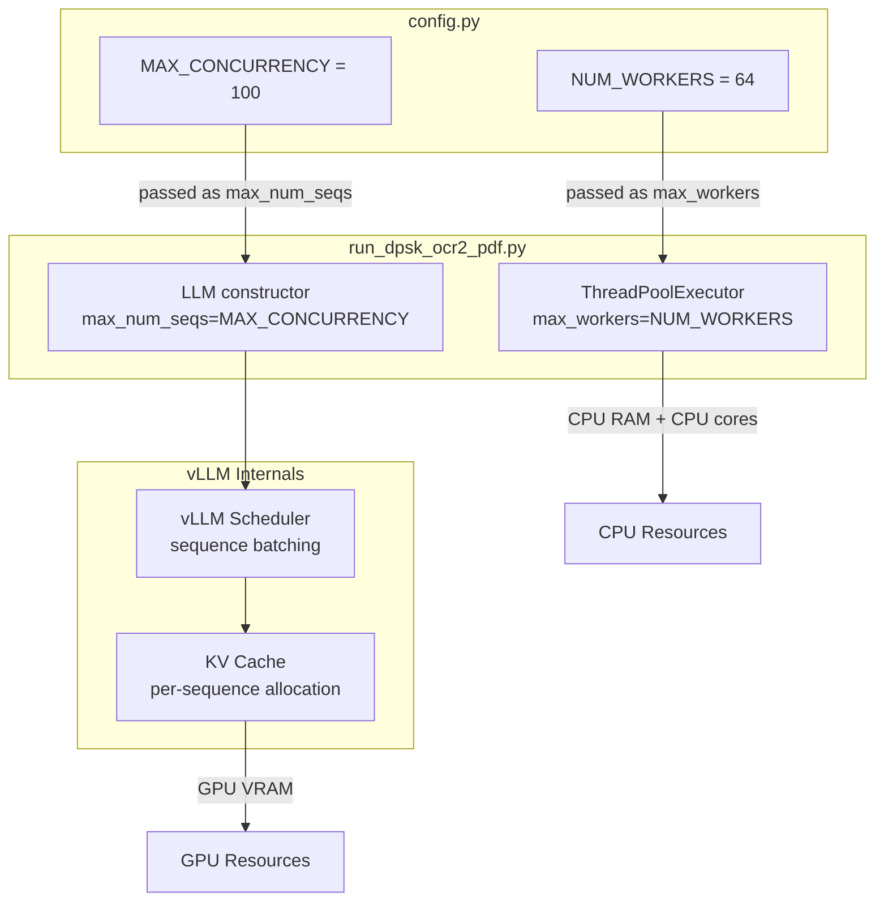

<!-- source: DeepWiki mcp.deepwiki.com · repo deepseek-ai/DeepSeek-OCR-2 · page 8.1 Concurrency Configuration · fetched 2026-10-30 -->

# Concurrency Configuration

Relevant source files

The following files were used as context for generating this wiki page:

- [DeepSeek-OCR2-master/DeepSeek-OCR2-vllm/__pycache__/config.cpython-312.pyc](DeepSeek-OCR2-master/DeepSeek-OCR2-vllm/__pycache__/config.cpython-312.pyc)
- [DeepSeek-OCR2-master/DeepSeek-OCR2-vllm/config.py](DeepSeek-OCR2-master/DeepSeek-OCR2-vllm/config.py)
- [DeepSeek-OCR2-master/DeepSeek-OCR2-vllm/run_dpsk_ocr2_pdf.py](DeepSeek-OCR2-master/DeepSeek-OCR2-vllm/run_dpsk_ocr2_pdf.py)

This page covers the two independent parallelism axes available in the vLLM inference path: CPU-side preprocessing concurrency (`NUM_WORKERS`) and GPU-side inference concurrency (`MAX_CONCURRENCY`). Both are controlled from a single file and affect throughput in different stages of the pipeline.

This page is specific to the vLLM path. For documentation of the underlying vLLM configuration parameters (model path, image sizing, etc.), see [vLLM Configuration](#3.2.1). For a description of what the runner scripts do with these values, see [vLLM Entry Points](#3.2.2).

---

## Parameters at a Glance

Both parameters are defined in `DeepSeek-OCR2-vllm/config.py`.

| Parameter | Default | Type | Stage |
|---|---|---|---|
| `NUM_WORKERS` | `64` | `int` | CPU: image resize/padding |
| `MAX_CONCURRENCY` | `100` | `int` | GPU: concurrent inference slots |

Sources: [DeepSeek-OCR2-master/DeepSeek-OCR2-vllm/config.py:7-8]()

---

## Two Independent Parallelism Axes

The inference pipeline has two discrete stages with independent concurrency controls:

**Pipeline Stages and Concurrency Controls**

Sources: [DeepSeek-OCR2-master/DeepSeek-OCR2-vllm/config.py:7-8](), [DeepSeek-OCR2-master/DeepSeek-OCR2-vllm/run_dpsk_ocr2_pdf.py:248-253](), [DeepSeek-OCR2-master/DeepSeek-OCR2-vllm/run_dpsk_ocr2_pdf.py:32-44]()

---

## NUM_WORKERS — CPU Preprocessing Concurrency

`NUM_WORKERS` controls how many threads run image preprocessing in parallel. It is passed directly as `max_workers` to `ThreadPoolExecutor`.

**Preprocessing parallelism in `run_dpsk_ocr2_pdf.py`:**

[DeepSeek-OCR2-master/DeepSeek-OCR2-vllm/run_dpsk_ocr2_pdf.py:248-253]()

Each worker thread calls `process_single_image`, which instantiates `DeepseekOCR2Processor` and runs `tokenize_with_images`. This includes:
- Aspect-ratio tiling via `dynamic_preprocess()`
- Tensor normalization
- Token sequence assembly

The output is a `batch_inputs` list that is passed wholesale to `llm.generate()` after all preprocessing completes. Preprocessing and inference are therefore **sequential phases**, not overlapping: all images are preprocessed before any GPU inference begins.

**What NUM_WORKERS affects:**

| Concern | Effect |
|---|---|
| Higher `NUM_WORKERS` | Faster preprocessing wall-clock time |
| Very high `NUM_WORKERS` | Diminishing returns; bounded by CPU/RAM, not GPU |
| Lower `NUM_WORKERS` | Preprocessing becomes the bottleneck before GPU inference starts |

Sources: [DeepSeek-OCR2-master/DeepSeek-OCR2-vllm/run_dpsk_ocr2_pdf.py:248-253](), [DeepSeek-OCR2-master/DeepSeek-OCR2-vllm/config.py:8]()

---

## MAX_CONCURRENCY — GPU Inference Concurrency

`MAX_CONCURRENCY` is passed as `max_num_seqs` to the `LLM` constructor. This is a vLLM parameter that limits how many sequences (requests) are processed concurrently in the GPU engine at any one time.

**Engine initialization in `run_dpsk_ocr2_pdf.py`:**

[DeepSeek-OCR2-master/DeepSeek-OCR2-vllm/run_dpsk_ocr2_pdf.py:32-44]()

The relevant argument: `max_num_seqs=MAX_CONCURRENCY`.

**What MAX_CONCURRENCY affects:**

| Concern | Effect |
|---|---|
| Higher `MAX_CONCURRENCY` | More sequences batched together; higher GPU utilization |
| Higher `MAX_CONCURRENCY` | More KV cache memory held simultaneously |
| GPU memory pressure | Risk of OOM errors if too many sequences with large visual token budgets are in-flight |
| Lower `MAX_CONCURRENCY` | Safer for systems with limited VRAM; reduces peak memory usage |

The in-code comment is explicit: [DeepSeek-OCR2-master/DeepSeek-OCR2-vllm/config.py:7]()

> `# If you have limited GPU memory, lower the concurrency count.`

Visual token counts vary per image (up to 256 + 6×144 = 1120 tokens per image; see [Dynamic Resolution System](#6)). Images with many crops will use substantially more KV cache memory per sequence. This makes `MAX_CONCURRENCY` especially sensitive when processing high-resolution or complex documents.

Sources: [DeepSeek-OCR2-master/DeepSeek-OCR2-vllm/config.py:7](), [DeepSeek-OCR2-master/DeepSeek-OCR2-vllm/run_dpsk_ocr2_pdf.py:32-44]()

---

## How the Two Parameters Interact

The two parameters control entirely separate resources and can be tuned independently. The diagram below maps each parameter to the code symbols it influences:

**Parameter-to-Code-Entity Mapping**

Sources: [DeepSeek-OCR2-master/DeepSeek-OCR2-vllm/config.py:7-8](), [DeepSeek-OCR2-master/DeepSeek-OCR2-vllm/run_dpsk_ocr2_pdf.py:32-44](), [DeepSeek-OCR2-master/DeepSeek-OCR2-vllm/run_dpsk_ocr2_pdf.py:248-253]()

---

## Tuning Guidance

| Scenario | Recommended Adjustment |
|---|---|
| Limited GPU VRAM (e.g., 24 GB GPU) | Lower `MAX_CONCURRENCY` (e.g., 16–32) |
| Slow preprocessing (many large images) | Increase `NUM_WORKERS` up to available CPU core count |
| Preprocessing is fast, GPU is underutilized | Increase `MAX_CONCURRENCY` |
| OOM errors during inference | Lower `MAX_CONCURRENCY` first; also check `MAX_CROPS` (see [Global and Local Views](#6.2)) |
| Low CPU core count | Lower `NUM_WORKERS` to avoid thread contention |

The two parameters are orthogonal: changing `NUM_WORKERS` does not affect GPU memory, and changing `MAX_CONCURRENCY` does not affect CPU preprocessing speed.

Note that `gpu_memory_utilization=0.9` is hardcoded in `run_dpsk_ocr2_pdf.py` [DeepSeek-OCR2-master/DeepSeek-OCR2-vllm/run_dpsk_ocr2_pdf.py:42]() and is not exposed via `config.py`. If memory pressure persists after lowering `MAX_CONCURRENCY`, this value may need to be reduced directly in the runner script.

Sources: [DeepSeek-OCR2-master/DeepSeek-OCR2-vllm/config.py:7-8](), [DeepSeek-OCR2-master/DeepSeek-OCR2-vllm/run_dpsk_ocr2_pdf.py:32-44]()

---

