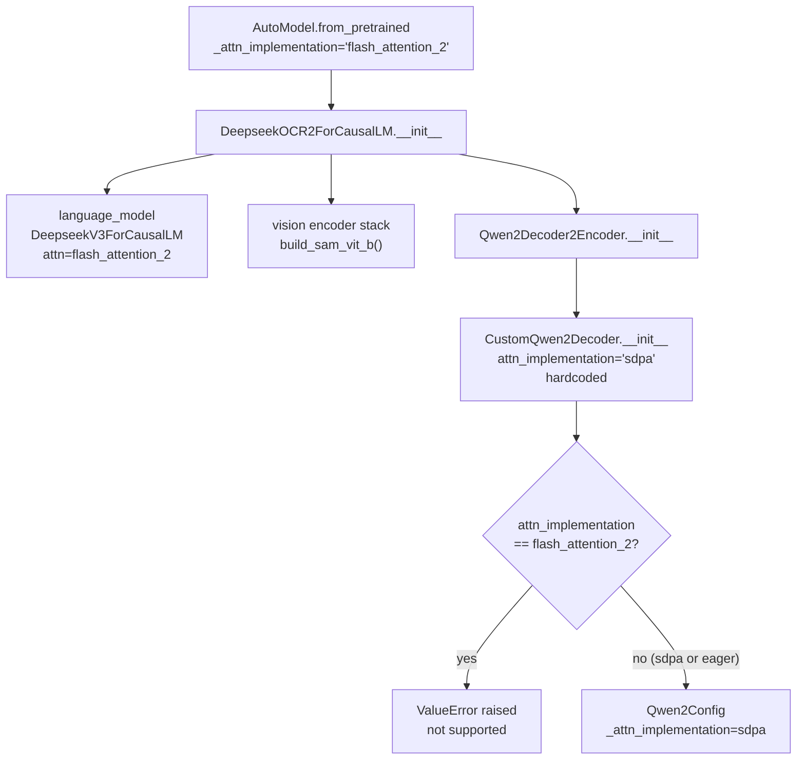
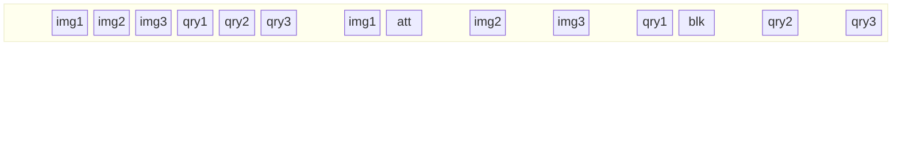

<!-- source: DeepWiki mcp.deepwiki.com · repo deepseek-ai/DeepSeek-OCR-2 · page 8.2 Flash Attention · fetched 2026-10-30 -->

# Flash Attention

<details>
<summary>Relevant source files</summary>

The following files were used as context for generating this wiki page:

- [DeepSeek-OCR2-master/DeepSeek-OCR2-hf/run_dpsk_ocr2.py](DeepSeek-OCR2-master/DeepSeek-OCR2-hf/run_dpsk_ocr2.py)
- [DeepSeek-OCR2-master/DeepSeek-OCR2-vllm/deepencoderv2/qwen2_d2e.py](DeepSeek-OCR2-master/DeepSeek-OCR2-vllm/deepencoderv2/qwen2_d2e.py)
- [README.md](README.md)

</details>


This page covers how `flash_attention_2` is configured in DeepSeek-OCR-2, where it is applied, and where it is explicitly prohibited. For background on the broader model architecture this sits inside, see [Model Overview](#4.1). For details on the Qwen2 decoder component referenced in the restriction section, see [Qwen2 Decoder-as-Encoder](#5.2).

---

## Purpose and Scope

Flash Attention 2 is used to accelerate the language model's self-attention computation during the Transformers inference path. However, the codebase contains a deliberate architectural restriction: the vision encoder's custom Qwen2 decoder module (`CustomQwen2Decoder`) cannot use `flash_attention_2` because it implements a non-standard attention mask that Flash Attention 2's kernel does not support. This page documents both aspects.

---

## Installation

Flash Attention must be installed manually with the `--no-build-isolation` flag. This is a separate step from the main `requirements.txt` install.

```
pip install flash-attn==2.7.3 --no-build-isolation
```

The `--no-build-isolation` flag is required because `flash-attn` must compile against the already-installed versions of PyTorch and CUDA in the active environment. Without it, `pip` would create an isolated build environment that may not match the correct CUDA or torch versions.

See [README.md:79-83]() for the full installation sequence.

---

## Transformers Inference Path

When loading the model via HuggingFace Transformers, `_attn_implementation='flash_attention_2'` is passed as a constructor argument to `AutoModel.from_pretrained`.

[DeepSeek-OCR2-master/DeepSeek-OCR2-hf/run_dpsk_ocr2.py:12]()

```
model = AutoModel.from_pretrained(
    model_name,
    _attn_implementation='flash_attention_2',
    trust_remote_code=True,
    use_safetensors=True
)
```

This parameter is forwarded to the HuggingFace model configuration and controls which attention kernel is selected inside the language model layers (e.g., `DeepseekV3ForCausalLM`). The model must then be cast to `bfloat16` and moved to a CUDA device, because Flash Attention 2 requires half-precision (fp16 or bf16) and does not run on CPU.

[DeepSeek-OCR2-master/DeepSeek-OCR2-hf/run_dpsk_ocr2.py:13]()

```
model = model.eval().cuda().to(torch.bfloat16)
```

### Summary of Requirements

| Requirement | Value |
|---|---|
| Package | `flash-attn==2.7.3` |
| Install flag | `--no-build-isolation` |
| `_attn_implementation` value | `'flash_attention_2'` |
| Required dtype | `torch.bfloat16` or `torch.float16` |
| Required device | CUDA |

Sources: [README.md:82](), [DeepSeek-OCR2-master/DeepSeek-OCR2-hf/run_dpsk_ocr2.py:12-13]()

---

## Where Flash Attention 2 Applies

The `_attn_implementation='flash_attention_2'` parameter flows through to the language model backbone. It does **not** apply to the vision encoder stack.

**Attention implementation by component:**

| Component | Class | Attention Implementation |
|---|---|---|
| Language model | `DeepseekV3ForCausalLM` (and variants) | `flash_attention_2` (via `_attn_implementation`) |
| SAM ViT-B encoder | `ImageEncoderViT` | Standard (built-in PyTorch) |
| Qwen2 decoder-as-encoder | `CustomQwen2Decoder` | `sdpa` (hardcoded, see below) |
| Qwen2 outer wrapper | `Qwen2Decoder2Encoder` | `sdpa` (hardcoded) |

Sources: [DeepSeek-OCR2-master/DeepSeek-OCR2-vllm/deepencoderv2/qwen2_d2e.py:24](), [DeepSeek-OCR2-master/DeepSeek-OCR2-vllm/deepencoderv2/qwen2_d2e.py:241]()

---

## The Flash Attention 2 Block in `CustomQwen2Decoder`

`CustomQwen2Decoder` enforces a hard restriction: passing `attn_implementation='flash_attention_2'` raises a `ValueError` at construction time.

[DeepSeek-OCR2-master/DeepSeek-OCR2-vllm/deepencoderv2/qwen2_d2e.py:34-38]()

```python
if attn_implementation == "flash_attention_2":
    raise ValueError(
        "CustomQwen2Decoder do not support flash_attention_2，"
        "new attention mask needs 'sdpa' or 'eager'"
    )
```

### Why Flash Attention 2 Cannot Be Used Here

`CustomQwen2Decoder` overrides the standard `_update_causal_mask` method with a custom implementation that builds a 4D additive mask (`_create_custom_4d_mask`). This mask implements a hybrid causal/non-causal attention pattern driven by `token_type_ids`:

- Tokens where `token_type_ids == 0` (image tokens) attend to all other image tokens — **non-causal, bidirectional**
- Tokens where `token_type_ids == 1` (query tokens) attend causally to earlier query tokens and fully to all image tokens

[DeepSeek-OCR2-master/DeepSeek-OCR2-vllm/deepencoderv2/qwen2_d2e.py:104-133]()

The resulting mask is a standard 4D float tensor of shape `[batch, 1, seq_len, seq_len]` with `0.0` for attended positions and `min_dtype` (a large negative value) for blocked positions.

Flash Attention 2's CUDA kernel does not accept an arbitrary dense additive mask in this format. It expects either no mask at all or a specific compact boolean/causal mask representation. The `sdpa` (scaled dot-product attention, backed by PyTorch's `F.scaled_dot_product_attention`) and `eager` backends do accept this format. This is why `Qwen2Decoder2Encoder` hardcodes `attn_implementation="sdpa"` when constructing `CustomQwen2Decoder`.

[DeepSeek-OCR2-master/DeepSeek-OCR2-vllm/deepencoderv2/qwen2_d2e.py:235-242]()

---

## Attention Implementation Decision Flow

The following diagram shows how the `_attn_implementation` parameter routes through the system at model construction time.

**Diagram: Attention Implementation Routing**



Sources: [DeepSeek-OCR2-master/DeepSeek-OCR2-hf/run_dpsk_ocr2.py:12](), [DeepSeek-OCR2-master/DeepSeek-OCR2-vllm/deepencoderv2/qwen2_d2e.py:34-38](), [DeepSeek-OCR2-master/DeepSeek-OCR2-vllm/deepencoderv2/qwen2_d2e.py:235-242]()

---

## Mask Construction in `_create_custom_4d_mask`

The mask structure that makes `flash_attention_2` incompatible is illustrated below.

**Diagram: Hybrid Causal/Non-Causal Mask Structure in `_create_custom_4d_mask`**



> `att` = 0.0 (attend), `blk` = `min_dtype` (blocked). Image rows are fully connected to all image columns (non-causal). Query rows attend to all image columns plus causally to prior query columns.

This additive float mask is constructed per-batch-element and stacked into shape `[batch, 1, seq_len, seq_len]`. Flash Attention 2 does not support this format; `sdpa` does.

Sources: [DeepSeek-OCR2-master/DeepSeek-OCR2-vllm/deepencoderv2/qwen2_d2e.py:135-172]()

---

## vLLM Path

The vLLM inference path does not pass `_attn_implementation` explicitly during model loading. vLLM manages its own attention backend (typically using Flash Attention or Paged Attention internally via its engine). The `CustomQwen2Decoder` restriction applies equally to the vLLM path because `Qwen2Decoder2Encoder` always constructs `CustomQwen2Decoder` with `attn_implementation="sdpa"` regardless of the outer engine.

For details on how the model is registered and loaded under vLLM, see [Custom Model Extensions](#9.3) and [Weight Loading and Mapping](#9.2).

---

