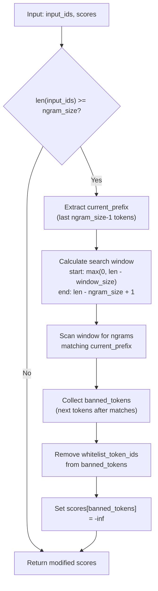
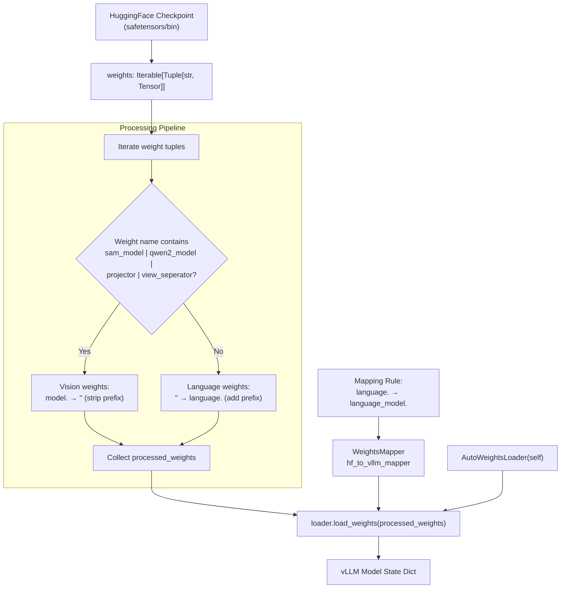
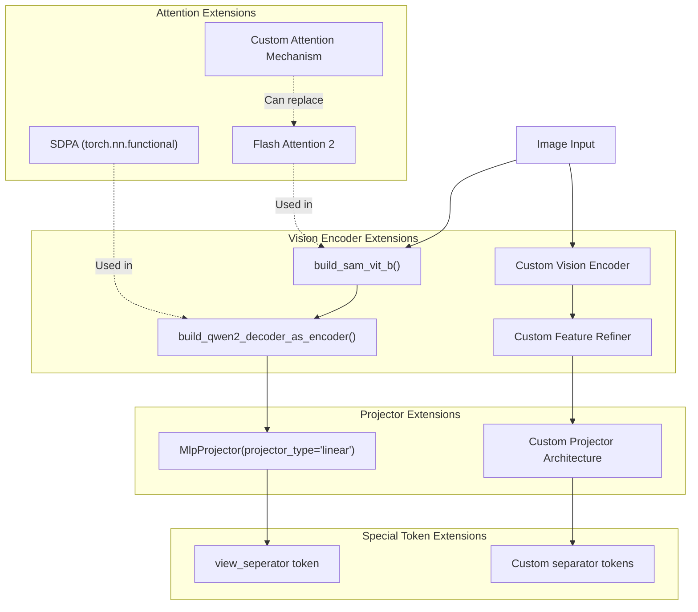

<!-- source: DeepWiki mcp.deepwiki.com · repo deepseek-ai/DeepSeek-OCR-2 · page 9 Advanced Topics · fetched 2026-10-30 -->

# Advanced Topics

<details>
<summary>Relevant source files</summary>

The following files were used as context for generating this wiki page:

- [DeepSeek-OCR2-master/DeepSeek-OCR2-vllm/deepseek_ocr2.py](DeepSeek-OCR2-master/DeepSeek-OCR2-vllm/deepseek_ocr2.py)

</details>


This page covers advanced customization and extension capabilities of DeepSeek-OCR-2. Topics include custom logits processors for generation control, weight loading and mapping mechanisms, and guidance on extending the model architecture with custom components.

For basic inference usage, see [Quick Start Examples](#2.2). For understanding the underlying model architecture before customization, see [Core Architecture](#4).

---

## 9.1 Custom Logits Processors

Logits processors modify the model's output logits before token sampling, enabling control over generation behavior. DeepSeek-OCR-2 supports custom logits processors through the transformers generation interface.

### NoRepeatNGramLogitsProcessor

The `NoRepeatNGramLogitsProcessor` prevents the model from generating repetitive n-gram sequences, which can occur during OCR of highly structured or tabular content.

**Class Interface**:

| Parameter | Type | Description |
|-----------|------|-------------|
| `ngram_size` | `int` | Size of n-grams to track (must be ≥ 1) |
| `window_size` | `int` | Number of tokens to search backward for repetitions (must be ≥ 1) |
| `whitelist_token_ids` | `Set[int]` | Optional set of token IDs exempt from n-gram blocking |

**Mechanism**:



**Algorithm Steps**:

1. **Length Check**: If sequence length < `ngram_size`, no blocking occurs
2. **Prefix Extraction**: Extract last `ngram_size - 1` tokens as the current prefix
3. **Window Search**: Scan backward `window_size` tokens for n-grams matching the prefix
4. **Token Collection**: For each match, collect the token that followed the n-gram
5. **Whitelist Filtering**: Exclude any tokens in `whitelist_token_ids`
6. **Score Masking**: Set logits to `-inf` for all banned tokens

**Usage Example Pattern**:

```python
from transformers import LogitsProcessorList

# Initialize processor
processor = NoRepeatNGramLogitsProcessor(
    ngram_size=3,           # Block 3-gram repetitions
    window_size=100,        # Search last 100 tokens
    whitelist_token_ids={tokenizer.eos_token_id}  # Allow EOS
)

# Apply during generation
logits_processor = LogitsProcessorList([processor])
outputs = model.generate(
    input_ids=input_ids,
    logits_processor=logits_processor,
    max_new_tokens=512
)
```

**Configuration Recommendations**:

| Use Case | ngram_size | window_size | Rationale |
|----------|------------|-------------|-----------|
| Tables with repeated headers | 3-4 | 200-500 | Prevents column header repetition |
| Code OCR | 2-3 | 100-200 | Blocks repeated syntax patterns |
| Mathematical formulas | 4-5 | 50-100 | Prevents equation repetition |
| General documents | 3 | 200 | Balanced general-purpose setting |

**Sources**: [process/ngram_norepeat.cpython-312.pyc:1-21]()

---

## 9.2 Weight Loading and Mapping

DeepSeek-OCR-2's vLLM implementation uses a custom weight loading system to map HuggingFace checkpoint weights to the vLLM model structure.

### Weight Mapping Architecture



### Weight Name Transformation

The `load_weights` method in `DeepseekOCR2ForCausalLM` implements a two-stage transformation:

**Stage 1: Prefix Handling** ([deepseek_ocr2.py:562-574]()):

```python
# Vision component weights (SAM, Qwen2, Projector)
if 'sam_model' in name or 'qwen2_model' in name or \
   'projector' in name or 'view_seperator' in name:
    new_name = name.replace('model.', '', 1)  # Strip model. prefix

# Language model weights
else:
    new_name = 'language.' + name  # Add language. prefix
```

**Stage 2: vLLM Mapper** ([deepseek_ocr2.py:266-268]()):

```python
hf_to_vllm_mapper = WeightsMapper(orig_to_new_prefix={
    "language.": "language_model.",
})
```

### Complete Mapping Table

| HuggingFace Checkpoint Name | Intermediate Name | Final vLLM Model Name |
|----------------------------|-------------------|----------------------|
| `model.sam_model.encoder.layers.0.weight` | `sam_model.encoder.layers.0.weight` | `sam_model.encoder.layers.0.weight` |
| `model.qwen2_model.layers.5.self_attn.q_proj.weight` | `qwen2_model.layers.5.self_attn.q_proj.weight` | `qwen2_model.layers.5.self_attn.q_proj.weight` |
| `model.projector.mlp.0.weight` | `projector.mlp.0.weight` | `projector.mlp.0.weight` |
| `model.view_seperator` | `view_seperator` | `view_seperator` |
| `embed_tokens.weight` | `language.embed_tokens.weight` | `language_model.embed_tokens.weight` |
| `layers.10.self_attn.q_proj.weight` | `language.layers.10.self_attn.q_proj.weight` | `language_model.layers.10.self_attn.q_proj.weight` |
| `norm.weight` | `language.norm.weight` | `language_model.norm.weight` |
| `lm_head.weight` | `language.lm_head.weight` | `language_model.lm_head.weight` |

### Key Design Principles

1. **Component Isolation**: Vision components (SAM, Qwen2, projector) are identified by substring matching and kept separate from language model weights
2. **Prefix Normalization**: The `model.` prefix from HuggingFace checkpoints is stripped for vision components but language components receive a `language.` prefix
3. **Two-Pass Mapping**: First pass handles component categorization, second pass (via `WeightsMapper`) handles vLLM-specific naming conventions
4. **Automatic Loading**: `AutoWeightsLoader` automatically distributes weights to the correct submodules based on the final mapped names

### Custom Weight Loading

To implement custom weight loading behavior:

```python
class CustomDeepseekOCR2(DeepseekOCR2ForCausalLM):
    def load_weights(self, weights: Iterable[Tuple[str, torch.Tensor]]) -> Set[str]:
        custom_processed = []
        
        for name, tensor in weights:
            # Custom logic: e.g., load quantized weights
            if 'quantized' in name:
                tensor = dequantize_tensor(tensor)
            
            # Apply standard mapping
            if 'sam_model' in name or 'qwen2_model' in name:
                new_name = name.replace('model.', '', 1)
            else:
                new_name = 'language.' + name
            
            custom_processed.append((new_name, tensor))
        
        loader = AutoWeightsLoader(self)
        return loader.load_weights(custom_processed, mapper=self.hf_to_vllm_mapper)
```

**Sources**: [deepseek_ocr2.py:266-268](), [deepseek_ocr2.py:562-583]()

---

## 9.3 Custom Model Extensions

DeepSeek-OCR-2's modular architecture enables extension at multiple levels: vision encoders, projectors, and attention mechanisms.

### Extension Points Architecture



### 1. Custom Vision Encoders

The vision encoding pipeline consists of two stages: initial feature extraction (SAM-ViT-B) and feature refinement (Qwen2 decoder-as-encoder).

**Implementation Pattern** ([deepseek_ocr2.py:291-295]()):

```python
# Current implementation
self.sam_model = build_sam_vit_b()
self.qwen2_model = build_qwen2_decoder_as_encoder()
```

**Custom Encoder Extension**:

```python
from my_vision_encoders import CustomViT, CustomRefiner

class DeepseekOCR2WithCustomVision(DeepseekOCR2ForCausalLM):
    def __init__(self, *, vllm_config: VllmConfig, prefix: str = ""):
        super().__init__(vllm_config=vllm_config, prefix=prefix)
        
        # Replace default encoders
        self.sam_model = CustomViT(
            image_size=1024,
            patch_size=16,
            embed_dim=768,
            depth=12,
            num_heads=12
        )
        
        self.qwen2_model = CustomRefiner(
            hidden_size=896,
            num_layers=24,
            num_attention_heads=14
        )
```

**Feature Dimension Constraints**:

| Component | Input Dimension | Output Dimension | Constraint |
|-----------|----------------|------------------|------------|
| SAM Model | `[B, 3, H, W]` | `[B, 1024, h, w]` | Must match Qwen2 input |
| Qwen2 Model | `[B, 1024, ...]` | `[B, N, 896]` | Must match projector input |
| Projector | `[B, N, 896]` | `[B, N, n_embed]` | n_embed must match LM dimension |

### 2. Custom Projector Architectures

The `MlpProjector` class supports 8 architecture variants ([deepseek_ocr2.py:295]()), but custom projectors can be implemented:

```python
class CustomMultiScaleProjector(nn.Module):
    """Projects vision features using multi-scale fusion."""
    
    def __init__(self, input_dim: int, output_dim: int, num_scales: int = 3):
        super().__init__()
        self.scales = nn.ModuleList([
            nn.Sequential(
                nn.Linear(input_dim, input_dim // (2 ** i)),
                nn.GELU(),
                nn.Linear(input_dim // (2 ** i), output_dim)
            )
            for i in range(num_scales)
        ])
        self.fusion = nn.Linear(output_dim * num_scales, output_dim)
    
    def forward(self, x: torch.Tensor) -> torch.Tensor:
        scale_outputs = [scale(x) for scale in self.scales]
        concatenated = torch.cat(scale_outputs, dim=-1)
        return self.fusion(concatenated)

# Integration
self.projector = CustomMultiScaleProjector(
    input_dim=896,
    output_dim=1280,  # Must match n_embed
    num_scales=3
)
```

### 3. Custom Attention Mechanisms

Attention mechanisms can be customized in both SAM and Qwen2 components:

**Flash Attention Replacement Pattern**:

```python
class CustomEfficientAttention(nn.Module):
    """Custom attention mechanism optimized for long sequences."""
    
    def __init__(self, dim: int, num_heads: int, window_size: int = 512):
        super().__init__()
        self.num_heads = num_heads
        self.window_size = window_size
        self.scale = (dim // num_heads) ** -0.5
        
        self.qkv = nn.Linear(dim, dim * 3)
        self.proj = nn.Linear(dim, dim)
    
    def forward(self, x: torch.Tensor) -> torch.Tensor:
        B, N, C = x.shape
        qkv = self.qkv(x).reshape(B, N, 3, self.num_heads, C // self.num_heads)
        q, k, v = qkv.permute(2, 0, 3, 1, 4)
        
        # Windowed attention for efficiency
        attn = (q @ k.transpose(-2, -1)) * self.scale
        attn = attn.softmax(dim=-1)
        
        x = (attn @ v).transpose(1, 2).reshape(B, N, C)
        return self.proj(x)
```

### 4. Custom Special Tokens

The `view_seperator` token ([deepseek_ocr2.py:311]()) separates global and local image features. Additional custom tokens can be added:

```python
class DeepseekOCR2WithCustomTokens(DeepseekOCR2ForCausalLM):
    def __init__(self, *, vllm_config: VllmConfig, prefix: str = ""):
        super().__init__(vllm_config=vllm_config, prefix=prefix)
        
        n_embed = self.config.text_config.hidden_size
        embed_std = 1 / torch.sqrt(torch.tensor(n_embed, dtype=torch.float32))
        
        # Add custom separator tokens
        self.scale_separator = nn.Parameter(torch.randn(n_embed) * embed_std)
        self.resolution_separator = nn.Parameter(torch.randn(n_embed) * embed_std)
        self.modality_separator = nn.Parameter(torch.randn(n_embed) * embed_std)
    
    def _pixel_values_to_embedding(self, ...):
        # Use custom tokens in feature concatenation
        global_local_features = torch.cat([
            low_res_features,
            self.scale_separator[None, :],
            mid_res_features,
            self.scale_separator[None, :],
            high_res_features,
            self.view_seperator[None, :]
        ], dim=0)
        return global_local_features
```

### Extension Checklist

When implementing custom extensions, ensure:

- [ ] **Dimension Compatibility**: Output dimensions match downstream component expectations
- [ ] **Device Placement**: Custom modules are moved to correct device/dtype (see [deepseek_ocr2.py:337]())
- [ ] **Weight Loading**: Update `load_weights` method to handle custom component weights
- [ ] **vLLM Registration**: Register custom model with `@MULTIMODAL_REGISTRY.register_processor` if modifying multimodal processing
- [ ] **Gradient Handling**: Wrap vision components with `torch.no_grad()` if training is disabled ([deepseek_ocr2.py:387-389]())
- [ ] **Memory Optimization**: Consider tensor cleanup (e.g., `del patches`) for large batch processing

### Performance Considerations

| Extension Type | Memory Impact | Compute Impact | Recommended Testing |
|----------------|---------------|----------------|---------------------|
| Custom Vision Encoder | High (cached features) | High (per-image) | Profile with various image sizes |
| Custom Projector | Low | Low | Verify dimension alignment |
| Custom Attention | Medium | High (sequence length²) | Benchmark on long sequences |
| Custom Tokens | Minimal | Minimal | Verify embedding quality |

**Sources**: [deepseek_ocr2.py:264-583](), [config.py:48]()

---

