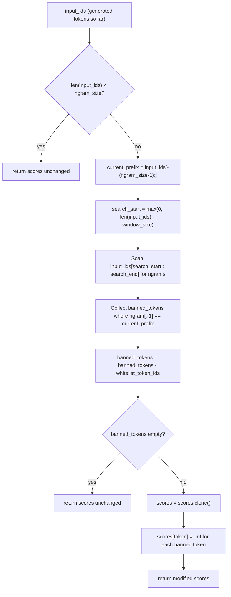
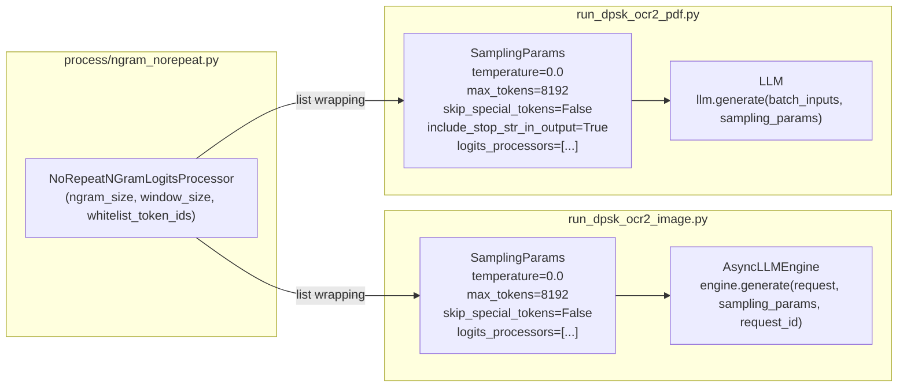

<!-- source: DeepWiki mcp.deepwiki.com · repo deepseek-ai/DeepSeek-OCR-2 · page 9.1 Custom Logits Processors · fetched 2026-10-30 -->

# Custom Logits Processors

<details>
<summary>Relevant source files</summary>

The following files were used as context for generating this wiki page:

- [DeepSeek-OCR2-master/DeepSeek-OCR2-vllm/process/__pycache__/ngram_norepeat.cpython-312.pyc](DeepSeek-OCR2-master/DeepSeek-OCR2-vllm/process/__pycache__/ngram_norepeat.cpython-312.pyc)
- [DeepSeek-OCR2-master/DeepSeek-OCR2-vllm/process/ngram_norepeat.py](DeepSeek-OCR2-master/DeepSeek-OCR2-vllm/process/ngram_norepeat.py)
- [DeepSeek-OCR2-master/DeepSeek-OCR2-vllm/run_dpsk_ocr2_image.py](DeepSeek-OCR2-master/DeepSeek-OCR2-vllm/run_dpsk_ocr2_image.py)
- [DeepSeek-OCR2-master/DeepSeek-OCR2-vllm/run_dpsk_ocr2_pdf.py](DeepSeek-OCR2-master/DeepSeek-OCR2-vllm/run_dpsk_ocr2_pdf.py)

</details>


This page covers `NoRepeatNGramLogitsProcessor`, the custom logits processor used during vLLM inference to suppress repetitive output. It is part of the vLLM inference path only — for the HuggingFace transformers path, no equivalent processor is used. For general vLLM configuration, see [vLLM Configuration](#3.2.1). For the runner scripts that wire this processor into inference, see [vLLM Entry Points](#3.2.2).

---

## Problem: Repetitive Generation in OCR

OCR and document-parsing outputs frequently contain repetitive structures (e.g., the same sentence or table row repeated for many tokens). Standard `no_repeat_ngram_size` in vLLM/HuggingFace bans any n-gram that appeared *anywhere* in the generation history. This is too aggressive for structured documents, which legitimately repeat short structural tokens like `<td>` and `</td>` throughout a table.

`NoRepeatNGramLogitsProcessor` solves both problems:
1. It uses a **sliding window** over recent tokens rather than the full history, limiting false positives from distant repetitions.
2. It accepts a **whitelist** of token IDs that are never banned, regardless of repetition frequency.

---

## Implementation

The processor lives at [DeepSeek-OCR2-master/DeepSeek-OCR2-vllm/process/ngram_norepeat.py]().

**Class hierarchy:**

```mermaid
classDiagram
    class "LogitsProcessor" {
        <<transformers>>
        +__call__(input_ids, scores)
    }
    class "NoRepeatNGramLogitsProcessor" {
        +ngram_size: int
        +window_size: int
        +whitelist_token_ids: set
        +__init__(ngram_size, window_size, whitelist_token_ids)
        +__call__(input_ids, scores) FloatTensor
    }
    "LogitsProcessor" <|-- "NoRepeatNGramLogitsProcessor"
```

Sources: [DeepSeek-OCR2-master/DeepSeek-OCR2-vllm/process/ngram_norepeat.py:1-40]()

---

### Constructor Parameters

[DeepSeek-OCR2-master/DeepSeek-OCR2-vllm/process/ngram_norepeat.py:9-16]()

| Parameter | Type | Default | Description |
|---|---|---|---|
| `ngram_size` | `int` | — | Length of n-gram to check. Must be a strictly positive integer. |
| `window_size` | `int` | `100` | Number of most-recent tokens to search for repeated n-grams. Limits history to a sliding window. Must be a strictly positive integer. |
| `whitelist_token_ids` | `set` | `None` (→ empty set) | Token IDs that are never penalized, even if they form repeated n-grams. |

Both `ngram_size` and `window_size` raise `ValueError` if they are non-integer or ≤ 0.

---

### `__call__` Logic

The `__call__` method [DeepSeek-OCR2-master/DeepSeek-OCR2-vllm/process/ngram_norepeat.py:18-38]() executes once per generation step, receiving the full generated token sequence so far (`input_ids`) and the raw logit scores tensor (`scores`).

**Step-by-step flow:**



Sources: [DeepSeek-OCR2-master/DeepSeek-OCR2-vllm/process/ngram_norepeat.py:18-38]()

**Key computed values:**

| Variable | Formula | Purpose |
|---|---|---|
| `current_prefix` | `tuple(input_ids[-(ngram_size-1):])` | The (n-1)-token suffix of the current context. Any n-gram in history that starts with this prefix has its final token banned. |
| `search_start` | `max(0, len(input_ids) - window_size)` | Start of the sliding window. Older tokens beyond `window_size` are ignored. |
| `search_end` | `len(input_ids) - ngram_size + 1` | End of scan range (avoids out-of-bounds). |
| `banned_tokens` | Set of `ngram[-1]` where `ngram[:-1] == current_prefix` | All tokens that would continue a repeated n-gram. Whitelist is subtracted before applying. |

---

## Whitelist: Table Tokens

Both runner scripts configure the same whitelist:

```python
whitelist_token_ids = {128821, 128822}  # <td>, </td>
```

| Token ID | Token |
|---|---|
| `128821` | `<td>` |
| `128822` | `</td>` |

These table cell tokens naturally repeat many times in a single table. Without the whitelist, generating any table longer than `ngram_size` tokens would cause the processor to ban `<td>`/`</td>`, corrupting the output.

Sources: [DeepSeek-OCR2-master/DeepSeek-OCR2-vllm/run_dpsk_ocr2_image.py:163](), [DeepSeek-OCR2-master/DeepSeek-OCR2-vllm/run_dpsk_ocr2_pdf.py:46]()

---

## Integration with `SamplingParams`

The processor is instantiated and passed to vLLM's `SamplingParams` via its `logits_processors` field. vLLM calls each processor in the list at every decoding step.

**Diagram: processor wiring**



Sources: [DeepSeek-OCR2-master/DeepSeek-OCR2-vllm/run_dpsk_ocr2_image.py:163-172](), [DeepSeek-OCR2-master/DeepSeek-OCR2-vllm/run_dpsk_ocr2_pdf.py:46-54]()

---

## Parameter Differences Between Runners

The two runners use slightly different `window_size` values:

| Runner | `ngram_size` | `window_size` | Engine type | Comment |
|---|---|---|---|---|
| `run_dpsk_ocr2_image.py` | `20` | `90` | `AsyncLLMEngine` | Full window for single-image inference |
| `run_dpsk_ocr2_pdf.py` | `20` | `50` | `LLM` (synchronous) | Smaller window for faster batch PDF processing |

Both use the same `whitelist_token_ids = {128821, 128822}` and the same `ngram_size = 20`.

Reducing `window_size` decreases the number of n-gram comparisons per step, which is the main cost driver at high batch sizes. The trade-off is that repetitions spanning more than `window_size` tokens back will not be caught.

Sources: [DeepSeek-OCR2-master/DeepSeek-OCR2-vllm/run_dpsk_ocr2_image.py:163](), [DeepSeek-OCR2-master/DeepSeek-OCR2-vllm/run_dpsk_ocr2_pdf.py:46]()

---

## Imports and Dependencies

[DeepSeek-OCR2-master/DeepSeek-OCR2-vllm/process/ngram_norepeat.py:1-4]()

| Import | Source | Role |
|---|---|---|
| `torch` | PyTorch | Tensor operations; `scores.clone()`, `float("inf")` |
| `LogitsProcessor` | `transformers` | Base class; defines the `__call__` interface |
| `_calc_banned_ngram_tokens` | `transformers.generation.logits_process` | Imported but the implementation uses its own inline scan instead |
| `List`, `Set` | `typing` | Type hints |

Note: `_calc_banned_ngram_tokens` is imported but not called in the body of `__call__`. The ban logic is implemented inline using a manual loop rather than delegating to the transformers utility.

---

## Scope and Limitations

- This processor applies to the **vLLM inference path only**. The HuggingFace `model.infer()` path does not use it.
- The processor operates per-sequence, not per-batch. In vLLM's batch generation, each sequence in the batch has its own `input_ids` and `scores` passed independently to the processor.
- Setting `window_size` too low on documents with genuine long-range repetition (e.g., repeated section headers in a long PDF) may fail to suppress repetitive loops that regenerate the same content after `window_size` tokens of other content.
- Setting `ngram_size` too low may inadvertently block valid short phrases. The default of `20` is conservative enough for natural language but still catches typical degenerate repeat loops.

---

