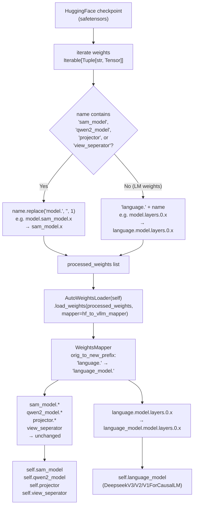
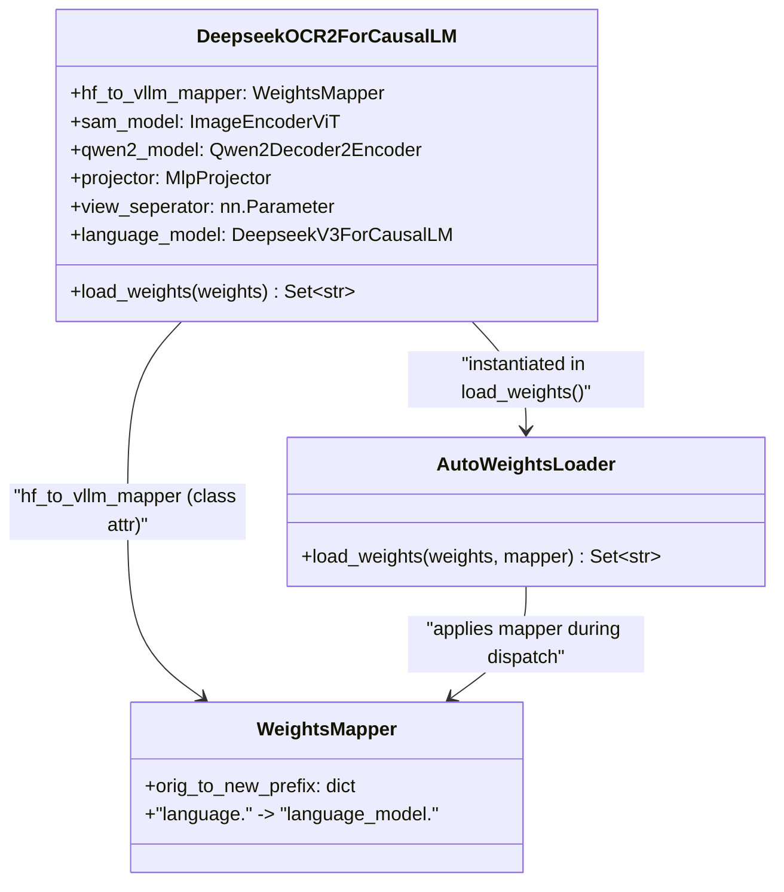

<!-- source: DeepWiki mcp.deepwiki.com · repo deepseek-ai/DeepSeek-OCR-2 · page 9.2 Weight Loading and Mapping · fetched 2026-10-30 -->

# Weight Loading and Mapping

<details>
<summary>Relevant source files</summary>

The following files were used as context for generating this wiki page:

- [DeepSeek-OCR2-master/DeepSeek-OCR2-vllm/__pycache__/deepseek_ocr2.cpython-312.pyc](DeepSeek-OCR2-master/DeepSeek-OCR2-vllm/__pycache__/deepseek_ocr2.cpython-312.pyc)
- [DeepSeek-OCR2-master/DeepSeek-OCR2-vllm/deepseek_ocr2.py](DeepSeek-OCR2-master/DeepSeek-OCR2-vllm/deepseek_ocr2.py)

</details>


## Purpose and Scope

This page documents how the vLLM inference path loads a HuggingFace checkpoint into the `DeepseekOCR2ForCausalLM` module. It covers the name transformation pipeline, the roles of `WeightsMapper` and `AutoWeightsLoader`, and how each sub-module receives its weights.

For a description of the sub-module architecture (what `sam_model`, `qwen2_model`, and `projector` actually do), see the [Vision Processing Pipeline](#4.2) and [Vision Encoders](#5) pages. For how the model is registered with vLLM so that loading is triggered, see [Custom Model Extensions](#9.3).

---

## Overview

The HuggingFace checkpoint uses a flat weight naming convention that does not match the internal module hierarchy used in vLLM. `DeepseekOCR2ForCausalLM.load_weights()` bridges this gap in two stages:

1. **Manual prefix rewriting** — a loop in `load_weights()` rewrites each weight name depending on which sub-module it belongs to.
2. **Mapper-based renaming** — `AutoWeightsLoader` applies `hf_to_vllm_mapper` (a `WeightsMapper`) to convert the temporary `language.` prefix into the actual `language_model.` attribute name.

Sources: [DeepSeek-OCR2-master/DeepSeek-OCR2-vllm/deepseek_ocr2.py:562-582]()

---

## Sub-Module Attribute Layout

The vLLM model registers four sub-module attributes that receive weights, plus the learnable `view_seperator` parameter:

| Attribute | Type | HF weight name pattern |
|---|---|---|
| `self.sam_model` | `ImageEncoderViT` (SAM ViT-B) | `model.sam_model.*` |
| `self.qwen2_model` | `Qwen2Decoder2Encoder` | `model.qwen2_model.*` |
| `self.projector` | `MlpProjector` | `model.projector.*` |
| `self.view_seperator` | `nn.Parameter` | `model.view_seperator` |
| `self.language_model` | `DeepseekV3/V2/V1ForCausalLM` | all remaining names |

Sources: [DeepSeek-OCR2-master/DeepSeek-OCR2-vllm/deepseek_ocr2.py:266-268](), [DeepSeek-OCR2-master/DeepSeek-OCR2-vllm/deepseek_ocr2.py:291-295](), [DeepSeek-OCR2-master/DeepSeek-OCR2-vllm/deepseek_ocr2.py:311]()

---

## Name Transformation Pipeline

### Diagram: Weight Name Flow

**HuggingFace → vLLM Weight Name Transformations**



Sources: [DeepSeek-OCR2-master/DeepSeek-OCR2-vllm/deepseek_ocr2.py:562-582](), [DeepSeek-OCR2-master/DeepSeek-OCR2-vllm/deepseek_ocr2.py:266-268]()

---

### Stage 1 — Manual Prefix Rewriting

The `load_weights()` method iterates over the raw weight iterator from vLLM's model loader. The condition on line 566 checks whether the weight name contains any of the four vision-side identifiers:

```
'sam_model', 'qwen2_model', 'projector', 'view_seperator'
```

- **Vision weights**: `name.replace('model.', '', 1)` strips the leading `model.` added by the HuggingFace `save_pretrained` convention. The resulting name matches the vLLM attribute directly (e.g., `sam_model.patch_embed.proj.weight`).
- **Language model weights**: `'language.' + name` prepends a temporary `language.` prefix to every other weight. This staging prefix is needed because `WeightsMapper` operates on prefixes.

All rewritten `(name, tensor)` pairs are collected into `processed_weights` before any loading occurs.

Sources: [DeepSeek-OCR2-master/DeepSeek-OCR2-vllm/deepseek_ocr2.py:563-573]()

---

### Stage 2 — Mapper-Based Renaming via `AutoWeightsLoader`

The class-level attribute `hf_to_vllm_mapper` is a `WeightsMapper` instance:

```
hf_to_vllm_mapper = WeightsMapper(orig_to_new_prefix={
    "language.": "language_model.",
})
```

`AutoWeightsLoader(self).load_weights(processed_weights, mapper=self.hf_to_vllm_mapper)` applies this mapper, which converts the temporary `language.` prefix into `language_model.`, matching the `self.language_model` attribute on the class.

Vision weights (which have no `language.` prefix after Stage 1) pass through the mapper unchanged and are dispatched directly to their respective sub-modules.

The method returns the set of autoloaded weight names from `AutoWeightsLoader`, which vLLM uses for weight coverage validation.

Sources: [DeepSeek-OCR2-master/DeepSeek-OCR2-vllm/deepseek_ocr2.py:266-268](), [DeepSeek-OCR2-master/DeepSeek-OCR2-vllm/deepseek_ocr2.py:575-582]()

---

## Concrete Name Examples

| HF checkpoint name | After Stage 1 | After `WeightsMapper` | Resolved attribute |
|---|---|---|---|
| `model.sam_model.patch_embed.proj.weight` | `sam_model.patch_embed.proj.weight` | *(unchanged)* | `self.sam_model.patch_embed.proj.weight` |
| `model.qwen2_model.layers.0.self_attn.q_proj.weight` | `qwen2_model.layers.0.self_attn.q_proj.weight` | *(unchanged)* | `self.qwen2_model.layers.0.self_attn.q_proj.weight` |
| `model.projector.layers.0.weight` | `projector.layers.0.weight` | *(unchanged)* | `self.projector.layers.0.weight` |
| `model.view_seperator` | `view_seperator` | *(unchanged)* | `self.view_seperator` |
| `model.embed_tokens.weight` | `language.model.embed_tokens.weight` | `language_model.model.embed_tokens.weight` | `self.language_model.model.embed_tokens.weight` |
| `model.layers.0.self_attn.q_proj.weight` | `language.model.layers.0.self_attn.q_proj.weight` | `language_model.model.layers.0.self_attn.q_proj.weight` | `self.language_model.model.layers.0.self_attn.q_proj.weight` |

Sources: [DeepSeek-OCR2-master/DeepSeek-OCR2-vllm/deepseek_ocr2.py:562-582]()

---

## Class and Function Relationships

**Diagram: Code Entities Involved in Weight Loading**



Sources: [DeepSeek-OCR2-master/DeepSeek-OCR2-vllm/deepseek_ocr2.py:264-268](), [DeepSeek-OCR2-master/DeepSeek-OCR2-vllm/deepseek_ocr2.py:562-582]()

---

## Notes

- **`use_safetensors`**: The HuggingFace path (`run_dpsk_ocr2.py`) passes `use_safetensors=True` to `AutoModel.from_pretrained`. In the vLLM path, vLLM's internal model loader handles safetensors loading before calling `load_weights()`; the method receives a plain weight iterator regardless of the source format.
- **dtype handling**: The commented-out line `# tensor = tensor.to(torch.bfloat16)` [DeepSeek-OCR2-master/DeepSeek-OCR2-vllm/deepseek_ocr2.py:571]() shows that dtype conversion was considered at load time but is currently delegated to `__init__`, where `self.sam_model.to(dtype=torch.bfloat16)` is called explicitly [DeepSeek-OCR2-master/DeepSeek-OCR2-vllm/deepseek_ocr2.py:337]().
- **`model.` prefix assumption**: The rewrite `name.replace('model.', '', 1)` removes only the *first* occurrence of the substring `model.`. This is safe for the vision sub-modules because their HF names begin with exactly `model.<submodule>.`, but it would silently fail if a weight name contained `model.` elsewhere before the sub-module prefix.

---

