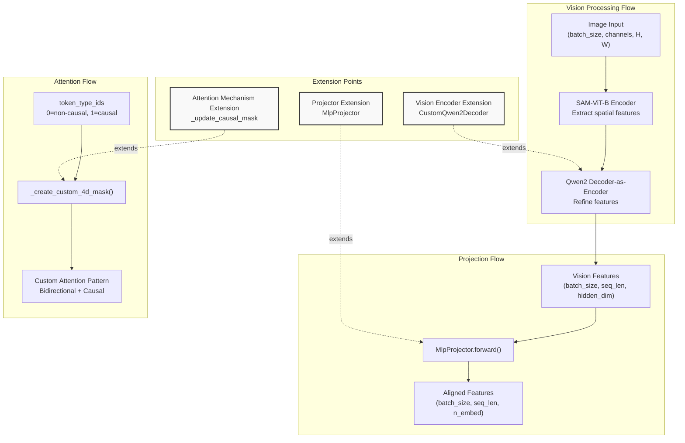
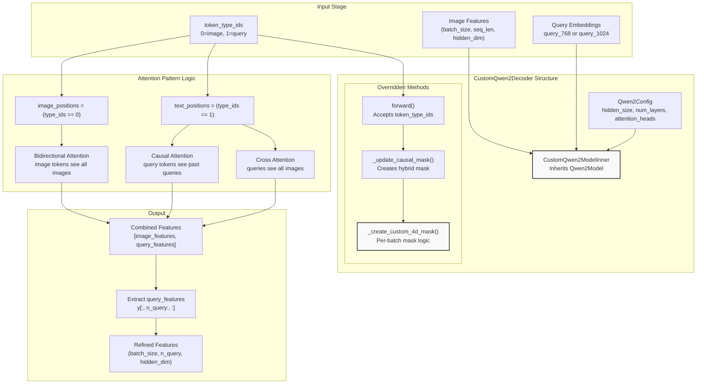
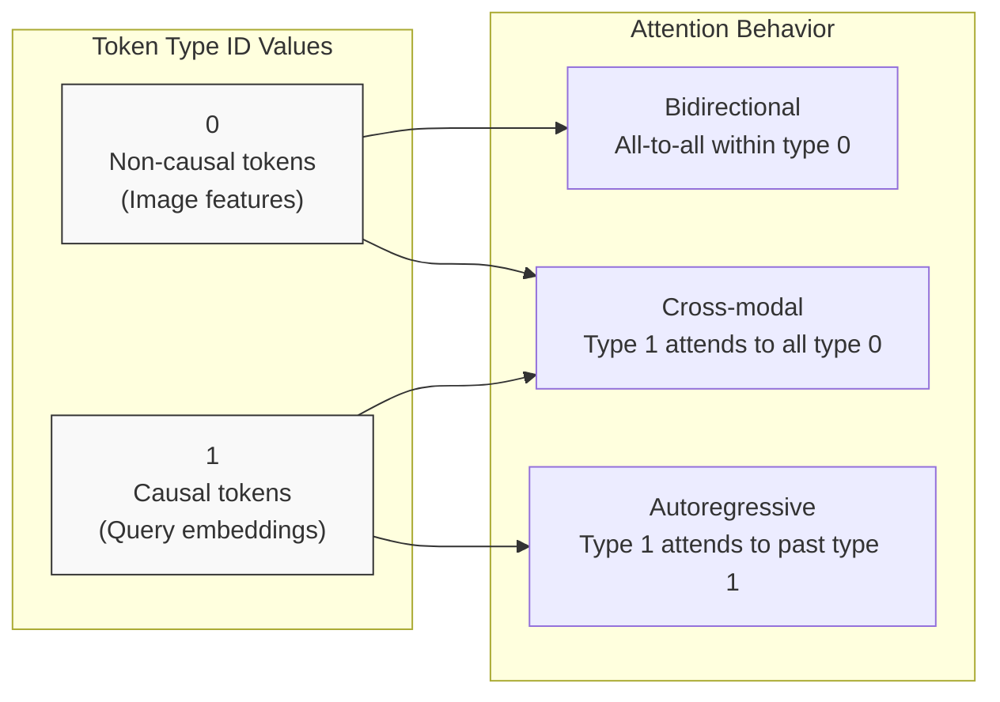

<!-- source: DeepWiki mcp.deepwiki.com · repo deepseek-ai/DeepSeek-OCR-2 · page 9.3 Custom Model Extensions · fetched 2026-10-30 -->

# Custom Model Extensions

<details>
<summary>Relevant source files</summary>

The following files were used as context for generating this wiki page:

- [DeepSeek-OCR2-master/DeepSeek-OCR2-hf/run_dpsk_ocr2.py](DeepSeek-OCR2-master/DeepSeek-OCR2-hf/run_dpsk_ocr2.py)
- [DeepSeek-OCR2-master/DeepSeek-OCR2-vllm/deepseek_ocr2.py](DeepSeek-OCR2-master/DeepSeek-OCR2-vllm/deepseek_ocr2.py)
- [README.md](README.md)

</details>


## Purpose and Scope

This document covers the extensible architecture of DeepSeek-OCR-2 and provides guidance on implementing custom model components. It focuses on the three primary extension points: **MLP projectors**, **vision encoders**, and **attention mechanisms**. This page is intended for advanced users who need to modify the model architecture for specialized use cases or research purposes.

For general model architecture information, see [Core Architecture](#4). For specific component details, see [Vision Encoders](#5). For generation-time customization, see [Custom Logits Processors](#9.1).

---

## Extensibility Architecture

The DeepSeek-OCR-2 model provides three main extension points where custom components can be integrated:



**Sources:** [DeepSeek-OCR2-master/DeepSeek-OCR2-vllm/deepencoderv2/build_linear.py:7-96](), [DeepSeek-OCR2-master/DeepSeek-OCR2-vllm/deepencoderv2/qwen2_d2e.py:8-174]()

---

## Custom MLP Projector Types

The `MlpProjector` class in [DeepSeek-OCR2-master/DeepSeek-OCR2-vllm/deepencoderv2/build_linear.py]() provides a flexible framework for feature projection with eight built-in variants. Each projector type serves different architectural requirements.

### Supported Projector Types

| Projector Type | Description | Use Case | Configuration Parameters |
|----------------|-------------|----------|-------------------------|
| `identity` | Pass-through projection | When input dimension matches output | None |
| `linear` | Single linear layer | Simple alignment | `input_dim`, `n_embed` |
| `mlp_gelu` | Multi-layer perceptron with GELU | Standard feature transformation | `depth` (default: 1) |
| `downsample_mlp_gelu` | Spatial downsampling + MLP | Reduce token count | `downsample_ratio`, `mlp_ratio` |
| `normlayer_downsample_mlp_gelu` | LayerNorm + downsampling + MLP | Stabilized downsampling | `downsample_ratio`, `mlp_ratio` |
| `low_high_hybrid_split_mlp_gelu` | Split processing with concatenation | Dual-stream features | `depth` |
| `hybrid_split_feature_mlp_gelu` | Channel-split feature processing | Multi-resolution features | `channel_div` (default: 0.5) |
| `low_high_split_mlp_gelu` | Independent low/high processing | Separate feature streams | `depth` |

### Projector Type Implementation Map

```mermaid
graph TB
    subgraph "Simple Projectors"
        IDENTITY["identity<br/>nn.Identity()"]
        LINEAR["linear<br/>nn.Linear(input_dim, n_embed)"]
        MLP["mlp_gelu<br/>Linear + GELU + ... + Linear"]
    end
    
    subgraph "Downsampling Projectors"
        DS_MLP["downsample_mlp_gelu<br/>Unfold + Linear + GELU + Linear"]
        NORM_DS["normlayer_downsample_mlp_gelu<br/>LayerNorm + Unfold + MLP"]
    end
    
    subgraph "Split-Feature Projectors"
        HYBRID_SPLIT["low_high_hybrid_split_mlp_gelu<br/>high_up_proj + low_up_proj + concat"]
        CHANNEL_SPLIT["hybrid_split_feature_mlp_gelu<br/>Split channels then project"]
        INDEPENDENT["low_high_split_mlp_gelu<br/>high_layers + low_layers + concat"]
    end
    
    subgraph "Optional Enhancements"
        TOKEN_POOL["token_pooling<br/>2x2 patch pooling"]
        FUSION["conv_fusion_high_low_features<br/>Feature fusion layer"]
    end
    
    CFG["cfg.projector_type"]
    
    CFG --> IDENTITY
    CFG --> LINEAR
    CFG --> MLP
    CFG --> DS_MLP
    CFG --> NORM_DS
    CFG --> HYBRID_SPLIT
    CFG --> CHANNEL_SPLIT
    CFG --> INDEPENDENT
    
    TOKEN_POOL -.->|"optional"| DS_MLP
    TOKEN_POOL -.->|"optional"| NORM_DS
    FUSION -.->|"optional"| HYBRID_SPLIT
    
    style IDENTITY fill:#f9f9f9,stroke:#333,stroke-width:1px
    style LINEAR fill:#f9f9f9,stroke:#333,stroke-width:1px
    style MLP fill:#f9f9f9,stroke:#333,stroke-width:1px
    style DS_MLP fill:#f9f9f9,stroke:#333,stroke-width:1px
    style NORM_DS fill:#f9f9f9,stroke:#333,stroke-width:1px
    style HYBRID_SPLIT fill:#f9f9f9,stroke:#333,stroke-width:1px
    style CHANNEL_SPLIT fill:#f9f9f9,stroke:#333,stroke-width:1px
    style INDEPENDENT fill:#f9f9f9,stroke:#333,stroke-width:1px
```



**Sources:** [DeepSeek-OCR2-master/DeepSeek-OCR2-vllm/deepencoderv2/build_linear.py:15-88]()

### Downsampling Projectors

The downsampling projectors (`downsample_mlp_gelu` and `normlayer_downsample_mlp_gelu`) perform spatial resolution reduction using unfold operations. This reduces the token count by merging adjacent patches.

**Implementation details** ([DeepSeek-OCR2-master/DeepSeek-OCR2-vllm/deepencoderv2/build_linear.py:138-155]()):

1. Reshape input from `(batch_size, H*W, channels)` to `(batch_size, H, W, channels)`
2. Calculate padding to ensure dimensions are divisible by `downsample_ratio`
3. Apply `F.unfold()` with `kernel_size=downsample_ratio` to concatenate neighboring patches
4. Process through MLP layers

The effective input dimension becomes `input_dim * downsample_ratio * downsample_ratio` after unfolding.

### Split-Feature Projectors

Split-feature projectors handle dual-stream or multi-resolution features by processing different feature components separately:

**`low_high_hybrid_split_mlp_gelu`** ([DeepSeek-OCR2-master/DeepSeek-OCR2-vllm/deepencoderv2/build_linear.py:54-63]()):
- Expects input as a tuple `(high_features, low_features)`
- Projects each stream to `n_embed // 2` dimensions
- Concatenates results: `torch.concat([high_x, low_x], dim=-1)`

**`hybrid_split_feature_mlp_gelu`** ([DeepSeek-OCR2-master/DeepSeek-OCR2-vllm/deepencoderv2/build_linear.py:65-75]()):
- Splits input tensor along channel dimension
- Projects high channels to `int(n_embed * channel_div)` dimensions
- Projects low channels to remaining dimensions
- Concatenates results

**`low_high_split_mlp_gelu`** ([DeepSeek-OCR2-master/DeepSeek-OCR2-vllm/deepencoderv2/build_linear.py:77-86]()):
- Processes high and low features through independent layer stacks
- Returns concatenated result without shared layers

**Sources:** [DeepSeek-OCR2-master/DeepSeek-OCR2-vllm/deepencoderv2/build_linear.py:54-136]()

### Adding Custom Projector Types

To implement a new projector type:

1. **Add configuration check** in `__init__()` at [DeepSeek-OCR2-master/DeepSeek-OCR2-vllm/deepencoderv2/build_linear.py:15-88]():
```python
elif cfg.projector_type == "my_custom_projector":
    # Initialize custom layers
    self.custom_layer = nn.SomeLayer(...)
    modules = nn.Sequential(...)
```

2. **Implement forward logic** in `forward()` at [DeepSeek-OCR2-master/DeepSeek-OCR2-vllm/deepencoderv2/build_linear.py:97-156]():
```python
if self.cfg.projector_type == 'my_custom_projector':
    # Custom forward pass logic
    x = self.custom_processing(x)
```

3. **Update FLOPS calculation** in `get_flops_per_sample()` at [DeepSeek-OCR2-master/DeepSeek-OCR2-vllm/deepencoderv2/build_linear.py:158-172]() for performance estimation.

**Sources:** [DeepSeek-OCR2-master/DeepSeek-OCR2-vllm/deepencoderv2/build_linear.py:7-174]()

---

## Custom Vision Encoder Extensions

The `CustomQwen2Decoder` class demonstrates how to repurpose a decoder architecture as an encoder with custom attention patterns. This pattern can be adapted for other encoder architectures.

### Qwen2 Decoder-as-Encoder Architecture



**Sources:** [DeepSeek-OCR2-master/DeepSeek-OCR2-vllm/deepencoderv2/qwen2_d2e.py:8-174](), [DeepSeek-OCR2-master/DeepSeek-OCR2-vllm/deepencoderv2/qwen2_d2e.py:217-285]()

### Custom Attention Mask Implementation

The hybrid attention mechanism is implemented through three key methods:

**1. Forward Pass Override** ([DeepSeek-OCR2-master/DeepSeek-OCR2-vllm/deepencoderv2/qwen2_d2e.py:72-102]()):
```python
def forward(self, ..., token_type_ids=None, ...):
    self._current_token_type_ids = token_type_ids
    return super().forward(...)
```
Stores `token_type_ids` in instance variable for access during mask creation.

**2. Update Causal Mask** ([DeepSeek-OCR2-master/DeepSeek-OCR2-vllm/deepencoderv2/qwen2_d2e.py:104-133]()):
- Creates custom 4D mask using `_create_custom_4d_mask()`
- Applies padding mask if provided
- Returns combined attention mask

**3. Custom 4D Mask Creation** ([DeepSeek-OCR2-master/DeepSeek-OCR2-vllm/deepencoderv2/qwen2_d2e.py:135-172]()):

The mask creation logic implements three attention patterns:

| Token Type | Can Attend To | Implementation |
|------------|---------------|----------------|
| Image tokens (type 0) | All image tokens | `mask[image_positions[:, None], image_positions] = 0.0` |
| Query tokens (type 1) | All image tokens | `mask[text_pos, image_positions] = 0.0` |
| Query tokens (type 1) | Previous query tokens | `mask[text_pos, text_positions[:i+1]] = 0.0` |

The mask is initialized with `min_dtype` (masked positions) and set to `0.0` for visible positions.

**Sources:** [DeepSeek-OCR2-master/DeepSeek-OCR2-vllm/deepencoderv2/qwen2_d2e.py:104-172]()

### Token Type ID System

The `token_type_ids` tensor controls attention behavior:



**Implementation** ([DeepSeek-OCR2-master/DeepSeek-OCR2-vllm/deepencoderv2/qwen2_d2e.py:272-275]()):
```python
token_type_ids = torch.cat([
    torch.zeros(bs, n_query, dtype=torch.long),  # Image tokens
    torch.ones(bs, n_query, dtype=torch.long),   # Query tokens
], dim=1)
```

**Sources:** [DeepSeek-OCR2-master/DeepSeek-OCR2-vllm/deepencoderv2/qwen2_d2e.py:8-13](), [DeepSeek-OCR2-master/DeepSeek-OCR2-vllm/deepencoderv2/qwen2_d2e.py:154-167]()

### Query Embedding System

The `Qwen2Decoder2Encoder` class ([DeepSeek-OCR2-master/DeepSeek-OCR2-vllm/deepencoderv2/qwen2_d2e.py:217-285]()) implements learnable query embeddings that adapt to different input resolutions:

**Query Embeddings:**
- `query_768`: 144 embeddings for 768×768 crops (144 = 12×12 patches)
- `query_1024`: 256 embeddings for 1024×1024 base images (256 = 16×16 patches)

**Forward Pass Logic** ([DeepSeek-OCR2-master/DeepSeek-OCR2-vllm/deepencoderv2/qwen2_d2e.py:254-284]()):
1. Flatten and transpose image features: `x.flatten(2).transpose(1, 2)`
2. Select appropriate query embeddings based on sequence length
3. Concatenate image features and query embeddings
4. Create token type IDs (0 for images, 1 for queries)
5. Process through `CustomQwen2Decoder`
6. Extract and return only query outputs: `y[:, n_query:, :]`

**Sources:** [DeepSeek-OCR2-master/DeepSeek-OCR2-vllm/deepencoderv2/qwen2_d2e.py:247-284]()

---

## Implementation Guidelines

### Configuration Pattern

Custom model components should follow the configuration-driven pattern used throughout the codebase:

```python
class CustomComponent(nn.Module):
    def __init__(self, cfg):
        super().__init__()
        self.cfg = cfg
        
        # Component type dispatch
        if cfg.component_type == "variant_a":
            modules = self._build_variant_a()
        elif cfg.component_type == "variant_b":
            modules = self._build_variant_b()
        else:
            raise ValueError(f"Unknown component type: {cfg.component_type}")
        
        self.layers = modules
```

This pattern enables:
- Runtime selection of component variants
- Easy addition of new variants without modifying existing code
- Configuration serialization for reproducibility

**Sources:** [DeepSeek-OCR2-master/DeepSeek-OCR2-vllm/deepencoderv2/build_linear.py:7-96]()

### Attention Implementation Constraints

When implementing custom attention mechanisms, note the following constraint from [DeepSeek-OCR2-master/DeepSeek-OCR2-vllm/deepencoderv2/qwen2_d2e.py:34-38]():

```python
if attn_implementation == "flash_attention_2":
    raise ValueError(
        "CustomQwen2Decoder do not support flash_attention_2, "
        "new attention mask needs 'sdpa' or 'eager'"
    )
```

Custom attention masks require either:
- `sdpa` (Scaled Dot Product Attention) - recommended for performance
- `eager` - for debugging or compatibility

Flash Attention 2 is incompatible because it does not support arbitrary 4D attention masks.

**Sources:** [DeepSeek-OCR2-master/DeepSeek-OCR2-vllm/deepencoderv2/qwen2_d2e.py:24-38](), [DeepSeek-OCR2-master/DeepSeek-OCR2-vllm/deepencoderv2/qwen2_d2e.py:241]()

### Builder Function Pattern

Custom components should provide builder functions for easy instantiation:

```python
def build_custom_component(
    param1=default_value1,
    param2=default_value2,
    checkpoint=None,
):
    component = CustomComponent(
        param1=param1,
        param2=param2,
    )
    
    if checkpoint is not None:
        state_dict = torch.load(checkpoint)
        component.load_state_dict(state_dict, strict=True)
    
    return component
```

This pattern is used by `build_qwen2_decoder_as_encoder()` at [DeepSeek-OCR2-master/DeepSeek-OCR2-vllm/deepencoderv2/qwen2_d2e.py:287-317]().

**Sources:** [DeepSeek-OCR2-master/DeepSeek-OCR2-vllm/deepencoderv2/qwen2_d2e.py:287-317]()

### Component Integration Checklist

When adding custom model components:

1. **Configuration:** Define all component parameters in a configuration object
2. **Type Dispatch:** Implement variant selection logic in `__init__()`
3. **Forward Pass:** Handle variant-specific logic in `forward()`
4. **State Dict:** Ensure weights can be loaded via `load_state_dict()`
5. **Builder Function:** Provide a builder function with checkpoint loading support
6. **Documentation:** Document expected input/output shapes and behavior
7. **Testing:** Verify shape correctness with sample inputs (see [DeepSeek-OCR2-master/DeepSeek-OCR2-vllm/deepencoderv2/qwen2_d2e.py:319-332]())

**Sources:** [DeepSeek-OCR2-master/DeepSeek-OCR2-vllm/deepencoderv2/build_linear.py:7-174](), [DeepSeek-OCR2-master/DeepSeek-OCR2-vllm/deepencoderv2/qwen2_d2e.py:8-332]()

---

## Summary

The DeepSeek-OCR-2 architecture provides three primary extension points:

1. **MLP Projectors:** Eight built-in variants supporting simple projection, downsampling, and split-feature processing. New variants can be added by extending the type dispatch in `MlpProjector.__init__()`.

2. **Vision Encoders:** The `Qwen2Decoder2Encoder` demonstrates repurposing decoder architectures as encoders. Custom encoders can implement similar patterns with learnable query embeddings.

3. **Attention Mechanisms:** Custom attention patterns can be implemented by overriding `_update_causal_mask()` and `_create_custom_4d_mask()` methods. Token type IDs enable hybrid bidirectional/causal attention.

All custom components should follow the configuration-driven design pattern and provide builder functions with checkpoint loading support for seamless integration with the existing model infrastructure.

**Sources:** [DeepSeek-OCR2-master/DeepSeek-OCR2-vllm/deepencoderv2/build_linear.py](), [DeepSeek-OCR2-master/DeepSeek-OCR2-vllm/deepencoderv2/qwen2_d2e.py]()

---

