# Page: Overview

# Overview

<details>
<summary>Relevant source files</summary>

The following files were used as context for generating this wiki page:

- [DeepSeek_OCR2_paper.pdf](DeepSeek_OCR2_paper.pdf)
- [README.md](README.md)

</details>


This page introduces DeepSeek-OCR-2, its core architectural concept, primary capabilities, and the top-level structure of the repository. For installation steps, see [Getting Started](#2). For detailed documentation of either inference backend, see [Inference Backends](#3). For the internal model architecture, see [Core Architecture](#4).

---

## What is DeepSeek-OCR-2?

DeepSeek-OCR-2 is a multimodal OCR model built on the concept of **Visual Causal Flow** — an approach to visual encoding that processes image regions in a sequential, causally-dependent manner rather than treating all patches as independent tokens. The model converts document images into structured text output, primarily Markdown.

The model is published as `deepseek-ai/DeepSeek-OCR-2` on HuggingFace Hub and supports two primary task modes controlled by the prompt:

| Task | Prompt | Output |
|---|---|---|
| Document to Markdown (with layout) | `<image>\n<|grounding|>Convert the document to markdown.` | Markdown with bounding-box grounding tags |
| Free OCR (text only, no layout) | `<image>\nFree OCR.` | Plain extracted text |

See [README.md:135-138]() for the canonical prompt definitions.

---

## Visual Causal Flow

The "Visual Causal Flow" concept, described in the paper `DeepSeek_OCR2_paper.pdf`, drives the vision encoder design. Rather than encoding all image patches in parallel, the model uses a **Qwen2 decoder operating as an encoder** with learnable query embeddings. This hybrid causal/non-causal attention mechanism allows image tokens to attend to each other in a structured sequence, producing richer contextual visual features than purely parallel ViT encoding.

This is implemented in the `deepencoderv2/` package within the vLLM path. The key components are `ImageEncoderViT` (a SAM-ViT-B backbone) followed by `Qwen2Decoder2Encoder`. For full details, see [Vision Encoders](#5).

---

## Core Capabilities

- **Dynamic resolution**: A single image is split into 0–6 local tiles at 768×768 pixels plus one global thumbnail at 1024×1024 pixels, producing between 256 and 1,120 visual tokens total. The tile count is determined per image based on aspect ratio.
- **Grounding output**: The document-to-markdown prompt causes the model to emit `<|ref|>...<|/ref|>` and `<|det|>...<|/det|>` tags that encode bounding box coordinates alongside text.
- **Structured document output**: Tables (using `<td>`, `</td>`, `<tr>`, `</tr>` tokens), formulas, and headings are preserved in the Markdown output.

For a full explanation of the dynamic resolution system, see [Dynamic Resolution System](#6). For special tokens, see [Special Tokens](#7.1).

---

## Repository Structure

The repository contains two independent inference paths and one shared model package, all pointing to the same HuggingFace checkpoint.

**Repository layout:**

```
DeepSeek-OCR-2/
├── DeepSeek-OCR2-vllm/          # High-throughput vLLM path
│   ├── config.py                # Central configuration
│   ├── run_dpsk_ocr2_image.py   # Single image, async streaming
│   ├── run_dpsk_ocr2_pdf.py     # PDF batch processing
│   ├── run_dpsk_ocr2_eval_batch.py  # OmniDocBench evaluation
│   ├── deepseek_ocr2.py         # DeepseekOCR2ForCausalLM (vLLM plugin)
│   ├── process/                 # DeepseekOCR2Processor
│   └── deepencoderv2/           # Vision encoder package
│
├── DeepSeek-OCR2-hf/            # HuggingFace Transformers path
│   └── run_dpsk_ocr2.py         # Script entrypoint
│
├── requirements.txt
├── README.md
└── DeepSeek_OCR2_paper.pdf
```

Sources: [README.md:55-129]()

---

## High-Level System Architecture

The following diagram maps the two inference paths to the code entities that implement them.

**Diagram: Repository-Level Component Map**

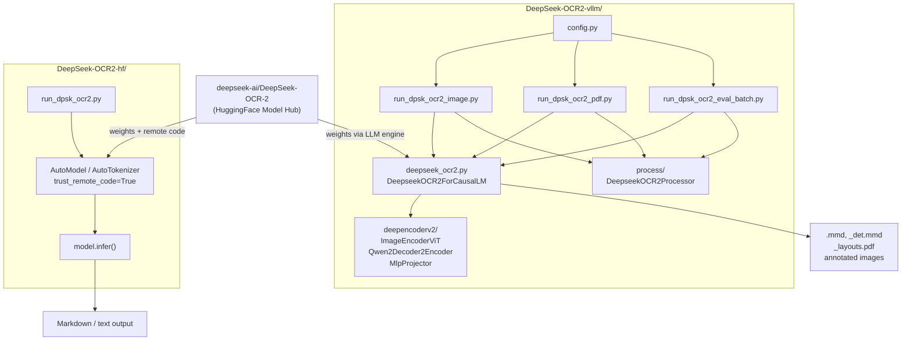

Sources: [README.md:86-129]()

---

## Inference Backends

Two independent inference backends are provided. They share the same model checkpoint but differ significantly in deployment complexity and throughput.

| Property | Transformers (`DeepSeek-OCR2-hf/`) | vLLM (`DeepSeek-OCR2-vllm/`) |
|---|---|---|
| Primary class | `AutoModel` (remote code) | `DeepseekOCR2ForCausalLM` |
| Engine | HuggingFace `transformers` | vLLM `AsyncLLMEngine` / `LLM` |
| Invocation | `model.infer(...)` | `run_dpsk_ocr2_*.py` scripts |
| Concurrency | Single-request | `MAX_CONCURRENCY` slots, `NUM_WORKERS` CPU threads |
| PDF support | No | Yes (`run_dpsk_ocr2_pdf.py`) |
| Bounding box annotation | Yes | Yes |
| Benchmark eval | No | Yes (`run_dpsk_ocr2_eval_batch.py`) |
| Flash Attention | Required (`flash_attention_2`) | Optional |

For the Transformers path, see [Transformers Inference](#3.1). For the vLLM path, see [vLLM Inference](#3.2).

---

## End-to-End Inference Flow

**Diagram: Image to Text — Key Code Entities**

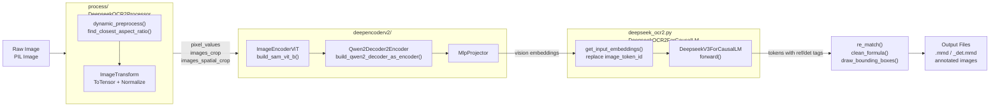

Sources: [README.md:86-138]()

---

## Dynamic Resolution Summary

The default resolution mode is documented in [README.md:131-133]():

- **Local tiles**: 0–6 crops at 768×768 pixels → 0–864 visual tokens (144 per tile)
- **Global thumbnail**: 1 view at 1024×1024 pixels → 256 visual tokens
- **Total token budget**: 256 + (N × 144), where N ∈ [0, 6]

The tiling count N is chosen per image based on aspect ratio matching. Configuration parameters `MIN_CROPS`, `MAX_CROPS`, `CROP_MODE`, `BASE_SIZE`, and `IMAGE_SIZE` in `config.py` control this budget. For a full explanation, see [Dynamic Resolution System](#6).

---

## Key Configuration Parameters

All vLLM-path configuration lives in a single file. The table below summarizes the most important parameters.

| Parameter | Default | Purpose |
|---|---|---|
| `MODEL_PATH` | `deepseek-ai/DeepSeek-OCR-2` | HuggingFace model identifier |
| `BASE_SIZE` | `1024` | Global thumbnail resolution |
| `IMAGE_SIZE` | `768` | Local tile resolution |
| `CROP_MODE` | `True` | Enable/disable local tiling |
| `MIN_CROPS` | `2` | Minimum number of tiles |
| `MAX_CROPS` | `6` | Maximum number of tiles |
| `MAX_CONCURRENCY` | `100` | Concurrent GPU inference slots |
| `NUM_WORKERS` | `64` | CPU preprocessing threads |
| `SKIP_REPEAT` | — | Skip already-processed outputs |

For full parameter documentation, see [vLLM Configuration](#3.2.1).

Sources: [README.md:64-138]()

---

# Page: Getting Started

# Getting Started

<details>
<summary>Relevant source files</summary>

The following files were used as context for generating this wiki page:

- [README.md](README.md)

</details>


This page covers environment setup and minimal working examples for running DeepSeek-OCR-2. It is the entry point before diving into deeper topics. For detailed parameter documentation of the transformers path, see [Transformers Inference](#3.1). For detailed vLLM configuration, see [vLLM Configuration](#3.2.1). For architecture details, see [Core Architecture](#4).

---

## Prerequisites

The following prerequisites are required before installation.

| Requirement | Version |
|---|---|
| CUDA | 11.8 |
| PyTorch | 2.6.0 |
| Python | 3.12.9 (via conda) |
| vLLM wheel | 0.8.5+cu118 (manual download) |
| flash-attn | 2.7.3 |

The vLLM wheel must be downloaded manually from the [vllm-project releases page](https://github.com/vllm-project/vllm/releases/tag/v0.8.5) before running the install commands.

Sources: [README.md:64-83]()

---

## Installation

**Step 1 — Clone the repository**

```bash
git clone https://github.com/deepseek-ai/DeepSeek-OCR-2.git
```

**Step 2 — Create and activate the conda environment**

```bash
conda create -n deepseek-ocr2 python=3.12.9 -y
conda activate deepseek-ocr2
```

**Step 3 — Install packages**

```bash
pip install torch==2.6.0 torchvision==0.21.0 torchaudio==2.6.0 --index-url https://download.pytorch.org/whl/cu118
pip install vllm-0.8.5+cu118-cp38-abi3-manylinux1_x86_64.whl
pip install -r requirements.txt
pip install flash-attn==2.7.3 --no-build-isolation
```

> **Note:** If you run both vLLM and transformers inference in the same environment, you may see the warning `vllm 0.8.5+cu118 requires transformers>=4.51.1`. This can be safely ignored when using the two backends together.

For more on flash-attn and `_attn_implementation`, see [Flash Attention](#8.2).

Sources: [README.md:64-84]()

---

## Choosing an Inference Backend

Two independent inference paths are available. The table below summarizes when to use each.

| | **Transformers (`DeepSeek-OCR2-hf/`)** | **vLLM (`DeepSeek-OCR2-vllm/`)** |
|---|---|---|
| Entry point | `run_dpsk_ocr2.py` | `run_dpsk_ocr2_image.py`, `run_dpsk_ocr2_pdf.py`, `run_dpsk_ocr2_eval_batch.py` |
| Model loading | `AutoModel.from_pretrained()` | `LLM` / `AsyncLLMEngine` via vLLM plugin |
| Best for | Single images, prototyping | Batch PDFs, throughput-sensitive workloads, evaluation |
| Output | Markdown / text returned from `model.infer()` | `.mmd` files, annotated images, `_layouts.pdf` |

For a detailed comparison, see [Inference Backends](#3).

**Setup flow (both paths share the same model checkpoint):**

```mermaid
flowchart TD
    HUB["\"deepseek-ai/DeepSeek-OCR-2\n(HuggingFace Hub)\""]

    subgraph hf_path["\"DeepSeek-OCR2-hf/\""]
        RUN_HF["\"run_dpsk_ocr2.py\""]
        AUTO["\"AutoModel.from_pretrained()\nAutoTokenizer.from_pretrained()\""]
        INFER_M["\"model.infer()\""]
        RUN_HF --> AUTO --> INFER_M
    end

    subgraph vllm_path["\"DeepSeek-OCR2-vllm/\""]
        CFG["\"config.py\""]
        SCRIPTS["\"run_dpsk_ocr2_image.py\nrun_dpsk_ocr2_pdf.py\nrun_dpsk_ocr2_eval_batch.py\""]
        ENGINE["\"LLM / AsyncLLMEngine\nDeepseekOCR2ForCausalLM\""]
        CFG --> SCRIPTS --> ENGINE
    end

    HUB -->|"weights + remote code"| AUTO
    HUB -->|"weights loaded by vLLM"| ENGINE
```

Sources: [README.md:86-129]()

---

## Quick Start: Transformers Path

The HuggingFace transformers path uses `AutoModel` and `AutoTokenizer` with `trust_remote_code=True`. The custom `infer()` method is delivered from the remote model repository.

```python
from transformers import AutoModel, AutoTokenizer
import torch
import os

os.environ["CUDA_VISIBLE_DEVICES"] = '0'
model_name = 'deepseek-ai/DeepSeek-OCR-2'

tokenizer = AutoTokenizer.from_pretrained(model_name, trust_remote_code=True)
model = AutoModel.from_pretrained(
    model_name,
    _attn_implementation='flash_attention_2',
    trust_remote_code=True,
    use_safetensors=True
)
model = model.eval().cuda().to(torch.bfloat16)

prompt = "<image>\n<|grounding|>Convert the document to markdown. "
image_file = 'your_image.jpg'
output_path = 'your/output/dir'

res = model.infer(
    tokenizer,
    prompt=prompt,
    image_file=image_file,
    output_path=output_path,
    base_size=1024,
    image_size=768,
    crop_mode=True,
    save_results=True
)
```

Alternatively, run the provided script directly:

```bash
cd DeepSeek-OCR2-master/DeepSeek-OCR2-hf
python run_dpsk_ocr2.py
```

**Key call chain for the transformers path:**

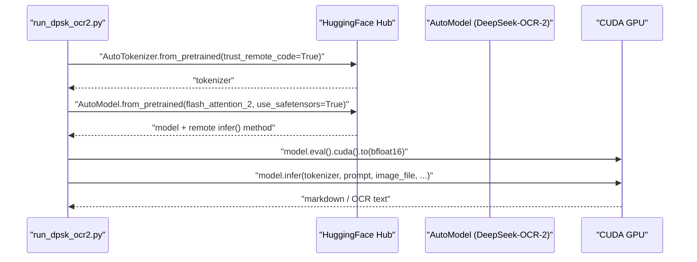

Sources: [README.md:105-129]()

---

## Quick Start: vLLM Path

Before running any vLLM script, edit `DeepSeek-OCR2-vllm/config.py` to set `INPUT_PATH` and `OUTPUT_PATH` for your environment. The `TOKENIZER` instance in `config.py` is created eagerly at import time. See [vLLM Configuration](#3.2.1) for all available parameters.

```bash
cd DeepSeek-OCR2-master/DeepSeek-OCR2-vllm
```

**Single image with streaming output:**
```bash
python run_dpsk_ocr2_image.py
```

**PDF batch inference (concurrent processing):**
```bash
python run_dpsk_ocr2_pdf.py
```

**OmniDocBench evaluation:**
```bash
python run_dpsk_ocr2_eval_batch.py
```

**vLLM runner-to-output mapping:**

```mermaid
flowchart LR
    CFG["\"config.py\nMODEL_PATH, PROMPT\nINPUT_PATH, OUTPUT_PATH\nBASE_SIZE, IMAGE_SIZE\""]

    subgraph runners["\"Runner Scripts\""]
        RI["\"run_dpsk_ocr2_image.py\n(AsyncLLMEngine, streaming)\""]
        RP["\"run_dpsk_ocr2_pdf.py\n(pdf_to_images, batch)\""]
        RE["\"run_dpsk_ocr2_eval_batch.py\n(ThreadPoolExecutor)\""]
    end

    subgraph outputs["\"Output Files\""]
        O1["\"result.mmd\nannotated images\""]
        O2["\".mmd, _det.mmd\n_layouts.pdf\""]
        O3["\"markdown per image\""]
    end

    CFG --> RI --> O1
    CFG --> RP --> O2
    CFG --> RE --> O3
```

Sources: [README.md:86-103]()

---

## Prompt Formats

Two standard prompts control model behavior. Select one based on your task.

| Task | Prompt |
|---|---|
| Document to Markdown (with layout) | `<image>\n<|grounding|>Convert the document to markdown.` |
| Free OCR (text only, no layout) | `<image>\nFree OCR.` |

The `<|grounding|>` token activates bounding-box output in the model response. See [Task-Specific Prompts](#7.2) and [Special Tokens](#7.1) for full details.

Sources: [README.md:134-138]()

---

## Dynamic Resolution

Both inference paths use the same tiling strategy by default.

| Parameter | Default | Meaning |
|---|---|---|
| `base_size` | `1024` | Global thumbnail resolution |
| `image_size` | `768` | Per-tile resolution |
| `crop_mode` | `True` | Enable local tile crops |
| `MIN_CROPS` | `2` | Minimum number of local tiles |
| `MAX_CROPS` | `6` | Maximum number of local tiles |

This produces `(0–6) × 144 + 256` visual tokens per image. See [Dynamic Resolution System](#6) for the full tiling implementation.

Sources: [README.md:131-132]()

---

# Page: Installation

# Installation

<details>
<summary>Relevant source files</summary>

The following files were used as context for generating this wiki page:

- [README.md](README.md)

</details>


Step-by-step environment setup for DeepSeek-OCR-2. The same environment supports both inference backends (vLLM and Transformers). See page 2.2 for quick-start usage after installation.

## Prerequisites and System Requirements

DeepSeek-OCR-2 requires a CUDA-capable GPU and specific versions of key dependencies:

| Component | Required Version | Purpose |
|-----------|-----------------|---------|
| CUDA | 11.8 | GPU acceleration |
| Python | 3.12.9 | Runtime environment |
| PyTorch | 2.6.0 | Deep learning framework |
| vLLM | 0.8.5+cu118 | High-throughput inference |
| Flash Attention | 2.7.3 | Optimized attention computation |

**Sources:** [README.md:65]()

## Installation Workflow

**Installation step sequence**

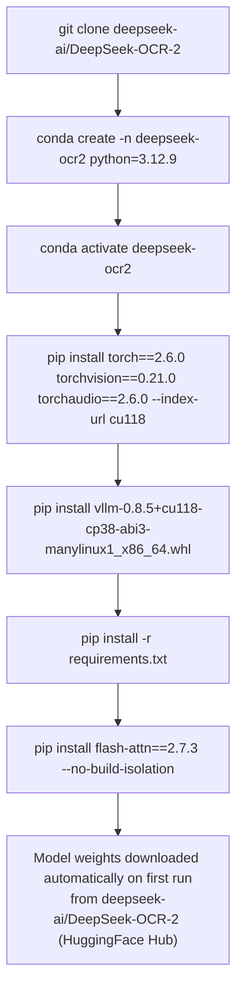

Sources: [README.md:64-83]()

## Step 1: Repository Clone

Clone the DeepSeek-OCR-2 repository from GitHub:

```bash
git clone https://github.com/deepseek-ai/DeepSeek-OCR-2.git
cd DeepSeek-OCR-2
```

This creates the local directory structure:
- `DeepSeek-OCR2-master/DeepSeek-OCR2-vllm/` - vLLM inference backend
- `DeepSeek-OCR2-master/DeepSeek-OCR2-hf/` - Transformers inference backend
- `requirements.txt` - Python dependencies

**Sources:** [README.md:66-69]()

## Step 2: Conda Environment Setup

Create and activate a dedicated conda environment with Python 3.12.9:

```bash
conda create -n deepseek-ocr2 python=3.12.9 -y
conda activate deepseek-ocr2
```

The specific Python version (3.12.9) ensures compatibility with all required packages, particularly vLLM's pre-built wheel which targets Python 3.8+ ABI.

**Sources:** [README.md:70-74]()

## Step 3: PyTorch Installation

Install PyTorch 2.6.0 with CUDA 11.8 support:

```bash
pip install torch==2.6.0 torchvision==0.21.0 torchaudio==2.6.0 \
    --index-url https://download.pytorch.org/whl/cu118
```

- `torch==2.6.0` is the tested version; other versions are untested.
- The `cu118` index URL is required for CUDA 11.8 compatibility.
- `torchvision==0.21.0` and `torchaudio==2.6.0` must match the torch version.

Sources: [README.md:79]()

## Step 4: vLLM Installation

### Obtaining the Wheel File

Download the vLLM 0.8.5 wheel from the official release:

```bash
# Download from: https://github.com/vllm-project/vllm/releases/tag/v0.8.5
# File: vllm-0.8.5+cu118-cp38-abi3-manylinux1_x86_64.whl
```

### Installing vLLM

```bash
pip install vllm-0.8.5+cu118-cp38-abi3-manylinux1_x86_64.whl
```

### Dependency Conflict Resolution

The vLLM wheel declares `transformers>=4.51.1` as a requirement. This version constraint may not be satisfied by the `transformers` version installed by `requirements.txt`. **This conflict can be safely ignored.** Both the vLLM and Transformers inference backends function correctly regardless of this pip warning.

> `vllm 0.8.5+cu118 requires transformers>=4.51.1` — safe to ignore when running both backends in the same environment.

Sources: [README.md:84]()

## Step 5: Additional Dependencies

Install remaining dependencies:

```bash
pip install -r requirements.txt
```

`requirements.txt` includes packages for HuggingFace model loading (`transformers`), image processing (`Pillow`), numerical operations (`numpy`), weight loading (`safetensors`), and utilities for PDF processing and evaluation.

Sources: [README.md:81]()

## Step 6: Flash Attention Installation

Install Flash Attention 2.7.3:

```bash
pip install flash-attn==2.7.3 --no-build-isolation
```

- `--no-build-isolation` is required for correct CUDA kernel compilation against the installed torch.
- This enables `_attn_implementation='flash_attention_2'` when loading via `AutoModel.from_pretrained()` in the Transformers path.
- Note: Flash Attention is **not** used by `CustomQwen2Decoder` (the vision encoder's decoder-as-encoder component), which requires `sdpa` or `eager` attention. See page 8.2 and page 5.2 for details.

Sources: [README.md:82]()

## Dependency and Entry Point Map

This diagram maps installed packages to the code entities that depend on them.

**Package-to-code-entity dependency map**

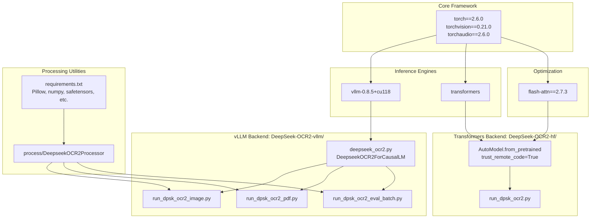

Sources: [README.md:75-83](), [README.md:86-129]()

## Step 7: Model Download

Model weights are downloaded automatically from HuggingFace Hub on first use, by either inference backend. No explicit download step is required.

The model identifier is `deepseek-ai/DeepSeek-OCR-2`. The `trust_remote_code=True` flag is required because the repository bundles custom modeling and preprocessing code (e.g., `modeling_*.py`, `processing_*.py`).

For offline environments, pre-download with:

```bash
huggingface-cli download deepseek-ai/DeepSeek-OCR-2
```

The vLLM backend reads the model path from `MODEL_PATH` in `DeepSeek-OCR2-vllm/config.py`, which defaults to `'deepseek-ai/DeepSeek-OCR-2'`. See page 3.2.1 for configuration details.

Sources: [README.md:36](), [README.md:108-116]()

## Installation Verification

Verify the installation by running the Transformers inference script as described in [README.md:107-116](). The script loads `DeepseekOCR2ForCausalLM` via `AutoModel.from_pretrained` with `trust_remote_code=True`, moves the model to CUDA, and calls `model.infer()`. A successful run confirms that torch, flash-attn, and the HuggingFace stack are all correctly installed.

For the vLLM backend, verify by running:

```bash
cd DeepSeek-OCR2-master/DeepSeek-OCR2-vllm
python run_dpsk_ocr2_image.py
```

after setting `INPUT_PATH` and `OUTPUT_PATH` in `config.py`.

Sources: [README.md:86-103](), [README.md:107-116]()

## Repository File Structure

After cloning, the relevant files for each inference path are:

**Repository layout mapped to inference paths**

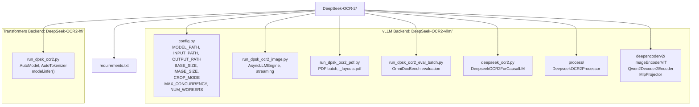

Sources: [README.md:88-103](), [README.md:126-129]()

## Backend Selection

Choose an inference backend based on your use case:

| Use Case | Backend | Entry Point | Configuration |
|----------|---------|-------------|---------------|
| Development, custom Python workflows | Transformers | `DeepSeek-OCR2-hf/run_dpsk_ocr2.py` | Script parameters |
| Production, high-throughput image OCR | vLLM | `DeepSeek-OCR2-vllm/run_dpsk_ocr2_image.py` | `config.py` |
| PDF batch processing | vLLM | `DeepSeek-OCR2-vllm/run_dpsk_ocr2_pdf.py` | `config.py` |
| OmniDocBench evaluation | vLLM | `DeepSeek-OCR2-vllm/run_dpsk_ocr2_eval_batch.py` | `config.py` |

For detailed usage:
- Page 3.1 — Transformers inference path, `model.infer()` parameters
- Page 3.2 — vLLM inference path overview
- Page 3.2.1 — All `config.py` parameters

Sources: [README.md:86-103](), [README.md:105-129]()

## Troubleshooting

### CUDA Version Mismatch

**Symptom:** `RuntimeError: CUDA error: no kernel image is available`

**Solution:** Ensure CUDA 11.8 is installed and `torch` uses the cu118 index:
```bash
nvcc --version  # Should show CUDA 11.8
python -c "import torch; print(torch.version.cuda)"  # Should show 11.8
```

### Flash Attention Build Failure

**Symptom:** Compilation errors during `flash-attn` installation

**Solution:** Install build dependencies:
```bash
conda install -c conda-forge cudatoolkit-dev=11.8
pip install ninja
pip install flash-attn==2.7.3 --no-build-isolation
```

### vLLM Transformers Version Warning

**Symptom:** `WARNING: vllm 0.8.5+cu118 requires transformers>=4.51.1`

**Solution:** This warning can be safely ignored. Both backends function correctly with the installed transformers version.

### Model Download Timeout

**Symptom:** HuggingFace Hub connection timeout

**Solution:** Set alternative mirror or pre-download:
```bash
export HF_ENDPOINT=https://hf-mirror.com
# Or manually download and set local path
export MODEL_PATH=/path/to/local/model
```

**Sources:** [README.md:84]()

## Next Steps

After successful installation:
1. Configure inference backend - see [vLLM Configuration](#3.2.1)
2. Run basic OCR examples - see [Quick Start Examples](#2.2)
3. Understand prompt templates - see [Prompt Engineering](#7)
4. Optimize performance - see [Performance Optimization](#8)

**Sources:** [README.md:55-142]()

---

# Page: Quick Start Examples

# Quick Start Examples

<details>
<summary>Relevant source files</summary>

The following files were used as context for generating this wiki page:

- [DeepSeek-OCR2-master/DeepSeek-OCR2-hf/run_dpsk_ocr2.py](DeepSeek-OCR2-master/DeepSeek-OCR2-hf/run_dpsk_ocr2.py)
- [README.md](README.md)

</details>


This page provides minimal working examples for running DeepSeek-OCR-2 inference with both supported backends. The goal is to get from a model checkpoint to OCR output in as few steps as possible.

This page covers the entry points only. For detailed parameter explanations, see the Transformers backend documentation at [3.1]() and the vLLM backend documentation at [3.2](). For installation prerequisites, see [2.1]().

---

## Choosing a Backend

Two independent inference paths share the same `deepseek-ai/DeepSeek-OCR-2` model checkpoint from HuggingFace Hub.

| Backend | Entry Point | Use Case |
|---|---|---|
| HuggingFace Transformers | `DeepSeek-OCR2-hf/run_dpsk_ocr2.py` | Single-image inference, simpler setup |
| vLLM | `DeepSeek-OCR2-vllm/run_dpsk_ocr2_image.py` | High-throughput, streaming, batch PDF, benchmarks |

The two paths load the same weights but differ significantly in how the model is registered, how images are dispatched, and what output formats are produced.

**Path selection diagram:**

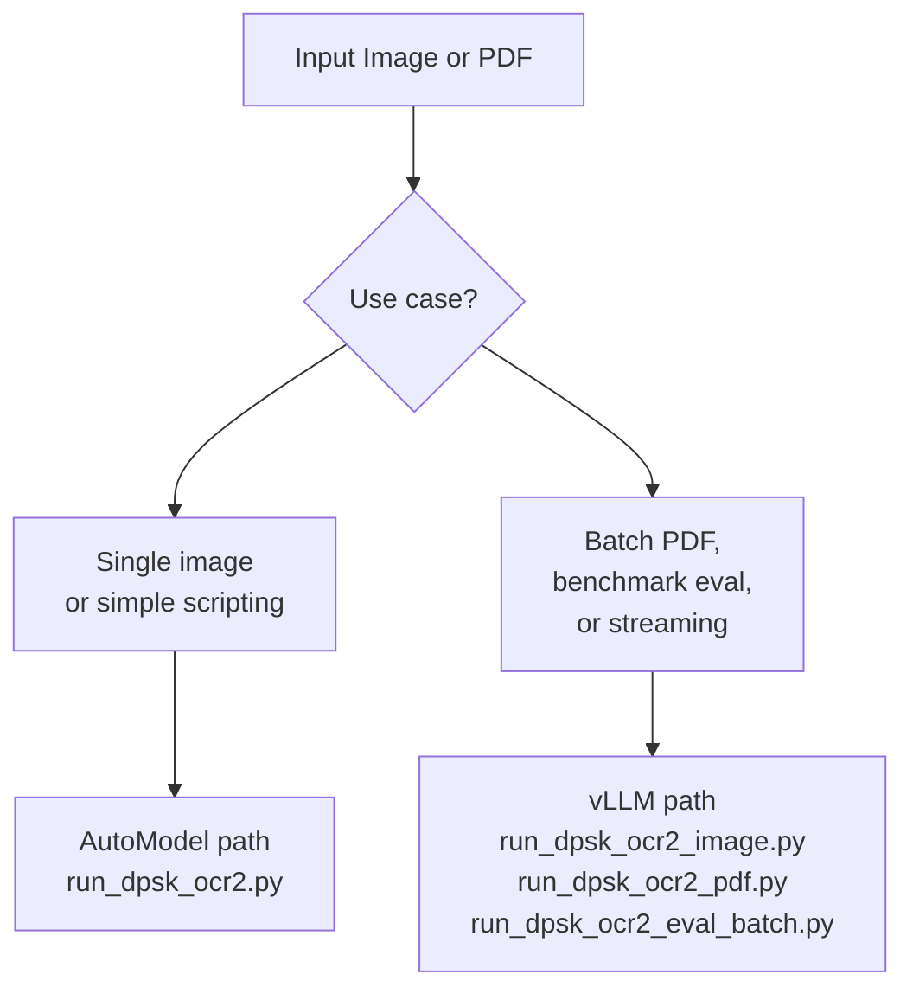

Sources: [README.md:57-103]()

---

## Prompt Formats

Before looking at the examples, note that the model recognizes two standard prompt strings. The prompt you choose determines the output format.

| Prompt | Behavior |
|---|---|
| `<image>\n<|grounding|>Convert the document to markdown.` | Full document-to-markdown conversion with layout grounding. Produces structured markdown with bounding box annotations (`<\|ref\|>...<\|det\|>` tags). |
| `<image>\nFree OCR.` | Plain text extraction without layout structure. |

Both prompts begin with the `<image>` special token, which is the injection point for visual embeddings.

Sources: [README.md:134-138](), [DeepSeek-OCR2-master/DeepSeek-OCR2-hf/run_dpsk_ocr2.py:17-18]()

---

## HuggingFace Transformers — Quick Start

**Runtime flow:**

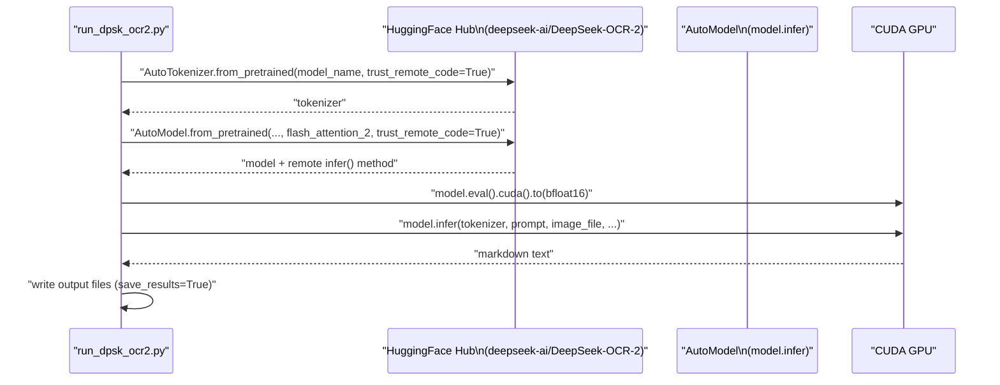

Sources: [DeepSeek-OCR2-master/DeepSeek-OCR2-hf/run_dpsk_ocr2.py:1-25](), [README.md:107-124]()

### Steps

**1. Load tokenizer and model**

See [DeepSeek-OCR2-master/DeepSeek-OCR2-hf/run_dpsk_ocr2.py:1-13]()

- `AutoTokenizer.from_pretrained` with `trust_remote_code=True` is required because the tokenizer includes custom remote code from the model repository.
- `AutoModel.from_pretrained` requires `trust_remote_code=True` (custom `infer()` method), `_attn_implementation='flash_attention_2'` (for performance), and `use_safetensors=True`.
- After loading, the model is moved to `bfloat16` precision on CUDA with `.eval().cuda().to(torch.bfloat16)`.

**2. Set the prompt and paths**

See [DeepSeek-OCR2-master/DeepSeek-OCR2-hf/run_dpsk_ocr2.py:17-21]()

- `image_file`: path to the input image.
- `output_path`: directory where output files are written when `save_results=True`.
- Choose between the two prompt formats from the table above.

**3. Call `model.infer()`**

See [DeepSeek-OCR2-master/DeepSeek-OCR2-hf/run_dpsk_ocr2.py:24-25]()

The `infer()` method is delivered as part of the remote model code. Key parameters:

| Parameter | Value in example | Description |
|---|---|---|
| `tokenizer` | loaded tokenizer | required |
| `prompt` | `<image>\n<|grounding|>...` | task prompt string |
| `image_file` | path string | input image path |
| `output_path` | path string | output directory |
| `base_size` | `1024` | global thumbnail resolution |
| `image_size` | `768` | local crop tile size |
| `crop_mode` | `True` | enable dynamic tiling |
| `save_results` | `True` | write output files to `output_path` |

**4. Run the script directly**

The file [DeepSeek-OCR2-master/DeepSeek-OCR2-hf/run_dpsk_ocr2.py:1-25]() is a complete runnable script. After editing `image_file` and `output_path`:

```
cd DeepSeek-OCR2-master/DeepSeek-OCR2-hf
python run_dpsk_ocr2.py
```

Sources: [README.md:105-129](), [DeepSeek-OCR2-master/DeepSeek-OCR2-hf/run_dpsk_ocr2.py:1-25]()

---

## vLLM — Quick Start

The vLLM path uses three separate runner scripts depending on the input type. All three share a single configuration file.

**Runtime flow:**

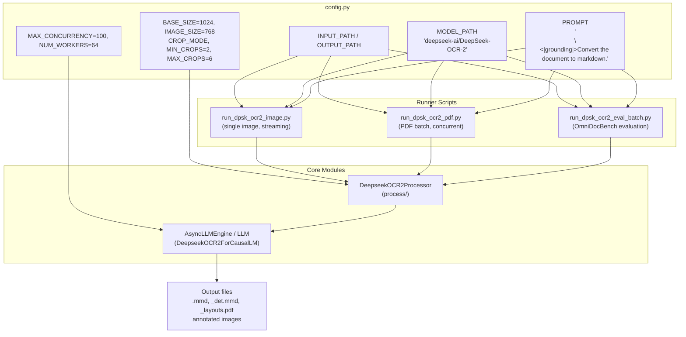

Sources: [README.md:87-103]()

### Steps

**1. Edit `config.py`**

Before running any script, set `INPUT_PATH` and `OUTPUT_PATH` in `DeepSeek-OCR2-vllm/config.py`. All other parameters have working defaults. See [3.2.1]() for a full parameter reference.

**2. Navigate to the vLLM directory**

```
cd DeepSeek-OCR2-master/DeepSeek-OCR2-vllm
```

**3. Choose the appropriate runner script**

| Script | Command | When to use |
|---|---|---|
| `run_dpsk_ocr2_image.py` | `python run_dpsk_ocr2_image.py` | Single image, streaming token output |
| `run_dpsk_ocr2_pdf.py` | `python run_dpsk_ocr2_pdf.py` | One or more PDF files, concurrent batch |
| `run_dpsk_ocr2_eval_batch.py` | `python run_dpsk_ocr2_eval_batch.py` | OmniDocBench benchmark evaluation |

Sources: [README.md:87-103]()

### Output Files

Depending on the runner, the following output files are written to `OUTPUT_PATH`:

| File pattern | Content | Runner |
|---|---|---|
| `*.mmd` | Markdown OCR result | all |
| `*_det.mmd` | Markdown with `<\|ref\|>/<\|det\|>` bounding box tags | image runner |
| `*_layouts.pdf` | PDF with annotated layout bounding boxes | PDF runner |
| Annotated image files | Images with drawn bounding boxes | image runner |

Sources: [README.md:87-103]()

---

## Key Code Entities at a Glance

The following diagram maps the high-level concepts from this page to their concrete code locations.

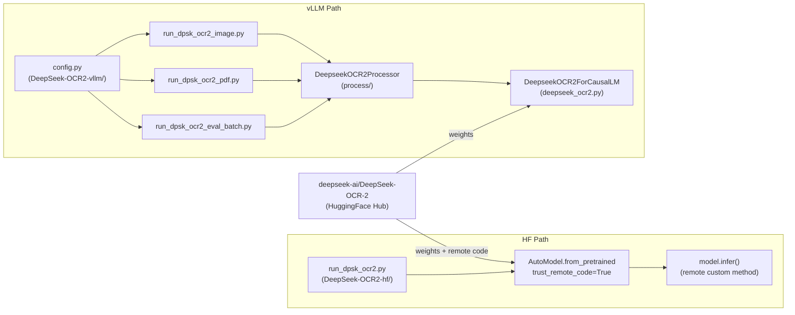

Sources: [README.md:57-138](), [DeepSeek-OCR2-master/DeepSeek-OCR2-hf/run_dpsk_ocr2.py:1-25]()

---

# Page: Inference Backends

# Inference Backends

<details>
<summary>Relevant source files</summary>

The following files were used as context for generating this wiki page:

- [README.md](README.md)

</details>


This page introduces the two inference paths available in DeepSeek-OCR-2 and explains when to use each. Both paths load from the same model checkpoint (`deepseek-ai/DeepSeek-OCR-2`) but differ significantly in throughput, configuration complexity, and feature set.

- For detailed parameter references, see the child pages: Transformers Inference ([3.1](#3.1)) and vLLM Inference ([3.2](#3.2)).
- For the underlying model architecture that both paths execute, see Core Architecture ([4](#4)).
- For image preprocessing details shared by both paths, see Dynamic Resolution System ([6](#6)).

---

## Overview

DeepSeek-OCR-2 ships two self-contained inference directories. They do not share runtime code with each other, but both depend on the same HuggingFace model repository for weights and the custom `infer()` method.

| Aspect | Transformers (`DeepSeek-OCR2-hf/`) | vLLM (`DeepSeek-OCR2-vllm/`) |
|---|---|---|
| Entry point | `run_dpsk_ocr2.py` | `run_dpsk_ocr2_image.py`, `run_dpsk_ocr2_pdf.py`, `run_dpsk_ocr2_eval_batch.py` |
| Engine | `AutoModel` via `transformers` | `LLM` / `AsyncLLMEngine` via `vllm` |
| Concurrency | Single image per call | Up to `MAX_CONCURRENCY=100` concurrent requests |
| PDF support | No | Yes (`run_dpsk_ocr2_pdf.py`) |
| Streaming output | No | Yes (`run_dpsk_ocr2_image.py`) |
| Bounding box annotation | No | Yes (grounding mode) |
| Configuration | Parameters passed to `model.infer()` | Centralized `config.py` |
| Attention backend | `flash_attention_2` required | vLLM manages internally |
| Primary use case | Development, single-document inference | Production serving, batch evaluation |

Sources: [README.md:86-129]()

---

## Repository Structure

**Directory layout for inference backends:**

```
DeepSeek-OCR2-hf/
└── run_dpsk_ocr2.py          ← Transformers entry point

DeepSeek-OCR2-vllm/
├── config.py                 ← Central configuration
├── run_dpsk_ocr2_image.py    ← Single image, async streaming
├── run_dpsk_ocr2_pdf.py      ← PDF batch inference
├── run_dpsk_ocr2_eval_batch.py  ← OmniDocBench evaluation
├── deepseek_ocr2.py          ← DeepseekOCR2ForCausalLM (vLLM plugin)
├── process/                  ← DeepseekOCR2Processor
└── deepencoderv2/            ← Vision encoder package
```

Sources: [README.md:86-129]()

---

## Backend Decision Flow

**Diagram: Choosing an Inference Backend**

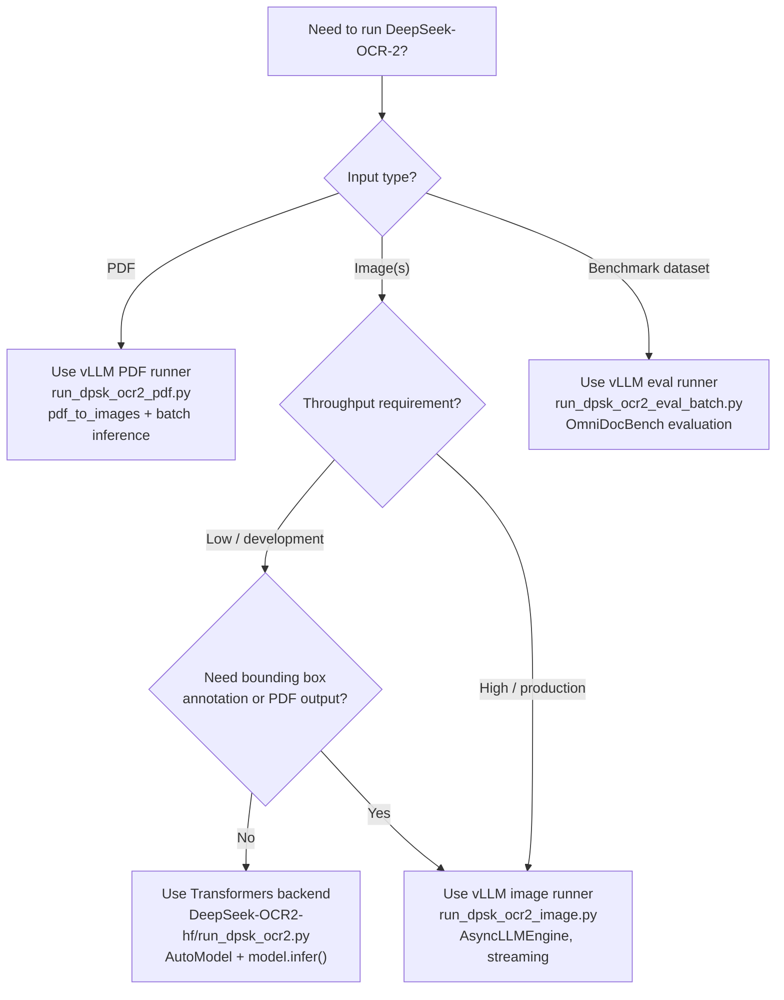

Sources: [README.md:86-129]()

---

## Shared Model Checkpoint

Both backends load from the same source: `deepseek-ai/DeepSeek-OCR-2` on HuggingFace Hub.

- The Transformers path fetches weights and custom remote code (including the `infer()` method) via `AutoModel.from_pretrained(..., trust_remote_code=True)`.
- The vLLM path loads weights through `DeepseekOCR2ForCausalLM.load_weights()`, which maps HuggingFace weight names to vLLM sub-module names.

The `MODEL_PATH` constant in `config.py` (vLLM path) and the `model_name` variable in `run_dpsk_ocr2.py` (Transformers path) both reference `'deepseek-ai/DeepSeek-OCR-2'`.

**Diagram: Both Backends Share One Checkpoint**

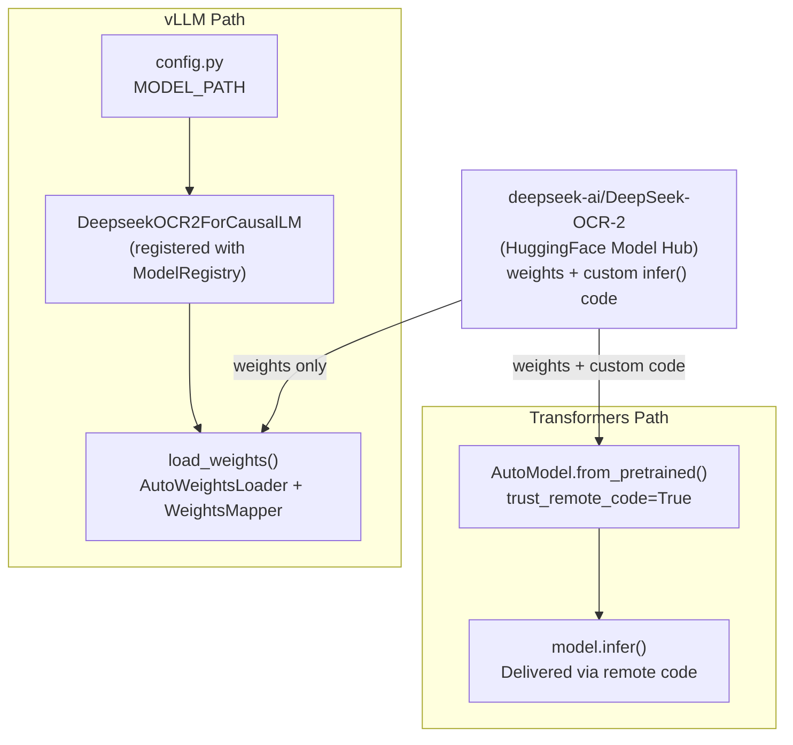

Sources: [README.md:107-129]()

---

## Two Standard Prompts

Both backends support the same two prompt formats. The prompt controls the output mode.

| Mode | Prompt | Output |
|---|---|---|
| Document-to-Markdown | `<image>\n<|grounding|>Convert the document to markdown.` | Markdown with layout, `<|ref|>...<|det|>` bounding box tags |
| Free OCR | `<image>\nFree OCR. ` | Plain text, no layout structure |

The `<|grounding|>` token activates bounding box prediction. The vLLM path configures this via the `PROMPT` constant in `config.py`. The Transformers path passes it directly to `model.infer()`.

For a full explanation of special tokens and prompt formats, see Special Tokens ([7.1](#7.1)) and Task-Specific Prompts ([7.2](#7.2)).

Sources: [README.md:134-138]()

---

## Installation Requirements

Both backends share a common base installation. The vLLM backend requires the additional vLLM wheel.

```
# Common (both backends)
torch==2.6.0  torchvision==0.21.0  torchaudio==2.6.0  (CUDA 11.8)
requirements.txt
flash-attn==2.7.3  (required by Transformers backend; installed with --no-build-isolation)

# vLLM backend only
vllm-0.8.5+cu118 wheel (manual install from GitHub releases)
```

> **Note:** The `transformers>=4.51.1` version conflict reported during vLLM installation can be safely ignored when running both backends in the same environment. See [README.md:84]().

For full installation steps, see Installation ([2.1](#2.1)).

Sources: [README.md:64-84]()

---

# Page: Transformers Inference

# Transformers Inference

<details>
<summary>Relevant source files</summary>

The following files were used as context for generating this wiki page:

- [DeepSeek-OCR2-master/DeepSeek-OCR2-hf/run_dpsk_ocr2.py](DeepSeek-OCR2-master/DeepSeek-OCR2-hf/run_dpsk_ocr2.py)
- [README.md](README.md)

</details>


This page documents the HuggingFace `transformers`-based inference path for DeepSeek-OCR-2. It covers model loading, setup, the `model.infer()` method signature and parameters, and the `run_dpsk_ocr2.py` entry point script.

This is the simpler of the two inference backends — it targets single-image, interactive use cases. For the high-throughput, batch-oriented path, see the vLLM Inference page ([3.2](#3.2)). For details on how the prompts are structured, see [7.2](#7.2).

---

## Overview

The transformers inference path loads the model through the standard HuggingFace `AutoModel` / `AutoTokenizer` API with `trust_remote_code=True`. The model repository (`deepseek-ai/DeepSeek-OCR-2`) ships custom Python code that is downloaded and executed locally, including the `infer()` method. No local model definition file is required beyond the runner script.

**Entry point:** [`DeepSeek-OCR2-master/DeepSeek-OCR2-hf/run_dpsk_ocr2.py`](DeepSeek-OCR2-master/DeepSeek-OCR2-hf/run_dpsk_ocr2.py)

---

## Call Flow

**Diagram: Transformers Inference Call Flow**

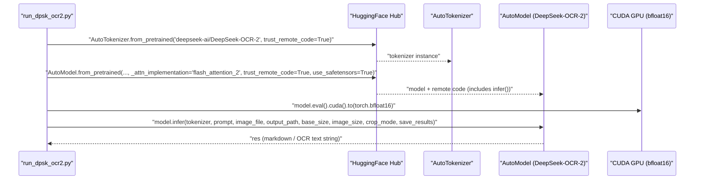

Sources: [`DeepSeek-OCR2-master/DeepSeek-OCR2-hf/run_dpsk_ocr2.py:1-25`](), [`README.md:107-124`]()

---

## Loading the Model

### AutoTokenizer

```
AutoTokenizer.from_pretrained(model_name, trust_remote_code=True)
```

- `model_name` is `'deepseek-ai/DeepSeek-OCR-2'` ([`run_dpsk_ocr2.py:8`]()).
- `trust_remote_code=True` is required because the tokenizer configuration lives in the remote repository.

### AutoModel

```
AutoModel.from_pretrained(
    model_name,
    _attn_implementation='flash_attention_2',
    trust_remote_code=True,
    use_safetensors=True
)
```

| Parameter | Value | Effect |
|---|---|---|
| `_attn_implementation` | `'flash_attention_2'` | Enables FlashAttention-2 in the language model layers. Requires `flash-attn==2.7.3`. |
| `trust_remote_code` | `True` | Allows the HuggingFace Hub to download and execute model-specific Python code, including the `infer()` method. |
| `use_safetensors` | `True` | Loads weights from `.safetensors` files rather than `.bin` pickle files. |

See [8.2](#8.2) for flash attention details, and [9.3](#9.3) for `trust_remote_code` implications.

### Device Setup

After loading, the model is moved to the GPU and cast to `bfloat16`:

[`DeepSeek-OCR2-master/DeepSeek-OCR2-hf/run_dpsk_ocr2.py:13`]()

```
model = model.eval().cuda().to(torch.bfloat16)
```

| Step | Method | Purpose |
|---|---|---|
| Disable gradients | `.eval()` | Puts model in inference mode; disables dropout. |
| Move to GPU | `.cuda()` | Defaults to the device specified by `CUDA_VISIBLE_DEVICES`. |
| Cast dtype | `.to(torch.bfloat16)` | Reduces memory footprint; bfloat16 is numerically stable for large language models. |

`CUDA_VISIBLE_DEVICES` is set to `'0'` at line [`run_dpsk_ocr2.py:6`]() to restrict to GPU 0. Adjust this to target different devices.

Sources: [`DeepSeek-OCR2-master/DeepSeek-OCR2-hf/run_dpsk_ocr2.py:1-13`](), [`README.md:108-116`]()

---

## The `model.infer()` Method

`infer()` is a custom method delivered by the remote model code (not part of the standard `transformers` `AutoModel` API). It wraps image preprocessing, tokenization, forward pass, and result saving into a single call.

### Method Signature

```
model.infer(
    tokenizer,
    prompt,
    image_file,
    output_path,
    base_size,
    image_size,
    crop_mode,
    save_results
)
```

### Parameters

| Parameter | Type | Example Value | Description |
|---|---|---|---|
| `tokenizer` | tokenizer object | (from `AutoTokenizer`) | The tokenizer instance loaded earlier. |
| `prompt` | `str` | `"<image>\n<|grounding|>Convert the document to markdown. "` | Instruction string including the `<image>` placeholder token. See [7.1](#7.1) and [7.2](#7.2). |
| `image_file` | `str` | `'your_image.jpg'` | Path to the input image file. |
| `output_path` | `str` | `'your/output/dir'` | Directory where output files are written when `save_results=True`. |
| `base_size` | `int` | `1024` | Resolution of the global thumbnail view (pixels). See [6.2](#6.2). |
| `image_size` | `int` | `768` | Resolution of each local crop tile (pixels). See [6.2](#6.2). |
| `crop_mode` | `bool` | `True` | Enables dynamic tiling (up to 6 local crops). Set to `False` for the global-view-only mode. |
| `save_results` | `bool` | `True` | If `True`, writes the result markdown/text to `output_path`. |

### Return Value

`infer()` returns `res`, a string containing the generated OCR output — either markdown (with grounding prompt) or plain text (with Free OCR prompt).

Sources: [`DeepSeek-OCR2-master/DeepSeek-OCR2-hf/run_dpsk_ocr2.py:17-25`](), [`README.md:118-123`]()

---

## Prompt Formats

Two standard prompts are used with this inference path:

| Mode | Prompt String | Output |
|---|---|---|
| Document-to-Markdown | `"<image>\n<|grounding|>Convert the document to markdown. "` | Structured markdown with layout, tables, formulas, and `<|ref|>`/`<|det|>` bounding box tags. |
| Free OCR | `"<image>\nFree OCR. "` | Plain text OCR without layout structure. |

The `<image>` token is the placeholder replaced by vision embeddings during the forward pass. See [7.1](#7.1) for full special token documentation.

Sources: [`DeepSeek-OCR2-master/DeepSeek-OCR2-hf/run_dpsk_ocr2.py:17-18`](), [`README.md:135-138`]()

---

## Component Map

**Diagram: Code Entities in the Transformers Inference Path**

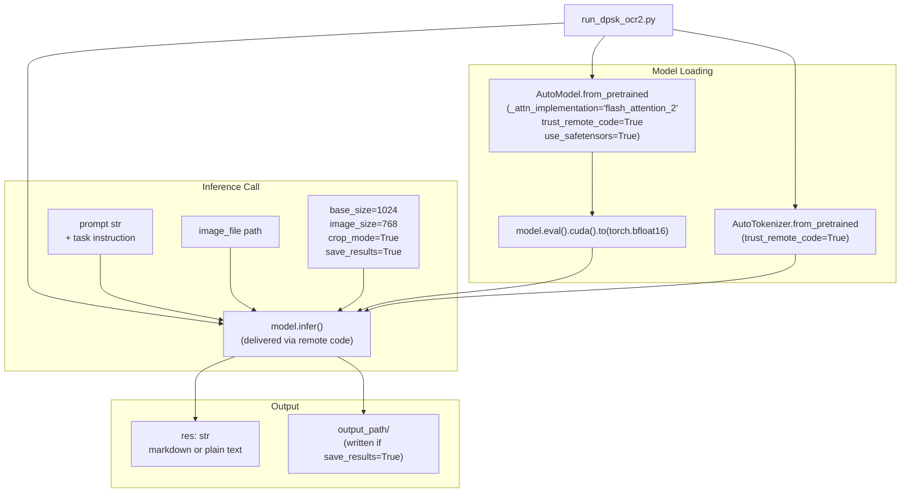

Sources: [`DeepSeek-OCR2-master/DeepSeek-OCR2-hf/run_dpsk_ocr2.py:1-25`](), [`README.md:107-129`]()

---

## Running the Script

The full working example is in [`DeepSeek-OCR2-master/DeepSeek-OCR2-hf/run_dpsk_ocr2.py`](). Before running:

1. Set `image_file` to your input image path ([`run_dpsk_ocr2.py:19`]()).
2. Set `output_path` to your desired output directory ([`run_dpsk_ocr2.py:20`]()).
3. Select the appropriate `prompt` ([`run_dpsk_ocr2.py:17-18`]()).
4. Optionally adjust `CUDA_VISIBLE_DEVICES` ([`run_dpsk_ocr2.py:6`]()).

Then execute:

```
cd DeepSeek-OCR2-master/DeepSeek-OCR2-hf
python run_dpsk_ocr2.py
```

Sources: [`README.md:126-129`](), [`DeepSeek-OCR2-master/DeepSeek-OCR2-hf/run_dpsk_ocr2.py:1-25`]()

---

## Notes and Limitations

- **Single-image, synchronous**: This path processes one image per call with no concurrency support. For batch or PDF processing, use the vLLM path ([3.2](#3.2)).
- **`transformers` version conflict**: Installing `flash-attn==2.7.3` alongside vLLM 0.8.5 may raise a `transformers>=4.51.1` requirement error from vLLM. This error can be safely ignored if only using the transformers path. See [2.1](#2.1) for installation details.
- **`flash_attention_2` in vision encoder**: `flash_attention_2` is not supported in the `CustomQwen2Decoder` (part of the vision encoder). That component requires `sdpa` or `eager` attention. The `_attn_implementation='flash_attention_2'` flag applies only to the language model backbone layers. See [5.2](#5.2) and [8.2](#8.2).

Sources: [`README.md:64-84`]()

---

# Page: vLLM Inference

# vLLM Inference

<details>
<summary>Relevant source files</summary>

The following files were used as context for generating this wiki page:

- [DeepSeek-OCR2-master/DeepSeek-OCR2-vllm/config.py](DeepSeek-OCR2-master/DeepSeek-OCR2-vllm/config.py)
- [DeepSeek-OCR2-master/DeepSeek-OCR2-vllm/deepseek_ocr2.py](DeepSeek-OCR2-master/DeepSeek-OCR2-vllm/deepseek_ocr2.py)
- [README.md](README.md)

</details>


This page describes the vLLM-based inference path for DeepSeek-OCR-2: how the model is registered with vLLM, how configuration flows from `config.py` into the runner scripts, and how inputs are processed into outputs. It covers the shared model plugin (`deepseek_ocr2.py`) and the three runner scripts that sit on top of it.

- For the configuration parameters in detail, see [vLLM Configuration](#3.2.1).
- For the individual runner scripts and their post-processing steps, see [vLLM Entry Points](#3.2.2).
- For the Transformers-based inference path, see [Transformers Inference](#3.1).
- For the vision encoder internals, see [Vision Encoders](#5).

---

## Overview

The vLLM path is organized as a self-contained package under `DeepSeek-OCR2-master/DeepSeek-OCR2-vllm/`. It exposes a custom vLLM model plugin that wraps the vision encoder stack and a DeepSeek language model backend, plus three runner scripts that target different use cases.

| Script | Use Case | Engine Type |
|---|---|---|
| `run_dpsk_ocr2_image.py` | Single image, streaming output | `AsyncLLMEngine` |
| `run_dpsk_ocr2_pdf.py` | PDF batch processing | `LLM` (concurrent) |
| `run_dpsk_ocr2_eval_batch.py` | OmniDocBench evaluation | `LLM` + `ThreadPoolExecutor` |

All three share the same `config.py` values and the same `DeepseekOCR2ForCausalLM` model plugin.

Sources: [DeepSeek-OCR2-master/DeepSeek-OCR2-vllm/config.py:1-31](), [README.md:86-103]()

---

## vLLM Model Registration

The model is registered with vLLM's multimodal system via the `@MULTIMODAL_REGISTRY.register_processor` decorator. This is how vLLM learns to treat `DeepseekOCR2ForCausalLM` as a multimodal model capable of accepting image inputs.

**Registration decorator** — [DeepSeek-OCR2-master/DeepSeek-OCR2-vllm/deepseek_ocr2.py:260-264]():

```
@MULTIMODAL_REGISTRY.register_processor(
    DeepseekOCR2MultiModalProcessor,
    info=DeepseekOCR2ProcessingInfo,
    dummy_inputs=DeepseekOCR2DummyInputsBuilder)
class DeepseekOCR2ForCausalLM(nn.Module, SupportsMultiModal, SupportsPP):
```

The three classes passed to the decorator have distinct roles in the vLLM plugin system:

| Class | Base Class | Role |
|---|---|---|
| `DeepseekOCR2ProcessingInfo` | `BaseProcessingInfo` | Reports token counts, image size limits, and supported modalities to vLLM's scheduler |
| `DeepseekOCR2DummyInputsBuilder` | `BaseDummyInputsBuilder` | Generates synthetic inputs for vLLM's memory profiling pass |
| `DeepseekOCR2MultiModalProcessor` | `BaseMultiModalProcessor` | Calls `DeepseekOCR2Processor`, maps multimodal field configs, and handles prompt token replacement |

Sources: [DeepSeek-OCR2-master/DeepSeek-OCR2-vllm/deepseek_ocr2.py:53-263]()

---

## Component Relationship Diagram

**Diagram: vLLM Plugin Class Hierarchy and Data Flow**

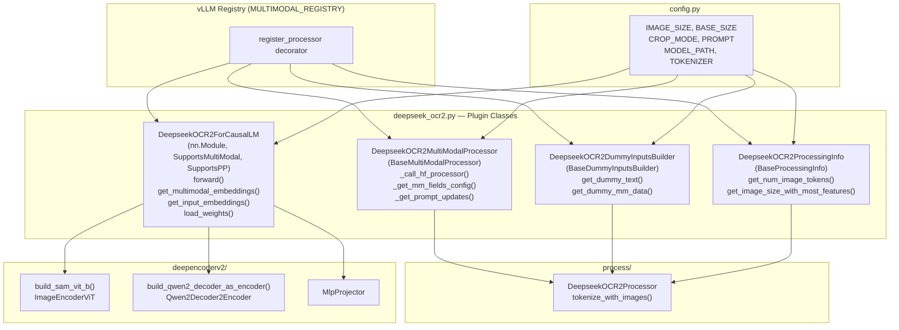

Sources: [DeepSeek-OCR2-master/DeepSeek-OCR2-vllm/deepseek_ocr2.py:1-582](), [DeepSeek-OCR2-master/DeepSeek-OCR2-vllm/config.py:1-31]()

---

## Inference Flow

The following diagram traces a request from a raw image file through preprocessing, vLLM engine dispatch, and into the model's forward pass.

**Diagram: End-to-End vLLM Inference Flow**

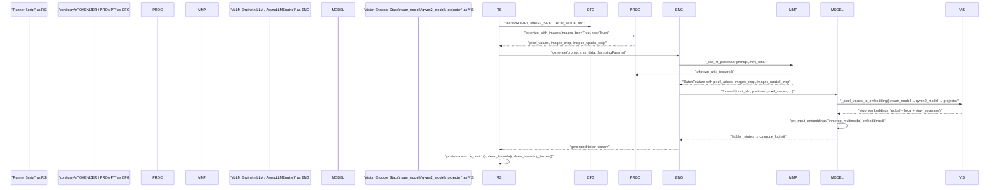

Sources: [DeepSeek-OCR2-master/DeepSeek-OCR2-vllm/deepseek_ocr2.py:372-551](), [DeepSeek-OCR2-master/DeepSeek-OCR2-vllm/config.py:1-31]()

---

## DeepseekOCR2ForCausalLM — Model Plugin

`DeepseekOCR2ForCausalLM` is the central model class. It owns the three stages of the vision pipeline and delegates language modeling to one of the DeepSeek language model variants.

### Submodules

| Attribute | Created By | Type |
|---|---|---|
| `sam_model` | `build_sam_vit_b()` | `ImageEncoderViT` (SAM ViT-B) |
| `qwen2_model` | `build_qwen2_decoder_as_encoder()` | `Qwen2Decoder2Encoder` |
| `projector` | `MlpProjector(...)` | Linear projector, input dim 896 → 1280 |
| `language_model` | `init_vllm_registered_model(...)` | One of: `DeepseekV3ForCausalLM`, `DeepseekV2ForCausalLM`, `DeepseekForCausalLM` |
| `view_seperator` | `nn.Parameter(...)` | Learnable 1280-dim separator token appended between local and global features |

See [Language Model Variants](#4.4) for how `language_model` is selected based on `text_config`.

Sources: [DeepSeek-OCR2-master/DeepSeek-OCR2-vllm/deepseek_ocr2.py:270-338]()

### Key Methods

| Method | Signature | Role |
|---|---|---|
| `_parse_and_validate_image_input` | `(**kwargs) → list or None` | Extracts `pixel_values`, `images_crop`, `images_spatial_crop` from kwargs; returns `None` if no image is present |
| `_pixel_values_to_embedding` | `(pixel_values, images_crop, images_spatial_crop) → list[Tensor]` | Runs the three-stage vision pipeline per image; concatenates local features, global features, and `view_seperator` |
| `get_multimodal_embeddings` | `(**kwargs) → MultiModalEmbeddings or None` | Calls the above two methods in sequence |
| `get_input_embeddings` | `(input_ids, multimodal_embeddings) → Tensor` | Merges vision embeddings into the language model token stream at `<image>` token positions using `merge_multimodal_embeddings` |
| `forward` | `(input_ids, positions, ...) → hidden_states` | Orchestrates the full forward pass |
| `compute_logits` | `(hidden_states, sampling_metadata) → Tensor` | Delegates to `language_model.compute_logits()` |
| `load_weights` | `(weights) → Set[str]` | Remaps HuggingFace weight names to vLLM sub-module names; uses `AutoWeightsLoader` and `WeightsMapper` |

Sources: [DeepSeek-OCR2-master/DeepSeek-OCR2-vllm/deepseek_ocr2.py:341-582]()

---

## Image Token Placeholder Mechanism

The `<image>` token in the input prompt acts as a placeholder. During preprocessing, `DeepseekOCR2MultiModalProcessor._get_prompt_updates()` replaces each `<image>` token ID with a repeated sequence of `image_token_id` values whose length equals the computed visual token count for that image.

The token count is determined by `DeepseekOCR2ProcessingInfo.get_num_image_tokens()`, which uses `count_tiles()` to determine the tiling grid, then applies this formula:

```
global_tokens = ceil((BASE_SIZE / patch_size) / downsample_ratio) ^ 2   # = 256
local_tokens  = (num_height_tiles × h2) × (num_width_tiles × w2)        # = 0–864
total         = global_tokens + local_tokens + 1  (for view_seperator)
```

Where `patch_size = 16` and `downsample_ratio = 4`.

For details on the tiling logic, see [Global and Local Views](#6.2) and [Image Preprocessing](#6.1).

Sources: [DeepSeek-OCR2-master/DeepSeek-OCR2-vllm/deepseek_ocr2.py:53-116](), [DeepSeek-OCR2-master/DeepSeek-OCR2-vllm/deepseek_ocr2.py:193-232]()

---

## Weight Loading

`load_weights()` handles the mismatch between HuggingFace checkpoint key names and the vLLM sub-module layout:

- Weights whose names contain `sam_model`, `qwen2_model`, `projector`, or `view_seperator` have the leading `model.` prefix stripped.
- All other weights (the language model) are prefixed with `language.`.
- A `WeightsMapper` then converts `language.` → `language_model.` via `hf_to_vllm_mapper`.

**Diagram: Weight Name Remapping**

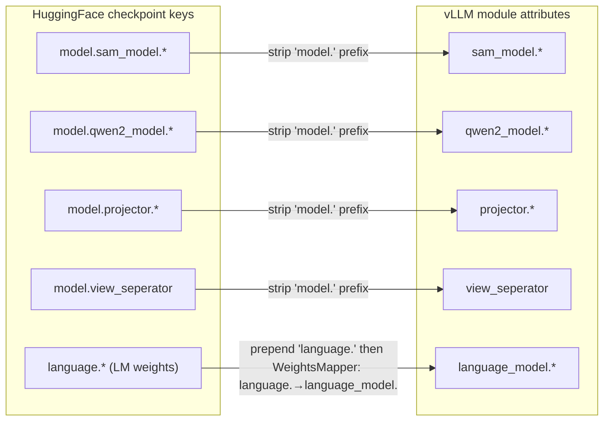

Sources: [DeepSeek-OCR2-master/DeepSeek-OCR2-vllm/deepseek_ocr2.py:562-582]()

---

## Configuration Summary

All runner scripts import their parameters from `config.py` at startup. The `TOKENIZER` instance is constructed eagerly at import time. See [vLLM Configuration](#3.2.1) for the full parameter reference.

| Parameter | Default | Purpose |
|---|---|---|
| `MODEL_PATH` | `'deepseek-ai/DeepSeek-OCR-2'` | Model checkpoint location |
| `PROMPT` | `'<image>\n<|grounding|>Convert the document to markdown.'` | Default inference prompt |
| `TOKENIZER` | `AutoTokenizer.from_pretrained(MODEL_PATH)` | Eagerly instantiated tokenizer |
| `BASE_SIZE` | `1024` | Global thumbnail resolution |
| `IMAGE_SIZE` | `768` | Local tile resolution |
| `CROP_MODE` | `True` | Enable dynamic tiling |
| `MIN_CROPS` | `2` | Minimum number of local tiles |
| `MAX_CROPS` | `6` | Maximum number of local tiles |
| `MAX_CONCURRENCY` | `100` | Maximum in-flight inference requests |
| `NUM_WORKERS` | `64` | CPU preprocessing thread count |
| `SKIP_REPEAT` | `True` | Skip already-processed outputs |

Sources: [DeepSeek-OCR2-master/DeepSeek-OCR2-vllm/config.py:1-31]()

---

# Page: vLLM Configuration

# vLLM Configuration

<details>
<summary>Relevant source files</summary>

The following files were used as context for generating this wiki page:

- [DeepSeek-OCR2-master/DeepSeek-OCR2-vllm/__pycache__/config.cpython-312.pyc](DeepSeek-OCR2-master/DeepSeek-OCR2-vllm/__pycache__/config.cpython-312.pyc)
- [DeepSeek-OCR2-master/DeepSeek-OCR2-vllm/config.py](DeepSeek-OCR2-master/DeepSeek-OCR2-vllm/config.py)

</details>


This page documents every parameter defined in `DeepSeek-OCR2-vllm/config.py`, their types, default values, and effects on runtime behavior. `config.py` is the single shared configuration hub imported by all three vLLM runner scripts; changing a value here affects all runners simultaneously.

For information on the runner scripts that consume these parameters, see [vLLM Entry Points](#3.2.2). For the image preprocessing logic that uses the image parameters, see [Image Preprocessing](#6.1). For tuning `MAX_CONCURRENCY` and `NUM_WORKERS` together, see [Concurrency Configuration](#8.1).

---

## Role of `config.py`

All vLLM runner scripts import `config.py` at the top of their module. The file has no classes or functions — it is a flat namespace of module-level constants. One side effect occurs at import time: `TOKENIZER` is instantiated by calling `AutoTokenizer.from_pretrained`, which contacts the model hub (or loads from local disk) before any runner logic executes.

**Dependency graph — config.py to runners:**

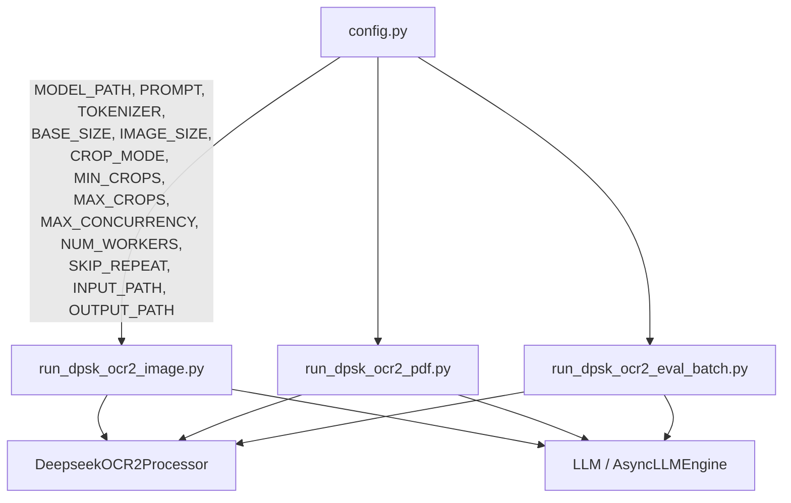

Sources: [DeepSeek-OCR2-vllm/config.py:1-31]()

---

## Parameter Reference

### Model and Prompt Parameters

| Parameter | Default value | Type | Description |
|---|---|---|---|
| `MODEL_PATH` | `'deepseek-ai/DeepSeek-OCR-2'` | `str` | HuggingFace Hub model ID or local filesystem path passed to the vLLM engine and `AutoTokenizer`. Change this to a local path when running offline. |
| `PROMPT` | `'<image>\n<|grounding|>Convert the document to markdown.'` | `str` | The text prompt prepended to every inference request. A commented-out alternative (`'<image>\nFree OCR.'`) is provided for layout-agnostic OCR. See [Task-Specific Prompts](#7.2) for when to use each format. |
| `TOKENIZER` | `AutoTokenizer.from_pretrained(MODEL_PATH, trust_remote_code=True)` | `AutoTokenizer` | A tokenizer instance created **eagerly at import time**. Because `TOKENIZER` is a module-level expression, the `from_pretrained` call runs as soon as any script does `import config`. This instance is shared across all workers to avoid repeated initialization. |

Sources: [DeepSeek-OCR2-vllm/config.py:11-30]()

---

### Image Parameters

These parameters control the dynamic tiling logic inside `DeepseekOCR2Processor.dynamic_preprocess()`. They directly determine the number of visual tokens fed to the model. See [Global and Local Views](#6.2) for the token budget calculations.

| Parameter | Default value | Type | Description |
|---|---|---|---|
| `BASE_SIZE` | `1024` | `int` | Pixel side-length of the global thumbnail. The entire image is resized to `BASE_SIZE × BASE_SIZE` to produce one global view contributing ~256 visual tokens. |
| `IMAGE_SIZE` | `768` | `int` | Pixel side-length of each local crop tile. Each tile contributes ~144 visual tokens. |
| `CROP_MODE` | `True` | `bool` | When `True`, the image is split into local tiles in addition to the global thumbnail. When `False`, only the global thumbnail is used (equivalent to `MIN_CROPS=MAX_CROPS=0`). |
| `MIN_CROPS` | `2` | `int` | Minimum number of local tiles to generate per image when `CROP_MODE=True`. Ensures a minimum level of resolution detail even for small images. |
| `MAX_CROPS` | `6` | `int` | Maximum number of local tiles. The comment in the source marks `6` as the architectural maximum. Raising this beyond `6` is not supported. |

**Token budget as a function of tile count:**

```mermaid
graph LR
    BS["BASE_SIZE=1024\nglobal thumbnail\n256 tokens"]
    IS["IMAGE_SIZE=768\nper tile\n144 tokens"]
    N["N tiles\nN in [MIN_CROPS..MAX_CROPS]\nselected by find_closest_aspect_ratio()"]
    TOTAL["Total visual tokens\n= 256 + N × 144\nrange: 256+2×144=544\nto 256+6×144=1120"]

    BS --> TOTAL
    IS --> N --> TOTAL
```

Sources: [DeepSeek-OCR2-vllm/config.py:2-6]()

---

### Execution Parameters

These parameters control parallelism and output behavior at runtime.

| Parameter | Default value | Type | Description |
|---|---|---|---|
| `MAX_CONCURRENCY` | `100` | `int` | Maximum number of inference requests submitted to the vLLM engine simultaneously. The inline comment states: "If you have limited GPU memory, lower the concurrency count." Applies to `run_dpsk_ocr2_pdf.py` (via `asyncio.Semaphore`) and `run_dpsk_ocr2_eval_batch.py`. |
| `NUM_WORKERS` | `64` | `int` | Thread/process count for CPU-side image preprocessing (resize, padding, tokenization). Used in `ThreadPoolExecutor` calls inside the eval and PDF runners. Independent of `MAX_CONCURRENCY`. |
| `SKIP_REPEAT` | `True` | `bool` | When `True`, runner scripts check whether an output file already exists for a given input and skip re-inference if so. Useful for resuming interrupted batch jobs. |
| `PRINT_NUM_VIS_TOKENS` | `False` | `bool` | Debug flag. When `True`, prints the number of visual tokens computed for each image during preprocessing. |

Sources: [DeepSeek-OCR2-vllm/config.py:7-10]()

---

### I/O Path Parameters

| Parameter | Default | Description |
|---|---|---|
| `INPUT_PATH` | `'/your/image/path/'` | Path to input data. The expected format depends on which runner is invoked: a directory of images for `run_dpsk_ocr2_image.py`, a `.pdf` file for `run_dpsk_ocr2_pdf.py`, or an OmniDocBench image directory for `run_dpsk_ocr2_eval_batch.py`. Must be changed before use. |
| `OUTPUT_PATH` | `'/your/output/path/'` | Root directory where output files are written (`.mmd` markdown files, `_det.mmd` grounding files, `_layouts.pdf`, annotated images). |

The file-level comment [DeepSeek-OCR2-vllm/config.py:13-16]() summarizes which runner matches which input format:

```
# .pdf: run_dpsk_ocr_pdf.py
# .jpg, .png, .jpeg: run_dpsk_ocr_image.py
# Omnidocbench images path: run_dpsk_ocr_eval_batch.py
```

Sources: [DeepSeek-OCR2-vllm/config.py:13-21]()

---

## Import-Time Side Effects

`TOKENIZER` is the only parameter with a side effect at import time.

```mermaid
sequenceDiagram
    participant Script as "runner script"
    participant cfg as "config.py (module body)"
    participant HF as "AutoTokenizer.from_pretrained()"
    participant Hub as "HuggingFace Hub / local disk"

    Script->>cfg: "import config"
    cfg->>HF: "from_pretrained(MODEL_PATH, trust_remote_code=True)"
    HF->>Hub: "fetch tokenizer files"
    Hub-->>HF: "tokenizer files"
    HF-->>cfg: "TOKENIZER instance"
    cfg-->>Script: "module ready"
    Note over Script,cfg: "All constants including TOKENIZER are now available"
```

Because of this, if `MODEL_PATH` points to a Hub ID that requires network access and the machine is offline, the import will fail before any runner code runs. To avoid this, set `MODEL_PATH` to a local path containing downloaded weights and tokenizer files.

Sources: [DeepSeek-OCR2-vllm/config.py:28-30]()

---

## Complete Parameter Summary

```mermaid
graph TD
    subgraph "Image Resolution (→ DeepseekOCR2Processor)"
        p1["BASE_SIZE = 1024"]
        p2["IMAGE_SIZE = 768"]
        p3["CROP_MODE = True"]
        p4["MIN_CROPS = 2"]
        p5["MAX_CROPS = 6"]
    end

    subgraph "Execution Control (→ runner scripts)"
        p6["MAX_CONCURRENCY = 100"]
        p7["NUM_WORKERS = 64"]
        p8["SKIP_REPEAT = True"]
        p9["PRINT_NUM_VIS_TOKENS = False"]
    end

    subgraph "Model + Prompt (→ LLM / AsyncLLMEngine)"
        p10["MODEL_PATH = 'deepseek-ai/DeepSeek-OCR-2'"]
        p11["PROMPT = '<image>\\n<|grounding|>...'"]
        p12["TOKENIZER (instantiated at import)"]
    end

    subgraph "I/O Paths (→ runner scripts)"
        p13["INPUT_PATH"]
        p14["OUTPUT_PATH"]
    end
```

Sources: [DeepSeek-OCR2-vllm/config.py:1-31]()

---

# Page: vLLM Entry Points

# vLLM Entry Points

<details>
<summary>Relevant source files</summary>

The following files were used as context for generating this wiki page:

- [DeepSeek-OCR2-master/DeepSeek-OCR2-vllm/config.py](DeepSeek-OCR2-master/DeepSeek-OCR2-vllm/config.py)
- [DeepSeek-OCR2-master/DeepSeek-OCR2-vllm/run_dpsk_ocr2_eval_batch.py](DeepSeek-OCR2-master/DeepSeek-OCR2-vllm/run_dpsk_ocr2_eval_batch.py)
- [DeepSeek-OCR2-master/DeepSeek-OCR2-vllm/run_dpsk_ocr2_image.py](DeepSeek-OCR2-master/DeepSeek-OCR2-vllm/run_dpsk_ocr2_image.py)
- [DeepSeek-OCR2-master/DeepSeek-OCR2-vllm/run_dpsk_ocr2_pdf.py](DeepSeek-OCR2-master/DeepSeek-OCR2-vllm/run_dpsk_ocr2_pdf.py)

</details>


This document describes the three vLLM-based inference entry point scripts that provide production-optimized OCR processing for different workload types. Each script is designed for a specific use case: streaming image processing, concurrent PDF document processing, and batch evaluation for benchmarking.

For configuration details referenced by these entry points, see page 3.2.1. For the underlying Transformers-based inference approach, see page 3.1.

## Overview

The vLLM inference system provides three specialized entry point scripts located in `DeepSeek-OCR2-master/DeepSeek-OCR2-vllm/`:

| Script | Engine Class | Primary Use Case | Input |
|--------|-------------|-----------------|-------|
| `run_dpsk_ocr2_image.py` | `AsyncLLMEngine` | Single image OCR with streaming and bounding box annotation | Single image file |
| `run_dpsk_ocr2_pdf.py` | `LLM` | Multi-page PDF batch processing | Single PDF file |
| `run_dpsk_ocr2_eval_batch.py` | `LLM` | OmniDocBench evaluation batch processing | Directory of images |

All three scripts:
- Register `DeepseekOCR2ForCausalLM` with vLLM via `ModelRegistry.register_model()`
- Import configuration from `config.py`
- Use `DeepseekOCR2Processor().tokenize_with_images()` for preprocessing
- Apply `NoRepeatNGramLogitsProcessor` via `SamplingParams.logits_processors`
- Apply `re_match()` and `clean_formula()` post-processing on generated text

Sources: [DeepSeek-OCR2-master/DeepSeek-OCR2-vllm/run_dpsk_ocr2_image.py:1-27](), [DeepSeek-OCR2-master/DeepSeek-OCR2-vllm/run_dpsk_ocr2_pdf.py:1-30](), [DeepSeek-OCR2-master/DeepSeek-OCR2-vllm/run_dpsk_ocr2_eval_batch.py:1-22]()

## Entry Point Architecture

**Diagram: Entry point scripts, engine classes, and output files**

```mermaid
graph TB
    subgraph config["config.py"]
        CFG["MODEL_PATH, PROMPT, TOKENIZER\nCROP_MODE, NUM_WORKERS, MAX_CONCURRENCY\nINPUT_PATH, OUTPUT_PATH, SKIP_REPEAT"]
    end

    subgraph image_script["run_dpsk_ocr2_image.py"]
        LI["load_image()"]
        PROC_IMG["DeepseekOCR2Processor\n.tokenize_with_images()"]
        ASYNC_ENG["AsyncLLMEngine\n.from_engine_args()"]
        SG["stream_generate()"]
        RE1["re_match()"]
        DBB["draw_bounding_boxes()"]
    end

    subgraph pdf_script["run_dpsk_ocr2_pdf.py"]
        P2I["pdf_to_images_high_quality()\nvia fitz (PyMuPDF)"]
        TPE1["ThreadPoolExecutor\n(NUM_WORKERS)"]
        PROC_PDF["DeepseekOCR2Processor\n.tokenize_with_images()"]
        LLM1["LLM.generate()"]
        RE2["re_match()"]
        P2P["pil_to_pdf_img2pdf()"]
    end

    subgraph eval_script["run_dpsk_ocr2_eval_batch.py"]
        GLOB["glob.glob(INPUT_PATH/*)"]
        CIO["correct_image_orientation()"]
        TPE2["ThreadPoolExecutor\n(NUM_WORKERS)"]
        PROC_EVL["DeepseekOCR2Processor\n.tokenize_with_images()"]
        LLM2["LLM.generate()"]
        RE3["re_match()"]
        CF["clean_formula()"]
    end

    subgraph outputs["Output Files"]
        O1["result_ori.mmd\nresult.mmd\nresult_with_boxes.jpg\nimages/*.jpg"]
        O2["*.mmd\n*_det.mmd\n*_layouts.pdf\nimages/*.jpg"]
        O3["*.md (per input image)"]
    end

    CFG --> image_script
    CFG --> pdf_script
    CFG --> eval_script

    LI --> PROC_IMG --> SG
    ASYNC_ENG --> SG
    SG --> RE1 --> DBB

    P2I --> TPE1 --> PROC_PDF --> LLM1
    LLM1 --> RE2 --> P2P

    GLOB --> CIO --> TPE2 --> PROC_EVL --> LLM2
    LLM2 --> RE3 --> CF

    DBB --> O1
    P2P --> O2
    CF --> O3
```

Sources: [DeepSeek-OCR2-master/DeepSeek-OCR2-vllm/run_dpsk_ocr2_image.py:1-304](), [DeepSeek-OCR2-master/DeepSeek-OCR2-vllm/run_dpsk_ocr2_pdf.py:1-330](), [DeepSeek-OCR2-master/DeepSeek-OCR2-vllm/run_dpsk_ocr2_eval_batch.py:1-191]()

## run_dpsk_ocr2_image.py — Streaming Image OCR

### Purpose

Processes a single image file with token-by-token streaming output using `AsyncLLMEngine`. After generation, annotates the source image with bounding boxes for detected document elements and saves extracted sub-images.

`INPUT_PATH` must point to a single image file (`.jpg`, `.png`, `.jpeg`).

### Engine Initialization

This is the only entry point that uses `AsyncLLMEngine` rather than the synchronous `LLM` class. The engine is created inside `stream_generate()` via `AsyncLLMEngine.from_engine_args(AsyncEngineArgs(...))`.

[DeepSeek-OCR2-master/DeepSeek-OCR2-vllm/run_dpsk_ocr2_image.py:147-161]()

Key `AsyncEngineArgs` values:
- `dtype="bfloat16"`
- `max_model_len=8192`
- `gpu_memory_utilization=0.75`
- `tensor_parallel_size=1`

### stream_generate() Coroutine

`stream_generate(image, prompt)` is an `async def` function driven by `asyncio.run()`. It iterates over `engine.generate()` asynchronously and prints each newly generated token chunk to stdout in real time.

[DeepSeek-OCR2-master/DeepSeek-OCR2-vllm/run_dpsk_ocr2_image.py:146-200]()

The `NoRepeatNGramLogitsProcessor` is configured with `ngram_size=20`, `window_size=90`, and `whitelist_token_ids={128821, 128822}` (tokens for `<td>` and `</td>`).

### Image Loading

`load_image(image_path)` opens the image and applies EXIF orientation correction via `ImageOps.exif_transpose()`.

[DeepSeek-OCR2-master/DeepSeek-OCR2-vllm/run_dpsk_ocr2_image.py:28-42]()

### Bounding Box Annotation

After `stream_generate()` returns, the full output is passed to `re_match()`, which splits detected regions into `matches_image` (label `image`) and `mathes_other` (all other labels such as `title`, `text`, `table`, etc.).

`draw_bounding_boxes(image, refs)` iterates over all matched references and:
- Scales normalized coordinates (0–999 range) to pixel space
- Draws colored rectangles on a copy of the original image
- For `image`-labeled regions, crops and saves the sub-image to `OUTPUT_PATH/images/<idx>.jpg`
- Applies a semi-transparent fill overlay

[DeepSeek-OCR2-master/DeepSeek-OCR2-vllm/run_dpsk_ocr2_image.py:72-136]()

### Output Files

| File | Content |
|------|---------|
| `OUTPUT_PATH/result_ori.mmd` | Raw model output including `<\|ref\|>...<\|det\|>` tags |
| `OUTPUT_PATH/result.mmd` | Cleaned output: image refs replaced with ``, other refs stripped |
| `OUTPUT_PATH/result_with_boxes.jpg` | Source image annotated with bounding boxes and labels |
| `OUTPUT_PATH/images/<N>.jpg` | Cropped sub-images for each detected `image` region |

[DeepSeek-OCR2-master/DeepSeek-OCR2-vllm/run_dpsk_ocr2_image.py:205-304]()

Sources: [DeepSeek-OCR2-master/DeepSeek-OCR2-vllm/run_dpsk_ocr2_image.py:1-304]()

## run_dpsk_ocr2_pdf.py — PDF Batch Processing

### Purpose

Converts a PDF file to per-page images, preprocesses all pages in parallel with `ThreadPoolExecutor`, runs batch inference with `LLM`, and produces three output files: a raw detections file, a clean markdown file, and an annotated layouts PDF.

`INPUT_PATH` must point to a single `.pdf` file.

### PDF-to-Image Conversion

`pdf_to_images_high_quality(pdf_path, dpi=144)` uses `fitz` (PyMuPDF) to rasterize each page at 144 DPI. The zoom factor is computed as `dpi / 72.0`. Pages are returned as a list of PIL `Image` objects.

[DeepSeek-OCR2-master/DeepSeek-OCR2-vllm/run_dpsk_ocr2_pdf.py:64-95]()

### Preprocessing and Inference

Pages are preprocessed in parallel using `ThreadPoolExecutor(max_workers=NUM_WORKERS)`. Each worker calls `process_single_image()`, which runs `DeepseekOCR2Processor().tokenize_with_images()` to produce the `multi_modal_data` dict.

The resulting `batch_inputs` list is passed to `llm.generate()` (synchronous `LLM` class) with `SamplingParams`:
- `temperature=0.0`, `max_tokens=8192`
- `skip_special_tokens=False`, `include_stop_str_in_output=True`
- `NoRepeatNGramLogitsProcessor(ngram_size=20, window_size=50, whitelist_token_ids={128821, 128822})`

`LLM` is initialized with `gpu_memory_utilization=0.9` and `disable_mm_preprocessor_cache=True`.

[DeepSeek-OCR2-master/DeepSeek-OCR2-vllm/run_dpsk_ocr2_pdf.py:32-54](), [DeepSeek-OCR2-master/DeepSeek-OCR2-vllm/run_dpsk_ocr2_pdf.py:248-271]()

### SKIP_REPEAT Behavior

For each page output, the script checks whether `<｜end▁of▁sentence｜>` appears in the generated text:

```
if '<｜end▁of▁sentence｜>' in content:
    content = content.replace('<｜end▁of▁sentence｜>', '')
else:
    if SKIP_REPEAT:
        continue   # page is dropped from output
```

When `SKIP_REPEAT=True` (the default), any page whose output does not terminate with the EOS token — an indicator of a degenerate repetition loop that consumed all available tokens — is silently skipped and excluded from the merged output files.

[DeepSeek-OCR2-master/DeepSeek-OCR2-vllm/run_dpsk_ocr2_pdf.py:289-293]()

### Output Files

**Diagram: PDF script output pipeline**

```mermaid
flowchart LR
    LLM_OUT["LLM.generate()\nper-page output text"]
    SKIP["SKIP_REPEAT check\nEOS token presence"]
    RE["re_match()\nsplit image vs other refs"]
    DBB["draw_bounding_boxes()\nannotate page image"]
    CLEAN["strip refs\nreplace image refs"]
    P2P["pil_to_pdf_img2pdf()\ncollect annotated pages"]

    LLM_OUT --> SKIP
    SKIP -->|"has EOS"| RE
    SKIP -->|"no EOS + SKIP_REPEAT"| DROP["skip page"]
    RE --> DBB
    RE --> CLEAN
    DBB --> P2P
    CLEAN --> DET["*_det.mmd\nraw text with ref tags\npage separator lines"]
    CLEAN --> MMD["*.mmd\nclean markdown\npage separator lines"]
    P2P --> PDF_OUT["*_layouts.pdf\nannotated pages"]
```

| File | Content |
|------|---------|
| `<name>_det.mmd` | Raw output per page including `<\|ref\|>...<\|det\|>` tags, separated by `<--- Page Split --->` |
| `<name>.mmd` | Cleaned markdown per page: refs stripped, image refs replaced with ``, separated by `<--- Page Split --->` |
| `<name>_layouts.pdf` | PDF assembled from annotated page images via `pil_to_pdf_img2pdf()` |
| `images/<jdx>_<idx>.jpg` | Cropped sub-images for each detected `image` region per page |

[DeepSeek-OCR2-master/DeepSeek-OCR2-vllm/run_dpsk_ocr2_pdf.py:279-329]()

Sources: [DeepSeek-OCR2-master/DeepSeek-OCR2-vllm/run_dpsk_ocr2_pdf.py:1-330]()

## run_dpsk_ocr2_eval_batch.py — OmniDocBench Batch Evaluation

### Purpose

Processes an entire directory of images (e.g., OmniDocBench images) in batch mode using `LLM`. Produces one `.md` file per input image in `OUTPUT_PATH`. Does not compute evaluation metrics itself — metric computation is performed separately using OmniDocBench tooling against the generated `.md` files.

`INPUT_PATH` must point to a directory of image files.

### Image Loading

Images are discovered via `glob.glob(f'{INPUT_PATH}/*')`. Each image is opened with PIL and passed through `correct_image_orientation()`, which reads EXIF orientation tags and applies `image.rotate()` as needed (180°, 90°, or 270°).

[DeepSeek-OCR2-master/DeepSeek-OCR2-vllm/run_dpsk_ocr2_eval_batch.py:24-47](), [DeepSeek-OCR2-master/DeepSeek-OCR2-vllm/run_dpsk_ocr2_eval_batch.py:129-137]()

### ThreadPoolExecutor Preprocessing

All images are preprocessed concurrently using `ThreadPoolExecutor(max_workers=NUM_WORKERS)`. Each worker calls `process_single_image()`, which wraps `DeepseekOCR2Processor().tokenize_with_images()` in a `multi_modal_data` dict.

[DeepSeek-OCR2-master/DeepSeek-OCR2-vllm/run_dpsk_ocr2_eval_batch.py:109-116](), [DeepSeek-OCR2-master/DeepSeek-OCR2-vllm/run_dpsk_ocr2_eval_batch.py:155-160]()

`LLM` is initialized with `gpu_memory_utilization=0.7` and `max_num_seqs=MAX_CONCURRENCY`. The `NoRepeatNGramLogitsProcessor` uses `ngram_size=40`, `window_size=90`.

[DeepSeek-OCR2-master/DeepSeek-OCR2-vllm/run_dpsk_ocr2_eval_batch.py:50-70]()

### Post-Processing and Output

For each output, the script applies `clean_formula()` then `re_match()`. All matched reference spans (both image and non-image) in `mathes_other` are stripped from the output. Note that unlike `run_dpsk_ocr2_image.py`, the eval script does not differentiate image refs for replacement — all refs are removed.

Output files are written as `OUTPUT_PATH/<basename>.md` (`.jpg` and `.png` extensions replaced with `.md`).

There is no `SKIP_REPEAT` check in this script.

[DeepSeek-OCR2-master/DeepSeek-OCR2-vllm/run_dpsk_ocr2_eval_batch.py:175-191]()

Sources: [DeepSeek-OCR2-master/DeepSeek-OCR2-vllm/run_dpsk_ocr2_eval_batch.py:1-191]()

## Shared Post-Processing

All three entry points apply the same post-processing steps to the raw model output. These functions are defined locally in each script (they are not shared via an import).

### re_match()

`re_match(text)` applies a regex to find all occurrences of the grounding output pattern:

```
<|ref|>LABEL<|/ref|><|det|>COORDINATES<|/det|>
```

The regex pattern is: `r'(<\|ref\|>(.*?)<\|/ref\|><\|det\|>(.*?)<\|/det\|>)'`

In `run_dpsk_ocr2_image.py` and `run_dpsk_ocr2_pdf.py`, matches are split into two groups: those with label `image` (go to `matches_image`) and all others (go to `mathes_other`). Image refs are replaced with markdown image links; other refs are stripped. In `run_dpsk_ocr2_eval_batch.py`, all refs go to `mathes_other` and are stripped.

[DeepSeek-OCR2-master/DeepSeek-OCR2-vllm/run_dpsk_ocr2_image.py:45-57](), [DeepSeek-OCR2-master/DeepSeek-OCR2-vllm/run_dpsk_ocr2_pdf.py:123-135](), [DeepSeek-OCR2-master/DeepSeek-OCR2-vllm/run_dpsk_ocr2_eval_batch.py:98-107]()

### clean_formula()

`clean_formula(text)` applies a regex substitution over LaTeX display math blocks (`\[...\]`). Within each matched formula, it removes `\quad (...)` annotation suffixes via `re.sub(r'\\quad\s*\([^)]*\)', '', formula)` and strips surrounding whitespace.

Used in `run_dpsk_ocr2_eval_batch.py` and `run_dpsk_ocr2_pdf.py`.

[DeepSeek-OCR2-master/DeepSeek-OCR2-vllm/run_dpsk_ocr2_eval_batch.py:81-96](), [DeepSeek-OCR2-master/DeepSeek-OCR2-vllm/run_dpsk_ocr2_pdf.py:314]()

### SKIP_REPEAT

`SKIP_REPEAT` is used exclusively by `run_dpsk_ocr2_pdf.py`. When `True`, any page whose generated text does not contain `<｜end▁of▁sentence｜>` is skipped. The EOS token's absence indicates the generation hit `max_tokens` without completing — typically caused by a repetition loop that was not fully suppressed by `NoRepeatNGramLogitsProcessor`.

The EOS token string is `<｜end▁of▁sentence｜>` (Unicode fullwidth characters).

[DeepSeek-OCR2-master/DeepSeek-OCR2-vllm/run_dpsk_ocr2_pdf.py:289-293](), [DeepSeek-OCR2-master/DeepSeek-OCR2-vllm/config.py:10]()

### NoRepeatNGramLogitsProcessor Wiring

Each script instantiates `NoRepeatNGramLogitsProcessor` and passes it through `SamplingParams(logits_processors=[...])`:

| Script | `ngram_size` | `window_size` |
|--------|-------------|---------------|
| `run_dpsk_ocr2_image.py` | 20 | 90 |
| `run_dpsk_ocr2_pdf.py` | 20 | 50 |
| `run_dpsk_ocr2_eval_batch.py` | 40 | 90 |

All three use `whitelist_token_ids={128821, 128822}` (token IDs for `<td>` and `</td>`) to prevent the n-gram filter from blocking table cell boundaries.

[DeepSeek-OCR2-master/DeepSeek-OCR2-vllm/run_dpsk_ocr2_image.py:163](), [DeepSeek-OCR2-master/DeepSeek-OCR2-vllm/run_dpsk_ocr2_pdf.py:46](), [DeepSeek-OCR2-master/DeepSeek-OCR2-vllm/run_dpsk_ocr2_eval_batch.py:63]()

Sources: [DeepSeek-OCR2-master/DeepSeek-OCR2-vllm/run_dpsk_ocr2_image.py:45-57](), [DeepSeek-OCR2-master/DeepSeek-OCR2-vllm/run_dpsk_ocr2_pdf.py:123-135](), [DeepSeek-OCR2-master/DeepSeek-OCR2-vllm/run_dpsk_ocr2_eval_batch.py:81-107]()

## Configuration Integration

All three entry points import from `config.py`. The table below lists which parameters each script imports.

**Diagram: config.py symbols imported by each runner script**

```mermaid
graph LR
    subgraph configpy["config.py"]
        MP["MODEL_PATH"]
        IP["INPUT_PATH"]
        OP["OUTPUT_PATH"]
        PR["PROMPT"]
        MC["MAX_CONCURRENCY"]
        NW["NUM_WORKERS"]
        CM["CROP_MODE"]
        SR["SKIP_REPEAT"]
    end

    subgraph run_image["run_dpsk_ocr2_image.py"]
        RI_IMP["MODEL_PATH, INPUT_PATH\nOUTPUT_PATH, PROMPT\nCROP_MODE"]
    end

    subgraph run_pdf["run_dpsk_ocr2_pdf.py"]
        RP_IMP["MODEL_PATH, INPUT_PATH\nOUTPUT_PATH, PROMPT\nSKIP_REPEAT, MAX_CONCURRENCY\nNUM_WORKERS, CROP_MODE"]
    end

    subgraph run_eval["run_dpsk_ocr2_eval_batch.py"]
        RE_IMP["MODEL_PATH, INPUT_PATH\nOUTPUT_PATH, PROMPT\nMAX_CONCURRENCY\nCROP_MODE, NUM_WORKERS"]
    end

    MP --> RI_IMP
    IP --> RI_IMP
    OP --> RI_IMP
    PR --> RI_IMP
    CM --> RI_IMP

    MP --> RP_IMP
    IP --> RP_IMP
    OP --> RP_IMP
    PR --> RP_IMP
    SR --> RP_IMP
    MC --> RP_IMP
    NW --> RP_IMP
    CM --> RP_IMP

    MP --> RE_IMP
    IP --> RE_IMP
    OP --> RE_IMP
    PR --> RE_IMP
    MC --> RE_IMP
    NW --> RE_IMP
    CM --> RE_IMP
```

Sources: [DeepSeek-OCR2-master/DeepSeek-OCR2-vllm/run_dpsk_ocr2_image.py:22](), [DeepSeek-OCR2-master/DeepSeek-OCR2-vllm/run_dpsk_ocr2_pdf.py:17](), [DeepSeek-OCR2-master/DeepSeek-OCR2-vllm/run_dpsk_ocr2_eval_batch.py:10](), [DeepSeek-OCR2-master/DeepSeek-OCR2-vllm/config.py:1-30]()

## Execution Comparison

| Aspect | `run_dpsk_ocr2_image.py` | `run_dpsk_ocr2_pdf.py` | `run_dpsk_ocr2_eval_batch.py` |
|--------|--------------------------|------------------------|-------------------------------|
| **vLLM class** | `AsyncLLMEngine` | `LLM` | `LLM` |
| **Input type** | Single image file | Single PDF file | Directory of images |
| **Image loading** | `load_image()` + `ImageOps.exif_transpose()` | `pdf_to_images_high_quality()` via `fitz` | `glob` + `correct_image_orientation()` |
| **Preprocessing** | Single call to `tokenize_with_images()` | `ThreadPoolExecutor` + `process_single_image()` | `ThreadPoolExecutor` + `process_single_image()` |
| **Generation** | `engine.generate()` async iterator | `llm.generate()` batch | `llm.generate()` batch |
| **`SKIP_REPEAT`** | Not used | Yes — pages without EOS dropped | Not used |
| **`clean_formula()`** | Not used | Yes | Yes |
| **`re_match()` image handling** | Replaced with `` | Replaced with `` | Stripped (not replaced) |
| **Bounding box output** | `result_with_boxes.jpg` | Per-page in `*_layouts.pdf` | Not produced |
| **`gpu_memory_utilization`** | `0.75` | `0.9` | `0.7` |
| **`ngram_size`** | 20 | 20 | 40 |

Sources: [DeepSeek-OCR2-master/DeepSeek-OCR2-vllm/run_dpsk_ocr2_image.py:147-165](), [DeepSeek-OCR2-master/DeepSeek-OCR2-vllm/run_dpsk_ocr2_pdf.py:32-54](), [DeepSeek-OCR2-master/DeepSeek-OCR2-vllm/run_dpsk_ocr2_eval_batch.py:50-70]()

## Usage Workflow

### Basic Workflow

1. **Configure**: Edit `config.py` to set paths and parameters
   ```bash
   cd DeepSeek-OCR2-master/DeepSeek-OCR2-vllm
   vim config.py  # Set INPUT_PATH, OUTPUT_PATH, PROMPT
   ```

2. **Select Entry Point**: Choose based on input type
   - Images → `run_dpsk_ocr2_image.py`
   - PDFs → `run_dpsk_ocr2_pdf.py`
   - Benchmarks → `run_dpsk_ocr2_eval_batch.py`

3. **Execute**: Run the selected script
   ```bash
   python run_dpsk_ocr2_[image|pdf|eval_batch].py
   ```

4. **Collect Results**: Find outputs in `OUTPUT_PATH`

### Entry Point Selection Decision Tree

```mermaid
graph TB
    START["Select Entry Point"]
    
    Q1{"What is the<br/>input type?"}
    Q2{"Need real-time<br/>feedback?"}
    Q3{"Benchmarking or<br/>production?"}
    
    IMG_TYPE["Image files<br/>.jpg, .png, .jpeg"]
    PDF_TYPE["PDF documents<br/>.pdf"]
    DATASET_TYPE["Evaluation dataset<br/>directory structure"]
    
    STREAM["run_dpsk_ocr2_image.py<br/>Streaming output"]
    BATCH_IMG["run_dpsk_ocr2_image.py<br/>Batch mode"]
    PDF["run_dpsk_ocr2_pdf.py<br/>Concurrent processing"]
    EVAL["run_dpsk_ocr2_eval_batch.py<br/>Evaluation mode"]
    
    START --> Q1
    
    Q1 -->|"Images"| IMG_TYPE
    Q1 -->|"PDFs"| PDF_TYPE
    Q1 -->|"Benchmark dataset"| DATASET_TYPE
    
    IMG_TYPE --> Q2
    Q2 -->|"Yes"| STREAM
    Q2 -->|"No"| BATCH_IMG
    
    PDF_TYPE --> PDF
    
    DATASET_TYPE --> Q3
    Q3 -->|"Benchmarking"| EVAL
    Q3 -->|"Production"| PDF
```

**Sources:** [README.md:86-103]()

## Performance Tuning

Each entry point's performance can be optimized by adjusting concurrency parameters in `config.py`:

### Concurrency Parameters

- **`MAX_CONCURRENCY`**: GPU-bound inference task limit
  - Default: `100`
  - Reduce if GPU memory is limited (e.g., to `50` for 24GB GPUs, `20` for 16GB GPUs)
  - Increase for multi-GPU setups with sufficient memory
  
- **`NUM_WORKERS`**: CPU-bound preprocessing thread count
  - Default: `64`
  - Adjust based on CPU core count (typically 1-2× core count)
  - Higher values reduce GPU idle time during preprocessing

### Tuning Guidelines by Entry Point

| Entry Point | Recommended MAX_CONCURRENCY | Recommended NUM_WORKERS | Rationale |
|-------------|----------------------------|-------------------------|-----------|
| `run_dpsk_ocr2_image.py` | 50-100 | 32-64 | Balance latency and throughput |
| `run_dpsk_ocr2_pdf.py` | 100+ | 64-128 | Maximize throughput for pages |
| `run_dpsk_ocr2_eval_batch.py` | 100+ | 64-128 | Optimize for large batches |

**Sources:** [README.md:88](), [DeepSeek-OCR2-master/DeepSeek-OCR2-vllm/config.py:7-8]()

---

# Page: Core Architecture

# Core Architecture

<details>
<summary>Relevant source files</summary>

The following files were used as context for generating this wiki page:

- [DeepSeek-OCR2-master/DeepSeek-OCR2-vllm/deepseek_ocr2.py](DeepSeek-OCR2-master/DeepSeek-OCR2-vllm/deepseek_ocr2.py)
- [README.md](README.md)

</details>


## Purpose and Scope

This page provides a high-level overview of the DeepSeek-OCR-2 model architecture. The architecture is implemented in `DeepseekOCR2ForCausalLM` [DeepSeek-OCR2-master/DeepSeek-OCR2-vllm/deepseek_ocr2.py:264-583](), which is the main model class for the vLLM inference backend.

**Child Pages:**
- **4.1 Model Overview** — `DeepseekOCR2ForCausalLM` three-stage pipeline and vLLM registration classes
- **4.2 Vision Processing Pipeline** — `sam_model` → `qwen2_model` → `projector` data path
- **4.3 Multimodal Integration** — `image_token_id` placeholder mechanism and embedding merging
- **4.4 Language Model Variants** — `DeepseekV3ForCausalLM`, `DeepseekV2ForCausalLM`, `DeepseekForCausalLM` selection

**Related Pages:**
- Vision encoder implementations: page 5
- Image preprocessing and resolution handling: page 6
- Weight loading details: page 9.2
- vLLM registration and `trust_remote_code`: page 9.3

---

## Architecture Overview

DeepSeek-OCR-2 follows a three-stage architecture: (1) vision encoding, (2) feature projection and multimodal fusion, and (3) language generation. Variable-resolution images pass through a dual-encoder vision pipeline (`sam_model` → `qwen2_model`), features are projected to the language model embedding dimension, and the combined sequence drives autoregressive text generation.

**Three-Stage Pipeline — Code Entities**

```mermaid
graph TB
    subgraph Stage1["Stage 1 — Vision Encoding (deepencoderv2/)"]
        PREPROC["DeepseekOCR2Processor\n(process/image_process.py)"]
        SAM["self.sam_model\nbuild_sam_vit_b()"]
        QWEN2["self.qwen2_model\nbuild_qwen2_decoder_as_encoder()"]
    end

    subgraph Stage2["Stage 2 — Projection and Fusion (deepseek_ocr2.py)"]
        PROJ["self.projector\nMlpProjector(linear, input_dim=896, n_embed=1280)"]
        VIEWSEP["self.view_seperator\nnn.Parameter — learnable boundary token"]
        MERGE["merge_multimodal_embeddings()\nReplaces image_token_id positions"]
    end

    subgraph Stage3["Stage 3 — Language Generation"]
        LM["self.language_model\nDeepseekV3ForCausalLM\n(or V2 / Base)"]
        LOGITS["compute_logits()"]
    end

    PREPROC -->|"pixel_values, images_crop\nimages_spatial_crop"| SAM
    SAM --> QWEN2
    QWEN2 --> PROJ
    PROJ --> VIEWSEP
    VIEWSEP --> MERGE
    MERGE --> LM
    LM --> LOGITS
```

Sources: [DeepSeek-OCR2-master/DeepSeek-OCR2-vllm/deepseek_ocr2.py:264-583](), [README.md:55-143]()

---

## Main Model Class: DeepseekOCR2ForCausalLM

`DeepseekOCR2ForCausalLM` [DeepSeek-OCR2-master/DeepSeek-OCR2-vllm/deepseek_ocr2.py:264]() is the central class for the vLLM inference path. It inherits from:

- `nn.Module` — PyTorch neural network base
- `SupportsMultiModal` — vLLM multimodal inference interface
- `SupportsPP` — vLLM pipeline-parallelism support

It is registered with vLLM's `MULTIMODAL_REGISTRY` via the decorator at [DeepSeek-OCR2-master/DeepSeek-OCR2-vllm/deepseek_ocr2.py:260-263](), which binds three companion classes:

| Class | Role |
|-------|------|
| `DeepseekOCR2MultiModalProcessor` | Calls `DeepseekOCR2Processor`, maps multimodal fields, generates prompt replacements |
| `DeepseekOCR2ProcessingInfo` | Reports token counts, image size limits, and supported modalities |
| `DeepseekOCR2DummyInputsBuilder` | Supplies dummy inputs for vLLM memory profiling |

**vLLM Registration and Companion Classes**

```mermaid
graph LR
    REGISTRY["MULTIMODAL_REGISTRY\n.register_processor()"]
    PROC["DeepseekOCR2MultiModalProcessor\n(BaseMultiModalProcessor)"]
    INFO["DeepseekOCR2ProcessingInfo\n(BaseProcessingInfo)"]
    DUMMY["DeepseekOCR2DummyInputsBuilder\n(BaseDummyInputsBuilder)"]
    MODEL["DeepseekOCR2ForCausalLM\n(nn.Module)"]

    REGISTRY -->|"processor="| PROC
    REGISTRY -->|"info="| INFO
    REGISTRY -->|"dummy_inputs="| DUMMY
    REGISTRY --> MODEL
```

### Submodules Constructed in `__init__`

During initialization [DeepSeek-OCR2-master/DeepSeek-OCR2-vllm/deepseek_ocr2.py:270-339](), the following submodules are built:

| Attribute | Constructor | Dimension | Purpose |
|-----------|-------------|-----------|---------|
| `self.sam_model` | `build_sam_vit_b()` | — | SAM-ViT-B visual feature extractor |
| `self.qwen2_model` | `build_qwen2_decoder_as_encoder()` | 896-dim output | Decoder-as-encoder semantic refiner |
| `self.projector` | `MlpProjector(linear, 896→1280)` | 1280-dim output | Projects visual features to LM space |
| `self.view_seperator` | `nn.Parameter(randn(1280))` | 1280-dim | Learnable boundary token between views |
| `self.language_model` | `init_vllm_registered_model()` | — | Deepseek LM backbone (V3/V2/Base) |
| `self.image_token_id` | `tokenizer.vocab["<image>"]` | int | Token ID marking image placeholder positions |

Sources: [DeepSeek-OCR2-master/DeepSeek-OCR2-vllm/deepseek_ocr2.py:260-339]()

---

## Component Interaction Summary

The following table summarizes the primary methods and their responsibilities:

| Method | Input Types | Output Type | Primary Responsibility |
|--------|-------------|-------------|------------------------|
| `_parse_and_validate_image_input()` | `**kwargs` (pixel_values, crops) | `Optional[list]` | Input validation and extraction |
| `_pixel_values_to_embedding()` | 3 tensors (pixel_values, crops, spatial_crop) | `NestedTensors` | Dual-encoder vision processing |
| `_process_image_input()` | Image input tuple | `torch.Tensor` | Vision pipeline coordinator |
| `get_multimodal_embeddings()` | `**kwargs` | `Optional[MultiModalEmbeddings]` | Vision embedding interface |
| `get_input_embeddings()` | `input_ids`, `multimodal_embeddings` | `torch.Tensor` | Multimodal fusion |
| `forward()` | `input_ids`, `positions`, `**kwargs` | `torch.Tensor` | Main inference entry point |
| `compute_logits()` | `hidden_states`, `sampling_metadata` | `torch.Tensor` | Token probability computation |
| `load_weights()` | `Iterable[Tuple[str, torch.Tensor]]` | `Set[str]` | Checkpoint loading |

**Sources:** [DeepSeek-OCR2-master/DeepSeek-OCR2-vllm/deepseek_ocr2.py:341-582]()

---

# Page: Model Overview

# Model Overview

<details>
<summary>Relevant source files</summary>

The following files were used as context for generating this wiki page:

- [DeepSeek-OCR2-master/DeepSeek-OCR2-vllm/__pycache__/deepseek_ocr2.cpython-312.pyc](DeepSeek-OCR2-master/DeepSeek-OCR2-vllm/__pycache__/deepseek_ocr2.cpython-312.pyc)
- [DeepSeek-OCR2-master/DeepSeek-OCR2-vllm/deepseek_ocr2.py](DeepSeek-OCR2-master/DeepSeek-OCR2-vllm/deepseek_ocr2.py)
- [README.md](README.md)

</details>


## Purpose and Scope

This page provides a high-level overview of the `DeepseekOCR2ForCausalLM` model architecture, including its three-stage pipeline (vision encoding → projection → language model), the vLLM registration system, and how the supporting processor classes fit together. For detailed information about specific components, see:

- Vision processing pipeline details: page 4.2
- Multimodal integration mechanics: page 4.3
- Language model variants and differences: page 4.4
- Individual vision encoder architectures: pages 5.1, 5.2, 5.3
</thinking>
</old_str>
<new_str>
## Purpose and Scope

This page provides a high-level overview of the `DeepseekOCR2ForCausalLM` model architecture, including its three-stage pipeline (vision encoding → projection → language model), the vLLM registration system, and how the supporting processor classes fit together. For detailed information about specific components, see:

- Vision processing pipeline details: page 4.2
- Multimodal integration mechanics: page 4.3
- Language model variants and differences: page 4.4
- Individual vision encoder architectures: pages 5.1, 5.2, 5.3

---

## Three-Stage Pipeline

`DeepseekOCR2ForCausalLM` ([DeepSeek-OCR2-master/DeepSeek-OCR2-vllm/deepseek_ocr2.py:264]()) is the primary model class. It implements a three-stage pipeline:

1. **Vision Encoding** — Two stacked encoders (`sam_model` → `qwen2_model`) extract and refine spatial and semantic features from image tiles.
2. **Projection** — `MlpProjector` maps 896-dimensional vision features into the language model's 1280-dimensional embedding space.
3. **Language Model** — A DeepSeek language model (V3, V2, or base) generates text conditioned on the merged vision + text embeddings.

The following diagram shows the three stages and their code-level identities:

**Diagram: Three-Stage Pipeline**

```mermaid
flowchart LR
    subgraph "Stage 1: Vision Encoding"
        SAM["sam_model\nbuild_sam_vit_b()"]
        Q2["qwen2_model\nbuild_qwen2_decoder_as_encoder()"]
        SAM --> Q2
    end
    subgraph "Stage 2: Projection"
        PROJ["projector\nMlpProjector\n(linear, 896→1280)"]
    end
    subgraph "Stage 3: Language Model"
        LM["language_model\nDeepseekV3/V2/Base\nForCausalLM"]
    end
    IMG["pixel_values\nimages_crop"] --> SAM
    Q2 --> PROJ
    PROJ --> MERGE["get_input_embeddings()\nmerge_multimodal_embeddings()"]
    IDS["input_ids"] --> MERGE
    MERGE --> LM
    LM --> OUT["hidden_states\ncompute_logits()"]
```

Sources: [DeepSeek-OCR2-master/DeepSeek-OCR2-vllm/deepseek_ocr2.py:264-340]()

---

## Model Architecture Overview

The `DeepseekOCR2ForCausalLM` class ([DeepSeek-OCR2-master/DeepSeek-OCR2-vllm/deepseek_ocr2.py:264]()) serves as the primary model implementation for OCR tasks. It inherits from `nn.Module`, `SupportsMultiModal`, and `SupportsPP`, providing a unified interface for multimodal processing with pipeline parallelism support.

### Core Components

The model consists of four major subsystems:

| Component | Attribute | Implementation | Dimensions | Purpose |
|-----------|-----------|---------------|------------|---------|
| Vision Encoder Stage 1 | `self.sam_model` | `build_sam_vit_b()` | Input → Features | Initial spatial feature extraction from images |
| Vision Encoder Stage 2 | `self.qwen2_model` | `build_qwen2_decoder_as_encoder()` | Features → Refined Features | Semantic feature refinement and contextualization |
| Feature Projector | `self.projector` | `MlpProjector` | 896 → 1280 | Aligns vision features to language model embedding space |
| Language Model | `self.language_model` | `init_vllm_registered_model()` | 1280 embeddings | Generates text output from multimodal embeddings |

Sources: [DeepSeek-OCR2-master/DeepSeek-OCR2-vllm/deepseek_ocr2.py:264-340]()

---

## Model Class Hierarchy

**Diagram: DeepseekOCR2ForCausalLM Internals**

```mermaid
graph TD
    Base1["nn.Module"]
    Base2["SupportsMultiModal"]
    Base3["SupportsPP"]
    
    Model["DeepseekOCR2ForCausalLM"]
    
    Base1 --> Model
    Base2 --> Model
    Base3 --> Model
    
    Model --> SAM["sam_model\nbuild_sam_vit_b()"]
    Model --> Qwen2["qwen2_model\nbuild_qwen2_decoder_as_encoder()"]
    Model --> Proj["projector\nMlpProjector\nlinear, 896→1280"]
    Model --> LM["language_model\nDeepseekV3/V2/Base"]
    Model --> ViewSep["view_seperator\nnn.Parameter [1280]"]
    Model --> ImageTok["image_token_id\ntokenizer.vocab['<image>']"]
    
    Model --> VisionConfig["vision_config\nVisionEncoderConfig"]
    Model --> ProjConfig["projector_config\nMlpProjectorConfig"]
    Model --> TextConfig["text_config\ntopk_method, use_mla"]
```

Sources: [DeepSeek-OCR2-master/DeepSeek-OCR2-vllm/deepseek_ocr2.py:264-340]()

---

## Vision Encoder Stack

The model uses a two-stage vision encoding pipeline that progressively refines visual features:

### Stage 1: SAM-ViT-B Encoder

`self.sam_model` ([DeepSeek-OCR2-master/DeepSeek-OCR2-vllm/deepseek_ocr2.py:291]()) provides initial spatial feature extraction via a Vision Transformer (ViT-B) architecture originally from the SAM model family. It processes raw image tensors and outputs spatial feature maps used by the second stage.

### Stage 2: Qwen2 Decoder-as-Encoder

`self.qwen2_model` ([DeepSeek-OCR2-master/DeepSeek-OCR2-vllm/deepseek_ocr2.py:292]()) applies learned query embeddings to the SAM feature maps to produce dense visual embeddings. Despite being a decoder architecture, it is used purely for feature refinement here (the "Visual Causal Flow" concept referenced in the paper). See page 5.2 for details on its hybrid attention mechanism.

### Processing Flow

The two-stage pipeline ([DeepSeek-OCR2-master/DeepSeek-OCR2-vllm/deepseek_ocr2.py:398-411]()) runs identically for both local crops and the global view:

```
patches / image_ori
    → sam_model(...)        → features_1
    → qwen2_model(...)      → features_2
    → projector(...)        → features (1280-dim)
```

Sources: [DeepSeek-OCR2-master/DeepSeek-OCR2-vllm/deepseek_ocr2.py:291-292](), [DeepSeek-OCR2-master/DeepSeek-OCR2-vllm/deepseek_ocr2.py:398-411]()

---

## Feature Projection

### MLP Projector Configuration

`self.projector` ([DeepSeek-OCR2-master/DeepSeek-OCR2-vllm/deepseek_ocr2.py:295]()) bridges vision and language embedding spaces. It is instantiated with:

- `projector_type = "linear"` — direct linear transformation
- `input_dim = 896` — output dimension from `qwen2_model`
- `n_embed = 1280` — input dimension expected by the language model

The `MlpProjector` class supports 8 projector variants (see page 5.3 for details). The `"linear"` type is the configuration used by the released checkpoint.

Sources: [DeepSeek-OCR2-master/DeepSeek-OCR2-vllm/deepseek_ocr2.py:294-295]()

---

## Language Model Integration

### Architecture Selection

The language model is selected dynamically based on configuration parameters ([DeepSeek-OCR2-master/DeepSeek-OCR2-vllm/deepseek_ocr2.py:317-323]()):

| Condition | Selected Architecture |
|-----------|----------------------|
| `text_config.topk_method == "noaux_tc"` | `DeepseekV3ForCausalLM` |
| `not text_config.use_mla` | `DeepseekForCausalLM` |
| Default (`use_mla == True`) | `DeepseekV2ForCausalLM` |

The released `deepseek-ai/DeepSeek-OCR-2` checkpoint uses `DeepseekV3ForCausalLM`. See page 4.4 for documentation of all three variants.

### Language Model Initialization

`self.language_model` is initialized via `init_vllm_registered_model()` ([DeepSeek-OCR2-master/DeepSeek-OCR2-vllm/deepseek_ocr2.py:325-330]()), which delegates to vLLM's internal model registry. The `"language"` prefix is applied so that weight names like `language.model.*` are resolved correctly.

`make_empty_intermediate_tensors` is delegated to the language model, enabling pipeline parallelism ([DeepSeek-OCR2-master/DeepSeek-OCR2-vllm/deepseek_ocr2.py:332-333]()).

Sources: [DeepSeek-OCR2-master/DeepSeek-OCR2-vllm/deepseek_ocr2.py:317-333]()

---

## Special Token Handling

### View Separator Token

`self.view_seperator` is a learnable `nn.Parameter` of shape `[1280]` ([DeepSeek-OCR2-master/DeepSeek-OCR2-vllm/deepseek_ocr2.py:311]()). It marks the boundary between local tile features and the global thumbnail features in the embedding sequence. It is appended via `torch.cat` at the end of each image's embedding list ([DeepSeek-OCR2-master/DeepSeek-OCR2-vllm/deepseek_ocr2.py:442](), [DeepSeek-OCR2-master/DeepSeek-OCR2-vllm/deepseek_ocr2.py:467]()).

The separator is initialized to small random values scaled by `1 / sqrt(n_embed)` to match the typical embedding scale.

### Image Token ID

`self.image_token_id` ([DeepSeek-OCR2-master/DeepSeek-OCR2-vllm/deepseek_ocr2.py:289]()) is resolved from `tokenizer.vocab["<image>"]` at initialization. This ID marks positions in the token sequence where vision embeddings are to be spliced in by `merge_multimodal_embeddings()`.

`_IMAGE_TOKEN = "<image>"` is defined at module level ([DeepSeek-OCR2-master/DeepSeek-OCR2-vllm/deepseek_ocr2.py:50]()).

Sources: [DeepSeek-OCR2-master/DeepSeek-OCR2-vllm/deepseek_ocr2.py:50](), [DeepSeek-OCR2-master/DeepSeek-OCR2-vllm/deepseek_ocr2.py:289](), [DeepSeek-OCR2-master/DeepSeek-OCR2-vllm/deepseek_ocr2.py:311](), [DeepSeek-OCR2-master/DeepSeek-OCR2-vllm/deepseek_ocr2.py:442-467]()

---

## Data Flow Through Model

**Diagram: Full Inference Data Flow (DeepseekOCR2ForCausalLM)**

```mermaid
graph TB
    PixelVals["pixel_values\nTensor[N, 3, H, W]"]
    CropVals["images_crop\nTensor[N, P, 3, h, w]"]
    SpatialCrop["images_spatial_crop\nTensor[N, 2]"]
    InputIDs["input_ids\nText token sequence"]

    Parse["_parse_and_validate_image_input()\nlines 341-368"]
    PixelVals --> Parse
    CropVals --> Parse
    SpatialCrop --> Parse

    ImageInput["image_input\n[pixel_values, images_crop, images_spatial_crop]"]
    Parse --> ImageInput

    Process["_process_image_input()\nlines 473-491"]
    ImageInput --> Process

    PixelEmbed["_pixel_values_to_embedding()\nlines 372-471"]
    Process --> PixelEmbed

    SAM["sam_model\nbuild_sam_vit_b()"]
    Q2["qwen2_model\nbuild_qwen2_decoder_as_encoder()"]
    PROJ["projector\nMlpProjector"]
    VS["view_seperator\nnn.Parameter[1280]"]

    PixelEmbed --> SAM
    SAM --> Q2
    Q2 --> PROJ
    VS --> VisionEmbed

    VisionEmbed["vision_embeddings\nList[Tensor[T, 1280]]"]
    PROJ --> VisionEmbed

    GetEmbed["get_input_embeddings()\nlines 506-526"]
    VisionEmbed --> GetEmbed
    InputIDs --> GetEmbed

    Merge["merge_multimodal_embeddings()\nReplaces image_token_id positions"]
    GetEmbed --> Merge

    InputsEmbeds["inputs_embeds\nMerged text + vision [S, 1280]"]
    Merge --> InputsEmbeds

    Forward["forward()\nlines 528-551"]
    InputsEmbeds --> Forward

    LM["language_model\nDeepseekV3ForCausalLM"]
    Forward --> LM

    HiddenStates["hidden_states"]
    LM --> HiddenStates

    Logits["compute_logits()\nlines 553-559"]
    HiddenStates --> Logits

    Out["Output token logits"]
    Logits --> Out
```

Sources: [DeepSeek-OCR2-master/DeepSeek-OCR2-vllm/deepseek_ocr2.py:341-559]()

---

## Model Configuration

### Configuration Hierarchy

**Diagram: vllm_config → DeepseekVLV2Config Hierarchy**

```mermaid
graph TD
    VllmConfig["VllmConfig\nvllm_config"]
    ModelConfig["model_config"]
    QuantConfig["quant_config"]
    MMConfig["multimodal_config"]

    VllmConfig --> ModelConfig
    VllmConfig --> QuantConfig
    VllmConfig --> MMConfig

    HFConfig["DeepseekVLV2Config\nhf_config"]
    ModelConfig --> HFConfig

    VisionCfg["VisionEncoderConfig\nvision_config"]
    ProjCfg["MlpProjectorConfig\nprojector_config"]
    TextCfg["text_config\ntopk_method, use_mla"]
    TileTag["tile_tag = '2D'"]
    GlobalPos["global_view_pos"]

    HFConfig --> VisionCfg
    HFConfig --> ProjCfg
    HFConfig --> TextCfg
    HFConfig --> TileTag
    HFConfig --> GlobalPos
```

### Key Configuration Parameters

The model extracts configuration values during `__init__` ([DeepSeek-OCR2-master/DeepSeek-OCR2-vllm/deepseek_ocr2.py:273-297]()):

| Parameter | Source | Effect |
|-----------|--------|--------|
| `config.vision_config` | `DeepseekVLV2Config` | Vision encoder configuration |
| `config.projector_config` | `DeepseekVLV2Config` | Projector configuration |
| `config.text_config` | `DeepseekVLV2Config` | Language model selection |
| `config.tile_tag` | `DeepseekVLV2Config` | Must be `"2D"`; raises `ValueError` otherwise |
| `config.global_view_pos` | `DeepseekVLV2Config` | Positioning of global vs local view embeddings |
| `text_config.topk_method` | `text_config` | Selects `DeepseekV3ForCausalLM` if `"noaux_tc"` |
| `text_config.use_mla` | `text_config` | Selects `DeepseekV2ForCausalLM` if `True` |

Sources: [DeepSeek-OCR2-master/DeepSeek-OCR2-vllm/deepseek_ocr2.py:270-297]()

---

## Weight Loading Strategy

### Weight Name Mapping

`hf_to_vllm_mapper` ([DeepSeek-OCR2-master/DeepSeek-OCR2-vllm/deepseek_ocr2.py:266-268]()) translates HuggingFace checkpoint names to vLLM internal names:

```
"language.*"  →  "language_model.*"
```

### Custom Loading Logic in `load_weights()`

`load_weights()` ([DeepSeek-OCR2-master/DeepSeek-OCR2-vllm/deepseek_ocr2.py:562-582]()) applies two transformations before passing weights to `AutoWeightsLoader`:

| Weight name contains | Transformation |
|----------------------|----------------|
| `sam_model`, `qwen2_model`, `projector`, `view_seperator` | Strip `"model."` prefix (once) |
| Everything else (language model) | Prepend `"language."` prefix |

After renaming, `AutoWeightsLoader.load_weights()` is called with `mapper=self.hf_to_vllm_mapper` to apply the final prefix substitution. This allows loading directly from HuggingFace safetensors checkpoints without manual weight surgery. See page 9.2 for full details.

Sources: [DeepSeek-OCR2-master/DeepSeek-OCR2-vllm/deepseek_ocr2.py:266-268](), [DeepSeek-OCR2-master/DeepSeek-OCR2-vllm/deepseek_ocr2.py:562-582]()

---

## Key Methods

### Embedding Generation

| Method | Lines | Purpose |
|--------|-------|---------|
| `_parse_and_validate_image_input()` | [341-368]() | Pops `pixel_values`, `images_spatial_crop`, `images_crop` from kwargs; returns `None` if no image data |
| `_pixel_values_to_embedding()` | [372-471]() | Runs each image through `sam_model` → `qwen2_model` → `projector`; concatenates local + global + `view_seperator` |
| `_process_image_input()` | [473-491]() | Applies dtype conversions; delegates to `_pixel_values_to_embedding()` |
| `get_multimodal_embeddings()` | [496-502]() | Public entry point: calls `_parse_and_validate_image_input()` then `_process_image_input()` |
| `get_input_embeddings()` | [506-526]() | Fetches text embeddings from `language_model`; calls `merge_multimodal_embeddings()` to splice vision at `<image>` positions |

### Forward Pass

| Method | Lines | Purpose |
|--------|-------|---------|
| `forward()` | [528-551]() | Orchestrates full pass; calls `get_multimodal_embeddings()` + `get_input_embeddings()` then delegates to `language_model` |
| `compute_logits()` | [553-559]() | Delegates to `language_model.compute_logits()` |

### Model Access

| Method | Lines | Purpose |
|--------|-------|---------|
| `get_language_model()` | [493-494]() | Returns `self.language_model` |
| `make_empty_intermediate_tensors` | [332-333]() | Alias for `language_model.make_empty_intermediate_tensors` |

Sources: [DeepSeek-OCR2-master/DeepSeek-OCR2-vllm/deepseek_ocr2.py:341-559]()

---

## vLLM Registration System

The model integrates with vLLM's multimodal processing system through a decorator registration ([DeepSeek-OCR2-master/DeepSeek-OCR2-vllm/deepseek_ocr2.py:260-263]()) that binds three auxiliary classes to `DeepseekOCR2ForCausalLM`:

**Diagram: vLLM Registration Class Relationships**

```mermaid
graph TD
    REG["MULTIMODAL_REGISTRY\n.register_processor()"]
    
    PROC["DeepseekOCR2MultiModalProcessor\n(BaseMultiModalProcessor)\nlines 153-257"]
    INFO["DeepseekOCR2ProcessingInfo\n(BaseProcessingInfo)\nlines 53-115"]
    DUMMY["DeepseekOCR2DummyInputsBuilder\n(BaseDummyInputsBuilder)\nlines 118-148"]
    MODEL["DeepseekOCR2ForCausalLM\n(nn.Module, SupportsMultiModal, SupportsPP)\nlines 264-582"]
    
    REG -->|"processor="| PROC
    REG -->|"info="| INFO
    REG -->|"dummy_inputs="| DUMMY
    REG --> MODEL
    
    PROC -->|"uses"| INFO
    DUMMY -->|"uses"| INFO
    
    HF["DeepseekOCR2Processor\n(HuggingFace processor)"]
    INFO -->|"get_hf_processor()"| HF
    PROC -->|"_call_hf_processor()"| HF
```

### Class Roles

| Class | Base Class | Role |
|-------|-----------|------|
| `DeepseekOCR2MultiModalProcessor` | `BaseMultiModalProcessor` | Calls `DeepseekOCR2Processor`, produces `pixel_values`, `images_spatial_crop`, `images_crop` fields; handles prompt token replacement for `<image>` |
| `DeepseekOCR2ProcessingInfo` | `BaseProcessingInfo` | Computes per-image visual token counts (`get_num_image_tokens()`), returns max feature image size, declares support for unlimited images |
| `DeepseekOCR2DummyInputsBuilder` | `BaseDummyInputsBuilder` | Generates dummy text and image data used by vLLM's profiler to estimate memory requirements |

### `DeepseekOCR2ProcessingInfo` Key Methods

`DeepseekOCR2ProcessingInfo` ([DeepSeek-OCR2-master/DeepSeek-OCR2-vllm/deepseek_ocr2.py:53-115]()) provides information vLLM needs to plan memory and token budgets:

| Method | What it returns |
|--------|----------------|
| `get_hf_config()` | The `DeepseekVLV2Config` config object |
| `get_hf_processor()` | A `DeepseekOCR2Processor` instance |
| `get_supported_mm_limits()` | `{"image": None}` — unlimited images supported |
| `get_num_image_tokens()` | Integer token count for an image of given width/height, using `count_tiles()` to determine tiling |
| `get_image_size_with_most_features()` | `ImageSize` representing the maximum resolution used for profiling |

### `DeepseekOCR2MultiModalProcessor` Key Methods

`DeepseekOCR2MultiModalProcessor` ([DeepSeek-OCR2-master/DeepSeek-OCR2-vllm/deepseek_ocr2.py:153-257]()) bridges HuggingFace preprocessing with vLLM's batching system:

| Method | Role |
|--------|------|
| `_call_hf_processor()` | Calls `DeepseekOCR2Processor` when images present; falls back to tokenizer-only for text |
| `_get_mm_fields_config()` | Declares `pixel_values`, `images_spatial_crop`, `images_crop` as batched image fields |
| `_get_prompt_updates()` | Replaces each `<image>` token with `num_image_tokens` repetitions of `image_token_id` |
| `_cached_apply_hf_processor()` | Disables caching for requests with more than 2 images |

### `DeepseekOCR2DummyInputsBuilder`

`DeepseekOCR2DummyInputsBuilder` ([DeepSeek-OCR2-master/DeepSeek-OCR2-vllm/deepseek_ocr2.py:118-148]()) implements two methods:

- `get_dummy_text()` — Returns a string of `<image>` tokens (one per image slot)
- `get_dummy_mm_data()` — Calls `DeepseekOCR2Processor().tokenize_with_images()` with maximum-size dummy images to profile peak memory usage

Sources: [DeepSeek-OCR2-master/DeepSeek-OCR2-vllm/deepseek_ocr2.py:53-263]()

---

## Model Variants and Architecture Selection

**Diagram: Language Model Variant Selection**

```mermaid
graph TD
    Init["__init__()"]
    CheckTopK{"text_config.topk_method\n== 'noaux_tc'?"}
    Init --> CheckTopK
    V3["architectures =\n['DeepseekV3ForCausalLM']"]
    CheckTopK -->|"Yes"| V3
    CheckMLA{"text_config.use_mla == False?"}
    CheckTopK -->|"No"| CheckMLA
    Base["architectures =\n['DeepseekForCausalLM']"]
    CheckMLA -->|"Yes"| Base
    V2["architectures =\n['DeepseekV2ForCausalLM']"]
    CheckMLA -->|"No"| V2
    Register["init_vllm_registered_model()"]
    V3 --> Register
    Base --> Register
    V2 --> Register
    LM["self.language_model"]
    Register --> LM
```

| Architecture | Condition | Notes |
|-------------|-----------|-------|
| `DeepseekV3ForCausalLM` | `topk_method == "noaux_tc"` | Released checkpoint uses this |
| `DeepseekForCausalLM` | `use_mla == False` | Standard attention, no MLA |
| `DeepseekV2ForCausalLM` | Default (`use_mla == True`) | Multi-head Latent Attention |

Sources: [DeepSeek-OCR2-master/DeepSeek-OCR2-vllm/deepseek_ocr2.py:317-330]()

---

## Dtype Management

The model enforces specific data types for different components:

### Vision Components

The SAM model is explicitly cast to `bfloat16` after initialization ([deepseek_ocr2.py:337]()):

```python
self.sam_model.to(dtype=torch.bfloat16)
```

### Processing Conversions

During inference, tensors are converted as needed:
- Input pixel values: converted to `bfloat16` ([deepseek_ocr2.py:390](), [deepseek_ocr2.py:479]())
- Spatial crop information: converted to `long` (int64) ([deepseek_ocr2.py:484]())
- Image crop tensors: processed with minimal conversion ([deepseek_ocr2.py:482]())

This mixed-precision approach balances computational efficiency (bfloat16 for vision) with precision requirements (int64 for indices).

**Sources:** [deepseek_ocr2.py:337](), [deepseek_ocr2.py:390](), [deepseek_ocr2.py:479-484]()

---

# Page: Vision Processing Pipeline

# Vision Processing Pipeline

<details>
<summary>Relevant source files</summary>

The following files were used as context for generating this wiki page:

- [DeepSeek-OCR2-master/DeepSeek-OCR2-vllm/__pycache__/deepseek_ocr2.cpython-312.pyc](DeepSeek-OCR2-master/DeepSeek-OCR2-vllm/__pycache__/deepseek_ocr2.cpython-312.pyc)
- [DeepSeek-OCR2-master/DeepSeek-OCR2-vllm/deepencoderv2/__init__.py](DeepSeek-OCR2-master/DeepSeek-OCR2-vllm/deepencoderv2/__init__.py)
- [DeepSeek-OCR2-master/DeepSeek-OCR2-vllm/deepseek_ocr2.py](DeepSeek-OCR2-master/DeepSeek-OCR2-vllm/deepseek_ocr2.py)

</details>


## Purpose and Scope

This document describes the complete vision processing pipeline in DeepSeek-OCR-2, from raw pixel values through multi-stage encoding to final vision embeddings that can be integrated with the language model. The pipeline transforms images into feature representations through three sequential stages: SAM-ViT-B encoding, Qwen2 decoder-as-encoder refinement, and MLP projection.

For information about dynamic resolution and multi-crop processing that feeds into this pipeline, see [Dynamic Resolution System](#6). For details on how vision embeddings are merged with text tokens, see [Multimodal Integration](#4.3). For detailed architecture specifications of individual encoder components, see [Vision Encoders](#5).

**Sources:** [DeepSeek-OCR2-master/DeepSeek-OCR2-vllm/deepseek_ocr2.py:1-583]()

---

## Pipeline Overview

The vision processing pipeline consists of three sequential encoding stages that progressively refine visual features before they are integrated with the language model.

```mermaid
graph TB
    subgraph Input["Input Stage"]
        PIX["pixel_values<br/>[n_images, batch, 3, H, W]"]
        CROP["images_crop<br/>[n_images, batch, patches, 3, h, w]"]
        SPATIAL["images_spatial_crop<br/>[n_images, batch, [w_tiles, h_tiles]]"]
    end
    
    subgraph Stage1["Stage 1: SAM-ViT-B Encoder"]
        SAM["build_sam_vit_b()<br/>sam_model"]
        SAM_OUT["Initial Features<br/>Spatial representations"]
    end
    
    subgraph Stage2["Stage 2: Qwen2 Decoder-as-Encoder"]
        QWEN2["build_qwen2_decoder_as_encoder()<br/>qwen2_model"]
        QWEN2_OUT["Refined Features<br/>Semantic representations"]
    end
    
    subgraph Stage3["Stage 3: MLP Projector"]
        PROJ["MlpProjector<br/>projector"]
        PROJ_OUT["Aligned Features<br/>896 dim → 1280 dim"]
    end
    
    subgraph Output["Output Stage"]
        GLOBAL["global_features<br/>[hw, n_dim]"]
        LOCAL["local_features<br/>[hw2*patches, n_dim]"]
        SEP["view_seperator<br/>[1, n_dim]"]
        FINAL["vision_embeddings<br/>List of tensors"]
    end
    
    PIX --> SAM
    CROP --> SAM
    SAM --> SAM_OUT
    SAM_OUT --> QWEN2
    QWEN2 --> QWEN2_OUT
    QWEN2_OUT --> PROJ
    PROJ --> PROJ_OUT
    
    PROJ_OUT --> GLOBAL
    PROJ_OUT --> LOCAL
    SEP --> FINAL
    GLOBAL --> FINAL
    LOCAL --> FINAL
    
    SPATIAL -.->|"Controls processing"| LOCAL
```

**Core Pipeline Flow**: `_pixel_values_to_embedding` method

The pipeline is invoked through the `_pixel_values_to_embedding` method which processes each image independently and returns a list of vision embedding tensors.

| Stage | Component | Input Dimension | Output Dimension | Purpose |
|-------|-----------|-----------------|------------------|---------|
| 1 | `sam_model` | [batch, 3, H, W] | [batch, seq, 896] | Spatial feature extraction |
| 2 | `qwen2_model` | [batch, seq, 896] | [batch, seq, 896] | Semantic feature refinement |
| 3 | `projector` | [batch, seq, 896] | [batch, seq, 1280] | Alignment to language model dimension |

**Sources:** [DeepSeek-OCR2-master/DeepSeek-OCR2-vllm/deepseek_ocr2.py:372-471]()

---

## Stage 1: SAM-ViT-B Encoder

The first stage uses a Segment Anything Model (SAM) Vision Transformer with Base configuration to extract initial visual features from pixel values.

```mermaid
graph LR
    subgraph Initialization["Model Initialization"]
        INIT["__init__ method<br/>line 291"]
        BUILD["build_sam_vit_b()"]
        SAM_VAR["self.sam_model"]
        DTYPE["to(dtype=torch.bfloat16)<br/>line 337"]
    end
    
    subgraph Processing["Forward Pass"]
        INPUT["Image Tensor<br/>[batch, 3, H, W]"]
        PATCH["Patch Embedding<br/>Conv2d projection"]
        POS["Positional Encoding<br/>Absolute + Relative"]
        TRANS["Transformer Blocks<br/>Multi-head attention"]
        NECK["Neck ConvNet<br/>Feature refinement"]
        OUTPUT["Features<br/>[batch, seq_len, 896]"]
    end
    
    INIT --> BUILD
    BUILD --> SAM_VAR
    SAM_VAR --> DTYPE
    
    INPUT --> PATCH
    PATCH --> POS
    POS --> TRANS
    TRANS --> NECK
    NECK --> OUTPUT
```

**Initialization**: The SAM model is instantiated during `DeepseekOCR2ForCausalLM.__init__` and immediately converted to `bfloat16` precision for memory efficiency.

```python
# Model initialization [line 291]
self.sam_model = build_sam_vit_b()

# Precision conversion [line 337]
self.sam_model.to(dtype=torch.bfloat16)
```

**Usage in Pipeline**: The SAM encoder is called directly on pixel values to extract initial spatial features. Both global views (base image) and local views (crops) are processed through the same encoder.

```python
# Processing global features [line 408]
global_features_1 = self.sam_model(image_ori)

# Processing local features [line 398]
local_features_1 = self.sam_model(patches)
```

**Key Characteristics**:
- **Architecture**: Vision Transformer with Base configuration from SAM
- **Output Dimension**: 896-dimensional features per spatial token
- **Precision**: bfloat16 for reduced memory footprint
- **Scope**: Extracts low-level spatial representations

**Sources:** [DeepSeek-OCR2-master/DeepSeek-OCR2-vllm/deepseek_ocr2.py:291](), [DeepSeek-OCR2-master/DeepSeek-OCR2-vllm/deepseek_ocr2.py:337](), [DeepSeek-OCR2-master/DeepSeek-OCR2-vllm/deepseek_ocr2.py:398-408]()

---

## Stage 2: Qwen2 Decoder-as-Encoder

The second stage uses a Qwen2 decoder architecture repurposed as an encoder to refine the spatial features from SAM into more semantic representations.

```mermaid
graph TB
    subgraph Init["Initialization"]
        INIT2["__init__ method<br/>line 292"]
        BUILD2["build_qwen2_decoder_as_encoder()"]
        QWEN2_VAR["self.qwen2_model"]
    end
    
    subgraph Architecture["Qwen2 Architecture"]
        INPUT2["SAM Features<br/>[batch, seq, 896]"]
        QUERY["Query Embeddings<br/>query_768 or query_1024"]
        TOKEN_TYPE["Token Type IDs<br/>0=non-causal, 1=causal"]
        ATT_MASK["Hybrid Attention Mask<br/>Bidirectional + Causal"]
        LAYERS["24 Decoder Layers<br/>896 hidden dim"]
        OUTPUT2["Refined Features<br/>[batch, seq, 896]"]
    end
    
    subgraph Usage["Pipeline Usage"]
        SAM_OUT["sam_model output"]
        QWEN2_CALL["self.qwen2_model(features)"]
        REFINED["Semantically refined features"]
    end
    
    INIT2 --> BUILD2
    BUILD2 --> QWEN2_VAR
    
    INPUT2 --> QUERY
    QUERY --> TOKEN_TYPE
    TOKEN_TYPE --> ATT_MASK
    ATT_MASK --> LAYERS
    LAYERS --> OUTPUT2
    
    SAM_OUT --> QWEN2_CALL
    QWEN2_CALL --> REFINED
```

**Initialization**: The Qwen2 decoder-as-encoder is built using the `build_qwen2_decoder_as_encoder()` function.

```python
# Model initialization [line 292]
self.qwen2_model = build_qwen2_decoder_as_encoder()
```

**Architectural Innovation**: This component repurposes a decoder architecture as an encoder by using hybrid attention mechanisms. Token type IDs distinguish between image tokens (bidirectional attention) and query tokens (causal attention), allowing the model to extract information from spatial features iteratively.

**Usage in Pipeline**: The Qwen2 model refines features from the SAM encoder, processing both global and local features.

```python
# Refining local features [line 401]
local_features_2 = self.qwen2_model(local_features_1)

# Refining global features [line 409]
global_features_2 = self.qwen2_model(global_features_1)
```

**Key Characteristics**:
- **Input/Output Dimension**: 896 (preserves SAM output dimension)
- **Layers**: 24 decoder layers with 896 hidden dimensions
- **Attention**: Hybrid bidirectional/causal attention mechanism
- **Purpose**: Transforms spatial features into semantic representations

**Sources:** [DeepSeek-OCR2-master/DeepSeek-OCR2-vllm/deepseek_ocr2.py:292](), [DeepSeek-OCR2-master/DeepSeek-OCR2-vllm/deepseek_ocr2.py:401](), [DeepSeek-OCR2-master/DeepSeek-OCR2-vllm/deepseek_ocr2.py:409]()

---

## Stage 3: MLP Projector

The final stage projects the refined 896-dimensional features to the language model's embedding dimension (1280) using a configurable MLP projector.

```mermaid
graph TB
    subgraph Config["Projector Configuration"]
        N_EMBED["n_embed = 1280<br/>line 294"]
        DICT["Dict(projector_type='linear'<br/>input_dim=896<br/>n_embed=1280)"]
    end
    
    subgraph Init["Initialization"]
        INIT3["__init__ method<br/>line 295"]
        MLP_BUILD["MlpProjector(config)"]
        PROJ_VAR["self.projector"]
    end
    
    subgraph ProjectorTypes["Projector Type Options"]
        IDENT["identity: Direct passthrough"]
        LINEAR["linear: Single linear layer"]
        MLP["mlp_gelu: MLP with GELU"]
        DOWN["downsample: Spatial reduction"]
        SPLIT["split: Feature separation"]
    end
    
    subgraph Processing["Forward Pass"]
        INPUT3["Qwen2 Features<br/>[batch, seq, 896]"]
        PROJ_CALL["self.projector(features)"]
        OUTPUT3["Aligned Features<br/>[batch, seq, 1280]"]
    end
    
    N_EMBED --> DICT
    DICT --> MLP_BUILD
    INIT3 --> MLP_BUILD
    MLP_BUILD --> PROJ_VAR
    
    IDENT -.->|"projector_type"| DICT
    LINEAR -.->|"default"| DICT
    MLP -.->|"alternative"| DICT
    
    INPUT3 --> PROJ_CALL
    PROJ_CALL --> OUTPUT3
```

**Configuration**: The projector is configured with a linear projection type that maps from 896 dimensions (Qwen2 output) to 1280 dimensions (language model input).

```python
# Projector initialization [lines 294-295]
n_embed = 1280
self.projector = MlpProjector(Dict(projector_type="linear", 
                                   input_dim=896, 
                                   n_embed=n_embed))
```

**Usage in Pipeline**: The projector is applied to both global and local features after they have been refined by the Qwen2 model.

```python
# Projecting local features [line 405]
local_features = self.projector(local_features_2)

# Projecting global features [line 411]
global_features = self.projector(global_features_2)
```

**Projector Types**: While the default configuration uses `"linear"`, the `MlpProjector` class supports 8 different architecture variants:
- `identity`: Direct passthrough
- `linear`: Single linear transformation
- `mlp_gelu`: Multi-layer perceptron with GELU activation
- `downsample`: Includes spatial downsampling
- `split`: Processes high/low frequency features separately
- Additional fusion variants for multi-resolution processing

**Key Characteristics**:
- **Dimension Transformation**: 896 → 1280
- **Default Type**: Linear projection
- **Purpose**: Aligns vision features to language model embedding space
- **Flexibility**: Supports multiple projection architectures

**Sources:** [DeepSeek-OCR2-master/DeepSeek-OCR2-vllm/deepseek_ocr2.py:294-295](), [DeepSeek-OCR2-master/DeepSeek-OCR2-vllm/deepseek_ocr2.py:405](), [DeepSeek-OCR2-master/DeepSeek-OCR2-vllm/deepseek_ocr2.py:411]()

---

## Global and Local Feature Processing

The pipeline processes images at two resolutions: a global view (base image) and multiple local views (crops), processing each independently through all three stages.

```mermaid
graph TB
    subgraph InputSplit["Input Processing"]
        PIX_VAL["pixel_values[jdx]<br/>Global view"]
        PATCHES["images_crop[jdx][0]<br/>Local view patches"]
        CROP_SHAPE["images_spatial_crop[jdx][0]<br/>Crop dimensions"]
    end
    
    subgraph LocalPath["Local Feature Path (if crops exist)"]
        L_SAM["sam_model(patches)<br/>line 398"]
        L_QWEN["qwen2_model(local_features_1)<br/>line 401"]
        L_PROJ["projector(local_features_2)<br/>line 405"]
        L_VIEW["local_features.view(-1, n_dim2)<br/>line 440"]
    end
    
    subgraph GlobalPath["Global Feature Path"]
        G_SAM["sam_model(image_ori)<br/>line 408/445"]
        G_QWEN["qwen2_model(global_features_1)<br/>line 409/446"]
        G_PROJ["projector(global_features_2)<br/>line 411/448"]
        G_VIEW["global_features.view(-1, n_dim)<br/>line 433/465"]
    end
    
    subgraph Concatenation["Feature Concatenation"]
        CHECK{"torch.sum(patches)<br/>!= 0?"}
        WITH_CROPS["torch.cat([local, global, separator])<br/>line 442"]
        NO_CROPS["torch.cat([global, separator])<br/>line 467"]
        APPEND["images_in_this_batch.append()<br/>line 469"]
    end
    
    PIX_VAL --> G_SAM
    PATCHES --> CHECK
    CROP_SHAPE -.->|"Controls"| LocalPath
    
    CHECK -->|"Yes"| L_SAM
    L_SAM --> L_QWEN
    L_QWEN --> L_PROJ
    L_PROJ --> L_VIEW
    
    G_SAM --> G_QWEN
    G_QWEN --> G_PROJ
    G_PROJ --> G_VIEW
    
    L_VIEW --> WITH_CROPS
    G_VIEW --> WITH_CROPS
    CHECK -->|"No"| NO_CROPS
    G_VIEW --> NO_CROPS
    
    WITH_CROPS --> APPEND
    NO_CROPS --> APPEND
```

**Conditional Processing**: The pipeline checks whether local crops exist by testing if `torch.sum(patches).item() != 0`. If crops exist, both paths are executed; otherwise, only the global path is used.

**Processing Logic**:

1. **With Crops** [lines 395-442]():
   - Process patches through SAM → Qwen2 → Projector
   - Process base image through SAM → Qwen2 → Projector
   - Flatten both to [seq_len, dim]
   - Concatenate: `[local_features, global_features, view_seperator]`

2. **Without Crops** [lines 444-467]():
   - Process only base image through SAM → Qwen2 → Projector
   - Flatten to [seq_len, dim]
   - Concatenate: `[global_features, view_seperator]`

**Feature Dimensions**:

| Feature Type | Source | Typical Shape | Notes |
|--------------|--------|---------------|-------|
| Global features | Base image (1024×1024) | [256, 1280] | 16×16 grid after downsampling |
| Local features | Crops (768×768 each) | [144×N, 1280] | 12×12 grid per crop, N crops |
| View separator | Learnable parameter | [1, 1280] | Marks boundary between views |

**Sources:** [DeepSeek-OCR2-master/DeepSeek-OCR2-vllm/deepseek_ocr2.py:387-471]()

---

## Feature Concatenation and Output

The final step concatenates processed features with a special view separator token before returning the complete vision embeddings.

```mermaid
graph TB
    subgraph ViewSeparator["View Separator Token"]
        EMBED_STD["embed_std = 1/sqrt(n_embed)<br/>line 307"]
        INIT_SEP["nn.Parameter(torch.randn(n_embed) * embed_std)<br/>line 311"]
        VIEW_SEP["self.view_seperator<br/>[1, 1280]"]
    end
    
    subgraph Assembly["Feature Assembly"]
        LOCAL_FLAT["local_features<br/>[N*144, 1280]"]
        GLOBAL_FLAT["global_features<br/>[256, 1280]"]
        SEP_EXPAND["view_seperator[None, :]<br/>[1, 1280]"]
        
        CONCAT["torch.cat([local, global, separator], dim=0)<br/>line 442"]
        
        RESULT["global_local_features<br/>[N*144+256+1, 1280]"]
    end
    
    subgraph BatchProcessing["Batch Processing Loop"]
        LOOP["for jdx in range(n_images)<br/>line 388"]
        BATCH["images_in_this_batch = []<br/>line 384"]
        APPEND2["append(global_local_features)<br/>line 469"]
        RETURN["return images_in_this_batch<br/>line 471"]
    end
    
    EMBED_STD --> INIT_SEP
    INIT_SEP --> VIEW_SEP
    
    LOCAL_FLAT --> CONCAT
    GLOBAL_FLAT --> CONCAT
    VIEW_SEP --> SEP_EXPAND
    SEP_EXPAND --> CONCAT
    
    CONCAT --> RESULT
    
    LOOP --> BATCH
    RESULT --> APPEND2
    APPEND2 --> RETURN
```

**View Separator Token**: A learnable parameter initialized with random values scaled by the embedding standard deviation. This token serves as a boundary marker between local and global features.

```python
# View separator initialization [lines 307-311]
embed_std = 1 / torch.sqrt(torch.tensor(n_embed, dtype=torch.float32))
self.view_seperator = nn.Parameter(torch.randn(n_embed) * embed_std)
```

**Concatenation Order**: Features are concatenated in the order: local features → global features → view separator. This ordering places detailed local information first, followed by broader context, and finally the separator token.

**Batch Processing**: The pipeline processes each image in the batch independently within a `torch.no_grad()` context and accumulates results in a list.

```python
# Batch iteration [lines 384-471]
images_in_this_batch = []
with torch.no_grad():
    for jdx in range(images_spatial_crop.size(0)):
        # ... process single image ...
        images_in_this_batch.append(global_local_features)
return images_in_this_batch
```

**Output Format**:
- **Type**: `List[torch.Tensor]`
- **Length**: Number of images in batch
- **Element Shape**: Variable `[total_tokens, 1280]` where:
  - `total_tokens` = local_tokens + global_tokens + 1 (separator)
  - Typical range: 257 tokens (no crops) to 1121 tokens (6 crops)

**Debug Output**: When `PRINT_NUM_VIS_TOKENS` is enabled, the pipeline prints feature shapes for debugging.

```python
# Debug printing [lines 413-417]
if PRINT_NUM_VIS_TOKENS:
    print('=====================')
    print('BASE: ', global_features.shape)
    print('PATCHES: ', local_features.shape)
    print('=====================')
```

**Sources:** [DeepSeek-OCR2-master/DeepSeek-OCR2-vllm/deepseek_ocr2.py:307-311](), [DeepSeek-OCR2-master/DeepSeek-OCR2-vllm/deepseek_ocr2.py:384-471](), [DeepSeek-OCR2-master/DeepSeek-OCR2-vllm/deepseek_ocr2.py:413-417]()

---

## Pipeline Entry Point

The vision processing pipeline is accessed through the `_process_image_input` method, which serves as the main entry point and handles input format conversion.

```mermaid
graph LR
    subgraph EntryMethod["_process_image_input Method"]
        INPUT_ARG["image_input<br/>List[3]"]
        EXTRACT_PIX["pixel_values = image_input[0]<br/>line 479"]
        EXTRACT_CROP["images_crop = image_input[1]<br/>line 482"]
        EXTRACT_SPATIAL["images_spatial_crop = image_input[2]<br/>line 484"]
        
        CONVERT_PIX["to(torch.bfloat16)"]
        CONVERT_SPATIAL["to(dtype=torch.long)"]
        
        CALL_PIPELINE["_pixel_values_to_embedding()<br/>line 487"]
        RETURN["return vision_features<br/>line 491"]
    end
    
    INPUT_ARG --> EXTRACT_PIX
    INPUT_ARG --> EXTRACT_CROP
    INPUT_ARG --> EXTRACT_SPATIAL
    
    EXTRACT_PIX --> CONVERT_PIX
    EXTRACT_SPATIAL --> CONVERT_SPATIAL
    
    CONVERT_PIX --> CALL_PIPELINE
    EXTRACT_CROP --> CALL_PIPELINE
    CONVERT_SPATIAL --> CALL_PIPELINE
    
    CALL_PIPELINE --> RETURN
```

**Input Format**: The `image_input` parameter is a list containing three tensors produced by preprocessing:
1. `pixel_values`: Base images `[n_images, batch, 3, H, W]`
2. `images_crop`: Local crop patches `[n_images, batch, patches, 3, h, w]`
3. `images_spatial_crop`: Crop dimensions `[n_images, batch, [w_tiles, h_tiles]]`

**Type Conversions**: The method performs necessary type conversions before invoking the pipeline:
- `pixel_values`: Converted to `torch.bfloat16` for precision
- `images_spatial_crop`: Converted to `torch.long` for indexing operations
- `images_crop`: Used directly without conversion

**Method Signature**:
```python
def _process_image_input(self, image_input) -> torch.Tensor:
    # [lines 473-491]
```

**Invocation Chain**: This method is called by `get_multimodal_embeddings`, which is in turn called during the forward pass to extract vision features for multimodal fusion.

**Sources:** [DeepSeek-OCR2-master/DeepSeek-OCR2-vllm/deepseek_ocr2.py:473-491]()

---

# Page: Multimodal Integration

# Multimodal Integration

<details>
<summary>Relevant source files</summary>

The following files were used as context for generating this wiki page:

- [DeepSeek-OCR2-master/DeepSeek-OCR2-vllm/__pycache__/deepseek_ocr.cpython-312.pyc](DeepSeek-OCR2-master/DeepSeek-OCR2-vllm/__pycache__/deepseek_ocr.cpython-312.pyc)
- [DeepSeek-OCR2-master/DeepSeek-OCR2-vllm/__pycache__/deepseek_ocr2.cpython-312.pyc](DeepSeek-OCR2-master/DeepSeek-OCR2-vllm/__pycache__/deepseek_ocr2.cpython-312.pyc)
- [DeepSeek-OCR2-master/DeepSeek-OCR2-vllm/deepseek_ocr2.py](DeepSeek-OCR2-master/DeepSeek-OCR2-vllm/deepseek_ocr2.py)

</details>


## Purpose and Scope

This document describes how DeepSeek-OCR-2 integrates vision and language modalities by merging vision embeddings with text embeddings at runtime. The integration process involves three primary operations: (1) calculating dynamic token counts based on image dimensions, (2) replacing `<image>` placeholder tokens with variable-length vision token sequences, and (3) merging vision embeddings into the text embedding stream before language model processing.

For information about the vision processing pipeline that produces these embeddings, see [Vision Processing Pipeline](#4.2). For details on the language models that consume the merged embeddings, see [Language Model Variants](#4.4). For prompt engineering techniques using special tokens, see [Prompt Engineering](#7).

---

## Multimodal Integration Architecture

The multimodal integration system consists of three interconnected components that transform raw image and text inputs into a unified embedding sequence for language model processing.

```mermaid
graph TB
    subgraph "Input Stage"
        PROMPT["Text Prompt<br/>(with &lt;image&gt; token)"]
        IMAGE["Image Input<br/>(pixel_values, crops)"]
    end
    
    subgraph "DeepseekOCR2MultiModalProcessor"
        CALL_HF["_call_hf_processor()<br/>deepseek_ocr2.py:157-179"]
        FIELDS["_get_mm_fields_config()<br/>deepseek_ocr2.py:181-191"]
        UPDATE["_get_prompt_updates()<br/>deepseek_ocr2.py:193-232"]
    end
    
    subgraph "DeepseekOCR2ProcessingInfo"
        TOKEN_CALC["get_num_image_tokens()<br/>deepseek_ocr2.py:64-109"]
        SIZE_CALC["get_image_size_with_most_features()<br/>deepseek_ocr2.py:111-115"]
    end
    
    subgraph "DeepseekOCR2ForCausalLM"
        PARSE["_parse_and_validate_image_input()<br/>deepseek_ocr2.py:341-368"]
        PROCESS["_process_image_input()<br/>deepseek_ocr2.py:473-491"]
        GET_MM["get_multimodal_embeddings()<br/>deepseek_ocr2.py:496-502"]
        GET_INPUT["get_input_embeddings()<br/>deepseek_ocr2.py:506-526"]
        MERGE["merge_multimodal_embeddings()<br/>vllm utils"]
    end
    
    subgraph "Output"
        MERGED["Merged Embeddings<br/>(text + vision)"]
        LM["Language Model<br/>Forward Pass"]
    end
    
    PROMPT --> CALL_HF
    IMAGE --> CALL_HF
    
    CALL_HF --> FIELDS
    FIELDS --> UPDATE
    
    UPDATE --> TOKEN_CALC
    TOKEN_CALC --> UPDATE
    
    PARSE --> PROCESS
    PROCESS --> GET_MM
    GET_MM --> GET_INPUT
    
    GET_INPUT --> MERGE
    MERGE --> MERGED
    MERGED --> LM
    
    IMAGE --> PARSE
```

**Sources**: [DeepSeek-OCR2-master/DeepSeek-OCR2-vllm/deepseek_ocr2.py:53-583]()

---

## Dynamic Token Count Calculation

The system calculates the exact number of vision tokens needed for each image based on its dimensions and cropping configuration. This count determines how many token positions the single `<image>` placeholder will occupy after replacement.

### Token Count Formula

The `get_num_image_tokens()` method in `DeepseekOCR2ProcessingInfo` implements the dynamic token calculation:

```mermaid
graph LR
    subgraph "Input Parameters"
        W["image_width"]
        H["image_height"]
        CROP_FLAG["CROP_MODE<br/>(config.py)"]
    end
    
    subgraph "Tile Calculation"
        TILE_CHECK{"Width <= 768<br/>AND<br/>Height <= 768"}
        TILE_CALC["count_tiles()<br/>Returns [num_w, num_h]"]
        SINGLE["[1, 1]<br/>Single tile"]
    end
    
    subgraph "Token Components"
        BASE_CALC["Base Tokens<br/>h × w<br/>where h=w=ceil(1024/16/4)"]
        LOCAL_CALC["Local Tokens<br/>(num_h × h2) × (num_w × w2)<br/>where h2=w2=ceil(768/16/4)"]
        SEP["View Separator<br/>+1 token"]
    end
    
    subgraph "Output"
        TOTAL["Total Token Count<br/>256-1120 tokens"]
    end
    
    W --> TILE_CHECK
    H --> TILE_CHECK
    CROP_FLAG --> TILE_CHECK
    
    TILE_CHECK -->|"Yes"| SINGLE
    TILE_CHECK -->|"No"| TILE_CALC
    
    SINGLE --> BASE_CALC
    TILE_CALC --> LOCAL_CALC
    
    BASE_CALC --> TOTAL
    LOCAL_CALC --> TOTAL
    SEP --> TOTAL
```

| Resolution Type | Size | Patch Size | Downsample Ratio | Formula | Token Count |
|----------------|------|------------|------------------|---------|-------------|
| Base (global) | 1024×1024 | 16 | 4 | `ceil(1024/16/4) × ceil(1024/16/4)` | 256 |
| Local crop | 768×768 | 16 | 4 | `ceil(768/16/4) × ceil(768/16/4)` | 144 per crop |
| View separator | N/A | N/A | N/A | Constant | 1 |

**Calculation Logic** [deepseek_ocr2.py:64-109]():

1. **Base tokens** (line 98-102): Always 256 tokens from 1024×1024 global view
2. **Local tokens** (line 100-106): 144 tokens per crop tile, 0-6 crops depending on image dimensions
3. **View separator** (line 109): Single token separating global and local features

Total range: `256 + 1 = 257` (no crops) to `256 + (6 × 144) + 1 = 1121` (maximum crops)

**Sources**: [DeepSeek-OCR2-master/DeepSeek-OCR2-vllm/deepseek_ocr2.py:64-109](), [DeepSeek-OCR2-master/DeepSeek-OCR2-vllm/config.py]()

---

## Prompt Replacement Mechanism

The `DeepseekOCR2MultiModalProcessor` replaces each `<image>` token in the prompt with the calculated number of vision tokens before language model processing.

### Replacement Flow

```mermaid
graph TB
    subgraph "Input Processing"
        PROMPT_IN["Original Prompt<br/>'&lt;image&gt; Convert document'"]
        TOKEN_ID["image_token_id<br/>(from tokenizer.vocab)"]
    end
    
    subgraph "_get_prompt_updates()"
        GET_REPL["get_replacement_deepseek_vl2()<br/>deepseek_ocr2.py:204-224"]
        
        subgraph "Token Count Branch"
            EMB_CHECK{"Is ImageEmbeddingItems?"}
            EMB_SIZE["get_feature_size(item_idx)"]
            PROC_SIZE["get_num_image_tokens()<br/>(width, height, cropping)"]
        end
        
        CREATE_REPL["PromptReplacement<br/>target=[image_token_id]<br/>replacement=func"]
    end
    
    subgraph "Replacement Result"
        TOKEN_SEQ["Token Sequence<br/>[image_token_id] × N<br/>(N = 257-1121)"]
        FINAL_PROMPT["Modified Prompt IDs<br/>with expanded tokens"]
    end
    
    PROMPT_IN --> GET_REPL
    TOKEN_ID --> GET_REPL
    
    GET_REPL --> EMB_CHECK
    EMB_CHECK -->|"Yes"| EMB_SIZE
    EMB_CHECK -->|"No"| PROC_SIZE
    
    EMB_SIZE --> CREATE_REPL
    PROC_SIZE --> CREATE_REPL
    
    CREATE_REPL --> TOKEN_SEQ
    TOKEN_SEQ --> FINAL_PROMPT
```

**Key Implementation Details** [deepseek_ocr2.py:193-232]():

1. **Target identification** (line 229): The `PromptReplacement` targets the `image_token_id`
2. **Replacement function** (line 204-224): `get_replacement_deepseek_vl2()` generates token sequence
3. **Dynamic sizing** (line 215-223): Extracts image dimensions from `ImageProcessorItems` or uses pre-computed embeddings
4. **Token generation** (line 224): Returns list of `image_token_id` repeated N times

The replacement transforms:
```
"<image>\nConvert document"  →  [151859, 151859, ..., 151859, 198, 29369, ...]
                                  ↑_________ N tokens _________↑
```

**Sources**: [DeepSeek-OCR2-master/DeepSeek-OCR2-vllm/deepseek_ocr2.py:193-232]()

---

## Vision Embedding Extraction

Before merging can occur, the model extracts vision embeddings from preprocessed image data through the vision pipeline.

### Embedding Extraction Pipeline

```mermaid
graph TB
    subgraph "Input Validation"
        KWARGS["**kwargs from forward()"]
        PARSE["_parse_and_validate_image_input()<br/>deepseek_ocr2.py:341-368"]
        
        subgraph "Validated Components"
            PV["pixel_values<br/>(global view)"]
            IC["images_crop<br/>(local views)"]
            ISC["images_spatial_crop<br/>(tile dimensions)"]
        end
    end
    
    subgraph "Vision Processing"
        PROCESS["_process_image_input()<br/>deepseek_ocr2.py:473-491"]
        PIX2EMB["_pixel_values_to_embedding()<br/>deepseek_ocr2.py:372-471"]
        
        subgraph "Per-Image Loop"
            SAM_GLOBAL["sam_model(image_ori)<br/>Global features"]
            QWEN_GLOBAL["qwen2_model(global_feat_1)<br/>Refine global"]
            PROJ_GLOBAL["projector(global_feat_2)<br/>Align global"]
            
            SAM_LOCAL["sam_model(patches)<br/>Local features"]
            QWEN_LOCAL["qwen2_model(local_feat_1)<br/>Refine local"]
            PROJ_LOCAL["projector(local_feat_2)<br/>Align local"]
            
            CONCAT["torch.cat([local, global, sep])"]
        end
    end
    
    subgraph "Output"
        VIS_LIST["List[Tensor]<br/>One per image<br/>Shape: [N_tokens, n_embed]"]
    end
    
    KWARGS --> PARSE
    PARSE --> PV
    PARSE --> IC
    PARSE --> ISC
    
    PV --> PROCESS
    IC --> PROCESS
    ISC --> PROCESS
    
    PROCESS --> PIX2EMB
    
    PIX2EMB --> SAM_GLOBAL
    SAM_GLOBAL --> QWEN_GLOBAL
    QWEN_GLOBAL --> PROJ_GLOBAL
    
    PIX2EMB --> SAM_LOCAL
    SAM_LOCAL --> QWEN_LOCAL
    QWEN_LOCAL --> PROJ_LOCAL
    
    PROJ_GLOBAL --> CONCAT
    PROJ_LOCAL --> CONCAT
    CONCAT --> VIS_LIST
```

**Embedding Structure** [deepseek_ocr2.py:432-467]():

Each image produces a concatenated feature tensor:

| Component | Source | Shape | Description |
|-----------|--------|-------|-------------|
| Local features | Lines 398-405, 440 | `[num_crops × 144, n_embed]` | Flattened crop embeddings |
| Global features | Lines 408-411, 433 | `[256, n_embed]` | Flattened base embeddings |
| View separator | Lines 311, 442, 467 | `[1, n_embed]` | `self.view_seperator` parameter |

**Processing Path** [deepseek_ocr2.py:387-471]():

1. **Batch iteration** (line 388): Loop over `images_spatial_crop.size(0)` images
2. **Crop detection** (line 395): Check if `torch.sum(patches) != 0` to detect crops
3. **Dual-path processing**:
   - **With crops** (lines 398-442): Process both local crops and global view
   - **Without crops** (lines 445-467): Process only global view
4. **Concatenation** (line 442 or 467): Combine features with view separator
5. **Batch collection** (line 469): Append to `images_in_this_batch` list

**Sources**: [DeepSeek-OCR2-master/DeepSeek-OCR2-vllm/deepseek_ocr2.py:341-491]()

---

## Embedding Merge Process

The final integration step merges vision embeddings into the text embedding sequence at positions corresponding to `<image>` tokens.

### Merge Implementation

```mermaid
graph TB
    subgraph "Input Components"
        INPUT_IDS["input_ids<br/>Tokenized text with image_token_ids"]
        TEXT_EMB["inputs_embeds<br/>From language_model.get_input_embeddings()"]
        VIS_EMB["multimodal_embeddings<br/>List[Tensor] from get_multimodal_embeddings()"]
        IMG_TOK_ID["self.image_token_id<br/>Special token ID"]
    end
    
    subgraph "get_input_embeddings()"
        LM_EMB["language_model.get_input_embeddings(input_ids)<br/>deepseek_ocr2.py:514"]
        CHECK{"multimodal_embeddings<br/>is not None?"}
        MERGE_CALL["merge_multimodal_embeddings()<br/>deepseek_ocr2.py:521-523"]
    end
    
    subgraph "Merge Logic (vLLM)"
        FIND["Find positions where<br/>input_ids == image_token_id"]
        REPLACE["Replace text embeddings<br/>at those positions"]
        CONCAT["Concatenate text + vision<br/>in sequence order"]
    end
    
    subgraph "Output"
        MERGED_EMB["Merged inputs_embeds<br/>Shape: [seq_len, n_embed]<br/>Contains text + vision"]
    end
    
    INPUT_IDS --> LM_EMB
    LM_EMB --> TEXT_EMB
    TEXT_EMB --> CHECK
    VIS_EMB --> CHECK
    
    CHECK -->|"Yes"| MERGE_CALL
    CHECK -->|"No"| MERGED_EMB
    
    IMG_TOK_ID --> MERGE_CALL
    TEXT_EMB --> MERGE_CALL
    VIS_EMB --> MERGE_CALL
    
    MERGE_CALL --> FIND
    FIND --> REPLACE
    REPLACE --> CONCAT
    CONCAT --> MERGED_EMB
```

**Merge Execution** [deepseek_ocr2.py:506-526]():

The `get_input_embeddings()` method orchestrates the merge:

1. **Text embedding extraction** (line 514):
   ```python
   inputs_embeds = self.language_model.get_input_embeddings(input_ids)
   ```

2. **Vision embedding insertion** (lines 518-523):
   ```python
   if multimodal_embeddings is not None:
       inputs_embeds = merge_multimodal_embeddings(
           input_ids, inputs_embeds, multimodal_embeddings,
           self.image_token_id)
   ```

3. **Result**: Single tensor with vision features replacing `image_token_id` positions

**Example Merge Scenario**:

```
Input sequence:     [BOS] [IMG] [IMG] ... [IMG] \n Convert document [EOS]
                     ^     ^________________^    ^_____________________^
                     |            257 tokens              Text tokens
                     
Text embeddings:    [1×E] [257×E (placeholder)] [N×E (text)]
Vision embeddings:  [257×E (actual features)]

Merged result:      [1×E] [257×E (vision)] [N×E (text)]
```

**Sources**: [DeepSeek-OCR2-master/DeepSeek-OCR2-vllm/deepseek_ocr2.py:506-526]()

---

## View Separator Token

The view separator is a learnable parameter that marks the boundary between concatenated vision features in the embedding sequence.

### Separator Initialization

[deepseek_ocr2.py:307-315]():

```python
embed_std = 1 / torch.sqrt(torch.tensor(n_embed, dtype=torch.float32))
if self.tile_tag == "2D":
    self.view_seperator = nn.Parameter(torch.randn(n_embed) * embed_std)
```

| Property | Value | Location |
|----------|-------|----------|
| Initialization | `torch.randn(n_embed) * embed_std` | Line 311 |
| Shape | `[n_embed]` (1280-dimensional) | Line 311 |
| Type | `nn.Parameter` (trainable) | Line 311 |
| Tile tag | "2D" (required) | Line 308-314 |

**Concatenation Points**:

- **With crops** [deepseek_ocr2.py:442]():
  ```python
  global_local_features = torch.cat([local_features, global_features, self.view_seperator[None, :]], dim=0)
  ```
  Structure: `[local_crops_features | global_features | view_separator]`

- **Without crops** [deepseek_ocr2.py:467]():
  ```python
  global_local_features = torch.cat([global_features, self.view_seperator[None, :]], dim=0)
  ```
  Structure: `[global_features | view_separator]`

The separator's learned embedding allows the language model to distinguish between different views of the same image in the feature sequence.

**Sources**: [DeepSeek-OCR2-master/DeepSeek-OCR2-vllm/deepseek_ocr2.py:307-315](), [DeepSeek-OCR2-master/DeepSeek-OCR2-vllm/deepseek_ocr2.py:442](), [DeepSeek-OCR2-master/DeepSeek-OCR2-vllm/deepseek_ocr2.py:467]()

---

## End-to-End Integration Flow

The complete multimodal integration process from user input to language model forward pass.

```mermaid
graph TB
    subgraph "1. User Input"
        USER_PROMPT["Prompt: '&lt;image&gt;\nConvert document'"]
        USER_IMG["Image: 'document.jpg'<br/>1200×900 pixels"]
    end
    
    subgraph "2. Preprocessing"
        PROC_IMG["DeepseekOCR2Processor<br/>Resize, crop, normalize"]
        TOKEN_INPUT["Tokenize prompt<br/>with image_token_id placeholders"]
    end
    
    subgraph "3. Token Calculation"
        CALC["get_num_image_tokens()<br/>Result: 256 + 288 + 1 = 545"]
    end
    
    subgraph "4. Prompt Replacement"
        EXPAND["Expand &lt;image&gt; token<br/>[151859] → [151859] × 545"]
    end
    
    subgraph "5. Vision Embedding"
        VIS_PIPE["Vision Pipeline<br/>sam → qwen2 → projector"]
        VIS_OUT["Vision embeddings<br/>[545, 1280]"]
    end
    
    subgraph "6. Text Embedding"
        TEXT_EMB_CALL["language_model.get_input_embeddings()"]
        TEXT_OUT["Text embeddings<br/>[seq_len, 1280]"]
    end
    
    subgraph "7. Merge"
        MERGE_OP["merge_multimodal_embeddings()<br/>Replace image_token_id positions"]
        MERGED_OUT["Merged embeddings<br/>[seq_len, 1280]"]
    end
    
    subgraph "8. Language Model"
        LM_FWD["language_model.forward()<br/>input_ids=None<br/>inputs_embeds=merged"]
        LOGITS["Output logits"]
    end
    
    USER_PROMPT --> PROC_IMG
    USER_IMG --> PROC_IMG
    
    PROC_IMG --> TOKEN_INPUT
    PROC_IMG --> CALC
    
    CALC --> EXPAND
    TOKEN_INPUT --> EXPAND
    
    USER_IMG --> VIS_PIPE
    VIS_PIPE --> VIS_OUT
    
    EXPAND --> TEXT_EMB_CALL
    TEXT_EMB_CALL --> TEXT_OUT
    
    TEXT_OUT --> MERGE_OP
    VIS_OUT --> MERGE_OP
    
    MERGE_OP --> MERGED_OUT
    MERGED_OUT --> LM_FWD
    LM_FWD --> LOGITS
```

**Key Method Invocations**:

| Step | Method | File Location | Purpose |
|------|--------|---------------|---------|
| 1 | `model.infer()` | [run_dpsk_ocr2.py:25]() | Entry point |
| 2 | `_call_hf_processor()` | [deepseek_ocr2.py:157-179]() | Preprocess inputs |
| 3 | `get_num_image_tokens()` | [deepseek_ocr2.py:64-109]() | Calculate token count |
| 4 | `_get_prompt_updates()` | [deepseek_ocr2.py:193-232]() | Replace tokens |
| 5 | `get_multimodal_embeddings()` | [deepseek_ocr2.py:496-502]() | Extract vision features |
| 6 | `get_input_embeddings()` | [deepseek_ocr2.py:506-526]() | Merge embeddings |
| 7 | `forward()` | [deepseek_ocr2.py:528-551]() | Language model processing |

**Sources**: [DeepSeek-OCR2-master/DeepSeek-OCR2-hf/run_dpsk_ocr2.py:1-25](), [DeepSeek-OCR2-master/DeepSeek-OCR2-vllm/deepseek_ocr2.py:53-583]()

---

## Configuration Parameters

The multimodal integration behavior is controlled by several configuration parameters that affect token counting and processing modes.

### Integration-Related Parameters

| Parameter | Default | Location | Effect |
|-----------|---------|----------|--------|
| `IMAGE_SIZE` | 768 | [config.py]() | Local crop size; affects token calculation (line 76, 100) |
| `BASE_SIZE` | 1024 | [config.py]() | Global view size; affects token calculation (line 77, 98) |
| `CROP_MODE` | True | [config.py]() | Enables multi-crop processing (line 81-96) |
| `PRINT_NUM_VIS_TOKENS` | False | [config.py]() | Debug output for token counts (lines 413-417, 450-454) |
| `image_token` | `"<image>"` | Tokenizer | Placeholder in prompts |
| `image_token_id` | 151859 | Tokenizer | Token ID for replacement (line 289) |

**Token Count Examples**:

| Configuration | Image Size | Crops | Token Count |
|--------------|-----------|-------|-------------|
| `CROP_MODE=False` | Any | 0 | 256 + 1 = 257 |
| `CROP_MODE=True` | 768×768 | 0 | 256 + 1 = 257 |
| `CROP_MODE=True` | 1536×1024 | 2×1 | 256 + 288 + 1 = 545 |
| `CROP_MODE=True` | 2304×1536 | 3×2 | 256 + 864 + 1 = 1121 |

**Sources**: [DeepSeek-OCR2-master/DeepSeek-OCR2-vllm/config.py](), [DeepSeek-OCR2-master/DeepSeek-OCR2-vllm/deepseek_ocr2.py:48-50](), [DeepSeek-OCR2-master/DeepSeek-OCR2-vllm/deepseek_ocr2.py:76-109]()

---

## Implementation Notes

### Type Conversions

The integration pipeline involves multiple dtype conversions to ensure compatibility:

- **Input images** [deepseek_ocr2.py:479](): Converted to `torch.bfloat16` for vision processing
- **Vision models** [deepseek_ocr2.py:337](): SAM model operates in `torch.bfloat16`
- **Embeddings**: Maintain `torch.bfloat16` through merge operation
- **Spatial crops** [deepseek_ocr2.py:484](): Converted to `torch.long` for indexing

### Memory Management

[deepseek_ocr2.py:387-471]():

Vision processing uses `torch.no_grad()` context (line 387) to prevent gradient computation during embedding extraction, reducing memory usage during inference.

### Batch Processing

[deepseek_ocr2.py:388]():

The current implementation processes images sequentially within a batch (`for jdx in range(...)`), with each image producing a separate tensor in the output list. The vLLM framework handles batching at a higher level.

**Sources**: [DeepSeek-OCR2-master/DeepSeek-OCR2-vllm/deepseek_ocr2.py:337](), [DeepSeek-OCR2-master/DeepSeek-OCR2-vllm/deepseek_ocr2.py:387-491]()

---

# Page: Language Model Variants

# Language Model Variants

<details>
<summary>Relevant source files</summary>

The following files were used as context for generating this wiki page:

- [DeepSeek-OCR2-master/DeepSeek-OCR2-vllm/__pycache__/deepseek_ocr2.cpython-312.pyc](DeepSeek-OCR2-master/DeepSeek-OCR2-vllm/__pycache__/deepseek_ocr2.cpython-312.pyc)
- [DeepSeek-OCR2-master/DeepSeek-OCR2-vllm/deepseek_ocr2.py](DeepSeek-OCR2-master/DeepSeek-OCR2-vllm/deepseek_ocr2.py)

</details>


## Purpose and Scope

This document describes the three language model architectures supported by DeepSeek-OCR-2: `DeepseekV3ForCausalLM`, `DeepseekV2ForCausalLM`, and `DeepseekForCausalLM`. These variants represent different generations of the Deepseek language model family, each with distinct architectural features. The system automatically selects the appropriate variant based on configuration parameters at model initialization.

For information about how vision features are processed before reaching the language model, see [Vision Processing Pipeline](#4.2). For details on how vision and text embeddings are merged, see [Multimodal Integration](#4.3).

**Sources:** [DeepSeek-OCR2-master/DeepSeek-OCR2-vllm/deepseek_ocr2.py:317-330]()

## Architecture Selection Logic

The DeepSeek-OCR-2 system determines which language model architecture to instantiate based on two configuration parameters from `text_config`:

| Configuration Parameter | Value | Selected Architecture |
|------------------------|-------|----------------------|
| `text_config.topk_method` | `"noaux_tc"` | `DeepseekV3ForCausalLM` |
| `text_config.use_mla` | `False` | `DeepseekForCausalLM` |
| (default) | Any other combination | `DeepseekV2ForCausalLM` |

The selection logic is implemented in the `DeepseekOCR2ForCausalLM.__init__` method:

```mermaid
graph TD
    START["DeepseekOCR2ForCausalLM.__init__"]
    CHECK_TOPK{"text_config.topk_method<br/>== 'noaux_tc'?"}
    CHECK_MLA{"text_config.use_mla<br/>== False?"}
    V3["architectures =<br/>['DeepseekV3ForCausalLM']"]
    BASE["architectures =<br/>['DeepseekForCausalLM']"]
    V2["architectures =<br/>['DeepseekV2ForCausalLM']"]
    INIT["init_vllm_registered_model(...)"]
    LM["self.language_model"]
    
    START --> CHECK_TOPK
    CHECK_TOPK -->|Yes| V3
    CHECK_TOPK -->|No| CHECK_MLA
    CHECK_MLA -->|Yes| BASE
    CHECK_MLA -->|No| V2
    V3 --> INIT
    BASE --> INIT
    V2 --> INIT
    INIT --> LM
```

**Sources:** [DeepSeek-OCR2-master/DeepSeek-OCR2-vllm/deepseek_ocr2.py:317-330]()

## Language Model Initialization

All three language model variants are instantiated through the same initialization process using `init_vllm_registered_model`. This function dynamically loads the appropriate architecture from vLLM's model registry based on the `architectures` parameter.

```mermaid
graph LR
    CONFIG["text_config<br/>(DeepseekConfig)"]
    VLLM_CONFIG["vllm_config<br/>(VllmConfig)"]
    PREFIX["prefix='language'"]
    ARCH["architectures<br/>(List[str])"]
    
    INIT["init_vllm_registered_model()"]
    
    LM["language_model<br/>(DeepseekV3/V2/Base)"]
    
    CONFIG --> INIT
    VLLM_CONFIG --> INIT
    PREFIX --> INIT
    ARCH --> INIT
    
    INIT --> LM
```

The initialization parameters are:
- `vllm_config`: The main vLLM configuration containing model and quantization settings
- `hf_config`: Set to `self.text_config`, which contains architecture-specific configurations
- `prefix`: Set to `"language"` via `maybe_prefix(prefix, "language")` for proper weight mapping
- `architectures`: A list containing the selected architecture name

**Sources:** [DeepSeek-OCR2-master/DeepSeek-OCR2-vllm/deepseek_ocr2.py:325-330]()

## DeepseekV3ForCausalLM

`DeepseekV3ForCausalLM` is the most recent architecture variant, selected when `text_config.topk_method == "noaux_tc"`. This architecture represents the latest generation of the Deepseek language model family.

### Key Characteristics

- **Selection Condition:** Activated when `topk_method` configuration is set to `"noaux_tc"` (no auxiliary token classification)
- **Architecture Name:** `"DeepseekV3ForCausalLM"`
- **Use Case:** Latest-generation model with advanced attention mechanisms

The "noaux_tc" (no auxiliary token classification) method indicates a specific approach to top-k routing or attention mechanisms that differentiates V3 from earlier versions.

**Sources:** [DeepSeek-OCR2-master/DeepSeek-OCR2-vllm/deepseek_ocr2.py:317-319]()

## DeepseekV2ForCausalLM

`DeepseekV2ForCausalLM` represents the second-generation architecture and is selected as the default when neither the V3 condition (`topk_method == "noaux_tc"`) nor the base condition (`use_mla == False`) is met.

### Key Characteristics

- **Selection Condition:** Default architecture when `use_mla == True` and `topk_method != "noaux_tc"`
- **Architecture Name:** `"DeepseekV2ForCausalLM"`
- **MLA Support:** Explicitly requires Multi-head Latent Attention (`use_mla == True`)

The Multi-head Latent Attention (MLA) mechanism is a key feature that distinguishes V2 from the base architecture. This is typically used for improved efficiency and performance in attention computation.

**Sources:** [DeepSeek-OCR2-master/DeepSeek-OCR2-vllm/deepseek_ocr2.py:320-323]()

## DeepseekForCausalLM

`DeepseekForCausalLM` is the base architecture variant, selected when `use_mla == False`. This represents the foundational Deepseek language model architecture without Multi-head Latent Attention.

### Key Characteristics

- **Selection Condition:** Activated when `text_config.use_mla == False`
- **Architecture Name:** `"DeepseekForCausalLM"`
- **Attention Mechanism:** Standard attention without MLA

This variant is suitable for scenarios where MLA is not required or when compatibility with the base architecture is needed.

**Sources:** [DeepSeek-OCR2-master/DeepSeek-OCR2-vllm/deepseek_ocr2.py:320-321]()

## Integration with Multimodal Pipeline

All three language model variants integrate identically with the vision pipeline through a common interface. The language model receives merged embeddings from both text tokens and vision features.

```mermaid
graph TB
    subgraph "Vision Processing"
        VISION_INPUT["Vision Features<br/>(from projector)"]
    end
    
    subgraph "Text Processing"
        INPUT_IDS["input_ids<br/>(torch.Tensor)"]
        TEXT_EMBED["Text Embeddings"]
        GET_INPUT_EMBED["language_model.get_input_embeddings()"]
        
        INPUT_IDS --> GET_INPUT_EMBED
        GET_INPUT_EMBED --> TEXT_EMBED
    end
    
    subgraph "Multimodal Fusion"
        MERGE["merge_multimodal_embeddings()"]
        INPUTS_EMBEDS["inputs_embeds"]
        IMAGE_TOKEN["image_token_id"]
        
        TEXT_EMBED --> MERGE
        VISION_INPUT --> MERGE
        IMAGE_TOKEN --> MERGE
        MERGE --> INPUTS_EMBEDS
    end
    
    subgraph "Language Model (V3/V2/Base)"
        LM_FORWARD["language_model.forward()"]
        HIDDEN["hidden_states"]
        LOGITS["compute_logits()"]
        OUTPUT["Generated Text"]
        
        INPUTS_EMBEDS --> LM_FORWARD
        LM_FORWARD --> HIDDEN
        HIDDEN --> LOGITS
        LOGITS --> OUTPUT
    end
```

### Common Interface Methods

Regardless of which variant is selected, all language models expose the same interface methods:

| Method | Purpose | Return Type |
|--------|---------|-------------|
| `get_input_embeddings(input_ids)` | Convert token IDs to embeddings | `torch.Tensor` |
| `forward(input_ids, positions, ...)` | Process inputs and generate hidden states | `torch.Tensor` |
| `compute_logits(hidden_states, sampling_metadata)` | Convert hidden states to token probabilities | `torch.Tensor` |
| `make_empty_intermediate_tensors()` | Create intermediate tensor placeholders for pipeline parallelism | Function reference |

**Sources:** [DeepSeek-OCR2-master/DeepSeek-OCR2-vllm/deepseek_ocr2.py:493-495](), [DeepSeek-OCR2-master/DeepSeek-OCR2-vllm/deepseek_ocr2.py:506-526](), [DeepSeek-OCR2-master/DeepSeek-OCR2-vllm/deepseek_ocr2.py:528-551](), [DeepSeek-OCR2-master/DeepSeek-OCR2-vllm/deepseek_ocr2.py:553-559](), [DeepSeek-OCR2-master/DeepSeek-OCR2-vllm/deepseek_ocr2.py:332-333]()

## Forward Pass Sequence

The forward pass through the language model follows this sequence, which is consistent across all three variants:

```mermaid
sequenceDiagram
    participant OCR2 as DeepseekOCR2ForCausalLM
    participant MM as Multimodal Processing
    participant LM as Language Model (V3/V2/Base)
    
    OCR2->>OCR2: forward(input_ids, positions, ...)
    
    alt inputs_embeds is None
        OCR2->>MM: get_multimodal_embeddings(**kwargs)
        MM-->>OCR2: vision_embeddings
        
        OCR2->>LM: get_input_embeddings(input_ids)
        LM-->>OCR2: text_embeddings
        
        OCR2->>OCR2: merge_multimodal_embeddings(...)
        OCR2->>OCR2: inputs_embeds created
    end
    
    OCR2->>LM: forward(input_ids=None, positions, inputs_embeds)
    LM-->>OCR2: hidden_states
    
    OCR2->>LM: compute_logits(hidden_states, sampling_metadata)
    LM-->>OCR2: logits
```

Key observations:
1. The `input_ids` are set to `None` after embeddings are generated (line 544)
2. The language model processes `inputs_embeds` instead of raw token IDs
3. All three variants handle `intermediate_tensors` for pipeline parallelism support

**Sources:** [DeepSeek-OCR2-master/DeepSeek-OCR2-vllm/deepseek_ocr2.py:528-551]()

## Weight Loading and Mapping

When loading weights from HuggingFace checkpoints, the system applies a prefix mapping to ensure compatibility with vLLM's internal structure. This mapping is consistent across all three language model variants.

### Weight Prefix Mapping

The `hf_to_vllm_mapper` defines the transformation:

```python
hf_to_vllm_mapper = WeightsMapper(orig_to_new_prefix={
    "language.": "language_model.",
})
```

### Weight Loading Process

```mermaid
graph TD
    HF_WEIGHTS["HuggingFace Weights<br/>(Iterable[Tuple[str, Tensor]])"]
    PROCESS["Process Weight Names"]
    
    CHECK_VISION{"Name contains<br/>'sam_model', 'qwen2_model',<br/>'projector', or<br/>'view_seperator'?"}
    
    STRIP["Remove 'model.' prefix"]
    ADD_PREFIX["Add 'language.' prefix"]
    
    PROCESSED["Processed Weights"]
    LOADER["AutoWeightsLoader"]
    MAPPER["Apply hf_to_vllm_mapper"]
    LOADED["Autoloaded Weights"]
    
    HF_WEIGHTS --> PROCESS
    PROCESS --> CHECK_VISION
    
    CHECK_VISION -->|Yes| STRIP
    CHECK_VISION -->|No| ADD_PREFIX
    
    STRIP --> PROCESSED
    ADD_PREFIX --> PROCESSED
    
    PROCESSED --> LOADER
    LOADER --> MAPPER
    MAPPER --> LOADED
```

The weight loading logic (lines 562-582) performs two transformations:

1. **Vision component weights:** For names containing `'sam_model'`, `'qwen2_model'`, `'projector'`, or `'view_seperator'`, the `'model.'` prefix is stripped
2. **Language model weights:** For all other weights, a `'language.'` prefix is added

After preprocessing, the `hf_to_vllm_mapper` further transforms `"language."` → `"language_model."` to match vLLM's internal naming convention.

**Sources:** [DeepSeek-OCR2-master/DeepSeek-OCR2-vllm/deepseek_ocr2.py:266-268](), [DeepSeek-OCR2-master/DeepSeek-OCR2-vllm/deepseek_ocr2.py:562-582]()

## Configuration Parameters Reference

The following table summarizes the key configuration parameters that control language model variant selection:

| Parameter | Type | Location | Effect |
|-----------|------|----------|--------|
| `text_config.topk_method` | `str` | `DeepseekVLV2Config.text_config` | When `"noaux_tc"`, selects DeepseekV3 |
| `text_config.use_mla` | `bool` | `DeepseekVLV2Config.text_config` | When `False`, selects base Deepseek; when `True`, enables V2 |
| `text_config.architectures` | `List[str]` | Model initialization | Passed to `init_vllm_registered_model` |

These parameters are read from the model's HuggingFace configuration file and used during initialization to select the appropriate architecture.

**Sources:** [DeepSeek-OCR2-master/DeepSeek-OCR2-vllm/deepseek_ocr2.py:273-285](), [DeepSeek-OCR2-master/DeepSeek-OCR2-vllm/deepseek_ocr2.py:317-330]()

---

# Page: Vision Encoders

# Vision Encoders

<details>
<summary>Relevant source files</summary>

The following files were used as context for generating this wiki page:

- [DeepSeek-OCR2-master/DeepSeek-OCR2-vllm/deepencoderv2/__init__.py](DeepSeek-OCR2-master/DeepSeek-OCR2-vllm/deepencoderv2/__init__.py)
- [DeepSeek-OCR2-master/DeepSeek-OCR2-vllm/deepseek_ocr2.py](DeepSeek-OCR2-master/DeepSeek-OCR2-vllm/deepseek_ocr2.py)

</details>


## Purpose and Scope

The `deepencoderv2/` package implements a three-stage vision encoding pipeline that transforms raw image tensors into embeddings aligned with the language model's embedding space. The three stages correspond to three separate modules instantiated in `DeepseekOCR2ForCausalLM`:

| Stage | Module Field | Factory Function | Source File | Wiki Page |
|-------|-------------|------------------|-------------|-----------|
| 1 — Spatial feature extraction | `sam_model` | `build_sam_vit_b()` | `sam_vary_sdpa.py` | Page 5.1 |
| 2 — Semantic feature refinement | `qwen2_model` | `build_qwen2_decoder_as_encoder()` | `qwen2_d2e.py` | Page 5.2 |
| 3 — Language model alignment | `projector` | `MlpProjector(cfg)` | `build_linear.py` | Page 5.3 |

For information on how images are preprocessed before entering the vision encoders, see page 6.1.

Sources: [DeepSeek-OCR2-master/DeepSeek-OCR2-vllm/deepseek_ocr2.py:291-295](), [DeepSeek-OCR2-master/DeepSeek-OCR2-vllm/deepencoderv2/__init__.py]()

## Architecture Overview

The three stages are wired together in `_pixel_values_to_embedding()` inside `DeepseekOCR2ForCausalLM`. The same pipeline runs independently on local crop patches and on the global thumbnail:

**Diagram: deepencoderv2 Package — Code Entity Map**

```mermaid
graph TD
    subgraph "deepseek_ocr2.py — DeepseekOCR2ForCausalLM"
        INIT["__init__\nself.sam_model\nself.qwen2_model\nself.projector\nself.view_seperator"]
        PIX2EMB["_pixel_values_to_embedding()"]
    end

    subgraph "deepencoderv2/sam_vary_sdpa.py"
        SAM_FACTORY["build_sam_vit_b()"]
        SAM_CLASS["ImageEncoderViT\n(PatchEmbed → 12×Block → Neck)"]
        SAM_FACTORY --> SAM_CLASS
    end

    subgraph "deepencoderv2/qwen2_d2e.py"
        Q2E_FACTORY["build_qwen2_decoder_as_encoder()"]
        Q2E_CLASS["Qwen2Decoder2Encoder\n(CustomQwen2Decoder + learnable queries)"]
        Q2E_FACTORY --> Q2E_CLASS
    end

    subgraph "deepencoderv2/build_linear.py"
        MLP_CLASS["MlpProjector\n(8 projector_type variants)"]
    end

    INIT -->|"build_sam_vit_b()"| SAM_CLASS
    INIT -->|"build_qwen2_decoder_as_encoder()"| Q2E_CLASS
    INIT -->|"MlpProjector(cfg)"| MLP_CLASS

    PIX2EMB -->|"self.sam_model(patches)"| SAM_CLASS
    SAM_CLASS -->|"local_features_1"| Q2E_CLASS
    Q2E_CLASS -->|"local_features_2"| MLP_CLASS
    MLP_CLASS -->|"local_features"| CONCAT["torch.cat\n[local, global, view_seperator]"]
```

Sources: [DeepSeek-OCR2-master/DeepSeek-OCR2-vllm/deepseek_ocr2.py:291-295](), [DeepSeek-OCR2-master/DeepSeek-OCR2-vllm/deepseek_ocr2.py:372-471]()

## Vision Encoding Pipeline

The entry point for vision encoding is `_pixel_values_to_embedding()` in `DeepseekOCR2ForCausalLM`. It processes each image in the batch, running local crops and the global thumbnail through the same three-stage stack, then concatenating their outputs with the `view_seperator` learnable parameter.

### Stage 1: SAM-ViT-B Spatial Feature Extraction

`ImageEncoderViT` (instantiated via `build_sam_vit_b()`) converts image tensors to spatial feature maps. Its internal structure:

| Component | Class/Function | Configuration | Purpose |
|-----------|---------------|---------------|---------|
| `PatchEmbed` | `PatchEmbed.forward()` | 16×16 conv, out=768 | Image → patch tokens |
| Positional encoding | `get_abs_pos()` | Absolute, interpolated | Spatial awareness |
| Transformer blocks | `Block` × 12 | 768 dim, 12 heads | Feature extraction |
| Attention | `Attention` (SDPA) | Optional windowing (size=14) | Efficient self-attention |
| Neck | `net` Sequential | Conv2d 768→256→512→896 | Feature refinement |

Output shape: `(B, H/4, W/4, 896)` (for 1024×1024 input: `(B, 16, 16, 896)`).

For full detail see page 5.1.

Sources: [DeepSeek-OCR2-master/DeepSeek-OCR2-vllm/deepencoderv2/sam_vary_sdpa.py:77-184](), [DeepSeek-OCR2-master/DeepSeek-OCR2-vllm/deepencoderv2/sam_vary_sdpa.py:481-488]()

### Stage 2: Qwen2 Decoder-as-Encoder Semantic Refinement

`Qwen2Decoder2Encoder` (instantiated via `build_qwen2_decoder_as_encoder()`) wraps `CustomQwen2Decoder` and prepends learnable query embeddings (`query_768` for 768×768 input → 144 queries; `query_1024` for 1024×1024 input → 256 queries). The hybrid attention mask assigns:

- **`token_type_ids = 0`** (image tokens): bidirectional attention — can attend to all positions
- **`token_type_ids = 1`** (query tokens): causal attention — attend only to preceding positions

This is computed by `_create_custom_4d_mask()`. Flash attention is explicitly unsupported; only `sdpa` and `eager` implementations are allowed.

Output shape: `(B, N_queries, 896)` where `N_queries` is 144 or 256.

For full detail see page 5.2.

Sources: [DeepSeek-OCR2-master/DeepSeek-OCR2-vllm/deepseek_ocr2.py:400-411]()

### Stage 3: MLP Projection for Language Alignment

`MlpProjector` (in `build_linear.py`) maps the 896-dim vision features to the language model's embedding dimension (`n_embed = 1280` in the default configuration). The active `DeepseekOCR2ForCausalLM` instantiation uses `projector_type="linear"` with `input_dim=896`:

```
MlpProjector(Dict(projector_type="linear", input_dim=896, n_embed=1280))
```

`MlpProjector` supports 8 `projector_type` values; the others are available for alternate configurations. For the full variant table and `forward()` logic, see page 5.3.

Sources: [DeepSeek-OCR2-master/DeepSeek-OCR2-vllm/deepseek_ocr2.py:295](), [DeepSeek-OCR2-master/DeepSeek-OCR2-vllm/deepencoderv2/build_linear.py:7-174]()

## Component Integration

### Data Flow Through Vision Encoders

The diagram below traces the complete call sequence within `_pixel_values_to_embedding()`, from raw tensors to the final concatenated embedding list.

**Diagram: _pixel_values_to_embedding() — Full Data Flow**

```mermaid
flowchart TD
    subgraph "DeepseekOCR2Processor output"
        PV["pixel_values\n(B,3,1024,1024) — global thumbnail"]
        IC["images_crop\n(B,N_tiles,3,768,768) — local crops"]
        ISC["images_spatial_crop\n(B,[w_tiles,h_tiles])"]
    end

    subgraph "_pixel_values_to_embedding()"
        CHK{"sum(patches) != 0?\n(has local crops)"}

        subgraph "Local crop branch"
            L1["sam_model(patches)\nImageEncoderViT.forward()"]
            L2["qwen2_model(local_features_1)\nQwen2Decoder2Encoder.forward()"]
            L3["projector(local_features_2)\nMlpProjector.forward()"]
            LF["local_features\n(N_tiles,144,n_embed) → flattened"]
        end

        subgraph "Global view branch (both paths)"
            G1["sam_model(image_ori)\nImageEncoderViT.forward()"]
            G2["qwen2_model(global_features_1)\nQwen2Decoder2Encoder.forward()"]
            G3["projector(global_features_2)\nMlpProjector.forward()"]
            GF["global_features\n(1,256,n_embed) → flattened"]
        end

        VS["view_seperator\nnn.Parameter(n_embed)"]

        CAT1["torch.cat([local_features, global_features, view_seperator])\n→ with crops"]
        CAT2["torch.cat([global_features, view_seperator])\n→ no crops"]
        OUT["images_in_this_batch list\nNestedTensors"]
    end

    PV --> CHK
    IC --> CHK
    ISC --> CHK
    CHK -->|"yes"| L1
    L1 --> L2 --> L3 --> LF
    CHK -->|"yes"| G1
    CHK -->|"no"| G1
    G1 --> G2 --> G3 --> GF
    LF --> CAT1
    GF --> CAT1
    GF --> CAT2
    VS --> CAT1
    VS --> CAT2
    CAT1 --> OUT
    CAT2 --> OUT
```

Sources: [DeepSeek-OCR2-master/DeepSeek-OCR2-vllm/deepseek_ocr2.py:372-471]()

### Token Count Calculation

The number of visual tokens produced per image is determined by the query count in `Qwen2Decoder2Encoder`:

| Image Type | Resolution | Qwen2 Queries | Tokens contributed |
|------------|------------|---------------|--------------------|
| Global thumbnail | 1024×1024 | `query_1024` → 256 | 256 tokens |
| Local crop (each) | 768×768 | `query_768` → 144 | 144 tokens per tile |

For a complete image:
- **Global view**: 256 tokens (always present)
- **Local crops**: 0–6 tiles × 144 = 0–864 tokens
- **`view_seperator`**: 1 token (always appended)
- **Total range**: 257–1121 tokens

The number of tiles is determined by `dynamic_preprocess()` in the preprocessor. See page 6.2 for the tiling strategy and page 6.1 for `count_tiles()`.

Sources: [DeepSeek-OCR2-master/DeepSeek-OCR2-vllm/deepseek_ocr2.py:96-109](), [DeepSeek-OCR2-master/DeepSeek-OCR2-vllm/deepseek_ocr2.py:442-467]()

### Feature Dimension Transformations

**Diagram: Tensor Shape Through the Vision Stack (global view, 1024×1024 input)**

```mermaid
flowchart LR
    IMG["(B,3,1024,1024)"]
    PATCH["(B,64,64,768)\nafter PatchEmbed\n16x16 conv"]
    AFTER_BLOCKS["(B,64,64,768)\nafter 12x Block"]
    AFTER_NECK["(B,16,16,896)\nafter Neck\nConv2d x3 downsample"]
    AFTER_QWEN["(B,256,896)\nafter Qwen2Decoder2Encoder\nquery_1024 queries"]
    AFTER_PROJ["(B,256,n_embed)\nafter MlpProjector\nn_embed=1280"]

    IMG -->|"PatchEmbed"| PATCH
    PATCH -->|"12x Block"| AFTER_BLOCKS
    AFTER_BLOCKS -->|"Neck Sequential"| AFTER_NECK
    AFTER_NECK -->|"Qwen2Decoder2Encoder"| AFTER_QWEN
    AFTER_QWEN -->|"MlpProjector"| AFTER_PROJ
```

For 768×768 local crops, the same pipeline applies with `query_768` (144 queries), yielding shape `(B, 144, n_embed)` after the projector.

Sources: [DeepSeek-OCR2-master/DeepSeek-OCR2-vllm/deepencoderv2/sam_vary_sdpa.py:166-183](), [DeepSeek-OCR2-master/DeepSeek-OCR2-vllm/deepencoderv2/build_linear.py:18-27]()

## Key Design Notes

### Attention Mechanisms Per Stage

| Stage | Attention Type | Key Classes/Functions |
|-------|----------------|-----------------------|
| `ImageEncoderViT` | SDPA + relative position bias; optional windowing | `Attention`, `window_partition()`, `window_unpartition()`, `add_decomposed_rel_pos()` |
| `Qwen2Decoder2Encoder` | Hybrid causal/bidirectional via `token_type_ids` | `CustomQwen2Decoder`, `_create_custom_4d_mask()` |

`flash_attention_2` is explicitly blocked in `CustomQwen2Decoder`; only `sdpa` and `eager` are supported. See page 5.2 and page 8.2 for details.

Sources: [DeepSeek-OCR2-master/DeepSeek-OCR2-vllm/deepencoderv2/sam_vary_sdpa.py:252-323](), [DeepSeek-OCR2-master/DeepSeek-OCR2-vllm/deepencoderv2/sam_vary_sdpa.py:326-444]()

### view_seperator Parameter

After projecting both local and global features, they are concatenated with a learnable `view_seperator` embedding (`nn.Parameter` of shape `(n_embed,)`), appended as a single token at the end of every image's embedding sequence. This boundary token is initialized with `embed_std = 1 / sqrt(n_embed)` scale.

Sources: [DeepSeek-OCR2-master/DeepSeek-OCR2-vllm/deepseek_ocr2.py:307-311](), [DeepSeek-OCR2-master/DeepSeek-OCR2-vllm/deepseek_ocr2.py:442-467]()

### Configurable Projection Layer

`MlpProjector` supports 8 `projector_type` values. The active deployment uses `"linear"` (single `nn.Linear`, 896 → 1280). Other variants include downsampling types (`downsample_mlp_gelu`, `normlayer_downsample_mlp_gelu`) and split-feature types (`low_high_hybrid_split_mlp_gelu`, `hybrid_split_feature_mlp_gelu`, `low_high_split_mlp_gelu`). Full documentation in page 5.3.

Sources: [DeepSeek-OCR2-master/DeepSeek-OCR2-vllm/deepencoderv2/build_linear.py:7-174](), [DeepSeek-OCR2-master/DeepSeek-OCR2-vllm/deepseek_ocr2.py:295]()

## Weight Loading

Vision encoder weights are loaded in `DeepseekOCR2ForCausalLM.load_weights()`. Weight names containing `sam_model`, `qwen2_model`, `projector`, or `view_seperator` are stripped of the leading `model.` prefix and loaded directly into the corresponding sub-modules. All other names are routed to `language_model` via the prefix `language.`.

`build_sam_vit_b()` also supports an optional `checkpoint` argument for standalone loading from a file; the loader strips `vision_tower_high.` key prefixes when present. `get_abs_pos()` handles positional embedding interpolation when the runtime resolution differs from the pre-trained resolution.

Sources: [DeepSeek-OCR2-master/DeepSeek-OCR2-vllm/deepseek_ocr2.py:562-582](), [DeepSeek-OCR2-master/DeepSeek-OCR2-vllm/deepencoderv2/sam_vary_sdpa.py:19-38](), [DeepSeek-OCR2-master/DeepSeek-OCR2-vllm/deepencoderv2/sam_vary_sdpa.py:517-527]()

## Performance Optimizations

### Flash Attention Support

The `Attention` class includes support for Flash Attention through the `flash_attn_qkvpacked_func` import at [DeepSeek-OCR2-master/DeepSeek-OCR2-vllm/deepencoderv2/sam_vary_sdpa.py:13](). While commented out in the default implementation, Flash Attention can be enabled for faster attention computation on supported hardware.

The current implementation uses PyTorch's `scaled_dot_product_attention`, which provides automatic optimization including Flash Attention when available.

### Windowed Attention

For large images, the encoder supports windowed attention through the `window_size` parameter. When `window_size > 0`, the `Block` class partitions the input into non-overlapping windows before computing attention, reducing computational complexity from O(n²) to O(w²×n/w²) where w is the window size and n is the sequence length.

Window operations are implemented through:
- `window_partition()` at [DeepSeek-OCR2-master/DeepSeek-OCR2-vllm/deepencoderv2/sam_vary_sdpa.py:326-347]()
- `window_unpartition()` at [DeepSeek-OCR2-master/DeepSeek-OCR2-vllm/deepencoderv2/sam_vary_sdpa.py:350-372]()

### Relative Position Encoding

The attention mechanism uses decomposed relative positional embeddings that are computed dynamically rather than stored as a full attention bias matrix. The `add_decomposed_rel_pos()` function at [DeepSeek-OCR2-master/DeepSeek-OCR2-vllm/deepencoderv2/sam_vary_sdpa.py:410-444]() computes relative position biases efficiently by separating height and width components.

**Sources:** [DeepSeek-OCR2-master/DeepSeek-OCR2-vllm/deepencoderv2/sam_vary_sdpa.py:252-323](), [DeepSeek-OCR2-master/DeepSeek-OCR2-vllm/deepencoderv2/sam_vary_sdpa.py:326-444]()

---

# Page: SAM-ViT-B Encoder

# SAM-ViT-B Encoder

<details>
<summary>Relevant source files</summary>

The following files were used as context for generating this wiki page:

- [DeepSeek-OCR2-master/DeepSeek-OCR2-vllm/deepencoderv2/__pycache__/sam_vary_sdpa.cpython-312.pyc](DeepSeek-OCR2-master/DeepSeek-OCR2-vllm/deepencoderv2/__pycache__/sam_vary_sdpa.cpython-312.pyc)
- [DeepSeek-OCR2-master/DeepSeek-OCR2-vllm/deepencoderv2/sam_vary_sdpa.py](DeepSeek-OCR2-master/DeepSeek-OCR2-vllm/deepencoderv2/sam_vary_sdpa.py)

</details>


## Purpose and Scope

This page documents the SAM-ViT-B vision encoder component of DeepSeek-OCR-2. It covers all classes and functions defined in `DeepSeek-OCR2-vllm/deepencoderv2/sam_vary_sdpa.py`, which is the first stage of the three-stage vision encoding pipeline (`sam_model → qwen2_model → projector`). This encoder takes raw pixel tensors and produces spatial feature maps that are passed to the Qwen2 decoder-as-encoder.

For the second stage (Qwen2 decoder-as-encoder), see [Section 5.2](#5.2). For the projection layer that adapts features to the language model's embedding dimension, see [Section 5.3](#5.3). For how the full pipeline is wired together inside `DeepseekOCR2ForCausalLM`, see [Section 4.2](#4.2).

---

## Overview

The encoder is a Vision Transformer (ViT-B) adapted from Meta's Segment Anything Model (SAM). It has been extended with two additional strided convolution layers (`net_2`, `net_3`) that further downsample spatial features for consumption by the decoder-as-encoder stage.

**Architecture summary for the ViT-B configuration:**

| Parameter | Value |
|---|---|
| Input image size | 1024 × 1024 |
| Patch size | 16 × 16 |
| Input channels | 3 (RGB) |
| Embedding dimension | 768 |
| Transformer depth | 12 blocks |
| Attention heads | 12 |
| MLP ratio | 4.0 |
| Window size (local blocks) | 14 |
| Global attention block indexes | 2, 5, 8, 11 |
| Neck output channels | 256 |
| `net_2` output channels | 512 |
| `net_3` output channels | 896 |

---

## Class and Function Inventory

**Data flow through the module:**

```mermaid
flowchart TD
    A["Raw pixel tensor\n[B, 3, 1024, 1024]"]
    B["PatchEmbed\n.proj (Conv2d 16x16)\n→ [B, 64, 64, 768]"]
    C["get_abs_pos()\n+ pos_embed interpolation\n→ [B, 64, 64, 768]"]
    D["Block × 12\nnorm1 → Attention → norm2 → MLPBlock\n(8 windowed + 4 global)"]
    E["neck (Sequential)\nConv2d(768→256, k=1)\nLayerNorm2d\nConv2d(256→256, k=3, p=1)\nLayerNorm2d\n→ [B, 256, 64, 64]"]
    F["net_2 (Conv2d)\n256→512, k=3, s=2, p=1\n→ [B, 512, 32, 32]"]
    G["net_3 (Conv2d)\n512→896, k=3, s=2, p=1\n→ [B, 896, 16, 16]"]

    A --> B --> C --> D --> E --> F --> G
```

Sources: [DeepSeek-OCR2-master/DeepSeek-OCR2-vllm/deepencoderv2/sam_vary_sdpa.py:77-183]()

---

## Component Reference

### `PatchEmbed`

[DeepSeek-OCR2-master/DeepSeek-OCR2-vllm/deepencoderv2/sam_vary_sdpa.py:447-478]()

Converts a raw image tensor into a sequence of patch embeddings.

- Contains a single `nn.Conv2d` named `proj` with `kernel_size` and `stride` both equal to `patch_size` (16).
- The `forward` method applies the projection and permutes the output from `[B, C, H, W]` to `[B, H, W, C]` for compatibility with the subsequent transformer blocks.

**Default configuration (from `_build_sam`):**

| Argument | Value |
|---|---|
| `kernel_size` | (16, 16) |
| `stride` | (16, 16) |
| `padding` | (0, 0) |
| `in_chans` | 3 |
| `embed_dim` | 768 |

---

### `get_abs_pos`

[DeepSeek-OCR2-master/DeepSeek-OCR2-vllm/deepencoderv2/sam_vary_sdpa.py:19-38]()

Handles absolute positional embedding at sizes different from the pretraining size. If the target spatial size (`tgt_size`) differs from the stored embedding's spatial size, it bicubic-interpolates the embedding to match. This allows the encoder to process images of varying resolution without retraining positional embeddings.

- Uses `F.interpolate` with `mode='bicubic'` and `antialias=True`.
- Temporarily casts to `float32` for stable interpolation, then restores the original dtype.

---

### `LayerNorm2d`

[DeepSeek-OCR2-master/DeepSeek-OCR2-vllm/deepencoderv2/sam_vary_sdpa.py:61-73]()

A channel-wise layer normalization for spatial feature maps in `[B, C, H, W]` layout. Standard `nn.LayerNorm` expects channel-last layout; `LayerNorm2d` applies normalization along the channel dimension (dim=1) directly.

- Learnable `weight` (initialized to ones) and `bias` (initialized to zeros) parameters.
- `eps` defaults to `1e-6`.
- Used in the `neck` sequential block after each `Conv2d`.

---

### `MLPBlock`

[DeepSeek-OCR2-master/DeepSeek-OCR2-vllm/deepencoderv2/sam_vary_sdpa.py:43-56]()

Two-layer feed-forward network used within each transformer `Block`.

- `lin1`: `nn.Linear(embedding_dim, mlp_dim)`
- `lin2`: `nn.Linear(mlp_dim, embedding_dim)`
- Default activation: `nn.GELU`

With `mlp_ratio=4.0` and `embed_dim=768`, `mlp_dim = 3072`.

---

### `Attention`

[DeepSeek-OCR2-master/DeepSeek-OCR2-vllm/deepencoderv2/sam_vary_sdpa.py:252-323]()

Multi-head self-attention with optional decomposed relative positional embeddings.

**Key attributes:**

| Attribute | Description |
|---|---|
| `qkv` | `nn.Linear(dim, dim * 3, bias=qkv_bias)` |
| `proj` | `nn.Linear(dim, dim)` — output projection |
| `scale` | `head_dim ** -0.5` |
| `rel_pos_h` | `nn.Parameter` of shape `(2 * H - 1, head_dim)` |
| `rel_pos_w` | `nn.Parameter` of shape `(2 * W - 1, head_dim)` |

**Attention mechanism:**

The `forward` method uses `torch.nn.functional.scaled_dot_product_attention` (SDPA). When `use_rel_pos=True`, it calls `add_decomposed_rel_pos` to compute an attention bias from relative positional embeddings, which is passed as the `attn_mask` argument to SDPA.

Note: The file name `sam_vary_sdpa.py` reflects this SDPA-based implementation (as opposed to an older flash-attention variant).

---

### Relative Positional Embedding Utilities

[DeepSeek-OCR2-master/DeepSeek-OCR2-vllm/deepencoderv2/sam_vary_sdpa.py:375-444]()

Two helper functions implement decomposed relative position biases from the MViTv2 paper:

**`get_rel_pos(q_size, k_size, rel_pos)`**

Extracts a positional embedding table for a given query/key size pair. If the stored table length does not match `2 * max(q_size, k_size) - 1`, it performs 1D linear interpolation to resize the table. Coordinates are scaled when query and key sizes differ.

**`add_decomposed_rel_pos(q, rel_pos_h, rel_pos_w, q_size, k_size)`**

Computes separate height and width relative biases using `torch.einsum`, then returns them as `(rel_h, rel_w)` tensors to be summed and added to the attention logits. This decomposed approach avoids storing a full 2D relative embedding table.

---

### Window Attention Utilities

[DeepSeek-OCR2-master/DeepSeek-OCR2-vllm/deepencoderv2/sam_vary_sdpa.py:326-372]()

**`window_partition(x, window_size)`**

Splits a spatial feature map `[B, H, W, C]` into non-overlapping windows `[B * num_windows, window_size, window_size, C]`. Pads height and width to be divisible by `window_size` before partitioning.

**`window_unpartition(windows, window_size, pad_hw, hw)`**

Reverses `window_partition`: reconstructs `[B, H, W, C]` from windows, removing any padding that was added.

---

### `Block`

[DeepSeek-OCR2-master/DeepSeek-OCR2-vllm/deepencoderv2/sam_vary_sdpa.py:186-249]()

A single transformer block. Contains:

- `norm1`: pre-attention layer norm
- `attn`: `Attention` module
- `norm2`: pre-MLP layer norm
- `mlp`: `MLPBlock`
- `window_size`: if `> 0`, applies window attention; if `== 0`, applies global attention

**Forward pass logic:**

```
shortcut = x
x = norm1(x)
if window_size > 0:
    x, pad_hw = window_partition(x, window_size)
x = attn(x)
if window_size > 0:
    x = window_unpartition(x, window_size, pad_hw, (H, W))
x = shortcut + x
x = x + mlp(norm2(x))
```

The distinction between windowed and global blocks is set at construction time in `ImageEncoderViT.__init__`: blocks at indexes `[2, 5, 8, 11]` receive `window_size=0` (global), while the remaining 8 blocks receive `window_size=14` (windowed).

---

### `ImageEncoderViT`

[DeepSeek-OCR2-master/DeepSeek-OCR2-vllm/deepencoderv2/sam_vary_sdpa.py:77-183]()

The top-level encoder class. Composes all sub-components into the complete encoding pipeline.

**Sub-modules:**

| Attribute | Type | Role |
|---|---|---|
| `patch_embed` | `PatchEmbed` | Convert image to patch tokens |
| `pos_embed` | `nn.Parameter` or `None` | Absolute position embedding `[1, H/P, W/P, embed_dim]` |
| `blocks` | `nn.ModuleList` of `Block` | 12 transformer blocks |
| `neck` | `nn.Sequential` | Two Conv2d + LayerNorm2d to compress to 256 channels |
| `net_2` | `nn.Conv2d` | 256→512, stride=2 |
| `net_3` | `nn.Conv2d` | 512→896, stride=2 |

**Neck structure (detail):**

```
Conv2d(embed_dim→256, kernel_size=1, bias=False)
LayerNorm2d(256)
Conv2d(256→256, kernel_size=3, padding=1, bias=False)
LayerNorm2d(256)
```

**Forward pass:**

1. `patch_embed` produces `[B, 64, 64, 768]`
2. `get_abs_pos` adds or interpolates absolute position embedding
3. All 12 `Block`s are applied sequentially
4. Transpose to `[B, C, H, W]` for `neck`: output `[B, 256, 64, 64]`
5. `net_2` downsamples: `[B, 512, 32, 32]`
6. `net_3` downsamples: `[B, 896, 16, 16]` — **this is the final output**

Sources: [DeepSeek-OCR2-master/DeepSeek-OCR2-vllm/deepencoderv2/sam_vary_sdpa.py:148-183]()

---

## Attention Block Map: Windowed vs. Global

**Block types in the 12-block stack:**

```mermaid
flowchart LR
    B0["Block 0\nwindow_size=14"] --> B1["Block 1\nwindow_size=14"]
    B1 --> B2["Block 2\nwindow_size=0\n(global)"]
    B2 --> B3["Block 3\nwindow_size=14"]
    B3 --> B4["Block 4\nwindow_size=14"]
    B4 --> B5["Block 5\nwindow_size=0\n(global)"]
    B5 --> B6["Block 6\nwindow_size=14"]
    B6 --> B7["Block 7\nwindow_size=14"]
    B7 --> B8["Block 8\nwindow_size=0\n(global)"]
    B8 --> B9["Block 9\nwindow_size=14"]
    B9 --> B10["Block 10\nwindow_size=14"]
    B10 --> B11["Block 11\nwindow_size=0\n(global)"]
```

Sources: [DeepSeek-OCR2-master/DeepSeek-OCR2-vllm/deepencoderv2/sam_vary_sdpa.py:481-515]()

---

## Factory Functions

### `build_sam_vit_b`

[DeepSeek-OCR2-master/DeepSeek-OCR2-vllm/deepencoderv2/sam_vary_sdpa.py:481-488]()

Public entry point. Calls `_build_sam` with fixed ViT-B hyperparameters:

```
encoder_embed_dim=768
encoder_depth=12
encoder_num_heads=12
encoder_global_attn_indexes=[2, 5, 8, 11]
```

Takes an optional `checkpoint` path.

### `_build_sam`

[DeepSeek-OCR2-master/DeepSeek-OCR2-vllm/deepencoderv2/sam_vary_sdpa.py:491-527]()

Internal builder. Constructs `ImageEncoderViT` with fixed constants:

| Constant | Value |
|---|---|
| `prompt_embed_dim` | 256 |
| `image_size` | 1024 |
| `vit_patch_size` | 16 |
| `image_embedding_size` | 64 (`image_size // vit_patch_size`) |
| `use_rel_pos` | `True` |
| `window_size` | 14 |
| `qkv_bias` | `True` |
| `norm_layer` | `partial(torch.nn.LayerNorm, eps=1e-6)` |

**Checkpoint loading:**

If a `checkpoint` path is provided, `_build_sam` loads the state dict with `torch.load` and filters keys containing `'vision_tower_high'`, stripping the first 30 characters of each key before calling `load_state_dict(..., strict=True)`.

```python
image_encoder.load_state_dict(
    {k[30:]: v for k, v in state_dict.items() if 'vision_tower_high' in k},
    strict=True
)
```

This key prefix convention (`vision_tower_high`) reflects the parameter naming used in the combined checkpoint on the model hub.

Sources: [DeepSeek-OCR2-master/DeepSeek-OCR2-vllm/deepencoderv2/sam_vary_sdpa.py:516-527]()

---

## Code Entity Map

The following diagram maps the main code entities to their roles and relationships:

```mermaid
classDiagram
    class ImageEncoderViT {
        +img_size: int
        +patch_embed: PatchEmbed
        +pos_embed: nn.Parameter
        +blocks: nn.ModuleList
        +neck: nn.Sequential
        +net_2: nn.Conv2d
        +net_3: nn.Conv2d
        +forward(x) Tensor
    }

    class Block {
        +norm1: nn.LayerNorm
        +attn: Attention
        +norm2: nn.LayerNorm
        +mlp: MLPBlock
        +window_size: int
        +forward(x) Tensor
    }

    class Attention {
        +num_heads: int
        +scale: float
        +qkv: nn.Linear
        +proj: nn.Linear
        +use_rel_pos: bool
        +rel_pos_h: nn.Parameter
        +rel_pos_w: nn.Parameter
        +forward(x) Tensor
    }

    class MLPBlock {
        +lin1: nn.Linear
        +lin2: nn.Linear
        +act: nn.Module
        +forward(x) Tensor
    }

    class PatchEmbed {
        +proj: nn.Conv2d
        +forward(x) Tensor
    }

    class LayerNorm2d {
        +weight: nn.Parameter
        +bias: nn.Parameter
        +eps: float
        +forward(x) Tensor
    }

    ImageEncoderViT --> PatchEmbed : "patch_embed"
    ImageEncoderViT --> Block : "blocks[0..11]"
    ImageEncoderViT --> LayerNorm2d : "neck"
    Block --> Attention : "attn"
    Block --> MLPBlock : "mlp"
    Attention --> MLPBlock : ""
```

Sources: [DeepSeek-OCR2-master/DeepSeek-OCR2-vllm/deepencoderv2/sam_vary_sdpa.py:43-478]()

---

## Spatial Dimension Walkthrough

For a standard 1024×1024 input, dimensions at each stage:

| Stage | Tensor shape | Notes |
|---|---|---|
| Input | `[B, 3, 1024, 1024]` | Raw RGB |
| After `PatchEmbed` | `[B, 64, 64, 768]` | 16×16 patches, channel-last |
| After `pos_embed` add | `[B, 64, 64, 768]` | Same shape |
| After 12 `Block`s | `[B, 64, 64, 768]` | Same shape |
| After `.permute(0,3,1,2)` | `[B, 768, 64, 64]` | Channel-first for Conv2d |
| After `neck` | `[B, 256, 64, 64]` | Compressed channels |
| After `net_2` | `[B, 512, 32, 32]` | Stride-2 downsample |
| After `net_3` | `[B, 896, 16, 16]` | Final output to stage 2 |

The `[B, 896, 16, 16]` tensor is what `Qwen2Decoder2Encoder` receives as input in the vision encoding pipeline. See [Section 5.2](#5.2) for how it is consumed.

Sources: [DeepSeek-OCR2-master/DeepSeek-OCR2-vllm/deepencoderv2/sam_vary_sdpa.py:166-183]()

---

# Page: Qwen2 Decoder-as-Encoder

# Qwen2 Decoder-as-Encoder

<details>
<summary>Relevant source files</summary>

The following files were used as context for generating this wiki page:

- [DeepSeek-OCR2-master/DeepSeek-OCR2-vllm/deepencoderv2/__pycache__/qwen2_d2e.cpython-312.pyc](DeepSeek-OCR2-master/DeepSeek-OCR2-vllm/deepencoderv2/__pycache__/qwen2_d2e.cpython-312.pyc)
- [DeepSeek-OCR2-master/DeepSeek-OCR2-vllm/deepencoderv2/qwen2_d2e.py](DeepSeek-OCR2-master/DeepSeek-OCR2-vllm/deepencoderv2/qwen2_d2e.py)

</details>


## Purpose and Scope

This document details the **Qwen2 Decoder-as-Encoder** component, a novel vision feature refinement module that repurposes a Qwen2 decoder architecture to act as an encoder with hybrid attention capabilities. This component sits between the SAM-ViT-B encoder and the MLP projector in the vision processing pipeline, performing feature refinement through learnable query embeddings.

For information about the preceding SAM-ViT-B encoder stage, see [SAM-ViT-B Encoder](#5.1). For the subsequent projection stage, see [MLP Projector](#5.3). For the complete vision processing flow, see [Vision Processing Pipeline](#4.2).

---

## Architecture Overview

The Qwen2 Decoder-as-Encoder implements a two-stage feature extraction strategy using a modified Qwen2 decoder with custom attention mechanisms:

```mermaid
graph TB
    subgraph "Input Stage"
        IMG_FEAT["Image Features<br/>[bs, 896, 16, 16]<br/>from SAM-ViT-B"]
    end
    
    subgraph "Qwen2Decoder2Encoder Class"
        FLATTEN["Flatten & Transpose<br/>[bs, 256, 896] or [bs, 144, 896]"]
        
        subgraph "Query Selection"
            QUERY_SELECT{"Query Count?"}
            Q768["query_768<br/>Embedding(144, 896)"]
            Q1024["query_1024<br/>Embedding(256, 896)"]
        end
        
        CONCAT["Concatenate<br/>x + queries<br/>[bs, 2*n_query, 896]"]
        TOKEN_TYPE["Token Type IDs<br/>0s for image, 1s for queries"]
    end
    
    subgraph "CustomQwen2Decoder"
        QWEN2_MODEL["Qwen2Model<br/>24 layers, 896 hidden_dim"]
        HYBRID_ATTN["Hybrid Attention<br/>_update_causal_mask()<br/>_create_custom_4d_mask()"]
    end
    
    subgraph "Output"
        EXTRACT["Extract Query Features<br/>y[:, n_query:, :]"]
        OUT_FEAT["Output Features<br/>[bs, n_query, 896]"]
    end
    
    IMG_FEAT --> FLATTEN
    FLATTEN --> QUERY_SELECT
    QUERY_SELECT -->|"n_query=144"| Q768
    QUERY_SELECT -->|"n_query=256"| Q1024
    Q768 --> CONCAT
    Q1024 --> CONCAT
    FLATTEN --> CONCAT
    CONCAT --> TOKEN_TYPE
    TOKEN_TYPE --> QWEN2_MODEL
    QWEN2_MODEL --> HYBRID_ATTN
    HYBRID_ATTN --> EXTRACT
    EXTRACT --> OUT_FEAT
    
    style QWEN2_MODEL fill:#f9f9f9
    style HYBRID_ATTN fill:#f9f9f9
    style QUERY_SELECT fill:#f9f9f9
```

**Sources:** [DeepSeek-OCR2-master/DeepSeek-OCR2-vllm/deepencoderv2/qwen2_d2e.py:217-284]()

The architecture processes image features through learnable queries using a custom attention mechanism that combines bidirectional (non-causal) attention for image tokens and autoregressive (causal) attention for query tokens.

---

## Core Components

### CustomQwen2Decoder Class

The `CustomQwen2Decoder` class ([qwen2_d2e.py:8-194]()) provides the foundational decoder architecture with hybrid attention capabilities.

#### Initialization Parameters

| Parameter | Default Value | Purpose |
|-----------|---------------|---------|
| `decoder_layer` | 24 | Number of transformer layers |
| `max_position_embeddings` | 131072 | Maximum sequence length |
| `hidden_dimension` | 896 | Hidden state dimension |
| `num_attention_heads` | 14 | Number of attention heads |
| `num_key_value_heads` | 2 | Number of key-value heads (GQA) |
| `intermediate_size` | 4864 | FFN intermediate dimension |
| `vocab_size` | 151936 | Vocabulary size (unused after embed_tokens deletion) |
| `attn_implementation` | "sdpa" | Attention implementation ("sdpa" or "eager") |
| `rms_norm_eps` | 1e-06 | RMS normalization epsilon |
| `rope_theta` | 1000000.0 | RoPE base frequency |
| `attention_dropout` | 0.0 | Attention dropout probability |
| `hidden_act` | "silu" | Activation function |
| `initializer_range` | 0.02 | Weight initialization range |

**Critical Design Constraint:** The `attn_implementation` parameter **cannot** be set to `"flash_attention_2"` because the custom attention mask logic requires either `"sdpa"` or `"eager"` implementations ([qwen2_d2e.py:34-38]()).

**Sources:** [DeepSeek-OCR2-master/DeepSeek-OCR2-vllm/deepencoderv2/qwen2_d2e.py:15-64]()

#### Internal Architecture

The class creates a custom Qwen2Model through the `_create_custom_model()` method:

```mermaid
graph TB
    subgraph "CustomQwen2Decoder Structure"
        INIT["__init__()<br/>Parameter validation"]
        
        subgraph "Model Creation"
            QWEN2_CONFIG["Qwen2Config<br/>from transformers"]
            CUSTOM_INNER["CustomQwen2ModelInner<br/>Inherits from Qwen2Model"]
        end
        
        DELETE["Delete embed_tokens<br/>Not needed for vision"]
    end
    
    subgraph "CustomQwen2ModelInner Methods"
        FORWARD["forward()<br/>Stores token_type_ids"]
        UPDATE_MASK["_update_causal_mask()<br/>Generates custom attention mask"]
        CREATE_MASK["_create_custom_4d_mask()<br/>Hybrid attention logic"]
    end
    
    INIT --> QWEN2_CONFIG
    QWEN2_CONFIG --> CUSTOM_INNER
    CUSTOM_INNER --> DELETE
    
    CUSTOM_INNER --> FORWARD
    CUSTOM_INNER --> UPDATE_MASK
    CUSTOM_INNER --> CREATE_MASK
    
    style CUSTOM_INNER fill:#f9f9f9
    style CREATE_MASK fill:#f9f9f9
```

**Sources:** [DeepSeek-OCR2-master/DeepSeek-OCR2-vllm/deepencoderv2/qwen2_d2e.py:62-64](), [DeepSeek-OCR2-master/DeepSeek-OCR2-vllm/deepencoderv2/qwen2_d2e.py:66-174]()

---

### Token Type IDs and Hybrid Attention

The core innovation of this architecture is the use of **token_type_ids** to control attention patterns:

- **Type 0 (Image tokens):** Bidirectional attention - can attend to all image tokens
- **Type 1 (Query tokens):** Causal attention - attend to all image tokens and previous query tokens

#### Attention Mask Creation Logic

The `_create_custom_4d_mask()` method ([qwen2_d2e.py:135-172]()) generates the hybrid attention mask:

```mermaid
graph TB
    subgraph "Mask Generation Process"
        INPUT["Input: sequence_length, dtype, device,<br/>batch_size, token_type_ids"]
        
        INIT_MASK["Initialize full mask<br/>torch.full(..., fill_value=min_dtype)<br/>[seq_len, seq_len] filled with -inf"]
        
        IDENTIFY["Identify token positions<br/>image_positions = (type_ids == 0)<br/>text_positions = (type_ids == 1)"]
        
        subgraph "Set Attention Patterns"
            IMAGE_ATTN["Image-to-Image: Non-Causal<br/>mask[image_positions[:, None], image_positions] = 0.0<br/>All image tokens can see each other"]
            
            QUERY_ATTN["Query Attention: Causal<br/>For each query at position i:<br/>- mask[text_pos, image_positions] = 0.0<br/>- mask[text_pos, text_positions[:i+1]] = 0.0"]
        end
        
        STACK["Stack masks for batch<br/>torch.stack(..., dim=0).unsqueeze(1)<br/>[batch_size, 1, seq_len, seq_len]"]
    end
    
    INPUT --> INIT_MASK
    INIT_MASK --> IDENTIFY
    IDENTIFY --> IMAGE_ATTN
    IDENTIFY --> QUERY_ATTN
    IMAGE_ATTN --> STACK
    QUERY_ATTN --> STACK
    
    style INIT_MASK fill:#f9f9f9
    style IMAGE_ATTN fill:#f9f9f9
    style QUERY_ATTN fill:#f9f9f9
```

**Mask Value Semantics:**
- `0.0`: Tokens can attend (attention weight is preserved)
- `min_dtype` (≈ -inf for float16/bfloat16): Tokens cannot attend (attention weight masked out)

**Sources:** [DeepSeek-OCR2-master/DeepSeek-OCR2-vllm/deepencoderv2/qwen2_d2e.py:135-172]()

#### Attention Pattern Example

For a sequence with 4 image tokens (type 0) and 3 query tokens (type 1):

```
Sequence: [I0, I1, I2, I3, Q0, Q1, Q2]
Types:    [ 0,  0,  0,  0,  1,  1,  1]

Attention Mask (0 = can attend, X = masked):
       I0  I1  I2  I3  Q0  Q1  Q2
I0  |  0   0   0   0   X   X   X  |  Image tokens see all images
I1  |  0   0   0   0   X   X   X  |  but not queries
I2  |  0   0   0   0   X   X   X  |
I3  |  0   0   0   0   X   X   X  |
Q0  |  0   0   0   0   0   X   X  |  Query tokens see all images
Q1  |  0   0   0   0   0   0   X  |  and previous queries (causal)
Q2  |  0   0   0   0   0   0   0  |
```

**Sources:** [DeepSeek-OCR2-master/DeepSeek-OCR2-vllm/deepencoderv2/qwen2_d2e.py:159-167]()

---

## Qwen2Decoder2Encoder Class

The `Qwen2Decoder2Encoder` class ([qwen2_d2e.py:217-284]()) wraps `CustomQwen2Decoder` and adds learnable query embeddings for feature extraction.

### Query Embeddings

Two separate learnable embeddings are maintained for different spatial resolutions:

```python
self.query_768 = nn.Embedding(144, hidden_dimension)   # For 12×12 patches (768×768 crops)
self.query_1024 = nn.Embedding(256, hidden_dimension)  # For 16×16 patches (1024×1024 base)
```

**Resolution Mapping:**
- **144 queries** → Used for local crops processed at 768×768 pixels → produces 12×12 spatial grid
- **256 queries** → Used for base image processed at 1024×1024 pixels → produces 16×16 spatial grid

**Sources:** [DeepSeek-OCR2-master/DeepSeek-OCR2-vllm/deepencoderv2/qwen2_d2e.py:247-248]()

### Forward Pass Data Flow

```mermaid
graph TB
    INPUT["x: [bs, 896, H, W]<br/>H,W ∈ {12, 16}"]
    
    RESHAPE["Flatten & Transpose<br/>x.flatten(2).transpose(1,2)<br/>[bs, n_query, 896]<br/>n_query = H×W"]
    
    SELECT{"n_query?"}
    
    PARAM144["param_img = query_768.weight<br/>[144, 896]"]
    PARAM256["param_img = query_1024.weight<br/>[256, 896]"]
    
    EXPAND["batch_query_imgs<br/>param_img.unsqueeze(0).expand(bs,-1,-1)<br/>[bs, n_query, 896]"]
    
    CONCAT["x_combined = torch.cat([x, batch_query_imgs], dim=1)<br/>[bs, 2×n_query, 896]"]
    
    TOKEN_IDS["token_type_ids = torch.cat([<br/>  torch.zeros(bs, n_query, dtype=torch.long),<br/>  torch.ones(bs, n_query, dtype=torch.long)<br/>], dim=1)<br/>[bs, 2×n_query]"]
    
    MODEL["y = self.model(x_combined, token_type_ids)[0]<br/>CustomQwen2Decoder forward<br/>[bs, 2×n_query, 896]"]
    
    EXTRACT["y = y[:, n_query:, :]<br/>Extract only query features<br/>[bs, n_query, 896]"]
    
    OUTPUT["Output: [bs, n_query, 896]<br/>Refined features"]
    
    INPUT --> RESHAPE
    RESHAPE --> SELECT
    SELECT -->|"n_query=144"| PARAM144
    SELECT -->|"n_query=256"| PARAM256
    PARAM144 --> EXPAND
    PARAM256 --> EXPAND
    EXPAND --> CONCAT
    RESHAPE --> CONCAT
    CONCAT --> TOKEN_IDS
    TOKEN_IDS --> MODEL
    MODEL --> EXTRACT
    EXTRACT --> OUTPUT
    
    style SELECT fill:#f9f9f9
    style TOKEN_IDS fill:#f9f9f9
    style EXTRACT fill:#f9f9f9
```

**Sources:** [DeepSeek-OCR2-master/DeepSeek-OCR2-vllm/deepencoderv2/qwen2_d2e.py:254-284]()

### Key Design Insights

1. **Input Splitting:** Image features (type 0) and query embeddings (type 1) are concatenated before processing
2. **Bidirectional Image Processing:** Image tokens can attend to each other bidirectionally, enabling global context understanding
3. **Autoregressive Query Extraction:** Query tokens extract features from images in an autoregressive manner, allowing each query to build upon previous queries
4. **Feature Selection:** Only the query features (`y[:, n_query:, :]`) are returned, discarding the processed image features

**Sources:** [DeepSeek-OCR2-master/DeepSeek-OCR2-vllm/deepencoderv2/qwen2_d2e.py:254-284]()

---

## Factory Function and Weight Loading

### build_qwen2_decoder_as_encoder()

The `build_qwen2_decoder_as_encoder()` function ([qwen2_d2e.py:287-316]()) provides a convenient interface for model instantiation:

```python
decoder_as_encoder = build_qwen2_decoder_as_encoder(
    decoder_layer=24,                # Number of transformer layers
    hidden_dimension=896,            # Hidden state dimension
    num_attention_heads=14,          # Attention head count
    num_key_value_heads=2,           # KV heads for GQA
    intermediate_size=4864,          # FFN intermediate size
    max_query=400,                   # Maximum query count (unused in current impl)
    checkpoint=None,                 # Optional checkpoint path
)
```

**Checkpoint Loading:**
If a `checkpoint` path is provided, the function loads pretrained weights using `torch.load()` and applies them with `load_state_dict(state_dict, strict=True)` ([qwen2_d2e.py:309-315]()).

**Sources:** [DeepSeek-OCR2-master/DeepSeek-OCR2-vllm/deepencoderv2/qwen2_d2e.py:287-316]()

---

## Integration with Vision Pipeline

### Position in Processing Chain

```mermaid
graph LR
    SAM["SAM-ViT-B<br/>Initial feature extraction<br/>[bs, 896, H, W]"]
    
    QWEN2["Qwen2Decoder2Encoder<br/>Feature refinement<br/>[bs, n_query, 896]"]
    
    MLP["MLP Projector<br/>Feature alignment<br/>[bs, n_query, llm_dim]"]
    
    LM["Language Model<br/>Text generation"]
    
    SAM --> QWEN2
    QWEN2 --> MLP
    MLP --> LM
    
    style QWEN2 fill:#f9f9f9
```

**Sources:** Referenced from system architecture diagrams

### Spatial Resolution Flow

The Qwen2 Decoder-as-Encoder handles two distinct spatial resolutions corresponding to the dynamic resolution system:

| Input Source | Spatial Dim | Query Count | Output Shape |
|--------------|-------------|-------------|--------------|
| Base image (1024×1024) | 16×16 | 256 | [bs, 256, 896] |
| Local crop (768×768) | 12×12 | 144 | [bs, 144, 896] |

Each resolution uses its own learned query embedding to extract features optimally for that scale.

**Sources:** [DeepSeek-OCR2-master/DeepSeek-OCR2-vllm/deepencoderv2/qwen2_d2e.py:259-262]()

---

## Implementation Details

### Memory and Performance Considerations

1. **Attention Implementation:** Must use `"sdpa"` or `"eager"` (not `"flash_attention_2"`) due to custom mask requirements
2. **Query Embeddings:** Learnable parameters that are NOT frozen during training
3. **Computational Cost:** Full attention over concatenated sequence (2×n_query tokens) before extraction
4. **Output Efficiency:** Only query features are returned, reducing downstream computation

**Sources:** [DeepSeek-OCR2-master/DeepSeek-OCR2-vllm/deepencoderv2/qwen2_d2e.py:34-38](), [DeepSeek-OCR2-master/DeepSeek-OCR2-vllm/deepencoderv2/qwen2_d2e.py:281]()

### Deleted Components

The `embed_tokens` layer is explicitly deleted from the Qwen2Model after initialization ([qwen2_d2e.py:64]()), as this component operates on visual embeddings rather than token IDs:

```python
del self.model.embed_tokens
```

This deletion reduces memory footprint and prevents accidental misuse of the text embedding layer.

**Sources:** [DeepSeek-OCR2-master/DeepSeek-OCR2-vllm/deepencoderv2/qwen2_d2e.py:64]()

---

## Configuration Summary

### Default Architectural Parameters

| Component | Value | Purpose |
|-----------|-------|---------|
| Transformer Layers | 24 | Depth of feature refinement |
| Hidden Dimension | 896 | Feature vector size |
| Attention Heads | 14 | Multi-head attention parallelism |
| KV Heads | 2 | Grouped query attention efficiency |
| Intermediate Size | 4864 | FFN expansion factor (≈5.4×) |
| Max Position Embeddings | 131072 | RoPE scaling capacity |
| RoPE Theta | 1,000,000.0 | Base frequency for rotary embeddings |
| Attention Dropout | 0.0 | No dropout during attention |
| Hidden Activation | silu | SiLU/Swish activation function |

**Sources:** [DeepSeek-OCR2-master/DeepSeek-OCR2-vllm/deepencoderv2/qwen2_d2e.py:15-30]()

---

This Qwen2 Decoder-as-Encoder component represents a novel approach to vision feature extraction, leveraging the architectural strengths of transformer decoders with hybrid attention patterns to enable effective query-based feature extraction from image representations.

---

# Page: MLP Projector

# MLP Projector

<details>
<summary>Relevant source files</summary>

The following files were used as context for generating this wiki page:

- [DeepSeek-OCR2-master/DeepSeek-OCR2-vllm/deepencoderv2/__pycache__/build_linear.cpython-312.pyc](DeepSeek-OCR2-master/DeepSeek-OCR2-vllm/deepencoderv2/__pycache__/build_linear.cpython-312.pyc)
- [DeepSeek-OCR2-master/DeepSeek-OCR2-vllm/deepencoderv2/build_linear.py](DeepSeek-OCR2-master/DeepSeek-OCR2-vllm/deepencoderv2/build_linear.py)

</details>


## Overview

The **MLP Projector** is a critical component that bridges the vision encoding pipeline and the language model in DeepSeek-OCR-2. It transforms vision features extracted by the SAM-ViT-B encoder and Qwen2 decoder-as-encoder into embeddings compatible with the language model's input space. The projector supports 8 distinct architecture variants, enabling flexible adaptation to different model sizes, tasks, and performance requirements.

For information about the upstream vision encoders that produce features for this projector, see pages 5.1 (SAM-ViT-B Encoder) and 5.2 (Qwen2 Decoder-as-Encoder). For the complete vision processing pipeline, see page 4.2.

Sources: [DeepSeek-OCR2-master/DeepSeek-OCR2-vllm/deepencoderv2/build_linear.py:7-95]()

## Architecture Variants

The `MlpProjector` class implements 8 distinct projection architectures, selected via the `cfg.projector_type` parameter. Each variant is optimized for different use cases:

**Diagram: `MlpProjector` — `projector_type` variants and associated modules**

```mermaid
graph TB
    CFG["MlpProjector.__init__(cfg)"]

    subgraph "Simple Projections"
        IDENTITY["identity\nnn.Identity()"]
        LINEAR["linear\nnn.Linear(input_dim, n_embed)"]
        MLP_GELU["mlp_gelu\nnn.Sequential(Linear, GELU, ...) depth times"]
    end

    subgraph "Downsampling Projections"
        DS_MLP["downsample_mlp_gelu\nnn.Sequential(Linear, GELU, ..., Linear)"]
        NL_DS_MLP["normlayer_downsample_mlp_gelu\nnn.Sequential(LayerNorm, Linear, GELU, ..., Linear)"]
    end

    subgraph "Split Feature Projections"
        LH_HYBRID["low_high_hybrid_split_mlp_gelu\nhigh_up_proj + low_up_proj + shared layers"]
        HYBRID_SPLIT["hybrid_split_feature_mlp_gelu\nhigh_up_proj(input_dim[0]) + low_up_proj(input_dim[1])"]
        LH_SPLIT["low_high_split_mlp_gelu\nhigh_layers + low_layers (independent, deepcopy)"]
    end

    CFG --> IDENTITY
    CFG --> LINEAR
    CFG --> MLP_GELU
    CFG --> DS_MLP
    CFG --> NL_DS_MLP
    CFG --> LH_HYBRID
    CFG --> HYBRID_SPLIT
    CFG --> LH_SPLIT
```

### Variant Details

| Variant | Description | Key Parameters | Use Case |
|---------|-------------|----------------|----------|
| `identity` | Pass-through (no transformation) | None | When `input_dim == n_embed` |
| `linear` | Single linear layer | `input_dim`, `n_embed` | Lightweight alignment |
| `mlp_gelu` | Multi-layer perceptron with GELU | `depth` (default: 1) | General-purpose projection |
| `normlayer_downsample_mlp_gelu` | LayerNorm + spatial reduction + MLP | `downsample_ratio`, `mlp_ratio` | Spatial compression with normalization |
| `downsample_mlp_gelu` | Spatial reduction + MLP | `downsample_ratio`, `mlp_ratio` | Spatial compression |
| `low_high_hybrid_split_mlp_gelu` | Separate projections for high/low features | `high_up_proj`, `low_up_proj` | Dual-resolution processing |
| `hybrid_split_feature_mlp_gelu` | Channel-wise split projection | `channel_div` (default: 0.5) | Channel-split dual features |
| `low_high_split_mlp_gelu` | Independent processing chains | `high_layers`, `low_layers` | Separate high/low pathways |

Sources: [DeepSeek-OCR2-master/DeepSeek-OCR2-vllm/deepencoderv2/build_linear.py:15-95]()

## Configuration Parameters

The projector is initialized with a configuration object (`cfg`) that contains the following key parameters:

### Core Parameters

- **`projector_type`** (str): Selects the architecture variant (required)
- **`input_dim`** (int or list[int]): Dimension of input features
  - Single int for most variants
  - List of 2 ints for `hybrid_split_feature_mlp_gelu`: `[high_dim, low_dim]`
- **`n_embed`** (int): Target embedding dimension (language model dimension)

### Variant-Specific Parameters

- **`depth`** (int, default: 1): Number of MLP layers for `mlp_gelu` variants
- **`mlp_ratio`** (int, default: 1): Intermediate dimension multiplier for downsample variants
- **`downsample_ratio`** (int): Spatial downsampling factor (e.g., 2 for 2×2 reduction)
- **`channel_div`** (float, default: 0.5): Channel split ratio for `hybrid_split_feature_mlp_gelu`

### Optional Features

- **`token_pooling`** (bool, default: False): Enable 2×2 token pooling before projection
- **`conv_fusion_high_low_features`** (bool, default: False): Fuse high and low resolution features

Sources: [DeepSeek-OCR2-master/DeepSeek-OCR2-vllm/deepencoderv2/build_linear.py:9-95]()

## Forward Pass Processing

The `forward()` method implements the projection logic with conditional processing based on the configuration:

**Diagram: `MlpProjector.forward(x)` — conditional branching logic**

```mermaid
flowchart TB
    INPUT["x: input tensor or list"]

    CHECK_POOL{"cfg.token_pooling == True?"}
    POOLING["token_pooling_layer\nunfold 2x2 -> Linear(input_dim*4, input_dim)"]

    CHECK_FUSION{"cfg.conv_fusion_high_low_features == True?"}
    FUSION["fusion_layer(x[:,0]) + x[:,1]"]

    CHECK_TYPE{"cfg.projector_type"}

    LH_HYBRID_PROC["low_high_hybrid_split_mlp_gelu\nhigh_up_proj(x[0])\nlow_up_proj(x[1])\ntorch.concat(dim=-1)"]

    HYBRID_SPLIT_PROC["hybrid_split_feature_mlp_gelu\nsplit at x[...,:input_dim[0]]\nhigh_up_proj + low_up_proj\ntorch.concat(dim=-1)"]

    LH_SPLIT_PROC["low_high_split_mlp_gelu\nhigh_layers(x[0])\nlow_layers(x[1])\ntorch.concat -> early return"]

    DOWNSAMPLE_PROC["downsample_mlp_gelu or normlayer_downsample_mlp_gelu\nreshape + optional F.pad\nF.unfold(kernel=downsample_ratio, stride=downsample_ratio)\npermute(0,2,1)"]

    DEFAULT_PROC["identity / linear / mlp_gelu\npass through"]

    LAYERS["self.layers(x)"]
    OUTPUT["Output: (batch, seq_len, n_embed)"]

    INPUT --> CHECK_POOL
    CHECK_POOL -->|"Yes"| POOLING
    CHECK_POOL -->|"No"| CHECK_FUSION
    POOLING --> CHECK_FUSION

    CHECK_FUSION -->|"Yes"| FUSION
    CHECK_FUSION -->|"No"| CHECK_TYPE
    FUSION --> CHECK_TYPE

    CHECK_TYPE --> LH_HYBRID_PROC
    CHECK_TYPE --> HYBRID_SPLIT_PROC
    CHECK_TYPE --> LH_SPLIT_PROC
    CHECK_TYPE --> DOWNSAMPLE_PROC
    CHECK_TYPE --> DEFAULT_PROC

    LH_HYBRID_PROC --> LAYERS
    HYBRID_SPLIT_PROC --> LAYERS
    LH_SPLIT_PROC --> OUTPUT
    DOWNSAMPLE_PROC --> LAYERS
    DEFAULT_PROC --> LAYERS

    LAYERS --> OUTPUT
```

### Processing Details

#### Token Pooling (Optional)
When `token_pooling=True`, the projector performs 2×2 spatial pooling:
1. Reshape input from `(batch, w×h, channels)` to `(batch, w, h, channels)`
2. Apply `unfold` operation with kernel=2, stride=2
3. Concatenate 4 neighboring tokens along channel dimension
4. Project with `token_pooling_layer`: `Linear(input_dim × 4, input_dim)`

Sources: [DeepSeek-OCR2-master/DeepSeek-OCR2-vllm/deepencoderv2/build_linear.py:98-113]()

#### Feature Fusion (Optional)
When `conv_fusion_high_low_features=True`:
- Expects input with shape `(batch, 2, seq_len, channels)` (two feature views)
- Applies: `fusion_layer(x[:, 0]) + x[:, 1]`

Sources: [DeepSeek-OCR2-master/DeepSeek-OCR2-vllm/deepencoderv2/build_linear.py:115-116]()

#### Split Feature Processing
For variants with "split" in their name, the input is processed as separate high-resolution and low-resolution features:

**`low_high_hybrid_split_mlp_gelu`:**
- Input: `x` as list `[high_features, low_features]`
- Projects each independently: `high_up_proj(x[0])`, `low_up_proj(x[1])`
- Concatenates on last dimension
- Passes through shared MLP layers

**`hybrid_split_feature_mlp_gelu`:**
- Input: `x` with concatenated features
- Splits along last dimension at `input_dim[0]`
- Projects each part with different dimensions
- Concatenates and passes through shared MLP

**`low_high_split_mlp_gelu`:**
- Input: list `[high_features, low_features]`
- Processes through separate `high_layers` and `low_layers`
- Concatenates and returns immediately (no shared layers)

Sources: [DeepSeek-OCR2-master/DeepSeek-OCR2-vllm/deepencoderv2/build_linear.py:118-136]()

#### Downsample Processing
For `downsample_mlp_gelu` and `normlayer_downsample_mlp_gelu`:

**Diagram: Spatial downsampling in `downsample_mlp_gelu` / `normlayer_downsample_mlp_gelu`**

```mermaid
graph LR
    INPUT["x: (bs, h*w, input_dim)"]
    RESHAPE["x.reshape(bs, h, w, input_dim)"]
    PAD["F.pad if h % downsample_ratio != 0\npad = downsample_ratio - h % downsample_ratio"]
    PERMUTE1["x.permute(0, 3, 1, 2)\n(bs, input_dim, h, w)"]
    UNFOLD["F.unfold(kernel_size=downsample_ratio,\nstride=downsample_ratio)\n-> (bs, input_dim*ratio^2, hw/ratio^2)"]
    PERMUTE2["x.permute(0, 2, 1)\n(bs, hw/ratio^2, input_dim*ratio^2)"]

    INPUT --> RESHAPE
    RESHAPE --> PAD
    PAD --> PERMUTE1
    PERMUTE1 --> UNFOLD
    UNFOLD --> PERMUTE2
```

`F.unfold` concatenates `downsample_ratio × downsample_ratio` spatial patches along the channel dimension, reducing spatial resolution by `ratio²` while multiplying the channel dimension by the same factor. This prepared tensor is then passed to `self.layers`.

Sources: [DeepSeek-OCR2-master/DeepSeek-OCR2-vllm/deepencoderv2/build_linear.py:138-155]()

## Implementation Details

### Class Structure

**Diagram: `MlpProjector` — class members and inheritance**

```mermaid
classDiagram
    class MlpProjector {
        +cfg : object
        +layers : nn.Sequential or nn.Identity
        +high_up_proj : nn.Linear
        +low_up_proj : nn.Linear
        +high_layers : nn.Sequential
        +low_layers : nn.Sequential
        +token_pooling_layer : nn.Linear
        +fusion_layer : nn.Linear
        +__init__(cfg)
        +forward(x) Tensor
        +get_flops_per_sample(cfg) int
    }

    class nn_Module {
        <<torch.nn>>
    }

    MlpProjector --|> nn_Module
```

All attributes except `cfg` and `layers` are conditionally assigned: `high_up_proj` / `low_up_proj` only for split variants, `token_pooling_layer` only when `cfg.token_pooling=True`, and `fusion_layer` only when `cfg.conv_fusion_high_low_features=True`. `low_layers` is created via `copy.deepcopy` of `modules` for `low_high_split_mlp_gelu`.

### Layer Construction by Variant

| `projector_type` | `self.layers` structure |
|---|---|
| `identity` | `nn.Identity()` |
| `linear` | `nn.Linear(input_dim, n_embed)` |
| `mlp_gelu` (depth=d) | `Linear(input_dim, n_embed)`, then `(d-1)` × `[GELU, Linear(n_embed, n_embed)]` |
| `downsample_mlp_gelu` (depth=d, ratio=r, mlp_ratio=m) | `Linear(input_dim*r², n_embed*m)`, `(d-2)` × `[GELU, Linear(n_embed*m, n_embed*m)]`, `GELU`, `Linear(n_embed*m, n_embed)` |
| `normlayer_downsample_mlp_gelu` (same params) | Prepends `LayerNorm(input_dim*r²)` before the first `Linear` |
| `low_high_hybrid_split_mlp_gelu` | `(depth-1)` × `[GELU, Linear(n_embed, n_embed)]` — shared after separate up-projections |
| `hybrid_split_feature_mlp_gelu` | Same as above but up-projections use `channel_div` split |
| `low_high_split_mlp_gelu` | `high_layers` and `low_layers` each: `(depth-1)` × `[GELU, Linear(n_embed//2, n_embed//2)]` |

Sources: [DeepSeek-OCR2-master/DeepSeek-OCR2-vllm/deepencoderv2/build_linear.py:21-88]()

## FLOPS Calculation

The `get_flops_per_sample()` static method on `MlpProjector` estimates computational cost per sample.

### Formulae

| Condition | Formula |
|---|---|
| `projector_type == "linear"` | `fwd = 2 × input_dim × n_embed` |
| `"mlp_gelu" in projector_type` | `fwd = 2 × (input_dim × downsample_ratio²) × n_embed + (depth - 1) × 2 × n_embed × n_embed` |
| All other types | `fwd = 0` |

The returned value is always `fwd * 3`. The factor of 2 in each term counts multiply-add operations. The `× 3` multiplier is a fixed convention in the implementation.

### Special Handling

- `downsample_ratio` defaults to 1 via `cfg.get("downsample_ratio", 1)` if not set.
- When `cfg.input_dim` is a list (used by `hybrid_split_feature_mlp_gelu`), `input_dim = sum(cfg.input_dim)`.

Sources: [DeepSeek-OCR2-master/DeepSeek-OCR2-vllm/deepencoderv2/build_linear.py:158-172]()

## Integration in Vision Pipeline

The MLP Projector sits between the Qwen2 decoder-as-encoder output and the language model input:

```mermaid
graph LR
    SAM["SAM-ViT-B<br/>Spatial features"]
    QWEN2["Qwen2 D2E<br/>Semantic features<br/>Shape: (bs, seq, input_dim)"]
    PROJECTOR["MlpProjector<br/>Alignment layer"]
    SEPARATOR["View Separator<br/>Token insertion"]
    LM["Language Model<br/>Shape: (bs, seq, n_embed)"]
    
    SAM --> QWEN2
    QWEN2 --> PROJECTOR
    PROJECTOR --> SEPARATOR
    SEPARATOR --> LM
```

**Diagram: MLP Projector Position in Vision-Language Pipeline**

The projector ensures that vision features from the Qwen2 encoder (which may have dimension `input_dim`) are transformed to match the language model's expected embedding dimension (`n_embed`). This alignment is critical for seamless multimodal fusion.

**Sources:** [DeepSeek-OCR2-master/DeepSeek-OCR2-vllm/deepencoderv2/build_linear.py:1-174]()

## Usage Example

```python
# Configuration for a standard MLP projector
class ProjectorConfig:
    projector_type = "mlp_gelu"
    input_dim = 896  # Qwen2 output dimension
    n_embed = 4096   # Language model dimension
    depth = 2        # 2-layer MLP

# Initialize projector
projector = MlpProjector(ProjectorConfig())

# Forward pass
vision_features = torch.randn(2, 256, 896)  # (batch, seq_len, input_dim)
projected = projector(vision_features)       # (batch, seq_len, 4096)
```

**Sources:** [DeepSeek-OCR2-master/DeepSeek-OCR2-vllm/deepencoderv2/build_linear.py:9-156]()

---

# Page: Dynamic Resolution System

# Dynamic Resolution System

<details>
<summary>Relevant source files</summary>

The following files were used as context for generating this wiki page:

- [DeepSeek-OCR2-master/DeepSeek-OCR2-vllm/process/image_process.py](DeepSeek-OCR2-master/DeepSeek-OCR2-vllm/process/image_process.py)
- [README.md](README.md)

</details>


## Purpose and Scope

This document describes the dynamic resolution system in DeepSeek-OCR-2, which adaptively processes images at multiple scales to generate between 256 and 1120 visual tokens based on image content and complexity. This system enables the model to efficiently handle images of varying sizes and aspect ratios while maintaining high recognition accuracy.

For detailed information about `DeepseekOCR2Processor`, its output tensors, and the internal preprocessing steps, see page 6.1. For the tiling strategy, token counts, and how `MIN_CROPS`/`MAX_CROPS` control the budget, see page 6.2.

## Overview

The dynamic resolution system implements a multi-scale image processing approach that generates a variable number of visual tokens rather than using a fixed resolution. This design allows the model to allocate more computational resources to complex images while processing simpler images more efficiently.

The system processes each input image through two complementary views:

1. **Base/Global View**: A 1024×1024 downsampled representation of the entire image, producing 256 visual tokens
2. **Local Crop Views**: 0 to 6 additional 768×768 crops focusing on detailed regions, each producing 144 visual tokens

This results in a total token range of **256 tokens** (no crops) to **1,120 tokens** (6 crops + base), with the number of crops determined automatically based on image characteristics.

**Dynamic resolution flow through `DeepseekOCR2Processor.tokenize_with_images()`**

```mermaid
flowchart TB
    INPUT["Input Image (Arbitrary Resolution)"]

    subgraph TWI["DeepseekOCR2Processor.tokenize_with_images()"]
        CHECK{"image.size <= 768x768?"}
        NOCROP["crop_ratio = [1, 1]"]
        DYN["dynamic_preprocess(image, image_size=IMAGE_SIZE)\nfind_closest_aspect_ratio()\n→ N tiles where MIN_CROPS <= N <= MAX_CROPS"]
        GLOBALPAD["ImageOps.pad(image, (BASE_SIZE, BASE_SIZE))\n→ pixel_values\n→ 256 image tokens"]
        LOCALCROP["ImageTransform per tile\n→ images_crop\n→ N x 144 image tokens"]
    end

    TOTAL1["256 tokens total"]
    TOTALN["256 + N x 144 tokens total"]
    VISION["sam_model → qwen2_model → projector\n(vision encoder stack)"]

    INPUT --> CHECK
    CHECK -->|"Yes"| NOCROP
    CHECK -->|"No and crop_mode=True"| DYN
    NOCROP --> GLOBALPAD
    DYN --> GLOBALPAD
    DYN --> LOCALCROP
    GLOBALPAD --> TOTAL1
    GLOBALPAD --> TOTALN
    LOCALCROP --> TOTALN
    TOTAL1 --> VISION
    TOTALN --> VISION
```

Sources: [DeepSeek-OCR2-master/DeepSeek-OCR2-vllm/process/image_process.py:45-83](), [DeepSeek-OCR2-master/DeepSeek-OCR2-vllm/process/image_process.py:363-435](), [README.md:131-132]()

## Resolution Configuration Parameters

The dynamic resolution system is controlled by a set of configuration parameters that determine how images are processed. These parameters are defined in the configuration file and used consistently across both inference backends.

| Parameter | Default | Purpose | Consumed By |
|-----------|---------|---------|-------------|
| `BASE_SIZE` | 1024 | Resolution for the global/base image view | `DeepseekOCR2Processor.__init__` |
| `IMAGE_SIZE` | 768 | Resolution for each local crop tile | `dynamic_preprocess()`, `tokenize_with_images()` |
| `CROP_MODE` | `True` | Enable/disable multi-crop processing | `tokenize_with_images()` (the `cropping` arg) |
| `MIN_CROPS` | 2 | Minimum tile count (`i*j`) in candidate grids | `dynamic_preprocess()`, `count_tiles()` |
| `MAX_CROPS` | 6 | Maximum tile count (`i*j`) in candidate grids | `dynamic_preprocess()`, `count_tiles()` |

These parameters can be configured for different use cases:

- **Maximum quality**: `CROP_MODE=True`, `MAX_CROPS=6` — up to 1,120 tokens
- **Balanced**: `CROP_MODE=True`, `MIN_CROPS=2`, `MAX_CROPS=4` — 544–832 tokens
- **Speed-optimized**: `CROP_MODE=False` — 256 base tokens only

Sources: [DeepSeek-OCR2-master/DeepSeek-OCR2-vllm/config.py](), [DeepSeek-OCR2-master/DeepSeek-OCR2-vllm/process/image_process.py:9](), [DeepSeek-OCR2-master/DeepSeek-OCR2-hf/run_dpsk_ocr2.py]()

## Token Calculation Formula

The system calculates the total number of visual tokens based on the image processing configuration. Understanding this formula is critical for memory estimation and performance tuning.

### Base Token Calculation

The base image is padded to `BASE_SIZE × BASE_SIZE` (1024×1024) and always produces a fixed number of query tokens. In `tokenize_with_images()` [DeepSeek-OCR2-master/DeepSeek-OCR2-vllm/process/image_process.py:424-429]():

```
num_queries_base = ceil((BASE_SIZE // patch_size) / downsample_ratio)
                 = ceil((1024 // 16) / 4) = ceil(16) = 16

Base Tokens = num_queries_base × num_queries_base = 16 × 16 = 256
```

A single separator token is appended after the base tokens before the local crop tokens.

### Crop Token Calculation

Each local tile is processed at `IMAGE_SIZE × IMAGE_SIZE` (768×768):

```
num_queries = ceil((IMAGE_SIZE // patch_size) / downsample_ratio)
            = ceil((768 // 16) / 4) = ceil(12) = 12

Tokens per tile grid (W_tiles × H_tiles) = (num_queries × W_tiles) × (num_queries × H_tiles)
```

For a 1×N arrangement: `12 × 12 × N = 144 × N` tokens.

### Total Token Formula

```
Total Visual Tokens ≈ 256 + (Number of Tiles × 144)

where: MIN_CROPS ≤ Number of Tiles ≤ MAX_CROPS
```

### Token Count Examples

| Number of Tiles (N) | Calculation | Total Tokens |
|---------------------|-------------|--------------|
| 0 (base only, small image) | 256 + (0 × 144) | 256 |
| 2 (MIN_CROPS default) | 256 + (2 × 144) | 544 |
| 4 | 256 + (4 × 144) | 832 |
| 6 (MAX_CROPS default) | 256 + (6 × 144) | 1,120 |

These token counts directly affect GPU memory consumption, inference latency, and recognition quality.

Sources: [README.md:132](), [DeepSeek-OCR2-master/DeepSeek-OCR2-vllm/process/image_process.py:424-435]()

## Processing Pipeline Architecture

The dynamic resolution system integrates with both inference backends. The following diagram maps configuration constants to the functions and classes that consume them.

**Configuration-to-code mapping for the dynamic resolution system**

```mermaid
flowchart TD
    subgraph cfg["DeepSeek-OCR2-vllm/config.py"]
        BS["BASE_SIZE=1024"]
        IS["IMAGE_SIZE=768"]
        CM["CROP_MODE=True"]
        MINMAX["MIN_CROPS=2, MAX_CROPS=6"]
        TOK["TOKENIZER (AutoTokenizer instance)"]
    end

    subgraph hfpath["DeepSeek-OCR2-hf/ (Transformers path)"]
        HF["run_dpsk_ocr2.py\nmodel.infer(base_size=1024, image_size=768, crop_mode=True)"]
    end

    subgraph vllmpath["DeepSeek-OCR2-vllm/ (vLLM path)"]
        RUNNERS["run_dpsk_ocr2_image.py\nrun_dpsk_ocr2_pdf.py\nrun_dpsk_ocr2_eval_batch.py"]
        PROC["DeepseekOCR2Processor\n(process/image_process.py)"]
        TWI["tokenize_with_images()"]
        DP["dynamic_preprocess()\nfind_closest_aspect_ratio()\ncount_tiles()"]
        IT["ImageTransform (ToTensor + Normalize)"]
    end

    subgraph tensors["Output Tensors from tokenize_with_images()"]
        PV["pixel_values\n(global: 1 x 3 x 1024 x 1024)"]
        IC["images_crop\n(local: N x 3 x 768 x 768)"]
        ISC["images_spatial_crop\n(num_width_tiles, num_height_tiles)"]
        ISM["images_seq_mask"]
        NIT["num_image_tokens"]
    end

    cfg -->|"imported at module level"| RUNNERS
    cfg -->|"imported at module level"| PROC
    RUNNERS --> PROC
    HF --> TWI
    PROC --> TWI
    TWI --> DP
    TWI --> IT
    IT --> PV
    IT --> IC
    TWI --> ISC
    TWI --> ISM
    TWI --> NIT
```

Sources: [DeepSeek-OCR2-master/DeepSeek-OCR2-vllm/config.py](), [DeepSeek-OCR2-master/DeepSeek-OCR2-vllm/process/image_process.py:111-499](), [DeepSeek-OCR2-master/DeepSeek-OCR2-hf/run_dpsk_ocr2.py]()

## Prompt Integration

The dynamic resolution system seamlessly integrates with the prompt-based control system. When users include the `<image>` token in their prompt, the system automatically:

1. Calculates the required number of visual tokens based on the input image
2. Processes the image through base and crop pipelines
3. Replaces the single `<image>` token with the actual visual embeddings (256-1,120 tokens)

### Example: Token Replacement Flow

**`<image>` placeholder expansion via `get_input_embeddings()` / `get_multimodal_embeddings()`**

```mermaid
flowchart LR
    PROMPT_IN["Prompt string:\n<image>\n<|grounding|>Convert..."]
    IMAGE_IN["Input Image\n(e.g. 2048x1536 px)"]
    TWI["tokenize_with_images()\n→ finds 4-tile grid\n→ num_image_tokens = 832"]
    VISION["sam_model + qwen2_model + projector\n→ 832 visual embedding vectors"]
    PROMPT_OUT["LM input sequence:\n[256 global tokens][1 sep][576 local tokens]\n<|grounding|>Convert..."]

    PROMPT_IN --> TWI
    IMAGE_IN --> TWI
    TWI --> VISION
    VISION --> PROMPT_OUT
```

The `<image>` token ID in `input_ids` is used as a mask in `get_multimodal_embeddings()` to locate where vision embeddings are injected. The language model receives only the fully merged embedding sequence.

Sources: [README.md:118-123](), [DeepSeek-OCR2-master/DeepSeek-OCR2-vllm/process/image_process.py:330-499]()

## Configuration in Practice

### Transformers Backend Configuration

In the Transformers backend, dynamic resolution parameters are passed directly to the `model.infer()` method:

```python
# From run_dpsk_ocr2.py:23
res = model.infer(
    tokenizer, 
    prompt=prompt, 
    image_file=image_file, 
    output_path=output_path, 
    base_size=1024,      # BASE_SIZE - global view resolution
    image_size=768,      # IMAGE_SIZE - local crop resolution
    crop_mode=True,      # CROP_MODE - enable multi-crop
    save_results=True
)
```

The `crop_mode=True` parameter enables the dynamic resolution system. When set to `False`, only the base 256 tokens are generated.

**Sources**: [run_dpsk_ocr2.py:23]()

### vLLM Backend Configuration

In the vLLM backend, dynamic resolution parameters are centralized in `config.py` and imported directly by `process/image_process.py` [DeepSeek-OCR2-master/DeepSeek-OCR2-vllm/process/image_process.py:9]():

```python
# DeepSeek-OCR2-vllm/config.py
BASE_SIZE = 1024      # Global view resolution
IMAGE_SIZE = 768      # Local crop resolution
CROP_MODE = True      # Enable dynamic crops
MIN_CROPS = 2         # Minimum tile count (i*j)
MAX_CROPS = 6         # Maximum tile count (i*j)
```

All three vLLM entry points (`run_dpsk_ocr2_image.py`, `run_dpsk_ocr2_pdf.py`, `run_dpsk_ocr2_eval_batch.py`) import from `config.py`, so changing these values affects all runners uniformly.

Sources: [DeepSeek-OCR2-master/DeepSeek-OCR2-vllm/config.py](), [README.md:88-103]()

## Memory and Performance Implications

The dynamic resolution system has direct implications for GPU memory usage and inference performance:

### Memory Consumption

Token count is the primary driver of GPU memory per image during vision encoding. More tiles mean larger intermediate feature tensors passed through `sam_model`, `qwen2_model`, and `projector`.

| Tiles (N) | Total Tokens | Relative Memory |
|-----------|-------------|-----------------|
| 0 | 256 | Low |
| 2 | 544 | Moderate |
| 4 | 832 | High |
| 6 | 1,120 | Maximum |

Note: these figures cover the vision processing stage only; the language model's KV cache scales with the full sequence length.

### Concurrency Considerations

The `MAX_CONCURRENCY` parameter in `config.py` controls how many images are processed concurrently in the vLLM path. Higher tile counts consume more GPU memory per request, so this value should be reduced when using high `MAX_CROPS`:

```python
MAX_CONCURRENCY = 100  # Lower this if GPU memory is limited
```

Sources: [DeepSeek-OCR2-master/DeepSeek-OCR2-vllm/config.py](), [README.md:131-132]()

## Adaptive Crop Selection

The number of tiles selected per image is determined geometrically — not by content analysis. The selection algorithm in `dynamic_preprocess()` and `find_closest_aspect_ratio()` works as follows:

1. **Build candidate grids**: All `(i, j)` pairs where `MIN_CROPS ≤ i*j ≤ MAX_CROPS` and `1 ≤ i, j ≤ MAX_CROPS`.
2. **Match aspect ratio**: `find_closest_aspect_ratio()` selects the grid whose aspect ratio `i/j` is closest to the input image's `width/height` ratio.
3. **Small image bypass**: In `tokenize_with_images()`, if `image.size[0] <= 768 and image.size[1] <= 768`, the image is assigned `crop_ratio = [1, 1]` and `dynamic_preprocess()` is skipped entirely — the image gets no local crops.

The result is that:
- A square image tends toward a square tile grid (e.g., 2×2 or 3×2).
- A wide landscape image tends toward a wide grid (e.g., 3×1 or 3×2).
- A tall portrait image tends toward a tall grid (e.g., 1×3 or 2×3).

The tile count `i*j` is always between `MIN_CROPS` and `MAX_CROPS`, giving a visual token budget in the range `256 + MIN_CROPS×144` to `256 + MAX_CROPS×144`.

See page 6.1 for the full implementation details of `find_closest_aspect_ratio()` and `count_tiles()`.

Sources: [DeepSeek-OCR2-master/DeepSeek-OCR2-vllm/process/image_process.py:11-43](), [DeepSeek-OCR2-master/DeepSeek-OCR2-vllm/process/image_process.py:45-83](), [DeepSeek-OCR2-master/DeepSeek-OCR2-vllm/process/image_process.py:363-376]()

## Best Practices

### When to Use High Resolution

Enable maximum crops (`MAX_CROPS=6`) for:
- Dense document layouts with small text
- Multi-column documents
- Documents with tables and figures
- High-resolution scanned images
- Documents requiring high accuracy

### When to Use Low Resolution

Reduce crops (`MAX_CROPS=2` or `CROP_MODE=False`) for:
- Simple single-column text
- Low-resolution images
- Speed-critical applications
- Batch processing with memory constraints
- Preview or draft OCR passes

### Tuning Guidelines

1. **Start with defaults**: `BASE_SIZE=1024`, `IMAGE_SIZE=768`, `CROP_MODE=True`, `MAX_CROPS=6`
2. **Monitor GPU memory**: If encountering OOM errors, reduce `MAX_CROPS` first
3. **Profile latency**: If speed is insufficient, reduce `MAX_CROPS` or set `CROP_MODE=False`
4. **Evaluate quality**: If accuracy is insufficient, increase `MAX_CROPS` or `BASE_SIZE`
5. **Balance concurrency**: Adjust `MAX_CONCURRENCY` inversely with `MAX_CROPS`

**Sources**: [config.py:1-8](), [README.md:88-103]()

---

# Page: Image Preprocessing

# Image Preprocessing

<details>
<summary>Relevant source files</summary>

The following files were used as context for generating this wiki page:

- [DeepSeek-OCR2-master/DeepSeek-OCR2-vllm/process/__pycache__/image_process.cpython-312.pyc](DeepSeek-OCR2-master/DeepSeek-OCR2-vllm/process/__pycache__/image_process.cpython-312.pyc)
- [DeepSeek-OCR2-master/DeepSeek-OCR2-vllm/process/__pycache__/image_process_gpu.cpython-312.pyc](DeepSeek-OCR2-master/DeepSeek-OCR2-vllm/process/__pycache__/image_process_gpu.cpython-312.pyc)
- [DeepSeek-OCR2-master/DeepSeek-OCR2-vllm/process/__pycache__/image_process_pre.cpython-312.pyc](DeepSeek-OCR2-master/DeepSeek-OCR2-vllm/process/__pycache__/image_process_pre.cpython-312.pyc)
- [DeepSeek-OCR2-master/DeepSeek-OCR2-vllm/process/image_process.py](DeepSeek-OCR2-master/DeepSeek-OCR2-vllm/process/image_process.py)

</details>


This page documents the image preprocessing subsystem used in the vLLM inference path of DeepSeek-OCR-2. It covers every class and function in `DeepSeek-OCR2-vllm/process/`, describing how raw PIL images are converted into the structured tensor inputs consumed by the vision encoder.

For the tiling strategy and token budget reasoning (how tile counts map to visual token counts), see [Global and Local Views](#6.2). For the vision encoder that consumes the tensors produced here, see [Vision Processing Pipeline](#4.2). For the configuration constants (`BASE_SIZE`, `IMAGE_SIZE`, etc.) that parameterize this module, see [vLLM Configuration](#3.2.1).

---

## Module Overview

The `process/` directory contains three Python source files:

| File | Key Contents | Role |
|---|---|---|
| `process/image_process.py` | `DeepseekOCR2Processor`, `ImageTransform`, `dynamic_preprocess`, `find_closest_aspect_ratio`, `count_tiles` | Primary CPU preprocessing path used by all vLLM runners |
| `process/image_process_gpu.py` | `DeepseekOCRProcessor`, `ImageTransformGPU`, `dynamic_preprocess_gpu`, `pad_image_gpu_optimized` | GPU-accelerated variant; replaces PIL resizing with torchvision tensor ops |
| `process/image_process_pre.py` | `DeepseekOCRProcessor`, `process_pre` | Standalone batch preprocessing helper; used by `run_dpsk_ocr2_eval_batch.py` via `ThreadPoolExecutor` |

All three files share the same tiling geometry logic. The primary path documented here is `image_process.py`.

**Preprocessing data flow — file-level**

```mermaid
flowchart TD
    PIL["PIL Image"]
    CFG["config.py\n(IMAGE_SIZE, BASE_SIZE, CROP_MODE,\nMIN_CROPS, MAX_CROPS, PROMPT, TOKENIZER)"]

    subgraph "process/image_process.py"
        DYN["dynamic_preprocess()"]
        FAR["find_closest_aspect_ratio()"]
        CT["count_tiles()"]
        IT["ImageTransform.__call__()"]
        TWI["DeepseekOCR2Processor\n.tokenize_with_images()"]
        PO["DeepseekOCR2Processor\n.process_one()"]
    end

    TENSORS["Output tensors dict:\ninput_ids, pixel_values,\nimages_crop, images_seq_mask,\nimages_spatial_crop, num_image_tokens"]

    CFG --> TWI
    PIL --> TWI
    TWI --> FAR
    TWI --> DYN
    DYN --> FAR
    TWI --> CT
    TWI --> IT
    TWI --> TENSORS
    PO --> TENSORS
```

Sources: [DeepSeek-OCR2-master/DeepSeek-OCR2-vllm/process/image_process.py:1-10]()

---

## Configuration Inputs

`DeepseekOCR2Processor` reads sizing parameters directly from `config.py` at import time rather than accepting them as arguments at call time.

| Config Constant | Value | Used For |
|---|---|---|
| `IMAGE_SIZE` | 768 | Local tile size in pixels; also the `image_size` arg to `dynamic_preprocess` |
| `BASE_SIZE` | 1024 | Global thumbnail size; controls the 1024×1024 padded view |
| `CROP_MODE` | True | Whether to apply tiling at all |
| `MIN_CROPS` | 2 | Minimum tile count in `count_tiles` / `dynamic_preprocess` |
| `MAX_CROPS` | 6 | Maximum tile count |
| `PROMPT` | `"<image>\n<|grounding|>Convert the document to markdown."` | Hardcoded conversation template used inside `tokenize_with_images` |
| `TOKENIZER` | `AutoTokenizer` instance | Eagerly instantiated at import; used as the default tokenizer |

Sources: [DeepSeek-OCR2-master/DeepSeek-OCR2-vllm/process/image_process.py:9]()

---

## `ImageTransform`

**File:** [DeepSeek-OCR2-master/DeepSeek-OCR2-vllm/process/image_process.py:89-108]()

A thin wrapper around a `torchvision.transforms.Compose` pipeline.

**Constructor parameters:**

| Parameter | Default | Effect |
|---|---|---|
| `mean` | `(0.5, 0.5, 0.5)` | Per-channel normalization mean |
| `std` | `(0.5, 0.5, 0.5)` | Per-channel normalization std |
| `normalize` | `True` | If False, skips `T.Normalize` step |

**Pipeline built in `__init__`:**

```
T.ToTensor()           # PIL → float tensor in [0, 1], shape [3, H, W]
T.Normalize(mean, std) # → values in [-1, 1] given default mean/std
```

`__call__(pil_img)` applies this pipeline and returns the resulting `torch.Tensor`.

The GPU variant `ImageTransformGPU` (in `image_process_gpu.py`) skips `T.ToTensor()` and operates on tensors already on device, using `torchvision.transforms.functional.normalize` and converting back to CPU at the end.

Sources: [DeepSeek-OCR2-master/DeepSeek-OCR2-vllm/process/image_process.py:89-108]()

---

## Tiling Geometry Functions

These three standalone functions encapsulate the aspect-ratio matching logic. They are called by `tokenize_with_images` and can be used independently.

### `find_closest_aspect_ratio`

**Signature:** `find_closest_aspect_ratio(aspect_ratio, target_ratios, width, height, image_size)`

**File:** [DeepSeek-OCR2-master/DeepSeek-OCR2-vllm/process/image_process.py:11-25]()

Selects the best `(cols, rows)` tile grid from `target_ratios` by minimizing the absolute difference between the image's aspect ratio and the grid's aspect ratio. In a tie, it prefers the larger grid when the image area exceeds half the grid area.

**Returns:** `(cols, rows)` tuple, e.g. `(2, 1)` for a 2-wide, 1-tall grid.

---

### `count_tiles`

**Signature:** `count_tiles(orig_width, orig_height, min_num=MIN_CROPS, max_num=MAX_CROPS, image_size=768, use_thumbnail=False)`

**File:** [DeepSeek-OCR2-master/DeepSeek-OCR2-vllm/process/image_process.py:28-42]()

Constructs the set of candidate `(cols, rows)` grids satisfying `min_num ≤ cols×rows ≤ max_num`, then calls `find_closest_aspect_ratio`. Returns only the `(cols, rows)` tuple; does not split the image. Used when you need only the tile count without actually processing image data.

---

### `dynamic_preprocess`

**Signature:** `dynamic_preprocess(image, min_num=MIN_CROPS, max_num=MAX_CROPS, image_size=768, use_thumbnail=False)`

**File:** [DeepSeek-OCR2-master/DeepSeek-OCR2-vllm/process/image_process.py:45-83]()

Performs the full tiling operation:

1. Computes candidate grids and calls `find_closest_aspect_ratio` to select `(cols, rows)`.
2. Resizes the image to `(cols × image_size, rows × image_size)`.
3. Slices the resized image into `cols × rows` non-overlapping tiles of `image_size × image_size`.
4. Optionally appends a `(image_size, image_size)` thumbnail (when `use_thumbnail=True` and `blocks > 1`).

**Returns:** `(processed_images: List[PIL.Image], target_aspect_ratio: Tuple[int, int])`

**Tiling logic diagram:**

```mermaid
flowchart LR
    subgraph "Candidate grid generation"
        MINMAX["min_num=2, max_num=6"]
        PAIRS["All (i, j) where\nmin_num ≤ i×j ≤ max_num"]
    end

    subgraph "find_closest_aspect_ratio()"
        AR["Image aspect ratio\nwidth / height"]
        SCORE["Min |AR - i/j|\nwith area tiebreak"]
        BEST["Best (cols, rows)"]
    end

    subgraph "dynamic_preprocess() split"
        RESIZE["image.resize(\ncols×768, rows×768)"]
        TILES["Slice into cols×rows\n tiles of 768×768"]
        RESULT["List[PIL.Image] + (cols, rows)"]
    end

    MINMAX --> PAIRS --> SCORE
    AR --> SCORE --> BEST
    BEST --> RESIZE --> TILES --> RESULT
```

Sources: [DeepSeek-OCR2-master/DeepSeek-OCR2-vllm/process/image_process.py:28-83]()

---

## `DeepseekOCR2Processor`

**File:** [DeepSeek-OCR2-master/DeepSeek-OCR2-vllm/process/image_process.py:111-502]()

Extends `transformers.ProcessorMixin`. This is the single class used by all three vLLM runner scripts to convert (prompt, image) pairs into model inputs.

### `__init__`

**File:** [DeepSeek-OCR2-master/DeepSeek-OCR2-vllm/process/image_process.py:115-187]()

| Parameter | Default | Stored As |
|---|---|---|
| `tokenizer` | `TOKENIZER` (config) | `self.tokenizer` |
| `candidate_resolutions` | `[[1024, 1024]]` | unused (placeholder) |
| `patch_size` | 16 | `self.patch_size` (hardcoded to 16) |
| `downsample_ratio` | 4 | `self.downsample_ratio` (hardcoded to 4) |
| `image_mean` | `(0.5, 0.5, 0.5)` | `self.image_mean` |
| `image_std` | `(0.5, 0.5, 0.5)` | `self.image_std` |
| `normalize` | `True` | `self.normalize` |
| `image_token` | `"<image>"` | `self.image_token` |
| `pad_token` | `"<｜▁pad▁｜>"` | `self.pad_token` |
| `ignore_id` | `-100` | `self.ignore_id` |

Also reads from `config.py`:
- `self.image_size = IMAGE_SIZE` (768)
- `self.base_size = BASE_SIZE` (1024)

Side effects during `__init__`:
- Sets `tokenizer.padding_side = 'left'` (required for correct batch inference).
- Registers the `pad_token` as a special token if not already present.
- Looks up `image_token_id` via `tokenizer.vocab.get("<image>")`.
- Creates an `ImageTransform` instance stored as `self.image_transform`.

---

### `tokenize_with_images`

**File:** [DeepSeek-OCR2-master/DeepSeek-OCR2-vllm/process/image_process.py:330-499]()

This is the core preprocessing method. It is always invoked with a pre-loaded list of PIL images; the text prompt is taken from `PROMPT` (config), not from the caller.

**Signature:**
```
tokenize_with_images(images, bos=True, eos=True, cropping=True)
```

**Processing steps per image:**

1. **Small image fast-path**: If `image.width ≤ 768 and image.height ≤ 768`, sets `crop_ratio = [1, 1]` with no tiling.

2. **Tiling** (when `cropping=True` and image exceeds 768px): Calls `dynamic_preprocess(image, image_size=IMAGE_SIZE)` to get local crops and `crop_ratio = (cols, rows)`.

3. **Global view**: Pads the original image to `(base_size, base_size)` using `ImageOps.pad` with the mean color as fill. Applies `image_transform` to produce a `[3, 1024, 1024]` tensor added to `images_list`.

4. **Local crops**: If `cols > 1 or rows > 1`, each crop from step 2 is passed through `image_transform` and appended to `images_crop_list`.

5. **Token accounting**:

    | Symbol | Formula | Value |
    |---|---|---|
    | `num_queries_base` | `ceil((base_size // patch_size) / downsample_ratio)` | `ceil(64/4)` = 16 |
    | `num_queries` | `ceil((image_size // patch_size) / downsample_ratio)` | `ceil(12)` = 12 |
    | Global tokens | `num_queries_base²` | 256 |
    | Separator token | 1 | 1 |
    | Tile tokens | `(num_queries × cols) × (num_queries × rows)` | `144 × (cols × rows)` |

6. **Assembly**: After all images are processed, the last text segment (after the final `<image>`) is tokenized and appended.

**Returns:**
```
[[input_ids, pixel_values, images_crop, images_seq_mask, images_spatial_crop, num_image_tokens, image_shapes]]
```
(Wrapped in a double list so `process_one` can unpack as `images[0]`.)

---

**Full preprocessing data flow inside `tokenize_with_images`:**

```mermaid
flowchart TD
    IMG["PIL Image"]

    subgraph "Small image path (≤768px)"
        SR["crop_ratio = [1, 1]"]
    end

    subgraph "Large image path (>768px, cropping=True)"
        DP["dynamic_preprocess(image,\nimage_size=IMAGE_SIZE)"]
        CROPS["images_crop_raw: List[PIL]\ncrop_ratio: (cols, rows)"]
        DP --> CROPS
    end

    IMG --> SR
    IMG --> DP

    subgraph "Global view (always)"
        PAD["ImageOps.pad(image,\n(base_size, base_size),\ncolor=mean_color)"]
        ITG["image_transform(global_view)\n→ Tensor [3, 1024, 1024]"]
        PAD --> ITG
    end

    subgraph "Local view (cols>1 or rows>1)"
        ITL["image_transform(crop_i)\n→ Tensor [3, 768, 768]"]
    end

    CROPS --> ITL
    IMG --> PAD

    subgraph "Token sequence"
        TBASE["num_queries_base² tokens\n(256 for 1024×1024)"]
        TSEP["1 separator token"]
        TTILE["num_queries² × cols × rows tokens\n(144 × N tiles)"]
        TBASE --> TSEP --> TTILE
    end

    subgraph "Output tensors"
        IV["pixel_values\n[N_imgs, 3, 1024, 1024]"]
        IC["images_crop\n[1, N_crops, 3, 768, 768]"]
        ISC["images_spatial_crop\n[N_imgs, 2] (cols, rows)"]
        ISM["images_seq_mask\n[seq_len] bool"]
        IID["input_ids\n[1, seq_len] LongTensor"]
        NIT["num_image_tokens\nList[int]"]
    end

    ITG --> IV
    ITL --> IC
    CROPS --> ISC
    TBASE --> ISM
    TBASE --> IID
    TTILE --> NIT
```

Sources: [DeepSeek-OCR2-master/DeepSeek-OCR2-vllm/process/image_process.py:330-499]()

---

### `process_one` and `__call__`

**File:** [DeepSeek-OCR2-master/DeepSeek-OCR2-vllm/process/image_process.py:241-328]()

These are thin adapters used by runner scripts. The `images` argument passed to them is the double-list returned by `tokenize_with_images`, not raw PIL images.

`process_one` unpacks `images[0]` into named keys and returns a plain `dict`:

```python
{
    "input_ids":             input_ids,
    "pixel_values":          pixel_values,
    "images_crop":           images_crop,
    "images_seq_mask":       images_seq_mask,
    "images_spatial_crop":   images_spatial_crop,
    "num_image_tokens":      num_image_tokens,
}
```

`__call__` is a direct delegation to `process_one`.

Sources: [DeepSeek-OCR2-master/DeepSeek-OCR2-vllm/process/image_process.py:241-328]()

---

## Output Tensor Reference

| Tensor Key | Dtype | Shape | Description |
|---|---|---|---|
| `input_ids` | `torch.LongTensor` | `[1, seq_len]` | Full token sequence; image positions hold `image_token_id` |
| `pixel_values` | `torch.FloatTensor` | `[N_imgs, 3, 1024, 1024]` | Normalized global thumbnails |
| `images_crop` | `torch.FloatTensor` | `[1, N_crops, 3, 768, 768]` | Normalized local tile crops; zeros if no tiling |
| `images_seq_mask` | `torch.BoolTensor` | `[seq_len]` | `True` at every image-token position |
| `images_spatial_crop` | `torch.LongTensor` | `[N_imgs, 2]` | `(cols, rows)` tile grid per image |
| `num_image_tokens` | `List[int]` | `[N_imgs]` | Total image token count per image (global + tiles) |

Zero tensors are used for `pixel_values`, `images_crop`, and `images_spatial_crop` when no images are present.

Sources: [DeepSeek-OCR2-master/DeepSeek-OCR2-vllm/process/image_process.py:484-499]()

---

## GPU-Optimized Variant

`process/image_process_gpu.py` provides `dynamic_preprocess_gpu` and `ImageTransformGPU` for environments where image data is already on GPU. Key differences from the CPU path:

- `dynamic_preprocess_gpu` accepts a `torch.Tensor` instead of a PIL image.
- Resizing uses `torchvision.transforms.functional.resize` with `InterpolationMode.BILINEAR`.
- Tiling is performed via tensor slice operations (`tensor[..., start_h:end_h, start_w:end_w]`) rather than `PIL.Image.crop`.
- `pad_image_gpu_optimized` handles padding directly on device using `torch.Tensor.expand` and `clone`.
- `ImageTransformGPU.__call__` normalizes on GPU and calls `.cpu()` at the end.
- This variant is used by `DeepseekOCRProcessor` (note: different class name) in `image_process_gpu.py`, which also registers special tokens (`<|ref|>`, `<|/ref|>`, `<|det|>`, etc.) in its `__init__`.

Sources: [DeepSeek-OCR2-master/DeepSeek-OCR2-vllm/process/__pycache__/image_process_gpu.cpython-312.pyc:1-10]()

---

## Processor Registration

`image_process.py` registers `DeepseekOCR2Processor` with the HuggingFace `AutoProcessor` registry at module load time:

```python
AutoProcessor.register("DeepseekVLV2Processor", DeepseekOCR2Processor)
```

[DeepSeek-OCR2-master/DeepSeek-OCR2-vllm/process/image_process.py:502]()

This allows the processor to be loaded via `AutoProcessor.from_pretrained(...)` using the alias `"DeepseekVLV2Processor"`.

---

# Page: Global and Local Views

# Global and Local Views

<details>
<summary>Relevant source files</summary>

The following files were used as context for generating this wiki page:

- [DeepSeek-OCR2-master/DeepSeek-OCR2-vllm/config.py](DeepSeek-OCR2-master/DeepSeek-OCR2-vllm/config.py)
- [DeepSeek-OCR2-master/DeepSeek-OCR2-vllm/process/image_process.py](DeepSeek-OCR2-master/DeepSeek-OCR2-vllm/process/image_process.py)
- [README.md](README.md)

</details>


## Purpose and Scope

This page documents DeepSeek-OCR-2's dual-view processing strategy, where images are encoded into both **global features** (from a base 1024×1024 thumbnail) and **local features** (from 0–6 crops at 768×768 resolution). The tiling logic is implemented in `dynamic_preprocess()` and `find_closest_aspect_ratio()` in [DeepSeek-OCR2-master/DeepSeek-OCR2-vllm/process/image_process.py](), and the budget is controlled by `MIN_CROPS`, `MAX_CROPS`, and `CROP_MODE` in [DeepSeek-OCR2-master/DeepSeek-OCR2-vllm/config.py]().

For information about the full preprocessing pipeline, see page 6.1 (Image Preprocessing). For the overall token budget and dynamic resolution mechanism, see page 6 (Dynamic Resolution System).
</thinking>

Sources: [DeepSeek-OCR2-master/DeepSeek-OCR2-vllm/process/image_process.py:1-10](), [DeepSeek-OCR2-master/DeepSeek-OCR2-vllm/config.py:1-8]()

---

## Overview

DeepSeek-OCR-2 processes each input image at two resolutions simultaneously:

| View Type | Resolution | Visual Tokens | Key Config | Driven By |
|-----------|------------|---------------|------------|-----------|
| **Global view** | `BASE_SIZE` × `BASE_SIZE` (1024×1024) | 256 | `BASE_SIZE=1024` | `ImageOps.pad` to base size |
| **Local views** | `IMAGE_SIZE` × `IMAGE_SIZE` (768×768) per crop | 144 per crop | `IMAGE_SIZE=768`, `MIN_CROPS`–`MAX_CROPS` | `dynamic_preprocess()` |
| **View separator** | N/A | 1 | — | `view_seperator` learnable param |

The total number of visual tokens per image:

```
total_tokens = 256 + (N × 144) + 1
```

where `N` is the number of local crops selected by `dynamic_preprocess()`. `N` is `0` for small images (≤768×768) or when `CROP_MODE=False`, and in the range `[MIN_CROPS, MAX_CROPS]` (default 2–6) for all other images.

| Case | Crops (N) | Total Tokens |
|------|-----------|--------------|
| Small image or `CROP_MODE=False` | 0 | 257 |
| Minimum crop grid (e.g., 1×2) | 2 | 545 |
| 2×2 grid | 4 | 833 |
| Maximum crop grid (e.g., 2×3 or 1×6) | 6 | 1121 |

Sources: [README.md:132](), [DeepSeek-OCR2-master/DeepSeek-OCR2-vllm/config.py:1-8](), [DeepSeek-OCR2-master/DeepSeek-OCR2-vllm/process/image_process.py:45-83]()

---

## Dual-View Architecture

The diagram below maps the global/local view pipeline to the actual code entities responsible for each stage.

**Diagram: Global and Local View Processing — Code Entity Map**

```mermaid
graph TB
    INPUT["Raw PIL Image"]

    subgraph "DeepseekOCR2Processor.tokenize_with_images()"
        SMALLCHECK["image.size <= 768x768?"]
        CROPMODE["CROP_MODE flag"]
        DYN["dynamic_preprocess(image,\nmin_num=MIN_CROPS,\nmax_num=MAX_CROPS,\nimage_size=IMAGE_SIZE)"]
        GLOBALPAD["ImageOps.pad(image,\n(BASE_SIZE, BASE_SIZE))\n-> global_view 1024x1024"]
        LOCALCROPS["images_crop_raw\n0-6 tiles at 768x768"]
        IMAGETRANSFORM["ImageTransform.__call__()\nToTensor + Normalize"]
        TOKENS_GLOBAL["256 image_token_id placeholders\n(num_queries_base^2)"]
        TOKENS_LOCAL["N*144 image_token_id placeholders\n(num_queries*w_tiles)*(num_queries*h_tiles)"]
        SEP_TOK["1 image_token_id separator placeholder"]
    end

    subgraph "_pixel_values_to_embedding() in deepseek_ocr2.py"
        SAM["sam_model (ImageEncoderViT)\napplied to global + local"]
        QWEN2["qwen2_model (Qwen2Decoder2Encoder)\napplied to sam output"]
        PROJ["projector (MlpProjector)\nglobal_features [256, n_dim]\nlocal_features [N*144, n_dim]"]
        VIEWSEP["view_seperator\nnn.Parameter [n_dim]"]
        CONCAT["torch.cat([local_features,\nglobal_features,\nview_seperator])"]
    end

    OUTPUT["Vision Embeddings [257-1121, n_dim]\ninjected at <image> token positions"]

    INPUT --> SMALLCHECK
    SMALLCHECK -->|"True: crop_ratio=[1,1]"| GLOBALPAD
    SMALLCHECK -->|"False"| CROPMODE
    CROPMODE -->|"True"| DYN
    CROPMODE -->|"False: crop_ratio=[1,1]"| GLOBALPAD
    DYN --> LOCALCROPS
    DYN --> GLOBALPAD
    GLOBALPAD --> IMAGETRANSFORM
    LOCALCROPS --> IMAGETRANSFORM
    IMAGETRANSFORM --> TOKENS_GLOBAL
    IMAGETRANSFORM --> TOKENS_LOCAL
    TOKENS_GLOBAL --> SEP_TOK
    TOKENS_LOCAL --> SEP_TOK

    IMAGETRANSFORM --> SAM
    SAM --> QWEN2
    QWEN2 --> PROJ
    PROJ --> CONCAT
    VIEWSEP --> CONCAT
    CONCAT --> OUTPUT
```

Sources: [DeepSeek-OCR2-master/DeepSeek-OCR2-vllm/process/image_process.py:45-83](), [DeepSeek-OCR2-master/DeepSeek-OCR2-vllm/process/image_process.py:330-499]()

---

## Tiling Strategy

### Grid Candidate Generation in `dynamic_preprocess()`

The function `dynamic_preprocess()` ([DeepSeek-OCR2-master/DeepSeek-OCR2-vllm/process/image_process.py:45-83]()) selects a crop grid by enumerating all `(i, j)` pairs whose product `i*j` falls in `[MIN_CROPS, MAX_CROPS]`:

```
target_ratios = {
    (i, j)
    for n in range(MIN_CROPS, MAX_CROPS + 1)
    for i in range(1, n + 1)
    for j in range(1, n + 1)
    if MIN_CROPS <= i*j <= MAX_CROPS
}
```

With defaults `MIN_CROPS=2, MAX_CROPS=6`, the candidate grids are:

| Grid (w×h) | Total Tiles | Candidate? |
|------------|-------------|------------|
| 1×2, 2×1 | 2 | ✓ |
| 1×3, 3×1 | 3 | ✓ |
| 2×2 | 4 | ✓ |
| 1×5, 5×1 | 5 | ✓ |
| 2×3, 3×2, 1×6, 6×1 | 6 | ✓ |
| 1×1 | 1 | ✗ (below MIN_CROPS) |
| 3×3 | 9 | ✗ (above MAX_CROPS) |

`find_closest_aspect_ratio()` ([DeepSeek-OCR2-master/DeepSeek-OCR2-vllm/process/image_process.py:11-25]()) then picks the `(i, j)` whose aspect ratio `i/j` is closest to the image's aspect ratio `width/height`, with a tie-breaker that prefers the larger grid when the image area exceeds half of `i*j*image_size²`.

Sources: [DeepSeek-OCR2-master/DeepSeek-OCR2-vllm/process/image_process.py:11-83](), [DeepSeek-OCR2-master/DeepSeek-OCR2-vllm/config.py:3-6]()

### Crop Extraction

After selecting the best `(num_width_tiles, num_height_tiles)` grid, `dynamic_preprocess()` resizes the image to `(num_width_tiles × IMAGE_SIZE, num_height_tiles × IMAGE_SIZE)` and slices it into `num_width_tiles × num_height_tiles` non-overlapping tiles of size `IMAGE_SIZE × IMAGE_SIZE` (768×768).

The resulting list of PIL images (`images_crop_raw`) is then passed through `ImageTransform` and stacked into the `images_crop` tensor.

Sources: [DeepSeek-OCR2-master/DeepSeek-OCR2-vllm/process/image_process.py:58-83]()

### Global Thumbnail

Independently of tiling, the original image is always padded to `BASE_SIZE × BASE_SIZE` (1024×1024) using `ImageOps.pad()` with the mean color as fill, producing a single global thumbnail. This occurs unconditionally in `tokenize_with_images()`.

Sources: [DeepSeek-OCR2-master/DeepSeek-OCR2-vllm/process/image_process.py:386-388]()

### Small Image Short-Circuit

If the image is at most 768×768, `tokenize_with_images()` sets `crop_ratio = [1, 1]` without calling `dynamic_preprocess()` at all. This bypasses all tiling and results in 0 local crops regardless of `MIN_CROPS`.

Sources: [DeepSeek-OCR2-master/DeepSeek-OCR2-vllm/process/image_process.py:363-375]()

---

## Token Calculation Logic

### Global View Tokens

Computed in `tokenize_with_images()` using:

```
patch_size = 16
downsample_ratio = 4
num_queries_base = ceil((BASE_SIZE // patch_size) / downsample_ratio)
                 = ceil((1024 // 16) / 4)
                 = ceil(16) = 16

global_tokens = num_queries_base × num_queries_base = 16 × 16 = 256
```

Sources: [DeepSeek-OCR2-master/DeepSeek-OCR2-vllm/process/image_process.py:424-428]()

### Local View Tokens

```
num_queries = ceil((IMAGE_SIZE // patch_size) / downsample_ratio)
            = ceil((768 // 16) / 4)
            = ceil(12) = 12

local_tokens = (num_queries × num_width_tiles) × (num_queries × num_height_tiles)
             = (12 × w) × (12 × h)
             = 144 × (w × h)   — where w×h = number of crops
```

Local tokens are only added when `num_width_tiles > 1 or num_height_tiles > 1`.

Sources: [DeepSeek-OCR2-master/DeepSeek-OCR2-vllm/process/image_process.py:424-434]()

### View Separator Token

A single `image_token_id` placeholder separates the two view types in the token sequence. On the model side, this position is filled by `view_seperator`, an `nn.Parameter` initialized as:

```
embed_std = 1 / sqrt(n_embed)
view_seperator ~ Normal(0, embed_std)   shape: [n_embed]
```

Sources: [DeepSeek-OCR2-master/DeepSeek-OCR2-vllm/process/image_process.py:429]()

---

## Feature Concatenation Strategy

After encoding, the model's `_pixel_values_to_embedding()` method (in `deepseek_ocr2.py`) produces the final embedding sequence by concatenating in this order:

| Position | Content | Shape |
|----------|---------|-------|
| First | `local_features` (if crops exist) | `[N×144, n_dim]` |
| Second | `global_features` | `[256, n_dim]` |
| Last | `view_seperator` | `[1, n_dim]` |

**With local crops** (`torch.sum(patches).item() != 0`): both paths run through `sam_model` → `qwen2_model` → `projector`, and the result is `torch.cat([local_features, global_features, view_seperator[None, :]], dim=0)`.

**Without local crops**: only the global path runs, and the result is `torch.cat([global_features, view_seperator[None, :]], dim=0)`.

The ordering means the language model sees fine-grained local detail first, followed by global context, followed by the separator that signals the end of all visual tokens.

Sources: [DeepSeek-OCR2-master/DeepSeek-OCR2-vllm/deepseek_ocr2.py:397-467]()

---

## Implementation Details

### Tensor Shapes Through the Pipeline

**Diagram: Tensor Shape Flow — `_pixel_values_to_embedding()`**

```mermaid
graph LR
    subgraph "Input Tensors from DeepseekOCR2Processor"
        PV["pixel_values\n[n_image, 1, 3, 1024, 1024]\ntorch.bfloat16"]
        IC["images_crop\n[n_image, 1, num_patches, 3, 768, 768]\ntorch.bfloat16"]
        ISC["images_spatial_crop\n[n_image, 1, w_tiles, h_tiles]\ntorch.long"]
    end

    subgraph "Per-image processing loop"
        G_SAM["sam_model(image_ori)\n[1, C, H, W] feature map"]
        G_QWEN["qwen2_model(global_1)\n[1, 256, n_dim]"]
        G_PROJ["projector(global_2)\nglobal_features [256, n_dim]"]

        L_SAM["sam_model(patches)\n[N, C, H, W]"]
        L_QWEN["qwen2_model(local_1)\n[N, 144, n_dim]"]
        L_PROJ["projector(local_2)\nlocal_features [N*144, n_dim]"]

        VSEP["view_seperator\n[1, n_dim]"]
        CAT["torch.cat([local, global, sep])\n[257-1121, n_dim]"]
    end

    OUT["images_in_this_batch\nlist of [total_tokens, n_dim]"]

    PV --> G_SAM
    IC --> L_SAM
    ISC --> L_SAM

    G_SAM --> G_QWEN --> G_PROJ --> CAT
    L_SAM --> L_QWEN --> L_PROJ --> CAT
    VSEP --> CAT
    CAT --> OUT
```

Sources: [DeepSeek-OCR2-master/DeepSeek-OCR2-vllm/deepseek_ocr2.py:372-471](), [DeepSeek-OCR2-master/DeepSeek-OCR2-vllm/process/image_process.py:488-499]()

### Feature Dimensions

After `projector`, all features share the language model's embedding dimension `n_embed` (typically 1280 for DeepseekV3):

| Tensor | Shape | Notes |
|--------|-------|-------|
| `global_features` | `[256, n_embed]` | Always present |
| `local_features` | `[N×144, n_embed]` | Omitted if no crops |
| `view_seperator` | `[1, n_embed]` | Always appended last |
| `global_local_features` | `[257–1121, n_embed]` | Final concatenation |

Sources: [DeepSeek-OCR2-master/DeepSeek-OCR2-vllm/deepseek_ocr2.py:419-442]()

---

## Token Count Examples

### Example 1: Small Image (No Crops)

For images ≤768×768 that require no cropping:

```
Global view:    256 tokens  (1024×1024 base image)
Local views:      0 tokens  (no crops)
View separator:   1 token
────────────────────────────
Total:          257 tokens
```

**Sources:** [DeepSeek-OCR2-master/DeepSeek-OCR2-vllm/deepseek_ocr2.py:82-83](), [DeepSeek-OCR2-master/DeepSeek-OCR2-vllm/deepseek_ocr2.py:105-106]()

### Example 2: Medium Image (2×2 Grid)

For an image requiring a 2×2 crop grid:

```
Global view:    256 tokens  (1024×1024 base image)
Local views:    576 tokens  (4 crops × 144 tokens each)
View separator:   1 token
────────────────────────────
Total:          833 tokens
```

**Sources:** [DeepSeek-OCR2-master/DeepSeek-OCR2-vllm/deepseek_ocr2.py:98-109]()

### Example 3: Large Image (2×3 Grid)

For a complex document requiring a 2×3 crop grid (maximum crops):

```
Global view:    256 tokens  (1024×1024 base image)
Local views:    864 tokens  (6 crops × 144 tokens each)
View separator:   1 token
────────────────────────────
Total:         1121 tokens
```

**Sources:** [README.md:132](), [DeepSeek-OCR2-master/DeepSeek-OCR2-vllm/deepseek_ocr2.py:98-109]()

---

## View Separator Token

### Purpose

The `view_seperator` token serves as a learned delimiter that:

1. **Separates feature types**: Marks the boundary between local and global features
2. **Provides context**: Signals to the language model when to transition from fine-grained to coarse-grained reasoning
3. **Learned representation**: Optimized during training to encode the relationship between views

### Initialization

The separator is initialized as a learnable parameter:

```python
n_embed = 1280  # Language model embedding dimension
embed_std = 1 / torch.sqrt(torch.tensor(n_embed, dtype=torch.float32))
self.view_seperator = nn.Parameter(torch.randn(n_embed) * embed_std)
```

This initialization follows a normal distribution with standard deviation scaled by `1/√n_embed`, matching typical embedding initialization strategies.

**Sources:** [DeepSeek-OCR2-master/DeepSeek-OCR2-vllm/deepseek_ocr2.py:307-311]()

### Usage in Concatenation

The separator is always appended at the end of the concatenated features:

```python
# With crops: [local_features, global_features, view_seperator]
# Without crops: [global_features, view_seperator]
```

This placement ensures the language model receives a clear signal when all visual information has been processed.

**Sources:** [DeepSeek-OCR2-master/DeepSeek-OCR2-vllm/deepseek_ocr2.py:442](), [DeepSeek-OCR2-master/DeepSeek-OCR2-vllm/deepseek_ocr2.py:467]()

---

## Debug Output

When `PRINT_NUM_VIS_TOKENS` is enabled in configuration, the model prints token counts during inference:

```python
if PRINT_NUM_VIS_TOKENS:
    print('=====================')
    print('BASE: ', global_features.shape)
    print('PATCHES: ', local_features.shape)
    print('=====================')
```

Example output with crops:
```
=====================
BASE:  torch.Size([1, 256, 1280])
PATCHES:  torch.Size([6, 144, 1280])
=====================
```

Example output without crops:
```
=====================
BASE:  torch.Size([1, 256, 1280])
NO PATCHES
=====================
```

**Sources:** [DeepSeek-OCR2-master/DeepSeek-OCR2-vllm/deepseek_ocr2.py:413-417](), [DeepSeek-OCR2-master/DeepSeek-OCR2-vllm/deepseek_ocr2.py:450-454]()

---

## Integration with Language Model

After concatenation, the vision embeddings are merged with text embeddings in the `get_input_embeddings` method:

```python
def get_input_embeddings(
    self,
    input_ids: torch.Tensor,
    multimodal_embeddings: Optional[MultiModalEmbeddings] = None,
) -> torch.Tensor:
    inputs_embeds = self.language_model.get_input_embeddings(input_ids)
    
    if multimodal_embeddings is not None:
        inputs_embeds = merge_multimodal_embeddings(
            input_ids, inputs_embeds, multimodal_embeddings,
            self.image_token_id)
    
    return inputs_embeds
```

The `merge_multimodal_embeddings` function replaces `<image>` token positions with the concatenated global+local+separator embeddings.

**Sources:** [DeepSeek-OCR2-master/DeepSeek-OCR2-vllm/deepseek_ocr2.py:506-526]()

---

## Configuration Parameters

The following parameters from `config.py` control the dual-view system:

| Parameter | Default | Description |
|-----------|---------|-------------|
| `BASE_SIZE` | 1024 | Resolution for global view |
| `IMAGE_SIZE` | 768 | Resolution for local view crops |
| `CROP_MODE` | `True` | Enable/disable local view processing |
| `PRINT_NUM_VIS_TOKENS` | `False` | Debug output for token counts |

When `CROP_MODE=False`, only the global view is processed, resulting in a fixed 257 tokens per image.

**Sources:** [DeepSeek-OCR2-master/DeepSeek-OCR2-vllm/deepseek_ocr2.py:48]()

---

# Page: Prompt Engineering

# Prompt Engineering

<details>
<summary>Relevant source files</summary>

The following files were used as context for generating this wiki page:

- [DeepSeek-OCR2-master/DeepSeek-OCR2-vllm/config.py](DeepSeek-OCR2-master/DeepSeek-OCR2-vllm/config.py)
- [README.md](README.md)

</details>


This page documents the prompt engineering system for DeepSeek-OCR-2, which uses special control tokens and task-specific templates to direct model behavior at inference time. The system enables a single model to perform diverse OCR tasks through declarative prompt specifications rather than task-specific fine-tuning.

For information about the underlying vision processing that responds to these prompts, see [Dynamic Resolution System](#6). For implementation details of the model's inference methods, see [Transformers Inference](#3.1) and [vLLM Inference](#3.2).

---

## System Overview

DeepSeek-OCR-2 uses a prompt-based control system where the model's behavior is determined by the combination of special tokens and natural language instructions in the input prompt. The system supports three primary control tokens that modify model processing:

| Token | Purpose | Effect |
|-------|---------|--------|
| `<image>` | Visual input placeholder | Replaced with 256-1120 visual tokens based on image complexity |
| `<|grounding|>` | Spatial awareness mode | Enables coordinate prediction and structured output |
| `<|ref|>...<|/ref|>` | Text reference wrapper | Specifies target text for localization tasks |

Sources: [README.md:134-142](), [DeepSeek-OCR2-master/DeepSeek-OCR2-hf/run_dpsk_ocr2.py:17-18]()

### Prompt Processing Flow

The following diagram shows how prompts are processed from user input to model execution:

```mermaid
graph TD
    USER["User Prompt<br/>(with special tokens)"]
    TOKEN_DETECT["Token Detection<br/>Identify &lt;image&gt;, &lt;|grounding|&gt;, &lt;|ref|&gt;"]
    
    subgraph "Token Replacement Pipeline"
        IMG_TOKEN["&lt;image&gt; Token"]
        IMG_PROC["Image Processing<br/>base_size=1024, image_size=768"]
        CROP_CALC["Crop Calculation<br/>MIN_CROPS=2, MAX_CROPS=6"]
        TOKEN_COUNT["Token Count<br/>256 to 1120 visual tokens"]
        REPLACE["Replace &lt;image&gt; with<br/>actual visual embeddings"]
    end
    
    subgraph "Mode Selection"
        GROUND_CHECK{{"&lt;|grounding|&gt;<br/>present?"}}
        SPATIAL_MODE["Enable Spatial Mode<br/>Coordinate prediction"]
        STANDARD_MODE["Standard Mode<br/>No coordinate output"]
    end
    
    subgraph "Reference Processing"
        REF_CHECK{{"&lt;|ref|&gt;<br/>present?"}}
        REF_EXTRACT["Extract reference text<br/>for localization"]
        NO_REF["No reference processing"]
    end
    
    FINAL_PROMPT["Final Prompt<br/>Visual embeddings + text"]
    MODEL["model.infer() or<br/>vLLM inference"]
    OUTPUT["Generated Output"]
    
    USER --> TOKEN_DETECT
    TOKEN_DETECT --> IMG_TOKEN
    TOKEN_DETECT --> GROUND_CHECK
    TOKEN_DETECT --> REF_CHECK
    
    IMG_TOKEN --> IMG_PROC
    IMG_PROC --> CROP_CALC
    CROP_CALC --> TOKEN_COUNT
    TOKEN_COUNT --> REPLACE
    
    GROUND_CHECK -->|Yes| SPATIAL_MODE
    GROUND_CHECK -->|No| STANDARD_MODE
    
    REF_CHECK -->|Yes| REF_EXTRACT
    REF_CHECK -->|No| NO_REF
    
    REPLACE --> FINAL_PROMPT
    SPATIAL_MODE --> FINAL_PROMPT
    STANDARD_MODE --> FINAL_PROMPT
    REF_EXTRACT --> FINAL_PROMPT
    NO_REF --> FINAL_PROMPT
    
    FINAL_PROMPT --> MODEL
    MODEL --> OUTPUT
```

Sources: [README.md:134-142](), [DeepSeek-OCR2-master/DeepSeek-OCR2-hf/run_dpsk_ocr2.py:17-25]()

---

## Special Tokens

### `<image>` Token

The `<image>` token marks the position where visual embeddings will be inserted into the prompt. This token is replaced during preprocessing with variable-length visual embeddings.

**Token Replacement Process:**

1. **Detection**: The tokenizer identifies `<image>` tokens in the input prompt
2. **Image Processing**: The image undergoes multi-crop processing (see [Global and Local Views](#6.2))
3. **Token Calculation**: System calculates exact token count:
   - Base image (1024×1024): 256 tokens
   - Local crops (0-6 at 768×768): 144 tokens each
   - Total range: 256-1120 tokens
4. **Embedding Replacement**: Single `<image>` token replaced with actual visual embeddings

**Key Parameters:**

| Parameter | Default | Description |
|-----------|---------|-------------|
| `base_size` | 1024 | Base image resolution for global view |
| `image_size` | 768 | Resolution for local crop tiles |
| `crop_mode` | True | Enable/disable multi-crop processing |

**Example Usage:**

```python
# Basic usage with model.infer()
prompt = "<image>\nDescribe this image in detail."
res = model.infer(
    tokenizer, 
    prompt=prompt, 
    image_file=image_file,
    base_size=1024,
    image_size=768,
    crop_mode=True
)
```

Sources: [README.md:118-124](), [DeepSeek-OCR2-master/DeepSeek-OCR2-hf/run_dpsk_ocr2.py:17-25]()

### `<|grounding|>` Token

The `<|grounding|>` token enables spatial awareness mode, allowing the model to predict coordinates and produce structured outputs with layout information.

**Effects of Grounding Mode:**

1. **Coordinate Prediction**: Model can output bounding box coordinates
2. **Structured Output**: Enables markdown with layout preservation
3. **Spatial Relationships**: Better understanding of document structure
4. **Layout Awareness**: Maintains reading order and spatial hierarchy

**When to Use:**

- **Use `<|grounding|>`** for:
  - Document-to-markdown conversion
  - Structured OCR with layout preservation
  - Tasks requiring spatial coordinates
  - Document understanding with positional information

- **Omit `<|grounding|>`** for:
  - Layout-free text extraction
  - General image description
  - Figure parsing (when layout is not critical)
  - Simple text recognition without coordinates

**Example Comparison:**

```python
# With grounding (structured output)
prompt_grounded = "<image>\n<|grounding|>Convert the document to markdown."

# Without grounding (layout-free)
prompt_free = "<image>\nFree OCR."
```

Sources: [README.md:119, 136-138]()

### `<|ref|>...<|/ref|>` Token Pair

The `<|ref|>...<|/ref|>` token pair wraps reference text for localization tasks. The model searches for the specified text in the image and returns its location.

**Usage Pattern:**

```python
prompt = "<image>\nLocate <|ref|>target text<|/ref|> in the image."
```

**Output Format:**

The model returns bounding box coordinates or location descriptions for the referenced text.

**Use Cases:**

- Finding specific text strings in documents
- Locating keywords or phrases
- Text-based region extraction
- Document navigation by content

Sources: [README.md:141]()

---

## Task-Specific Prompts

The following table provides production-ready prompt templates for common OCR tasks. These templates combine special tokens with natural language instructions to achieve specific behaviors.

### Prompt Template Reference

| Task | Prompt Template | Special Tokens | Output Type |
|------|----------------|----------------|-------------|
| **Document to Markdown** | `<image>\n<|grounding|>Convert the document to markdown.` | `<image>`, `<|grounding|>` | Structured markdown with layout |
| **General OCR** | `<image>\n<|grounding|>OCR this image.` | `<image>`, `<|grounding|>` | Text with layout information |
| **Layout-Free OCR** | `<image>\nFree OCR.` | `<image>` | Plain text without layout |
| **Figure Parsing** | `<image>\nParse the figure.` | `<image>` | Figure description and data |
| **Image Description** | `<image>\nDescribe this image in detail.` | `<image>` | Detailed image description |
| **Text Localization** | `<image>\nLocate <|ref|>text<|/ref|> in the image.` | `<image>`, `<|ref|>` | Bounding box coordinates |

Sources: [README.md:134-142]()

### Task Flow Diagram

The following diagram maps task types to their prompt patterns and code entry points:

```mermaid
graph LR
    subgraph "Task Categories"
        DOC["Document Processing"]
        IMG["Image OCR"]
        FIG["Figure Analysis"]
        LOC["Text Localization"]
    end
    
    subgraph "Prompt Patterns"
        DOC_PROMPT["&lt;image&gt;\n&lt;|grounding|&gt;Convert the document to markdown."]
        OCR_PROMPT["&lt;image&gt;\n&lt;|grounding|&gt;OCR this image."]
        FREE_PROMPT["&lt;image&gt;\nFree OCR."]
        FIG_PROMPT["&lt;image&gt;\nParse the figure."]
        DESC_PROMPT["&lt;image&gt;\nDescribe this image in detail."]
        LOC_PROMPT["&lt;image&gt;\nLocate &lt;|ref|&gt;text&lt;|/ref|&gt; in the image."]
    end
    
    subgraph "Code Entry Points"
        INFER["model.infer()<br/>run_dpsk_ocr2.py"]
        VLLM_IMG["run_dpsk_ocr2_image.py<br/>Streaming"]
        VLLM_PDF["run_dpsk_ocr2_pdf.py<br/>Concurrent"]
        VLLM_EVAL["run_dpsk_ocr2_eval_batch.py<br/>Batch"]
    end
    
    subgraph "Output Types"
        MD["Markdown<br/>Structured"]
        TXT["Plain Text"]
        DESC["Description"]
        COORD["Coordinates"]
    end
    
    DOC --> DOC_PROMPT
    IMG --> OCR_PROMPT
    IMG --> FREE_PROMPT
    FIG --> FIG_PROMPT
    FIG --> DESC_PROMPT
    LOC --> LOC_PROMPT
    
    DOC_PROMPT --> INFER
    OCR_PROMPT --> INFER
    FREE_PROMPT --> INFER
    FIG_PROMPT --> INFER
    DESC_PROMPT --> INFER
    LOC_PROMPT --> INFER
    
    DOC_PROMPT --> VLLM_IMG
    OCR_PROMPT --> VLLM_PDF
    FREE_PROMPT --> VLLM_EVAL
    
    INFER --> MD
    INFER --> TXT
    INFER --> DESC
    INFER --> COORD
    
    VLLM_IMG --> MD
    VLLM_PDF --> TXT
    VLLM_EVAL --> DESC
```

Sources: [README.md:86-103, 134-142](), [DeepSeek-OCR2-master/DeepSeek-OCR2-hf/run_dpsk_ocr2.py:17-25]()

---

## Document-to-Markdown Conversion

This is the primary use case for structured document processing. The prompt enables full layout preservation and markdown formatting.

**Prompt Template:**

```python
prompt = "<image>\n<|grounding|>Convert the document to markdown."
```

**Configuration:**

```python
res = model.infer(
    tokenizer, 
    prompt=prompt, 
    image_file=image_file,
    output_path=output_path,
    base_size=1024,        # Global view resolution
    image_size=768,        # Local crop resolution
    crop_mode=True,        # Enable multi-crop processing
    save_results=True      # Save to file
)
```

**Output Characteristics:**

- Preserves document structure (headings, paragraphs, lists)
- Maintains table formatting
- Captures text hierarchy
- Includes spatial layout information
- Produces valid markdown syntax

Sources: [README.md:119-124, 136](), [DeepSeek-OCR2-master/DeepSeek-OCR2-hf/run_dpsk_ocr2.py:18, 25]()

---

## General OCR with Layout

For general images requiring OCR with spatial awareness.

**Prompt Template:**

```python
prompt = "<image>\n<|grounding|>OCR this image."
```

**Use Cases:**

- Natural scene text recognition
- Mixed content images
- Images with complex layouts
- When coordinate information is needed

**Differences from Document Conversion:**

- Less structured than markdown output
- May not follow strict markdown syntax
- Better for non-document images
- Still maintains spatial relationships

Sources: [README.md:137]()

---

## Layout-Free OCR

For extracting text without preserving spatial layout or structure.

**Prompt Template:**

```python
prompt = "<image>\nFree OCR."
```

**Configuration:**

```python
res = model.infer(
    tokenizer, 
    prompt=prompt, 
    image_file=image_file,
    base_size=1024,
    image_size=768,
    crop_mode=True,        # Still recommended for quality
    save_results=True
)
```

**Characteristics:**

- No `<|grounding|>` token
- Plain text output
- No coordinate information
- No layout preservation
- Faster processing (no spatial computations)
- Reading order may vary

**When to Use:**

- Simple text extraction needs
- When layout is not important
- When processing speed is critical
- For text-only applications

Sources: [README.md:118, 138]()

---

## Figure Parsing

Specialized prompt for extracting information from figures, charts, and diagrams.

**Prompt Template:**

```python
prompt = "<image>\nParse the figure."
```

**Output Content:**

- Figure type identification
- Data extraction from charts/graphs
- Legend interpretation
- Axis labels and values
- Visual element descriptions

**Best For:**

- Scientific figures
- Charts and graphs
- Diagrams with labels
- Infographics

Sources: [README.md:139]()

---

## Image Description

General-purpose visual understanding without OCR focus.

**Prompt Template:**

```python
prompt = "<image>\nDescribe this image in detail."
```

**Output Characteristics:**

- Comprehensive visual description
- Scene understanding
- Object detection and relationships
- May include text if present
- Natural language narrative

**Differences from OCR:**

- Focus on visual content, not text extraction
- Describes what is seen, not transcribing text
- Useful for accessibility or content understanding
- Can complement OCR tasks

Sources: [README.md:140]()

---

## Text Localization

Finding and locating specific text strings within images.

**Prompt Template:**

```python
target_text = "specific phrase to find"
prompt = f"<image>\nLocate <|ref|>{target_text}<|/ref|> in the image."
```

**Example:**

```python
prompt = "<image>\nLocate <|ref|>Chapter 3<|/ref|> in the image."
```

**Output Format:**

The model returns bounding box coordinates or location descriptions:
- Top-left and bottom-right coordinates
- Relative position descriptions
- Multiple locations if text appears multiple times

**Use Cases:**

- Document navigation
- Keyword search in images
- Form field location
- Template matching

Sources: [README.md:141]()

---

## Code Integration Examples

### Transformers Backend Integration

The following example shows complete prompt usage with the Transformers backend:

```python
from transformers import AutoModel, AutoTokenizer
import torch
import os

os.environ["CUDA_VISIBLE_DEVICES"] = '0'

# Load model
model_name = 'deepseek-ai/DeepSeek-OCR-2'
tokenizer = AutoTokenizer.from_pretrained(model_name, trust_remote_code=True)
model = AutoModel.from_pretrained(
    model_name, 
    _attn_implementation='flash_attention_2', 
    trust_remote_code=True, 
    use_safetensors=True
)
model = model.eval().cuda().to(torch.bfloat16)

# Document to markdown
prompt_doc = "<image>\n<|grounding|>Convert the document to markdown."

# Layout-free OCR
prompt_free = "<image>\nFree OCR."

# Execute inference
res = model.infer(
    tokenizer, 
    prompt=prompt_doc,          # Or prompt_free
    image_file='document.jpg',
    output_path='output/',
    base_size=1024,
    image_size=768,
    crop_mode=True,
    save_results=True
)
```

Sources: [DeepSeek-OCR2-master/DeepSeek-OCR2-hf/run_dpsk_ocr2.py:1-25]()

### vLLM Backend Prompt Usage

For vLLM inference, prompts are configured in the entry point scripts. The configuration parameters affect how the `<image>` token is processed:

**Configuration in `config.py`:**

```python
# Image processing parameters affecting <image> token expansion
BASE_SIZE = 1024      # Global view resolution
IMAGE_SIZE = 768      # Local crop resolution
CROP_MODE = True      # Enable multi-crop processing
MIN_CROPS = 2         # Minimum local crops
MAX_CROPS = 6         # Maximum local crops
```

**Usage in entry scripts:**

The vLLM scripts (`run_dpsk_ocr2_image.py`, `run_dpsk_ocr2_pdf.py`, `run_dpsk_ocr2_eval_batch.py`) use prompts internally based on the task type. The `<image>` token replacement happens automatically through the `DeepseekOCR2MultiModalProcessor` class.

Sources: [README.md:86-103]()

---

## Prompt Engineering Best Practices

### Token Order

The standard token order is:

1. `<image>` - Always first
2. Line break (`\n`)
3. Optional: `<|grounding|>` - If spatial awareness needed
4. Task instruction
5. Optional: `<|ref|>...<|/ref|>` - For localization

**Correct:**
```python
"<image>\n<|grounding|>Convert the document to markdown."
```

**Incorrect:**
```python
"<|grounding|><image>\nConvert the document to markdown."  # Wrong order
```

### Natural Language Instructions

After the special tokens, use clear, concise natural language:

**Effective Instructions:**
- `Convert the document to markdown.`
- `OCR this image.`
- `Parse the figure.`
- `Describe this image in detail.`

**Less Effective:**
- Overly verbose instructions
- Ambiguous phrasing
- Multiple conflicting requests

### Token Combination Rules

| Combination | Valid | Use Case |
|-------------|-------|----------|
| `<image>` only | ✓ | Layout-free tasks, descriptions |
| `<image>` + `<|grounding|>` | ✓ | Structured OCR, documents |
| `<image>` + `<|ref|>` | ✓ | Text localization |
| `<|grounding|>` + `<|ref|>` | ✓ | Localization with coordinates |
| `<|grounding|>` only | ✗ | Invalid (requires `<image>`) |
| `<|ref|>` only | ✗ | Invalid (requires `<image>`) |

### Processing Parameters

The prompt works in conjunction with processing parameters:

```python
# For high-quality results
res = model.infer(
    tokenizer,
    prompt=prompt,
    image_file=image_file,
    base_size=1024,      # Higher = better quality
    image_size=768,      # Higher = more detail in crops
    crop_mode=True       # Enable for complex layouts
)

# For faster processing
res = model.infer(
    tokenizer,
    prompt=prompt,
    image_file=image_file,
    base_size=512,       # Lower = faster
    image_size=512,      # Lower = less detail
    crop_mode=False      # Disable for simple images
)
```

Sources: [DeepSeek-OCR2-master/DeepSeek-OCR2-hf/run_dpsk_ocr2.py:25]()

---

## Prompt-to-Code Mapping

The following diagram shows how prompts map to internal processing code:

```mermaid
graph TB
    subgraph "User Space"
        USER_PROMPT["User Prompt String"]
    end
    
    subgraph "Tokenizer Processing"
        AUTO_TOKENIZER["AutoTokenizer.from_pretrained()<br/>trust_remote_code=True"]
        TOKEN_ENCODE["tokenizer.encode()"]
        IMG_TOKEN_ID["Detect &lt;image&gt; token ID"]
        GROUND_TOKEN_ID["Detect &lt;|grounding|&gt; token ID"]
        REF_TOKEN_ID["Detect &lt;|ref|&gt;...&lt;|/ref|&gt; token IDs"]
    end
    
    subgraph "Image Processing"
        MODEL_INFER["model.infer()<br/>run_dpsk_ocr2.py:25"]
        IMG_PREPROCESS["Image Preprocessing<br/>Resize, Crop, Tile"]
        VISION_ENC["Vision Encoders<br/>SAM + Qwen2 decoder"]
        MLP_PROJ["MLP Projector<br/>Feature alignment"]
        VIS_EMBED["Visual Embeddings<br/>256-1120 tokens"]
    end
    
    subgraph "Prompt Assembly"
        CALC_TOKENS["Calculate token count<br/>based on crops"]
        REPLACE_IMG["Replace &lt;image&gt; with<br/>visual embeddings"]
        MERGE_EMB["Merge text + vision<br/>embeddings"]
    end
    
    subgraph "Model Execution"
        LM_FORWARD["Language Model<br/>Forward Pass"]
        GENERATE["Text Generation<br/>with special token handling"]
        OUTPUT["Final Output"]
    end
    
    USER_PROMPT --> AUTO_TOKENIZER
    AUTO_TOKENIZER --> TOKEN_ENCODE
    TOKEN_ENCODE --> IMG_TOKEN_ID
    TOKEN_ENCODE --> GROUND_TOKEN_ID
    TOKEN_ENCODE --> REF_TOKEN_ID
    
    IMG_TOKEN_ID --> MODEL_INFER
    MODEL_INFER --> IMG_PREPROCESS
    IMG_PREPROCESS --> VISION_ENC
    VISION_ENC --> MLP_PROJ
    MLP_PROJ --> VIS_EMBED
    
    VIS_EMBED --> CALC_TOKENS
    CALC_TOKENS --> REPLACE_IMG
    TOKEN_ENCODE --> REPLACE_IMG
    REPLACE_IMG --> MERGE_EMB
    
    GROUND_TOKEN_ID --> MERGE_EMB
    REF_TOKEN_ID --> MERGE_EMB
    
    MERGE_EMB --> LM_FORWARD
    LM_FORWARD --> GENERATE
    GENERATE --> OUTPUT
```

Sources: [DeepSeek-OCR2-master/DeepSeek-OCR2-hf/run_dpsk_ocr2.py:1-25](), [README.md:118-124]()

---

## Summary

DeepSeek-OCR-2's prompt engineering system provides:

1. **Three special tokens** (`<image>`, `<|grounding|>`, `<|ref|>...<|/ref|>`) for control
2. **Six primary task templates** covering document conversion, OCR, figure parsing, description, and localization
3. **Unified architecture** where behavior is controlled by prompts, not model architecture
4. **Dynamic token expansion** where `<image>` becomes 256-1120 visual tokens
5. **Declarative task specification** through natural language instructions

The system's strength lies in its simplicity: developers specify tasks through clear prompts rather than managing multiple models or complex configuration. This approach enables rapid prototyping and easy adaptation to new OCR tasks without retraining.

Sources: [README.md:134-142](), [DeepSeek-OCR2-master/DeepSeek-OCR2-hf/run_dpsk_ocr2.py:1-25]()

---

# Page: Special Tokens

# Special Tokens

<details>
<summary>Relevant source files</summary>

The following files were used as context for generating this wiki page:

- [DeepSeek-OCR2-master/DeepSeek-OCR2-vllm/process/__pycache__/image_process_gpu.cpython-312.pyc](DeepSeek-OCR2-master/DeepSeek-OCR2-vllm/process/__pycache__/image_process_gpu.cpython-312.pyc)
- [DeepSeek-OCR2-master/DeepSeek-OCR2-vllm/process/image_process.py](DeepSeek-OCR2-master/DeepSeek-OCR2-vllm/process/image_process.py)
- [DeepSeek-OCR2-master/DeepSeek-OCR2-vllm/run_dpsk_ocr2_image.py](DeepSeek-OCR2-master/DeepSeek-OCR2-vllm/run_dpsk_ocr2_image.py)
- [README.md](README.md)

</details>


## Purpose and Scope

This document catalogs all special tokens used in DeepSeek-OCR-2, across both input prompts and model outputs. For practical prompt templates combining these tokens, see page 7.2. For details on how vision embeddings are merged at `<image>` positions, see page 4.3.

---

## Complete Token Catalog

DeepSeek-OCR-2 uses tokens across four functional categories:

| Category | Token(s) | Direction | Role |
|----------|----------|-----------|------|
| **Visual** | `<image>` | Input | Marks position where vision embeddings are injected |
| **Task Control** | `<\|grounding\|>` | Input | Activates grounding mode (structured output + coordinates) |
| **Grounding Output** | `<\|ref\|>` / `<\|/ref\|>` | Output | Wraps the semantic label of a detected region |
| **Grounding Output** | `<\|det\|>` / `<\|/det\|>` | Output | Wraps bounding box coordinates for a detected region |
| **Table Structure** | `<td>` / `</td>` | Output | Cell delimiters in table HTML output |
| **Table Structure** | `<tr>` / `</tr>` | Output | Row delimiters in table HTML output |
| **System** | `<｜▁pad▁｜>` | Internal | Padding token for left-padding in batch inference |
| **System** | `<｜end▁of▁sentence｜>` | Internal | End-of-sequence token (EOS) |

The full set of tokens registered as `additional_special_tokens` in the tokenizer is visible at [DeepSeek-OCR2-master/DeepSeek-OCR2-vllm/process/image_process.py:168-170]():

```
'<image>', '<|ref|>', '<|/ref|>', '<|det|>', '<|/det|>', '<|grounding|>',
'<td>', '</td>', '<tr>', '</tr>'
```

Sources: [DeepSeek-OCR2-master/DeepSeek-OCR2-vllm/process/image_process.py:111-187](), [README.md:136-142]()

---

## Input Tokens

### `<image>` — Visual Embedding Placeholder

`<image>` marks the position in the prompt where vision embeddings are injected. It is consumed during preprocessing and does not appear as a distinct token in the final model input — it is replaced by a variable-length sequence of vision token IDs.

The replacement happens in `tokenize_with_images()` inside `DeepseekOCR2Processor`:

- `image_token_id` is looked up via `self.tokenizer.vocab.get("<image>")` [DeepSeek-OCR2-master/DeepSeek-OCR2-vllm/process/image_process.py:161]()
- The prompt is split on `<image>`, and vision token IDs are inserted at the split point [DeepSeek-OCR2-master/DeepSeek-OCR2-vllm/process/image_process.py:342-435]()

**Visual Token Budget** (controlled by `config.py`):

| Source | Size | Tokens |
|--------|------|--------|
| Global thumbnail | `BASE_SIZE` × `BASE_SIZE` (1024×1024) | 256 |
| Each local crop | `IMAGE_SIZE` × `IMAGE_SIZE` (768×768) | 144 |
| Total (0–6 crops) | — | 256–1120 |

Formula: `total = 256 + (num_crops × 144)`, where `num_crops ∈ [MIN_CROPS, MAX_CROPS]` = [2, 6].

`<image>` must appear exactly once per prompt. The conventional placement is at the start, followed by a newline:

```
<image>\n<|grounding|>Convert the document to markdown.
<image>\nFree OCR.
```

Sources: [README.md:131-138](), [DeepSeek-OCR2-master/DeepSeek-OCR2-vllm/process/image_process.py:111-187](), [DeepSeek-OCR2-master/DeepSeek-OCR2-vllm/process/image_process.py:424-435]()

---

### `<|grounding|>` — Task Mode Control

`<|grounding|>` is a single input token placed in the prompt to signal that the model should operate in grounding mode. When present, the model:

- Produces structured markdown output that preserves document layout
- Annotates detected regions with `<|ref|>...<|/ref|><|det|>...<|/det|>` spans in its output
- Maintains spatial relationships between document elements

Without `<|grounding|>`, the model performs "Free OCR" — extracting raw text without coordinate or layout annotation.

| Prompt | Mode | Output |
|--------|------|--------|
| `<image>\n<|grounding|>Convert the document to markdown.` | Grounding | Markdown + bounding box annotations |
| `<image>\nFree OCR.` | Free OCR | Plain extracted text only |

Sources: [README.md:134-138](), [DeepSeek-OCR2-master/DeepSeek-OCR2-vllm/config.py:27-30]()

---

## The `<|grounding|>` Control Token

### Spatial Awareness Activation

The `<|grounding|>` token is a control signal that modifies model behavior to enable:

1. **Spatial awareness**: Model generates coordinate information and maintains spatial relationships
2. **Structured output**: Model produces layout-preserving markdown with proper document structure
3. **Enhanced precision**: Model focuses on detailed text extraction rather than semantic summarization

```mermaid
graph TD
    PROMPT["Prompt with &lt;|grounding|&gt;"]
    
    subgraph "Model Behavior Changes"
        SPATIAL["Spatial Reasoning<br/>Activated"]
        STRUCT["Structured Output<br/>Mode Enabled"]
        COORDS["Coordinate Generation<br/>Capability"]
    end
    
    subgraph "Output Characteristics"
        MARKDOWN["Markdown Formatting<br/>with Layout"]
        TABLES["Table Structure<br/>Preserved"]
        HIER["Hierarchical Structure<br/>Maintained"]
    end
    
    PROMPT --> SPATIAL
    PROMPT --> STRUCT
    PROMPT --> COORDS
    
    SPATIAL --> MARKDOWN
    STRUCT --> TABLES
    COORDS --> HIER
```

### Usage Patterns

The `<|grounding|>` token should be placed after the `<image>` token but before task instructions:

| Task Type | With Grounding | Without Grounding |
|-----------|----------------|-------------------|
| **Document OCR** | `<image>\n<|grounding|>Convert the document to markdown.` | `<image>\nFree OCR.` |
| **General Image OCR** | `<image>\n<|grounding|>OCR this image.` | Not typically used |
| **Figure Parsing** | Not typically used | `<image>\nParse the figure.` |
| **Description** | Not used | `<image>\nDescribe this image in detail.` |

**Key Distinction:**
- **With `<|grounding|>`**: Preserves layout, maintains structure, outputs markdown
- **Without `<|grounding|>`**: Extracts text without layout information ("Free OCR")

**Sources:** [README.md:136-142](), [DeepSeek-OCR2-master/DeepSeek-OCR2-vllm/config.py:27-30]()

---

## Output Tokens (Grounding Mode)

When the model runs with `<|grounding|>` in the prompt, it annotates detected document regions using paired output tokens. These tokens appear in the **model's generated text**, not in the user's input prompt.

### `<|ref|>` / `<|/ref|>` — Semantic Label Delimiters

`<|ref|>` and `<|/ref|>` wrap the semantic class of a detected region. The text between them is the region type (e.g., `text`, `title`, `image`, `table`, `formula`).

### `<|det|>` / `<|/det|>` — Bounding Box Delimiters

`<|det|>` and `<|/det|>` wrap bounding box coordinates for the region identified by the preceding `<|ref|>...<|/ref|>` span. Coordinates are expressed as `[[x1, y1, x2, y2], ...]` in the normalized [0, 999] range relative to the image dimensions.

### Combined Output Format

The tokens always appear as a quartet in this order:

```
<|ref|>label<|/ref|><|det|>[[x1,y1,x2,y2]]<|/det|>
```

**Example grounding output segment:**
```
<|ref|>title<|/ref|><|det|>[[50,20,950,80]]<|/det|>
<|ref|>text<|/ref|><|det|>[[50,90,950,400]]<|/det|>
<|ref|>image<|/ref|><|det|>[[50,410,500,800]]<|/det|>
```

The post-processing function `re_match()` in `run_dpsk_ocr2_image.py` parses these spans using the regex pattern [DeepSeek-OCR2-master/DeepSeek-OCR2-vllm/run_dpsk_ocr2_image.py:46]():

```
r'(<\|ref\|>(.*?)<\|/ref\|><\|det\|>(.*?)<\|/det\|>)'
```

It splits matched spans into two lists: image regions (`<|ref|>image<|/ref|>`) and all other regions [DeepSeek-OCR2-master/DeepSeek-OCR2-vllm/run_dpsk_ocr2_image.py:50-57]().

**Grounding Output Parsing Diagram:**

```mermaid
flowchart TD
    RAWOUT["Raw model output (text)"]
    REMATCH["re_match()\nrun_dpsk_ocr2_image.py"]
    MATCHES["matches: all ref/det spans"]
    IMG["matches_image\nwhere label == 'image'"]
    OTHER["matches_other\nall other labels"]
    SAVECROP["Save cropped region\nto OUTPUT_PATH/images/"]
    DRAWBOX["draw_bounding_boxes()\nAnnotate layout PDF"]
    CLEANOUT["Clean output .mmd\nRemove grounding spans"]

    RAWOUT --> REMATCH
    REMATCH --> MATCHES
    MATCHES --> IMG
    MATCHES --> OTHER
    IMG --> SAVECROP
    OTHER --> DRAWBOX
    OTHER --> CLEANOUT
```

Coordinate scaling from normalized [0, 999] to pixel space [DeepSeek-OCR2-master/DeepSeek-OCR2-vllm/run_dpsk_ocr2_image.py:98-102]():
```
x1_px = int(x1 / 999 * image_width)
y1_px = int(y1 / 999 * image_height)
```

Sources: [DeepSeek-OCR2-master/DeepSeek-OCR2-vllm/run_dpsk_ocr2_image.py:45-57](), [DeepSeek-OCR2-master/DeepSeek-OCR2-vllm/run_dpsk_ocr2_image.py:60-136]()

---

## Table Structure Tokens

### `<td>` / `</td>` and `<tr>` / `</tr>`

These tokens are HTML-style table delimiters emitted by the model when rendering table content in grounding mode. They mark individual cells (`<td>...</td>`) and rows (`<tr>...</tr>`) in a table's output representation.

Because tables produce dense, repetitive sequences of these tokens, the `NoRepeatNGramLogitsProcessor` in each runner script explicitly **whitelists** `<td>` and `</td>` to prevent them from being suppressed by the n-gram repetition filter [DeepSeek-OCR2-master/DeepSeek-OCR2-vllm/run_dpsk_ocr2_image.py:163]():

```python
logits_processors = [NoRepeatNGramLogitsProcessor(
    ngram_size=20, window_size=90,
    whitelist_token_ids={128821, 128822}  # <td>, </td>
)]
```

Token IDs `128821` and `128822` correspond to `<td>` and `</td>` respectively in the model's vocabulary.

Sources: [DeepSeek-OCR2-master/DeepSeek-OCR2-vllm/run_dpsk_ocr2_image.py:163-172](), [DeepSeek-OCR2-master/DeepSeek-OCR2-vllm/process/image_process.py:168-170]()

---

## System Tokens

### `<｜▁pad▁｜>` — Padding Token

Used as the tokenizer's `pad_token` for left-padding during batch inference. `DeepseekOCR2Processor.__init__` adds it as a special token if `tokenizer.pad_token` is `None` [DeepSeek-OCR2-master/DeepSeek-OCR2-vllm/process/image_process.py:152-153]():

```python
if self.tokenizer.pad_token is None:
    self.tokenizer.add_special_tokens({'pad_token': pad_token})
```

The padding side is set to `'left'` because right-padding affects batch inference correctness for causal language models [DeepSeek-OCR2-master/DeepSeek-OCR2-vllm/process/image_process.py:149]().

### `<｜end▁of▁sentence｜>` — EOS Token

The end-of-sequence token from the DeepSeek tokenizer vocabulary. It terminates model generation and is used as `self.eos_id` via `self.tokenizer.eos_token_id` [DeepSeek-OCR2-master/DeepSeek-OCR2-vllm/process/image_process.py:220-222]().

During preprocessing, when `inference_mode=True`, the trailing EOS from `tokenize_with_images()` is removed [DeepSeek-OCR2-master/DeepSeek-OCR2-vllm/process/image_process.py:477-482]() so that the model generates freely rather than terminating immediately.

Sources: [DeepSeek-OCR2-master/DeepSeek-OCR2-vllm/process/image_process.py:115-188]()

---

## Token Lifecycle: From Prompt to Output

**`<image>` token flow through `DeepseekOCR2Processor` and `DeepseekOCR2ForCausalLM`:**

```mermaid
flowchart TD
    subgraph "Preprocessing (DeepseekOCR2Processor)"
        PROMPT["Prompt string\n\"<image>\\n<|grounding|>...\""]
        SPLIT["tokenize_with_images()\nsplit on image_token"]
        IMGTOK["Insert image_token_id\n× (256 + N×144) times"]
        INPUTIDS["input_ids tensor\n(LongTensor)"]
        SEQMASK["images_seq_mask\n(bool tensor)"]
    end

    subgraph "Model Forward (DeepseekOCR2ForCausalLM)"
        PIXVAL["pixel_values + images_crop\n→ sam_model → qwen2_model → projector"]
        VISEMB["vision embeddings"]
        GETEMB["get_multimodal_embeddings()\nget_input_embeddings()"]
        MERGE2["Replace image_token_id positions\nwith vision embeddings"]
        LLM["DeepseekV3ForCausalLM\nforward()"]
        OUT["Generated tokens\nwith <|ref|><|det|> spans"]
    end

    PROMPT --> SPLIT
    SPLIT --> IMGTOK
    IMGTOK --> INPUTIDS
    IMGTOK --> SEQMASK
    INPUTIDS --> GETEMB
    PIXVAL --> VISEMB
    VISEMB --> GETEMB
    GETEMB --> MERGE2
    SEQMASK --> MERGE2
    MERGE2 --> LLM
    LLM --> OUT
```

Sources: [DeepSeek-OCR2-master/DeepSeek-OCR2-vllm/process/image_process.py:330-499](), [README.md:108-124]()

---

## Special Token Configuration

### Tokenizer Initialization

Special tokens are configured during tokenizer initialization:

```python
from transformers import AutoTokenizer

# Load tokenizer with special token support
tokenizer = AutoTokenizer.from_pretrained(
    model_path, 
    trust_remote_code=True  # Required for custom special tokens
)
```

The `trust_remote_code=True` parameter is essential as it enables:
- Loading of custom tokenizer code from the model repository
- Registration of model-specific special tokens (`<image>`, `<|grounding|>`, `<|ref|>`, etc.)
- Proper handling of token replacement logic

**Sources:** [README.md:114](), [DeepSeek-OCR2-master/DeepSeek-OCR2-vllm/config.py:36-38]()

### Token Behavior Summary

| Token | Tokenizer Behavior | Model Processing | Output Impact |
|-------|-------------------|------------------|---------------|
| `<image>` | Single token ID | Replaced with 256-1120 vision embeddings | No direct presence in output |
| `<|grounding|>` | Single token ID | Preserved in input, modifies attention/generation | Enables spatial/structured output |
| `<|ref|>` | Single token ID (open) | Preserved in input, marks target text start | Activates localization mode |
| `<|/ref|>` | Single token ID (close) | Preserved in input, marks target text end | Bounds localization target |

**Important Notes:**
- Special tokens must not be modified or removed from prompts
- Token ordering matters: `<image>` should precede control tokens
- Multiple `<image>` tokens in a single prompt are not supported
- `<|ref|>` tokens must be properly paired (open/close)

**Sources:** [README.md:136-142](), [DeepSeek-OCR2-master/DeepSeek-OCR2-vllm/config.py:23-33]()

---

# Page: Task-Specific Prompts

# Task-Specific Prompts

<details>
<summary>Relevant source files</summary>

The following files were used as context for generating this wiki page:

- [DeepSeek-OCR2-master/DeepSeek-OCR2-vllm/config.py](DeepSeek-OCR2-master/DeepSeek-OCR2-vllm/config.py)
- [README.md](README.md)

</details>


## Purpose and Scope

This document provides comprehensive prompt templates for the six primary OCR tasks supported by DeepSeek-OCR-2. Each template combines the `<image>` token with optional control tokens (`<|grounding|>`, `<|ref|>`) and task-specific instructions to enable different processing modes. For documentation of the control tokens themselves, see [Special Tokens](#7.1). For information about how these prompts are processed at the model level, see [Multimodal Integration](#4.3).

---

## Prompt Template Overview

The following diagram maps each task type to its corresponding prompt template and expected output format:

```mermaid
graph TB
    subgraph "Task Categories"
        DOC["Document Processing"]
        IMG_OCR["Image OCR"]
        SPECIAL["Special Tasks"]
    end
    
    subgraph "Prompt Templates"
        DOC_MD["<image>\n<|grounding|>Convert the document to markdown."]
        IMG_STRUCT["<image>\n<|grounding|>OCR this image."]
        FREE["<image>\nFree OCR."]
        FIG["<image>\nParse the figure."]
        DESC["<image>\nDescribe this image in detail."]
        LOC["<image>\nLocate <|ref|>text<|/ref|> in the image."]
    end
    
    subgraph "Output Types"
        MD_OUT["Markdown with structure"]
        OCR_STRUCT["OCR with layout"]
        OCR_FLAT["OCR without layout"]
        FIG_OUT["Figure content extraction"]
        DESC_OUT["Natural language description"]
        COORD_OUT["Bounding box coordinates"]
    end
    
    DOC --> DOC_MD
    IMG_OCR --> IMG_STRUCT
    IMG_OCR --> FREE
    SPECIAL --> FIG
    SPECIAL --> DESC
    SPECIAL --> LOC
    
    DOC_MD --> MD_OUT
    IMG_STRUCT --> OCR_STRUCT
    FREE --> OCR_FLAT
    FIG --> FIG_OUT
    DESC --> DESC_OUT
    LOC --> COORD_OUT
```

**Sources:** [README.md:134-142]()

---

## Prompt Processing Flow

The following diagram shows how task-specific prompts are processed through the inference pipeline:

```mermaid
graph LR
    subgraph "User Input"
        USER_PROMPT["Prompt String<br/>e.g., '<image>...'"]
        IMAGE_FILE["image_file parameter"]
    end
    
    subgraph "model.infer() Method"
        TOKENIZER["tokenizer.encode()"]
        IMG_PROC["Image preprocessing<br/>base_size, image_size, crop_mode"]
        TOKEN_CALC["Calculate visual token count<br/>256-1120 tokens"]
        REPLACE["Replace '<image>' token<br/>with visual embeddings"]
    end
    
    subgraph "Model Forward Pass"
        VISION_ENC["Vision encoders"]
        MERGE["Merge text + vision embeddings"]
        LM_GEN["Language model generation"]
    end
    
    subgraph "Output"
        RESULT["Generated text<br/>res variable"]
        SAVE["save_results=True<br/>output_path"]
    end
    
    USER_PROMPT --> TOKENIZER
    IMAGE_FILE --> IMG_PROC
    TOKENIZER --> TOKEN_CALC
    IMG_PROC --> VISION_ENC
    TOKEN_CALC --> REPLACE
    REPLACE --> MERGE
    VISION_ENC --> MERGE
    MERGE --> LM_GEN
    LM_GEN --> RESULT
    RESULT --> SAVE
```

**Sources:** [run_dpsk_ocr2.py:1-25](), [README.md:107-124]()

---

## Task-Specific Templates

### Document-to-Markdown Conversion

**Prompt Template:**
```python
prompt = "<image>\n<|grounding|>Convert the document to markdown."
```

**Use Case:** Converting structured documents (PDFs, scanned papers, reports) into markdown format while preserving document structure including headings, lists, tables, and hierarchical organization.

**Characteristics:**
- **Requires:** `<|grounding|>` token for spatial awareness
- **Output:** Markdown text with preserved document structure
- **Best For:** Documents with clear hierarchical structure, academic papers, technical reports

**Example Usage:**
```python
# From run_dpsk_ocr2.py
prompt = "<image>\n<|grounding|>Convert the document to markdown."
res = model.infer(
    tokenizer, 
    prompt=prompt, 
    image_file=image_file, 
    output_path=output_path,
    base_size=1024, 
    image_size=768, 
    crop_mode=True, 
    save_results=True
)
```

**Sources:** [README.md:136](), [run_dpsk_ocr2.py:18]()

---

### General Image OCR

**Prompt Template:**
```python
prompt = "<image>\n<|grounding|>OCR this image."
```

**Use Case:** Extracting text from general images (screenshots, photos, diagrams) while maintaining spatial layout and text positioning information.

**Characteristics:**
- **Requires:** `<|grounding|>` token for layout preservation
- **Output:** OCR text with layout structure maintained
- **Best For:** Images with complex layouts, multi-column text, forms, infographics

**Key Differences from Document Conversion:**
- More generic than document-to-markdown (doesn't assume document structure)
- Maintains spatial relationships without enforcing markdown hierarchy
- Suitable for images that aren't traditional documents

**Sources:** [README.md:137]()

---

### Layout-Free OCR

**Prompt Template:**
```python
prompt = "<image>\nFree OCR."
```

**Use Case:** Extracting text content without preserving layout or spatial relationships. Text is returned in reading order without structure preservation.

**Characteristics:**
- **No Control Tokens:** Omits `<|grounding|>` token
- **Output:** Plain text stream in reading order
- **Best For:** Simple text extraction where layout doesn't matter, single-column documents, captions

**Performance Note:**
- Faster processing than layout-aware modes
- Lower token count in output
- No spatial metadata

**Example:**
```python
# From run_dpsk_ocr2.py comment
prompt = "<image>\nFree OCR."
res = model.infer(tokenizer, prompt=prompt, image_file=image_file)
```

**Sources:** [README.md:138](), [run_dpsk_ocr2.py:17]()

---

### Figure Parsing

**Prompt Template:**
```python
prompt = "<image>\nParse the figure."
```

**Use Case:** Extracting information from figures, charts, diagrams, and graphs within documents. Interprets visual elements beyond just text.

**Characteristics:**
- **No `<|grounding|>` Token:** Focuses on content interpretation
- **Output:** Structured description of figure content, data, labels, legends
- **Best For:** Scientific figures, charts, technical diagrams, flowcharts

**Interpretation Behavior:**
- Extracts text labels from axes, legends, annotations
- Describes visual relationships (e.g., "line graph showing...")
- May infer data values from visual representation

**Sources:** [README.md:139]()

---

### Image Description

**Prompt Template:**
```python
prompt = "<image>\nDescribe this image in detail."
```

**Use Case:** Generating natural language descriptions of image content for general visual understanding tasks (not OCR-specific).

**Characteristics:**
- **No Control Tokens:** Pure vision-language understanding
- **Output:** Natural language description of visual content
- **Best For:** General images, photos, scenes where text extraction isn't the goal

**Scope:**
- Describes visual elements, objects, scenes, actions
- May include text if visible, but not the primary focus
- More holistic than OCR-specific prompts

**Sources:** [README.md:140]()

---

### Text Localization

**Prompt Template:**
```python
prompt = "<image>\nLocate <|ref|>target_text<|/ref|> in the image."
```

**Use Case:** Finding specific text within an image and returning its spatial coordinates (bounding boxes).

**Characteristics:**
- **Requires:** `<|ref|>...<|/ref|>` tokens enclosing target text
- **Output:** Coordinate information (bounding box) for the specified text
- **Best For:** Text search, verification, region-of-interest extraction

**Template Variables:**
- `target_text`: The specific text string to locate in the image

**Example:**
```python
prompt = "<image>\nLocate <|ref|>Section 3.2<|/ref|> in the image."
# Returns coordinates of where "Section 3.2" appears
```

**Sources:** [README.md:141]()

---

## Prompt Template Summary Table

| Task | Prompt Template | Control Tokens | Output Format |
|------|----------------|----------------|---------------|
| Document → Markdown | `<image>\n<\|grounding\|>Convert the document to markdown.` | `<\|grounding\|>` | Markdown with structure |
| General Image OCR | `<image>\n<\|grounding\|>OCR this image.` | `<\|grounding\|>` | OCR text with layout |
| Layout-Free OCR | `<image>\nFree OCR.` | None | Plain text stream |
| Figure Parsing | `<image>\nParse the figure.` | None | Figure content description |
| Image Description | `<image>\nDescribe this image in detail.` | None | Natural language description |
| Text Localization | `<image>\nLocate <\|ref\|>text<\|/ref\|> in the image.` | `<\|ref\|>` | Bounding box coordinates |

**Sources:** [README.md:134-142]()

---

## Prompt Construction Guidelines

### Token Placement Rules

1. **`<image>` Token Position:**
   - Always place at the beginning of the prompt
   - Must appear before any control tokens or instructions
   - Replaced with 256-1120 visual embeddings during processing

2. **Newline Separation:**
   - Use `\n` to separate `<image>` token from subsequent text
   - Example: `"<image>\n<|grounding|>..."` not `"<image><|grounding|>..."`

3. **Control Token Order:**
   - `<|grounding|>` comes immediately after `<image>\n`
   - `<|ref|>` encloses specific text in localization tasks
   - Instruction text follows control tokens

### Common Patterns

**Pattern 1: Structured Output (with grounding)**
```python
"<image>\n<|grounding|>[instruction]"
```
- Used when spatial layout matters
- Enables coordinate prediction and structure preservation

**Pattern 2: Content Extraction (no grounding)**
```python
"<image>\n[instruction]"
```
- Used when only content matters, not layout
- Faster processing, simpler output

**Pattern 3: Search/Localization**
```python
"<image>\n[instruction] <|ref|>[target]<|/ref|> [continuation]"
```
- Used for finding specific text
- Returns spatial coordinates

**Sources:** [README.md:134-142](), [run_dpsk_ocr2.py:17-18]()

---

## Integration with model.infer() Method

All prompt templates are passed to the `model.infer()` method defined in the DeepSeek-OCR-2 model class. The method signature and key parameters:

```python
res = model.infer(
    tokenizer,                    # AutoTokenizer instance
    prompt=prompt,                # Task-specific prompt string
    image_file=image_file,        # Path to input image
    output_path=output_path,      # Directory for saving results
    base_size=1024,               # Base resolution (default: 1024)
    image_size=768,               # Crop resolution (default: 768)
    crop_mode=True,               # Enable multi-crop (default: True)
    save_results=True             # Save output to file (default: True)
)
```

### Parameter Impact on Prompts

- **crop_mode:** When `True`, enables 0-6 local crops (768×768) in addition to base image (1024×1024), increasing visual token count from 256 to up to 1120 tokens
- **base_size, image_size:** Control resolution of processed images, affecting detail level available to prompt instructions
- **save_results:** When `True`, saves generated text to `output_path`, useful for batch processing with different prompts

**Sources:** [run_dpsk_ocr2.py:25](), [README.md:123]()

---

## Customizing Prompts

While the six standard templates cover most use cases, prompts can be customized by:

1. **Modifying Instructions:** Change the text after control tokens
   ```python
   # Instead of "Convert the document to markdown."
   prompt = "<image>\n<|grounding|>Convert to markdown, preserving all tables."
   ```

2. **Adding Context:** Provide additional context in the instruction
   ```python
   prompt = "<image>\n<|grounding|>OCR this scientific paper, paying attention to equations."
   ```

3. **Combining Modes:** Mix control tokens with custom instructions
   ```python
   prompt = "<image>\n<|grounding|>Extract all table data and describe the figures."
   ```

**Note:** Custom prompts should maintain the token ordering rules (see Token Placement Rules above) to ensure correct model behavior.

**Sources:** [README.md:134-142]()

---

# Page: Performance Optimization

# Performance Optimization

<details>
<summary>Relevant source files</summary>

The following files were used as context for generating this wiki page:

- [DeepSeek-OCR2-master/DeepSeek-OCR2-vllm/config.py](DeepSeek-OCR2-master/DeepSeek-OCR2-vllm/config.py)
- [README.md](README.md)

</details>


This document covers performance optimization strategies for DeepSeek-OCR-2, including concurrency tuning, worker configuration, memory management, and attention mechanism optimizations. The focus is on maximizing throughput for production workloads while maintaining stability across different hardware configurations.

For backend-specific configuration details, see [vLLM Inference](#3.2) and [Transformers Inference](#3.1). For image processing parameters that affect performance, see [Image Preprocessing](#6.1).

## Overview

DeepSeek-OCR-2's performance is governed by a two-tier parallelism model that separates CPU-bound preprocessing operations from GPU-bound inference. Understanding this architecture is essential for optimal tuning:

```mermaid
graph TB
    subgraph "Performance Architecture"
        INPUT["Input Queue<br/>(Images/PDFs)"]
        
        subgraph "CPU Tier"
            WORKERS["Worker Pool<br/>NUM_WORKERS=64<br/>(Configurable)"]
            RESIZE["Image Resize"]
            PAD["Padding"]
            CROP["Multi-crop Generation<br/>MIN_CROPS=2<br/>MAX_CROPS=6"]
        end
        
        subgraph "Transfer Layer"
            QUEUE["Inference Queue<br/>MAX_CONCURRENCY=100<br/>(GPU Memory Throttle)"]
        end
        
        subgraph "GPU Tier"
            VLLM["vLLM Engine<br/>Model Inference"]
            VISION["Vision Pipeline<br/>SAM-ViT-B + Qwen2"]
            LM["Language Model<br/>Token Generation"]
        end
        
        OUTPUT["Output Queue<br/>(Results)"]
    end
    
    INPUT --> WORKERS
    WORKERS --> RESIZE
    WORKERS --> PAD
    WORKERS --> CROP
    RESIZE --> QUEUE
    PAD --> QUEUE
    CROP --> QUEUE
    QUEUE --> VLLM
    VLLM --> VISION
    VISION --> LM
    LM --> OUTPUT
```

**Sources**: [DeepSeek-OCR2-master/DeepSeek-OCR2-vllm/config.py:7-8](), [README.md:86-103]()

## Two-Tier Parallelism Model

The system implements distinct parallelism strategies for different computational bottlenecks:

| Tier | Resource | Operations | Parallelism Control | Bottleneck Type |
|------|----------|------------|---------------------|-----------------|
| CPU | Multi-core CPUs | Image resize, padding, crop generation | `NUM_WORKERS` | I/O + computation |
| GPU | CUDA devices | Vision encoding, language model inference | `MAX_CONCURRENCY` | GPU memory + computation |

### CPU Tier: Preprocessing Workers

The `NUM_WORKERS` parameter controls the number of parallel processes handling image preprocessing operations defined in [DeepSeek-OCR2-master/DeepSeek-OCR2-vllm/config.py:8](). These workers perform:

- Image resizing to `BASE_SIZE=1024` and `IMAGE_SIZE=768`
- Padding to uniform dimensions
- Multi-crop generation (2-6 crops per image based on `MIN_CROPS` and `MAX_CROPS`)

**Default Configuration**: `NUM_WORKERS = 64`

**Tuning Considerations**:
- CPU core count: Set to available CPU cores minus system overhead (e.g., 64 for a 128-core system)
- I/O bandwidth: Reduce if reading from slow storage to prevent worker starvation
- Memory pressure: Each worker holds image buffers; reduce if experiencing CPU memory exhaustion

### GPU Tier: Inference Concurrency

The `MAX_CONCURRENCY` parameter in [DeepSeek-OCR2-master/DeepSeek-OCR2-vllm/config.py:7]() controls the maximum number of simultaneous inference requests submitted to the vLLM engine. This acts as a throttle to prevent GPU out-of-memory (OOM) errors.

**Default Configuration**: `MAX_CONCURRENCY = 100`

**Critical Note**: The configuration file explicitly warns: "If you have limited GPU memory, lower the concurrency count."

**Sources**: [DeepSeek-OCR2-master/DeepSeek-OCR2-vllm/config.py:1-11]()

## Concurrency Configuration

### MAX_CONCURRENCY Tuning

The `MAX_CONCURRENCY` parameter must be carefully balanced against GPU memory capacity and dynamic visual token counts:

```mermaid
graph LR
    subgraph "Input Characteristics"
        IMG_COMPLEX["Image Complexity"]
        CROP_COUNT["Crop Count<br/>(2-6)"]
    end
    
    subgraph "Token Generation"
        BASE_TOKENS["Base: 256 tokens<br/>(1024×1024)"]
        CROP_TOKENS["Crops: 144 tokens each<br/>(768×768)"]
        TOTAL["Total: 256-1120 tokens<br/>per image"]
    end
    
    subgraph "Memory Impact"
        BATCH_SIZE["Effective Batch Size<br/>= MAX_CONCURRENCY"]
        ACTIVATIONS["Activation Memory<br/>∝ batch_size × tokens"]
        KV_CACHE["KV Cache<br/>∝ batch_size × seq_len"]
        GPU_MEM["GPU Memory Usage"]
    end
    
    IMG_COMPLEX --> CROP_COUNT
    CROP_COUNT --> CROP_TOKENS
    BASE_TOKENS --> TOTAL
    CROP_TOKENS --> TOTAL
    TOTAL --> ACTIVATIONS
    BATCH_SIZE --> ACTIVATIONS
    BATCH_SIZE --> KV_CACHE
    ACTIVATIONS --> GPU_MEM
    KV_CACHE --> GPU_MEM
```

### Hardware-Specific Recommendations

| GPU Configuration | Recommended MAX_CONCURRENCY | Notes |
|-------------------|----------------------------|-------|
| Single A100 (80GB) | 100 (default) | Optimal for standard workloads |
| Single A100 (40GB) | 40-60 | Reduce for complex images with high crop counts |
| 8×A100 (80GB) | 800 (100 per GPU) | Scale linearly with GPU count |
| Consumer GPUs (24GB) | 20-30 | Significantly reduce; monitor OOM errors |
| Consumer GPUs (12GB) | 10-15 | Minimal concurrency; consider Transformers backend |

### Dynamic Adjustment Strategy

For workloads with variable image complexity, implement adaptive concurrency:

1. **Start Conservative**: Begin with `MAX_CONCURRENCY = 50` for unknown workloads
2. **Monitor GPU Memory**: Track `nvidia-smi` memory utilization during inference
3. **Iterate Upward**: Increase by 10-20 until memory utilization reaches 85-90%
4. **Leave Headroom**: Maintain 10-15% memory buffer for peak token counts (images with 6 crops)

**Sources**: [DeepSeek-OCR2-master/DeepSeek-OCR2-vllm/config.py:7](), [README.md:86-103]()

## Worker Configuration

### NUM_WORKERS Optimization

The `NUM_WORKERS` parameter defined in [DeepSeek-OCR2-master/DeepSeek-OCR2-vllm/config.py:8]() controls CPU preprocessing parallelism. This is independent of GPU concurrency and should be tuned based on CPU resources:

```mermaid
graph TB
    subgraph "Input Processing Flow"
        DISK["Storage I/O<br/>(Images/PDFs)"]
        WORKERS["Worker Pool<br/>NUM_WORKERS processes"]
        
        subgraph "Per-Worker Operations"
            LOAD["Image Loading"]
            RESIZE["Resize to BASE_SIZE/IMAGE_SIZE"]
            PAD["Padding"]
            CROP["Crop Generation<br/>(2-6 crops)"]
        end
        
        QUEUE["Processed Queue<br/>(Ready for GPU)"]
    end
    
    DISK --> WORKERS
    WORKERS --> LOAD
    LOAD --> RESIZE
    RESIZE --> PAD
    PAD --> CROP
    CROP --> QUEUE
```

### Balancing Workers with Inference

The optimal `NUM_WORKERS` depends on the preprocessing-to-inference time ratio:

**Formula**: `NUM_WORKERS ≈ (avg_inference_time / avg_preprocess_time) × MAX_CONCURRENCY`

**Example Calculation**:
- Average preprocessing time: 0.5s per image
- Average inference time: 2.0s per image
- `MAX_CONCURRENCY = 100`
- Optimal `NUM_WORKERS = (2.0 / 0.5) × 100 = 400`

However, practical constraints limit this:
- **CPU cores**: Cannot exceed available CPU threads
- **Memory**: Each worker consumes RAM for image buffers (~100MB per worker)
- **I/O bandwidth**: Disk throughput may bottleneck at high worker counts

**Recommended Range**: 32-128 workers for most systems

**Sources**: [DeepSeek-OCR2-master/DeepSeek-OCR2-vllm/config.py:8]()

## Flash Attention Integration

DeepSeek-OCR-2 leverages Flash Attention 2 for optimized attention computation in both SAM-ViT-B and language model components. This provides significant speedup and memory reduction for the attention mechanism.

### Installation and Configuration

Flash Attention 2 is installed via [README.md:82]():

```bash
pip install flash-attn==2.7.3 --no-build-isolation
```

### Transformers Backend Activation

In the Transformers backend, Flash Attention 2 is activated via the `_attn_implementation` parameter in [README.md:115]():

```python
model = AutoModel.from_pretrained(
    model_name, 
    _attn_implementation='flash_attention_2',
    trust_remote_code=True,
    use_safetensors=True
)
```

### vLLM Backend Activation

The vLLM backend automatically detects and uses Flash Attention 2 when available. No explicit configuration is required beyond installation.

### Performance Impact

```mermaid
graph LR
    subgraph "Standard Attention"
        STD_INPUT["Query/Key/Value<br/>(batch, seq_len, dim)"]
        STD_ATTN["O(seq_len²) Memory<br/>O(seq_len²) Compute"]
        STD_OUTPUT["Attention Output"]
    end
    
    subgraph "Flash Attention 2"
        FA_INPUT["Query/Key/Value<br/>(batch, seq_len, dim)"]
        FA_ATTN["O(seq_len) Memory<br/>Fused Kernel<br/>IO-Aware Tiling"]
        FA_OUTPUT["Attention Output<br/>(Mathematically Identical)"]
    end
    
    STD_INPUT --> STD_ATTN
    STD_ATTN --> STD_OUTPUT
    
    FA_INPUT --> FA_ATTN
    FA_ATTN --> FA_OUTPUT
```

| Metric | Standard Attention | Flash Attention 2 | Improvement |
|--------|-------------------|-------------------|-------------|
| Memory Complexity | O(seq_len²) | O(seq_len) | ~4-8× reduction |
| Speed (seq_len=2048) | Baseline | 2-4× faster | 2-4× |
| Speed (seq_len=4096) | Baseline | 3-5× faster | 3-5× |
| Numerical Accuracy | Standard | Identical | No loss |

### Compatibility Notes

- **CUDA Requirement**: Flash Attention 2 requires CUDA 11.8 or higher
- **GPU Architecture**: Requires Ampere (A100, A10) or newer (H100, H200)
- **Precision**: Optimized for `bfloat16` and `float16` datatypes
- **PyTorch Version**: Requires PyTorch 2.0 or higher (system uses 2.6.0)

**Sources**: [README.md:82](), [README.md:115]()

## Memory Management

### GPU Memory Allocation

DeepSeek-OCR-2's GPU memory consumption consists of three primary components:

| Component | Size | Scaling Factor |
|-----------|------|----------------|
| Model Weights | Fixed (~10-40GB depending on language model) | N/A |
| KV Cache | Variable | `MAX_CONCURRENCY × max_seq_len × 2 × num_layers × hidden_dim` |
| Activation Memory | Variable | `MAX_CONCURRENCY × (256-1120) tokens × hidden_dim` |

### Memory Estimation Formula

**Total GPU Memory** ≈ Model Weights + KV Cache + Activations + Overhead

Where:
- **Model Weights**: 10-40GB (language model dependent)
- **KV Cache**: `MAX_CONCURRENCY × 2048 × 2 × 28 × 5120 × 2 bytes` (example for DeepseekV3)
- **Activations**: `MAX_CONCURRENCY × avg_tokens × 5120 × 2 bytes`
- **Overhead**: ~20% for CUDA operations

### Preventing OOM Errors

```mermaid
graph TB
    START["Start Inference"]
    CHECK_MEM["Monitor GPU Memory"]
    DECISION{"Memory > 85%?"}
    REDUCE["Reduce MAX_CONCURRENCY"]
    OPTIMIZE["Enable Optimizations"]
    CONTINUE["Continue Processing"]
    
    START --> CHECK_MEM
    CHECK_MEM --> DECISION
    DECISION -->|Yes| REDUCE
    DECISION -->|No| CONTINUE
    REDUCE --> OPTIMIZE
    OPTIMIZE --> CHECK_MEM
    CONTINUE --> CHECK_MEM
```

**Recommended Monitoring**:
```bash
# Real-time GPU memory monitoring
watch -n 1 nvidia-smi

# Per-process memory tracking
nvidia-smi pmon -s m -d 1
```

**Sources**: [DeepSeek-OCR2-master/DeepSeek-OCR2-vllm/config.py:7]()

## Crop Mode Optimization

The `CROP_MODE` parameter in [DeepSeek-OCR2-master/DeepSeek-OCR2-vllm/config.py:4]() controls whether the system generates local crops for enhanced detail. This has significant performance implications:

| Configuration | Visual Tokens | Memory Usage | Inference Time | Recommended For |
|--------------|---------------|--------------|----------------|-----------------|
| `CROP_MODE=False` | 256 (fixed) | Minimal | Fastest | Simple documents, low-resolution images |
| `CROP_MODE=True, MIN_CROPS=2` | 544-1120 | Moderate | Moderate | General OCR workloads |
| `CROP_MODE=True, MAX_CROPS=6` | 256-1120 | High | Slower | Complex documents, fine detail preservation |

### Tuning MIN_CROPS and MAX_CROPS

From [DeepSeek-OCR2-master/DeepSeek-OCR2-vllm/config.py:5-6]():

```python
MIN_CROPS = 2  # Minimum number of local crops
MAX_CROPS = 6  # Maximum number of local crops
```

**Trade-offs**:
- **Higher MAX_CROPS**: Better detail preservation, higher memory usage, slower inference
- **Lower MIN_CROPS**: Faster processing for simple images, may miss fine details
- **Adaptive Range**: System automatically determines crop count between MIN and MAX based on image complexity

**Sources**: [DeepSeek-OCR2-master/DeepSeek-OCR2-vllm/config.py:4-6](), [README.md:131-132]()

## Performance Profiling

### Entry Point Performance Characteristics

| Entry Point | Script | Optimization Focus | Recommended MAX_CONCURRENCY |
|-------------|--------|-------------------|----------------------------|
| Image Streaming | `run_dpsk_ocr2_image.py` | Low latency, real-time output | 50-100 |
| PDF Concurrent | `run_dpsk_ocr2_pdf.py` | High throughput, batch processing | 100-200 |
| Batch Evaluation | `run_dpsk_ocr2_eval_batch.py` | Consistent timing, reproducibility | 100 |

### Benchmark Configuration

From [README.md:100-102](), the batch evaluation script is optimized for benchmarking workloads like OmniDocBench v1.5:

**Recommended Settings for Benchmarking**:
```python
MAX_CONCURRENCY = 100  # Stable, reproducible performance
NUM_WORKERS = 64       # Consistent preprocessing
CROP_MODE = True       # Full quality evaluation
MIN_CROPS = 2
MAX_CROPS = 6
```

**Sources**: [README.md:92-102](), [DeepSeek-OCR2-master/DeepSeek-OCR2-vllm/config.py:1-11]()

## Configuration File Reference

The central configuration hub at [DeepSeek-OCR2-master/DeepSeek-OCR2-vllm/config.py:1-38]() consolidates all performance-related parameters:

```mermaid
graph TB
    CONFIG["config.py<br/>Central Configuration"]
    
    subgraph "Image Processing"
        BASE["BASE_SIZE = 1024"]
        IMG["IMAGE_SIZE = 768"]
        CROP["CROP_MODE = True"]
        MINC["MIN_CROPS = 2"]
        MAXC["MAX_CROPS = 6"]
    end
    
    subgraph "Parallelism"
        CONC["MAX_CONCURRENCY = 100"]
        WORK["NUM_WORKERS = 64"]
    end
    
    subgraph "Debugging"
        PRINT["PRINT_NUM_VIS_TOKENS = False"]
        SKIP["SKIP_REPEAT = True"]
    end
    
    subgraph "Paths"
        MODEL["MODEL_PATH"]
        INPUT["INPUT_PATH"]
        OUTPUT["OUTPUT_PATH"]
        PROMPT["PROMPT"]
    end
    
    CONFIG --> BASE
    CONFIG --> IMG
    CONFIG --> CROP
    CONFIG --> MINC
    CONFIG --> MAXC
    CONFIG --> CONC
    CONFIG --> WORK
    CONFIG --> PRINT
    CONFIG --> SKIP
    CONFIG --> MODEL
    CONFIG --> INPUT
    CONFIG --> OUTPUT
    CONFIG --> PROMPT
```

### Parameter Summary

| Parameter | Default | Type | Performance Impact |
|-----------|---------|------|-------------------|
| `BASE_SIZE` | 1024 | int | Affects base image token count (256 tokens) |
| `IMAGE_SIZE` | 768 | int | Affects crop token count (144 tokens each) |
| `CROP_MODE` | True | bool | Enables/disables local crops (major impact) |
| `MIN_CROPS` | 2 | int | Minimum visual tokens: 544 |
| `MAX_CROPS` | 6 | int | Maximum visual tokens: 1120 |
| `MAX_CONCURRENCY` | 100 | int | GPU batch size (memory critical) |
| `NUM_WORKERS` | 64 | int | CPU preprocessing parallelism |
| `PRINT_NUM_VIS_TOKENS` | False | bool | Debug output (minimal impact) |
| `SKIP_REPEAT` | True | bool | Enables n-gram repetition prevention |

**Sources**: [DeepSeek-OCR2-master/DeepSeek-OCR2-vllm/config.py:1-11]()

## Performance Optimization Workflow

```mermaid
graph TB
    START["Start Optimization"]
    
    BASELINE["Run with Default Settings<br/>MAX_CONCURRENCY=100<br/>NUM_WORKERS=64"]
    
    MEASURE["Measure Baseline<br/>- Throughput (images/sec)<br/>- GPU Memory Usage<br/>- CPU Utilization"]
    
    BOTTLENECK{"Identify Bottleneck"}
    
    GPU_BOUND["GPU Bound<br/>(GPU util > 90%)"]
    CPU_BOUND["CPU Bound<br/>(CPU util > 90%)"]
    MEM_BOUND["Memory Bound<br/>(GPU mem > 85%)"]
    
    TUNE_GPU["Increase MAX_CONCURRENCY<br/>Monitor Memory"]
    TUNE_CPU["Increase NUM_WORKERS<br/>Check I/O"]
    TUNE_MEM["Reduce MAX_CONCURRENCY<br/>or Reduce MAX_CROPS"]
    
    RETEST["Re-test Performance"]
    OPTIMAL{"Optimal?"}
    DONE["Optimization Complete"]
    
    START --> BASELINE
    BASELINE --> MEASURE
    MEASURE --> BOTTLENECK
    
    BOTTLENECK -->|"GPU Idle"| GPU_BOUND
    BOTTLENECK -->|"Preprocessing Slow"| CPU_BOUND
    BOTTLENECK -->|"OOM Errors"| MEM_BOUND
    
    GPU_BOUND --> TUNE_GPU
    CPU_BOUND --> TUNE_CPU
    MEM_BOUND --> TUNE_MEM
    
    TUNE_GPU --> RETEST
    TUNE_CPU --> RETEST
    TUNE_MEM --> RETEST
    
    RETEST --> OPTIMAL
    OPTIMAL -->|No| MEASURE
    OPTIMAL -->|Yes| DONE
```

**Optimization Checklist**:
1. ✅ Install Flash Attention 2 (`flash-attn==2.7.3`)
2. ✅ Configure `MAX_CONCURRENCY` based on GPU memory
3. ✅ Set `NUM_WORKERS` based on CPU core count
4. ✅ Enable `CROP_MODE=True` for quality, `False` for speed
5. ✅ Adjust `MIN_CROPS` and `MAX_CROPS` based on detail requirements
6. ✅ Monitor GPU memory with `nvidia-smi`
7. ✅ Profile with batch evaluation script for reproducible metrics
8. ✅ Use `_attn_implementation='flash_attention_2'` in Transformers backend

**Sources**: [DeepSeek-OCR2-master/DeepSeek-OCR2-vllm/config.py:1-11](), [README.md:82](), [README.md:115]()

---

# Page: Concurrency Configuration

# Concurrency Configuration

<details>
<summary>Relevant source files</summary>

The following files were used as context for generating this wiki page:

- [DeepSeek-OCR2-master/DeepSeek-OCR2-vllm/__pycache__/config.cpython-312.pyc](DeepSeek-OCR2-master/DeepSeek-OCR2-vllm/__pycache__/config.cpython-312.pyc)
- [DeepSeek-OCR2-master/DeepSeek-OCR2-vllm/config.py](DeepSeek-OCR2-master/DeepSeek-OCR2-vllm/config.py)
- [DeepSeek-OCR2-master/DeepSeek-OCR2-vllm/run_dpsk_ocr2_pdf.py](DeepSeek-OCR2-master/DeepSeek-OCR2-vllm/run_dpsk_ocr2_pdf.py)

</details>


This page covers the two independent parallelism axes available in the vLLM inference path: CPU-side preprocessing concurrency (`NUM_WORKERS`) and GPU-side inference concurrency (`MAX_CONCURRENCY`). Both are controlled from a single file and affect throughput in different stages of the pipeline.

This page is specific to the vLLM path. For documentation of the underlying vLLM configuration parameters (model path, image sizing, etc.), see [vLLM Configuration](#3.2.1). For a description of what the runner scripts do with these values, see [vLLM Entry Points](#3.2.2).

---

## Parameters at a Glance

Both parameters are defined in `DeepSeek-OCR2-vllm/config.py`.

| Parameter | Default | Type | Stage |
|---|---|---|---|
| `NUM_WORKERS` | `64` | `int` | CPU: image resize/padding |
| `MAX_CONCURRENCY` | `100` | `int` | GPU: concurrent inference slots |

Sources: [DeepSeek-OCR2-master/DeepSeek-OCR2-vllm/config.py:7-8]()

---

## Two Independent Parallelism Axes

The inference pipeline has two discrete stages with independent concurrency controls:

**Pipeline Stages and Concurrency Controls**

```mermaid
flowchart LR
    subgraph "CPU Stage"
        IMAGES["Raw Images\n(PIL)"]
        TP["ThreadPoolExecutor\nmax_workers=NUM_WORKERS"]
        PROC["DeepseekOCR2Processor\ntokenize_with_images()"]
        IMAGES --> TP --> PROC
    end

    subgraph "GPU Stage"
        QUEUE["vLLM Request Queue"]
        LLM_ENGINE["LLM / AsyncLLMEngine\nmax_num_seqs=MAX_CONCURRENCY"]
        OUT["Generated Tokens"]
        QUEUE --> LLM_ENGINE --> OUT
    end

    PROC -->|"batch_inputs list"| QUEUE
```

Sources: [DeepSeek-OCR2-master/DeepSeek-OCR2-vllm/config.py:7-8](), [DeepSeek-OCR2-master/DeepSeek-OCR2-vllm/run_dpsk_ocr2_pdf.py:248-253](), [DeepSeek-OCR2-master/DeepSeek-OCR2-vllm/run_dpsk_ocr2_pdf.py:32-44]()

---

## NUM_WORKERS — CPU Preprocessing Concurrency

`NUM_WORKERS` controls how many threads run image preprocessing in parallel. It is passed directly as `max_workers` to `ThreadPoolExecutor`.

**Preprocessing parallelism in `run_dpsk_ocr2_pdf.py`:**

[DeepSeek-OCR2-master/DeepSeek-OCR2-vllm/run_dpsk_ocr2_pdf.py:248-253]()

Each worker thread calls `process_single_image`, which instantiates `DeepseekOCR2Processor` and runs `tokenize_with_images`. This includes:
- Aspect-ratio tiling via `dynamic_preprocess()`
- Tensor normalization
- Token sequence assembly

The output is a `batch_inputs` list that is passed wholesale to `llm.generate()` after all preprocessing completes. Preprocessing and inference are therefore **sequential phases**, not overlapping: all images are preprocessed before any GPU inference begins.

**What NUM_WORKERS affects:**

| Concern | Effect |
|---|---|
| Higher `NUM_WORKERS` | Faster preprocessing wall-clock time |
| Very high `NUM_WORKERS` | Diminishing returns; bounded by CPU/RAM, not GPU |
| Lower `NUM_WORKERS` | Preprocessing becomes the bottleneck before GPU inference starts |

Sources: [DeepSeek-OCR2-master/DeepSeek-OCR2-vllm/run_dpsk_ocr2_pdf.py:248-253](), [DeepSeek-OCR2-master/DeepSeek-OCR2-vllm/config.py:8]()

---

## MAX_CONCURRENCY — GPU Inference Concurrency

`MAX_CONCURRENCY` is passed as `max_num_seqs` to the `LLM` constructor. This is a vLLM parameter that limits how many sequences (requests) are processed concurrently in the GPU engine at any one time.

**Engine initialization in `run_dpsk_ocr2_pdf.py`:**

[DeepSeek-OCR2-master/DeepSeek-OCR2-vllm/run_dpsk_ocr2_pdf.py:32-44]()

The relevant argument: `max_num_seqs=MAX_CONCURRENCY`.

**What MAX_CONCURRENCY affects:**

| Concern | Effect |
|---|---|
| Higher `MAX_CONCURRENCY` | More sequences batched together; higher GPU utilization |
| Higher `MAX_CONCURRENCY` | More KV cache memory held simultaneously |
| GPU memory pressure | Risk of OOM errors if too many sequences with large visual token budgets are in-flight |
| Lower `MAX_CONCURRENCY` | Safer for systems with limited VRAM; reduces peak memory usage |

The in-code comment is explicit: [DeepSeek-OCR2-master/DeepSeek-OCR2-vllm/config.py:7]()

> `# If you have limited GPU memory, lower the concurrency count.`

Visual token counts vary per image (up to 256 + 6×144 = 1120 tokens per image; see [Dynamic Resolution System](#6)). Images with many crops will use substantially more KV cache memory per sequence. This makes `MAX_CONCURRENCY` especially sensitive when processing high-resolution or complex documents.

Sources: [DeepSeek-OCR2-master/DeepSeek-OCR2-vllm/config.py:7](), [DeepSeek-OCR2-master/DeepSeek-OCR2-vllm/run_dpsk_ocr2_pdf.py:32-44]()

---

## How the Two Parameters Interact

The two parameters control entirely separate resources and can be tuned independently. The diagram below maps each parameter to the code symbols it influences:

**Parameter-to-Code-Entity Mapping**

```mermaid
flowchart TD
    subgraph "config.py"
        NUM_WORKERS["NUM_WORKERS = 64"]
        MAX_CONCURRENCY["MAX_CONCURRENCY = 100"]
    end

    subgraph "run_dpsk_ocr2_pdf.py"
        TE["ThreadPoolExecutor\nmax_workers=NUM_WORKERS"]
        LLM_INIT["LLM constructor\nmax_num_seqs=MAX_CONCURRENCY"]
    end

    subgraph "vLLM Internals"
        SCHED["vLLM Scheduler\nsequence batching"]
        KV["KV Cache\nper-sequence allocation"]
    end

    NUM_WORKERS -->|"passed as max_workers"| TE
    MAX_CONCURRENCY -->|"passed as max_num_seqs"| LLM_INIT
    LLM_INIT --> SCHED
    SCHED --> KV
    TE -->|"CPU RAM + CPU cores"| RESOURCE_CPU["CPU Resources"]
    KV -->|"GPU VRAM"| RESOURCE_GPU["GPU Resources"]
```

Sources: [DeepSeek-OCR2-master/DeepSeek-OCR2-vllm/config.py:7-8](), [DeepSeek-OCR2-master/DeepSeek-OCR2-vllm/run_dpsk_ocr2_pdf.py:32-44](), [DeepSeek-OCR2-master/DeepSeek-OCR2-vllm/run_dpsk_ocr2_pdf.py:248-253]()

---

## Tuning Guidance

| Scenario | Recommended Adjustment |
|---|---|
| Limited GPU VRAM (e.g., 24 GB GPU) | Lower `MAX_CONCURRENCY` (e.g., 16–32) |
| Slow preprocessing (many large images) | Increase `NUM_WORKERS` up to available CPU core count |
| Preprocessing is fast, GPU is underutilized | Increase `MAX_CONCURRENCY` |
| OOM errors during inference | Lower `MAX_CONCURRENCY` first; also check `MAX_CROPS` (see [Global and Local Views](#6.2)) |
| Low CPU core count | Lower `NUM_WORKERS` to avoid thread contention |

The two parameters are orthogonal: changing `NUM_WORKERS` does not affect GPU memory, and changing `MAX_CONCURRENCY` does not affect CPU preprocessing speed.

Note that `gpu_memory_utilization=0.9` is hardcoded in `run_dpsk_ocr2_pdf.py` [DeepSeek-OCR2-master/DeepSeek-OCR2-vllm/run_dpsk_ocr2_pdf.py:42]() and is not exposed via `config.py`. If memory pressure persists after lowering `MAX_CONCURRENCY`, this value may need to be reduced directly in the runner script.

Sources: [DeepSeek-OCR2-master/DeepSeek-OCR2-vllm/config.py:7-8](), [DeepSeek-OCR2-master/DeepSeek-OCR2-vllm/run_dpsk_ocr2_pdf.py:32-44]()

---

# Page: Flash Attention

# Flash Attention

<details>
<summary>Relevant source files</summary>

The following files were used as context for generating this wiki page:

- [DeepSeek-OCR2-master/DeepSeek-OCR2-hf/run_dpsk_ocr2.py](DeepSeek-OCR2-master/DeepSeek-OCR2-hf/run_dpsk_ocr2.py)
- [DeepSeek-OCR2-master/DeepSeek-OCR2-vllm/deepencoderv2/qwen2_d2e.py](DeepSeek-OCR2-master/DeepSeek-OCR2-vllm/deepencoderv2/qwen2_d2e.py)
- [README.md](README.md)

</details>


This page covers how `flash_attention_2` is configured in DeepSeek-OCR-2, where it is applied, and where it is explicitly prohibited. For background on the broader model architecture this sits inside, see [Model Overview](#4.1). For details on the Qwen2 decoder component referenced in the restriction section, see [Qwen2 Decoder-as-Encoder](#5.2).

---

## Purpose and Scope

Flash Attention 2 is used to accelerate the language model's self-attention computation during the Transformers inference path. However, the codebase contains a deliberate architectural restriction: the vision encoder's custom Qwen2 decoder module (`CustomQwen2Decoder`) cannot use `flash_attention_2` because it implements a non-standard attention mask that Flash Attention 2's kernel does not support. This page documents both aspects.

---

## Installation

Flash Attention must be installed manually with the `--no-build-isolation` flag. This is a separate step from the main `requirements.txt` install.

```
pip install flash-attn==2.7.3 --no-build-isolation
```

The `--no-build-isolation` flag is required because `flash-attn` must compile against the already-installed versions of PyTorch and CUDA in the active environment. Without it, `pip` would create an isolated build environment that may not match the correct CUDA or torch versions.

See [README.md:79-83]() for the full installation sequence.

---

## Transformers Inference Path

When loading the model via HuggingFace Transformers, `_attn_implementation='flash_attention_2'` is passed as a constructor argument to `AutoModel.from_pretrained`.

[DeepSeek-OCR2-master/DeepSeek-OCR2-hf/run_dpsk_ocr2.py:12]()

```
model = AutoModel.from_pretrained(
    model_name,
    _attn_implementation='flash_attention_2',
    trust_remote_code=True,
    use_safetensors=True
)
```

This parameter is forwarded to the HuggingFace model configuration and controls which attention kernel is selected inside the language model layers (e.g., `DeepseekV3ForCausalLM`). The model must then be cast to `bfloat16` and moved to a CUDA device, because Flash Attention 2 requires half-precision (fp16 or bf16) and does not run on CPU.

[DeepSeek-OCR2-master/DeepSeek-OCR2-hf/run_dpsk_ocr2.py:13]()

```
model = model.eval().cuda().to(torch.bfloat16)
```

### Summary of Requirements

| Requirement | Value |
|---|---|
| Package | `flash-attn==2.7.3` |
| Install flag | `--no-build-isolation` |
| `_attn_implementation` value | `'flash_attention_2'` |
| Required dtype | `torch.bfloat16` or `torch.float16` |
| Required device | CUDA |

Sources: [README.md:82](), [DeepSeek-OCR2-master/DeepSeek-OCR2-hf/run_dpsk_ocr2.py:12-13]()

---

## Where Flash Attention 2 Applies

The `_attn_implementation='flash_attention_2'` parameter flows through to the language model backbone. It does **not** apply to the vision encoder stack.

**Attention implementation by component:**

| Component | Class | Attention Implementation |
|---|---|---|
| Language model | `DeepseekV3ForCausalLM` (and variants) | `flash_attention_2` (via `_attn_implementation`) |
| SAM ViT-B encoder | `ImageEncoderViT` | Standard (built-in PyTorch) |
| Qwen2 decoder-as-encoder | `CustomQwen2Decoder` | `sdpa` (hardcoded, see below) |
| Qwen2 outer wrapper | `Qwen2Decoder2Encoder` | `sdpa` (hardcoded) |

Sources: [DeepSeek-OCR2-master/DeepSeek-OCR2-vllm/deepencoderv2/qwen2_d2e.py:24](), [DeepSeek-OCR2-master/DeepSeek-OCR2-vllm/deepencoderv2/qwen2_d2e.py:241]()

---

## The Flash Attention 2 Block in `CustomQwen2Decoder`

`CustomQwen2Decoder` enforces a hard restriction: passing `attn_implementation='flash_attention_2'` raises a `ValueError` at construction time.

[DeepSeek-OCR2-master/DeepSeek-OCR2-vllm/deepencoderv2/qwen2_d2e.py:34-38]()

```python
if attn_implementation == "flash_attention_2":
    raise ValueError(
        "CustomQwen2Decoder do not support flash_attention_2，"
        "new attention mask needs 'sdpa' or 'eager'"
    )
```

### Why Flash Attention 2 Cannot Be Used Here

`CustomQwen2Decoder` overrides the standard `_update_causal_mask` method with a custom implementation that builds a 4D additive mask (`_create_custom_4d_mask`). This mask implements a hybrid causal/non-causal attention pattern driven by `token_type_ids`:

- Tokens where `token_type_ids == 0` (image tokens) attend to all other image tokens — **non-causal, bidirectional**
- Tokens where `token_type_ids == 1` (query tokens) attend causally to earlier query tokens and fully to all image tokens

[DeepSeek-OCR2-master/DeepSeek-OCR2-vllm/deepencoderv2/qwen2_d2e.py:104-133]()

The resulting mask is a standard 4D float tensor of shape `[batch, 1, seq_len, seq_len]` with `0.0` for attended positions and `min_dtype` (a large negative value) for blocked positions.

Flash Attention 2's CUDA kernel does not accept an arbitrary dense additive mask in this format. It expects either no mask at all or a specific compact boolean/causal mask representation. The `sdpa` (scaled dot-product attention, backed by PyTorch's `F.scaled_dot_product_attention`) and `eager` backends do accept this format. This is why `Qwen2Decoder2Encoder` hardcodes `attn_implementation="sdpa"` when constructing `CustomQwen2Decoder`.

[DeepSeek-OCR2-master/DeepSeek-OCR2-vllm/deepencoderv2/qwen2_d2e.py:235-242]()

---

## Attention Implementation Decision Flow

The following diagram shows how the `_attn_implementation` parameter routes through the system at model construction time.

**Diagram: Attention Implementation Routing**

```mermaid
flowchart TD
    A["AutoModel.from_pretrained\n_attn_implementation='flash_attention_2'"]
    B["DeepseekOCR2ForCausalLM.__init__"]
    C["language_model\nDeepseekV3ForCausalLM\nattn=flash_attention_2"]
    D["vision encoder stack\nbuild_sam_vit_b()"]
    E["Qwen2Decoder2Encoder.__init__"]
    F["CustomQwen2Decoder.__init__\nattn_implementation='sdpa'\nhardcoded"]
    G{"attn_implementation\n== flash_attention_2?"}
    H["ValueError raised\nnot supported"]
    I["Qwen2Config\n_attn_implementation=sdpa"]

    A --> B
    B --> C
    B --> D
    B --> E
    E --> F
    F --> G
    G -- "yes" --> H
    G -- "no (sdpa or eager)" --> I
```

Sources: [DeepSeek-OCR2-master/DeepSeek-OCR2-hf/run_dpsk_ocr2.py:12](), [DeepSeek-OCR2-master/DeepSeek-OCR2-vllm/deepencoderv2/qwen2_d2e.py:34-38](), [DeepSeek-OCR2-master/DeepSeek-OCR2-vllm/deepencoderv2/qwen2_d2e.py:235-242]()

---

## Mask Construction in `_create_custom_4d_mask`

The mask structure that makes `flash_attention_2` incompatible is illustrated below.

**Diagram: Hybrid Causal/Non-Causal Mask Structure in `_create_custom_4d_mask`**

```mermaid
block-beta
    columns 7
    block:rows:7
        space:1
        I1["img1"] I2["img2"] I3["img3"] Q1["qry1"] Q2["qry2"] Q3["qry3"]
        space
        I1r["img1"] att att att att att att
        space
        I2r["img2"] att att att att att att
        space
        I3r["img3"] att att att att att att
        space
        Q1r["qry1"] att att att att blk blk
        space
        Q2r["qry2"] att att att att att blk
        space
        Q3r["qry3"] att att att att att att
    end
```

> `att` = 0.0 (attend), `blk` = `min_dtype` (blocked). Image rows are fully connected to all image columns (non-causal). Query rows attend to all image columns plus causally to prior query columns.

This additive float mask is constructed per-batch-element and stacked into shape `[batch, 1, seq_len, seq_len]`. Flash Attention 2 does not support this format; `sdpa` does.

Sources: [DeepSeek-OCR2-master/DeepSeek-OCR2-vllm/deepencoderv2/qwen2_d2e.py:135-172]()

---

## vLLM Path

The vLLM inference path does not pass `_attn_implementation` explicitly during model loading. vLLM manages its own attention backend (typically using Flash Attention or Paged Attention internally via its engine). The `CustomQwen2Decoder` restriction applies equally to the vLLM path because `Qwen2Decoder2Encoder` always constructs `CustomQwen2Decoder` with `attn_implementation="sdpa"` regardless of the outer engine.

For details on how the model is registered and loaded under vLLM, see [Custom Model Extensions](#9.3) and [Weight Loading and Mapping](#9.2).

---

# Page: Advanced Topics

# Advanced Topics

<details>
<summary>Relevant source files</summary>

The following files were used as context for generating this wiki page:

- [DeepSeek-OCR2-master/DeepSeek-OCR2-vllm/deepseek_ocr2.py](DeepSeek-OCR2-master/DeepSeek-OCR2-vllm/deepseek_ocr2.py)

</details>


This page covers advanced customization and extension capabilities of DeepSeek-OCR-2. Topics include custom logits processors for generation control, weight loading and mapping mechanisms, and guidance on extending the model architecture with custom components.

For basic inference usage, see [Quick Start Examples](#2.2). For understanding the underlying model architecture before customization, see [Core Architecture](#4).

---

## 9.1 Custom Logits Processors

Logits processors modify the model's output logits before token sampling, enabling control over generation behavior. DeepSeek-OCR-2 supports custom logits processors through the transformers generation interface.

### NoRepeatNGramLogitsProcessor

The `NoRepeatNGramLogitsProcessor` prevents the model from generating repetitive n-gram sequences, which can occur during OCR of highly structured or tabular content.

**Class Interface**:

| Parameter | Type | Description |
|-----------|------|-------------|
| `ngram_size` | `int` | Size of n-grams to track (must be ≥ 1) |
| `window_size` | `int` | Number of tokens to search backward for repetitions (must be ≥ 1) |
| `whitelist_token_ids` | `Set[int]` | Optional set of token IDs exempt from n-gram blocking |

**Mechanism**:

```mermaid
graph TB
    INPUT["Input: input_ids, scores"]
    CHECK_LEN{"len(input_ids) >= ngram_size?"}
    EXTRACT["Extract current_prefix<br/>(last ngram_size-1 tokens)"]
    CALC_WINDOW["Calculate search window<br/>start: max(0, len - window_size)<br/>end: len - ngram_size + 1"]
    SCAN["Scan window for ngrams<br/>matching current_prefix"]
    COLLECT["Collect banned_tokens<br/>(next tokens after matches)"]
    FILTER["Remove whitelist_token_ids<br/>from banned_tokens"]
    MASK["Set scores[banned_tokens] = -inf"]
    RETURN["Return modified scores"]
    
    INPUT --> CHECK_LEN
    CHECK_LEN -->|"No"| RETURN
    CHECK_LEN -->|"Yes"| EXTRACT
    EXTRACT --> CALC_WINDOW
    CALC_WINDOW --> SCAN
    SCAN --> COLLECT
    COLLECT --> FILTER
    FILTER --> MASK
    MASK --> RETURN
```

**Algorithm Steps**:

1. **Length Check**: If sequence length < `ngram_size`, no blocking occurs
2. **Prefix Extraction**: Extract last `ngram_size - 1` tokens as the current prefix
3. **Window Search**: Scan backward `window_size` tokens for n-grams matching the prefix
4. **Token Collection**: For each match, collect the token that followed the n-gram
5. **Whitelist Filtering**: Exclude any tokens in `whitelist_token_ids`
6. **Score Masking**: Set logits to `-inf` for all banned tokens

**Usage Example Pattern**:

```python
from transformers import LogitsProcessorList

# Initialize processor
processor = NoRepeatNGramLogitsProcessor(
    ngram_size=3,           # Block 3-gram repetitions
    window_size=100,        # Search last 100 tokens
    whitelist_token_ids={tokenizer.eos_token_id}  # Allow EOS
)

# Apply during generation
logits_processor = LogitsProcessorList([processor])
outputs = model.generate(
    input_ids=input_ids,
    logits_processor=logits_processor,
    max_new_tokens=512
)
```

**Configuration Recommendations**:

| Use Case | ngram_size | window_size | Rationale |
|----------|------------|-------------|-----------|
| Tables with repeated headers | 3-4 | 200-500 | Prevents column header repetition |
| Code OCR | 2-3 | 100-200 | Blocks repeated syntax patterns |
| Mathematical formulas | 4-5 | 50-100 | Prevents equation repetition |
| General documents | 3 | 200 | Balanced general-purpose setting |

**Sources**: [process/ngram_norepeat.cpython-312.pyc:1-21]()

---

## 9.2 Weight Loading and Mapping

DeepSeek-OCR-2's vLLM implementation uses a custom weight loading system to map HuggingFace checkpoint weights to the vLLM model structure.

### Weight Mapping Architecture

```mermaid
graph TB
    HF_CKPT["HuggingFace Checkpoint<br/>(safetensors/bin)"]
    WEIGHTS["weights: Iterable[Tuple[str, Tensor]]"]
    MAPPER["WeightsMapper<br/>hf_to_vllm_mapper"]
    MAPPING_RULE["Mapping Rule:<br/>language. → language_model."]
    
    subgraph "Processing Pipeline"
        ITERATE["Iterate weight tuples"]
        CLASSIFY{"Weight name contains<br/>sam_model | qwen2_model |<br/>projector | view_seperator?"}
        VISION_PATH["Vision weights:<br/>model. → '' (strip prefix)"]
        LANG_PATH["Language weights:<br/>'' → language. (add prefix)"]
        COLLECT["Collect processed_weights"]
    end
    
    LOADER["AutoWeightsLoader(self)"]
    LOAD["loader.load_weights(processed_weights)"]
    VLLM_MODEL["vLLM Model State Dict"]
    
    HF_CKPT --> WEIGHTS
    WEIGHTS --> ITERATE
    ITERATE --> CLASSIFY
    CLASSIFY -->|"Yes"| VISION_PATH
    CLASSIFY -->|"No"| LANG_PATH
    VISION_PATH --> COLLECT
    LANG_PATH --> COLLECT
    COLLECT --> LOAD
    MAPPER --> LOAD
    MAPPING_RULE --> MAPPER
    LOADER --> LOAD
    LOAD --> VLLM_MODEL
```

### Weight Name Transformation

The `load_weights` method in `DeepseekOCR2ForCausalLM` implements a two-stage transformation:

**Stage 1: Prefix Handling** ([deepseek_ocr2.py:562-574]()):

```python
# Vision component weights (SAM, Qwen2, Projector)
if 'sam_model' in name or 'qwen2_model' in name or \
   'projector' in name or 'view_seperator' in name:
    new_name = name.replace('model.', '', 1)  # Strip model. prefix

# Language model weights
else:
    new_name = 'language.' + name  # Add language. prefix
```

**Stage 2: vLLM Mapper** ([deepseek_ocr2.py:266-268]()):

```python
hf_to_vllm_mapper = WeightsMapper(orig_to_new_prefix={
    "language.": "language_model.",
})
```

### Complete Mapping Table

| HuggingFace Checkpoint Name | Intermediate Name | Final vLLM Model Name |
|----------------------------|-------------------|----------------------|
| `model.sam_model.encoder.layers.0.weight` | `sam_model.encoder.layers.0.weight` | `sam_model.encoder.layers.0.weight` |
| `model.qwen2_model.layers.5.self_attn.q_proj.weight` | `qwen2_model.layers.5.self_attn.q_proj.weight` | `qwen2_model.layers.5.self_attn.q_proj.weight` |
| `model.projector.mlp.0.weight` | `projector.mlp.0.weight` | `projector.mlp.0.weight` |
| `model.view_seperator` | `view_seperator` | `view_seperator` |
| `embed_tokens.weight` | `language.embed_tokens.weight` | `language_model.embed_tokens.weight` |
| `layers.10.self_attn.q_proj.weight` | `language.layers.10.self_attn.q_proj.weight` | `language_model.layers.10.self_attn.q_proj.weight` |
| `norm.weight` | `language.norm.weight` | `language_model.norm.weight` |
| `lm_head.weight` | `language.lm_head.weight` | `language_model.lm_head.weight` |

### Key Design Principles

1. **Component Isolation**: Vision components (SAM, Qwen2, projector) are identified by substring matching and kept separate from language model weights
2. **Prefix Normalization**: The `model.` prefix from HuggingFace checkpoints is stripped for vision components but language components receive a `language.` prefix
3. **Two-Pass Mapping**: First pass handles component categorization, second pass (via `WeightsMapper`) handles vLLM-specific naming conventions
4. **Automatic Loading**: `AutoWeightsLoader` automatically distributes weights to the correct submodules based on the final mapped names

### Custom Weight Loading

To implement custom weight loading behavior:

```python
class CustomDeepseekOCR2(DeepseekOCR2ForCausalLM):
    def load_weights(self, weights: Iterable[Tuple[str, torch.Tensor]]) -> Set[str]:
        custom_processed = []
        
        for name, tensor in weights:
            # Custom logic: e.g., load quantized weights
            if 'quantized' in name:
                tensor = dequantize_tensor(tensor)
            
            # Apply standard mapping
            if 'sam_model' in name or 'qwen2_model' in name:
                new_name = name.replace('model.', '', 1)
            else:
                new_name = 'language.' + name
            
            custom_processed.append((new_name, tensor))
        
        loader = AutoWeightsLoader(self)
        return loader.load_weights(custom_processed, mapper=self.hf_to_vllm_mapper)
```

**Sources**: [deepseek_ocr2.py:266-268](), [deepseek_ocr2.py:562-583]()

---

## 9.3 Custom Model Extensions

DeepSeek-OCR-2's modular architecture enables extension at multiple levels: vision encoders, projectors, and attention mechanisms.

### Extension Points Architecture

```mermaid
graph TB
    subgraph "Vision Encoder Extensions"
        CURRENT_SAM["build_sam_vit_b()"]
        CURRENT_QWEN2["build_qwen2_decoder_as_encoder()"]
        CUSTOM_VIS["Custom Vision Encoder"]
        CUSTOM_REFINE["Custom Feature Refiner"]
    end
    
    subgraph "Projector Extensions"
        CURRENT_PROJ["MlpProjector(projector_type='linear')"]
        CUSTOM_PROJ["Custom Projector Architecture"]
    end
    
    subgraph "Attention Extensions"
        FLASH_ATTN["Flash Attention 2"]
        SDPA["SDPA (torch.nn.functional)"]
        CUSTOM_ATTN["Custom Attention Mechanism"]
    end
    
    subgraph "Special Token Extensions"
        VIEW_SEP["view_seperator token"]
        CUSTOM_SEP["Custom separator tokens"]
    end
    
    INPUT["Image Input"] --> CURRENT_SAM
    INPUT --> CUSTOM_VIS
    CURRENT_SAM --> CURRENT_QWEN2
    CUSTOM_VIS --> CUSTOM_REFINE
    
    CURRENT_QWEN2 --> CURRENT_PROJ
    CUSTOM_REFINE --> CUSTOM_PROJ
    
    CURRENT_PROJ --> VIEW_SEP
    CUSTOM_PROJ --> CUSTOM_SEP
    
    FLASH_ATTN -.->|"Used in"| CURRENT_SAM
    SDPA -.->|"Used in"| CURRENT_QWEN2
    CUSTOM_ATTN -.->|"Can replace"| FLASH_ATTN
```

### 1. Custom Vision Encoders

The vision encoding pipeline consists of two stages: initial feature extraction (SAM-ViT-B) and feature refinement (Qwen2 decoder-as-encoder).

**Implementation Pattern** ([deepseek_ocr2.py:291-295]()):

```python
# Current implementation
self.sam_model = build_sam_vit_b()
self.qwen2_model = build_qwen2_decoder_as_encoder()
```

**Custom Encoder Extension**:

```python
from my_vision_encoders import CustomViT, CustomRefiner

class DeepseekOCR2WithCustomVision(DeepseekOCR2ForCausalLM):
    def __init__(self, *, vllm_config: VllmConfig, prefix: str = ""):
        super().__init__(vllm_config=vllm_config, prefix=prefix)
        
        # Replace default encoders
        self.sam_model = CustomViT(
            image_size=1024,
            patch_size=16,
            embed_dim=768,
            depth=12,
            num_heads=12
        )
        
        self.qwen2_model = CustomRefiner(
            hidden_size=896,
            num_layers=24,
            num_attention_heads=14
        )
```

**Feature Dimension Constraints**:

| Component | Input Dimension | Output Dimension | Constraint |
|-----------|----------------|------------------|------------|
| SAM Model | `[B, 3, H, W]` | `[B, 1024, h, w]` | Must match Qwen2 input |
| Qwen2 Model | `[B, 1024, ...]` | `[B, N, 896]` | Must match projector input |
| Projector | `[B, N, 896]` | `[B, N, n_embed]` | n_embed must match LM dimension |

### 2. Custom Projector Architectures

The `MlpProjector` class supports 8 architecture variants ([deepseek_ocr2.py:295]()), but custom projectors can be implemented:

```python
class CustomMultiScaleProjector(nn.Module):
    """Projects vision features using multi-scale fusion."""
    
    def __init__(self, input_dim: int, output_dim: int, num_scales: int = 3):
        super().__init__()
        self.scales = nn.ModuleList([
            nn.Sequential(
                nn.Linear(input_dim, input_dim // (2 ** i)),
                nn.GELU(),
                nn.Linear(input_dim // (2 ** i), output_dim)
            )
            for i in range(num_scales)
        ])
        self.fusion = nn.Linear(output_dim * num_scales, output_dim)
    
    def forward(self, x: torch.Tensor) -> torch.Tensor:
        scale_outputs = [scale(x) for scale in self.scales]
        concatenated = torch.cat(scale_outputs, dim=-1)
        return self.fusion(concatenated)

# Integration
self.projector = CustomMultiScaleProjector(
    input_dim=896,
    output_dim=1280,  # Must match n_embed
    num_scales=3
)
```

### 3. Custom Attention Mechanisms

Attention mechanisms can be customized in both SAM and Qwen2 components:

**Flash Attention Replacement Pattern**:

```python
class CustomEfficientAttention(nn.Module):
    """Custom attention mechanism optimized for long sequences."""
    
    def __init__(self, dim: int, num_heads: int, window_size: int = 512):
        super().__init__()
        self.num_heads = num_heads
        self.window_size = window_size
        self.scale = (dim // num_heads) ** -0.5
        
        self.qkv = nn.Linear(dim, dim * 3)
        self.proj = nn.Linear(dim, dim)
    
    def forward(self, x: torch.Tensor) -> torch.Tensor:
        B, N, C = x.shape
        qkv = self.qkv(x).reshape(B, N, 3, self.num_heads, C // self.num_heads)
        q, k, v = qkv.permute(2, 0, 3, 1, 4)
        
        # Windowed attention for efficiency
        attn = (q @ k.transpose(-2, -1)) * self.scale
        attn = attn.softmax(dim=-1)
        
        x = (attn @ v).transpose(1, 2).reshape(B, N, C)
        return self.proj(x)
```

### 4. Custom Special Tokens

The `view_seperator` token ([deepseek_ocr2.py:311]()) separates global and local image features. Additional custom tokens can be added:

```python
class DeepseekOCR2WithCustomTokens(DeepseekOCR2ForCausalLM):
    def __init__(self, *, vllm_config: VllmConfig, prefix: str = ""):
        super().__init__(vllm_config=vllm_config, prefix=prefix)
        
        n_embed = self.config.text_config.hidden_size
        embed_std = 1 / torch.sqrt(torch.tensor(n_embed, dtype=torch.float32))
        
        # Add custom separator tokens
        self.scale_separator = nn.Parameter(torch.randn(n_embed) * embed_std)
        self.resolution_separator = nn.Parameter(torch.randn(n_embed) * embed_std)
        self.modality_separator = nn.Parameter(torch.randn(n_embed) * embed_std)
    
    def _pixel_values_to_embedding(self, ...):
        # Use custom tokens in feature concatenation
        global_local_features = torch.cat([
            low_res_features,
            self.scale_separator[None, :],
            mid_res_features,
            self.scale_separator[None, :],
            high_res_features,
            self.view_seperator[None, :]
        ], dim=0)
        return global_local_features
```

### Extension Checklist

When implementing custom extensions, ensure:

- [ ] **Dimension Compatibility**: Output dimensions match downstream component expectations
- [ ] **Device Placement**: Custom modules are moved to correct device/dtype (see [deepseek_ocr2.py:337]())
- [ ] **Weight Loading**: Update `load_weights` method to handle custom component weights
- [ ] **vLLM Registration**: Register custom model with `@MULTIMODAL_REGISTRY.register_processor` if modifying multimodal processing
- [ ] **Gradient Handling**: Wrap vision components with `torch.no_grad()` if training is disabled ([deepseek_ocr2.py:387-389]())
- [ ] **Memory Optimization**: Consider tensor cleanup (e.g., `del patches`) for large batch processing

### Performance Considerations

| Extension Type | Memory Impact | Compute Impact | Recommended Testing |
|----------------|---------------|----------------|---------------------|
| Custom Vision Encoder | High (cached features) | High (per-image) | Profile with various image sizes |
| Custom Projector | Low | Low | Verify dimension alignment |
| Custom Attention | Medium | High (sequence length²) | Benchmark on long sequences |
| Custom Tokens | Minimal | Minimal | Verify embedding quality |

**Sources**: [deepseek_ocr2.py:264-583](), [config.py:48]()

---

# Page: Custom Logits Processors

# Custom Logits Processors

<details>
<summary>Relevant source files</summary>

The following files were used as context for generating this wiki page:

- [DeepSeek-OCR2-master/DeepSeek-OCR2-vllm/process/__pycache__/ngram_norepeat.cpython-312.pyc](DeepSeek-OCR2-master/DeepSeek-OCR2-vllm/process/__pycache__/ngram_norepeat.cpython-312.pyc)
- [DeepSeek-OCR2-master/DeepSeek-OCR2-vllm/process/ngram_norepeat.py](DeepSeek-OCR2-master/DeepSeek-OCR2-vllm/process/ngram_norepeat.py)
- [DeepSeek-OCR2-master/DeepSeek-OCR2-vllm/run_dpsk_ocr2_image.py](DeepSeek-OCR2-master/DeepSeek-OCR2-vllm/run_dpsk_ocr2_image.py)
- [DeepSeek-OCR2-master/DeepSeek-OCR2-vllm/run_dpsk_ocr2_pdf.py](DeepSeek-OCR2-master/DeepSeek-OCR2-vllm/run_dpsk_ocr2_pdf.py)

</details>


This page covers `NoRepeatNGramLogitsProcessor`, the custom logits processor used during vLLM inference to suppress repetitive output. It is part of the vLLM inference path only — for the HuggingFace transformers path, no equivalent processor is used. For general vLLM configuration, see [vLLM Configuration](#3.2.1). For the runner scripts that wire this processor into inference, see [vLLM Entry Points](#3.2.2).

---

## Problem: Repetitive Generation in OCR

OCR and document-parsing outputs frequently contain repetitive structures (e.g., the same sentence or table row repeated for many tokens). Standard `no_repeat_ngram_size` in vLLM/HuggingFace bans any n-gram that appeared *anywhere* in the generation history. This is too aggressive for structured documents, which legitimately repeat short structural tokens like `<td>` and `</td>` throughout a table.

`NoRepeatNGramLogitsProcessor` solves both problems:
1. It uses a **sliding window** over recent tokens rather than the full history, limiting false positives from distant repetitions.
2. It accepts a **whitelist** of token IDs that are never banned, regardless of repetition frequency.

---

## Implementation

The processor lives at [DeepSeek-OCR2-master/DeepSeek-OCR2-vllm/process/ngram_norepeat.py]().

**Class hierarchy:**

```mermaid
classDiagram
    class "LogitsProcessor" {
        <<transformers>>
        +__call__(input_ids, scores)
    }
    class "NoRepeatNGramLogitsProcessor" {
        +ngram_size: int
        +window_size: int
        +whitelist_token_ids: set
        +__init__(ngram_size, window_size, whitelist_token_ids)
        +__call__(input_ids, scores) FloatTensor
    }
    "LogitsProcessor" <|-- "NoRepeatNGramLogitsProcessor"
```

Sources: [DeepSeek-OCR2-master/DeepSeek-OCR2-vllm/process/ngram_norepeat.py:1-40]()

---

### Constructor Parameters

[DeepSeek-OCR2-master/DeepSeek-OCR2-vllm/process/ngram_norepeat.py:9-16]()

| Parameter | Type | Default | Description |
|---|---|---|---|
| `ngram_size` | `int` | — | Length of n-gram to check. Must be a strictly positive integer. |
| `window_size` | `int` | `100` | Number of most-recent tokens to search for repeated n-grams. Limits history to a sliding window. Must be a strictly positive integer. |
| `whitelist_token_ids` | `set` | `None` (→ empty set) | Token IDs that are never penalized, even if they form repeated n-grams. |

Both `ngram_size` and `window_size` raise `ValueError` if they are non-integer or ≤ 0.

---

### `__call__` Logic

The `__call__` method [DeepSeek-OCR2-master/DeepSeek-OCR2-vllm/process/ngram_norepeat.py:18-38]() executes once per generation step, receiving the full generated token sequence so far (`input_ids`) and the raw logit scores tensor (`scores`).

**Step-by-step flow:**

```mermaid
flowchart TD
    A["input_ids (generated tokens so far)"]
    B{"len(input_ids) < ngram_size?"}
    C["return scores unchanged"]
    D["current_prefix = input_ids[-(ngram_size-1):]"]
    E["search_start = max(0, len(input_ids) - window_size)"]
    F["Scan input_ids[search_start : search_end] for ngrams"]
    G["Collect banned_tokens where ngram[:-1] == current_prefix"]
    H["banned_tokens = banned_tokens - whitelist_token_ids"]
    I{"banned_tokens empty?"}
    J["return scores unchanged"]
    K["scores = scores.clone()"]
    L["scores[token] = -inf for each banned token"]
    M["return modified scores"]

    A --> B
    B -- "yes" --> C
    B -- "no" --> D
    D --> E
    E --> F
    F --> G
    G --> H
    H --> I
    I -- "yes" --> J
    I -- "no" --> K
    K --> L
    L --> M
```

Sources: [DeepSeek-OCR2-master/DeepSeek-OCR2-vllm/process/ngram_norepeat.py:18-38]()

**Key computed values:**

| Variable | Formula | Purpose |
|---|---|---|
| `current_prefix` | `tuple(input_ids[-(ngram_size-1):])` | The (n-1)-token suffix of the current context. Any n-gram in history that starts with this prefix has its final token banned. |
| `search_start` | `max(0, len(input_ids) - window_size)` | Start of the sliding window. Older tokens beyond `window_size` are ignored. |
| `search_end` | `len(input_ids) - ngram_size + 1` | End of scan range (avoids out-of-bounds). |
| `banned_tokens` | Set of `ngram[-1]` where `ngram[:-1] == current_prefix` | All tokens that would continue a repeated n-gram. Whitelist is subtracted before applying. |

---

## Whitelist: Table Tokens

Both runner scripts configure the same whitelist:

```python
whitelist_token_ids = {128821, 128822}  # <td>, </td>
```

| Token ID | Token |
|---|---|
| `128821` | `<td>` |
| `128822` | `</td>` |

These table cell tokens naturally repeat many times in a single table. Without the whitelist, generating any table longer than `ngram_size` tokens would cause the processor to ban `<td>`/`</td>`, corrupting the output.

Sources: [DeepSeek-OCR2-master/DeepSeek-OCR2-vllm/run_dpsk_ocr2_image.py:163](), [DeepSeek-OCR2-master/DeepSeek-OCR2-vllm/run_dpsk_ocr2_pdf.py:46]()

---

## Integration with `SamplingParams`

The processor is instantiated and passed to vLLM's `SamplingParams` via its `logits_processors` field. vLLM calls each processor in the list at every decoding step.

**Diagram: processor wiring**

```mermaid
flowchart LR
    subgraph "process/ngram_norepeat.py"
        NRNG["NoRepeatNGramLogitsProcessor\n(ngram_size, window_size, whitelist_token_ids)"]
    end

    subgraph "run_dpsk_ocr2_image.py"
        SP_IMG["SamplingParams\ntemperature=0.0\nmax_tokens=8192\nskip_special_tokens=False\nlogits_processors=[...]"]
        AE["AsyncLLMEngine\nengine.generate(request, sampling_params, request_id)"]
    end

    subgraph "run_dpsk_ocr2_pdf.py"
        SP_PDF["SamplingParams\ntemperature=0.0\nmax_tokens=8192\nskip_special_tokens=False\ninclude_stop_str_in_output=True\nlogits_processors=[...]"]
        LLM["LLM\nllm.generate(batch_inputs, sampling_params)"]
    end

    NRNG -->|"list wrapping"| SP_IMG
    NRNG -->|"list wrapping"| SP_PDF
    SP_IMG --> AE
    SP_PDF --> LLM
```

Sources: [DeepSeek-OCR2-master/DeepSeek-OCR2-vllm/run_dpsk_ocr2_image.py:163-172](), [DeepSeek-OCR2-master/DeepSeek-OCR2-vllm/run_dpsk_ocr2_pdf.py:46-54]()

---

## Parameter Differences Between Runners

The two runners use slightly different `window_size` values:

| Runner | `ngram_size` | `window_size` | Engine type | Comment |
|---|---|---|---|---|
| `run_dpsk_ocr2_image.py` | `20` | `90` | `AsyncLLMEngine` | Full window for single-image inference |
| `run_dpsk_ocr2_pdf.py` | `20` | `50` | `LLM` (synchronous) | Smaller window for faster batch PDF processing |

Both use the same `whitelist_token_ids = {128821, 128822}` and the same `ngram_size = 20`.

Reducing `window_size` decreases the number of n-gram comparisons per step, which is the main cost driver at high batch sizes. The trade-off is that repetitions spanning more than `window_size` tokens back will not be caught.

Sources: [DeepSeek-OCR2-master/DeepSeek-OCR2-vllm/run_dpsk_ocr2_image.py:163](), [DeepSeek-OCR2-master/DeepSeek-OCR2-vllm/run_dpsk_ocr2_pdf.py:46]()

---

## Imports and Dependencies

[DeepSeek-OCR2-master/DeepSeek-OCR2-vllm/process/ngram_norepeat.py:1-4]()

| Import | Source | Role |
|---|---|---|
| `torch` | PyTorch | Tensor operations; `scores.clone()`, `float("inf")` |
| `LogitsProcessor` | `transformers` | Base class; defines the `__call__` interface |
| `_calc_banned_ngram_tokens` | `transformers.generation.logits_process` | Imported but the implementation uses its own inline scan instead |
| `List`, `Set` | `typing` | Type hints |

Note: `_calc_banned_ngram_tokens` is imported but not called in the body of `__call__`. The ban logic is implemented inline using a manual loop rather than delegating to the transformers utility.

---

## Scope and Limitations

- This processor applies to the **vLLM inference path only**. The HuggingFace `model.infer()` path does not use it.
- The processor operates per-sequence, not per-batch. In vLLM's batch generation, each sequence in the batch has its own `input_ids` and `scores` passed independently to the processor.
- Setting `window_size` too low on documents with genuine long-range repetition (e.g., repeated section headers in a long PDF) may fail to suppress repetitive loops that regenerate the same content after `window_size` tokens of other content.
- Setting `ngram_size` too low may inadvertently block valid short phrases. The default of `20` is conservative enough for natural language but still catches typical degenerate repeat loops.

---

# Page: Weight Loading and Mapping

# Weight Loading and Mapping

<details>
<summary>Relevant source files</summary>

The following files were used as context for generating this wiki page:

- [DeepSeek-OCR2-master/DeepSeek-OCR2-vllm/__pycache__/deepseek_ocr2.cpython-312.pyc](DeepSeek-OCR2-master/DeepSeek-OCR2-vllm/__pycache__/deepseek_ocr2.cpython-312.pyc)
- [DeepSeek-OCR2-master/DeepSeek-OCR2-vllm/deepseek_ocr2.py](DeepSeek-OCR2-master/DeepSeek-OCR2-vllm/deepseek_ocr2.py)

</details>


## Purpose and Scope

This page documents how the vLLM inference path loads a HuggingFace checkpoint into the `DeepseekOCR2ForCausalLM` module. It covers the name transformation pipeline, the roles of `WeightsMapper` and `AutoWeightsLoader`, and how each sub-module receives its weights.

For a description of the sub-module architecture (what `sam_model`, `qwen2_model`, and `projector` actually do), see the [Vision Processing Pipeline](#4.2) and [Vision Encoders](#5) pages. For how the model is registered with vLLM so that loading is triggered, see [Custom Model Extensions](#9.3).

---

## Overview

The HuggingFace checkpoint uses a flat weight naming convention that does not match the internal module hierarchy used in vLLM. `DeepseekOCR2ForCausalLM.load_weights()` bridges this gap in two stages:

1. **Manual prefix rewriting** — a loop in `load_weights()` rewrites each weight name depending on which sub-module it belongs to.
2. **Mapper-based renaming** — `AutoWeightsLoader` applies `hf_to_vllm_mapper` (a `WeightsMapper`) to convert the temporary `language.` prefix into the actual `language_model.` attribute name.

Sources: [DeepSeek-OCR2-master/DeepSeek-OCR2-vllm/deepseek_ocr2.py:562-582]()

---

## Sub-Module Attribute Layout

The vLLM model registers four sub-module attributes that receive weights, plus the learnable `view_seperator` parameter:

| Attribute | Type | HF weight name pattern |
|---|---|---|
| `self.sam_model` | `ImageEncoderViT` (SAM ViT-B) | `model.sam_model.*` |
| `self.qwen2_model` | `Qwen2Decoder2Encoder` | `model.qwen2_model.*` |
| `self.projector` | `MlpProjector` | `model.projector.*` |
| `self.view_seperator` | `nn.Parameter` | `model.view_seperator` |
| `self.language_model` | `DeepseekV3/V2/V1ForCausalLM` | all remaining names |

Sources: [DeepSeek-OCR2-master/DeepSeek-OCR2-vllm/deepseek_ocr2.py:266-268](), [DeepSeek-OCR2-master/DeepSeek-OCR2-vllm/deepseek_ocr2.py:291-295](), [DeepSeek-OCR2-master/DeepSeek-OCR2-vllm/deepseek_ocr2.py:311]()

---

## Name Transformation Pipeline

### Diagram: Weight Name Flow

**HuggingFace → vLLM Weight Name Transformations**

```mermaid
flowchart TD
    HF["HuggingFace checkpoint\n(safetensors)"]

    HF --> ITER["iterate weights\nIterable[Tuple[str, Tensor]]"]

    ITER --> COND{"name contains\n'sam_model',\n'qwen2_model',\n'projector', or\n'view_seperator'?"}

    COND -->|"Yes"| STRIP["name.replace('model.', '', 1)\ne.g. model.sam_model.x\n→ sam_model.x"]
    COND -->|"No (LM weights)"| PREPEND["'language.' + name\ne.g. model.layers.0.x\n→ language.model.layers.0.x"]

    STRIP --> PW["processed_weights list"]
    PREPEND --> PW

    PW --> AWL["AutoWeightsLoader(self)\n.load_weights(processed_weights,\n  mapper=hf_to_vllm_mapper)"]

    AWL --> MAPPER["WeightsMapper\norig_to_new_prefix:\n'language.' → 'language_model.'"]

    MAPPER --> VIS["sam_model.*\nqwen2_model.*\nprojector.*\nview_seperator\n→ unchanged"]
    MAPPER --> LM["language.model.layers.0.x\n→ language_model.model.layers.0.x"]

    VIS --> SELF_VIS["self.sam_model\nself.qwen2_model\nself.projector\nself.view_seperator"]
    LM --> SELF_LM["self.language_model\n(DeepseekV3/V2/V1ForCausalLM)"]
```

Sources: [DeepSeek-OCR2-master/DeepSeek-OCR2-vllm/deepseek_ocr2.py:562-582](), [DeepSeek-OCR2-master/DeepSeek-OCR2-vllm/deepseek_ocr2.py:266-268]()

---

### Stage 1 — Manual Prefix Rewriting

The `load_weights()` method iterates over the raw weight iterator from vLLM's model loader. The condition on line 566 checks whether the weight name contains any of the four vision-side identifiers:

```
'sam_model', 'qwen2_model', 'projector', 'view_seperator'
```

- **Vision weights**: `name.replace('model.', '', 1)` strips the leading `model.` added by the HuggingFace `save_pretrained` convention. The resulting name matches the vLLM attribute directly (e.g., `sam_model.patch_embed.proj.weight`).
- **Language model weights**: `'language.' + name` prepends a temporary `language.` prefix to every other weight. This staging prefix is needed because `WeightsMapper` operates on prefixes.

All rewritten `(name, tensor)` pairs are collected into `processed_weights` before any loading occurs.

Sources: [DeepSeek-OCR2-master/DeepSeek-OCR2-vllm/deepseek_ocr2.py:563-573]()

---

### Stage 2 — Mapper-Based Renaming via `AutoWeightsLoader`

The class-level attribute `hf_to_vllm_mapper` is a `WeightsMapper` instance:

```
hf_to_vllm_mapper = WeightsMapper(orig_to_new_prefix={
    "language.": "language_model.",
})
```

`AutoWeightsLoader(self).load_weights(processed_weights, mapper=self.hf_to_vllm_mapper)` applies this mapper, which converts the temporary `language.` prefix into `language_model.`, matching the `self.language_model` attribute on the class.

Vision weights (which have no `language.` prefix after Stage 1) pass through the mapper unchanged and are dispatched directly to their respective sub-modules.

The method returns the set of autoloaded weight names from `AutoWeightsLoader`, which vLLM uses for weight coverage validation.

Sources: [DeepSeek-OCR2-master/DeepSeek-OCR2-vllm/deepseek_ocr2.py:266-268](), [DeepSeek-OCR2-master/DeepSeek-OCR2-vllm/deepseek_ocr2.py:575-582]()

---

## Concrete Name Examples

| HF checkpoint name | After Stage 1 | After `WeightsMapper` | Resolved attribute |
|---|---|---|---|
| `model.sam_model.patch_embed.proj.weight` | `sam_model.patch_embed.proj.weight` | *(unchanged)* | `self.sam_model.patch_embed.proj.weight` |
| `model.qwen2_model.layers.0.self_attn.q_proj.weight` | `qwen2_model.layers.0.self_attn.q_proj.weight` | *(unchanged)* | `self.qwen2_model.layers.0.self_attn.q_proj.weight` |
| `model.projector.layers.0.weight` | `projector.layers.0.weight` | *(unchanged)* | `self.projector.layers.0.weight` |
| `model.view_seperator` | `view_seperator` | *(unchanged)* | `self.view_seperator` |
| `model.embed_tokens.weight` | `language.model.embed_tokens.weight` | `language_model.model.embed_tokens.weight` | `self.language_model.model.embed_tokens.weight` |
| `model.layers.0.self_attn.q_proj.weight` | `language.model.layers.0.self_attn.q_proj.weight` | `language_model.model.layers.0.self_attn.q_proj.weight` | `self.language_model.model.layers.0.self_attn.q_proj.weight` |

Sources: [DeepSeek-OCR2-master/DeepSeek-OCR2-vllm/deepseek_ocr2.py:562-582]()

---

## Class and Function Relationships

**Diagram: Code Entities Involved in Weight Loading**

```mermaid
classDiagram
    class DeepseekOCR2ForCausalLM {
        +hf_to_vllm_mapper: WeightsMapper
        +sam_model: ImageEncoderViT
        +qwen2_model: Qwen2Decoder2Encoder
        +projector: MlpProjector
        +view_seperator: nn.Parameter
        +language_model: DeepseekV3ForCausalLM
        +load_weights(weights) Set~str~
    }

    class WeightsMapper {
        +orig_to_new_prefix: dict
        +"language." -> "language_model."
    }

    class AutoWeightsLoader {
        +load_weights(weights, mapper) Set~str~
    }

    DeepseekOCR2ForCausalLM --> WeightsMapper : "hf_to_vllm_mapper (class attr)"
    DeepseekOCR2ForCausalLM --> AutoWeightsLoader : "instantiated in load_weights()"
    AutoWeightsLoader --> WeightsMapper : "applies mapper during dispatch"
```

Sources: [DeepSeek-OCR2-master/DeepSeek-OCR2-vllm/deepseek_ocr2.py:264-268](), [DeepSeek-OCR2-master/DeepSeek-OCR2-vllm/deepseek_ocr2.py:562-582]()

---

## Notes

- **`use_safetensors`**: The HuggingFace path (`run_dpsk_ocr2.py`) passes `use_safetensors=True` to `AutoModel.from_pretrained`. In the vLLM path, vLLM's internal model loader handles safetensors loading before calling `load_weights()`; the method receives a plain weight iterator regardless of the source format.
- **dtype handling**: The commented-out line `# tensor = tensor.to(torch.bfloat16)` [DeepSeek-OCR2-master/DeepSeek-OCR2-vllm/deepseek_ocr2.py:571]() shows that dtype conversion was considered at load time but is currently delegated to `__init__`, where `self.sam_model.to(dtype=torch.bfloat16)` is called explicitly [DeepSeek-OCR2-master/DeepSeek-OCR2-vllm/deepseek_ocr2.py:337]().
- **`model.` prefix assumption**: The rewrite `name.replace('model.', '', 1)` removes only the *first* occurrence of the substring `model.`. This is safe for the vision sub-modules because their HF names begin with exactly `model.<submodule>.`, but it would silently fail if a weight name contained `model.` elsewhere before the sub-module prefix.

---

# Page: Custom Model Extensions

# Custom Model Extensions

<details>
<summary>Relevant source files</summary>

The following files were used as context for generating this wiki page:

- [DeepSeek-OCR2-master/DeepSeek-OCR2-hf/run_dpsk_ocr2.py](DeepSeek-OCR2-master/DeepSeek-OCR2-hf/run_dpsk_ocr2.py)
- [DeepSeek-OCR2-master/DeepSeek-OCR2-vllm/deepseek_ocr2.py](DeepSeek-OCR2-master/DeepSeek-OCR2-vllm/deepseek_ocr2.py)
- [README.md](README.md)

</details>


## Purpose and Scope

This document covers the extensible architecture of DeepSeek-OCR-2 and provides guidance on implementing custom model components. It focuses on the three primary extension points: **MLP projectors**, **vision encoders**, and **attention mechanisms**. This page is intended for advanced users who need to modify the model architecture for specialized use cases or research purposes.

For general model architecture information, see [Core Architecture](#4). For specific component details, see [Vision Encoders](#5). For generation-time customization, see [Custom Logits Processors](#9.1).

---

## Extensibility Architecture

The DeepSeek-OCR-2 model provides three main extension points where custom components can be integrated:

```mermaid
graph TB
    subgraph "Extension Points"
        VE["Vision Encoder Extension<br/>CustomQwen2Decoder"]
        PROJ["Projector Extension<br/>MlpProjector"]
        ATTN["Attention Mechanism Extension<br/>_update_causal_mask"]
    end
    
    subgraph "Vision Processing Flow"
        IMG["Image Input<br/>(batch_size, channels, H, W)"]
        SAM["SAM-ViT-B Encoder<br/>Extract spatial features"]
        QWEN["Qwen2 Decoder-as-Encoder<br/>Refine features"]
        
        IMG --> SAM
        SAM --> QWEN
    end
    
    subgraph "Projection Flow"
        FEAT["Vision Features<br/>(batch_size, seq_len, hidden_dim)"]
        MLP["MlpProjector.forward()"]
        ALIGNED["Aligned Features<br/>(batch_size, seq_len, n_embed)"]
        
        QWEN --> FEAT
        FEAT --> MLP
        MLP --> ALIGNED
    end
    
    subgraph "Attention Flow"
        TOKEN_TYPE["token_type_ids<br/>0=non-causal, 1=causal"]
        MASK["_create_custom_4d_mask()"]
        CUSTOM_ATTN["Custom Attention Pattern<br/>Bidirectional + Causal"]
        
        TOKEN_TYPE --> MASK
        MASK --> CUSTOM_ATTN
    end
    
    VE -.->|"extends"| QWEN
    PROJ -.->|"extends"| MLP
    ATTN -.->|"extends"| MASK
    
    style VE fill:#f9f9f9,stroke:#333,stroke-width:2px
    style PROJ fill:#f9f9f9,stroke:#333,stroke-width:2px
    style ATTN fill:#f9f9f9,stroke:#333,stroke-width:2px
```

**Sources:** [DeepSeek-OCR2-master/DeepSeek-OCR2-vllm/deepencoderv2/build_linear.py:7-96](), [DeepSeek-OCR2-master/DeepSeek-OCR2-vllm/deepencoderv2/qwen2_d2e.py:8-174]()

---

## Custom MLP Projector Types

The `MlpProjector` class in [DeepSeek-OCR2-master/DeepSeek-OCR2-vllm/deepencoderv2/build_linear.py]() provides a flexible framework for feature projection with eight built-in variants. Each projector type serves different architectural requirements.

### Supported Projector Types

| Projector Type | Description | Use Case | Configuration Parameters |
|----------------|-------------|----------|-------------------------|
| `identity` | Pass-through projection | When input dimension matches output | None |
| `linear` | Single linear layer | Simple alignment | `input_dim`, `n_embed` |
| `mlp_gelu` | Multi-layer perceptron with GELU | Standard feature transformation | `depth` (default: 1) |
| `downsample_mlp_gelu` | Spatial downsampling + MLP | Reduce token count | `downsample_ratio`, `mlp_ratio` |
| `normlayer_downsample_mlp_gelu` | LayerNorm + downsampling + MLP | Stabilized downsampling | `downsample_ratio`, `mlp_ratio` |
| `low_high_hybrid_split_mlp_gelu` | Split processing with concatenation | Dual-stream features | `depth` |
| `hybrid_split_feature_mlp_gelu` | Channel-split feature processing | Multi-resolution features | `channel_div` (default: 0.5) |
| `low_high_split_mlp_gelu` | Independent low/high processing | Separate feature streams | `depth` |

### Projector Type Implementation Map

```mermaid
graph TB
    subgraph "Simple Projectors"
        IDENTITY["identity<br/>nn.Identity()"]
        LINEAR["linear<br/>nn.Linear(input_dim, n_embed)"]
        MLP["mlp_gelu<br/>Linear + GELU + ... + Linear"]
    end
    
    subgraph "Downsampling Projectors"
        DS_MLP["downsample_mlp_gelu<br/>Unfold + Linear + GELU + Linear"]
        NORM_DS["normlayer_downsample_mlp_gelu<br/>LayerNorm + Unfold + MLP"]
    end
    
    subgraph "Split-Feature Projectors"
        HYBRID_SPLIT["low_high_hybrid_split_mlp_gelu<br/>high_up_proj + low_up_proj + concat"]
        CHANNEL_SPLIT["hybrid_split_feature_mlp_gelu<br/>Split channels then project"]
        INDEPENDENT["low_high_split_mlp_gelu<br/>high_layers + low_layers + concat"]
    end
    
    subgraph "Optional Enhancements"
        TOKEN_POOL["token_pooling<br/>2x2 patch pooling"]
        FUSION["conv_fusion_high_low_features<br/>Feature fusion layer"]
    end
    
    CFG["cfg.projector_type"]
    
    CFG --> IDENTITY
    CFG --> LINEAR
    CFG --> MLP
    CFG --> DS_MLP
    CFG --> NORM_DS
    CFG --> HYBRID_SPLIT
    CFG --> CHANNEL_SPLIT
    CFG --> INDEPENDENT
    
    TOKEN_POOL -.->|"optional"| DS_MLP
    TOKEN_POOL -.->|"optional"| NORM_DS
    FUSION -.->|"optional"| HYBRID_SPLIT
    
    style IDENTITY fill:#f9f9f9,stroke:#333,stroke-width:1px
    style LINEAR fill:#f9f9f9,stroke:#333,stroke-width:1px
    style MLP fill:#f9f9f9,stroke:#333,stroke-width:1px
    style DS_MLP fill:#f9f9f9,stroke:#333,stroke-width:1px
    style NORM_DS fill:#f9f9f9,stroke:#333,stroke-width:1px
    style HYBRID_SPLIT fill:#f9f9f9,stroke:#333,stroke-width:1px
    style CHANNEL_SPLIT fill:#f9f9f9,stroke:#333,stroke-width:1px
    style INDEPENDENT fill:#f9f9f9,stroke:#333,stroke-width:1px
```

**Sources:** [DeepSeek-OCR2-master/DeepSeek-OCR2-vllm/deepencoderv2/build_linear.py:15-88]()

### Downsampling Projectors

The downsampling projectors (`downsample_mlp_gelu` and `normlayer_downsample_mlp_gelu`) perform spatial resolution reduction using unfold operations. This reduces the token count by merging adjacent patches.

**Implementation details** ([DeepSeek-OCR2-master/DeepSeek-OCR2-vllm/deepencoderv2/build_linear.py:138-155]()):

1. Reshape input from `(batch_size, H*W, channels)` to `(batch_size, H, W, channels)`
2. Calculate padding to ensure dimensions are divisible by `downsample_ratio`
3. Apply `F.unfold()` with `kernel_size=downsample_ratio` to concatenate neighboring patches
4. Process through MLP layers

The effective input dimension becomes `input_dim * downsample_ratio * downsample_ratio` after unfolding.

### Split-Feature Projectors

Split-feature projectors handle dual-stream or multi-resolution features by processing different feature components separately:

**`low_high_hybrid_split_mlp_gelu`** ([DeepSeek-OCR2-master/DeepSeek-OCR2-vllm/deepencoderv2/build_linear.py:54-63]()):
- Expects input as a tuple `(high_features, low_features)`
- Projects each stream to `n_embed // 2` dimensions
- Concatenates results: `torch.concat([high_x, low_x], dim=-1)`

**`hybrid_split_feature_mlp_gelu`** ([DeepSeek-OCR2-master/DeepSeek-OCR2-vllm/deepencoderv2/build_linear.py:65-75]()):
- Splits input tensor along channel dimension
- Projects high channels to `int(n_embed * channel_div)` dimensions
- Projects low channels to remaining dimensions
- Concatenates results

**`low_high_split_mlp_gelu`** ([DeepSeek-OCR2-master/DeepSeek-OCR2-vllm/deepencoderv2/build_linear.py:77-86]()):
- Processes high and low features through independent layer stacks
- Returns concatenated result without shared layers

**Sources:** [DeepSeek-OCR2-master/DeepSeek-OCR2-vllm/deepencoderv2/build_linear.py:54-136]()

### Adding Custom Projector Types

To implement a new projector type:

1. **Add configuration check** in `__init__()` at [DeepSeek-OCR2-master/DeepSeek-OCR2-vllm/deepencoderv2/build_linear.py:15-88]():
```python
elif cfg.projector_type == "my_custom_projector":
    # Initialize custom layers
    self.custom_layer = nn.SomeLayer(...)
    modules = nn.Sequential(...)
```

2. **Implement forward logic** in `forward()` at [DeepSeek-OCR2-master/DeepSeek-OCR2-vllm/deepencoderv2/build_linear.py:97-156]():
```python
if self.cfg.projector_type == 'my_custom_projector':
    # Custom forward pass logic
    x = self.custom_processing(x)
```

3. **Update FLOPS calculation** in `get_flops_per_sample()` at [DeepSeek-OCR2-master/DeepSeek-OCR2-vllm/deepencoderv2/build_linear.py:158-172]() for performance estimation.

**Sources:** [DeepSeek-OCR2-master/DeepSeek-OCR2-vllm/deepencoderv2/build_linear.py:7-174]()

---

## Custom Vision Encoder Extensions

The `CustomQwen2Decoder` class demonstrates how to repurpose a decoder architecture as an encoder with custom attention patterns. This pattern can be adapted for other encoder architectures.

### Qwen2 Decoder-as-Encoder Architecture

```mermaid
graph TB
    subgraph "Input Stage"
        IMG_FEAT["Image Features<br/>(batch_size, seq_len, hidden_dim)"]
        QUERY["Query Embeddings<br/>query_768 or query_1024"]
        TT["token_type_ids<br/>0=image, 1=query"]
    end
    
    subgraph "CustomQwen2Decoder Structure"
        CONFIG["Qwen2Config<br/>hidden_size, num_layers, attention_heads"]
        CUSTOM_MODEL["CustomQwen2ModelInner<br/>Inherits Qwen2Model"]
        
        subgraph "Overridden Methods"
            FWD["forward()<br/>Accepts token_type_ids"]
            UPDATE_MASK["_update_causal_mask()<br/>Creates hybrid mask"]
            CREATE_MASK["_create_custom_4d_mask()<br/>Per-batch mask logic"]
        end
    end
    
    subgraph "Attention Pattern Logic"
        IMG_POS["image_positions = (type_ids == 0)"]
        TXT_POS["text_positions = (type_ids == 1)"]
        
        BIDIR["Bidirectional Attention<br/>image tokens see all images"]
        CAUSAL["Causal Attention<br/>query tokens see past queries"]
        CROSS["Cross Attention<br/>queries see all images"]
    end
    
    subgraph "Output"
        COMBINED["Combined Features<br/>[image_features, query_features]"]
        EXTRACT["Extract query_features<br/>y[:, n_query:, :]"]
        OUTPUT["Refined Features<br/>(batch_size, n_query, hidden_dim)"]
    end
    
    IMG_FEAT --> CUSTOM_MODEL
    QUERY --> CUSTOM_MODEL
    TT --> FWD
    
    CONFIG --> CUSTOM_MODEL
    FWD --> UPDATE_MASK
    UPDATE_MASK --> CREATE_MASK
    
    TT --> IMG_POS
    TT --> TXT_POS
    
    IMG_POS --> BIDIR
    TXT_POS --> CAUSAL
    TXT_POS --> CROSS
    
    BIDIR --> COMBINED
    CAUSAL --> COMBINED
    CROSS --> COMBINED
    
    COMBINED --> EXTRACT
    EXTRACT --> OUTPUT
    
    style CUSTOM_MODEL fill:#f9f9f9,stroke:#333,stroke-width:2px
    style CREATE_MASK fill:#f9f9f9,stroke:#333,stroke-width:2px
```

**Sources:** [DeepSeek-OCR2-master/DeepSeek-OCR2-vllm/deepencoderv2/qwen2_d2e.py:8-174](), [DeepSeek-OCR2-master/DeepSeek-OCR2-vllm/deepencoderv2/qwen2_d2e.py:217-285]()

### Custom Attention Mask Implementation

The hybrid attention mechanism is implemented through three key methods:

**1. Forward Pass Override** ([DeepSeek-OCR2-master/DeepSeek-OCR2-vllm/deepencoderv2/qwen2_d2e.py:72-102]()):
```python
def forward(self, ..., token_type_ids=None, ...):
    self._current_token_type_ids = token_type_ids
    return super().forward(...)
```
Stores `token_type_ids` in instance variable for access during mask creation.

**2. Update Causal Mask** ([DeepSeek-OCR2-master/DeepSeek-OCR2-vllm/deepencoderv2/qwen2_d2e.py:104-133]()):
- Creates custom 4D mask using `_create_custom_4d_mask()`
- Applies padding mask if provided
- Returns combined attention mask

**3. Custom 4D Mask Creation** ([DeepSeek-OCR2-master/DeepSeek-OCR2-vllm/deepencoderv2/qwen2_d2e.py:135-172]()):

The mask creation logic implements three attention patterns:

| Token Type | Can Attend To | Implementation |
|------------|---------------|----------------|
| Image tokens (type 0) | All image tokens | `mask[image_positions[:, None], image_positions] = 0.0` |
| Query tokens (type 1) | All image tokens | `mask[text_pos, image_positions] = 0.0` |
| Query tokens (type 1) | Previous query tokens | `mask[text_pos, text_positions[:i+1]] = 0.0` |

The mask is initialized with `min_dtype` (masked positions) and set to `0.0` for visible positions.

**Sources:** [DeepSeek-OCR2-master/DeepSeek-OCR2-vllm/deepencoderv2/qwen2_d2e.py:104-172]()

### Token Type ID System

The `token_type_ids` tensor controls attention behavior:

```mermaid
graph LR
    subgraph "Token Type ID Values"
        TYPE0["0<br/>Non-causal tokens<br/>(Image features)"]
        TYPE1["1<br/>Causal tokens<br/>(Query embeddings)"]
    end
    
    subgraph "Attention Behavior"
        BIDIR["Bidirectional<br/>All-to-all within type 0"]
        CROSS["Cross-modal<br/>Type 1 attends to all type 0"]
        CAUSAL["Autoregressive<br/>Type 1 attends to past type 1"]
    end
    
    TYPE0 --> BIDIR
    TYPE0 --> CROSS
    TYPE1 --> CROSS
    TYPE1 --> CAUSAL
    
    style TYPE0 fill:#f9f9f9,stroke:#333,stroke-width:1px
    style TYPE1 fill:#f9f9f9,stroke:#333,stroke-width:1px
```

**Implementation** ([DeepSeek-OCR2-master/DeepSeek-OCR2-vllm/deepencoderv2/qwen2_d2e.py:272-275]()):
```python
token_type_ids = torch.cat([
    torch.zeros(bs, n_query, dtype=torch.long),  # Image tokens
    torch.ones(bs, n_query, dtype=torch.long),   # Query tokens
], dim=1)
```

**Sources:** [DeepSeek-OCR2-master/DeepSeek-OCR2-vllm/deepencoderv2/qwen2_d2e.py:8-13](), [DeepSeek-OCR2-master/DeepSeek-OCR2-vllm/deepencoderv2/qwen2_d2e.py:154-167]()

### Query Embedding System

The `Qwen2Decoder2Encoder` class ([DeepSeek-OCR2-master/DeepSeek-OCR2-vllm/deepencoderv2/qwen2_d2e.py:217-285]()) implements learnable query embeddings that adapt to different input resolutions:

**Query Embeddings:**
- `query_768`: 144 embeddings for 768×768 crops (144 = 12×12 patches)
- `query_1024`: 256 embeddings for 1024×1024 base images (256 = 16×16 patches)

**Forward Pass Logic** ([DeepSeek-OCR2-master/DeepSeek-OCR2-vllm/deepencoderv2/qwen2_d2e.py:254-284]()):
1. Flatten and transpose image features: `x.flatten(2).transpose(1, 2)`
2. Select appropriate query embeddings based on sequence length
3. Concatenate image features and query embeddings
4. Create token type IDs (0 for images, 1 for queries)
5. Process through `CustomQwen2Decoder`
6. Extract and return only query outputs: `y[:, n_query:, :]`

**Sources:** [DeepSeek-OCR2-master/DeepSeek-OCR2-vllm/deepencoderv2/qwen2_d2e.py:247-284]()

---

## Implementation Guidelines

### Configuration Pattern

Custom model components should follow the configuration-driven pattern used throughout the codebase:

```python
class CustomComponent(nn.Module):
    def __init__(self, cfg):
        super().__init__()
        self.cfg = cfg
        
        # Component type dispatch
        if cfg.component_type == "variant_a":
            modules = self._build_variant_a()
        elif cfg.component_type == "variant_b":
            modules = self._build_variant_b()
        else:
            raise ValueError(f"Unknown component type: {cfg.component_type}")
        
        self.layers = modules
```

This pattern enables:
- Runtime selection of component variants
- Easy addition of new variants without modifying existing code
- Configuration serialization for reproducibility

**Sources:** [DeepSeek-OCR2-master/DeepSeek-OCR2-vllm/deepencoderv2/build_linear.py:7-96]()

### Attention Implementation Constraints

When implementing custom attention mechanisms, note the following constraint from [DeepSeek-OCR2-master/DeepSeek-OCR2-vllm/deepencoderv2/qwen2_d2e.py:34-38]():

```python
if attn_implementation == "flash_attention_2":
    raise ValueError(
        "CustomQwen2Decoder do not support flash_attention_2, "
        "new attention mask needs 'sdpa' or 'eager'"
    )
```

Custom attention masks require either:
- `sdpa` (Scaled Dot Product Attention) - recommended for performance
- `eager` - for debugging or compatibility

Flash Attention 2 is incompatible because it does not support arbitrary 4D attention masks.

**Sources:** [DeepSeek-OCR2-master/DeepSeek-OCR2-vllm/deepencoderv2/qwen2_d2e.py:24-38](), [DeepSeek-OCR2-master/DeepSeek-OCR2-vllm/deepencoderv2/qwen2_d2e.py:241]()

### Builder Function Pattern

Custom components should provide builder functions for easy instantiation:

```python
def build_custom_component(
    param1=default_value1,
    param2=default_value2,
    checkpoint=None,
):
    component = CustomComponent(
        param1=param1,
        param2=param2,
    )
    
    if checkpoint is not None:
        state_dict = torch.load(checkpoint)
        component.load_state_dict(state_dict, strict=True)
    
    return component
```

This pattern is used by `build_qwen2_decoder_as_encoder()` at [DeepSeek-OCR2-master/DeepSeek-OCR2-vllm/deepencoderv2/qwen2_d2e.py:287-317]().

**Sources:** [DeepSeek-OCR2-master/DeepSeek-OCR2-vllm/deepencoderv2/qwen2_d2e.py:287-317]()

### Component Integration Checklist

When adding custom model components:

1. **Configuration:** Define all component parameters in a configuration object
2. **Type Dispatch:** Implement variant selection logic in `__init__()`
3. **Forward Pass:** Handle variant-specific logic in `forward()`
4. **State Dict:** Ensure weights can be loaded via `load_state_dict()`
5. **Builder Function:** Provide a builder function with checkpoint loading support
6. **Documentation:** Document expected input/output shapes and behavior
7. **Testing:** Verify shape correctness with sample inputs (see [DeepSeek-OCR2-master/DeepSeek-OCR2-vllm/deepencoderv2/qwen2_d2e.py:319-332]())

**Sources:** [DeepSeek-OCR2-master/DeepSeek-OCR2-vllm/deepencoderv2/build_linear.py:7-174](), [DeepSeek-OCR2-master/DeepSeek-OCR2-vllm/deepencoderv2/qwen2_d2e.py:8-332]()

---

## Summary

The DeepSeek-OCR-2 architecture provides three primary extension points:

1. **MLP Projectors:** Eight built-in variants supporting simple projection, downsampling, and split-feature processing. New variants can be added by extending the type dispatch in `MlpProjector.__init__()`.

2. **Vision Encoders:** The `Qwen2Decoder2Encoder` demonstrates repurposing decoder architectures as encoders. Custom encoders can implement similar patterns with learnable query embeddings.

3. **Attention Mechanisms:** Custom attention patterns can be implemented by overriding `_update_causal_mask()` and `_create_custom_4d_mask()` methods. Token type IDs enable hybrid bidirectional/causal attention.

All custom components should follow the configuration-driven design pattern and provide builder functions with checkpoint loading support for seamless integration with the existing model infrastructure.

**Sources:** [DeepSeek-OCR2-master/DeepSeek-OCR2-vllm/deepencoderv2/build_linear.py](), [DeepSeek-OCR2-master/DeepSeek-OCR2-vllm/deepencoderv2/qwen2_d2e.py]()

---

# Page: License and Legal

# License and Legal

<details>
<summary>Relevant source files</summary>

The following files were used as context for generating this wiki page:

- [LICENSE.txt](LICENSE.txt)

</details>


This page covers the licensing terms under which DeepSeek-OCR-2 is distributed. It applies to all source code, configuration files, model integration code, and documentation contained in the repository, including both the `DeepSeek-OCR2-vllm/` and `DeepSeek-OCR2-hf/` inference paths described in pages [3.1](#3.1) and [3.2](#3.2). It does not cover third-party dependencies (such as vLLM, PyTorch, or Transformers), which carry their own licenses.

---

## License

DeepSeek-OCR-2 is released under the **Apache License, Version 2.0** by DeepSeek (copyright 2023).

The full license text is located at [LICENSE.txt:1-202]().

---

## Summary of Key Provisions

The table below summarizes the core terms. All items are drawn directly from [LICENSE.txt:1-202]().

| Provision | Description |
|---|---|
| **Copyright grant** | Perpetual, worldwide, non-exclusive, royalty-free license to reproduce, prepare derivative works, publicly display, perform, sublicense, and distribute the Work. |
| **Patent grant** | Perpetual, royalty-free patent license covering claims necessarily infringed by a Contributor's contributions. Terminates if you initiate patent litigation against the Work. |
| **Redistribution** | Allowed in Source or Object form with or without modifications, subject to the four conditions listed below. |
| **Trademark** | No permission to use DeepSeek trade names, trademarks, or product names, except as required for reasonable attribution. |
| **Warranty** | Work is provided **"AS IS"**, without warranties of any kind (title, non-infringement, merchantability, fitness for purpose). |
| **Liability** | No Contributor is liable for any direct, indirect, special, incidental, or consequential damages arising from use of the Work. |
| **Contributions** | Any Contribution submitted to the Licensor is, by default, under the same Apache 2.0 terms unless explicitly stated otherwise. |

---

## Redistribution Requirements

When redistributing the Work or Derivative Works, all four of the following conditions must be met ([LICENSE.txt:90-129]()):

```
(a) Include a copy of this License with the distribution.
(b) Modified files must carry prominent notices stating they were changed.
(c) Retain all copyright, patent, trademark, and attribution notices
    from the Source form of the Work in any Derivative Works you distribute.
(d) If a NOTICE file exists, include its attribution notices in at least
    one of: a NOTICE file, the documentation, or a display generated
    by the Derivative Works.
```

---

## Patent License Termination

The patent license granted under Section 3 of the Apache License ([LICENSE.txt:75-88]()) is **automatically terminated** if you institute patent litigation — including a cross-claim or counterclaim — alleging that the Work or any Contribution within it constitutes patent infringement.

---

## License Flow Diagram

The following diagram maps the Apache 2.0 provisions to the parties and actions relevant to this repository.

**Apache 2.0 License Provisions and Parties**

```mermaid
flowchart TD
    LICENSOR["DeepSeek\n(Licensor / Copyright 2023)"]
    LICENSEE["You\n(Individual or Legal Entity)"]
    WORK["Work\nDeepSeek-OCR-2 Repository\n(LICENSE.txt)"]
    DERIV["Derivative Works\n(your modifications or\ndownstream projects)"]

    LICENSOR -->|"grants copyright license\n(Section 2)"| LICENSEE
    LICENSOR -->|"grants patent license\n(Section 3)"| LICENSEE
    LICENSEE -->|"may reproduce, modify,\ndistribute"| WORK
    LICENSEE -->|"may create and distribute"| DERIV
    DERIV -->|"must include LICENSE.txt copy\n(Section 4a)"| DERIV
    DERIV -->|"must note file modifications\n(Section 4b)"| DERIV
    DERIV -->|"must retain attribution notices\n(Section 4c)"| DERIV
    LICENSEE -->|"patent litigation filed?\npatent license terminates\n(Section 3)"| WORK
```

Sources: [LICENSE.txt:67-88](), [LICENSE.txt:90-129]()

---

## Permissions and Obligations Reference

**Permissions and Obligations Reference (Apache 2.0)**

```mermaid
flowchart LR
    subgraph PERMITTED["Permitted"]
        P1["Commercial use"]
        P2["Modification"]
        P3["Distribution"]
        P4["Sublicensing"]
        P5["Private use"]
        P6["Patent use"]
    end

    subgraph REQUIRED["Required"]
        R1["Include LICENSE.txt\nwith distributions"]
        R2["State changes\nin modified files"]
        R3["Retain original\nattribution notices"]
        R4["Include NOTICE file\ncontent if present"]
    end

    subgraph FORBIDDEN["Forbidden / Not Granted"]
        F1["Use of DeepSeek\ntrademarks (Section 6)"]
        F2["Liability claims\nagainst Contributors\n(Section 8)"]
        F3["Warranty claims\nagainst Contributors\n(Section 7)"]
    end
```

Sources: [LICENSE.txt:67-176]()

---

## Full License Text

The complete, authoritative license text is in [LICENSE.txt:1-202](). The boilerplate copyright notice, as it appears at the end of that file, reads:

> Copyright (c) 2023 DeepSeek
>
> Licensed under the Apache License, Version 2.0 (the "License"); you may not use this file except in compliance with the License. You may obtain a copy of the License at http://www.apache.org/licenses/LICENSE-2.0
>
> Unless required by applicable law or agreed to in writing, software distributed under the License is distributed on an "AS IS" BASIS, WITHOUT WARRANTIES OR CONDITIONS OF ANY KIND, either express or implied. See the License for the specific language governing permissions and limitations under the License.

[LICENSE.txt:190-202]()

---

## Notes on Third-Party Components

The repository integrates several third-party libraries. Their licenses are independent of Apache 2.0 and must be reviewed separately before redistribution:

| Component | Where Used | License (check upstream) |
|---|---|---|
| vLLM | `DeepSeek-OCR2-vllm/` inference path | Apache 2.0 |
| HuggingFace Transformers | `DeepSeek-OCR2-hf/` inference path | Apache 2.0 |
| PyTorch | Both inference paths | BSD-style |
| flash-attn | Transformers path (`_attn_implementation`) | BSD 3-Clause |
| Qwen2 model code | `DeepSeek-OCR2-vllm/deepencoderv2/` | Apache 2.0 |

> **Note:** The model weights distributed via `deepseek-ai/DeepSeek-OCR-2` on HuggingFace Hub may carry additional or separate terms. Review the model card on HuggingFace for any model-specific usage restrictions before deploying in production.

Sources: [LICENSE.txt:139-142]()