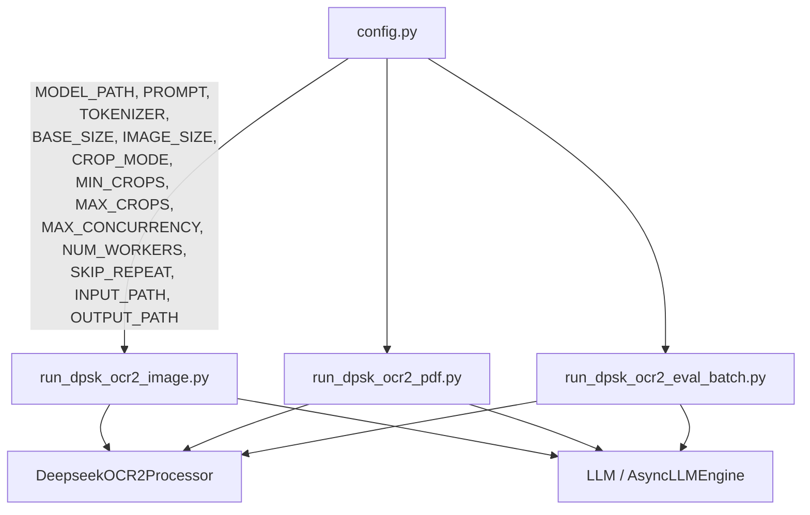
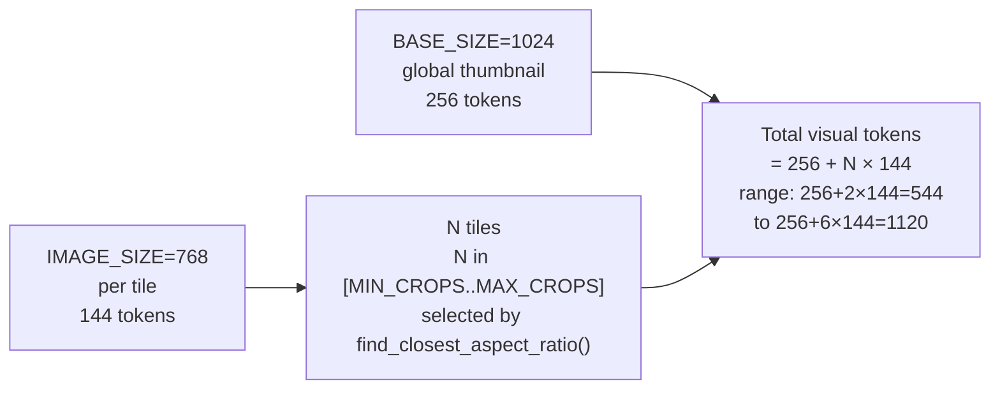
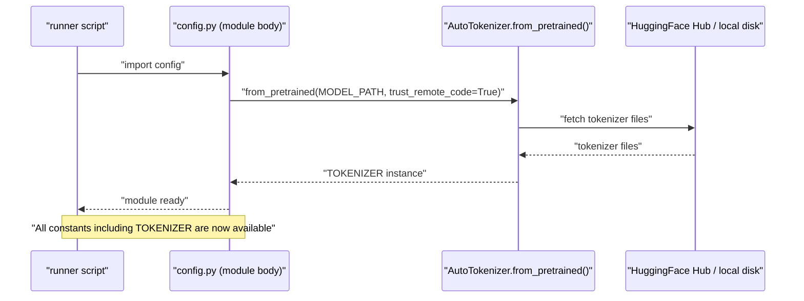
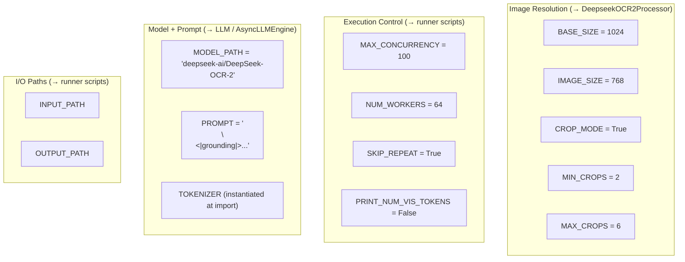

<!-- source: DeepWiki mcp.deepwiki.com · repo deepseek-ai/DeepSeek-OCR-2 · extra page vLLM Configuration · fetched 2026-10-30 -->

# vLLM Configuration

<details>
<summary>Relevant source files</summary>

The following files were used as context for generating this wiki page:

- [DeepSeek-OCR2-master/DeepSeek-OCR2-vllm/__pycache__/config.cpython-312.pyc](DeepSeek-OCR2-master/DeepSeek-OCR2-vllm/__pycache__/config.cpython-312.pyc)
- [DeepSeek-OCR2-master/DeepSeek-OCR2-vllm/config.py](DeepSeek-OCR2-master/DeepSeek-OCR2-vllm/config.py)

</details>


This page documents every parameter defined in `DeepSeek-OCR2-vllm/config.py`, their types, default values, and effects on runtime behavior. `config.py` is the single shared configuration hub imported by all three vLLM runner scripts; changing a value here affects all runners simultaneously.

For information on the runner scripts that consume these parameters, see [vLLM Entry Points](#3.2.2). For the image preprocessing logic that uses the image parameters, see [Image Preprocessing](#6.1). For tuning `MAX_CONCURRENCY` and `NUM_WORKERS` together, see [Concurrency Configuration](#8.1).

---

## Role of `config.py`

All vLLM runner scripts import `config.py` at the top of their module. The file has no classes or functions — it is a flat namespace of module-level constants. One side effect occurs at import time: `TOKENIZER` is instantiated by calling `AutoTokenizer.from_pretrained`, which contacts the model hub (or loads from local disk) before any runner logic executes.

**Dependency graph — config.py to runners:**



Sources: [DeepSeek-OCR2-vllm/config.py:1-31]()

---

## Parameter Reference

### Model and Prompt Parameters

| Parameter | Default value | Type | Description |
|---|---|---|---|
| `MODEL_PATH` | `'deepseek-ai/DeepSeek-OCR-2'` | `str` | HuggingFace Hub model ID or local filesystem path passed to the vLLM engine and `AutoTokenizer`. Change this to a local path when running offline. |
| `PROMPT` | `'<image>\n<|grounding|>Convert the document to markdown.'` | `str` | The text prompt prepended to every inference request. A commented-out alternative (`'<image>\nFree OCR.'`) is provided for layout-agnostic OCR. See [Task-Specific Prompts](#7.2) for when to use each format. |
| `TOKENIZER` | `AutoTokenizer.from_pretrained(MODEL_PATH, trust_remote_code=True)` | `AutoTokenizer` | A tokenizer instance created **eagerly at import time**. Because `TOKENIZER` is a module-level expression, the `from_pretrained` call runs as soon as any script does `import config`. This instance is shared across all workers to avoid repeated initialization. |

Sources: [DeepSeek-OCR2-vllm/config.py:11-30]()

---

### Image Parameters

These parameters control the dynamic tiling logic inside `DeepseekOCR2Processor.dynamic_preprocess()`. They directly determine the number of visual tokens fed to the model. See [Global and Local Views](#6.2) for the token budget calculations.

| Parameter | Default value | Type | Description |
|---|---|---|---|
| `BASE_SIZE` | `1024` | `int` | Pixel side-length of the global thumbnail. The entire image is resized to `BASE_SIZE × BASE_SIZE` to produce one global view contributing ~256 visual tokens. |
| `IMAGE_SIZE` | `768` | `int` | Pixel side-length of each local crop tile. Each tile contributes ~144 visual tokens. |
| `CROP_MODE` | `True` | `bool` | When `True`, the image is split into local tiles in addition to the global thumbnail. When `False`, only the global thumbnail is used (equivalent to `MIN_CROPS=MAX_CROPS=0`). |
| `MIN_CROPS` | `2` | `int` | Minimum number of local tiles to generate per image when `CROP_MODE=True`. Ensures a minimum level of resolution detail even for small images. |
| `MAX_CROPS` | `6` | `int` | Maximum number of local tiles. The comment in the source marks `6` as the architectural maximum. Raising this beyond `6` is not supported. |

**Token budget as a function of tile count:**



Sources: [DeepSeek-OCR2-vllm/config.py:2-6]()

---

### Execution Parameters

These parameters control parallelism and output behavior at runtime.

| Parameter | Default value | Type | Description |
|---|---|---|---|
| `MAX_CONCURRENCY` | `100` | `int` | Maximum number of inference requests submitted to the vLLM engine simultaneously. The inline comment states: "If you have limited GPU memory, lower the concurrency count." Applies to `run_dpsk_ocr2_pdf.py` (via `asyncio.Semaphore`) and `run_dpsk_ocr2_eval_batch.py`. |
| `NUM_WORKERS` | `64` | `int` | Thread/process count for CPU-side image preprocessing (resize, padding, tokenization). Used in `ThreadPoolExecutor` calls inside the eval and PDF runners. Independent of `MAX_CONCURRENCY`. |
| `SKIP_REPEAT` | `True` | `bool` | When `True`, runner scripts check whether an output file already exists for a given input and skip re-inference if so. Useful for resuming interrupted batch jobs. |
| `PRINT_NUM_VIS_TOKENS` | `False` | `bool` | Debug flag. When `True`, prints the number of visual tokens computed for each image during preprocessing. |

Sources: [DeepSeek-OCR2-vllm/config.py:7-10]()

---

### I/O Path Parameters

| Parameter | Default | Description |
|---|---|---|
| `INPUT_PATH` | `'/your/image/path/'` | Path to input data. The expected format depends on which runner is invoked: a directory of images for `run_dpsk_ocr2_image.py`, a `.pdf` file for `run_dpsk_ocr2_pdf.py`, or an OmniDocBench image directory for `run_dpsk_ocr2_eval_batch.py`. Must be changed before use. |
| `OUTPUT_PATH` | `'/your/output/path/'` | Root directory where output files are written (`.mmd` markdown files, `_det.mmd` grounding files, `_layouts.pdf`, annotated images). |

The file-level comment [DeepSeek-OCR2-vllm/config.py:13-16]() summarizes which runner matches which input format:

```
# .pdf: run_dpsk_ocr_pdf.py
# .jpg, .png, .jpeg: run_dpsk_ocr_image.py
# Omnidocbench images path: run_dpsk_ocr_eval_batch.py
```

Sources: [DeepSeek-OCR2-vllm/config.py:13-21]()

---

## Import-Time Side Effects

`TOKENIZER` is the only parameter with a side effect at import time.



Because of this, if `MODEL_PATH` points to a Hub ID that requires network access and the machine is offline, the import will fail before any runner code runs. To avoid this, set `MODEL_PATH` to a local path containing downloaded weights and tokenizer files.

Sources: [DeepSeek-OCR2-vllm/config.py:28-30]()

---

## Complete Parameter Summary



Sources: [DeepSeek-OCR2-vllm/config.py:1-31]()

---

