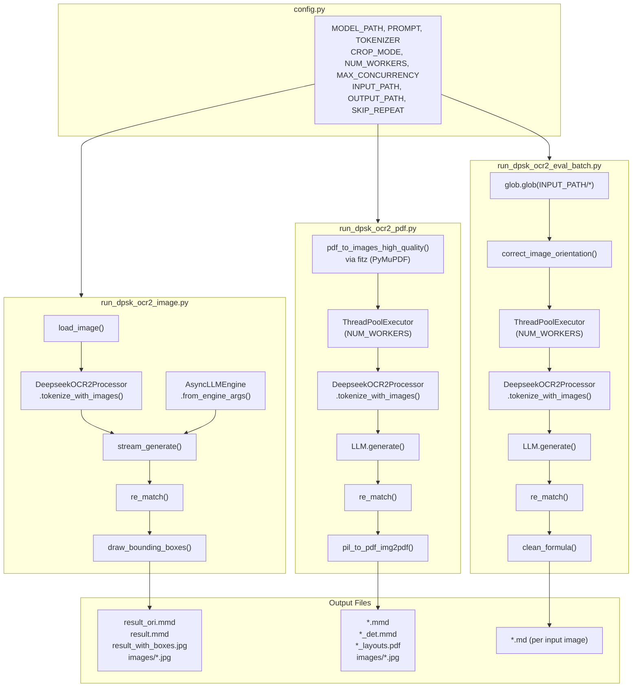
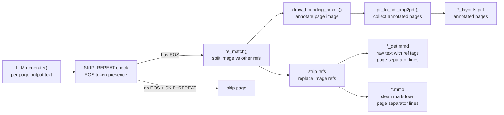
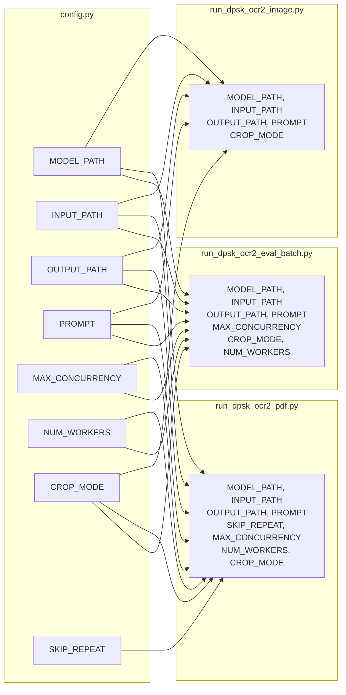
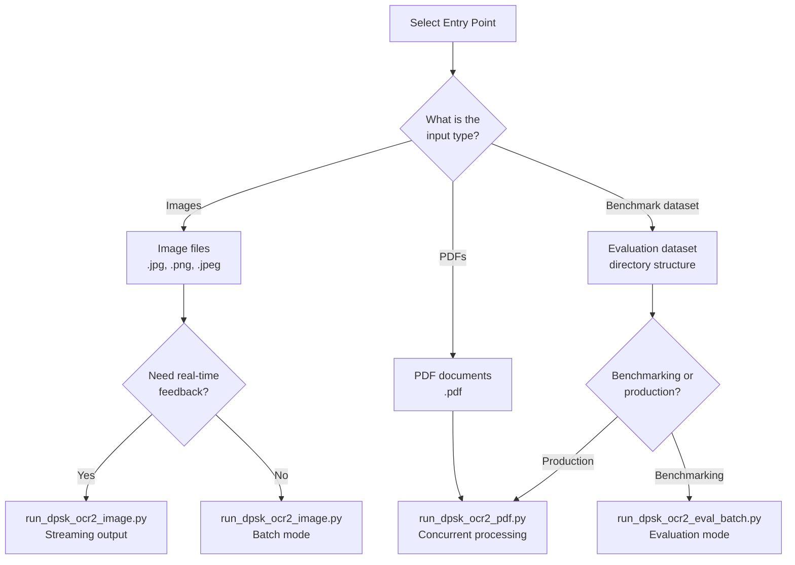

<!-- source: DeepWiki mcp.deepwiki.com · repo deepseek-ai/DeepSeek-OCR-2 · extra page vLLM Entry Points · fetched 2026-10-30 -->

# vLLM Entry Points

<details>
<summary>Relevant source files</summary>

The following files were used as context for generating this wiki page:

- [DeepSeek-OCR2-master/DeepSeek-OCR2-vllm/config.py](DeepSeek-OCR2-master/DeepSeek-OCR2-vllm/config.py)
- [DeepSeek-OCR2-master/DeepSeek-OCR2-vllm/run_dpsk_ocr2_eval_batch.py](DeepSeek-OCR2-master/DeepSeek-OCR2-vllm/run_dpsk_ocr2_eval_batch.py)
- [DeepSeek-OCR2-master/DeepSeek-OCR2-vllm/run_dpsk_ocr2_image.py](DeepSeek-OCR2-master/DeepSeek-OCR2-vllm/run_dpsk_ocr2_image.py)
- [DeepSeek-OCR2-master/DeepSeek-OCR2-vllm/run_dpsk_ocr2_pdf.py](DeepSeek-OCR2-master/DeepSeek-OCR2-vllm/run_dpsk_ocr2_pdf.py)

</details>


This document describes the three vLLM-based inference entry point scripts that provide production-optimized OCR processing for different workload types. Each script is designed for a specific use case: streaming image processing, concurrent PDF document processing, and batch evaluation for benchmarking.

For configuration details referenced by these entry points, see page 3.2.1. For the underlying Transformers-based inference approach, see page 3.1.

## Overview

The vLLM inference system provides three specialized entry point scripts located in `DeepSeek-OCR2-master/DeepSeek-OCR2-vllm/`:

| Script | Engine Class | Primary Use Case | Input |
|--------|-------------|-----------------|-------|
| `run_dpsk_ocr2_image.py` | `AsyncLLMEngine` | Single image OCR with streaming and bounding box annotation | Single image file |
| `run_dpsk_ocr2_pdf.py` | `LLM` | Multi-page PDF batch processing | Single PDF file |
| `run_dpsk_ocr2_eval_batch.py` | `LLM` | OmniDocBench evaluation batch processing | Directory of images |

All three scripts:
- Register `DeepseekOCR2ForCausalLM` with vLLM via `ModelRegistry.register_model()`
- Import configuration from `config.py`
- Use `DeepseekOCR2Processor().tokenize_with_images()` for preprocessing
- Apply `NoRepeatNGramLogitsProcessor` via `SamplingParams.logits_processors`
- Apply `re_match()` and `clean_formula()` post-processing on generated text

Sources: [DeepSeek-OCR2-master/DeepSeek-OCR2-vllm/run_dpsk_ocr2_image.py:1-27](), [DeepSeek-OCR2-master/DeepSeek-OCR2-vllm/run_dpsk_ocr2_pdf.py:1-30](), [DeepSeek-OCR2-master/DeepSeek-OCR2-vllm/run_dpsk_ocr2_eval_batch.py:1-22]()

## Entry Point Architecture

**Diagram: Entry point scripts, engine classes, and output files**



Sources: [DeepSeek-OCR2-master/DeepSeek-OCR2-vllm/run_dpsk_ocr2_image.py:1-304](), [DeepSeek-OCR2-master/DeepSeek-OCR2-vllm/run_dpsk_ocr2_pdf.py:1-330](), [DeepSeek-OCR2-master/DeepSeek-OCR2-vllm/run_dpsk_ocr2_eval_batch.py:1-191]()

## run_dpsk_ocr2_image.py — Streaming Image OCR

### Purpose

Processes a single image file with token-by-token streaming output using `AsyncLLMEngine`. After generation, annotates the source image with bounding boxes for detected document elements and saves extracted sub-images.

`INPUT_PATH` must point to a single image file (`.jpg`, `.png`, `.jpeg`).

### Engine Initialization

This is the only entry point that uses `AsyncLLMEngine` rather than the synchronous `LLM` class. The engine is created inside `stream_generate()` via `AsyncLLMEngine.from_engine_args(AsyncEngineArgs(...))`.

[DeepSeek-OCR2-master/DeepSeek-OCR2-vllm/run_dpsk_ocr2_image.py:147-161]()

Key `AsyncEngineArgs` values:
- `dtype="bfloat16"`
- `max_model_len=8192`
- `gpu_memory_utilization=0.75`
- `tensor_parallel_size=1`

### stream_generate() Coroutine

`stream_generate(image, prompt)` is an `async def` function driven by `asyncio.run()`. It iterates over `engine.generate()` asynchronously and prints each newly generated token chunk to stdout in real time.

[DeepSeek-OCR2-master/DeepSeek-OCR2-vllm/run_dpsk_ocr2_image.py:146-200]()

The `NoRepeatNGramLogitsProcessor` is configured with `ngram_size=20`, `window_size=90`, and `whitelist_token_ids={128821, 128822}` (tokens for `<td>` and `</td>`).

### Image Loading

`load_image(image_path)` opens the image and applies EXIF orientation correction via `ImageOps.exif_transpose()`.

[DeepSeek-OCR2-master/DeepSeek-OCR2-vllm/run_dpsk_ocr2_image.py:28-42]()

### Bounding Box Annotation

After `stream_generate()` returns, the full output is passed to `re_match()`, which splits detected regions into `matches_image` (label `image`) and `mathes_other` (all other labels such as `title`, `text`, `table`, etc.).

`draw_bounding_boxes(image, refs)` iterates over all matched references and:
- Scales normalized coordinates (0–999 range) to pixel space
- Draws colored rectangles on a copy of the original image
- For `image`-labeled regions, crops and saves the sub-image to `OUTPUT_PATH/images/<idx>.jpg`
- Applies a semi-transparent fill overlay

[DeepSeek-OCR2-master/DeepSeek-OCR2-vllm/run_dpsk_ocr2_image.py:72-136]()

### Output Files

| File | Content |
|------|---------|
| `OUTPUT_PATH/result_ori.mmd` | Raw model output including `<\|ref\|>...<\|det\|>` tags |
| `OUTPUT_PATH/result.mmd` | Cleaned output: image refs replaced with ``, other refs stripped |
| `OUTPUT_PATH/result_with_boxes.jpg` | Source image annotated with bounding boxes and labels |
| `OUTPUT_PATH/images/<N>.jpg` | Cropped sub-images for each detected `image` region |

[DeepSeek-OCR2-master/DeepSeek-OCR2-vllm/run_dpsk_ocr2_image.py:205-304]()

Sources: [DeepSeek-OCR2-master/DeepSeek-OCR2-vllm/run_dpsk_ocr2_image.py:1-304]()

## run_dpsk_ocr2_pdf.py — PDF Batch Processing

### Purpose

Converts a PDF file to per-page images, preprocesses all pages in parallel with `ThreadPoolExecutor`, runs batch inference with `LLM`, and produces three output files: a raw detections file, a clean markdown file, and an annotated layouts PDF.

`INPUT_PATH` must point to a single `.pdf` file.

### PDF-to-Image Conversion

`pdf_to_images_high_quality(pdf_path, dpi=144)` uses `fitz` (PyMuPDF) to rasterize each page at 144 DPI. The zoom factor is computed as `dpi / 72.0`. Pages are returned as a list of PIL `Image` objects.

[DeepSeek-OCR2-master/DeepSeek-OCR2-vllm/run_dpsk_ocr2_pdf.py:64-95]()

### Preprocessing and Inference

Pages are preprocessed in parallel using `ThreadPoolExecutor(max_workers=NUM_WORKERS)`. Each worker calls `process_single_image()`, which runs `DeepseekOCR2Processor().tokenize_with_images()` to produce the `multi_modal_data` dict.

The resulting `batch_inputs` list is passed to `llm.generate()` (synchronous `LLM` class) with `SamplingParams`:
- `temperature=0.0`, `max_tokens=8192`
- `skip_special_tokens=False`, `include_stop_str_in_output=True`
- `NoRepeatNGramLogitsProcessor(ngram_size=20, window_size=50, whitelist_token_ids={128821, 128822})`

`LLM` is initialized with `gpu_memory_utilization=0.9` and `disable_mm_preprocessor_cache=True`.

[DeepSeek-OCR2-master/DeepSeek-OCR2-vllm/run_dpsk_ocr2_pdf.py:32-54](), [DeepSeek-OCR2-master/DeepSeek-OCR2-vllm/run_dpsk_ocr2_pdf.py:248-271]()

### SKIP_REPEAT Behavior

For each page output, the script checks whether `<｜end▁of▁sentence｜>` appears in the generated text:

```
if '<｜end▁of▁sentence｜>' in content:
    content = content.replace('<｜end▁of▁sentence｜>', '')
else:
    if SKIP_REPEAT:
        continue   # page is dropped from output
```

When `SKIP_REPEAT=True` (the default), any page whose output does not terminate with the EOS token — an indicator of a degenerate repetition loop that consumed all available tokens — is silently skipped and excluded from the merged output files.

[DeepSeek-OCR2-master/DeepSeek-OCR2-vllm/run_dpsk_ocr2_pdf.py:289-293]()

### Output Files

**Diagram: PDF script output pipeline**



| File | Content |
|------|---------|
| `<name>_det.mmd` | Raw output per page including `<\|ref\|>...<\|det\|>` tags, separated by `<--- Page Split --->` |
| `<name>.mmd` | Cleaned markdown per page: refs stripped, image refs replaced with ``, separated by `<--- Page Split --->` |
| `<name>_layouts.pdf` | PDF assembled from annotated page images via `pil_to_pdf_img2pdf()` |
| `images/<jdx>_<idx>.jpg` | Cropped sub-images for each detected `image` region per page |

[DeepSeek-OCR2-master/DeepSeek-OCR2-vllm/run_dpsk_ocr2_pdf.py:279-329]()

Sources: [DeepSeek-OCR2-master/DeepSeek-OCR2-vllm/run_dpsk_ocr2_pdf.py:1-330]()

## run_dpsk_ocr2_eval_batch.py — OmniDocBench Batch Evaluation

### Purpose

Processes an entire directory of images (e.g., OmniDocBench images) in batch mode using `LLM`. Produces one `.md` file per input image in `OUTPUT_PATH`. Does not compute evaluation metrics itself — metric computation is performed separately using OmniDocBench tooling against the generated `.md` files.

`INPUT_PATH` must point to a directory of image files.

### Image Loading

Images are discovered via `glob.glob(f'{INPUT_PATH}/*')`. Each image is opened with PIL and passed through `correct_image_orientation()`, which reads EXIF orientation tags and applies `image.rotate()` as needed (180°, 90°, or 270°).

[DeepSeek-OCR2-master/DeepSeek-OCR2-vllm/run_dpsk_ocr2_eval_batch.py:24-47](), [DeepSeek-OCR2-master/DeepSeek-OCR2-vllm/run_dpsk_ocr2_eval_batch.py:129-137]()

### ThreadPoolExecutor Preprocessing

All images are preprocessed concurrently using `ThreadPoolExecutor(max_workers=NUM_WORKERS)`. Each worker calls `process_single_image()`, which wraps `DeepseekOCR2Processor().tokenize_with_images()` in a `multi_modal_data` dict.

[DeepSeek-OCR2-master/DeepSeek-OCR2-vllm/run_dpsk_ocr2_eval_batch.py:109-116](), [DeepSeek-OCR2-master/DeepSeek-OCR2-vllm/run_dpsk_ocr2_eval_batch.py:155-160]()

`LLM` is initialized with `gpu_memory_utilization=0.7` and `max_num_seqs=MAX_CONCURRENCY`. The `NoRepeatNGramLogitsProcessor` uses `ngram_size=40`, `window_size=90`.

[DeepSeek-OCR2-master/DeepSeek-OCR2-vllm/run_dpsk_ocr2_eval_batch.py:50-70]()

### Post-Processing and Output

For each output, the script applies `clean_formula()` then `re_match()`. All matched reference spans (both image and non-image) in `mathes_other` are stripped from the output. Note that unlike `run_dpsk_ocr2_image.py`, the eval script does not differentiate image refs for replacement — all refs are removed.

Output files are written as `OUTPUT_PATH/<basename>.md` (`.jpg` and `.png` extensions replaced with `.md`).

There is no `SKIP_REPEAT` check in this script.

[DeepSeek-OCR2-master/DeepSeek-OCR2-vllm/run_dpsk_ocr2_eval_batch.py:175-191]()

Sources: [DeepSeek-OCR2-master/DeepSeek-OCR2-vllm/run_dpsk_ocr2_eval_batch.py:1-191]()

## Shared Post-Processing

All three entry points apply the same post-processing steps to the raw model output. These functions are defined locally in each script (they are not shared via an import).

### re_match()

`re_match(text)` applies a regex to find all occurrences of the grounding output pattern:

```
<|ref|>LABEL<|/ref|><|det|>COORDINATES<|/det|>
```

The regex pattern is: `r'(<\|ref\|>(.*?)<\|/ref\|><\|det\|>(.*?)<\|/det\|>)'`

In `run_dpsk_ocr2_image.py` and `run_dpsk_ocr2_pdf.py`, matches are split into two groups: those with label `image` (go to `matches_image`) and all others (go to `mathes_other`). Image refs are replaced with markdown image links; other refs are stripped. In `run_dpsk_ocr2_eval_batch.py`, all refs go to `mathes_other` and are stripped.

[DeepSeek-OCR2-master/DeepSeek-OCR2-vllm/run_dpsk_ocr2_image.py:45-57](), [DeepSeek-OCR2-master/DeepSeek-OCR2-vllm/run_dpsk_ocr2_pdf.py:123-135](), [DeepSeek-OCR2-master/DeepSeek-OCR2-vllm/run_dpsk_ocr2_eval_batch.py:98-107]()

### clean_formula()

`clean_formula(text)` applies a regex substitution over LaTeX display math blocks (`\[...\]`). Within each matched formula, it removes `\quad (...)` annotation suffixes via `re.sub(r'\\quad\s*\([^)]*\)', '', formula)` and strips surrounding whitespace.

Used in `run_dpsk_ocr2_eval_batch.py` and `run_dpsk_ocr2_pdf.py`.

[DeepSeek-OCR2-master/DeepSeek-OCR2-vllm/run_dpsk_ocr2_eval_batch.py:81-96](), [DeepSeek-OCR2-master/DeepSeek-OCR2-vllm/run_dpsk_ocr2_pdf.py:314]()

### SKIP_REPEAT

`SKIP_REPEAT` is used exclusively by `run_dpsk_ocr2_pdf.py`. When `True`, any page whose generated text does not contain `<｜end▁of▁sentence｜>` is skipped. The EOS token's absence indicates the generation hit `max_tokens` without completing — typically caused by a repetition loop that was not fully suppressed by `NoRepeatNGramLogitsProcessor`.

The EOS token string is `<｜end▁of▁sentence｜>` (Unicode fullwidth characters).

[DeepSeek-OCR2-master/DeepSeek-OCR2-vllm/run_dpsk_ocr2_pdf.py:289-293](), [DeepSeek-OCR2-master/DeepSeek-OCR2-vllm/config.py:10]()

### NoRepeatNGramLogitsProcessor Wiring

Each script instantiates `NoRepeatNGramLogitsProcessor` and passes it through `SamplingParams(logits_processors=[...])`:

| Script | `ngram_size` | `window_size` |
|--------|-------------|---------------|
| `run_dpsk_ocr2_image.py` | 20 | 90 |
| `run_dpsk_ocr2_pdf.py` | 20 | 50 |
| `run_dpsk_ocr2_eval_batch.py` | 40 | 90 |

All three use `whitelist_token_ids={128821, 128822}` (token IDs for `<td>` and `</td>`) to prevent the n-gram filter from blocking table cell boundaries.

[DeepSeek-OCR2-master/DeepSeek-OCR2-vllm/run_dpsk_ocr2_image.py:163](), [DeepSeek-OCR2-master/DeepSeek-OCR2-vllm/run_dpsk_ocr2_pdf.py:46](), [DeepSeek-OCR2-master/DeepSeek-OCR2-vllm/run_dpsk_ocr2_eval_batch.py:63]()

Sources: [DeepSeek-OCR2-master/DeepSeek-OCR2-vllm/run_dpsk_ocr2_image.py:45-57](), [DeepSeek-OCR2-master/DeepSeek-OCR2-vllm/run_dpsk_ocr2_pdf.py:123-135](), [DeepSeek-OCR2-master/DeepSeek-OCR2-vllm/run_dpsk_ocr2_eval_batch.py:81-107]()

## Configuration Integration

All three entry points import from `config.py`. The table below lists which parameters each script imports.

**Diagram: config.py symbols imported by each runner script**



Sources: [DeepSeek-OCR2-master/DeepSeek-OCR2-vllm/run_dpsk_ocr2_image.py:22](), [DeepSeek-OCR2-master/DeepSeek-OCR2-vllm/run_dpsk_ocr2_pdf.py:17](), [DeepSeek-OCR2-master/DeepSeek-OCR2-vllm/run_dpsk_ocr2_eval_batch.py:10](), [DeepSeek-OCR2-master/DeepSeek-OCR2-vllm/config.py:1-30]()

## Execution Comparison

| Aspect | `run_dpsk_ocr2_image.py` | `run_dpsk_ocr2_pdf.py` | `run_dpsk_ocr2_eval_batch.py` |
|--------|--------------------------|------------------------|-------------------------------|
| **vLLM class** | `AsyncLLMEngine` | `LLM` | `LLM` |
| **Input type** | Single image file | Single PDF file | Directory of images |
| **Image loading** | `load_image()` + `ImageOps.exif_transpose()` | `pdf_to_images_high_quality()` via `fitz` | `glob` + `correct_image_orientation()` |
| **Preprocessing** | Single call to `tokenize_with_images()` | `ThreadPoolExecutor` + `process_single_image()` | `ThreadPoolExecutor` + `process_single_image()` |
| **Generation** | `engine.generate()` async iterator | `llm.generate()` batch | `llm.generate()` batch |
| **`SKIP_REPEAT`** | Not used | Yes — pages without EOS dropped | Not used |
| **`clean_formula()`** | Not used | Yes | Yes |
| **`re_match()` image handling** | Replaced with `` | Replaced with `` | Stripped (not replaced) |
| **Bounding box output** | `result_with_boxes.jpg` | Per-page in `*_layouts.pdf` | Not produced |
| **`gpu_memory_utilization`** | `0.75` | `0.9` | `0.7` |
| **`ngram_size`** | 20 | 20 | 40 |

Sources: [DeepSeek-OCR2-master/DeepSeek-OCR2-vllm/run_dpsk_ocr2_image.py:147-165](), [DeepSeek-OCR2-master/DeepSeek-OCR2-vllm/run_dpsk_ocr2_pdf.py:32-54](), [DeepSeek-OCR2-master/DeepSeek-OCR2-vllm/run_dpsk_ocr2_eval_batch.py:50-70]()

## Usage Workflow

### Basic Workflow

1. **Configure**: Edit `config.py` to set paths and parameters
   ```bash
   cd DeepSeek-OCR2-master/DeepSeek-OCR2-vllm
   vim config.py  # Set INPUT_PATH, OUTPUT_PATH, PROMPT
   ```

2. **Select Entry Point**: Choose based on input type
   - Images → `run_dpsk_ocr2_image.py`
   - PDFs → `run_dpsk_ocr2_pdf.py`
   - Benchmarks → `run_dpsk_ocr2_eval_batch.py`

3. **Execute**: Run the selected script
   ```bash
   python run_dpsk_ocr2_[image|pdf|eval_batch].py
   ```

4. **Collect Results**: Find outputs in `OUTPUT_PATH`

### Entry Point Selection Decision Tree



**Sources:** [README.md:86-103]()

## Performance Tuning

Each entry point's performance can be optimized by adjusting concurrency parameters in `config.py`:

### Concurrency Parameters

- **`MAX_CONCURRENCY`**: GPU-bound inference task limit
  - Default: `100`
  - Reduce if GPU memory is limited (e.g., to `50` for 24GB GPUs, `20` for 16GB GPUs)
  - Increase for multi-GPU setups with sufficient memory
  
- **`NUM_WORKERS`**: CPU-bound preprocessing thread count
  - Default: `64`
  - Adjust based on CPU core count (typically 1-2× core count)
  - Higher values reduce GPU idle time during preprocessing

### Tuning Guidelines by Entry Point

| Entry Point | Recommended MAX_CONCURRENCY | Recommended NUM_WORKERS | Rationale |
|-------------|----------------------------|-------------------------|-----------|
| `run_dpsk_ocr2_image.py` | 50-100 | 32-64 | Balance latency and throughput |
| `run_dpsk_ocr2_pdf.py` | 100+ | 64-128 | Maximize throughput for pages |
| `run_dpsk_ocr2_eval_batch.py` | 100+ | 64-128 | Optimize for large batches |

**Sources:** [README.md:88](), [DeepSeek-OCR2-master/DeepSeek-OCR2-vllm/config.py:7-8]()

---

