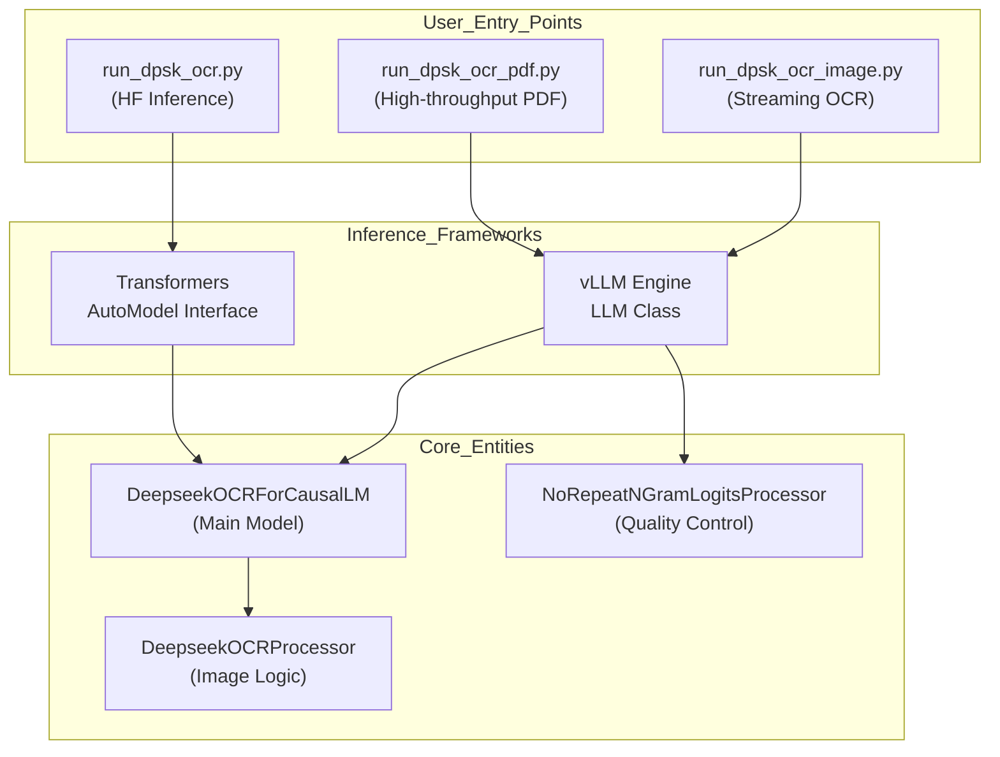
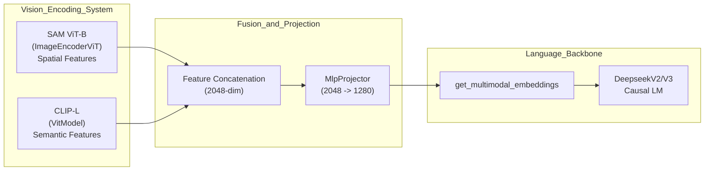

<!-- source: DeepWiki mcp.deepwiki.com · repo deepseek-ai/DeepSeek-OCR · page 1 DeepSeek-OCR Overview · fetched 2026-10-30 -->

# DeepSeek-OCR Overview

Relevant source files

The following files were used as context for generating this wiki page:

- [DeepSeek_OCR_paper.pdf](DeepSeek_OCR_paper.pdf)
- [README.md](README.md)
- [assets/badge.svg](assets/badge.svg)
- [assets/fig1.png](assets/fig1.png)
- [assets/logo.svg](assets/logo.svg)

## Purpose and Scope

DeepSeek-OCR is a specialized vision-language model architecture designed for high-performance optical character recognition (OCR) and document understanding. It investigates the role of vision encoders from an LLM-centric viewpoint, specifically optimizing how visual features are compressed and presented to a Large Language Model (LLM) for text extraction and layout analysis [README.md:57-58]().

The system is designed with a dual-framework approach:
1.  **Production-oriented vLLM integration** for high-throughput processing (~2500 tokens/s on A100) [README.md:100-103]().
2.  **Research-oriented Transformers interface** for fine-grained control over image processing parameters [README.md:165-183]().

This page details the system's architecture, the relationship between its vision and language components, and the data flow through its processing pipeline.

**Sources:** [README.md:35-58](), [README.md:89-107]()

---

## Key Capabilities

DeepSeek-OCR supports multiple task-specific prompts that trigger different behaviors in the underlying `DeepseekOCRForCausalLM` model.

| Capability | Description | Prompt Template |
| :--- | :--- | :--- |
| **Document to Markdown** | Full document parsing with layout and formula preservation. | `<image>\n<|grounding|>Convert the document to markdown.` |
| **Free OCR** | Plain text extraction without structural layout overhead. | `<image>\nFree OCR.` |
| **Visual Grounding** | Localization of specific text elements using reference tags. | `<image>\nLocate <|ref|>text<|/ref|> in the image.` |
| **Figure Parsing** | Specialized extraction for charts and diagrams. | `<image>\nParse the figure.` |
| **General Description** | Detailed visual understanding of non-textual elements. | `<image>\nDescribe this image in detail.` |

**Sources:** [README.md:178-179](), [README.md:201-209]()

---

## System Architecture

### High-Level Design

The system architecture bridges "Natural Language Space" (prompts and generated text) with "Code Entity Space" (model classes and processing logic) through a unified `DeepseekOCRForCausalLM` backbone.

#### System Entry Points and Workflows
The following diagram illustrates how user-facing scripts interact with the core engine components.

Title: DeepSeek-OCR Execution Flow

**Sources:** [README.md:91-107](), [README.md:119-129](), [README.md:168-176]()

---

### Dual Framework Approach

DeepSeek-OCR maintains two distinct implementation paths to satisfy different performance requirements.

#### 1. vLLM Framework (High Throughput)
The vLLM implementation is located in `DeepSeek-OCR-vllm/`. It is optimized for batch processing and high concurrency.
*   **Engine:** Uses the `vllm.LLM` class for execution [README.md:124-129]().
*   **Repetition Control:** Implements `NGramPerReqLogitsProcessor` (also referred to as `NoRepeatNGramLogitsProcessor`) to prevent the model from getting stuck in repetitive loops during long document generation [README.md:120-129]().
*   **Sampling:** Configured via `SamplingParams` with specific `extra_args` for n-gram windowing [README.md:147-157]().

#### 2. Transformers Framework (Research & Control)
The Transformers implementation is located in `DeepSeek-OCR-hf/`. It exposes the `model.infer()` method for direct manipulation of the vision pipeline.
*   **Model Loading:** Uses `AutoModel.from_pretrained` with `trust_remote_code=True` [README.md:174-175]().
*   **Inference Method:** The `model.infer()` function allows users to toggle `crop_mode`, `base_size`, and `test_compress` dynamically [README.md:183]().

**Sources:** [README.md:109-164](), [README.md:165-189]()

---

## Model Architecture: DeepseekOCRForCausalLM

The core of the system is the `DeepseekOCRForCausalLM` class. It employs a dual-encoder vision system to capture both high-level semantics and fine-grained spatial details.

Title: DeepseekOCRForCausalLM Internal Structure

### Vision Encoders
1.  **SAM ViT-B:** Built via `build_sam_vit_b`. This encoder focuses on spatial features and fine-grained details necessary for character recognition [README.md:176-183]().
2.  **CLIP-L:** Built via `build_clip_l`. This encoder provides semantic context, helping the model understand the overall structure of the document or image [README.md:176-183]().

### Feature Projection
The `MlpProjector` handles the dimensionality reduction from the combined vision encoders (2048 dimensions) to the language model's embedding space (1280 dimensions). It supports different strategies such as `downsample`, `split`, and `hybrid` projection [README.md:183]().

**Sources:** [README.md:168-183]()

---

## Resolution and Processing Modes

DeepSeek-OCR handles images using several resolution modes, ranging from static native resolutions to a dynamic multi-scale approach.

### Native Resolution Modes
These modes process the image at a fixed size, resulting in a constant number of vision tokens:
*   **Tiny:** 512×512 (64 tokens) [README.md:193]()
*   **Small:** 640×640 (100 tokens) [README.md:194]()
*   **Base:** 1024×1024 (256 tokens) [README.md:195]()
*   **Large:** 1280×1280 (400 tokens) [README.md:196]()

### Dynamic Resolution (Gundam Mode)
The "Gundam" mode is the most advanced processing strategy. It uses an asymmetric approach:
1.  **Global View:** 1 view at `1024×1024` resolution to capture layout [README.md:198]().
2.  **Local Views:** `n` crops at `640×640` resolution to capture fine text [README.md:198]().
3.  **Integration:** The `DeepseekOCRProcessor` manages the cropping and inserts special tokens like `view_separator` and `image_newline` to maintain spatial relationships [README.md:183]().

**Sources:** [README.md:183](), [README.md:191-199]()

---

