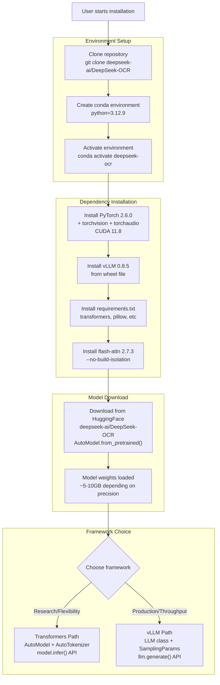
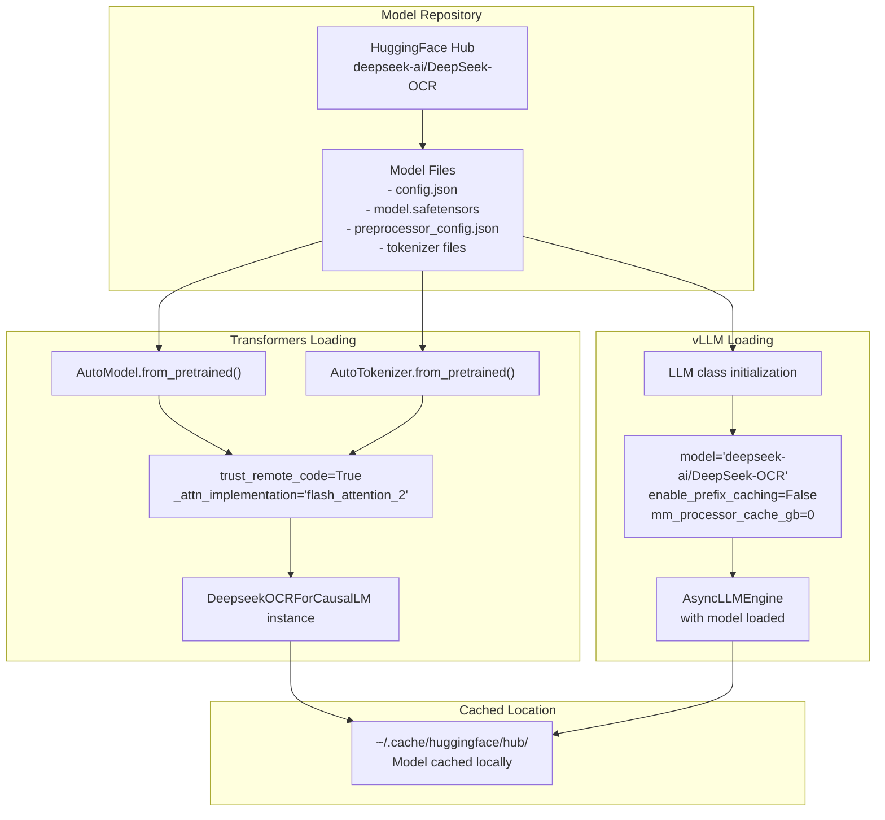
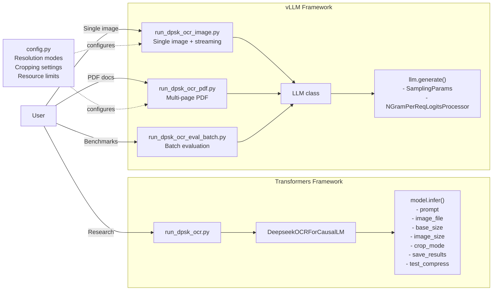

<!-- source: DeepWiki mcp.deepwiki.com · repo deepseek-ai/DeepSeek-OCR · page 2 Getting Started · fetched 2026-10-30 -->

# Getting Started

<details>
<summary>Relevant source files</summary>

The following files were used as context for generating this wiki page:

- [README.md](README.md)
- [requirements.txt](requirements.txt)

</details>


This page guides you through installing DeepSeek-OCR and running your first inference. The system provides two parallel inference frameworks: **vLLM** for high-throughput production workloads and **Transformers** for research and experimentation. Both frameworks share the same underlying model checkpoint.

For detailed usage of each framework, see [Quick Start with Transformers](#2.2) and [Quick Start with vLLM](#2.3). For comprehensive configuration options, see [Configuration System](#3.3).

---

## Overview of Setup Process

The following diagram shows the installation and initialization workflow:



**Sources:** [README.md:67-88]()

---

## Prerequisites

### Hardware Requirements

| Component | Minimum | Recommended |
|-----------|---------|-------------|
| GPU | NVIDIA GPU with 24GB+ VRAM | A100 40GB or H100 |
| RAM | 32GB | 64GB+ |
| Storage | 20GB free space | 50GB+ for multiple models |
| CUDA | 11.8 | 11.8 or 12.x |

The model requires significant GPU memory, especially when using dynamic cropping (Gundam mode) with high-resolution images. For batch processing, memory requirements scale with batch size and image resolution.

### Software Requirements

| Software | Version | Notes |
|----------|---------|-------|
| Python | 3.12.9 | Tested version [README.md:76]() |
| CUDA | 11.8 | Required for GPU acceleration [README.md:69]() |
| PyTorch | 2.6.0 | Specific version for compatibility [README.md:83]() |
| vLLM | 0.8.5 | Custom build with DeepSeek-OCR support [README.md:81]() |
| flash-attn | 2.7.3 | Required for efficient attention [README.md:86]() |

**Sources:** [README.md:68-87]()

---

## Installation Steps

### Step 1: Clone Repository

```bash
git clone https://github.com/deepseek-ai/DeepSeek-OCR.git
cd DeepSeek-OCR
```

The repository structure includes two main directories:
- `DeepSeek-OCR-vllm/`: vLLM inference scripts and configuration [README.md:94]()
- `DeepSeek-OCR-hf/`: Transformers inference scripts [README.md:187]()

### Step 2: Create Conda Environment

```bash
conda create -n deepseek-ocr python=3.12.9 -y
conda activate deepseek-ocr
```

Using a dedicated conda environment prevents dependency conflicts with other projects. [README.md:74-78]()

### Step 3: Install PyTorch with CUDA 11.8

```bash
pip install torch==2.6.0 torchvision==0.21.0 torchaudio==2.6.0 \
    --index-url https://download.pytorch.org/whl/cu118
```

**Important:** The CUDA 11.8 version is required as per the official environment specification. [README.md:69](), [README.md:83]()

### Step 4: Install vLLM

Download the vLLM 0.8.5 wheel file from the [vLLM releases page](https://github.com/vllm-project/vllm/releases/tag/v0.8.5), then:

```bash
pip install vllm-0.8.5+cu118-cp38-abi3-manylinux1_x86_64.whl
```

**Note:** You may see a warning about transformers version compatibility: `vllm 0.8.5+cu118 requires transformers>=4.51.1`. This can be safely ignored if you're using both vLLM and Transformers in the same environment. [README.md:88]()

### Step 5: Install Additional Requirements

```bash
pip install -r requirements.txt
```

This installs packages including:
- `transformers`: For the HuggingFace API [requirements.txt:1]()
- `pillow`: Image processing [requirements.txt:8]()
- `PyMuPDF`: PDF handling [requirements.txt:3]()
- Additional utilities like `einops`, `easydict`, and `addict`. [requirements.txt:5-7]()

### Step 6: Install Flash Attention

```bash
pip install flash-attn==2.7.3 --no-build-isolation
```

Flash Attention is critical for performance. The `--no-build-isolation` flag ensures proper compilation. [README.md:86]()

**Sources:** [README.md:67-88](), [requirements.txt:1-10]()

---

## Model Download and Initialization

The model weights are automatically downloaded from HuggingFace on first use. The following diagram shows how model loading works:



### Transformers Model Loading

```python
from transformers import AutoModel, AutoTokenizer
import torch

model_name = 'deepseek-ai/DeepSeek-OCR'

# Load tokenizer
tokenizer = AutoTokenizer.from_pretrained(
    model_name, 
    trust_remote_code=True
)

# Load model with flash attention
model = AutoModel.from_pretrained(
    model_name,
    _attn_implementation='flash_attention_2',
    trust_remote_code=True,
    use_safetensors=True
)

# Move to GPU and set dtype
model = model.eval().cuda().to(torch.bfloat16)
```

**Key Parameters:**
- `trust_remote_code=True`: Required because the model uses custom code. [README.md:174-175]()
- `_attn_implementation='flash_attention_2'`: Enables efficient attention. [README.md:175]()
- `use_safetensors=True`: Uses the safer safetensors format. [README.md:175]()
- `torch.bfloat16`: Reduces memory usage while maintaining quality. [README.md:176]()

### vLLM Model Loading

```python
from vllm import LLM, SamplingParams
from vllm.model_executor.models.deepseek_ocr import NGramPerReqLogitsProcessor

# Initialize vLLM engine
llm = LLM(
    model="deepseek-ai/DeepSeek-OCR",
    enable_prefix_caching=False,
    mm_processor_cache_gb=0,
    logits_processors=[NGramPerReqLogitsProcessor]
)
```

**Key Parameters:**
- `enable_prefix_caching=False`: Disables prefix caching for vision models. [README.md:126]()
- `mm_processor_cache_gb=0`: Controls multimodal processor cache size. [README.md:127]()
- `logits_processors`: Adds n-gram repetition prevention using `NGramPerReqLogitsProcessor`. [README.md:120](), [README.md:128]()

**Sources:** [README.md:117-130](), [README.md:168-176]()

---

## Framework Comparison

The following table summarizes when to use each framework:

| Aspect | Transformers | vLLM |
|--------|-------------|------|
| **Use Case** | Research, experimentation | Production serving, batch processing [README.md:100]() |
| **API Style** | `model.infer()` method [README.md:183]() | `llm.generate()` method [README.md:159]() |
| **Entry Points** | `run_dpsk_ocr.py` [README.md:188]() | `run_dpsk_ocr_image.py`, `run_dpsk_ocr_pdf.py` [README.md:98-102]() |
| **Throughput** | Single-image focus | ~2500 tokens/s on A100-40G [README.md:100]() |
| **Memory Efficiency** | Standard PyTorch | Optimized batching [README.md:131]() |
| **Streaming** | Not supported | Supported (image script) [README.md:96]() |

---

## Framework-Specific Entry Points



**Sources:** [README.md:89-107](), [README.md:117-163](), [README.md:164-188]()

---

## Resolution Modes

DeepSeek-OCR supports several native and dynamic resolution modes:

| Mode | Resolution | Vision Tokens |
|------|-----------|---------------|
| **Tiny** | 512×512 | 64 |
| **Small** | 640×640 | 100 |
| **Base** | 1024×1024 | 256 |
| **Large** | 1280×1280 | 400 |
| **Gundam** ⭐ | n×640×640 + 1×1024×1024 | Variable |

**Gundam mode** is the dynamic resolution setting that combines a global base view with multiple high-resolution crops. [README.md:191-198]()

---

## Common Prompts

DeepSeek-OCR uses task-specific prompts to guide generation:

```python
# Document OCR with layout preservation
prompt = "<image>\n<|grounding|>Convert the document to markdown. "

# General image OCR
prompt = "<image>\n<|grounding|>OCR this image."

# Simple text extraction (no layout)
prompt = "<image>\nFree OCR."

# Figure/chart parsing
prompt = "<image>\nParse the figure."

# Image description
prompt = "<image>\nDescribe this image in detail."

# Object localization/recognition
prompt = "<image>\nLocate <|ref|>text to find<|/ref|> in the image."
```

**Sources:** [README.md:199-208]()

---

## Next Steps

1. **Try Quick Examples:**
   - For research workflows, see [Quick Start with Transformers](#2.2).
   - For production workflows, see [Quick Start with vLLM](#2.3).
2. **Installation Troubleshooting:** If you encounter issues with dependencies or CUDA, refer to the [Installation](#2.1) child page.
3. **Advanced Configuration:** Adjust settings in `config.py` for vLLM or `model.infer()` parameters for Transformers. See [Configuration System](#3.3).

**Sources:** [README.md:1-239]()

---

