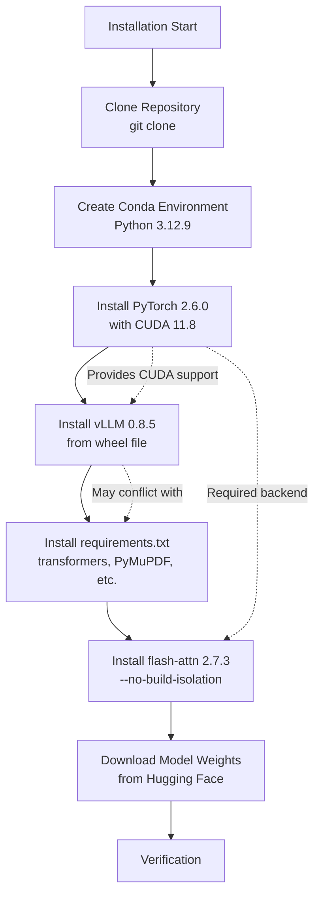
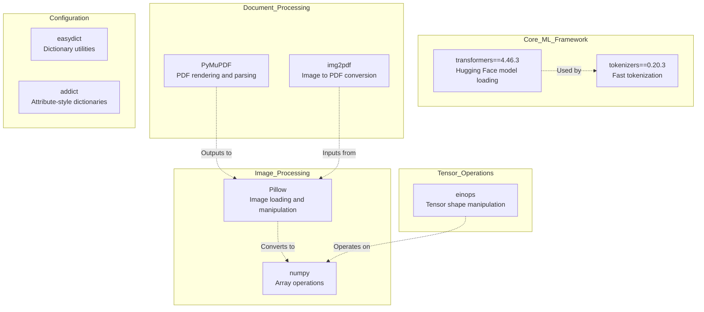

<!-- source: DeepWiki mcp.deepwiki.com · repo deepseek-ai/DeepSeek-OCR · page 2.1 Installation · fetched 2026-10-30 -->

# Installation

<details>
<summary>Relevant source files</summary>

The following files were used as context for generating this wiki page:

- [README.md](README.md)
- [requirements.txt](requirements.txt)

</details>


This page provides detailed instructions for installing DeepSeek-OCR and all required dependencies. Installation involves setting up a Python environment, installing GPU-accelerated deep learning libraries, and downloading the pre-trained model weights.

For instructions on running your first OCR inference after installation, see [Quick Start with Transformers]() or [Quick Start with vLLM](). For detailed configuration of the installed system, see [Configuration System]().

---

## Prerequisites

DeepSeek-OCR requires a CUDA-compatible GPU environment for inference. The system has been tested with the following specifications:

| Component | Requirement | Notes |
|-----------|-------------|-------|
| **CUDA Version** | 11.8 | Required for GPU acceleration |
| **Python Version** | 3.12.9 | Tested version; 3.8+ may work |
| **GPU Memory** | ≥40GB recommended | A100-40G tested; smaller GPUs may work with reduced batch sizes |
| **Operating System** | Linux | Primary development platform |

**Sources:** [README.md:69-69]()

---

## Installation Flow Overview

The installation process follows a specific sequence to ensure compatibility between PyTorch, vLLM, and other dependencies:

### Installation Sequence Diagram


**Important:** The installation order is critical. Installing vLLM before PyTorch or flash-attention before other packages may cause compatibility issues.

**Sources:** [README.md:68-87]()

---

## Step 1: Clone Repository

Clone the DeepSeek-OCR repository from GitHub:

```bash
git clone https://github.com/deepseek-ai/DeepSeek-OCR.git
cd DeepSeek-OCR
```

This creates the following directory structure:

```
DeepSeek-OCR/
├── DeepSeek-OCR-master/
│   ├── DeepSeek-OCR-vllm/      # vLLM inference code
│   └── DeepSeek-OCR-hf/        # Transformers inference code
├── README.md
├── requirements.txt
└── assets/
```

**Sources:** [README.md:70-73]()

---

## Step 2: Create Conda Environment

Create a dedicated conda environment to isolate DeepSeek-OCR dependencies:

```bash
conda create -n deepseek-ocr python=3.12.9 -y
conda activate deepseek-ocr
```

The environment name `deepseek-ocr` can be customized, but all subsequent commands assume this environment is activated.

**Sources:** [README.md:74-78]()

---

## Step 3: Install Core Dependencies

### PyTorch with CUDA Support

Install PyTorch 2.6.0 with CUDA 11.8 support:

```bash
pip install torch==2.6.0 torchvision==0.21.0 torchaudio==2.6.0 --index-url https://download.pytorch.org/whl/cu118
```

This command:
- Installs PyTorch with CUDA 11.8 backend.
- Includes `torchvision` for image processing utilities.
- Uses the CUDA 11.8 wheel index for GPU acceleration.

**Sources:** [README.md:83-83]()

### vLLM Installation

vLLM 0.8.5 must be installed from a pre-built wheel file for CUDA 11.8 compatibility. Download the wheel from the [vLLM v0.8.5 release page](https://github.com/vllm-project/vllm/releases/tag/v0.8.5):

```bash
# Download the wheel file first (see link in README)
pip install vllm-0.8.5+cu118-cp38-abi3-manylinux1_x86_64.whl
```

Alternatively, for the upstream version of vLLM (supporting `NGramPerReqLogitsProcessor`), use the nightly build:

```bash
uv pip install -U vllm --pre --extra-index-url https://wheels.vllm.ai/nightly
```

**Sources:** [README.md:81-84](), [README.md:109-115]()

---

## Step 4: Install Python Dependencies

Install the remaining Python packages from `requirements.txt`:

```bash
pip install -r requirements.txt
```

### Dependency Map


| Package | Version | Purpose in DeepSeek-OCR |
|---------|---------|-------------------------|
| `transformers` | 4.46.3 | Model loading, tokenization, Hugging Face integration |
| `tokenizers` | 0.20.3 | Fast text tokenization backend |
| `PyMuPDF` | Latest | PDF document rendering to images |
| `img2pdf` | Latest | Converting image outputs to PDF format |
| `einops` | Latest | Tensor manipulation in vision encoders |
| `easydict` / `addict` | Latest | Configuration management utilities |
| `Pillow` | Latest | Image loading and preprocessing |
| `numpy` | Latest | Numerical array operations |

**Important Compatibility Note:** The README warns about a potential version conflict:
> "if you want vLLM and transformers codes to run in the same environment, you don't need to worry about this installation error like: vllm 0.8.5+cu118 requires transformers>=4.51.1"

This warning indicates that while vLLM 0.8.5 officially requests a newer `transformers`, the project is verified to work with `transformers==4.46.3`.

**Sources:** [README.md:85-88](), [requirements.txt:1-10]()

---

## Step 5: Install Flash Attention

Flash Attention 2.7.3 provides optimized memory-efficient attention mechanisms:

```bash
pip install flash-attn==2.7.3 --no-build-isolation
```

The `--no-build-isolation` flag is critical:
- Allows the build process to access the conda environment's CUDA libraries.
- Flash Attention is used in the Transformers inference path when `_attn_implementation='flash_attention_2'` is specified.

**Sources:** [README.md:86-86](), [README.md:175-175]()

---

## Step 6: Download Model Weights

DeepSeek-OCR model weights are hosted on Hugging Face Hub at [`deepseek-ai/DeepSeek-OCR`](https://huggingface.co/deepseek-ai/DeepSeek-OCR).

### Automatic Download
When using the Transformers API, weights download automatically on first use:

```python
from transformers import AutoModel, AutoTokenizer

model_name = 'deepseek-ai/DeepSeek-OCR'
tokenizer = AutoTokenizer.from_pretrained(model_name, trust_remote_code=True)
model = AutoModel.from_pretrained(model_name, _attn_implementation='flash_attention_2', trust_remote_code=True, use_safetensors=True)
```

**Sources:** [README.md:168-175]()

---

## Installation Verification

### File Structure Check
After installation, verify the presence of key execution scripts:

```
DeepSeek-OCR/
├── DeepSeek-OCR-master/
│   ├── DeepSeek-OCR-vllm/
│   │   ├── run_dpsk_ocr_image.py
│   │   ├── run_dpsk_ocr_pdf.py
│   │   ├── run_dpsk_ocr_eval_batch.py
│   │   └── config.py
│   └── DeepSeek-OCR-hf/
│       └── run_dpsk_ocr.py
```

**Sources:** [README.md:94-106](), [README.md:187-188]()

### Quick Test: Transformers API
Verify the Transformers installation path:

```python
import torch
from transformers import AutoModel, AutoTokenizer

# Check CUDA availability
assert torch.cuda.is_available(), "CUDA not available"
print(f"CUDA version: {torch.version.cuda}")

# Load model
model_name = 'deepseek-ai/DeepSeek-OCR'
tokenizer = AutoTokenizer.from_pretrained(model_name, trust_remote_code=True)
model = AutoModel.from_pretrained(model_name, _attn_implementation='flash_attention_2', trust_remote_code=True, use_safetensors=True)
model = model.eval().cuda().to(torch.bfloat16)

print("✓ Model loaded successfully")
```

**Sources:** [README.md:168-176]()

---

## Troubleshooting Common Issues

### Issue: vLLM Transformer Version Warning
**Symptom:** `WARNING: vllm 0.8.5+cu118 requires transformers>=4.51.1`
**Solution:** This warning can be safely ignored. The codebase is tested with `transformers==4.46.3`.

### Issue: CUDA Version Mismatch
**Symptom:** `RuntimeError: CUDA error: no kernel image is available for execution`
**Solution:** Reinstall PyTorch with the correct CUDA 11.8 index:
```bash
pip install torch==2.6.0 --index-url https://download.pytorch.org/whl/cu118
```

**Sources:** [README.md:83-88]()

---

