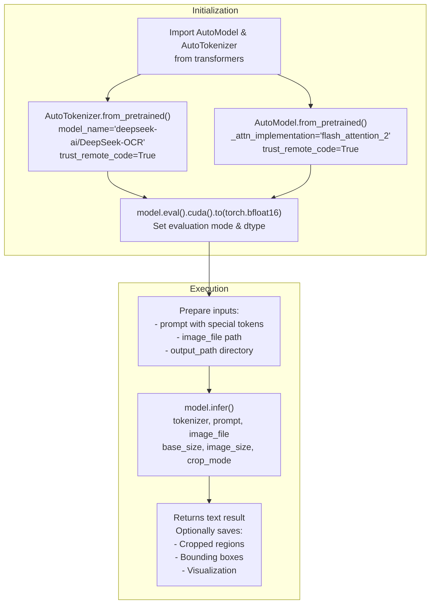
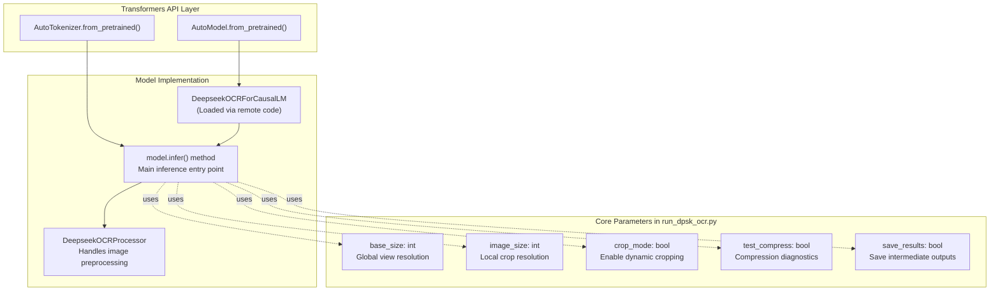

<!-- source: DeepWiki mcp.deepwiki.com · repo deepseek-ai/DeepSeek-OCR · page 2.2 Quick Start with Transformers · fetched 2026-10-30 -->

# Quick Start with Transformers

<details>
<summary>Relevant source files</summary>

The following files were used as context for generating this wiki page:

- [DeepSeek-OCR-master/DeepSeek-OCR-hf/run_dpsk_ocr.py](DeepSeek-OCR-master/DeepSeek-OCR-hf/run_dpsk_ocr.py)
- [README.md](README.md)

</details>


This page provides a minimal working example for using DeepSeek-OCR with the HuggingFace Transformers interface. This approach is recommended for research, experimentation, and scenarios requiring fine-grained control over model parameters. For production deployments focused on throughput, see [Quick Start with vLLM](#2.3). For comprehensive parameter documentation, see [Transformers Inference](#3.1).

---

## Prerequisites

Before proceeding with this quick start, ensure you have completed the installation steps described in [Installation](#2.1). The Transformers interface requires:

- **Python**: 3.12.9+ [README.md:76-76]()
- **PyTorch**: 2.6.0 with CUDA 11.8 [README.md:83-83]()
- **Libraries**: `transformers`, `flash-attn==2.7.3` [README.md:85-86]()
- **Model**: Access to `deepseek-ai/DeepSeek-OCR` on HuggingFace Hub [README.md:172-172]()

**Sources**: [README.md:67-86](), [README.md:172-172]()

---

## Minimal Working Example

The following example demonstrates the core workflow for processing a single image using the Transformers interface:

```python
from transformers import AutoModel, AutoTokenizer
import torch
import os

os.environ["CUDA_VISIBLE_DEVICES"] = '0'
model_name = 'deepseek-ai/DeepSeek-OCR'

# Load tokenizer and model with remote code trust enabled
tokenizer = AutoTokenizer.from_pretrained(model_name, trust_remote_code=True)
model = AutoModel.from_pretrained(
    model_name, 
    _attn_implementation='flash_attention_2', 
    trust_remote_code=True, 
    use_safetensors=True
)
model = model.eval().cuda().to(torch.bfloat16)

# Define task and inputs
prompt = "<image>\n<|grounding|>Convert the document to markdown. "
image_file = 'your_image.jpg'
output_path = 'your/output/dir'

# Execute inference
res = model.infer(
    tokenizer, 
    prompt=prompt, 
    image_file=image_file, 
    output_path=output_path, 
    base_size=1024, 
    image_size=640, 
    crop_mode=True, 
    save_results=True, 
    test_compress=True
)
```

**Sources**: [README.md:166-183](), [DeepSeek-OCR-master/DeepSeek-OCR-hf/run_dpsk_ocr.py:1-34]()

---

## Code Walkthrough

### Transformers Inference Workflow

The diagram below illustrates the data flow from initialization to the final OCR output using the `model.infer()` method.



**Sources**: [README.md:166-183](), [DeepSeek-OCR-master/DeepSeek-OCR-hf/run_dpsk_ocr.py:1-34]()

### Component Mapping

This diagram maps high-level system concepts to specific classes and methods found in the codebase.



**Sources**: [README.md:166-183](), [DeepSeek-OCR-master/DeepSeek-OCR-hf/run_dpsk_ocr.py:1-34]()

---

## Resolution Modes

The `model.infer()` method supports multiple resolution configurations by adjusting `base_size`, `image_size`, and `crop_mode`. These settings directly impact the number of vision tokens generated.

| Mode | `base_size` | `image_size` | `crop_mode` | Vision Tokens | Use Case |
|------|-------------|--------------|-------------|---------------|----------|
| **Tiny** | 512 | 512 | False | 64 | Minimal resource usage [README.md:193]() |
| **Small** | 640 | 640 | False | 100 | Lightweight processing [README.md:194]() |
| **Base** | 1024 | 1024 | False | 256 | Standard single-scale [README.md:195]() |
| **Large** | 1280 | 1280 | False | 400 | High-resolution single-scale [README.md:196]() |
| **Gundam** ⭐ | 1024 | 640 | True | Variable | **Recommended default** [README.md:198]() |

### Gundam Mode (Recommended)

The Gundam mode implements **dynamic resolution** via an asymmetric cropping strategy:
- **Global view**: A `base_size` × `base_size` (1024×1024) version provides document-level context. [DeepSeek-OCR-master/DeepSeek-OCR-hf/run_dpsk_ocr.py:32]()
- **Local crops**: Multiple `image_size` × `image_size` (640×640) tiles preserve fine-grained details. [DeepSeek-OCR-master/DeepSeek-OCR-hf/run_dpsk_ocr.py:32]()
- **Adaptive**: The number of crops is determined dynamically based on the image aspect ratio. [README.md:198]()

**Sources**: [README.md:192-198](), [DeepSeek-OCR-master/DeepSeek-OCR-hf/run_dpsk_ocr.py:26-33]()

---

## Key Parameters

### Core Inference Parameters

The `model.infer()` signature allows for granular control over the OCR process.

| Parameter | Type | Default | Description |
|-----------|------|---------|-------------|
| `tokenizer` | `AutoTokenizer` | Required | Tokenizer instance for text processing [DeepSeek-OCR-master/DeepSeek-OCR-hf/run_dpsk_ocr.py:25]() |
| `prompt` | `str` | Required | Task prompt with special tokens [DeepSeek-OCR-master/DeepSeek-OCR-hf/run_dpsk_ocr.py:25]() |
| `image_file` | `str` | Required | Path to input image file [DeepSeek-OCR-master/DeepSeek-OCR-hf/run_dpsk_ocr.py:25]() |
| `output_path` | `str` | `' '` | Directory for saving intermediate results [DeepSeek-OCR-master/DeepSeek-OCR-hf/run_dpsk_ocr.py:25]() |
| `base_size` | `int` | 1024 | Resolution for global view processing [DeepSeek-OCR-master/DeepSeek-OCR-hf/run_dpsk_ocr.py:25]() |
| `image_size` | `int` | 640 | Resolution for local crop processing [DeepSeek-OCR-master/DeepSeek-OCR-hf/run_dpsk_ocr.py:25]() |
| `crop_mode` | `bool` | True | Enable dynamic multi-scale cropping [DeepSeek-OCR-master/DeepSeek-OCR-hf/run_dpsk_ocr.py:25]() |
| `test_compress` | `bool` | False | Enable compression ratio diagnostics [DeepSeek-OCR-master/DeepSeek-OCR-hf/run_dpsk_ocr.py:25]() |
| `save_results` | `bool` | False | Save cropped regions and visualizations [DeepSeek-OCR-master/DeepSeek-OCR-hf/run_dpsk_ocr.py:25]() |

**Sources**: [README.md:182-183](), [DeepSeek-OCR-master/DeepSeek-OCR-hf/run_dpsk_ocr.py:25-34]()

### Special Tokens in Prompts

Prompts must include the `<image>` placeholder to mark the vision embedding insertion point. [README.md:179]()

- `<image>`: Vision embedding placeholder. [README.md:179]()
- `<|grounding|>`: Triggers spatial output (coordinates/bounding boxes). [README.md:179]()
- `<|ref|>...<|/ref|>`: Used for text localization (REC) tasks. [README.md:207]()

**Example prompts**:
```python
# Markdown conversion with grounding
"<image>\n<|grounding|>Convert the document to markdown. "

# General OCR
"<image>\nFree OCR. "

# Detailed description
"<image>\nDescribe this image in detail. "
```

**Sources**: [README.md:179-179](), [README.md:201-209]()

---

## Flash Attention Configuration

The example explicitly specifies `_attn_implementation='flash_attention_2'` when loading the model to optimize performance. [README.md:175]()

```python
model = AutoModel.from_pretrained(
    model_name, 
    _attn_implementation='flash_attention_2', 
    trust_remote_code=True, 
    use_safetensors=True
)
```

Flash Attention 2 provides memory efficiency and speed improvements, essential for processing high-resolution images or multi-crop Gundam mode. This requires the `flash-attn` package. [README.md:86]()

**Sources**: [README.md:86-86](), [README.md:175-175](), [DeepSeek-OCR-master/DeepSeek-OCR-hf/run_dpsk_ocr.py:13-13]()

---

## Next Steps

- **Detailed Configuration**: See [Transformers Inference](#3.1) for comprehensive parameter documentation.
- **Batch Processing**: See [Batch Evaluation](#3.2.3) for processing multiple images efficiently.
- **vLLM Comparison**: See [Quick Start with vLLM](#2.3) for production-optimized inference.
- **Custom Prompts**: See [Working with Prompts](#3.4) for task-specific prompt engineering.
- **Output Parsing**: See [Understanding Output](#3.5) for extracting structured information.

**Sources**: [README.md:58-62]()

---

