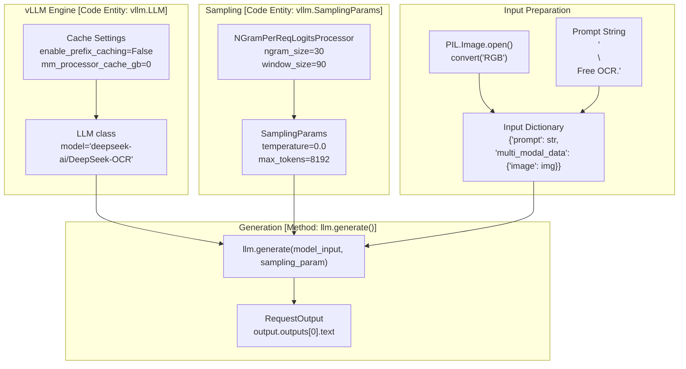
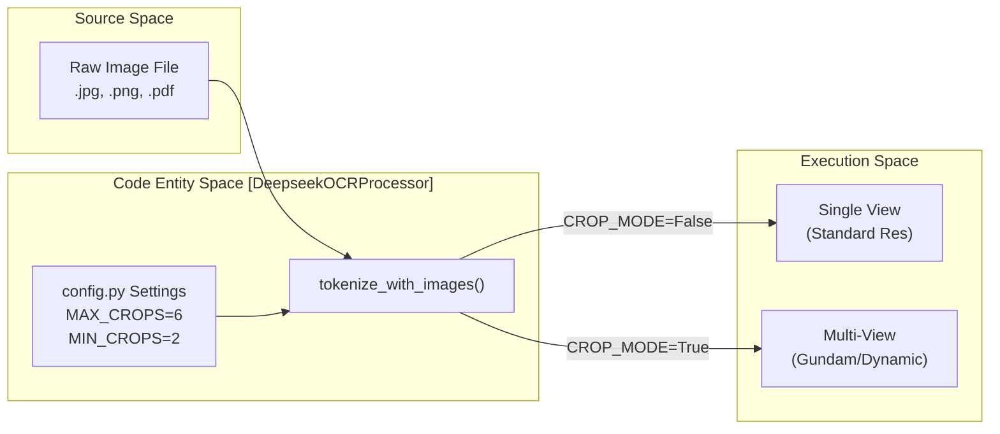

<!-- source: DeepWiki mcp.deepwiki.com · repo deepseek-ai/DeepSeek-OCR · page 2.3 Quick Start with vLLM · fetched 2026-10-30 -->

# Quick Start with vLLM

<details>
<summary>Relevant source files</summary>

The following files were used as context for generating this wiki page:

- [DeepSeek-OCR-master/DeepSeek-OCR-vllm/config.py](DeepSeek-OCR-master/DeepSeek-OCR-vllm/config.py)
- [README.md](README.md)

</details>


This page provides a minimal working example for running DeepSeek-OCR inference using the vLLM framework. vLLM is optimized for high-throughput production serving with efficient memory management, batching, and optional streaming output. It achieves approximately 2500 tokens/s on an A100-40G GPU for PDF processing.

For research and development with fine-grained control over inference parameters, see [Quick Start with Transformers](#2.2). For detailed configuration options and performance tuning, see [Configuration System](#3.3). For production workflows including PDF and batch processing, see [vLLM Inference](#3.2).

**Sources**: [README.md:55-56](), [README.md:90-103]()

---

## Basic vLLM Inference

### Minimal Example

The simplest way to run inference with vLLM uses the synchronous `LLM` class with batched input. This approach utilizes the upstream vLLM integration (v0.11.1+), where the model is registered as `deepseek-ai/DeepSeek-OCR`.

```python
from vllm import LLM, SamplingParams
from vllm.model_executor.models.deepseek_ocr import NGramPerReqLogitsProcessor
from PIL import Image

# Initialize model
llm = LLM(
    model="deepseek-ai/DeepSeek-OCR",
    enable_prefix_caching=False,
    mm_processor_cache_gb=0,
    logits_processors=[NGramPerReqLogitsProcessor]
)

# Load images
image_1 = Image.open("path/to/image_1.png").convert("RGB")
image_2 = Image.open("path/to/image_2.png").convert("RGB")
prompt = "<image>\nFree OCR."

# Prepare batched input
model_input = [
    {
        "prompt": prompt,
        "multi_modal_data": {"image": image_1}
    },
    {
        "prompt": prompt,
        "multi_modal_data": {"image": image_2}
    }
]

# Configure sampling
sampling_param = SamplingParams(
    temperature=0.0,
    max_tokens=8192,
    # ngram logit processor args
    extra_args=dict(
        ngram_size=30,
        window_size=90,
        whitelist_token_ids={128821, 128822},  # whitelist: <td>, </td>
    ),
    skip_special_tokens=False,
)

# Generate output
model_outputs = llm.generate(model_input, sampling_param)

# Print output
for output in model_outputs:
    print(output.outputs[0].text)
```

**Sources**: [README.md:118-164]()

---

## vLLM Inference Workflow

The following diagram maps the high-level inference workflow to specific code entities within the vLLM framework.

### Logic to Code Mapping: vLLM Inference
| System Concept | Code Entity | File Reference |
| :--- | :--- | :--- |
| Model Runner | `vllm.LLM` | [README.md:124]() |
| Generation Config | `vllm.SamplingParams` | [README.md:147]() |
| Repetition Control | `NGramPerReqLogitsProcessor` | [README.md:120]() |
| Data Container | `multi_modal_data` | [README.md:139]() |



**Sources**: [README.md:118-164]()

---

## Configuration and Modes

The vLLM implementation supports multiple resolution modes, defined by `BASE_SIZE`, `IMAGE_SIZE`, and `CROP_MODE`. These are typically configured in the local `config.py`.

### Supported Modes
| Mode | Base Size | Image Size | Crop Mode | Vision Tokens |
| :--- | :--- | :--- | :--- | :--- |
| **Tiny** | 512 | 512 | False | 64 |
| **Small** | 640 | 640 | False | 100 |
| **Base** | 1024 | 1024 | False | 256 |
| **Large** | 1280 | 1280 | False | 400 |
| **Gundam** | 1024 | 640 | True | Dynamic |

**Sources**: [DeepSeek-OCR-master/DeepSeek-OCR-vllm/config.py:1-10](), [README.md:191-198]()

### Image Preprocessing Pipeline

When using the local scripts in `DeepSeek-OCR-vllm/`, images are handled via the `DeepseekOCRProcessor`.



**Sources**: [DeepSeek-OCR-master/DeepSeek-OCR-vllm/config.py:8-12](), [README.md:191-198]()

---

## Local vLLM Scripts

The repository provides three entry point scripts for different use cases within the `DeepSeek-OCR-vllm` directory.

| Script | Purpose |
| :--- | :--- |
| `run_dpsk_ocr_image.py` | Single image processing with streaming output support. |
| `run_dpsk_ocr_pdf.py` | Multi-page PDF processing with high concurrency (~2500 tokens/s). |
| `run_dpsk_ocr_eval_batch.py` | Batch evaluation for benchmarks like Omnidocbench. |

**Usage Example**:
```bash
cd DeepSeek-OCR-master/DeepSeek-OCR-vllm
# Edit config.py to set INPUT_PATH and OUTPUT_PATH
python run_dpsk_ocr_image.py
```

**Sources**: [README.md:91-107](), [DeepSeek-OCR-master/DeepSeek-OCR-vllm/config.py:19-25]()

---

## Key Configuration Parameters

The `config.py` file controls both the vision processing and the vLLM engine resource allocation.

### Resource Management
- `MAX_CONCURRENCY`: Controls the number of concurrent requests. Lower this if GPU memory is limited. [DeepSeek-OCR-master/DeepSeek-OCR-vllm/config.py:13]()
- `NUM_WORKERS`: Number of CPU workers for image preprocessing (resize/padding). [DeepSeek-OCR-master/DeepSeek-OCR-vllm/config.py:14]()
- `MAX_CROPS`: Maximum number of crops for Gundam mode (default 6, max 9). [DeepSeek-OCR-master/DeepSeek-OCR-vllm/config.py:12]()

### Sampling and Logits
The `NGramPerReqLogitsProcessor` (or `NoRepeatNGramLogitsProcessor` in some versions) is used to prevent repetitive text generation, which is common in OCR tasks.

- `ngram_size`: The size of the n-gram to check for repetition (e.g., 30). [README.md:152]()
- `window_size`: The look-back window for checking repetitions (e.g., 90). [README.md:153]()
- `whitelist_token_ids`: Tokens exempt from the repetition penalty, such as HTML tags `<td>` (128821) and `</td>` (128822). [README.md:154]()

**Sources**: [DeepSeek-OCR-master/DeepSeek-OCR-vllm/config.py:11-14](), [README.md:147-157]()

---

## Next Steps

- For detailed vLLM usage patterns, see [vLLM Inference](#3.2)
- For configuration options and performance tuning, see [Configuration System](#3.3)
- For prompt engineering and task-specific examples, see [Working with Prompts](#3.4)
- For processing PDF documents, see [PDF Document Processing](#3.2.2)
- For batch evaluation workflows, see [Batch Evaluation](#3.2.3)

---

