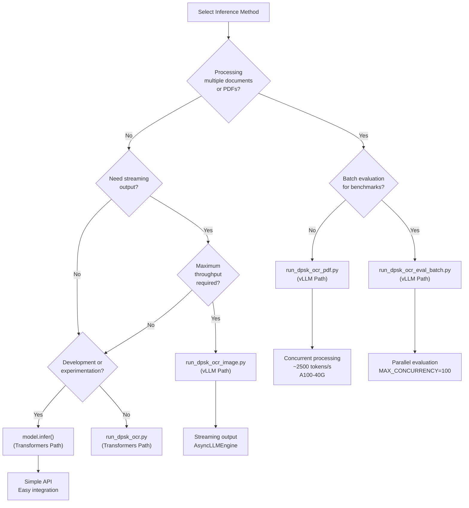
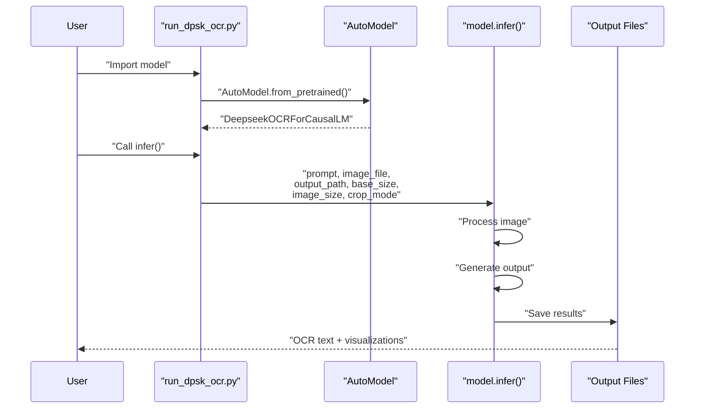
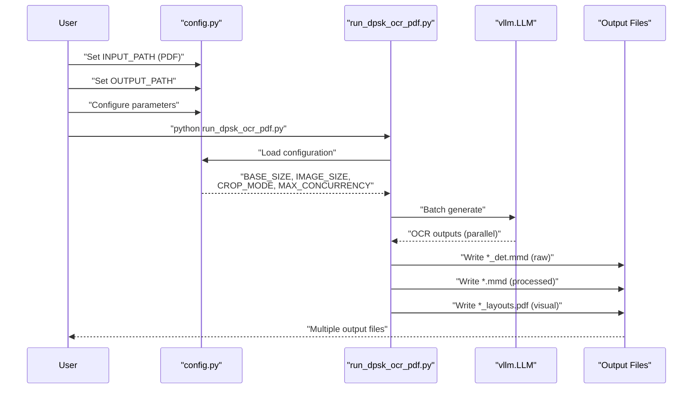
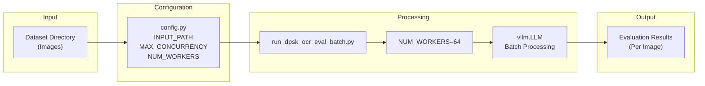
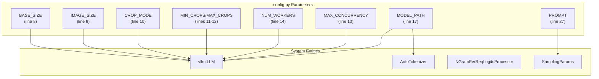

<!-- source: DeepWiki mcp.deepwiki.com · repo deepseek-ai/DeepSeek-OCR · page 3 User Guide · fetched 2026-10-30 -->

# User Guide

<details>
<summary>Relevant source files</summary>

The following files were used as context for generating this wiki page:

- [DeepSeek-OCR-master/DeepSeek-OCR-vllm/config.py](DeepSeek-OCR-master/DeepSeek-OCR-vllm/config.py)
- [README.md](README.md)

</details>


This page provides a comprehensive guide for using DeepSeek-OCR in various scenarios. It covers the two main inference pathways (Transformers and vLLM), configuration options, prompt engineering, and output interpretation.

For installation instructions and first-time setup, see [Getting Started](#2). For deep technical details on the model architecture, see [Architecture](#4). For developers extending the system, see [Developer Guide](#5).

## Overview

DeepSeek-OCR provides two distinct inference pathways optimized for different use cases:

1.  **Transformers Inference** ([Transformers Inference](#3.1)) - Standard HuggingFace interface for development, experimentation, and single-image processing.
2.  **vLLM Inference** ([vLLM Inference](#3.2)) - High-throughput GPU-optimized path for production workloads, batch processing, and PDF documents.

Both pathways use the same underlying model architecture but provide different execution environments and APIs. The system is highly configurable through a centralized configuration file and supports multiple operational modes for different resolution/performance trade-offs.

## Inference Pathway Selection

The following decision tree helps determine which inference pathway to use:

Title: Inference Selection Logic


**Key Differences:**

| Aspect | Transformers | vLLM |
| :--- | :--- | :--- |
| **Entry Point** | `model.infer()` method | Script execution (`run_dpsk_ocr_*.py`) |
| **Configuration** | Function parameters | [DeepSeek-OCR-master/DeepSeek-OCR-vllm/config.py:1-43]() |
| **Output Mode** | Synchronous | Streaming or batch |
| **Throughput** | Standard | High (~2500 tokens/s) |
| **GPU Memory** | Standard | Optimized |
| **Use Case** | Development, single images | Production, PDFs, batches |

Sources: [README.md:90-107](), [DeepSeek-OCR-master/DeepSeek-OCR-vllm/config.py:1-43]()

## Common Usage Workflows

### Workflow 1: Single Image OCR (Transformers)

Title: Transformers Inference Workflow


**Code Reference:**
```python
# [README.md:168-183]()
model = AutoModel.from_pretrained(model_name, 
    _attn_implementation='flash_attention_2', 
    trust_remote_code=True)

res = model.infer(tokenizer, 
    prompt="<image>\n<|grounding|>Convert the document to markdown. ", 
    image_file='your_image.jpg', 
    output_path='your/output/dir', 
    base_size=1024, 
    image_size=640, 
    crop_mode=True)
```

Sources: [README.md:168-183]()

### Workflow 2: PDF Document Processing (vLLM)

Title: vLLM PDF Pipeline


**Configuration Required:**
*   [DeepSeek-OCR-master/DeepSeek-OCR-vllm/config.py:24]() - `INPUT_PATH`: Path to PDF file.
*   [DeepSeek-OCR-master/DeepSeek-OCR-vllm/config.py:25]() - `OUTPUT_PATH`: Directory for outputs.
*   [DeepSeek-OCR-master/DeepSeek-OCR-vllm/config.py:8-12]() - Resolution and cropping settings.
*   [DeepSeek-OCR-master/DeepSeek-OCR-vllm/config.py:13]() - `MAX_CONCURRENCY`: Batch size control.

Sources: [README.md:100-103](), [DeepSeek-OCR-master/DeepSeek-OCR-vllm/config.py:1-43]()

### Workflow 3: Batch Evaluation (vLLM)

Title: Batch Evaluation Architecture


**Key Parameters:**
*   [DeepSeek-OCR-master/DeepSeek-OCR-vllm/config.py:13]() - `MAX_CONCURRENCY=100`: GPU memory-limited batch size.
*   [DeepSeek-OCR-master/DeepSeek-OCR-vllm/config.py:14]() - `NUM_WORKERS=64`: CPU-bound preprocessing parallelism.

Sources: [README.md:104-107](), [DeepSeek-OCR-master/DeepSeek-OCR-vllm/config.py:13-14]()

## Operational Modes

DeepSeek-OCR supports five operational modes that trade off between vision token count, image resolution, and GPU memory usage:

| Mode | Base Size | Image Size | Crop Mode | Vision Tokens | Use Case |
| :--- | :--- | :--- | :--- | :--- | :--- |
| **Tiny** | 512 | 512 | False | 64 | Extremely fast, low memory |
| **Small** | 640 | 640 | False | 100 | Quick processing |
| **Base** | 1024 | 1024 | False | 256 | Balanced |
| **Large** | 1280 | 1280 | False | 400 | High resolution |
| **Gundam** ⭐ | 1024 | 640 | True | 256 + n×100 | Adaptive, production-ready |

**Current Active Mode (Gundam):**
```python
# [DeepSeek-OCR-master/DeepSeek-OCR-vllm/config.py:8-12]()
BASE_SIZE = 1024      # Global view resolution
IMAGE_SIZE = 640      # Local crop resolution  
CROP_MODE = True      # Enable dynamic cropping
MIN_CROPS = 2         # Minimum number of crops
MAX_CROPS = 6         # Maximum crops (GPU memory limited)
```

The **Gundam mode** is recommended for production use. It processes images with one global view and multiple local crops.

Sources: [DeepSeek-OCR-master/DeepSeek-OCR-vllm/config.py:1-12](), [README.md:191-199]()

## Configuration-to-Code Mapping

The following diagram shows how configuration parameters in `config.py` affect system components:

Title: Config Entity Space Mapping


**Parameter Effects:**
*   **BASE_SIZE, IMAGE_SIZE**: Control vision encoder input dimensions.
*   **CROP_MODE**: Enables/disables dynamic cropping for multi-crop processing.
*   **MAX_CONCURRENCY**: Limits vLLM engine batch size to prevent GPU OOM.
*   **NUM_WORKERS**: Controls workers for image pre-processing (resize/padding).

Sources: [DeepSeek-OCR-master/DeepSeek-OCR-vllm/config.py:1-43]()

## Prompt Engineering

DeepSeek-OCR uses task-specific prompts to control output format and behavior.

### Common Prompt Templates

| Task | Prompt | Grounding |
| :--- | :--- | :--- |
| **Document Markdown** | `<image>\n<|grounding|>Convert the document to markdown.` | Yes |
| **General OCR** | `<image>\n<|grounding|>OCR this image.` | Yes |
| **Free OCR** | `<image>\nFree OCR.` | No |
| **Figure Parsing** | `<image>\nParse the figure.` | No |
| **Image Description** | `<image>\nDescribe this image in detail.` | No |
| **Text Localization** | `<image>\nLocate <|ref|>xxxx<|/ref|> in the image.` | Yes |

**Special Tokens:**
*   `<image>`: Required placeholder for image input.
*   `<|grounding|>`: Enables detection tags and coordinate output.
*   `<|ref|>...<|/ref|>`: Used to mark reference text for localization.

For detailed prompt usage and examples, see [Working with Prompts](#3.4).

Sources: [DeepSeek-OCR-master/DeepSeek-OCR-vllm/config.py:27-37](), [README.md:200-209]()

## Output Formats

The system generates different output formats depending on the inference pathway:

### Transformers Output
When using `model.infer()`:
*   **Text file**: Contains raw OCR output.
*   **Visualization**: Image with optional bounding boxes if `save_results=True`.

### vLLM Output
*   **Single Image**: Streaming output via `run_dpsk_ocr_image.py`.
*   **PDF Processing**: Generates `.mmd` (markdown), `_det.mmd` (raw with tags), and `_layouts.pdf` (visualizations).

### vLLM Specific: NGram Logits Processor
For vLLM inference, a specialized `NGramPerReqLogitsProcessor` is used to handle repetitive structures like table tags:
*   `ngram_size`: Size of n-gram to check.
*   `window_size`: Lookback window.
*   `whitelist_token_ids`: Tokens exempt from repetition penalties (e.g., `<td>`, `</td>`).

Sources: [README.md:96-107](), [README.md:119-164]()

## Next Steps

*   **For Transformers usage details**: See [Transformers Inference](#3.1)
*   **For vLLM usage details**: See [vLLM Inference](#3.2)
*   **For configuration tuning**: See [Configuration System](#3.3)
*   **For prompt examples**: See [Working with Prompts](#3.4)
*   **For output processing**: See [Understanding Output](#3.5)

---

