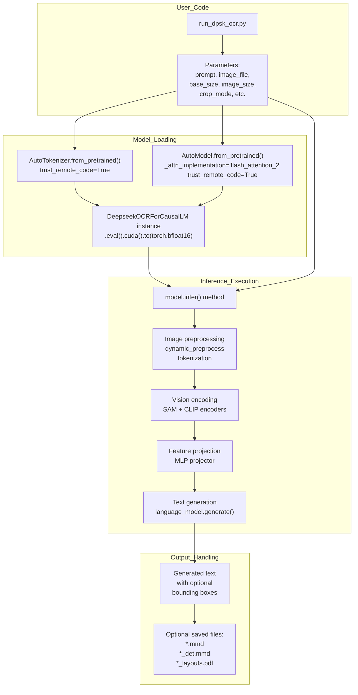
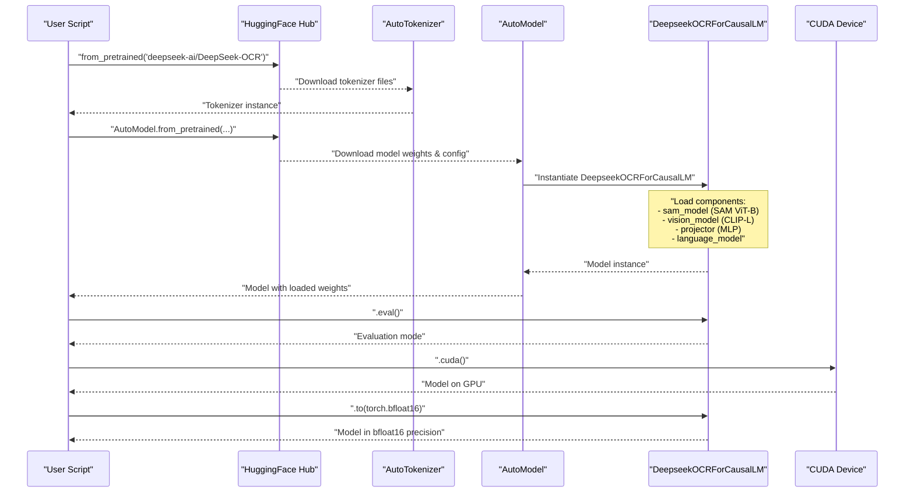
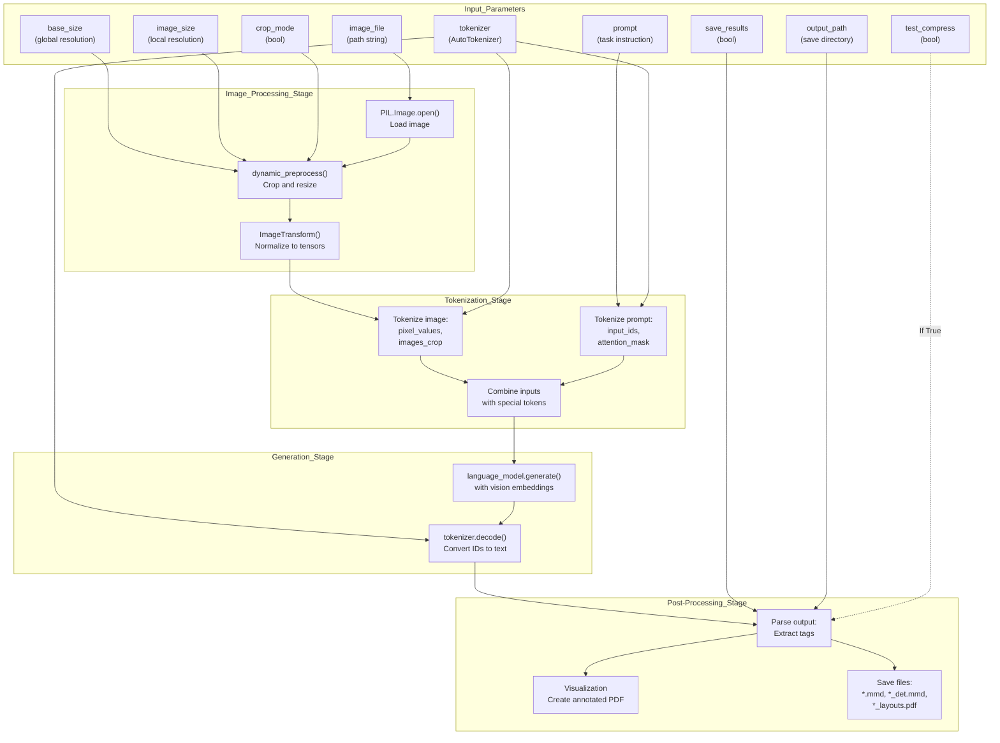

<!-- source: DeepWiki mcp.deepwiki.com · repo deepseek-ai/DeepSeek-OCR · page 3.1 Transformers Inference · fetched 2026-10-30 -->

# Transformers Inference

<details>
<summary>Relevant source files</summary>

The following files were used as context for generating this wiki page:

- [DeepSeek-OCR-master/DeepSeek-OCR-hf/run_dpsk_ocr.py](DeepSeek-OCR-master/DeepSeek-OCR-hf/run_dpsk_ocr.py)
- [README.md](README.md)

</details>


## Purpose and Scope

This page provides comprehensive documentation for using DeepSeek-OCR through the Transformers library interface. The Transformers inference pathway offers a standard HuggingFace-compatible API that is ideal for development, experimentation, and integration with existing ML workflows. It uses the `model.infer()` method as the primary inference interface.

For production deployments requiring high throughput and concurrent processing, see **3.2 vLLM Inference**. For a quick introduction to get started, see **2.2 Quick Start with Transformers**. For architectural details about how the model processes inputs, see **4.2 Model Architecture**.

**Sources:** [README.md:165-189](), [DeepSeek-OCR-master/DeepSeek-OCR-hf/run_dpsk_ocr.py:1-35]()

---

## Overview

The Transformers inference pathway provides a synchronous, easy-to-use interface for OCR tasks. It loads the model using HuggingFace's `AutoModel` and `AutoTokenizer` classes with custom remote code, enabling Flash Attention 2 for efficient computation. The inference is performed through a single `model.infer()` call that handles image preprocessing, tokenization, model forward pass, and output generation.

### Transformers Inference Flow



**Sources:** [DeepSeek-OCR-master/DeepSeek-OCR-hf/run_dpsk_ocr.py:1-35](), [README.md:167-183]()

---

## Basic Setup

### Model Loading

The Transformers interface requires loading both a tokenizer and model using HuggingFace's auto-loading utilities. The model must be moved to the GPU and cast to `bfloat16` for optimal performance.

```python
from transformers import AutoModel, AutoTokenizer
import torch
import os

os.environ["CUDA_VISIBLE_DEVICES"] = '0'

model_name = 'deepseek-ai/DeepSeek-OCR'

tokenizer = AutoTokenizer.from_pretrained(
    model_name, 
    trust_remote_code=True
)

model = AutoModel.from_pretrained(
    model_name, 
    _attn_implementation='flash_attention_2', 
    trust_remote_code=True, 
    use_safetensors=True
)

model = model.eval().cuda().to(torch.bfloat16)
```

Key loading parameters:
- `trust_remote_code=True`: Required to load custom model code (e.g., `DeepseekOCRForCausalLM`) from the repository. [README.md:174-175]()
- `_attn_implementation='flash_attention_2'`: Enables Flash Attention 2 for efficient memory usage. [README.md:175]()
- `use_safetensors=True`: Loads weights from the safer `safetensors` format. [README.md:175]()
- `.eval()`: Sets model to evaluation mode. [README.md:176]()
- `.cuda().to(torch.bfloat16)`: Moves model to GPU with `bfloat16` precision. [README.md:176]()

**Sources:** [DeepSeek-OCR-master/DeepSeek-OCR-hf/run_dpsk_ocr.py:1-14](), [README.md:167-176]()

### Initialization Sequence



**Sources:** [DeepSeek-OCR-master/DeepSeek-OCR-hf/run_dpsk_ocr.py:9-14](), [README.md:174-176]()

---

## The `model.infer` API

The primary interface for Transformers inference is the `model.infer()` method. This method encapsulates the entire inference pipeline from image loading to text generation.

### Method Signature

```python
def infer(
    self, 
    tokenizer, 
    prompt='', 
    image_file='', 
    output_path=' ', 
    base_size=1024, 
    image_size=640, 
    crop_mode=True, 
    test_compress=False, 
    save_results=False
)
```

### Parameters Reference

| Parameter | Type | Default | Description |
|-----------|------|---------|-------------|
| `tokenizer` | `AutoTokenizer` | *Required* | The tokenizer instance loaded with `AutoTokenizer.from_pretrained()` |
| `prompt` | `str` | `''` | Task instruction prompt (e.g., `"<image>\n<|grounding|>Convert the document to markdown."`) |
| `image_file` | `str` | `''` | Path to input image file (JPG, PNG, etc.) |
| `output_path` | `str` | `' '` | Directory path for saving output files |
| `base_size` | `int` | `1024` | Resolution for the global view of the image (width/height after resize) |
| `image_size` | `int` | `640` | Resolution for local cropped views (when `crop_mode=True`) |
| `crop_mode` | `bool` | `True` | Whether to use dynamic cropping for multi-scale processing |
| `test_compress` | `bool` | `False` | Whether to calculate and display token compression statistics |
| `save_results` | `bool` | `False` | Whether to save output files to disk |

**Sources:** [DeepSeek-OCR-master/DeepSeek-OCR-hf/run_dpsk_ocr.py:25-34](), [README.md:183]()

### Return Value

The method returns a string containing the generated OCR output. The format depends on the prompt:
- Plain text transcription (with `"Free OCR"`) [README.md:204]()
- Markdown-formatted document (with `"Convert the document to markdown"`) [README.md:202]()
- Text with embedded bounding boxes using `<|ref|>` and `<|det|>` tags (with `<|grounding|>` prefix) [README.md:207]()

### Parameter Flow Diagram



**Sources:** [DeepSeek-OCR-master/DeepSeek-OCR-hf/run_dpsk_ocr.py:25-34](), [README.md:183]()

---

## Operational Modes

DeepSeek-OCR supports multiple operational modes that control image resolution and cropping strategy. These modes balance between vision token count (affecting memory/speed) and OCR accuracy.

### Mode Configuration Table

| Mode | `base_size` | `image_size` | `crop_mode` | Vision Tokens | Use Case |
|------|-------------|--------------|-------------|---------------|----------|
| **Tiny** | 512 | 512 | `False` | 64 | Fast preview, low-res [README.md:193]() |
| **Small** | 640 | 640 | `False` | 100 | Standard documents [README.md:194]() |
| **Base** | 1024 | 1024 | `False` | 256 | High-quality documents [README.md:195]() |
| **Large** | 1280 | 1280 | `False` | 400 | Very high resolution [README.md:196]() |
| **Gundam** | 1024 | 640 | `True` | Variable | Adaptive multi-scale [README.md:198]() |

**Note:** Gundam mode is the recommended configuration as it provides both global context (1024×1024 base) and high-resolution local details (640×640 crops). [DeepSeek-OCR-master/DeepSeek-OCR-hf/run_dpsk_ocr.py:32]()

**Sources:** [DeepSeek-OCR-master/DeepSeek-OCR-hf/run_dpsk_ocr.py:27-32](), [README.md:191-198]()

---

## Common Usage Patterns

### Basic OCR with Markdown Conversion

```python
prompt = "<image>\n<|grounding|>Convert the document to markdown. "
image_file = 'your_image.jpg'
output_path = 'your/output/dir'

res = model.infer(
    tokenizer, 
    prompt=prompt, 
    image_file=image_file, 
    output_path=output_path, 
    base_size=1024, 
    image_size=640, 
    crop_mode=True, 
    save_results=True, 
    test_compress=True
)
```

**Sources:** [DeepSeek-OCR-master/DeepSeek-OCR-hf/run_dpsk_ocr.py:19-34](), [README.md:179-183]()

### Prompt Variants

The model's behavior is heavily influenced by the prompt prefix:
- **General OCR:** `<image>\n<|grounding|>OCR this image.` [README.md:203]()
- **Layout-free:** `<image>\nFree OCR.` [README.md:204]()
- **Figure Parsing:** `<image>\nParse the figure.` [README.md:205]()
- **Grounding/Detection:** `<image>\nLocate <|ref|>xxxx<|/ref|> in the image.` [README.md:207]()

---

## Advanced Options

### Token Compression Statistics

When `test_compress=True`, the method calculates and displays token compression statistics, which helps in evaluating the efficiency of the vision-to-text transformation. [DeepSeek-OCR-master/DeepSeek-OCR-hf/run_dpsk_ocr.py:34]()

### Saving Results to Disk

When `save_results=True`, the method saves several artifacts to the specified `output_path`:
1. **Markdown Results:** The extracted text content.
2. **Detection Data:** Files containing coordinate information.
3. **Visualizations:** PDF files showing layout detection results. [DeepSeek-OCR-master/DeepSeek-OCR-hf/run_dpsk_ocr.py:34]()

### Entry Point Script

The repository provides a standalone script at [DeepSeek-OCR-master/DeepSeek-OCR-hf/run_dpsk_ocr.py]() for executing these inferences. It is configured by default to use the "Gundam" mode. [DeepSeek-OCR-master/DeepSeek-OCR-hf/run_dpsk_ocr.py:34](), [README.md:187-189]()

**Sources:** [DeepSeek-OCR-master/DeepSeek-OCR-hf/run_dpsk_ocr.py:1-35](), [README.md:165-189]()

---

