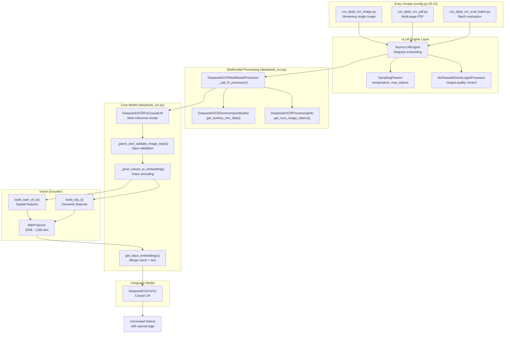

<!-- source: DeepWiki mcp.deepwiki.com · repo deepseek-ai/DeepSeek-OCR · page 3.2 vLLM Inference · fetched 2026-10-30 -->

# vLLM Inference

Relevant source files

The following files were used as context for generating this wiki page:

- [DeepSeek-OCR-master/DeepSeek-OCR-vllm/config.py](DeepSeek-OCR-master/DeepSeek-OCR-vllm/config.py)
- [DeepSeek-OCR-master/DeepSeek-OCR-vllm/deepseek_ocr.py](DeepSeek-OCR-master/DeepSeek-OCR-vllm/deepseek_ocr.py)

This page provides an overview of using the vLLM inference framework with DeepSeek-OCR, including performance characteristics, architecture components, and when to use each processing mode. For detailed usage examples of specific workflows, see:
- [Single Image Processing](#3.2.1) — Guide for processing individual images with vLLM, including streaming output, bounding box rendering, and geometric visualization.
- [PDF Document Processing](#3.2.2) — Guide for processing multi-page PDFs, including page-by-page processing, layout detection, and output formats.
- [Batch Evaluation](#3.2.3) — Guide for batch processing multiple images, parallel preprocessing, and evaluation workflows.
- [Transformers Inference](#3.1) — Alternative framework for research and fine-tuning.

## Purpose and Design

The vLLM inference path is designed for **production-grade, high-throughput OCR workloads**. It uses the vLLM serving engine to achieve optimal GPU utilization and throughput through:

- **Asynchronous request processing** via `AsyncLLMEngine`.
- **Continuous batching** for efficient GPU memory utilization (90% by default).
- **PagedAttention** for KV cache management.
- **Parallel preprocessing** with configurable worker pools (defaulting to 64 workers).

The vLLM implementation achieves approximately **2,500 tokens/second** on an A100-40G GPU for PDF processing workloads, significantly outperforming sequential inference approaches.

Sources: [DeepSeek-OCR-master/DeepSeek-OCR-vllm/config.py:13-14](), [DeepSeek-OCR-master/DeepSeek-OCR-vllm/deepseek_ocr.py:13-39]()

## vLLM vs Transformers Comparison

| Aspect | vLLM | Transformers |
|--------|------|--------------|
| **Primary Use Case** | Production serving, batch processing | Research, experimentation, fine-tuning |
| **Throughput** | ~2,500 tokens/s (PDF, A100-40G) | Lower (sequential processing) |
| **Request Handling** | Async with continuous batching | Synchronous, single request |
| **GPU Utilization** | 90% (configurable via `gpu_memory_utilization`) | Depends on manual batching |
| **Concurrency** | 100 concurrent sequences (configurable via `MAX_CONCURRENCY`) | Single sequence at a time |
| **Custom Features** | `NoRepeatNGramLogitsProcessor`, streaming output | Full parameter control (`test_compress`, `crop_mode`) |
| **API Style** | `llm.generate()` with `SamplingParams` | `model.infer()` with direct parameters |
| **Entry Points** | `run_dpsk_ocr_image.py`, `run_dpsk_ocr_pdf.py` | `run_dpsk_ocr.py` |

Sources: [DeepSeek-OCR-master/DeepSeek-OCR-vllm/config.py:12-14](), [DeepSeek-OCR-master/DeepSeek-OCR-vllm/deepseek_ocr.py:2-10]()

## System Architecture

The vLLM inference system consists of multiple layers that transform raw images into structured OCR output:

Title: vLLM Inference Architecture

**Architecture Overview**: The vLLM path starts with entry scripts that configure the `AsyncLLMEngine`. The engine routes requests through the multimodal processor (`DeepseekOCRMultiModalProcessor`), which handles image tokenization and calculates vision token counts via `DeepseekOCRProcessingInfo`. The core model (`DeepseekOCRForCausalLM`) performs dual-encoder vision processing using SAM and CLIP, projects features via `MlpProjector`, and merges them with text embeddings before passing to the language model.

Sources: [DeepSeek-OCR-master/DeepSeek-OCR-vllm/deepseek_ocr.py:50-107](), [DeepSeek-OCR-master/DeepSeek-OCR-vllm/deepseek_ocr.py:150-176](), [DeepSeek-OCR-master/DeepSeek-OCR-vllm/deepseek_ocr.py:261-330]()

## Processing Pipeline with Code Entities

This diagram maps the data flow from raw inputs to final outputs, showing the key functions and classes involved:

Title: Data Flow and Code Entity Mapping

```mermaid
graph LR
    subgraph "Input Stage"
        RAW_IMG["PIL.Image or<br/>PDF pages"]
        RAW_PROMPT["Text prompt with<br/>&lt;image&gt; token"]
    end
    
    subgraph "Preprocessing (process.image_process)"
        TOKENIZE["DeepseekOCRProcessor<br/>tokenize_with_images()"]
        CROP["dynamic_preprocess()<br/>count_tiles()"]
    end
    
    subgraph "Multimodal Input Preparation (deepseek_ocr.py)"
        VALIDATE["_parse_and_validate_image_input()"]
        FIELD_CONFIG["_get_mm_fields_config()<br/>pixel_values, images_crop"]
        PROMPT_UPDATE["_get_prompt_updates()<br/>Replace &lt;image&gt; with tokens"]
    end
    
    subgraph "Vision Encoding (deepseek_ocr.py)"
        PIXEL_TO_EMB["_pixel_values_to_embedding()"]
        SAM_ENCODE["self.sam_model(patches)"]
        CLIP_ENCODE["self.vision_model(patches)"]
        PROJECT["self.projector(features)"]
        STRUCTURE["Add image_newline and<br/>view_seperator tokens"]
    end
    
    subgraph "Token Merging"
        GET_EMBED["get_input_embeddings()"]
        MERGE_MM["merge_multimodal_embeddings()"]
    end
    
    subgraph "Language Model Forward"
        FORWARD["forward()"]
        LM_FORWARD["self.language_model()"]
        COMPUTE_LOGITS["compute_logits()"]
    end
    
    subgraph "Output Stage"
        TOKENS["Generated token IDs"]
        DECODE["Decode with special tags<br/>&lt;|ref|&gt;, &lt;|det|&gt;, &lt;|grounding|&gt;"]
    end
    
    RAW_IMG --> TOKENIZE
    RAW_PROMPT --> TOKENIZE
    TOKENIZE --> CROP
    CROP --> VALIDATE
    
    VALIDATE --> FIELD_CONFIG
    FIELD_CONFIG --> PROMPT_UPDATE
    PROMPT_UPDATE --> PIXEL_TO_EMB
    
    PIXEL_TO_EMB --> SAM_ENCODE
    PIXEL_TO_EMB --> CLIP_ENCODE
    SAM_ENCODE --> PROJECT
    CLIP_ENCODE --> PROJECT
    PROJECT --> STRUCTURE
    STRUCTURE --> GET_EMBED
    
    GET_EMBED --> MERGE_MM
    MERGE_MM --> FORWARD
    FORWARD --> LM_FORWARD
    LM_FORWARD --> COMPUTE_LOGITS
    COMPUTE_LOGITS --> TOKENS
    TOKENS --> DECODE
```

**Code Entity Mapping**: This pipeline shows the complete flow through the vLLM system with specific function names. Key stages include:
1. **Preprocessing**: `DeepseekOCRProcessor` handles dynamic cropping via `count_tiles` [DeepSeek-OCR-master/DeepSeek-OCR-vllm/deepseek_ocr.py:30-31]().
2. **Input Validation**: `_parse_and_validate_image_input` extracts `pixel_values`, `images_crop`, and `images_spatial_crop`.
3. **Vision Encoding**: `_pixel_values_to_embedding` processes both global and local views through dual encoders (SAM/CLIP) [DeepSeek-OCR-master/DeepSeek-OCR-vllm/deepseek_ocr.py:364-467]().
4. **Embedding Merge**: `merge_multimodal_embeddings` replaces `<image>` tokens with vision features [DeepSeek-OCR-master/DeepSeek-OCR-vllm/deepseek_ocr.py:520-522]().

Sources: [DeepSeek-OCR-master/DeepSeek-OCR-vllm/deepseek_ocr.py:150-561]()

## Three Processing Modes

The vLLM implementation provides three specialized entry points for different use cases:

| Script | Primary Use Case | Key Features | Output Formats |
|--------|------------------|--------------|----------------|
| `run_dpsk_ocr_image.py` | Single image OCR | - Streaming output - Bounding box rendering - Real-time feedback | - Markdown text - Annotated image |
| `run_dpsk_ocr_pdf.py` | Multi-page documents | - Page-by-page processing - Layout detection - Concurrent processing | - Markdown per page - Structured layout data |
| `run_dpsk_ocr_eval_batch.py` | Benchmark evaluation | - Parallel preprocessing (64 workers) - Batch inference - Metrics collection | - JSON results - Evaluation metrics |

All three scripts share the same underlying `DeepseekOCRForCausalLM` model and configuration system.

Sources: [DeepSeek-OCR-master/DeepSeek-OCR-vllm/config.py:20-22](), [DeepSeek-OCR-master/DeepSeek-OCR-vllm/config.py:14]()

## Core Components

### DeepseekOCRForCausalLM

The main model class registered with vLLM's multimodal registry. Key responsibilities:

- **Initialization**: Loads vision encoders via `build_sam_vit_b()` and `build_clip_l()`, and initializes the `MlpProjector` [DeepSeek-OCR-master/DeepSeek-OCR-vllm/deepseek_ocr.py:267-330]().
- **Vision Processing**: Implements `_pixel_values_to_embedding()` to process global views and local patches, adding structural tokens like `image_newline` and `view_seperator` [DeepSeek-OCR-master/DeepSeek-OCR-vllm/deepseek_ocr.py:364-467]().
- **Weight Loading**: Uses a custom `hf_to_vllm_mapper` to route vision, projector, and language model weights correctly [DeepSeek-OCR-master/DeepSeek-OCR-vllm/deepseek_ocr.py:564-582]().

### Multimodal Processing Components

- **DeepseekOCRProcessingInfo**: Calculates the number of vision tokens via `get_num_image_tokens()`, accounting for cropping ratios and tile counts [DeepSeek-OCR-master/DeepSeek-OCR-vllm/deepseek_ocr.py:50-107]().
- **DeepseekOCRMultiModalProcessor**: Handles the high-level mapping of image data to multimodal fields like `pixel_values` and `images_crop` [DeepSeek-OCR-master/DeepSeek-OCR-vllm/deepseek_ocr.py:150-255]().
- **DeepseekOCRDummyInputsBuilder**: Generates dummy inputs for profiling based on the `PROMPT` and `IMAGE_SIZE` [DeepSeek-OCR-master/DeepSeek-OCR-vllm/deepseek_ocr.py:115-146]().

Sources: [DeepSeek-OCR-master/DeepSeek-OCR-vllm/deepseek_ocr.py:50-582]()

## Configuration System

vLLM inference is controlled through `config.py` parameters:

### Resolution Modes

| Parameter | Purpose | Default | Effect |
|-----------|---------|---------|--------|
| `IMAGE_SIZE` | Local view resolution | 640 | Size of cropped patches |
| `BASE_SIZE` | Global view resolution | 1024 | Size of full image representation |
| `CROP_MODE` | Enable dynamic cropping | True | Gundam mode: multi-scale processing |
| `MAX_CROPS` | Maximum crop count | 6 | Upper bound to control memory |

The current default configuration (Gundam mode) uses `IMAGE_SIZE = 640`, `BASE_SIZE = 1024`, and `CROP_MODE = True` [DeepSeek-OCR-master/DeepSeek-OCR-vllm/config.py:8-12]().

### Performance Tuning

| Parameter | Purpose | Default | Recommendation |
|-----------|---------|---------|----------------|
| `MAX_CONCURRENCY` | Max concurrent requests | 100 | Lower if GPU memory is limited |
| `NUM_WORKERS` | Preprocessing workers | 64 | Match to CPU core count |

Sources: [DeepSeek-OCR-master/DeepSeek-OCR-vllm/config.py:8-14]()

## Next Steps

For detailed usage instructions and code examples:
- [Single Image Processing](#3.2.1) — Streaming output with visualization.
- [PDF Document Processing](#3.2.2) — Multi-page workflow.
- [Batch Evaluation](#3.2.3) — Parallel processing setup.
- [Configuration System](#3.3) — Tuning performance parameters.
- [Working with Prompts](#3.4) — Effective prompt engineering.
- [Understanding Output](#3.5) — Parsing results and special tokens.

Sources: [DeepSeek-OCR-master/DeepSeek-OCR-vllm/config.py:1-43]()

---

