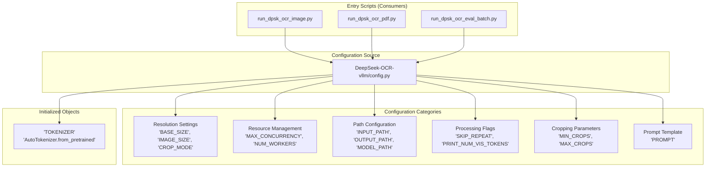
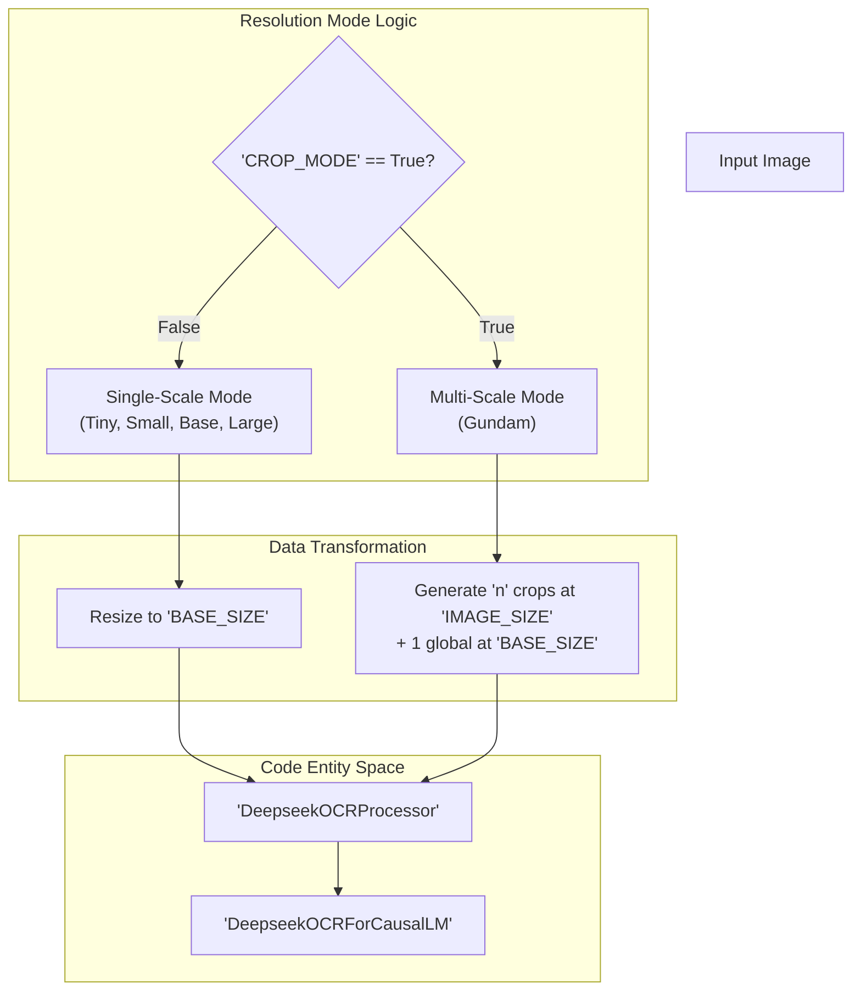
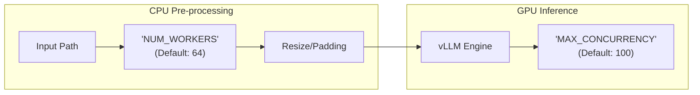

<!-- source: DeepWiki mcp.deepwiki.com · repo deepseek-ai/DeepSeek-OCR · page 3.3 Configuration System · fetched 2026-10-30 -->

# Configuration System

<details>
<summary>Relevant source files</summary>

The following files were used as context for generating this wiki page:

- [DeepSeek-OCR-master/DeepSeek-OCR-vllm/config.py](DeepSeek-OCR-master/DeepSeek-OCR-vllm/config.py)

</details>


The configuration system controls all aspects of DeepSeek-OCR inference behavior, from resolution modes and resource allocation to prompt templates and output handling. All configuration is centralized in a single Python file that is imported by the vLLM inference scripts.

This page covers configuration for **vLLM-based inference only**. For Transformers-based inference parameters, see [3.1](). For understanding the output formats controlled by these configurations, see [3.5]().

**Sources:** [DeepSeek-OCR-master/DeepSeek-OCR-vllm/config.py:1-43]()

---

## Configuration File Location

The configuration system is implemented in `config.py` located in the vLLM inference directory:

```
DeepSeek-OCR-master/DeepSeek-OCR-vllm/config.py
```

This file is imported by the vLLM entry scripts to define runtime behavior for single images, PDFs, and batch evaluation.

**Configuration Flow Diagram**

Title: "DeepSeek-OCR Configuration Architecture"


**Sources:** [DeepSeek-OCR-master/DeepSeek-OCR-vllm/config.py:1-43]()

---

## Resolution Modes

DeepSeek-OCR supports five pre-defined resolution modes that balance quality, speed, and memory consumption. Each mode is configured by setting three primary parameters: `BASE_SIZE`, `IMAGE_SIZE`, and `CROP_MODE`.

### Mode Configuration Table

| Mode | `BASE_SIZE` | `IMAGE_SIZE` | `CROP_MODE` | Use Case |
|------|-----------|------------|-----------|----------|
| **Tiny** | 512 | 512 | False | Quick preview, low-resolution documents |
| **Small** | 640 | 640 | False | Standard documents, faster processing |
| **Base** | 1024 | 1024 | False | High-quality documents, single-scale |
| **Large** | 1280 | 1280 | False | Very high resolution, single-scale |
| **Gundam** ⭐ | 1024 | 640 | True | **Default: Multi-scale with cropping** |

**Sources:** [DeepSeek-OCR-master/DeepSeek-OCR-vllm/config.py:1-10]()

### Current Default Configuration

The default configuration uses **Gundam mode**, which employs dynamic cropping to handle high-resolution documents without losing detail:

```python
BASE_SIZE = 1024      # Global view resolution
IMAGE_SIZE = 640      # Local crop resolution  
CROP_MODE = True      # Enable dynamic cropping
```

**Sources:** [DeepSeek-OCR-master/DeepSeek-OCR-vllm/config.py:8-10]()

### Resolution Mode Selection Diagram

Title: "Image Processing Logic by Configuration Mode"


**Sources:** [DeepSeek-OCR-master/DeepSeek-OCR-vllm/config.py:1-10]()

---

## Cropping Parameters

When `CROP_MODE = True` (Gundam mode), these parameters control the dynamic cropping behavior:

### Cropping Configuration

```python
MIN_CROPS = 2   # Minimum number of crops
MAX_CROPS = 6   # Maximum number of crops (max: 9)
```

**Sources:** [DeepSeek-OCR-master/DeepSeek-OCR-vllm/config.py:11-12]()

| Parameter | Type | Default | Description |
|-----------|------|---------|-------------|
| `MIN_CROPS` | int | 2 | Minimum number of high-resolution crops to generate |
| `MAX_CROPS` | int | 6 | Maximum number of crops (reduce if GPU memory is limited) |

**Memory Considerations:**
The configuration file notes that the maximum value is 9, but recommends 6 for environments with limited GPU memory to prevent Out-Of-Memory (OOM) errors [DeepSeek-OCR-master/DeepSeek-OCR-vllm/config.py:12-12]().

---

## Resource Management

These parameters control parallelism and concurrency for optimal throughput during inference:

### Resource Configuration Parameters

```python
MAX_CONCURRENCY = 100  # GPU-side concurrent sequences
NUM_WORKERS = 64       # CPU-side image pre-process workers
```

**Sources:** [DeepSeek-OCR-master/DeepSeek-OCR-vllm/config.py:13-14]()

| Parameter | Type | Default | Description | Impact |
|-----------|------|---------|-------------|--------|
| `MAX_CONCURRENCY` | int | 100 | Maximum concurrent sequences in vLLM engine | GPU memory, throughput |
| `NUM_WORKERS` | int | 64 | Number of parallel workers for image preprocessing | CPU utilization, I/O speed |

### Resource Allocation Diagram

Title: "Resource Flow and Parallelism"


**Sources:** [DeepSeek-OCR-master/DeepSeek-OCR-vllm/config.py:13-14]()

---

## Path Configuration

Path variables must be configured before running inference scripts. These paths determine where the model is loaded from and where data is read/written.

### Path Parameters

```python
MODEL_PATH = 'deepseek-ai/DeepSeek-OCR'  # Model checkpoint location
INPUT_PATH = ''                          # Source image(s) or PDF
OUTPUT_PATH = ''                         # Results directory
```

**Sources:** [DeepSeek-OCR-master/DeepSeek-OCR-vllm/config.py:17-25]()

| Parameter | Type | Description |
|-----------|------|-------------|
| `MODEL_PATH` | str | Path to local model directory or HuggingFace ID |
| `INPUT_PATH` | str | Path to input file (PDF/Image) or directory (Batch) |
| `OUTPUT_PATH` | str | Directory where OCR results will be saved |

---

## Prompt Configuration

The `PROMPT` variable defines the default instruction template. The system provides several commonly used prompts for different OCR tasks.

### Default Prompt

```python
PROMPT = '<image>\n<|grounding|>Convert the document to markdown.'
```

**Sources:** [DeepSeek-OCR-master/DeepSeek-OCR-vllm/config.py:27-27]()

### Common Prompt Templates

| Task | Prompt Template |
|------|-----------------|
| **Document OCR** | `<image>\n<|grounding|>Convert the document to markdown.` |
| **Standard OCR** | `<image>\n<|grounding|>OCR this image.` |
| **No Layout** | `<image>\nFree OCR.` |
| **Figure Parsing** | `<image>\nParse the figure.` |
| **Description** | `<image>\nDescribe this image in detail.` |
| **Localization** | `<image>\nLocate <|ref|>xxxx<|/ref|> in the image.` |

**Sources:** [DeepSeek-OCR-master/DeepSeek-OCR-vllm/config.py:30-35]()

---

## Processing Behavior Flags

Two boolean flags control debugging and output quality:

### Behavior Configuration

```python
PRINT_NUM_VIS_TOKENS = False  # Debug: print vision token count
SKIP_REPEAT = True            # Enable n-gram repetition prevention
```

**Sources:** [DeepSeek-OCR-master/DeepSeek-OCR-vllm/config.py:15-16]()

| Parameter | Type | Default | Description |
|-----------|------|---------|-------------|
| `PRINT_NUM_VIS_TOKENS` | bool | False | When True, logs the number of vision tokens generated for each image |
| `SKIP_REPEAT` | bool | True | Enables `NoRepeatNGramLogitsProcessor` to prevent repetitive text generation |

**Sources:** [DeepSeek-OCR-master/DeepSeek-OCR-vllm/config.py:15-16]()

---

## Tokenizer Initialization

The configuration file initializes the `TOKENIZER` object using `AutoTokenizer` from the `transformers` library. This instance is shared across the vLLM inference scripts.

```python
from transformers import AutoTokenizer

TOKENIZER = AutoTokenizer.from_pretrained(MODEL_PATH, trust_remote_code=True)
```

**Sources:** [DeepSeek-OCR-master/DeepSeek-OCR-vllm/config.py:40-42]()

---

