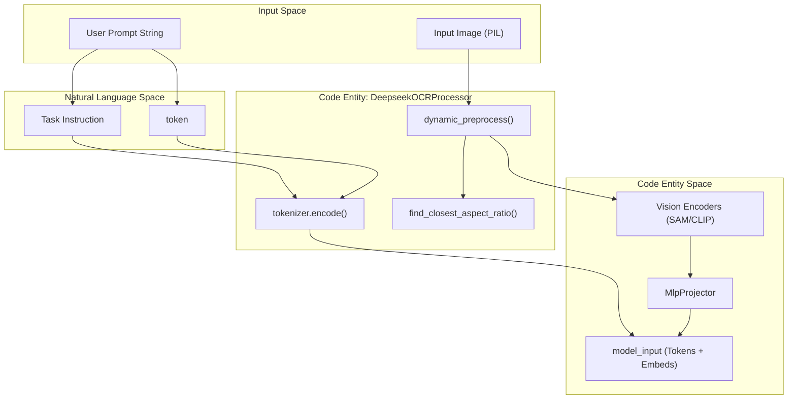
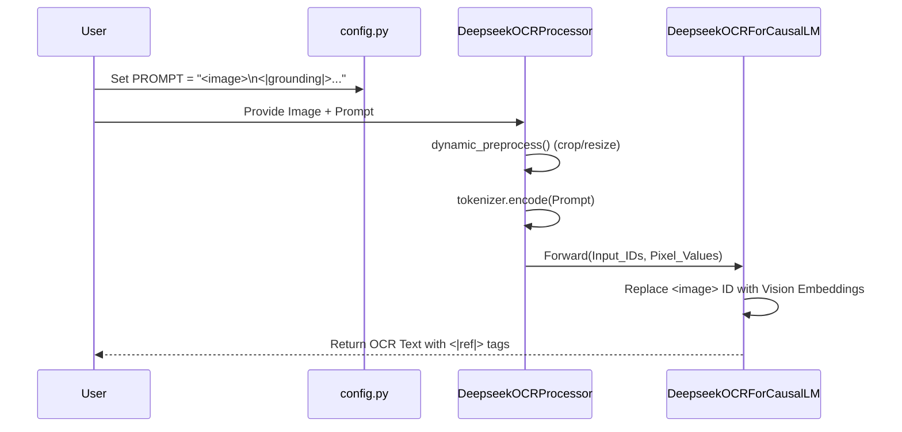

<!-- source: DeepWiki mcp.deepwiki.com · repo deepseek-ai/DeepSeek-OCR · page 3.4 Working with Prompts · fetched 2026-10-30 -->

# Working with Prompts

<details>
<summary>Relevant source files</summary>

The following files were used as context for generating this wiki page:

- [DeepSeek-OCR-master/DeepSeek-OCR-vllm/config.py](DeepSeek-OCR-master/DeepSeek-OCR-vllm/config.py)
- [DeepSeek-OCR-master/DeepSeek-OCR-vllm/process/image_process.py](DeepSeek-OCR-master/DeepSeek-OCR-vllm/process/image_process.py)
- [README.md](README.md)

</details>


## Purpose and Scope

This page provides a technical guide to the prompt system in DeepSeek-OCR. Prompts serve as the primary interface for guiding the model's multimodal capabilities, ranging from layout-aware document conversion to raw text extraction. This page details the prompt structure, the role of special tokens like `<image>`, `<|grounding|>`, and `<|ref|>`, and the configuration workflows across different inference frameworks.

For details on how the model processes these prompts internally, see [Multimodal Integration](4.5). For information on interpreting the resulting strings, see [Understanding Output](3.5).

---

## Prompt Structure and Components

DeepSeek-OCR prompts are composed of a mandatory image placeholder followed by task instructions and optional control tokens.

### Standard Format

```text
<image>\n[control_tokens]task_instruction
```

| Component | Code Entity / Token | Description | Required |
|-----------|---------------------|-------------|----------|
| **Image Placeholder** | `<image>` | Marks the insertion point for visual embeddings. | Yes |
| **Separator** | `\n` | Standard newline character separating image context from text. | Yes |
| **Control Tokens** | `<|grounding|>` | Modifiers that activate specific architectural behaviors (e.g., spatial awareness). | Optional |
| **Instruction** | Natural Language | The specific command (e.g., "Convert the document to markdown"). | Yes |

**Sources:** [DeepSeek-OCR-master/DeepSeek-OCR-vllm/config.py:27-35](), [README.md:178-179](), [DeepSeek-OCR-master/DeepSeek-OCR-vllm/process/image_process.py:124-177]()

---

## Task-Specific Prompt Templates

The model is optimized for several distinct OCR and vision-language tasks based on the instruction provided.

### Document and Layout Tasks

These tasks utilize the `<|grounding|>` token to enable the model's spatial coordinate system.

*   **Full Document Conversion:** `<image>\n<|grounding|>Convert the document to markdown.`
    *   **Behavior:** Produces hierarchical Markdown with tables, lists, and bounding boxes via `<|ref|>` and `<|det|>` tags. [DeepSeek-OCR-master/DeepSeek-OCR-vllm/config.py:27-30]()
*   **General OCR:** `<image>\n<|grounding|>OCR this image.`
    *   **Behavior:** Flexible text extraction with layout awareness for non-document images. [DeepSeek-OCR-master/DeepSeek-OCR-vllm/config.py:31]()
*   **Text Localization:** `<image>\nLocate <|ref|>target_text<|/ref|> in the image.`
    *   **Behavior:** Returns coordinates for specific text strings. [DeepSeek-OCR-master/DeepSeek-OCR-vllm/config.py:35]()

### Content Analysis and Raw Extraction

These tasks typically omit grounding tokens for faster, text-centric output.

*   **Free OCR:** `<image>\nFree OCR.`
    *   **Behavior:** High-speed raw text extraction without layout or coordinate metadata. [DeepSeek-OCR-master/DeepSeek-OCR-vllm/config.py:28-32]()
*   **Figure Parsing:** `<image>\nParse the figure.`
    *   **Behavior:** Specialized analysis of charts, plots, and diagrams. [DeepSeek-OCR-master/DeepSeek-OCR-vllm/config.py:33]()
*   **Image Description:** `<image>\nDescribe this image in detail.`
    *   **Behavior:** General-purpose captioning and visual understanding. [DeepSeek-OCR-master/DeepSeek-OCR-vllm/config.py:34]()

---

## Special Tokens Technical Reference

The `DeepseekOCRProcessor` handles several reserved tokens that trigger specific logic during tokenization and feature projection.

### Multimodal Tokens

*   **`<image>` (ID: 128812):** Used by `DeepseekOCRProcessor` to identify where to inject the visual token sequence. The number of tokens injected depends on the resolution mode (e.g., 64 for Tiny, 400 for Large). [README.md:192-198](), [DeepSeek-OCR-master/DeepSeek-OCR-vllm/process/image_process.py:161-177]()
*   **`<|grounding|>`:** Acts as a task-prefix that shifts the model into a coordinate-aware generation mode. [DeepSeek-OCR-master/DeepSeek-OCR-vllm/config.py:27-31]()

### Structural and Reference Tags

*   **`<|ref|>` / `<|/ref|>`:** Used to wrap text segments that correspond to specific regions in the image. [DeepSeek-OCR-master/DeepSeek-OCR-vllm/config.py:35]()
*   **`<|det|>` / `<|/det|>`:** Encapsulates the normalized coordinates `[[x1,y1,x2,y2]]` (0-1000 scale) for the preceding `<|ref|>` segment. [README.md:207-209]()
*   **`<td>`, `</td>`, `<tr>`, `</tr>`:** HTML-style tags used for table structure. These are often added to the `whitelist_token_ids` in `SamplingParams` to ensure structural integrity during generation. [README.md:154-155]()

**Sources:** [DeepSeek-OCR-master/DeepSeek-OCR-vllm/process/image_process.py:161-177](), [README.md:154-155](), [DeepSeek-OCR-master/DeepSeek-OCR-vllm/config.py:35-37]()

---

## Data Flow: From Prompt to Model Input

The following diagram illustrates how the `DeepseekOCRProcessor` and the inference scripts transform a text prompt into the multimodal sequence required by the `DeepseekOCRForCausalLM`.

### Prompt Processing Pipeline



**Sources:** [DeepSeek-OCR-master/DeepSeek-OCR-vllm/process/image_process.py:11-83](), [DeepSeek-OCR-master/DeepSeek-OCR-vllm/process/image_process.py:111-180](), [README.md:134-145]()

---

## Framework Integration

The method for applying prompts varies between the Transformers and vLLM implementations.

### vLLM Configuration (Centralized)

In the vLLM setup, prompts are typically defined in a global configuration file and consumed by various run scripts.

**File:** [DeepSeek-OCR-master/DeepSeek-OCR-vllm/config.py:27]()
```python
PROMPT = '<image>\n<|grounding|>Convert the document to markdown.'
```

**Workflow:**
1.  **Modify `config.py`**: Update the `PROMPT` variable. [DeepSeek-OCR-master/DeepSeek-OCR-vllm/config.py:27]()
2.  **Run Script**: Execute `run_dpsk_ocr_image.py` or `run_dpsk_ocr_pdf.py`. These scripts import `PROMPT` from `config`. [DeepSeek-OCR-master/DeepSeek-OCR-vllm/config.py:9-27]()

### Transformers Configuration (Direct)

In the Transformers interface, the prompt is passed as a direct argument to the `model.infer()` method.

**Example Implementation:**
```python
# Defined in inference script
prompt = "<image>\n<|grounding|>Convert the document to markdown."
image_file = 'document.jpg'

# model.infer handles tokenization and image processing internally
res = model.infer(
    tokenizer, 
    prompt=prompt, 
    image_file=image_file, 
    crop_mode=True, 
    base_size=1024, 
    image_size=640
)
```

**Sources:** [README.md:178-183](), [DeepSeek-OCR-master/DeepSeek-OCR-vllm/config.py:27-42]()

---

## Best Practices and Constraints

### Resolution and Token Limits
The choice of prompt is often constrained by the resolution mode configured. Higher complexity prompts (like Document Conversion) benefit from "Gundam" mode (dynamic resolution) to capture fine-grained text details.

| Mode | Base Size | Image Size | Vision Tokens | Recommended Prompt |
|------|-----------|------------|---------------|--------------------|
| Tiny | 512 | 512 | 64 | Free OCR |
| Base | 1024 | 1024 | 256 | General OCR |
| Gundam | 1024 | 640 | Dynamic | Markdown Conversion |

**Sources:** [README.md:192-198](), [DeepSeek-OCR-master/DeepSeek-OCR-vllm/config.py:2-6]()

### Logits Processing
When using structural prompts (like table conversion), it is recommended to use the `NGramPerReqLogitsProcessor` (or `NoRepeatNGramLogitsProcessor`) to prevent repetitive loops in the OCR output while whitelisting essential structural tokens like `<td>`.

**Implementation Detail:**
```python
sampling_param = SamplingParams(
    extra_args=dict(
        ngram_size=30,
        window_size=90,
        whitelist_token_ids={128821, 128822}, # <td>, </td>
    )
)
```
**Sources:** [README.md:150-157]()

### System Interaction Diagram



**Sources:** [DeepSeek-OCR-master/DeepSeek-OCR-vllm/config.py:27-42](), [DeepSeek-OCR-master/DeepSeek-OCR-vllm/process/image_process.py:111-180](), [README.md:158-164]()

---

