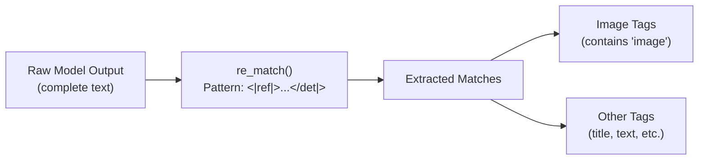
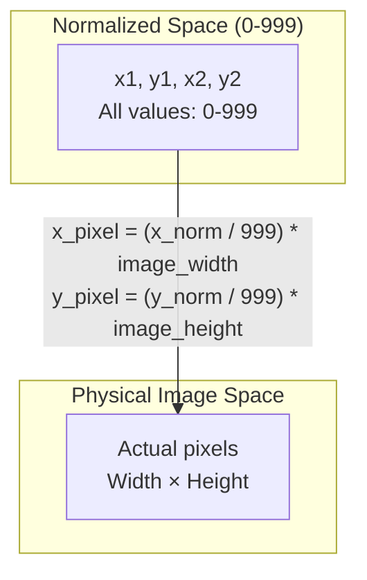
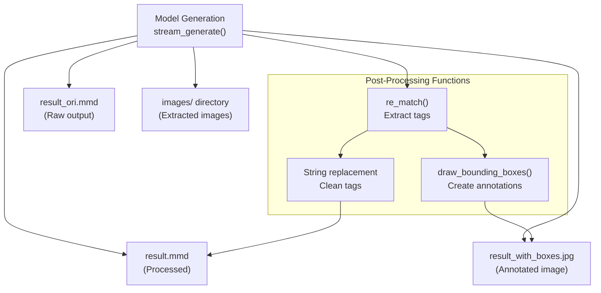
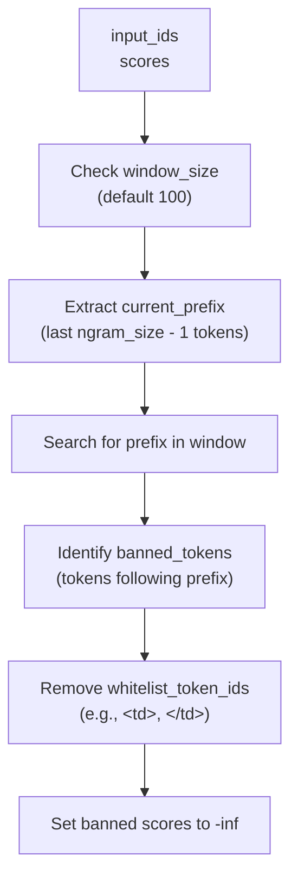

<!-- source: DeepWiki mcp.deepwiki.com · repo deepseek-ai/DeepSeek-OCR · page 3.5 Understanding Output · fetched 2026-10-30 -->

# Understanding Output

<details>
<summary>Relevant source files</summary>

The following files were used as context for generating this wiki page:

- [DeepSeek-OCR-master/DeepSeek-OCR-vllm/process/ngram_norepeat.py](DeepSeek-OCR-master/DeepSeek-OCR-vllm/process/ngram_norepeat.py)
- [README.md](README.md)

</details>


This page explains the output formats produced by DeepSeek-OCR, how to interpret structured tags, and how the system post-processes model generations into multiple output formats. It covers the raw model output structure, bounding box formats, coordinate systems, and the creation of visualizations.

For information about configuring output generation parameters, see **3.3 Configuration System**. For details on processing model outputs programmatically, see **5.5 Output Post-Processing**.

## Output Format Overview

DeepSeek-OCR generates structured text output containing both OCR content and spatial information. The model produces special markup tags that encode bounding boxes and element classifications, which are then post-processed into multiple output formats.

### Output Modalities

The system produces three primary output types depending on the inference script used:

| Output Type | File Extension | Description | Generated By |
|-------------|----------------|-------------|--------------|
| Raw Detection Output | `*_det.mmd` or `result_ori.mmd` | Complete model output with all markup tags preserved | `run_dpsk_ocr_image.py`, `run_dpsk_ocr_pdf.py` |
| Processed Markdown | `*.mmd` or `result.mmd` | Cleaned markdown with image references and tags removed | `run_dpsk_ocr_image.py`, `run_dpsk_ocr_pdf.py` |
| Visual Annotations | `*_layouts.pdf` or `result_with_boxes.jpg` | Original document/image with bounding boxes overlaid | `run_dpsk_ocr_image.py`, `run_dpsk_ocr_pdf.py` |

**Sources:** [DeepSeek-OCR-master/DeepSeek-OCR-vllm/run_dpsk_ocr_image.py:232-303](), [DeepSeek-OCR-master/DeepSeek-OCR-vllm/run_dpsk_ocr_pdf.py:279-329]()

## Raw Output Structure

### Special Markup Tags

The model generates output with embedded XML-like tags that encode spatial and semantic information. These tags follow a specific pattern:

```
<|ref|>LABEL<|/ref|><|det|>COORDINATES<|/det|>
```

Where:
- `LABEL` is the element type (e.g., `title`, `text`, `image`, `table`, `formula`)
- `COORDINATES` is a Python-style list of bounding boxes in normalized format.

**Example Raw Output:**
```markdown
<|ref|>title<|/ref|><|det|>[[120, 45, 880, 95]]<|/det|>Introduction

This document contains <|ref|>image<|/ref|><|det|>[[100, 150, 900, 600]]<|/det|> 
showing the system architecture.
```

### Tag Detection Logic

The system uses regular expressions to extract these structured tags for further processing.

**Tag Processing Data Flow**


**Sources:** [DeepSeek-OCR-master/DeepSeek-OCR-vllm/run_dpsk_ocr_image.py:45-57](), [DeepSeek-OCR-master/DeepSeek-OCR-vllm/run_dpsk_ocr_pdf.py:123-135]()

## Bounding Box Format

### Normalized Coordinate System

Bounding boxes use a normalized coordinate system where coordinates range from 0 to 999, independent of the actual image resolution. This allows the same coordinates to work across different image sizes.

**Coordinate Transformation**


**Coordinate Conversion Formula:**
```python
# From normalized to pixel coordinates
x_pixel = int(x_normalized / 999 * image_width)
y_pixel = int(y_normalized / 999 * image_height)
```

**Sources:** [DeepSeek-OCR-master/DeepSeek-OCR-vllm/run_dpsk_ocr_image.py:99-103](), [DeepSeek-OCR-master/DeepSeek-OCR-vllm/run_dpsk_ocr_pdf.py:177-181]()

### Label Types and Rendering

The `extract_coordinates_and_label()` function extracts label types and coordinates.

| Label Type | Description | Rendering Style |
|------------|-------------|-----------------|
| `title` | Document titles, headings | Thicker border (width=4) |
| `text` | Body text, paragraphs | Standard border (width=2) |
| `image` | Embedded images, figures | Standard border, auto-extracted |
| `table` | Tables and structured data | Standard border |
| `formula` | Mathematical formulas | Standard border |

**Sources:** [DeepSeek-OCR-master/DeepSeek-OCR-vllm/run_dpsk_ocr_image.py:60-71](), [DeepSeek-OCR-master/DeepSeek-OCR-vllm/run_dpsk_ocr_pdf.py:138-148]()

## Output File Generation

### Single Image Processing Output

When processing a single image using `run_dpsk_ocr_image.py`, the following pipeline is executed:

**Image Processing Pipeline**


**File Descriptions:**

1. **`result_ori.mmd`**: Contains the complete raw output including all `<|ref|>` and `<|det|>` tags.
2. **`result.mmd`**: Processed markdown with image tags replaced by ``, other tags removed, and LaTeX symbols normalized.
3. **`result_with_boxes.jpg`**: Original image with colored bounding boxes and labels overlaid.
4. **`images/` directory**: Contains cropped image regions for elements tagged as `<|ref|>image<|/ref|>`.

**Sources:** [DeepSeek-OCR-master/DeepSeek-OCR-vllm/run_dpsk_ocr_image.py:223-249]()

### PDF Processing Output

When processing PDF documents using `run_dpsk_ocr_pdf.py`, the system generates files per document:

1. **`{filename}_det.mmd`**: Concatenated raw output from all pages with `<--- Page Split --->` markers.
2. **`{filename}.mmd`**: Processed markdown from all pages with image tags replaced by ``.
3. **`{filename}_layouts.pdf`**: Multi-page PDF with bounding boxes and labels drawn on each page.
4. **`images/` directory**: Contains extracted images named as `{page_idx}_{img_idx}.jpg`.

**Sources:** [DeepSeek-OCR-master/DeepSeek-OCR-vllm/run_dpsk_ocr_pdf.py:279-329]()

## Repetition Control (Logits Processing)

To ensure high-quality output and prevent infinite loops in structured OCR (like table cells), DeepSeek-OCR implements a custom logits processor in the vLLM environment.

### NoRepeatNGramLogitsProcessor

The `NoRepeatNGramLogitsProcessor` prevents the model from repeating the same n-gram within a specified window, while allowing exceptions for necessary structural tokens.

**Logits Processing Flow**


**Key Parameters:**
- `ngram_size`: The size of the n-gram to check for repetition. [DeepSeek-OCR-master/DeepSeek-OCR-vllm/process/ngram_norepeat.py:14]()
- `window_size`: The look-back window for checking repetitions. [DeepSeek-OCR-master/DeepSeek-OCR-vllm/process/ngram_norepeat.py:15]()
- `whitelist_token_ids`: Tokens allowed to repeat (e.g., HTML table tags). [DeepSeek-OCR-master/DeepSeek-OCR-vllm/process/ngram_norepeat.py:16]()

**Sources:** [DeepSeek-OCR-master/DeepSeek-OCR-vllm/process/ngram_norepeat.py:7-40]()

## Visual Annotation Generation

The `draw_bounding_boxes()` function creates annotated images using the following logic:

1. **Coordinate Conversion**: Normalized coordinates (0-999) are scaled to actual image pixels. [DeepSeek-OCR-master/DeepSeek-OCR-vllm/run_dpsk_ocr_image.py:99-103]()
2. **Color Assignment**: A random RGB color is generated for each detection. [DeepSeek-OCR-master/DeepSeek-OCR-vllm/run_dpsk_ocr_image.py:105]()
3. **Drawing**:
    - A rectangle is drawn on a semi-transparent overlay (alpha=20). [DeepSeek-OCR-master/DeepSeek-OCR-vllm/run_dpsk_ocr_image.py:108-112]()
    - A text label is placed above the box. [DeepSeek-OCR-master/DeepSeek-OCR-vllm/run_dpsk_ocr_image.py:118-124]()
4. **Cropping**: If the label is `image`, the region is cropped and saved to the `images/` folder. [DeepSeek-OCR-master/DeepSeek-OCR-vllm/run_dpsk_ocr_image.py:126-133]()

**Sources:** [DeepSeek-OCR-master/DeepSeek-OCR-vllm/run_dpsk_ocr_image.py:73-137](), [DeepSeek-OCR-master/DeepSeek-OCR-vllm/run_dpsk_ocr_pdf.py:151-220]()

## Code Entity Reference

### Key Functions

| Function | Purpose | Location |
|----------|---------|----------|
| `re_match()` | Extract structured tags from text using regex. | [run_dpsk_ocr_image.py:45]() |
| `extract_coordinates_and_label()` | Parse individual tag into label and list of coords. | [run_dpsk_ocr_image.py:60]() |
| `draw_bounding_boxes()` | Create annotated image with boxes and labels. | [run_dpsk_ocr_image.py:73]() |
| `NoRepeatNGramLogitsProcessor` | Prevent n-gram repetition during inference. | [process/ngram_norepeat.py:7]() |

**Sources:** [DeepSeek-OCR-master/DeepSeek-OCR-vllm/run_dpsk_ocr_image.py:45-73](), [DeepSeek-OCR-master/DeepSeek-OCR-vllm/process/ngram_norepeat.py:7]()

---

