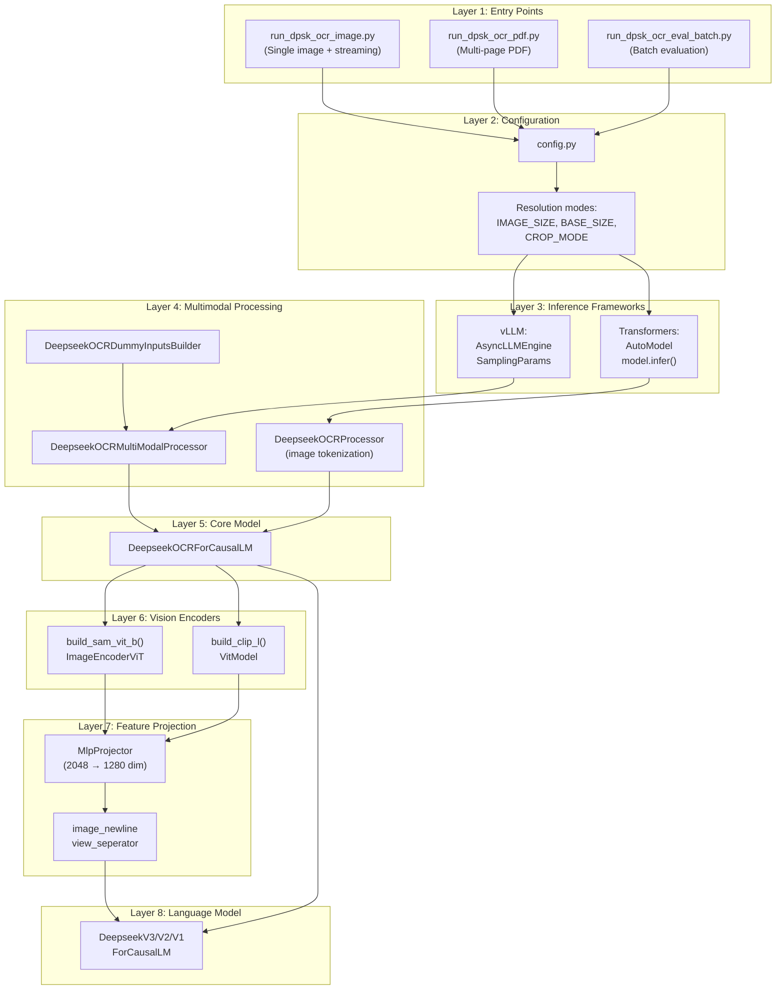
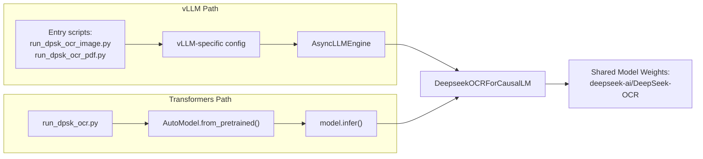
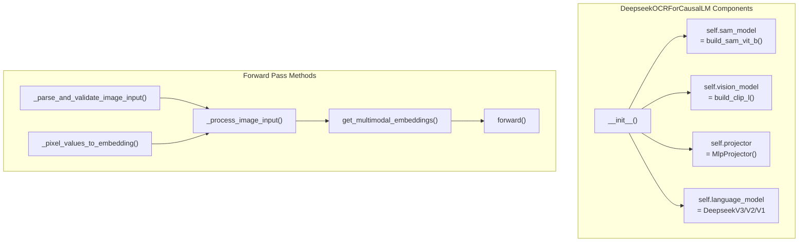
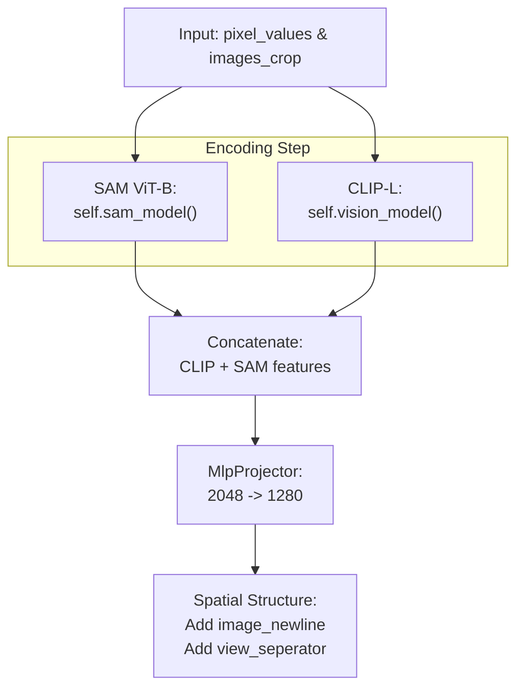
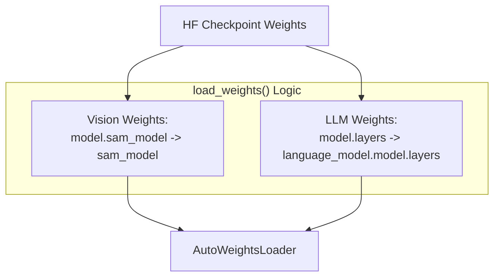

<!-- source: DeepWiki mcp.deepwiki.com · repo deepseek-ai/DeepSeek-OCR · page 4 Architecture · fetched 2026-10-30 -->

# Architecture

Relevant source files

The following files were used as context for generating this wiki page:

- [DeepSeek-OCR-master/DeepSeek-OCR-vllm/deepseek_ocr.py](DeepSeek-OCR-master/DeepSeek-OCR-vllm/deepseek_ocr.py)
- [DeepSeek_OCR_paper.pdf](DeepSeek_OCR_paper.pdf)

## Purpose and Scope

This page provides a technical overview of DeepSeek-OCR's system architecture, focusing on the major structural components and how they relate to each other. It explains the dual-framework design (vLLM and Transformers), the layered component hierarchy, and the overall data flow through the system.

For detailed information about specific subsystems, see:
- Model architecture internals: [Model Architecture](#4.2)
- Vision encoders (SAM and CLIP): [Vision Encoding System](#4.3)
- Image preprocessing logic: [Image Processing Pipeline](#4.4)
- How vision and text tokens are merged: [Multimodal Integration](#4.5)

For practical usage guides, see:
- Configuration parameters: [Configuration System](#3.3)
- Running inference: [vLLM Inference](#3.2) and [Transformers Inference](#3.1)

---

## Architectural Principles

DeepSeek-OCR is designed around several key architectural principles:

1. **Dual-Framework Support**: The system provides both vLLM and Transformers inference paths that share the same underlying model weights, enabling production throughput optimization and research flexibility. [DeepSeek-OCR-master/DeepSeek-OCR-vllm/deepseek_ocr.py:2-38]()

2. **Dual-Encoder Vision**: Combines SAM (Segment Anything Model) for spatial detail with CLIP for semantic understanding, creating complementary feature representations. [DeepSeek-OCR-master/DeepSeek-OCR-vllm/deepseek_ocr.py:40-41]()

3. **Hierarchical Resolution Processing**: Implements dynamic cropping (Gundam mode) to process large documents as multiple high-resolution local views plus one global view, balancing detail preservation with memory constraints. [DeepSeek-OCR-master/DeepSeek-OCR-vllm/deepseek_ocr.py:78-106]()

4. **Token-Based Spatial Encoding**: Uses special learned embeddings (`image_newline`, `view_seperator`) to maintain 2D spatial relationships within the 1D token sequence fed to the language model. [DeepSeek-OCR-master/DeepSeek-OCR-vllm/deepseek_ocr.py:318-322]()

5. **Configurable Resolution Modes**: Offers processing modes defined in `config.py` with different quality/speed/memory tradeoffs. [DeepSeek-OCR-master/DeepSeek-OCR-vllm/deepseek_ocr.py:45]()

**Sources:** [DeepSeek-OCR-master/DeepSeek-OCR-vllm/deepseek_ocr.py:1-583]()

---

## System Layers

The DeepSeek-OCR system is organized into distinct layers with clear responsibilities:

DeepSeek-OCR Component Hierarchy

**Layer Responsibilities:**

| Layer | Components | Purpose |
|-------|-----------|---------|
| 1: Entry Points | CLI scripts | User-facing interfaces for different use cases |
| 2: Configuration | `config.py` | Central parameter definition (resolution, cropping, workers) |
| 3: Inference Frameworks | vLLM, Transformers | Production serving vs. research/fine-tuning |
| 4: Multimodal Processing | Processor classes | Image tokenization, aspect ratio handling, dummy inputs |
| 5: Core Model | `DeepseekOCRForCausalLM` | Main orchestrator, weight loading, forward pass |
| 6: Vision Encoders | SAM, CLIP | Spatial and semantic feature extraction |
| 7: Feature Projection | `MlpProjector`, special tokens | Dimensionality reduction, spatial structure preservation |
| 8: Language Model | DeepseekV3/V2/V1 | Causal language modeling on fused multimodal tokens |

**Sources:** [DeepSeek-OCR-master/DeepSeek-OCR-vllm/deepseek_ocr.py:261-330](), [DeepSeek-OCR-master/DeepSeek-OCR-vllm/deepseek_ocr.py:50-255]()

---

## Dual-Framework Design

DeepSeek-OCR uniquely provides two parallel inference frameworks that operate on the same model checkpoint:

Framework Comparison and Data Paths

**Framework Comparison:**

| Aspect | vLLM | Transformers |
|--------|------|--------------|
| **Use Case** | Production serving, batch evaluation | Research, fine-tuning, experimentation |
| **Engine** | `AsyncLLMEngine` with batching | Direct `model.infer()` calls |
| **Implementation** | `DeepseekOCRMultiModalProcessor` | `DeepseekOCRProcessor` |
| **Special Features** | Streaming output, prefix caching | Direct logits access, `test_compress` |

The `DeepseekOCRForCausalLM` class is designed to work with both frameworks through:
- vLLM integration via `MULTIMODAL_REGISTRY.register_processor` decorator [DeepSeek-OCR-master/DeepSeek-OCR-vllm/deepseek_ocr.py:257-260]()
- Shared weight loading through `load_weights()` method [DeepSeek-OCR-master/DeepSeek-OCR-vllm/deepseek_ocr.py:564-582]()

**Sources:** [DeepSeek-OCR-master/DeepSeek-OCR-vllm/deepseek_ocr.py:257-261](), [DeepSeek-OCR-master/DeepSeek-OCR-vllm/deepseek_ocr.py:150-189]()

---

## Core Model Architecture

The `DeepseekOCRForCausalLM` class orchestrates all model components:

DeepseekOCRForCausalLM Internal Architecture

**Key Methods:**

| Method | Location | Purpose |
|--------|----------|---------|
| `__init__()` | [DeepSeek-OCR-master/DeepSeek-OCR-vllm/deepseek_ocr.py:267-329]() | Initialize encoders, projector, and LLM |
| `_parse_and_validate_image_input()` | [DeepSeek-OCR-master/DeepSeek-OCR-vllm/deepseek_ocr.py:333-360]() | Validate `pixel_values` and `images_crop` |
| `_pixel_values_to_embedding()` | [DeepSeek-OCR-master/DeepSeek-OCR-vllm/deepseek_ocr.py:364-467]() | Vision encoding: SAM + CLIP → projection |
| `get_multimodal_embeddings()` | [DeepSeek-OCR-master/DeepSeek-OCR-vllm/deepseek_ocr.py:498-504]() | Public API for getting vision embeddings |
| `forward()` | [DeepSeek-OCR-master/DeepSeek-OCR-vllm/deepseek_ocr.py:530-553]() | Complete forward pass through LLM |

**Sources:** [DeepSeek-OCR-master/DeepSeek-OCR-vllm/deepseek_ocr.py:261-583]()

---

## Vision Encoding Pipeline

The vision encoding pipeline implements the dual-encoder architecture:

Vision Feature Extraction Pipeline

**Encoding Steps:**

1. **Dual Encoding**: 
   - SAM extracts spatial features [DeepSeek-OCR-master/DeepSeek-OCR-vllm/deepseek_ocr.py:394]().
   - CLIP extracts semantic features [DeepSeek-OCR-master/DeepSeek-OCR-vllm/deepseek_ocr.py:397]().
2. **Feature Fusion**: Concatenates CLIP (1280) and SAM (768) features to form 2048-dim vectors [DeepSeek-OCR-master/DeepSeek-OCR-vllm/deepseek_ocr.py:400]().
3. **Projection**: `MlpProjector` reduces dimensions to match the language model (1280) [DeepSeek-OCR-master/DeepSeek-OCR-vllm/deepseek_ocr.py:401]().
4. **Spatial Structuring**: Reshapes the 1D token stream back to 2D rows and inserts `image_newline` and `view_seperator` tokens [DeepSeek-OCR-master/DeepSeek-OCR-vllm/deepseek_ocr.py:425-438]().

**Sources:** [DeepSeek-OCR-master/DeepSeek-OCR-vllm/deepseek_ocr.py:364-467]()

---

## Multimodal Processing Classes

The system uses specialized processor classes to manage the interface between raw images and model inputs:

| Class | Purpose | Key Methods |
|-------|---------|-------------|
| `DeepseekOCRProcessingInfo` | Metadata for vLLM | `get_num_image_tokens()` [DeepSeek-OCR-master/DeepSeek-OCR-vllm/deepseek_ocr.py:61-106]() |
| `DeepseekOCRDummyInputsBuilder` | Profiling utilities | `get_dummy_mm_data()` [DeepSeek-OCR-master/DeepSeek-OCR-vllm/deepseek_ocr.py:126-145]() |
| `DeepseekOCRMultiModalProcessor` | vLLM input handler | `_call_hf_processor()` [DeepSeek-OCR-master/DeepSeek-OCR-vllm/deepseek_ocr.py:154-176]() |
| `DeepseekOCRProcessor` | Core preprocessing | `tokenize_with_images()`, `count_tiles()` [DeepSeek-OCR-master/DeepSeek-OCR-vllm/deepseek_ocr.py:30-31]() |

**Sources:** [DeepSeek-OCR-master/DeepSeek-OCR-vllm/deepseek_ocr.py:50-255]()

---

## Weight Loading and Model Registration

The model uses custom weight loading to map checkpoint keys to the internal module structure:

Weight Mapping and Loading Flow

**Weight Loading Logic** [DeepSeek-OCR-master/DeepSeek-OCR-vllm/deepseek_ocr.py:564-582]():
The `load_weights` method remaps keys by checking if they belong to the vision system (SAM, CLIP, Projector) or the language model. Vision keys have their `model.` prefix removed, while LLM keys are prefixed with `language.` to route them to the `self.language_model` submodule.

**Sources:** [DeepSeek-OCR-master/DeepSeek-OCR-vllm/deepseek_ocr.py:564-582]()

---

