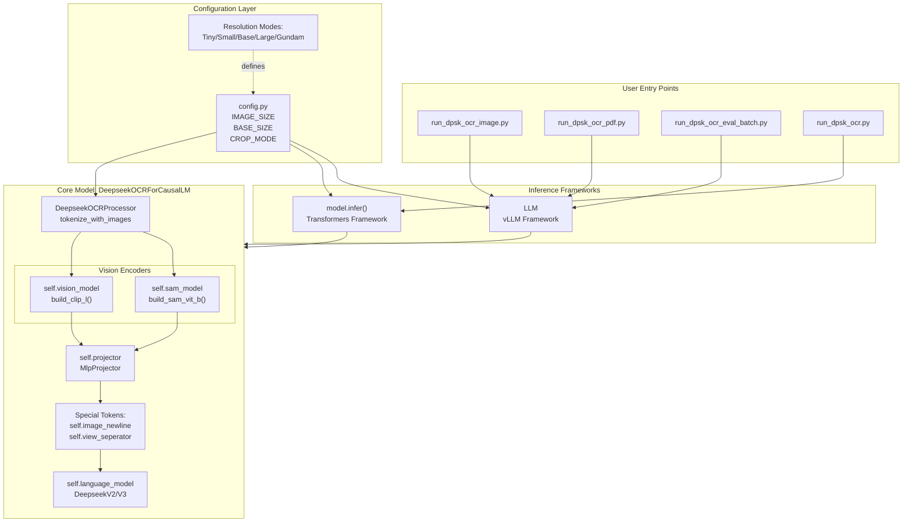
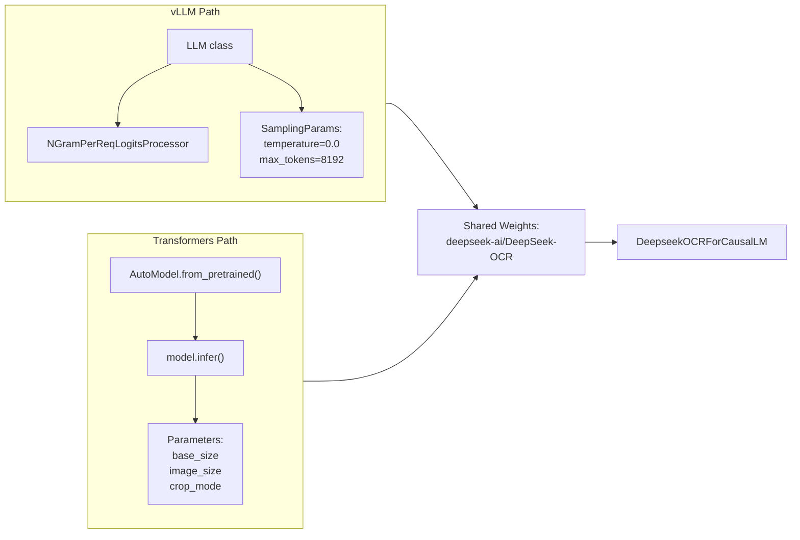
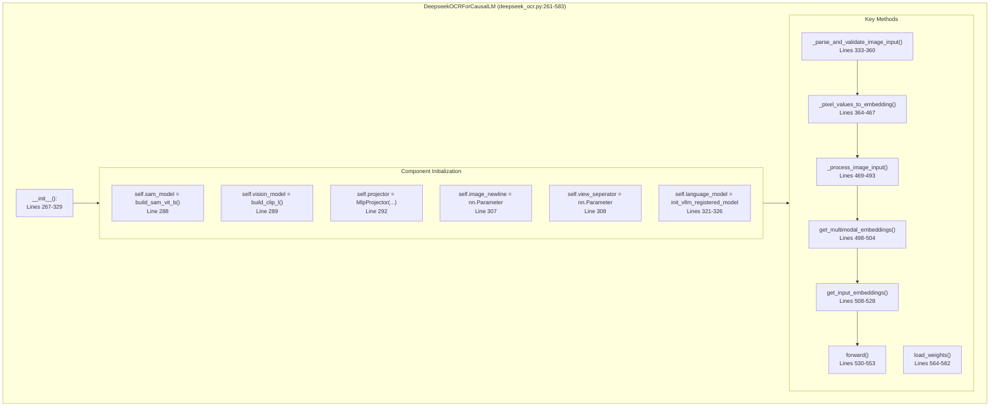
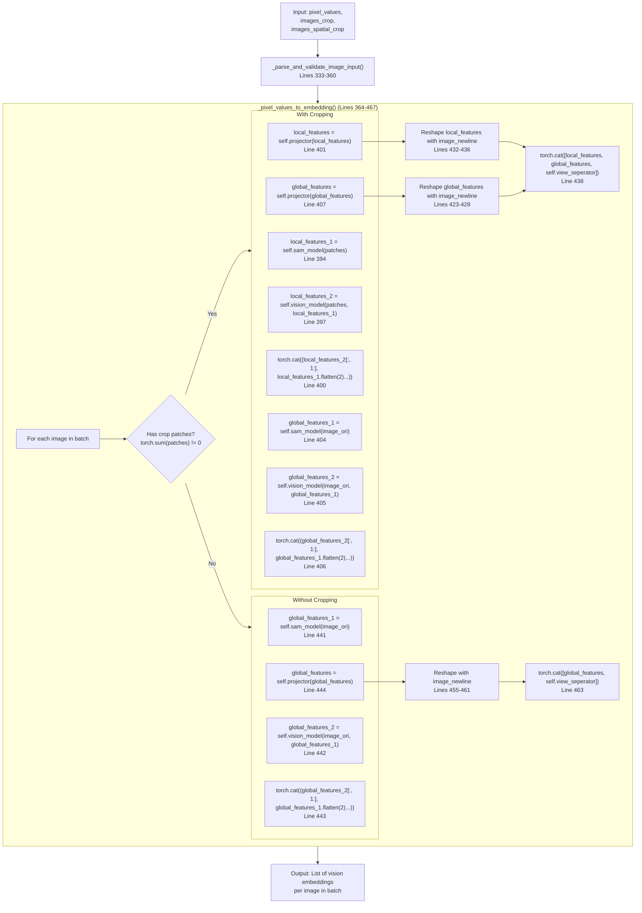
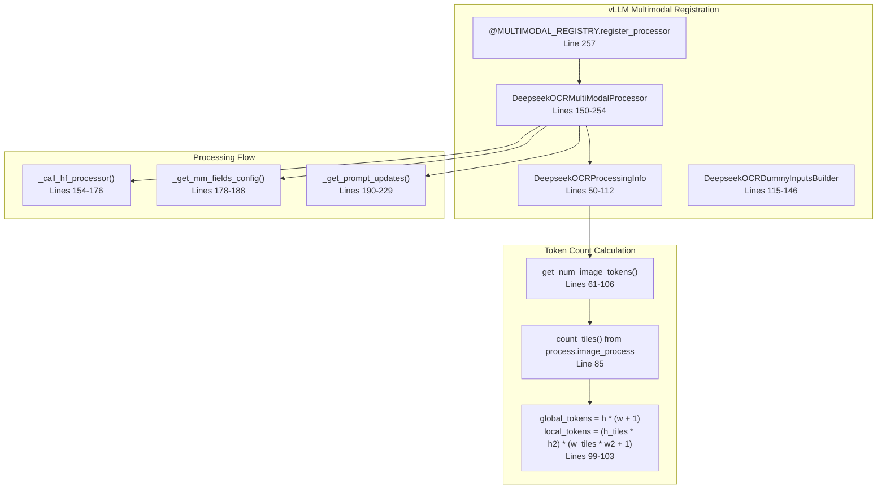
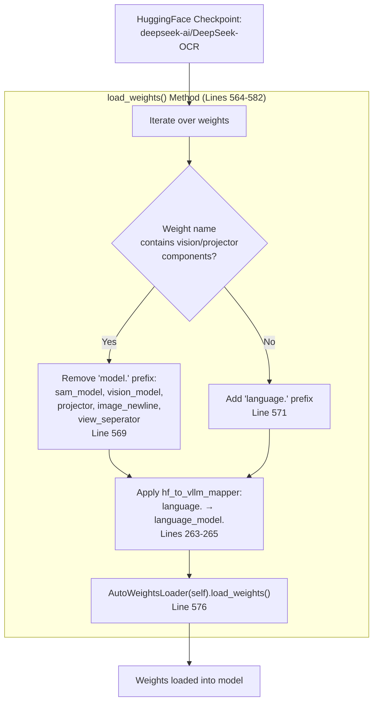

<!-- source: DeepWiki mcp.deepwiki.com · repo deepseek-ai/DeepSeek-OCR · page 4.1 System Design Overview · fetched 2026-10-30 -->

# System Design Overview

<details>
<summary>Relevant source files</summary>

The following files were used as context for generating this wiki page:

- [DeepSeek-OCR-master/DeepSeek-OCR-vllm/deepseek_ocr.py](DeepSeek-OCR-master/DeepSeek-OCR-vllm/deepseek_ocr.py)
- [README.md](README.md)

</details>


## Purpose and Scope

This page provides a high-level architectural overview of DeepSeek-OCR, explaining the major components, their relationships, and how data flows through the system. It covers the dual-framework design that enables both production deployment (vLLM) and research workflows (Transformers), the layered component architecture, and key design decisions.

For detailed information about specific subsystems:
- Model architecture internals: see [Model Architecture](#4.2)
- Vision encoding components: see [Vision Encoding System](#4.3)
- Image preprocessing pipeline: see [Image Processing Pipeline](#4.4)
- Configuration parameters: see [Configuration System](#3.3)

**Sources**: [README.md:1-189](), [DeepSeek-OCR-master/DeepSeek-OCR-vllm/deepseek_ocr.py:1-583]()

## Architectural Principles

DeepSeek-OCR is designed around three core principles:

1. **Dual-Framework Flexibility**: Parallel support for vLLM (production serving) and Transformers (research/development) with shared model weights [README.md:89-188]().
2. **Dual-Encoder Vision**: Complementary feature extraction using SAM (spatial/fine-grained) and CLIP (semantic/high-level) [DeepSeek-OCR-master/DeepSeek-OCR-vllm/deepseek_ocr.py:40-41]().
3. **Dynamic Multi-Scale Processing**: Hierarchical representation through local tile crops and global views [DeepSeek-OCR-master/DeepSeek-OCR-vllm/deepseek_ocr.py:78-106]().

**Sources**: [README.md:89-188](), [DeepSeek-OCR-master/DeepSeek-OCR-vllm/deepseek_ocr.py:40-106]()

## System Architecture Overview



**System Architecture Diagram**: Maps user-facing scripts to core components, showing the separation between entry points, configuration, frameworks, and model layers.

The system follows a layered architecture with clear separation of concerns:

- **Entry Points**: Specialized scripts for different use cases [README.md:96-106]().
- **Configuration Layer**: Centralized parameter management via `config.py` [DeepSeek-OCR-master/DeepSeek-OCR-vllm/deepseek_ocr.py:45]().
- **Framework Layer**: Dual implementation paths (vLLM and Transformers) [README.md:90-188]().
- **Model Layer**: Shared vision-language model with dual encoders [DeepSeek-OCR-master/DeepSeek-OCR-vllm/deepseek_ocr.py:261-330]().

**Sources**: [README.md:90-188](), [DeepSeek-OCR-master/DeepSeek-OCR-vllm/deepseek_ocr.py:45-330]()

## Component Breakdown

### Entry Point Scripts

DeepSeek-OCR provides several entry points optimized for specific workflows:

| Script | Framework | Primary Use Case | Key Features |
|--------|-----------|------------------|--------------|
| `run_dpsk_ocr_image.py` | vLLM | Single image OCR | Streaming output [README.md:98]() |
| `run_dpsk_ocr_pdf.py` | vLLM | PDF document processing | High concurrency (~2500 tokens/s) [README.md:102]() |
| `run_dpsk_ocr_eval_batch.py` | vLLM | Batch evaluation | Benchmarking [README.md:106]() |
| `run_dpsk_ocr.py` | Transformers | Research/experimentation | Direct `model.infer()` API [README.md:188]() |

**Sources**: [README.md:96-106](), [README.md:188]()

### Configuration System

The `config.py` file centralizes all processing parameters used by both frameworks [DeepSeek-OCR-master/DeepSeek-OCR-vllm/deepseek_ocr.py:45]():

```python
# Key configuration parameters referenced throughout the codebase
IMAGE_SIZE      # Local tile size (e.g., 640)
BASE_SIZE       # Global view size (e.g., 1024)
CROP_MODE       # Enable/disable dynamic cropping
```

These parameters control resolution modes such as **Tiny**, **Small**, **Base**, **Large**, and the dynamic **Gundam** mode (n×640×640 + 1×1024×1024) [README.md:192-198]().

**Sources**: [README.md:192-198](), [DeepSeek-OCR-master/DeepSeek-OCR-vllm/deepseek_ocr.py:45-45](), [DeepSeek-OCR-master/DeepSeek-OCR-vllm/deepseek_ocr.py:73-97]()

### Inference Framework Layer



**Dual Framework Design**: Both paths load the same model checkpoint but provide different interfaces and optimizations.

#### vLLM Framework
- **Purpose**: High-throughput production serving [README.md:56]().
- **Key Classes**: `LLM`, `NGramPerReqLogitsProcessor` [README.md:119-120]().
- **Performance**: Optimized for batch generation and streaming [README.md:96-106]().

#### Transformers Framework
- **Purpose**: Research and fine-tuning [README.md:165]().
- **Key Methods**: `model.infer()` with extensive parameters like `base_size`, `image_size`, and `crop_mode` [README.md:183]().

**Sources**: [README.md:56-183](), [DeepSeek-OCR-master/DeepSeek-OCR-vllm/deepseek_ocr.py:119-120]()

## Core Model Architecture

### DeepseekOCRForCausalLM Class Structure



**DeepseekOCRForCausalLM Class Hierarchy**: Shows initialization flow and method relationships for the main model class.

The `DeepseekOCRForCausalLM` class implements the `SupportsMultiModal` and `SupportsPP` interfaces from vLLM, enabling seamless integration with vLLM's serving infrastructure [DeepSeek-OCR-master/DeepSeek-OCR-vllm/deepseek_ocr.py:35, 261]().

**Sources**: [DeepSeek-OCR-master/DeepSeek-OCR-vllm/deepseek_ocr.py:261-583]()

### Vision Processing Pipeline



**Vision Processing Data Flow**: Detailed flow through `_pixel_values_to_embedding()` showing dual-encoder architecture and multi-scale processing.

Key processing steps:
1. **Input Validation**: `_parse_and_validate_image_input()` extracts `pixel_values`, `images_crop`, and `images_spatial_crop` [DeepSeek-OCR-master/DeepSeek-OCR-vllm/deepseek_ocr.py:333-360]().
2. **Dual Encoding**: Each image passes through both `self.sam_model` (SAM) and `self.vision_model` (CLIP) [DeepSeek-OCR-master/DeepSeek-OCR-vllm/deepseek_ocr.py:394-405]().
3. **Feature Fusion**: SAM and CLIP features are concatenated along the feature dimension (2048-dim total) [DeepSeek-OCR-master/DeepSeek-OCR-vllm/deepseek_ocr.py:400, 406]().
4. **Projection**: `self.projector` reduces 2048-dim to 1280-dim for language model compatibility [DeepSeek-OCR-master/DeepSeek-OCR-vllm/deepseek_ocr.py:401, 407]().
5. **Spatial Structuring**: `self.image_newline` tokens inserted to maintain 2D grid structure [DeepSeek-OCR-master/DeepSeek-OCR-vllm/deepseek_ocr.py:423-436]().
6. **View Separation**: `self.view_seperator` token marks boundaries between local and global views [DeepSeek-OCR-master/DeepSeek-OCR-vllm/deepseek_ocr.py:438]().

**Sources**: [DeepSeek-OCR-master/DeepSeek-OCR-vllm/deepseek_ocr.py:333-493]()

## Multimodal Processing Architecture



**Multimodal Registration System**: Shows how DeepSeek-OCR integrates with vLLM's multimodal framework through processor registration and token calculation.

The multimodal system handles:
- **Processor Registration**: Decorators connect custom processors to vLLM's `MULTIMODAL_REGISTRY` [DeepSeek-OCR-master/DeepSeek-OCR-vllm/deepseek_ocr.py:257]().
- **Token Counting**: Dynamic calculation based on `IMAGE_SIZE`, `BASE_SIZE`, `CROP_MODE`, and image dimensions [DeepSeek-OCR-master/DeepSeek-OCR-vllm/deepseek_ocr.py:61-106]().
- **Field Configuration**: Maps processor outputs (`pixel_values`, `images_spatial_crop`, `images_crop`) to vLLM's multimodal fields [DeepSeek-OCR-master/DeepSeek-OCR-vllm/deepseek_ocr.py:178-188]().

**Sources**: [DeepSeek-OCR-master/DeepSeek-OCR-vllm/deepseek_ocr.py:50-260]()

## Weight Loading and Model Initialization



**Weight Loading Process**: Shows how weights from HuggingFace checkpoint are mapped to vLLM model structure.

The weight loading system handles prefix transformations:
1. **Vision Components**: Strip `model.` prefix from SAM, CLIP, projector, and special token parameters [DeepSeek-OCR-master/DeepSeek-OCR-vllm/deepseek_ocr.py:569]().
2. **Language Model**: Add `language.` prefix, then apply mapper to transform to `language_model.` [DeepSeek-OCR-master/DeepSeek-OCR-vllm/deepseek_ocr.py:263-265, 571]().

**Sources**: [DeepSeek-OCR-master/DeepSeek-OCR-vllm/deepseek_ocr.py:263-265, 564-582]()

## Key Design Decisions

### Why Dual Encoders?

SAM and CLIP provide complementary features:
- **SAM (Segment Anything Model)**: excels at capturing fine-grained spatial details and boundaries—critical for OCR [DeepSeek-OCR-master/DeepSeek-OCR-vllm/deepseek_ocr.py:288]().
- **CLIP**: provides high-level semantic understanding [DeepSeek-OCR-master/DeepSeek-OCR-vllm/deepseek_ocr.py:289]().

The concatenation of features (2048-dim = SAM + CLIP) enables the model to leverage both spatial precision and semantic context [DeepSeek-OCR-master/DeepSeek-OCR-vllm/deepseek_ocr.py:400]().

### Why Special Tokens?

The `image_newline` and `view_seperator` tokens serve critical functions:
- **`image_newline` (line 307)**: Appended after each row of the vision feature grid, maintaining 2D spatial structure in the flattened 1D sequence [DeepSeek-OCR-master/DeepSeek-OCR-vllm/deepseek_ocr.py:423-429]().
- **`view_seperator` (line 308)**: Marks boundaries between local tile views and global view [DeepSeek-OCR-master/DeepSeek-OCR-vllm/deepseek_ocr.py:438]().

**Sources**: [DeepSeek-OCR-master/DeepSeek-OCR-vllm/deepseek_ocr.py:288-438]()

---

