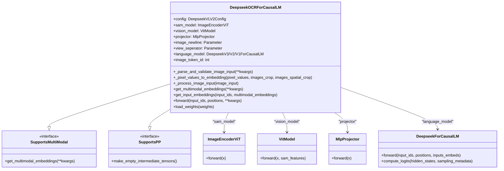
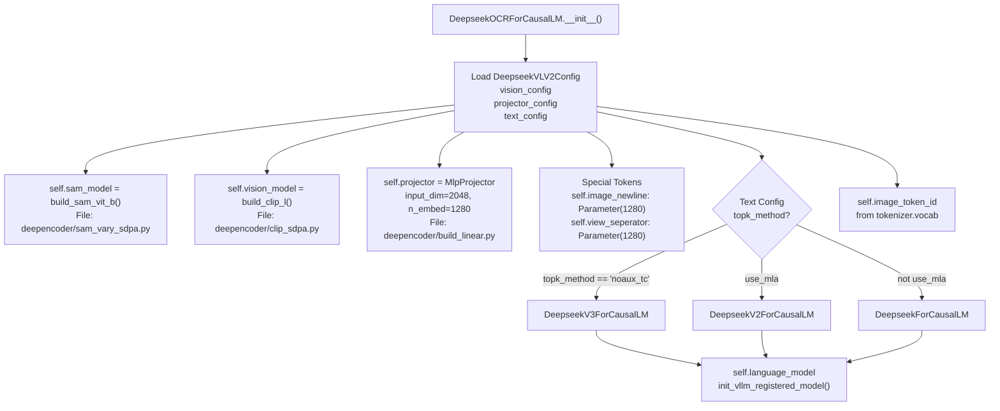
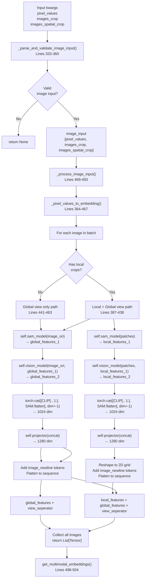
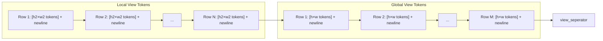
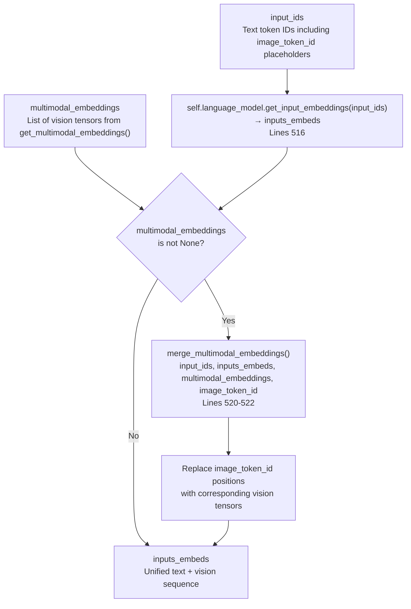
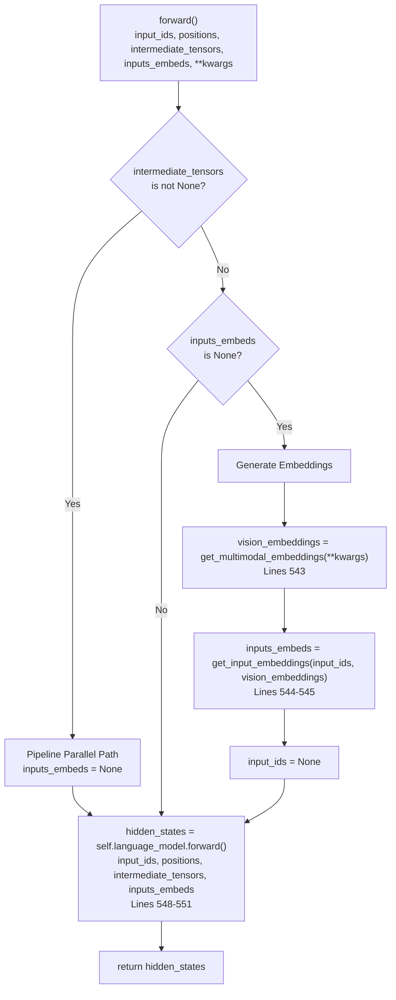
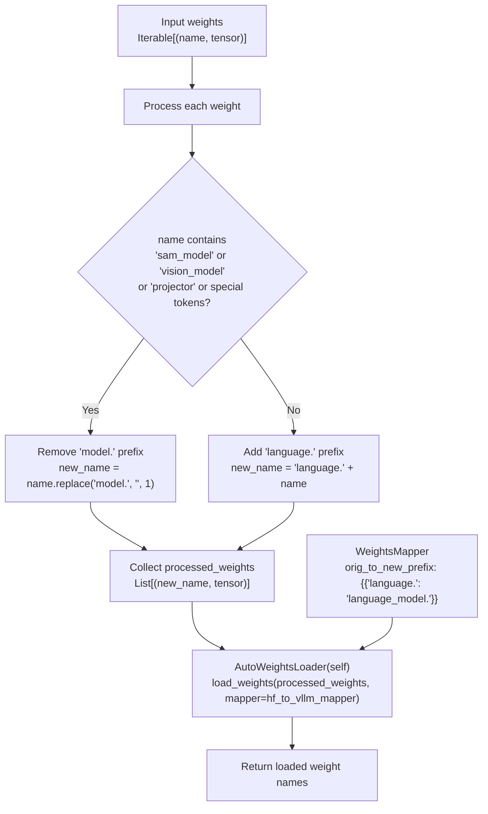

<!-- source: DeepWiki mcp.deepwiki.com · repo deepseek-ai/DeepSeek-OCR · page 4.2 Model Architecture · fetched 2026-10-30 -->

# Model Architecture

<details>
<summary>Relevant source files</summary>

The following files were used as context for generating this wiki page:

- [DeepSeek-OCR-master/DeepSeek-OCR-vllm/deepseek_ocr.py](DeepSeek-OCR-master/DeepSeek-OCR-vllm/deepseek_ocr.py)

</details>


This document provides a detailed technical explanation of the `DeepseekOCRForCausalLM` model class, which is the core neural network architecture of DeepSeek-OCR. It describes how the model combines dual vision encoders (SAM and CLIP) with a causal language model to perform optical character recognition tasks.

**Scope**: This page focuses on the model's internal structure, component initialization, and data flow through the network. For high-level system design patterns, see [System Design Overview](#4.1). For detailed encoder implementations, see [Vision Encoding System](#4.3) and its subsections. For image preprocessing before model input, see [Image Processing Pipeline](#4.4).

---

## Model Class Structure

The `DeepseekOCRForCausalLM` class serves as the main entry point for inference, inheriting from PyTorch's `nn.Module` and implementing vLLM's multimodal interfaces.

### Class Relationship Diagram



**Sources**: [DeepSeek-OCR-master/DeepSeek-OCR-vllm/deepseek_ocr.py:261-330]()

---

## Component Initialization

The model initializes five main components during construction, each serving a distinct role in the vision-language pipeline.

### Initialization Sequence

| Component | Builder/Class | Input Dimension | Output Dimension | Purpose |
|-----------|--------------|-----------------|------------------|---------|
| `sam_model` | `build_sam_vit_b()` | [B, 3, H, W] | [B, 256, H/16, W/16] | Spatial feature extraction |
| `vision_model` | `build_clip_l()` | [B, 3, H, W] + SAM features | [B, N, 768] | Semantic feature extraction |
| `projector` | `MlpProjector` | 1024 (768+256) | 1280 | Dimension reduction to LLM space |
| `image_newline` | `nn.Parameter` | - | 1280 | 2D spatial layout token |
| `view_seperator` | `nn.Parameter` | - | 1280 | Multi-view boundary token |
| `language_model` | `init_vllm_registered_model()` | 1280 | vocab_size | Causal text generation |

### Component Instantiation Logic



**Key Implementation Details**:

1. **SAM and CLIP encoders** are loaded from separate modules and operate independently on the same input images [DeepSeek-OCR-master/DeepSeek-OCR-vllm/deepseek_ocr.py:288-289]().
2. **MlpProjector configuration** uses a `Dict` wrapper with `projector_type="linear"`, which determines the projection architecture variant [DeepSeek-OCR-master/DeepSeek-OCR-vllm/deepseek_ocr.py:292]().
3. **Special token embeddings** are initialized with normal distribution scaled by `1/sqrt(n_embed)` to match the language model's embedding statistics [DeepSeek-OCR-master/DeepSeek-OCR-vllm/deepseek_ocr.py:304-308]().
4. **Language model selection** is determined by the text config's `topk_method` and `use_mla` flags, supporting three DeepSeek variants [DeepSeek-OCR-master/DeepSeek-OCR-vllm/deepseek_ocr.py:314-326]().

**Sources**: [DeepSeek-OCR-master/DeepSeek-OCR-vllm/deepseek_ocr.py:267-330]()

---

## Vision-to-Embedding Pipeline

The core of the model's multimodal capability is the conversion of pixel values into language model embeddings. This process involves three main stages: input validation, dual-encoder feature extraction, and spatial structuring.

### Data Flow Architecture



### Dual-Encoder Feature Fusion

The model concatenates SAM and CLIP features to create a combined representation before projection. This design captures both fine-grained spatial details (SAM) and high-level semantic understanding (CLIP).

**Feature concatenation logic** [DeepSeek-OCR-master/DeepSeek-OCR-vllm/deepseek_ocr.py:400]():
```python
# CLIP features (excluding CLS token) + SAM features (flattened)
local_features = torch.cat((local_features_2[:, 1:], 
                           local_features_1.flatten(2).permute(0, 2, 1)), 
                          dim=-1)
```

**Dimension breakdown**:
- `CLIP VitModel` output: `[B, N+1, 768]` where N = (H/16)×(W/16), CLS token at index 0.
- `SAM ImageEncoderViT` output: `[B, 256, H/16, W/16]`.
- After CLIP slicing: `[B, N, 768]`.
- After SAM flattening: `[B, N, 256]`.
- After concatenation: `[B, N, 1024]`.

**Sources**: [DeepSeek-OCR-master/DeepSeek-OCR-vllm/deepseek_ocr.py:333-504]()

---

## Special Token System

The model uses two learned embedding parameters to structure vision features into a 2D spatial layout that preserves document structure for the language model.

### Token Purposes

| Token | Parameter Name | Dimension | Usage | Insertion Points |
|-------|---------------|-----------|-------|-----------------|
| Image Newline | `image_newline` | 1280 | Marks end of each row in 2D grid | After each row of vision tokens |
| View Separator | `view_seperator` | 1280 | Separates local and global views | Between multi-view feature sequences |

### Spatial Structure Construction

The following diagram shows how vision features are structured with special tokens for a cropped image (local + global views):



**Implementation for global features** [DeepSeek-OCR-master/DeepSeek-OCR-vllm/deepseek_ocr.py:423-429]():
```python
# Reshape to 2D spatial grid
global_features = global_features.view(h, w, n_dim)

# Add newline token after each row
global_features = torch.cat(
    [global_features, self.image_newline[None, None, :].expand(h, 1, n_dim)], 
    dim=1
)

# Flatten to sequence
global_features = global_features.view(-1, n_dim)
```

**Implementation for local features** [DeepSeek-OCR-master/DeepSeek-OCR-vllm/deepseek_ocr.py:432-436]():
```python
# Reshape cropped patches to unified 2D grid
local_features = local_features.view(height_crop_num, width_crop_num, h2, w2, n_dim2)
                              .permute(0, 2, 1, 3, 4)
                              .reshape(height_crop_num*h2, width_crop_num*w2, n_dim2)

# Add newline token after each row
local_features = torch.cat(
    [local_features, self.image_newline[None, None, :].expand(height_crop_num * h2, 1, n_dim2)], 
    dim=1
)
local_features = local_features.view(-1, n_dim2)
```

**Sources**: [DeepSeek-OCR-master/DeepSeek-OCR-vllm/deepseek_ocr.py:304-308, 423-438, 456-463]()

---

## Input Embedding Integration

The `get_input_embeddings` method merges text token embeddings with vision embeddings by replacing image token placeholders in the input sequence.

### Embedding Merge Process



**Key implementation** [DeepSeek-OCR-master/DeepSeek-OCR-vllm/deepseek_ocr.py:508-528]():
```python
def get_input_embeddings(
    self,
    input_ids: torch.Tensor,
    multimodal_embeddings: Optional[MultiModalEmbeddings] = None,
) -> torch.Tensor:
    # Get text embeddings from language model
    inputs_embeds = self.language_model.get_input_embeddings(input_ids)
    
    # Replace image token positions with vision embeddings
    if multimodal_embeddings is not None:
        inputs_embeds = merge_multimodal_embeddings(
            input_ids, inputs_embeds, multimodal_embeddings,
            self.image_token_id)
    
    return inputs_embeds
```

**Sources**: [DeepSeek-OCR-master/DeepSeek-OCR-vllm/deepseek_ocr.py:508-528]()

---

## Forward Pass

The forward method orchestrates the complete inference pipeline, from multimodal input to logits generation.

### Forward Pass Flow



**Sources**: [DeepSeek-OCR-master/DeepSeek-OCR-vllm/deepseek_ocr.py:530-561]()

---

## Weight Loading

The model implements custom weight loading logic to handle the different naming conventions between Hugging Face checkpoints and vLLM's internal structure.

### Weight Mapping Strategy



**Implementation Details**:
- Vision encoder weights (SAM, CLIP, Projector) have the `model.` prefix stripped [DeepSeek-OCR-master/DeepSeek-OCR-vllm/deepseek_ocr.py:571-574]().
- Language model weights are prefixed with `language.` and then mapped to `language_model.` via the `WeightsMapper` [DeepSeek-OCR-master/DeepSeek-OCR-vllm/deepseek_ocr.py:576, 263-265]().

**Sources**: [DeepSeek-OCR-master/DeepSeek-OCR-vllm/deepseek_ocr.py:263-265, 564-582]()

---

## Summary of Key Methods

| Method | Input | Output | Purpose |
|--------|-------|--------|---------|
| `__init__()` | `vllm_config, prefix` | - | Initialize all model components |
| `_parse_and_validate_image_input()` | `**kwargs` | `Optional[List[Tensor]]` | Extract and validate pixel_values, images_crop, images_spatial_crop |
| `_pixel_values_to_embedding()` | `pixel_values, images_crop, images_spatial_crop` | `List[Tensor]` | Run dual encoders and structure features |
| `get_multimodal_embeddings()` | `**kwargs` | `Optional[List[Tensor]]` | Public API for vision embedding generation |
| `get_input_embeddings()` | `input_ids, multimodal_embeddings` | `Tensor` | Merge text and vision embeddings |
| `forward()` | `input_ids, positions, inputs_embeds, **kwargs` | `Tensor` | Complete forward pass through model |
| `load_weights()` | `weights` | `Set[str]` | Load model weights from checkpoint |

**Sources**: [DeepSeek-OCR-master/DeepSeek-OCR-vllm/deepseek_ocr.py:261-583]()

---

