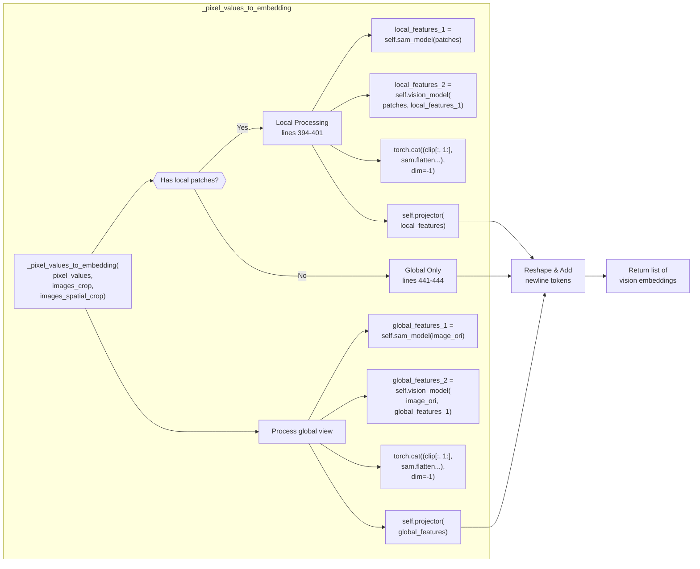
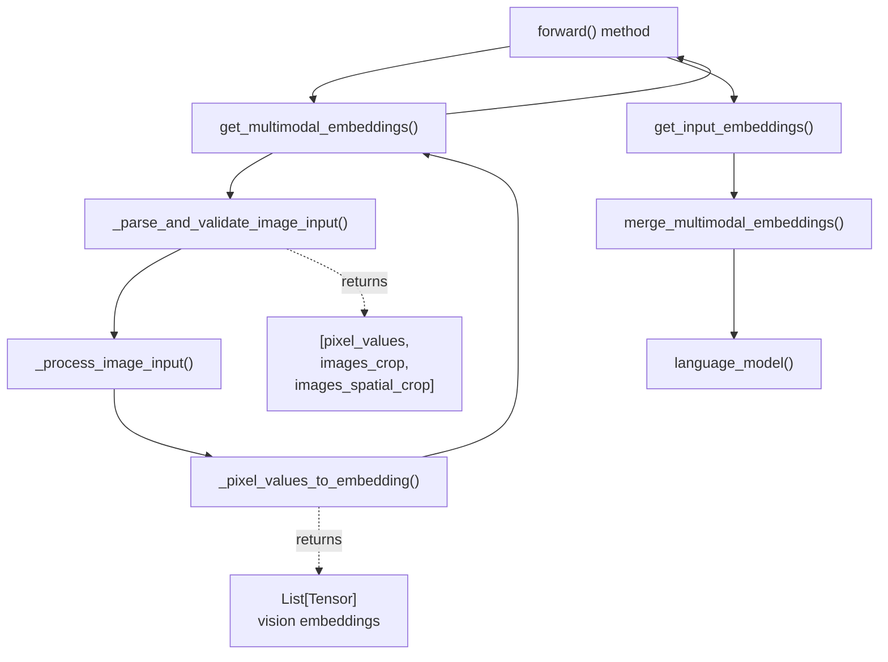

<!-- source: DeepWiki mcp.deepwiki.com · repo deepseek-ai/DeepSeek-OCR · page 4.3 Vision Encoding System · fetched 2026-10-30 -->

# Vision Encoding System

<details>
<summary>Relevant source files</summary>

The following files were used as context for generating this wiki page:

- [DeepSeek-OCR-master/DeepSeek-OCR-vllm/deepencoder/__init__.py](DeepSeek-OCR-master/DeepSeek-OCR-vllm/deepencoder/__init__.py)
- [DeepSeek-OCR-master/DeepSeek-OCR-vllm/deepseek_ocr.py](DeepSeek-OCR-master/DeepSeek-OCR-vllm/deepseek_ocr.py)

</details>


## Purpose and Scope

This document describes the dual-encoder vision system that extracts visual features from input images in DeepSeek-OCR. The system combines two complementary vision encoders—SAM (Segment Anything Model) ViT-B and CLIP-L—to capture both fine-grained spatial details and high-level semantic information. This page covers the overall architecture, feature extraction pipeline, and integration strategy. For implementation details of individual encoders, see [SAM ViT-B Encoder](#4.3.1) and [CLIP-L Encoder](#4.3.2). For information about feature projection to the language model dimension, see [Feature Projection](#4.3.3).

**Sources:** [DeepSeek-OCR-master/DeepSeek-OCR-vllm/deepseek_ocr.py:1-583]()

## Dual-Encoder Architecture

The vision encoding system employs a dual-encoder design where SAM and CLIP process the same input images in parallel. This architecture leverages complementary strengths:

- **SAM Encoder**: Extracts fine-grained spatial features with 1024 dimensions, optimized for detailed structure and layout recognition.
- **CLIP Encoder**: Extracts semantic features with 1024 dimensions, optimized for high-level content understanding.

Features from both encoders are concatenated to form 2048-dimensional representations, which are then projected to 1280 dimensions for the language model.

### Architecture Diagram

```mermaid
graph TB
    subgraph "Encoder_Initialization"
        ["build_sam_vit_b()"] --> SAM_MODEL["self.sam_model<br/>ImageEncoderViT"]
        ["build_clip_l()"] --> VISION_MODEL["self.vision_model<br/>VitModel"]
        ["MlpProjector"] --> PROJECTOR["self.projector<br/>2048 to 1280 dim"]
    end
    
    subgraph "Feature_Extraction_Pipeline"
        INPUT_IMG["Input Image<br/>torch.Tensor<br/>[B, 3, H, W]"]
        
        INPUT_IMG --> SAM_FWD["sam_model(image)<br/>Spatial Features"]
        INPUT_IMG --> CLIP_INPUT["vision_model(image,<br/>sam_features)"]
        SAM_FWD --> CLIP_INPUT
        
        SAM_FWD --> SAM_OUT["SAM Output<br/>[B, 1024, h, w]<br/>1024-dim spatial"]
        CLIP_INPUT --> CLIP_OUT["CLIP Output<br/>[B, L, 1024]<br/>1024-dim semantic"]
    end
    
    subgraph "Feature_Fusion"
        SAM_OUT --> FLATTEN["Flatten & Permute<br/>[B, h*w, 1024]"]
        CLIP_OUT --> CLIP_TOKENS["Remove CLS token<br/>[B, L-1, 1024]"]
        
        FLATTEN --> CONCAT["torch.cat(..., dim=-1)<br/>[B, h*w, 2048]"]
        CLIP_TOKENS --> CONCAT
        
        CONCAT --> PROJ_FWD["projector(features)<br/>[B, h*w, 1280]"]
    end
    
    PROJ_FWD --> OUTPUT["Vision Features<br/>1280-dim embeddings"]
```

**Sources:** [DeepSeek-OCR-master/DeepSeek-OCR-vllm/deepseek_ocr.py:288-298](), [DeepSeek-OCR-master/DeepSeek-OCR-vllm/deepseek_ocr.py:394-407]()

## Encoder Instantiation

The vision encoders are instantiated in the `DeepseekOCRForCausalLM.__init__` method as model attributes:

| Attribute | Builder Function | Implementation | Output Dimension |
|-----------|-----------------|----------------|------------------|
| `self.sam_model` | `build_sam_vit_b()` | `ImageEncoderViT` | 1024 |
| `self.vision_model` | `build_clip_l()` | `VitModel` | 1024 |
| `self.projector` | `MlpProjector(...)` | Linear/MLP projection | 1280 |

The encoders are initialized with fixed configurations defined in their respective builder functions. No runtime configuration is passed during instantiation.

**Sources:** [DeepSeek-OCR-master/DeepSeek-OCR-vllm/deepseek_ocr.py:288-292](), [DeepSeek-OCR-master/DeepSeek-OCR-vllm/deepencoder/sam_vary_sdpa.py:481-488](), [DeepSeek-OCR-master/DeepSeek-OCR-vllm/deepencoder/clip_sdpa.py:447-452]()

## Feature Extraction Pipeline

The `_pixel_values_to_embedding` method implements the core feature extraction logic. It processes each image through both encoders and handles both global and local views in dynamic cropping mode.

### Code Entity Mapping



**Sources:** [DeepSeek-OCR-master/DeepSeek-OCR-vllm/deepseek_ocr.py:364-467]()

### Processing Steps

For each image in the batch, the pipeline executes:

1. **Check for local patches** [DeepSeek-OCR-master/DeepSeek-OCR-vllm/deepseek_ocr.py:391](): Determines if dynamic cropping produced local views.
2. **Process local views** [DeepSeek-OCR-master/DeepSeek-OCR-vllm/deepseek_ocr.py:394-401]() (if applicable):
   - Extract SAM features from patches: `local_features_1 = self.sam_model(patches)`
   - Extract CLIP features with SAM as input: `local_features_2 = self.vision_model(patches, local_features_1)`
   - Concatenate: Remove CLIP CLS token, flatten SAM output, concat along feature dimension.
   - Project: `local_features = self.projector(local_features)`
3. **Process global view** [DeepSeek-OCR-master/DeepSeek-OCR-vllm/deepseek_ocr.py:404-407]() or [DeepSeek-OCR-master/DeepSeek-OCR-vllm/deepseek_ocr.py:441-444]():
   - Same steps as local processing but applied to full-resolution base image.
4. **Reshape and add special tokens** [DeepSeek-OCR-master/DeepSeek-OCR-vllm/deepseek_ocr.py:423-438]():
   - Add `image_newline` tokens to maintain 2D spatial structure.
   - Add `view_separator` token between local and global views.

**Sources:** [DeepSeek-OCR-master/DeepSeek-OCR-vllm/deepseek_ocr.py:391-464]()

## Feature Fusion Strategy

### Concatenation Details

The feature fusion combines SAM and CLIP outputs through concatenation along the feature dimension:

```python
# CLIP tokens (excluding CLS): [B, L-1, 1024]
clip_features = features_2[:, 1:]

# SAM features flattened: [B, h*w, 1024]  
sam_features = features_1.flatten(2).permute(0, 2, 1)

# Concatenated: [B, L, 2048]
fused_features = torch.cat((clip_features, sam_features), dim=-1)
```

This produces 2048-dimensional features that capture both semantic and spatial information. The concatenation strategy preserves all information from both encoders without any intermediate fusion operations like addition or learned gating.

**Sources:** [DeepSeek-OCR-master/DeepSeek-OCR-vllm/deepseek_ocr.py:400](), [DeepSeek-OCR-master/DeepSeek-OCR-vllm/deepseek_ocr.py:406](), [DeepSeek-OCR-master/DeepSeek-OCR-vllm/deepseek_ocr.py:443]()

### Projection to Language Model Dimension

After concatenation, the `MlpProjector` reduces dimensionality from 2048 to 1280:

```python
self.projector = MlpProjector(Dict(
    projector_type="linear",
    input_dim=2048,
    n_embed=1280
))

# During forward pass
projected_features = self.projector(fused_features)  # [B, L, 1280]
```

This matches the embedding dimension of the language model for seamless multimodal integration.

**Sources:** [DeepSeek-OCR-master/DeepSeek-OCR-vllm/deepseek_ocr.py:292](), [DeepSeek-OCR-master/DeepSeek-OCR-vllm/deepseek_ocr.py:401](), [DeepSeek-OCR-master/DeepSeek-OCR-vllm/deepseek_ocr.py:407]()

## Feature Dimension Flow

The following table summarizes tensor shapes through the vision encoding pipeline for a single image:

| Stage | Tensor | Shape | Notes |
|-------|--------|-------|-------|
| Input | `image` | `[1, 3, H, W]` | Original image or cropped patch |
| SAM Output | `sam_features` | `[1, 1024, h, w]` | Spatial feature map, h=w=H/16/4 |
| SAM Flattened | `sam_features` | `[1, h*w, 1024]` | After flatten(2).permute(0,2,1) |
| CLIP Output | `clip_features` | `[1, L, 1024]` | L = h*w + 1 (includes CLS) |
| CLIP Tokens | `clip_features[:, 1:]` | `[1, h*w, 1024]` | CLS token removed |
| Concatenated | `fused_features` | `[1, h*w, 2048]` | SAM + CLIP concatenated |
| Projected | `projected_features` | `[1, h*w, 1280]` | After MlpProjector |
| With Newlines | `features_with_nl` | `[1, h*(w+1), 1280]` | Newline tokens inserted |
| Final Output | `global_local_features` | `[N, 1280]` | Flattened, N varies by image |

For images with dynamic cropping enabled, both local and global views follow this pipeline independently, then are concatenated with a view separator token.

**Sources:** [DeepSeek-OCR-master/DeepSeek-OCR-vllm/deepseek_ocr.py:394-438]()

## Special Token Integration

The vision encoding system adds two types of learned special tokens to structure the output:

| Token | Parameter | Purpose | Shape |
|-------|-----------|---------|-------|
| Image Newline | `self.image_newline` | Marks end of each spatial row | `[1280]` |
| View Separator | `self.view_seperator` | Separates local and global views | `[1280]` |

These tokens are initialized as parameters with normal distribution scaled by `embed_std = 1 / sqrt(1280)` and are learned during training [DeepSeek-OCR-master/DeepSeek-OCR-vllm/deepseek_ocr.py:304-308]():

```python
embed_std = 1 / torch.sqrt(torch.tensor(n_embed, dtype=torch.float32))
self.image_newline = nn.Parameter(torch.randn(n_embed) * embed_std)
self.view_seperator = nn.Parameter(torch.randn(n_embed) * embed_std)
```

The newline tokens maintain 2D spatial structure in the flattened token sequence, while the view separator enables the language model to distinguish between different views of the same image.

**Sources:** [DeepSeek-OCR-master/DeepSeek-OCR-vllm/deepseek_ocr.py:304-308](), [DeepSeek-OCR-master/DeepSeek-OCR-vllm/deepseek_ocr.py:426-427](), [DeepSeek-OCR-master/DeepSeek-OCR-vllm/deepseek_ocr.py:438]()

## Integration with Model Pipeline

The vision encoding system integrates with the broader model through the `get_multimodal_embeddings` method:



The `get_multimodal_embeddings` method serves as the public interface that:
1. Validates and parses image inputs via `_parse_and_validate_image_input` [DeepSeek-OCR-master/DeepSeek-OCR-vllm/deepseek_ocr.py:469-493]().
2. Routes them through the dual-encoder pipeline via `_process_image_input` [DeepSeek-OCR-master/DeepSeek-OCR-vllm/deepseek_ocr.py:498-504]().
3. Returns vision embeddings ready for merging with text tokens via `merge_multimodal_embeddings` [DeepSeek-OCR-master/DeepSeek-OCR-vllm/deepseek_ocr.py:530-553]().

**Sources:** [DeepSeek-OCR-master/DeepSeek-OCR-vllm/deepseek_ocr.py:469-553]()

## Gradient Behavior

Vision feature extraction is performed within a `torch.no_grad()` context [DeepSeek-OCR-master/DeepSeek-OCR-vllm/deepseek_ocr.py:384]():

```python
with torch.no_grad():
    for jdx in range(images_spatial_crop.size(0)):
        local_features_1 = self.sam_model(patches)
        local_features_2 = self.vision_model(patches, local_features_1)
        # ... processing continues
```

This disables gradient computation for the vision encoders during inference, reducing memory overhead. The special tokens (`image_newline`, `view_seperator`) and projector are not wrapped in `no_grad()` and can be fine-tuned if needed.

**Sources:** [DeepSeek-OCR-master/DeepSeek-OCR-vllm/deepseek_ocr.py:384-466]()

## Weight Loading

Vision encoder weights are loaded through the `load_weights` method with specific name mapping:

```python
def load_weights(self, weights: Iterable[Tuple[str, torch.Tensor]]) -> Set[str]:
    processed_weights = []
    
    for name, tensor in weights:
        if 'sam_model' in name or 'vision_model' in name or 'projector' in name \
           or 'image_newline' in name or 'view_seperator' in name:
            new_name = name.replace('model.', '', 1)
        else:
            new_name = 'language.' + name
        
        processed_weights.append((new_name, tensor))
```

This mapping removes the `model.` prefix from vision-related weights while adding `language.` prefix to language model weights, ensuring correct parameter assignment during checkpoint loading.

**Sources:** [DeepSeek-OCR-master/DeepSeek-OCR-vllm/deepseek_ocr.py:564-582]()

---

