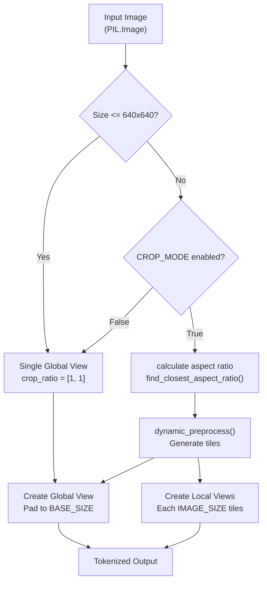
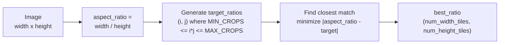
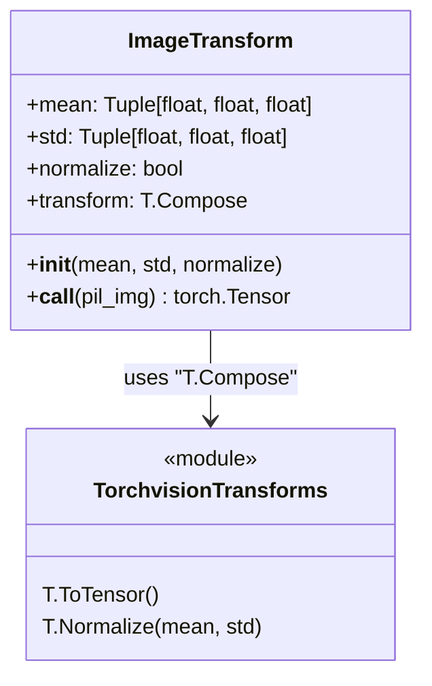
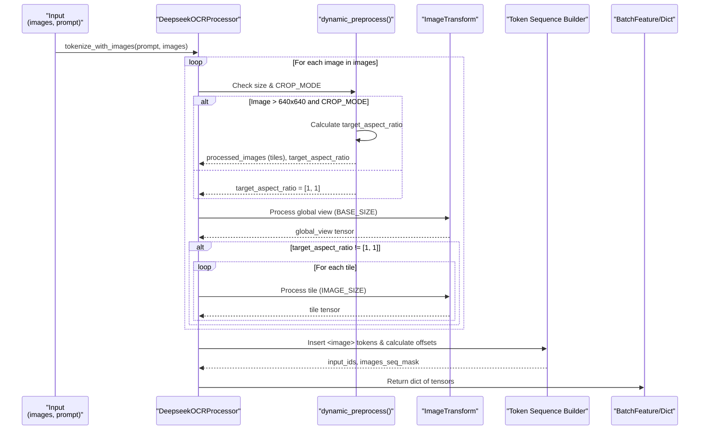
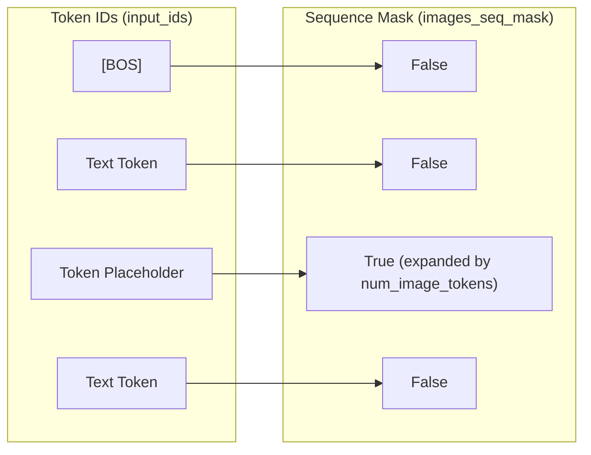

<!-- source: DeepWiki mcp.deepwiki.com · repo deepseek-ai/DeepSeek-OCR · page 4.4 Image Processing Pipeline · fetched 2026-10-30 -->

# Image Processing Pipeline

<details>
<summary>Relevant source files</summary>

The following files were used as context for generating this wiki page:

- [DeepSeek-OCR-master/DeepSeek-OCR-vllm/process/__init__.py](DeepSeek-OCR-master/DeepSeek-OCR-vllm/process/__init__.py)
- [DeepSeek-OCR-master/DeepSeek-OCR-vllm/process/image_process.py](DeepSeek-OCR-master/DeepSeek-OCR-vllm/process/image_process.py)

</details>


This document describes the image preprocessing pipeline in DeepSeek-OCR, which transforms raw input images into tokenized representations ready for vision encoding. The pipeline handles dynamic image cropping, normalization, and tokenization, producing structured inputs for the dual-encoder vision system.

For information about the vision encoders that process these preprocessed images, see [Vision Encoding System](#4.3). For details on how the tokenized images are integrated with text, see [Multimodal Integration](#4.5).

## Purpose and Scope

The image processing pipeline is responsible for:
- Loading and validating input images.
- Dynamically determining optimal cropping strategies based on image dimensions.
- Creating global and local image views at different resolutions.
- Normalizing pixel values.
- Generating tokenized sequences with special image tokens.
- Producing spatial metadata for the vision encoders.

The pipeline is implemented primarily in `DeepseekOCRProcessor` and supporting functions in [DeepSeek-OCR-master/DeepSeek-OCR-vllm/process/image_process.py:111-502]().

## Configuration-Driven Behavior

The image processing pipeline is controlled by centralized configuration parameters defined in [DeepSeek-OCR-master/DeepSeek-OCR-vllm/config.py:8-12]():

| Parameter | Default Value | Purpose |
|-----------|--------------|---------|
| `BASE_SIZE` | 1024 | Resolution for global view (full image) |
| `IMAGE_SIZE` | 640 | Resolution for local view tiles |
| `CROP_MODE` | True | Enable/disable dynamic cropping |
| `MIN_CROPS` | 2 | Minimum number of crop tiles |
| `MAX_CROPS` | 6 | Maximum number of crop tiles |

These parameters define the "Gundam" operational mode, which balances context preservation and detail capture by processing images at two scales.

**Sources:** [DeepSeek-OCR-master/DeepSeek-OCR-vllm/config.py:8-12](), [DeepSeek-OCR-master/DeepSeek-OCR-vllm/process/image_process.py:134-135]()

## Dynamic Preprocessing Strategy

### Overview

The preprocessing strategy adapts to each image's aspect ratio and size, determining whether to apply tiling and how many tiles to generate. This adaptive approach optimizes token usage while preserving visual information.

Title: Image Preprocessing Decision Flow


**Sources:** [DeepSeek-OCR-master/DeepSeek-OCR-vllm/process/image_process.py:363-376]()

### Aspect Ratio Calculation

The `find_closest_aspect_ratio` function [DeepSeek-OCR-master/DeepSeek-OCR-vllm/process/image_process.py:11-25]() determines the optimal grid layout for tiling an image. It compares the input image aspect ratio against a set of target ratios generated based on `MIN_CROPS` and `MAX_CROPS` [DeepSeek-OCR-master/DeepSeek-OCR-vllm/process/image_process.py:32-36]().

Title: find_closest_aspect_ratio Logic


The algorithm selects the configuration with the aspect ratio closest to the input image. If differences are equal, it prefers the ratio that covers more area relative to the base `image_size` [DeepSeek-OCR-master/DeepSeek-OCR-vllm/process/image_process.py:21-23]().

**Sources:** [DeepSeek-OCR-master/DeepSeek-OCR-vllm/process/image_process.py:11-25](), [DeepSeek-OCR-master/DeepSeek-OCR-vllm/process/image_process.py:32-42]()

### Dynamic Preprocessing Implementation

The `dynamic_preprocess` function [DeepSeek-OCR-master/DeepSeek-OCR-vllm/process/image_process.py:45-83]() performs the actual image tiling:

1. **Determine target dimensions:**
   - `target_width = image_size * target_aspect_ratio[0]` [DeepSeek-OCR-master/DeepSeek-OCR-vllm/process/image_process.py:62]()
   - `target_height = image_size * target_aspect_ratio[1]` [DeepSeek-OCR-master/DeepSeek-OCR-vllm/process/image_process.py:63]()

2. **Resize image** to target dimensions [DeepSeek-OCR-master/DeepSeek-OCR-vllm/process/image_process.py:67]().

3. **Extract tiles** using crop boxes [DeepSeek-OCR-master/DeepSeek-OCR-vllm/process/image_process.py:69-78]().

4. **Optional Thumbnail:** If `use_thumbnail` is enabled and multiple tiles are generated, a resized thumbnail of `image_size x image_size` is appended [DeepSeek-OCR-master/DeepSeek-OCR-vllm/process/image_process.py:80-82]().

**Sources:** [DeepSeek-OCR-master/DeepSeek-OCR-vllm/process/image_process.py:45-83]()

## ImageTransform Class

The `ImageTransform` class [DeepSeek-OCR-master/DeepSeek-OCR-vllm/process/image_process.py:89-109]() handles pixel-level normalization using `torchvision.transforms`.

Title: ImageTransform Structure


The default configuration uses a mean and standard deviation of `(0.5, 0.5, 0.5)` [DeepSeek-OCR-master/DeepSeek-OCR-vllm/process/image_process.py:92-93](), effectively mapping pixel values from `[0, 1]` (after `ToTensor`) to `[-1, 1]`.

**Sources:** [DeepSeek-OCR-master/DeepSeek-OCR-vllm/process/image_process.py:89-109]()

## DeepseekOCRProcessor Class

The `DeepseekOCRProcessor` class [DeepSeek-OCR-master/DeepSeek-OCR-vllm/process/image_process.py:111-502]() is the central component that orchestrates the entire preprocessing pipeline. It inherits from `ProcessorMixin` and integrates tokenization with image processing.

### Initialization

The processor is initialized with configuration from [DeepSeek-OCR-master/DeepSeek-OCR-vllm/config.py]() [DeepSeek-OCR-master/DeepSeek-OCR-vllm/process/image_process.py:115-187]():

| Attribute | Value | Purpose |
|-----------|-------|---------|
| `image_size` | `IMAGE_SIZE` (640) | Local tile resolution |
| `base_size` | `BASE_SIZE` (1024) | Global view resolution |
| `patch_size` | 16 | Vision encoder patch size |
| `downsample_ratio` | 4 | Token pooling ratio |
| `image_token_id` | From tokenizer vocab | ID for `<image>` token |
| `pad_token` | `<｜▁pad▁｜>` | Padding token |

The processor sets `tokenizer.padding_side = 'left'` [DeepSeek-OCR-master/DeepSeek-OCR-vllm/process/image_process.py:149](), which is critical for batch inference.

**Sources:** [DeepSeek-OCR-master/DeepSeek-OCR-vllm/process/image_process.py:115-187]()

## Tokenization Process

The `tokenize_with_images` method [DeepSeek-OCR-master/DeepSeek-OCR-vllm/process/image_process.py:330-500]() is the core processing function that transforms images and text into tokenized sequences.

### Processing Flow

Title: tokenize_with_images Data Flow


**Sources:** [DeepSeek-OCR-master/DeepSeek-OCR-vllm/process/image_process.py:330-500]()

### Global and Local View Processing

- **Global View:** Every image generates a global view padded to `base_size x base_size` (1024x1024) [DeepSeek-OCR-master/DeepSeek-OCR-vllm/process/image_process.py:386-388](). Padding uses the mean color from the transform [DeepSeek-OCR-master/DeepSeek-OCR-vllm/process/image_process.py:384]().
- **Local View:** For images requiring tiling, `dynamic_preprocess()` creates tiles of `image_size x image_size` (640x640) [DeepSeek-OCR-master/DeepSeek-OCR-vllm/process/image_process.py:398-408]().

**Sources:** [DeepSeek-OCR-master/DeepSeek-OCR-vllm/process/image_process.py:386-408]()

### Image Token Generation

The number of image tokens is calculated based on the patch size and downsampling ratio [DeepSeek-OCR-master/DeepSeek-OCR-vllm/process/image_process.py:424-435]():

```python
num_queries = math.ceil((self.image_size // self.patch_size) / self.downsample_ratio)
num_queries_base = math.ceil((self.base_size // self.patch_size) / self.downsample_ratio)
```

The total number of tokens for an image includes the global view tokens and the local view tokens (if tiling is used), with additional tokens for row separators (`image_newline`) [DeepSeek-OCR-master/DeepSeek-OCR-vllm/process/image_process.py:424-435]().

**Sources:** [DeepSeek-OCR-master/DeepSeek-OCR-vllm/process/image_process.py:424-435]()

### Token Sequence Assembly

The final sequence interleaves text and image tokens. The `images_seq_mask` tensor [DeepSeek-OCR-master/DeepSeek-OCR-vllm/process/image_process.py:468]() tracks which positions in the sequence correspond to image embeddings versus text tokens.

Title: Multimodal Sequence Mapping


**Sources:** [DeepSeek-OCR-master/DeepSeek-OCR-vllm/process/image_process.py:438-448](), [DeepSeek-OCR-master/DeepSeek-OCR-vllm/process/image_process.py:468]()

## Output Format

The `tokenize_with_images` method returns a list of lists, where each inner list contains [DeepSeek-OCR-master/DeepSeek-OCR-vllm/process/image_process.py:499]():

| Field | Description |
|-------|-------------|
| `input_ids` | Token IDs for the sequence |
| `pixel_values` | Tensors for the global image views |
| `images_crop` | Tensors for the local image tiles |
| `images_seq_mask` | Boolean mask for image token positions |
| `images_spatial_crop` | Grid dimensions `[num_width_tiles, num_height_tiles]` |
| `num_image_tokens` | Count of tokens per image |
| `image_shapes` | Original image dimensions `(width, height)` |

**Sources:** [DeepSeek-OCR-master/DeepSeek-OCR-vllm/process/image_process.py:499]()

## Integration with vLLM

The processor is registered with the Transformers library to allow seamless loading [DeepSeek-OCR-master/DeepSeek-OCR-vllm/process/image_process.py:502]():

```python
AutoProcessor.register("DeepseekVLV2Processor", DeepseekOCRProcessor)
```

This registration enables the use of `AutoProcessor.from_pretrained()` to instantiate the specialized OCR processing logic.

**Sources:** [DeepSeek-OCR-master/DeepSeek-OCR-vllm/process/image_process.py:502]()

---

