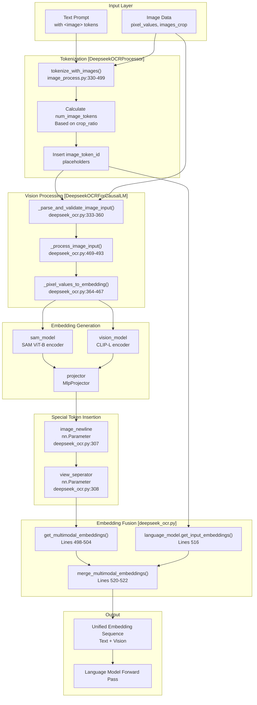
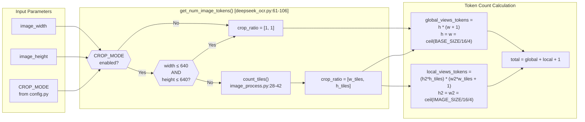
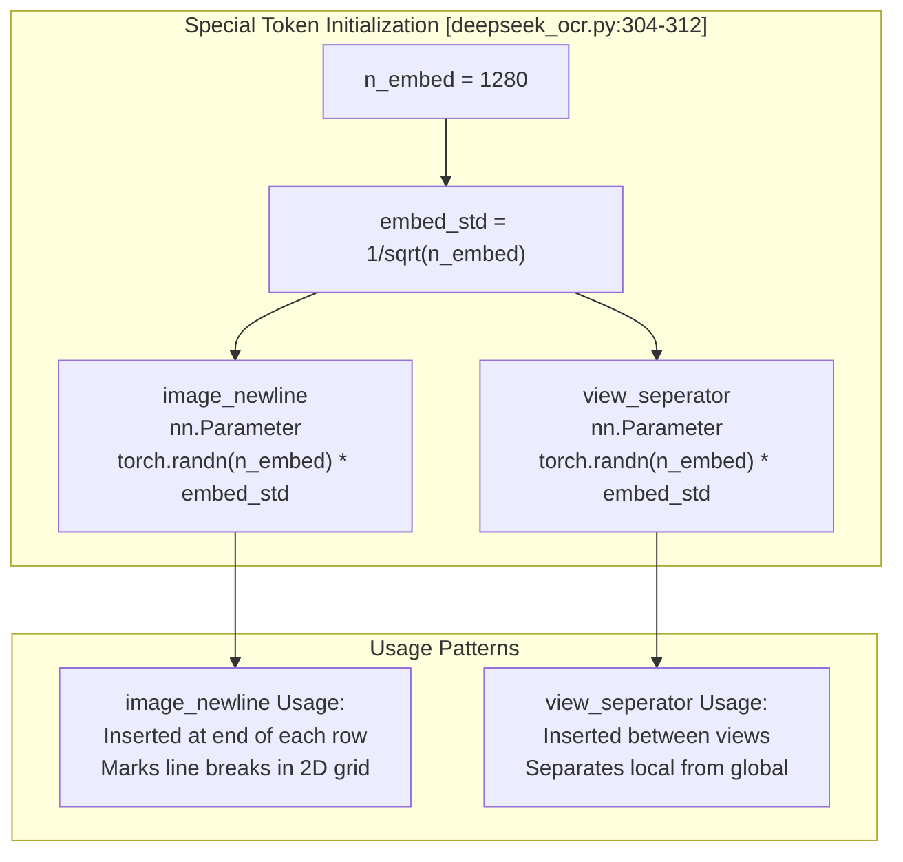
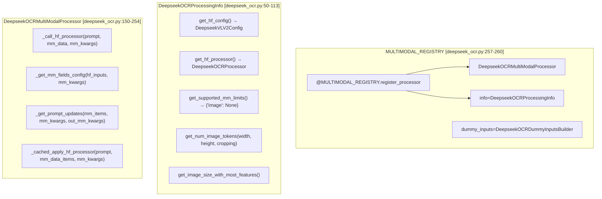

<!-- source: DeepWiki mcp.deepwiki.com · repo deepseek-ai/DeepSeek-OCR · page 4.5 Multimodal Integration · fetched 2026-10-30 -->

# Multimodal Integration

<details>
<summary>Relevant source files</summary>

The following files were used as context for generating this wiki page:

- [DeepSeek-OCR-master/DeepSeek-OCR-vllm/deepseek_ocr.py](DeepSeek-OCR-master/DeepSeek-OCR-vllm/deepseek_ocr.py)
- [DeepSeek-OCR-master/DeepSeek-OCR-vllm/process/image_process.py](DeepSeek-OCR-master/DeepSeek-OCR-vllm/process/image_process.py)

</details>


This page explains how DeepSeek-OCR combines visual and textual information to create unified multimodal representations. The integration process involves replacing image token placeholders with vision embeddings, structuring spatial information using special learned tokens, and merging the multimodal embeddings into a single sequence for the language model.

For details on the vision encoding pipeline that generates the image features, see [Vision Encoding System](#4.3). For information on the image preprocessing and tokenization steps, see [Image Processing Pipeline](#4.4). For the overall model architecture context, see [Model Architecture](#4.2).

---

## Integration Overview

The multimodal integration system bridges the gap between visual and textual modalities by:

1.  **Token Placeholder System**: The input text contains `<image>` tokens that mark positions where vision embeddings should be inserted.
2.  **Vision Embedding Generation**: Images are encoded through dual encoders (SAM + CLIP) and projected to the language model's embedding space.
3.  **Spatial Structuring**: Special learned tokens (`image_newline`, `view_separator`) organize vision embeddings to preserve 2D spatial layout.
4.  **Embedding Fusion**: Vision embeddings replace image token placeholders in the text embedding sequence.
5.  **Multi-view Coordination**: Global and local image views are combined with appropriate separators.

### System Data Flow: Text to Unified Embeddings

The following diagram traces the transformation from raw inputs to the unified sequence passed to the `language_model`.



**Sources:** [DeepSeek-OCR-master/DeepSeek-OCR-vllm/deepseek_ocr.py:261-583](), [DeepSeek-OCR-master/DeepSeek-OCR-vllm/process/image_process.py:330-499]()

---

## Token Replacement Mechanism

The multimodal integration process begins during tokenization, where the system determines how many image tokens are needed and inserts placeholder token IDs in the input sequence.

### Image Token Calculation

The number of image tokens depends on the image's dimensions and cropping configuration. The `get_num_image_tokens` method in `DeepseekOCRProcessingInfo` calculates this dynamically.



**Sources:** [DeepSeek-OCR-master/DeepSeek-OCR-vllm/deepseek_ocr.py:61-106](), [DeepSeek-OCR-master/DeepSeek-OCR-vllm/process/image_process.py:28-42]()

### Token Insertion Process

The `tokenize_with_images()` method in `DeepseekOCRProcessor` handles the actual insertion of image token placeholders:

| Step | Operation | Code Reference |
| :--- | :--- | :--- |
| 1. Parse prompt | Split text by `<image>` token | [image_process.py:342-343]() |
| 2. Encode text segments | Tokenize each text segment separately | [image_process.py:349-353]() |
| 3. Calculate image tokens | Based on image dimensions and cropping | [image_process.py:424-435]() |
| 4. Insert placeholders | Add `image_token_id` for each image token | [image_process.py:428-435]() |
| 5. Add special tokens | Prepend BOS, append EOS if requested | [image_process.py:443-448]() |

The tokenization creates three parallel structures:
*   `tokenized_str`: Token IDs including `image_token_id` placeholders.
*   `images_seq_mask`: Boolean mask marking image token positions.
*   `masked_tokenized_str`: Target IDs with `ignore_id` for image positions.

**Sources:** [DeepSeek-OCR-master/DeepSeek-OCR-vllm/process/image_process.py:330-499]()

---

## Vision Embedding Generation

Once images are processed through the dual encoders, they must be transformed into embeddings compatible with the language model's embedding space.

### Dual Encoder Processing Sequence

The `_pixel_values_to_embedding()` method in `DeepseekOCRForCausalLM` coordinates the encoding process:

```mermaid
sequenceDiagram
    participant Input as pixel_values,<br/>images_crop,<br/>images_spatial_crop
    participant Loop as Image Loop<br/>(jdx in range)
    participant SAM as sam_model<br/>SAM ViT-B
    participant CLIP as vision_model<br/>CLIP-L
    participant Proj as projector<br/>MlpProjector
    participant Struct as Spatial Structuring
    participant Output as vision_embeddings<br/>List[Tensor]
    
    Input->>Loop: For each image
    
    alt Has local crops (patches != 0)
        Loop->>SAM: local_features_1 = sam_model(patches)
        SAM-->>Loop: [P, H*W, C]
        Loop->>CLIP: local_features_2 = vision_model(patches, local_features_1)
        CLIP-->>Loop: [P, N, C]
        Loop->>Loop: Concatenate features[:, 1:] + features_1.flatten
        Loop->>Proj: local_features = projector(concat)
        Proj-->>Loop: [P, H*W, n_embed]
        
        Loop->>SAM: global_features_1 = sam_model(image_ori)
        SAM-->>Loop: [1, H*W, C]
        Loop->>CLIP: global_features_2 = vision_model(image_ori, global_features_1)
        CLIP-->>Loop: [1, N, C]
        Loop->>Loop: Concatenate features[:, 1:] + features_1.flatten
        Loop->>Proj: global_features = projector(concat)
        Proj-->>Loop: [1, H*W, n_embed]
        
        Loop->>Struct: Reshape and add image_newline
        Struct-->>Loop: Structured local + global features
    else No crops (patches == 0)
        Loop->>SAM: global_features_1 = sam_model(image_ori)
        Loop->>CLIP: global_features_2 = vision_model(image_ori, global_features_1)
        Loop->>Proj: global_features = projector(concat)
        Loop->>Struct: Reshape and add image_newline
        Struct-->>Loop: Structured global features only
    end
    
    Loop->>Struct: Append view_seperator
    Struct->>Output: Append to images_in_this_batch
```

**Key operations at [deepseek_ocr.py:364-467]():**

1.  **Line 387-388**: Extract patches and original image for current batch item.
2.  **Lines 394-401**: Process local crops through SAM and CLIP, concatenate features, project.
3.  **Lines 404-407**: Process global view through SAM and CLIP, concatenate features, project.
4.  **Lines 423-437**: Reshape and structure features with `image_newline` tokens.
5.  **Line 438**: Concatenate local + global + `view_seperator`.

**Sources:** [DeepSeek-OCR-master/DeepSeek-OCR-vllm/deepseek_ocr.py:364-467]()

### Feature Concatenation Strategy

The system concatenates features from SAM and CLIP encoders before projection to leverage both high-resolution spatial features and semantic features.

*   **CLIP features**: Use tokens 1: onwards (skip CLS token), dimension matches CLIP output [deepseek_ocr.py:400]().
*   **SAM features**: Flatten spatial dimensions (H, W) → (H*W), permute to match sequence length [deepseek_ocr.py:400]().
*   **Concatenation**: Along feature dimension, creating input of `[batch, seq_len, 2048]` for `projector` [deepseek_ocr.py:400]().
*   **Projection**: `MlpProjector` projects to `n_embed=1280` dimensions matching language model [deepseek_ocr.py:401]().

**Sources:** [DeepSeek-OCR-master/DeepSeek-OCR-vllm/deepseek_ocr.py:400-407]()

---

## Special Tokens for Spatial Structure

Two learnable parameters structure the vision embeddings to preserve spatial layout information during the sequence generation.

### Token Definitions and Initialization

The tokens are initialized as `nn.Parameter` within `DeepseekOCRForCausalLM`.



**Sources:** [DeepSeek-OCR-master/DeepSeek-OCR-vllm/deepseek_ocr.py:304-312]()

### Spatial Structuring Application

The special tokens are inserted during vision embedding generation to recreate the 2D layout in a 1D sequence.

**Global View Structuring (BASE_SIZE=1024, patch_size=16, downsample_ratio=4):**
1.  **Reshape**: Features are reshaped to a grid `(h, w)`.
2.  **Append Newline**: `image_newline` is appended to every row.
3.  **Flatten**: Grid is flattened back to a sequence.

**Code at [deepseek_ocr.py:423-429]():**
```python
global_features = global_features.view(h, w, n_dim)
global_features = torch.cat(
    [global_features, self.image_newline[None, None, :].expand(h, 1, n_dim)], dim=1
)
global_features = global_features.view(-1, n_dim)
```

**Local Views Structuring (IMAGE_SIZE=640):**
The system arranges crops based on `height_crop_num` and `width_crop_num`, then appends newlines to the combined grid.

**Code at [deepseek_ocr.py:432-436]():**
```python
local_features = local_features.view(height_crop_num, width_crop_num, h2, w2, n_dim2).permute(0, 2, 1, 3, 4).reshape(height_crop_num*h2, width_crop_num*w2, n_dim2)
local_features = torch.cat(
    [local_features, self.image_newline[None, None, :].expand(height_crop_num * h2, 1, n_dim2)], dim=1
)
local_features = local_features.view(-1, n_dim2)
```

**Final concatenation at [deepseek_ocr.py:438]():**
```python
global_local_features = torch.cat([local_features, global_features, self.view_seperator[None, :]], dim=0)
```

**Sources:** [DeepSeek-OCR-master/DeepSeek-OCR-vllm/deepseek_ocr.py:423-438]()

---

## Embedding Fusion and Merging

The final step combines vision embeddings with text embeddings to create a unified input sequence for the language model.

### Integration Pipeline in forward()

The `forward` pass coordinates the retrieval of vision embeddings and their fusion into the text sequence.

```mermaid
graph TB
    subgraph "get_multimodal_embeddings() [deepseek_ocr.py:498-504]"
        PARSE_INPUT["_parse_and_validate_image_input(**kwargs)<br/>Extract pixel_values, images_crop, images_spatial_crop"]
        CHECK{{"image_input<br/>is None?"}}
        PROCESS_IMG["_process_image_input(image_input)<br/>Returns List[Tensor]"]
        RETURN_VIS["Return vision_embeddings"]
        RETURN_NONE["Return None"]
    end
    
    subgraph "get_input_embeddings() [deepseek_ocr.py:508-528]"
        TEXT_EMB["inputs_embeds = language_model.get_input_embeddings(input_ids)"]
        MM_CHECK{{"multimodal_embeddings<br/>is not None?"}}
        MERGE_CALL["merge_multimodal_embeddings(<br/>input_ids, inputs_embeds,<br/>multimodal_embeddings,<br/>self.image_token_id)"]
        RETURN_EMB["Return inputs_embeds"]
    end
    
    subgraph "forward() [deepseek_ocr.py:530-553]"
        INTERMEDIATE{{"intermediate_tensors<br/>is not None?"}}
        EMB_CHECK{{"inputs_embeds<br/>is None?"}}
        GET_MM["vision_embeddings = get_multimodal_embeddings(**kwargs)"]
        GET_INP["inputs_embeds = get_input_embeddings(<br/>input_ids, vision_embeddings)"]
        CLEAR["input_ids = None"]
        LM_FORWARD["language_model(input_ids, positions,<br/>intermediate_tensors,<br/>inputs_embeds=inputs_embeds)"]
    end
    
    PARSE_INPUT --> CHECK
    CHECK -->|"Yes"| RETURN_NONE
    CHECK -->|"No"| PROCESS_IMG
    PROCESS_IMG --> RETURN_VIS
    
    TEXT_EMB --> MM_CHECK
    MM_CHECK -->|"Yes"| MERGE_CALL
    MM_CHECK -->|"No"| RETURN_EMB
    MERGE_CALL --> RETURN_EMB
    
    INTERMEDIATE -->|"Yes"| LM_FORWARD
    INTERMEDIATE -->|"No"| EMB_CHECK
    EMB_CHECK -->|"Yes"| GET_MM
    EMB_CHECK -->|"No"| LM_FORWARD
    GET_MM --> GET_INP
    GET_INP --> CLEAR
    CLEAR --> LM_FORWARD
```



**Sources:** [DeepSeek-OCR-master/DeepSeek-OCR-vllm/deepseek_ocr.py:498-553]()

### merge_multimodal_embeddings Function

The `merge_multimodal_embeddings` utility performs the actual tensor splicing.

**Behavior:**
1.  Identifies positions in `input_ids` where `input_ids[i] == image_token_id`.
2.  Replaces corresponding positions in `inputs_embeds` with vision embeddings.
3.  Vision embeddings are consumed sequentially from the `multimodal_embeddings` list.

**Call site at [deepseek_ocr.py:520-522]():**
```python
inputs_embeds = merge_multimodal_embeddings(
    input_ids, inputs_embeds, multimodal_embeddings,
    self.image_token_id)
```

**Sources:** [DeepSeek-OCR-master/DeepSeek-OCR-vllm/deepseek_ocr.py:520-522]()

---

## Multi-view Coordination

When processing images with both global and local views, the system coordinates multiple perspectives into a cohesive representation.

### View Ordering and Structure

The vision embeddings are organized in a specific order to optimize processing:

| Order | Component | Token Count Formula | Purpose |
| :--- | :--- | :--- | :--- |
| 1 | Local views (if present) | `(h_tiles * h2) * (w_tiles * w2 + 1)` | High-resolution details from crops |
| 2 | Global view | `h * (w + 1)` | Full image context |
| 3 | View separator | `1` | Boundary marker between images/views |

**Rationale for ordering (local → global → separator):**
1.  **Local-first processing**: The language model encounters fine-grained details before global context.
2.  **Global context enrichment**: Global view provides document-level understanding after details.
3.  **Clear boundaries**: `view_seperator` marks the end of image embeddings.

**Sources:** [DeepSeek-OCR-master/DeepSeek-OCR-vllm/deepseek_ocr.py:438]()

### Multi-image Batch Processing

The system handles multiple images in a single batch by accumulating vision embeddings into a list `images_in_this_batch` [deepseek_ocr.py:465](). Each image produces one tensor in the output list. The `merge_multimodal_embeddings()` function consumes these sequentially as it encounters `image_token_id` placeholders in the input sequence.

**Sources:** [DeepSeek-OCR-master/DeepSeek-OCR-vllm/deepseek_ocr.py:385-465]()

---

## vLLM Integration Pattern

DeepSeek-OCR integrates with vLLM's multimodal processing framework through custom processor classes.

### Processor Registration

The system registers key components with the vLLM multimodal registry:



**Key methods:**

| Class | Method | Purpose |
| :--- | :--- | :--- |
| `DeepseekOCRProcessingInfo` | `get_num_image_tokens()` | Calculate image token count for memory allocation [deepseek_ocr.py:61](). |
| `DeepseekOCRMultiModalProcessor` | `_get_mm_fields_config()` | Define multimodal field mappings for `pixel_values`, `images_crop`, etc. [deepseek_ocr.py:178](). |
| `DeepseekOCRMultiModalProcessor` | `_get_prompt_updates()` | Generate token replacements for `<image>` placeholders [deepseek_ocr.py:190](). |

**Sources:** [DeepSeek-OCR-master/DeepSeek-OCR-vllm/deepseek_ocr.py:50-260]()

---

