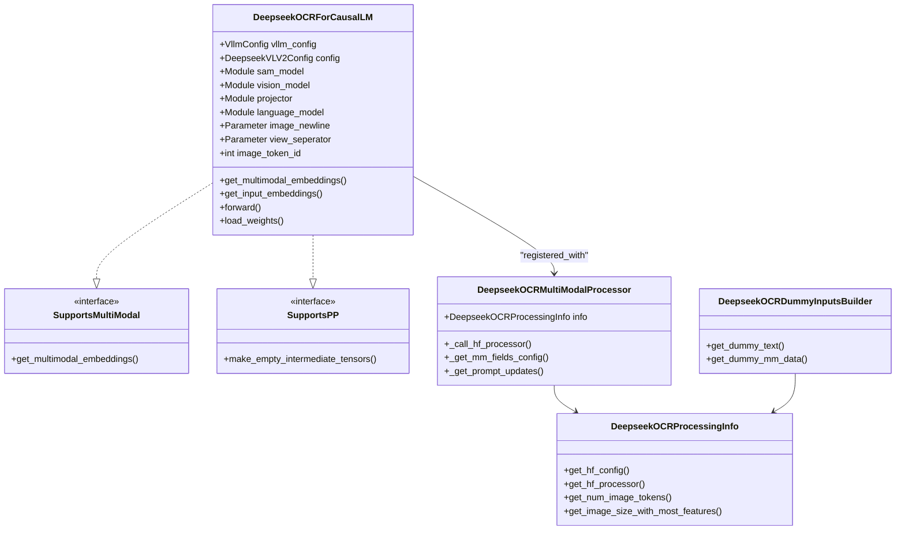
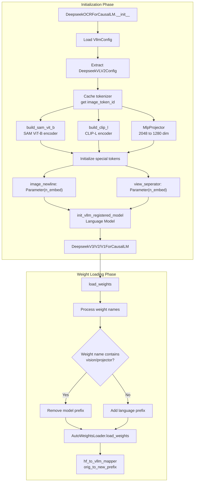
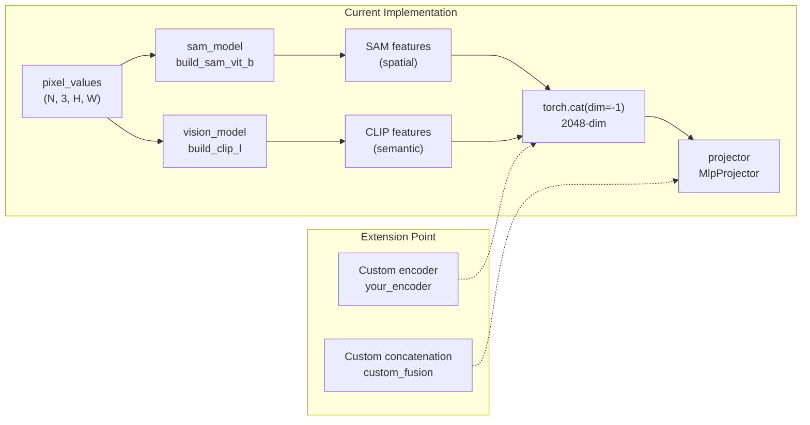
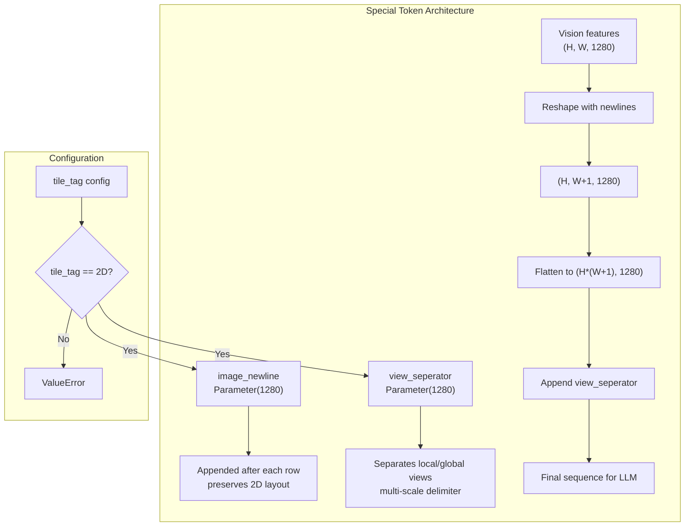
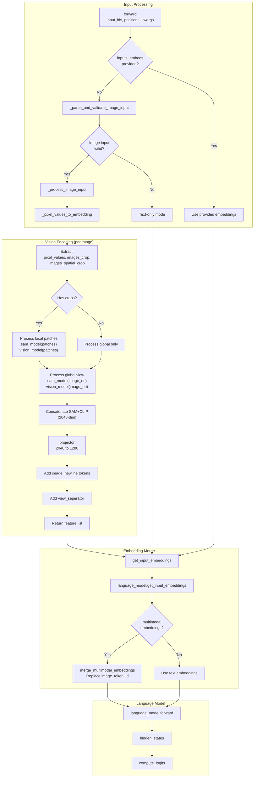
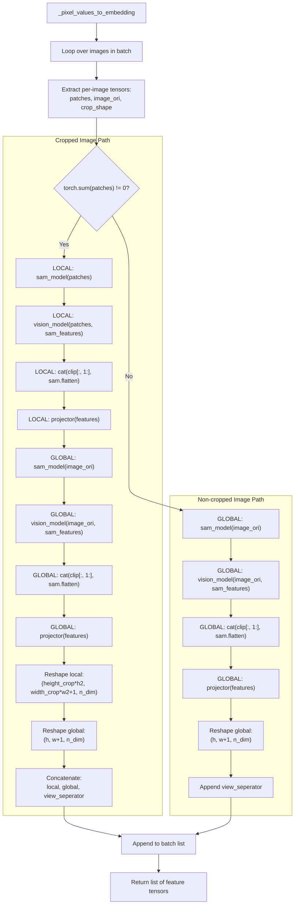
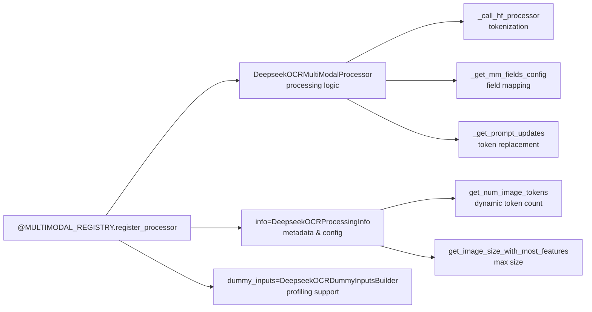
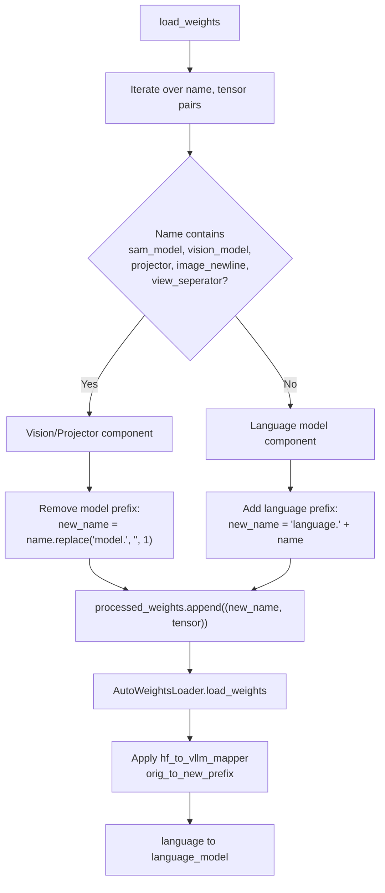

<!-- source: DeepWiki mcp.deepwiki.com · repo deepseek-ai/DeepSeek-OCR · page 5 Developer Guide · fetched 2026-10-30 -->

# Developer Guide

<details>
<summary>Relevant source files</summary>

The following files were used as context for generating this wiki page:

- [DeepSeek-OCR-master/DeepSeek-OCR-vllm/deepencoder/build_linear.py](DeepSeek-OCR-master/DeepSeek-OCR-vllm/deepencoder/build_linear.py)
- [DeepSeek-OCR-master/DeepSeek-OCR-vllm/deepseek_ocr.py](DeepSeek-OCR-master/DeepSeek-OCR-vllm/deepseek_ocr.py)

</details>


This guide is for developers who want to extend, customize, or deeply understand the DeepSeek-OCR codebase. It covers the key architectural components, extension points, and common patterns for modifying the system.

**Scope**: This page provides an overview of the development architecture and common customization patterns. For detailed API references, see [API Reference](#6). For architectural deep-dives, see [Architecture](#4). For specific customization tasks:
- Model components and weight loading: [Model Components Reference](#5.1)
- Custom inference logic: [Custom Logits Processors](#5.2)
- Vision feature projection: [Custom Projector Architectures](#5.3)
- Image preprocessing: [Extending Image Processing](#5.4)
- Output parsing: [Output Post-Processing](#5.5)

---

## System Architecture for Developers

The DeepSeek-OCR codebase is structured around **two parallel inference frameworks** (vLLM and Transformers) that share a common model core. Understanding this dual-path architecture is essential for development work.

### Core Model Class Hierarchy



**Sources**: [DeepSeek-OCR-master/DeepSeek-OCR-vllm/deepseek_ocr.py:261-583]()

---

## Component Initialization Flow

Understanding the initialization order is critical when adding custom components or modifying the architecture.



**Key Configuration Points**:
- **Line 288-289**: Vision encoders are instantiated with `build_sam_vit_b()` and `build_clip_l()` [DeepSeek-OCR-master/DeepSeek-OCR-vllm/deepseek_ocr.py:288-289]().
- **Line 292**: Projector uses `MlpProjector` with configurable `projector_type` [DeepSeek-OCR-master/DeepSeek-OCR-vllm/deepseek_ocr.py:292]().
- **Line 307-308**: Special tokens `image_newline` and `view_seperator` are learnable parameters [DeepSeek-OCR-master/DeepSeek-OCR-vllm/deepseek_ocr.py:307-308]().
- **Line 321-326**: Language model is dynamically selected based on `text_config.topk_method` [DeepSeek-OCR-master/DeepSeek-OCR-vllm/deepseek_ocr.py:321-326]().

**Sources**: [DeepSeek-OCR-master/DeepSeek-OCR-vllm/deepseek_ocr.py:267-330](), [DeepSeek-OCR-master/DeepSeek-OCR-vllm/deepseek_ocr.py:564-582]()

---

## Extension Points

### 1. Vision Encoder Customization

The dual-encoder architecture can be extended or replaced. The system uses two separate encoders that are concatenated before projection.



**Implementation locations**:
- SAM encoder instantiation: [DeepSeek-OCR-master/DeepSeek-OCR-vllm/deepseek_ocr.py:288]()
- CLIP encoder instantiation: [DeepSeek-OCR-master/DeepSeek-OCR-vllm/deepseek_ocr.py:289]()
- Feature concatenation: [DeepSeek-OCR-master/DeepSeek-OCR-vllm/deepseek_ocr.py:400](), [DeepSeek-OCR-master/DeepSeek-OCR-vllm/deepseek_ocr.py:406](), [DeepSeek-OCR-master/DeepSeek-OCR-vllm/deepseek_ocr.py:443]()

**Sources**: [DeepSeek-OCR-master/DeepSeek-OCR-vllm/deepseek_ocr.py:288-292](), [DeepSeek-OCR-master/DeepSeek-OCR-vllm/deepseek_ocr.py:394-407](), [DeepSeek-OCR-master/DeepSeek-OCR-vllm/deepseek_ocr.py:441-444]()

---

### 2. Projector Architecture Modification

The `MlpProjector` reduces vision features from 2048 to 1280 dimensions. This is a key bottleneck that can be customized.

| Projector Parameter | Location | Purpose |
|-------------------|----------|---------|
| `projector_type` | [deepseek_ocr.py:292]() | Determines projection architecture |
| `input_dim` | [deepseek_ocr.py:292]() | Input dimension (2048 for dual encoder) |
| `n_embed` | [deepseek_ocr.py:291-292]() | Output dimension matching LLM (1280) |

**Customization approach**: See [Custom Projector Architectures](#5.3) for implementing new projection strategies. The `MlpProjector` supports multiple types including `linear`, `mlp_gelu`, `downsample_mlp_gelu`, and hybrid split variants [DeepSeek-OCR-master/DeepSeek-OCR-vllm/deepencoder/build_linear.py:15-87]().

**Sources**: [DeepSeek-OCR-master/DeepSeek-OCR-vllm/deepseek_ocr.py:291-292](), [DeepSeek-OCR-master/DeepSeek-OCR-vllm/deepencoder/build_linear.py:7-96]()

---

### 3. Special Token Handling

The system uses learnable special tokens to structure the 2D image features into a 1D sequence.



**Implementation details**:
- Token initialization: [DeepSeek-OCR-master/DeepSeek-OCR-vllm/deepseek_ocr.py:304-312]()
- `image_newline` usage: [DeepSeek-OCR-master/DeepSeek-OCR-vllm/deepseek_ocr.py:426](), [DeepSeek-OCR-master/DeepSeek-OCR-vllm/deepseek_ocr.py:434](), [DeepSeek-OCR-master/DeepSeek-OCR-vllm/deepseek_ocr.py:458]()
- `view_seperator` usage: [DeepSeek-OCR-master/DeepSeek-OCR-vllm/deepseek_ocr.py:438](), [DeepSeek-OCR-master/DeepSeek-OCR-vllm/deepseek_ocr.py:463]()

**Extension**: Add new special tokens by modifying the initialization block at lines 304-312 and including them in weight loading at line 568.

**Sources**: [DeepSeek-OCR-master/DeepSeek-OCR-vllm/deepseek_ocr.py:304-312](), [DeepSeek-OCR-master/DeepSeek-OCR-vllm/deepseek_ocr.py:423-438](), [DeepSeek-OCR-master/DeepSeek-OCR-vllm/deepseek_ocr.py:455-463]()

---

## Forward Pass Pipeline

Understanding the complete forward pass is essential for debugging and adding custom processing logic.



**Key methods**:

| Method | Location | Purpose |
|--------|----------|---------|
| `forward()` | [deepseek_ocr.py:530-553]() | Main forward pass coordination |
| `_parse_and_validate_image_input()` | [deepseek_ocr.py:333-360]() | Extract and validate image tensors |
| `_pixel_values_to_embedding()` | [deepseek_ocr.py:364-467]() | Vision encoding per image |
| `_process_image_input()` | [deepseek_ocr.py:469-493]() | Batch vision processing |
| `get_multimodal_embeddings()` | [deepseek_ocr.py:498-504]() | Entry point for vision features |
| `get_input_embeddings()` | [deepseek_ocr.py:508-528]() | Merge vision and text embeddings |
| `compute_logits()` | [deepseek_ocr.py:555-561]() | Final logit computation |

**Sources**: [DeepSeek-OCR-master/DeepSeek-OCR-vllm/deepseek_ocr.py:530-561](), [DeepSeek-OCR-master/DeepSeek-OCR-vllm/deepseek_ocr.py:333-360](), [DeepSeek-OCR-master/DeepSeek-OCR-vllm/deepseek_ocr.py:364-467](), [DeepSeek-OCR-master/DeepSeek-OCR-vllm/deepseek_ocr.py:498-528]()

---

## Vision Feature Processing Details

The `_pixel_values_to_embedding()` method contains the core vision encoding logic. This is the primary extension point for custom vision processing.

### Processing Logic Flow



**Critical implementation details**:
- **Dual encoder calls**: SAM encoder runs first, then CLIP encoder receives SAM features as additional input ([lines 394-397](), [404-405](), [441-442]()).
- **Feature concatenation**: CLIP tokens `[:, 1:]` (excluding CLS) + SAM spatial features ([lines 400](), [406](), [443]()).
- **Gradient context**: All vision encoding happens in `torch.no_grad()` context ([line 384]()).
- **Newline insertion**: `image_newline` is expanded and concatenated to maintain 2D structure ([lines 426](), [434](), [458]()).

**Sources**: [DeepSeek-OCR-master/DeepSeek-OCR-vllm/deepseek_ocr.py:364-467](), [DeepSeek-OCR-master/DeepSeek-OCR-vllm/deepseek_ocr.py:384-438](), [DeepSeek-OCR-master/DeepSeek-OCR-vllm/deepseek_ocr.py:440-463]()

---

## Multimodal Processing Pipeline

The vLLM integration requires specialized processing components to handle multimodal inputs correctly.

### Processor Registration Pattern



**Processor methods**:

| Method | Location | Purpose |
|--------|----------|---------|
| `_call_hf_processor()` | [deepseek_ocr.py:154-176]() | Invoke HuggingFace processor for tokenization |
| `_get_mm_fields_config()` | [deepseek_ocr.py:178-188]() | Map BatchFeature fields to modality types |
| `_get_prompt_updates()` | [deepseek_ocr.py:190-229]() | Replace `<image>` with correct number of tokens |

**ProcessingInfo methods**:

| Method | Location | Purpose |
|--------|----------|---------|
| `get_num_image_tokens()` | [deepseek_ocr.py:61-106]() | Calculate tokens based on image size and cropping |
| `get_image_size_with_most_features()` | [deepseek_ocr.py:108-112]() | Return maximum supported image size |

**Sources**: [DeepSeek-OCR-master/DeepSeek-OCR-vllm/deepseek_ocr.py:257-260](), [DeepSeek-OCR-master/DeepSeek-OCR-vllm/deepseek_ocr.py:150-229](), [DeepSeek-OCR-master/DeepSeek-OCR-vllm/deepseek_ocr.py:50-112]()

---

## Token Count Calculation

Understanding how image tokens are counted is crucial for memory planning and prompt construction.

### Token Calculation Logic

The `get_num_image_tokens()` method implements the core token counting logic based on configuration and image dimensions:

```python
# Pseudocode representation of token calculation [deepseek_ocr.py:61-106]
def calculate_tokens(image_width, image_height):
    patch_size = 16
    downsample_ratio = 4
    
    # Determine cropping
    if CROP_MODE and (image_width > 640 or image_height > 640):
        crop_ratio = count_tiles(image_width, image_height, IMAGE_SIZE)
        num_width_tiles, num_height_tiles = crop_ratio
    else:
        num_width_tiles = num_height_tiles = 1
    
    # Global view tokens
    h = w = ceil((BASE_SIZE // patch_size) / downsample_ratio)
    global_tokens = h * (w + 1)  # +1 for newline per row
    
    # Local view tokens (if cropped)
    if num_width_tiles > 1 or num_height_tiles > 1:
        h2 = w2 = ceil((IMAGE_SIZE // patch_size) / downsample_ratio)
        local_tokens = (num_height_tiles * h2) * (num_width_tiles * w2 + 1)
    else:
        local_tokens = 0
    
    return global_tokens + local_tokens + 1  # +1 for view_seperator
```

**Configuration dependencies**:
- `IMAGE_SIZE`: Local crop resolution ([line 73]()).
- `BASE_SIZE`: Global view resolution ([line 74]()).
- `CROP_MODE`: Whether to enable dynamic cropping ([line 78]()).

**Sources**: [DeepSeek-OCR-master/DeepSeek-OCR-vllm/deepseek_ocr.py:61-106](), [DeepSeek-OCR-master/DeepSeek-OCR-vllm/deepseek_ocr.py:73-105]()

---

## Weight Loading Strategy

The weight loading mechanism handles the mapping between HuggingFace checkpoint names and vLLM internal names.

### Weight Name Mapping



**Mapping rules**:

| Original Name Pattern | New Name Pattern | Component |
|----------------------|------------------|-----------|
| `model.sam_model.*` | `sam_model.*` | SAM encoder |
| `model.vision_model.*` | `vision_model.*` | CLIP encoder |
| `model.projector.*` | `projector.*` | MLP projector |
| `model.image_newline` | `image_newline` | Special token |
| `model.view_seperator` | `view_seperator` | Special token |
| `*` (other) | `language.*` | Language model |
| `language.*` | `language_model.*` | vLLM mapping |

**Implementation**: [DeepSeek-OCR-master/DeepSeek-OCR-vllm/deepseek_ocr.py:564-582]()

**WeightsMapper configuration**: [DeepSeek-OCR-master/DeepSeek-OCR-vllm/deepseek_ocr.py:263-265]()

**Sources**: [DeepSeek-OCR-master/DeepSeek-OCR-vllm/deepseek_ocr.py:564-582](), [DeepSeek-OCR-master/DeepSeek-OCR-vllm/deepseek_ocr.py:263-265]()

---

## Development Best Practices

### 1. Adding Custom Vision Encoders

To add a new vision encoder:

1. **Import or define encoder**: Add builder function in `deepencoder/` directory.
2. **Instantiate in `__init__`**: Add encoder initialization at [deepseek_ocr.py:288-289]().
3. **Modify feature extraction**: Update `_pixel_values_to_embedding()` at [deepseek_ocr.py:394-407]().
4. **Update concatenation**: Adjust feature concatenation dimension at [deepseek_ocr.py:400]().
5. **Adjust projector**: Update `MlpProjector` `input_dim` at [deepseek_ocr.py:292]().
6. **Update weight loading**: Add encoder name to whitelist at [deepseek_ocr.py:568]().

### 2. Modifying Token Structure

To change how image features are structured:

1. **Define new special tokens**: Add parameters in `__init__` at [deepseek_ocr.py:304-312]().
2. **Update token usage**: Modify reshape/concatenation logic at [deepseek_ocr.py:423-438]().
3. **Adjust token counting**: Update `get_num_image_tokens()` at [deepseek_ocr.py:61-106]().
4. **Update weight loading**: Include new tokens in whitelist at [deepseek_ocr.py:568]().

### 3. Extending Multimodal Processing

To customize prompt processing:

1. **Modify processor**: Extend `DeepseekOCRMultiModalProcessor` methods at [deepseek_ocr.py:150-255]().
2. **Update field config**: Adjust `_get_mm_fields_config()` at [deepseek_ocr.py:178-188]().
3. **Customize prompt updates**: Modify `_get_prompt_updates()` at [deepseek_ocr.py:190-229]().
4. **Add dummy inputs**: Update `DeepseekOCRDummyInputsBuilder` at [deepseek_ocr.py:115-146]().

### 4. Debugging Vision Features

Key debugging points:

- **Print token counts**: Set `PRINT_NUM_VIS_TOKENS=True` in config ([lines 409-413](), [446-450]()).
- **Check feature dimensions**: Monitor concatenation shapes at [lines 400](), [406](), [443]().
- **Validate embeddings**: Inspect `get_multimodal_embeddings()` output at [line 504]().
- **Trace merge process**: Debug `merge_multimodal_embeddings()` at [line 520]().

**Sources**: [DeepSeek-OCR-master/DeepSeek-OCR-vllm/deepseek_ocr.py:288-292](), [DeepSeek-OCR-master/DeepSeek-OCR-vllm/deepseek_ocr.py:304-312](), [DeepSeek-OCR-master/DeepSeek-OCR-vllm/deepseek_ocr.py:394-463](), [DeepSeek-OCR-master/DeepSeek-OCR-vllm/deepseek_ocr.py:568]()

---

## Configuration Integration

The model integrates with global configuration from `config.py`:

| Config Variable | Usage Location | Purpose |
|----------------|----------------|---------|
| `IMAGE_SIZE` | [deepseek_ocr.py:73](), [85]() | Local crop resolution |
| `BASE_SIZE` | [deepseek_ocr.py:74](), [95]() | Global view resolution |
| `CROP_MODE` | [deepseek_ocr.py:78](), [140](), [219]() | Enable dynamic cropping |
| `PRINT_NUM_VIS_TOKENS` | [deepseek_ocr.py:409](), [446]() | Debug vision token counts |
| `PROMPT` | [deepseek_ocr.py:135]() | Default prompt template |

**Import statement**: [DeepSeek-OCR-master/DeepSeek-OCR-vllm/deepseek_ocr.py:45]()

See [Configuration System](#3.3) for detailed parameter documentation.

**Sources**: [DeepSeek-OCR-master/DeepSeek-OCR-vllm/deepseek_ocr.py:45](), [DeepSeek-OCR-master/DeepSeek-OCR-vllm/deepseek_ocr.py:73-106](), [DeepSeek-OCR-master/DeepSeek-OCR-vllm/deepseek_ocr.py:135](), [DeepSeek-OCR-master/DeepSeek-OCR-vllm/deepseek_ocr.py:409-450]()

---

## Common Development Patterns

### Pattern 1: Adding Pre/Post-Processing Hooks

To add custom processing before/after vision encoding:

```python
# In _pixel_values_to_embedding()
def _pixel_values_to_embedding(self, pixel_values, images_crop, images_spatial_crop):
    images_in_this_batch = []
    
    with torch.no_grad():
        for jdx in range(images_spatial_crop.size(0)):
            # Custom pre-processing
            patches = self._custom_preprocess(images_crop[jdx][0])
            
            # Standard encoding
            local_features = self.sam_model(patches)
            # ... rest of encoding
            
            # Custom post-processing
            global_local_features = self._custom_postprocess(global_local_features)
            images_in_this_batch.append(global_local_features)
    
    return images_in_this_batch
```

### Pattern 2: Adding Custom Special Tokens

To add a new structural token (e.g., for marking sections):

```python
# In __init__()
self.section_marker = nn.Parameter(torch.randn(n_embed) * embed_std)

# In _pixel_values_to_embedding()
section_features = torch.cat([
    local_features,
    self.section_marker[None, :],  # Add section marker
    global_features,
    self.view_seperator[None, :]
], dim=0)

# In load_weights()
if 'section_marker' in name:
    new_name = name.replace('model.', '', 1)
```

### Pattern 3: Multi-Resolution Encoding

To encode at multiple resolutions simultaneously:

```python
# Process at multiple scales
scales = [0.5, 1.0, 2.0]
multi_scale_features = []

for scale in scales:
    scaled_image = F.interpolate(image_ori, scale_factor=scale)
    sam_features = self.sam_model(scaled_image)
    clip_features = self.vision_model(scaled_image, sam_features)
    features = torch.cat((clip_features[:, 1:], sam_features.flatten(2).permute(0, 2, 1)), dim=-1)
    multi_scale_features.append(features)

# Aggregate features
aggregated = self._aggregate_multiscale(multi_scale_features)
projected = self.projector(aggregated)
```

**Sources**: [DeepSeek-OCR-master/DeepSeek-OCR-vllm/deepseek_ocr.py:364-467](), [DeepSeek-OCR-master/DeepSeek-OCR-vllm/deepseek_ocr.py:304-312]()

---

## Next Steps

For detailed implementation guides:
- **Model internals**: [Model Components Reference](#5.1)
- **Output processing**: [Custom Logits Processors](#5.2)
- **Feature projection**: [Custom Projector Architectures](#5.3)
- **Image preprocessing**: [Extending Image Processing](#5.4)
- **Result parsing**: [Output Post-Processing](#5.5)

For API specifications:
- **vLLM model API**: [vLLM Model API](#6.2)
- **Processing API**: [Processing API](#6.4)
- **Encoder API**: [Encoder API](#6.5)

---

