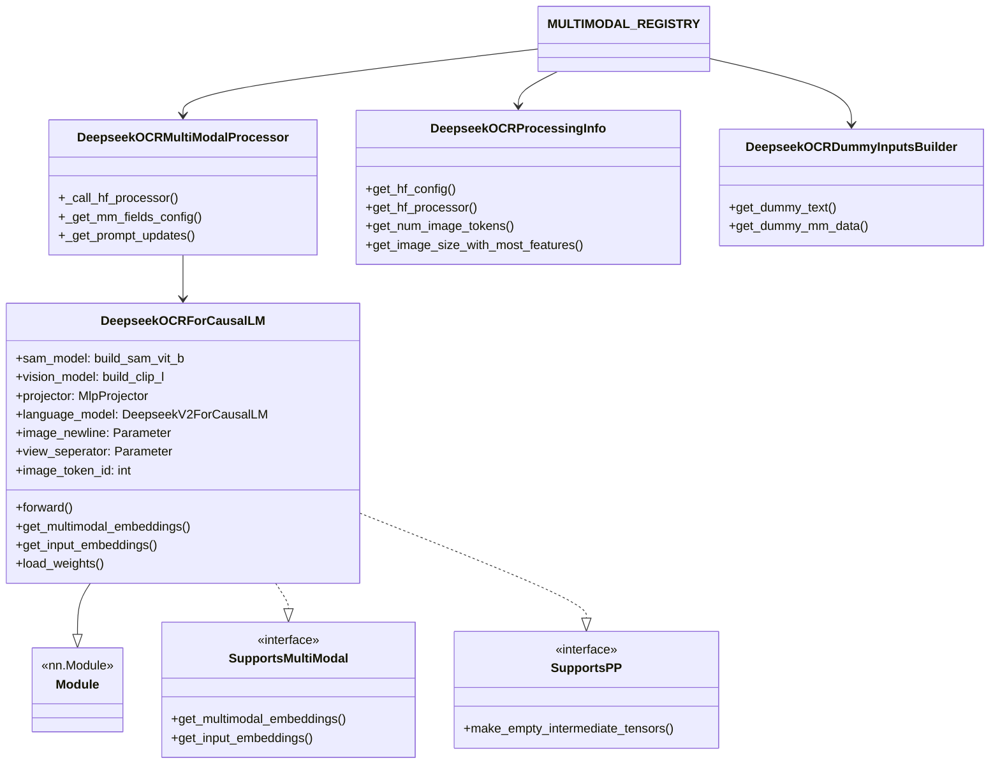
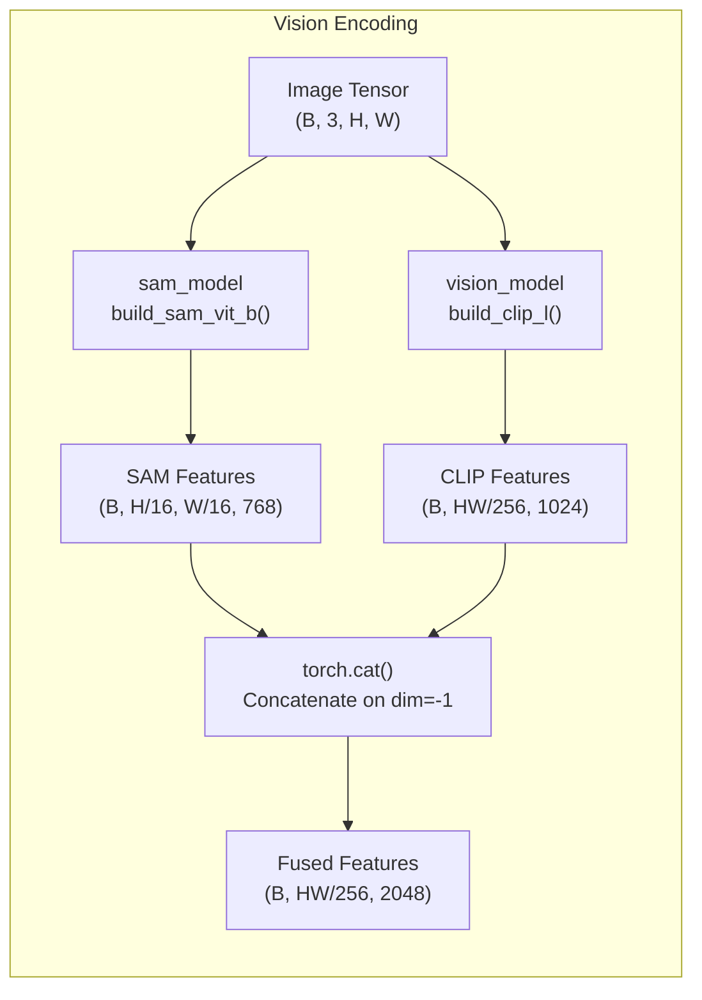
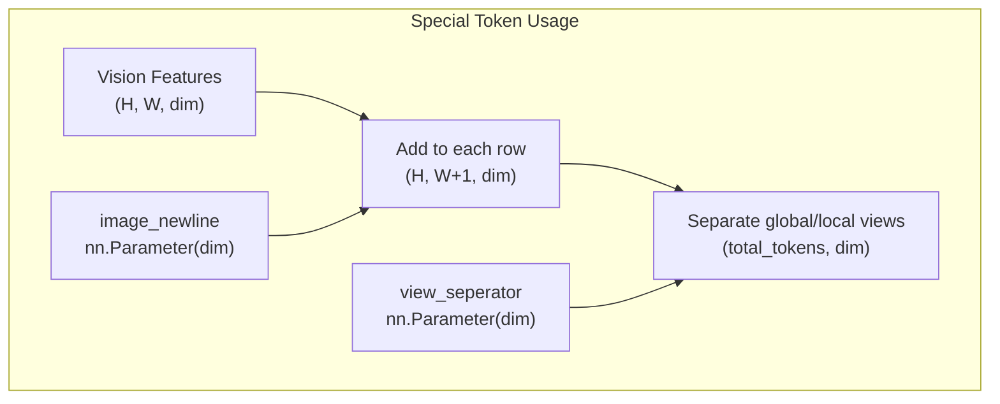
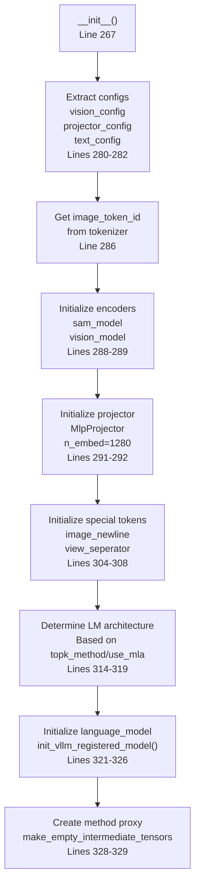
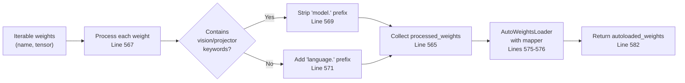
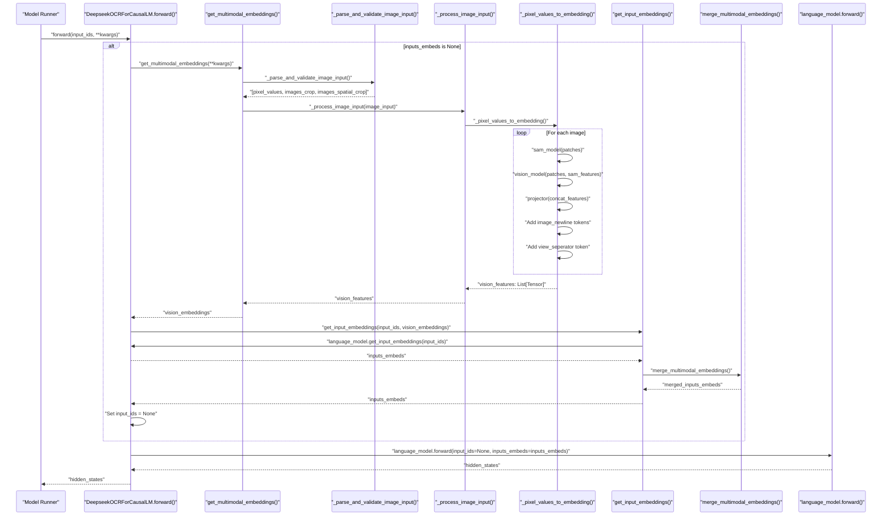
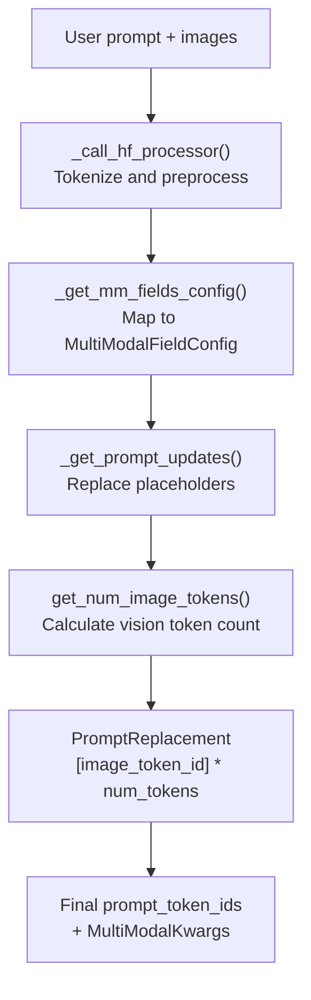

<!-- source: DeepWiki mcp.deepwiki.com · repo deepseek-ai/DeepSeek-OCR · page 5.1 Model Components Reference · fetched 2026-10-30 -->

# Model Components Reference

<details>
<summary>Relevant source files</summary>

The following files were used as context for generating this wiki page:

- [DeepSeek-OCR-master/DeepSeek-OCR-vllm/deepseek_ocr.py](DeepSeek-OCR-master/DeepSeek-OCR-vllm/deepseek_ocr.py)

</details>


This page provides a detailed technical reference for the core model components in DeepSeek-OCR's vLLM implementation. It covers the `DeepseekOCRForCausalLM` class structure, component initialization, weight loading mechanisms, and forward pass execution. This reference is intended for developers who need to understand, extend, or debug the model architecture.

For information about custom projector architectures, see [Custom Projector Architectures](). For details on image preprocessing and tokenization, see [Extending Image Processing](). For usage examples rather than internals, see [vLLM Inference]().

---

## Model Class Architecture

The `DeepseekOCRForCausalLM` class is the top-level model class that integrates all components and interfaces with vLLM's execution engine. It implements multiple vLLM interface protocols for multimodal support and pipeline parallelism.



**Sources:** [DeepSeek-OCR-master/DeepSeek-OCR-vllm/deepseek_ocr.py:261-583]()

---

## Core Components

### Component Inventory

The model comprises five primary components that work together to process multimodal inputs:

| Component | Type | Purpose | Initialization |
|-----------|------|---------|----------------|
| `sam_model` | `build_sam_vit_b()` | High-resolution local feature extraction with window attention | [Line 288]() |
| `vision_model` | `build_clip_l()` | Semantic feature extraction with global attention | [Line 289]() |
| `projector` | `MlpProjector` | Projects concatenated vision features to LLM embedding space | [Lines 291-292]() |
| `language_model` | `DeepseekV2/V3ForCausalLM` | Generates text output from multimodal embeddings | [Lines 321-326]() |
| Special Tokens | `nn.Parameter` | Spatial structuring tokens (`image_newline`, `view_seperator`) | [Lines 307-308]() |

### Vision Encoders

The dual-encoder architecture uses SAM and CLIP encoders in parallel to extract complementary features:



**Implementation Details:**

- **SAM Encoder** ([Line 288]()): Produces spatially-aligned features with shape `(batch, height*width, 768)` after flattening and permuting [Lines 400, 405-406]()
- **CLIP Encoder** ([Line 289]()): Takes SAM features as auxiliary input and outputs `(batch, num_patches+1, 1024)`, where the first token is the CLS token that is discarded [Lines 397, 405]()
- **Feature Concatenation**: CLIP features (excluding CLS) are concatenated with flattened SAM features along the channel dimension to produce 2048-dimensional vectors [Lines 400, 406]()

**Sources:** [DeepSeek-OCR-master/DeepSeek-OCR-vllm/deepseek_ocr.py:288-289, 394-407]()

### Projector

The `MlpProjector` transforms concatenated vision features into the language model's embedding space:

```python
# Initialization
n_embed = 1280  # Target embedding dimension
self.projector = MlpProjector(Dict(
    projector_type="linear", 
    input_dim=2048,  # SAM (768) + CLIP (1280)
    n_embed=n_embed
))
```

The projector is applied to both global and local view features after concatenation [Lines 401, 407, 444]().

**Sources:** [DeepSeek-OCR-master/DeepSeek-OCR-vllm/deepseek_ocr.py:291-292, 401, 407, 444]()

### Language Model

The language model is dynamically initialized based on the configuration's `topk_method` and `use_mla` flags:

| Config Condition | Architecture | Class Name |
|------------------|--------------|------------|
| `topk_method == "noaux_tc"` | DeepSeek V3 | `DeepseekV3ForCausalLM` |
| `use_mla == False` | DeepSeek V1 | `DeepseekForCausalLM` |
| `use_mla == True` | DeepSeek V2 | `DeepseekV2ForCausalLM` |

The language model is initialized using vLLM's model registry with the appropriate architecture [Lines 314-326]().

**Sources:** [DeepSeek-OCR-master/DeepSeek-OCR-vllm/deepseek_ocr.py:314-326]()

### Special Tokens

Two learnable token embeddings structure the spatial layout of vision features:



- **`image_newline`** ([Line 307]()): Inserted at the end of each spatial row to indicate row boundaries, enabling the LLM to understand 2D layout [Lines 426-427, 434-435, 458-459]()
- **`view_seperator`** ([Line 308]()): Appended after all view features to mark the end of the image token sequence [Lines 438, 463]()

Both tokens are initialized with random values scaled by `1/√n_embed` [Line 304]().

**Sources:** [DeepSeek-OCR-master/DeepSeek-OCR-vllm/deepseek_ocr.py:304-312, 426-427, 438, 458-459, 463]()

---

## Initialization Flow

The initialization process follows a specific order to ensure proper dependency resolution:



**Key Initialization Steps:**

1. **Configuration Extraction** ([Lines 270-282]()): Extracts `vision_config`, `projector_config`, and `text_config` from the HuggingFace config
2. **Tokenizer Setup** ([Lines 284-286]()): Loads tokenizer and retrieves the `<image>` token ID for embedding merging
3. **Vision Components** ([Lines 288-292]()): Initializes SAM encoder, CLIP encoder, and projector in sequence
4. **Spatial Tokens** ([Lines 304-312]()): Creates learnable `image_newline` and `view_seperator` parameters with proper initialization
5. **Language Model** ([Lines 314-326]()): Determines architecture based on config flags and initializes via vLLM registry
6. **Method Proxying** ([Lines 328-329]()): Exposes `make_empty_intermediate_tensors` from language model for pipeline parallelism

**Sources:** [DeepSeek-OCR-master/DeepSeek-OCR-vllm/deepseek_ocr.py:267-329]()

---

## Weight Loading Mechanism

The `load_weights` method implements custom weight name mapping to handle differences between HuggingFace checkpoint names and vLLM's internal naming conventions:



### Weight Name Mapping Rules

The loading logic applies different transformations based on the weight name [Lines 568-572]():

| Weight Type | Original Prefix | Transformed Prefix | Purpose |
|-------------|----------------|-------------------|---------|
| Vision encoders | `model.sam_model.*` | `sam_model.*` | Remove `model.` prefix |
| Vision encoders | `model.vision_model.*` | `vision_model.*` | Remove `model.` prefix |
| Projector | `model.projector.*` | `projector.*` | Remove `model.` prefix |
| Special tokens | `model.image_newline` | `image_newline` | Remove `model.` prefix |
| Special tokens | `model.view_seperator` | `view_seperator` | Remove `model.` prefix |
| Language model | `lm_head.*` | `language.lm_head.*` | Add `language.` prefix |
| Language model | `model.layers.*` | `language.model.layers.*` | Add `language.` prefix |

### HF-to-vLLM Mapper

Additionally, the `hf_to_vllm_mapper` handles consistent prefix transformations [Lines 263-265]():

```python
hf_to_vllm_mapper = WeightsMapper(orig_to_new_prefix={
    "language.": "language_model.",
})
```

This mapper ensures `language.*` weights are correctly mapped to `language_model.*` in the vLLM model structure.

**Sources:** [DeepSeek-OCR-master/DeepSeek-OCR-vllm/deepseek_ocr.py:263-265, 564-582]()

---

## Forward Pass Execution

The forward pass orchestrates multimodal input processing through several stages:



### Key Methods

#### `forward()`

Entry point that coordinates the forward pass [Lines 530-553]():

1. Checks if `intermediate_tensors` exist (pipeline parallelism)
2. If `inputs_embeds` is None, generates multimodal embeddings
3. Merges vision and text embeddings
4. Passes merged embeddings to language model

#### `get_multimodal_embeddings()`

Extracts and processes vision features [Lines 498-504]():

1. Parses and validates image input tensors
2. Returns `None` if no image data present
3. Processes image input through vision encoders
4. Returns list of embedding tensors (one per image)

#### `_parse_and_validate_image_input()`

Validates multimodal inputs [Lines 333-360]():

- Extracts `pixel_values`, `images_spatial_crop`, `images_crop` from kwargs
- Validates tensor types and non-zero content
- Returns `None` if no valid image data, otherwise returns list of tensors

#### `_process_image_input()`

Converts inputs to proper dtypes and invokes encoding [Lines 469-493]():

- Converts `pixel_values` to `torch.bfloat16`
- Converts `images_spatial_crop` to `torch.long`
- Calls `_pixel_values_to_embedding()` with prepared tensors

#### `_pixel_values_to_embedding()`

Core vision encoding logic [Lines 364-467](). For each image:

1. **Extract local features** (if crops exist):
   - SAM encoding: `local_features_1 = self.sam_model(patches)` [Line 394]()
   - CLIP encoding: `local_features_2 = self.vision_model(patches, local_features_1)` [Line 397]()
   - Concatenate and project [Lines 400-401]()

2. **Extract global features**:
   - SAM encoding: `global_features_1 = self.sam_model(image_ori)` [Lines 404, 441]()
   - CLIP encoding: `global_features_2 = self.vision_model(image_ori, global_features_1)` [Lines 405, 442]()
   - Concatenate and project [Lines 406-407, 443-444]()

3. **Spatial restructuring**:
   - Reshape global features to 2D grid [Lines 423, 455]()
   - Add `image_newline` tokens to each row [Lines 426-427, 458-459]()
   - Flatten to 1D sequence [Lines 429, 461]()
   - Reshape local features (if exist) with same process [Lines 432-436]()

4. **View concatenation**:
   - Concatenate local + global + `view_seperator` [Lines 438, 463]()

#### `get_input_embeddings()`

Merges vision and text embeddings [Lines 508-528]():

1. Gets text embeddings: `self.language_model.get_input_embeddings(input_ids)` [Line 516]()
2. If multimodal embeddings exist, merges them using `merge_multimodal_embeddings()` [Lines 520-522]()
3. This function replaces `image_token_id` positions in text embeddings with corresponding vision embeddings

**Sources:** [DeepSeek-OCR-master/DeepSeek-OCR-vllm/deepseek_ocr.py:333-553]()

---

## Multimodal Processing Integration

### Processor Registration

The model is registered with vLLM's multimodal registry using a decorator [Lines 257-260]():

```python
@MULTIMODAL_REGISTRY.register_processor(
    DeepseekOCRMultiModalProcessor,
    info=DeepseekOCRProcessingInfo,
    dummy_inputs=DeepseekOCRDummyInputsBuilder
)
class DeepseekOCRForCausalLM(nn.Module, SupportsMultiModal, SupportsPP):
    ...
```

This registration connects three supporting classes:

### `DeepseekOCRProcessingInfo`

Provides metadata about multimodal processing capabilities [Lines 50-112]():

- **`get_num_image_tokens()`** ([Lines 61-106]()): Calculates the number of vision tokens based on image dimensions and cropping configuration
  - Global view tokens: `h * (w + 1)` where `h = w = ceil((BASE_SIZE / 16) / 4)` [Line 95, 99]()
  - Local view tokens (if cropped): `(num_height_tiles * h2) * (num_width_tiles * w2 + 1)` [Lines 101-103]()
  - Plus 1 for `view_seperator` token [Line 106]()
  
- **`get_image_size_with_most_features()`** ([Lines 108-112]()): Returns maximum image size for profiling based on `IMAGE_SIZE` and `BASE_SIZE` configs.

### `DeepseekOCRDummyInputsBuilder`

Generates dummy inputs for model profiling [Lines 115-146]():

- Creates dummy images at maximum resolution using `_get_dummy_images` [Lines 138-140]()
- Calls `DeepseekOCRProcessor().tokenize_with_images()` to generate realistic input structure [Line 138]()

### `DeepseekOCRMultiModalProcessor`

Handles multimodal data preprocessing for vLLM [Lines 150-254]():

- **`_call_hf_processor()`** ([Lines 154-176]()): Invokes HuggingFace processor (`DeepseekOCRProcessor`) or falls back to tokenizer.
- **`_get_mm_fields_config()`** ([Lines 178-188]()): Maps HF processor output fields (`pixel_values`, `images_spatial_crop`, `images_crop`) to vLLM's multimodal format.
- **`_get_prompt_updates()`** ([Lines 190-229]()): Replaces image token placeholders with calculated number of vision tokens using `PromptReplacement`.

**Processing Pipeline:**



**Sources:** [DeepSeek-OCR-master/DeepSeek-OCR-vllm/deepseek_ocr.py:50-254, 257-260]()

---

## Component Interaction Summary

The following table summarizes how components interact during inference:

| Stage | Components Involved | Data Flow | Key Methods |
|-------|-------------------|-----------|-------------|
| **Input Parsing** | `DeepseekOCRMultiModalProcessor` | Prompt + images → BatchFeature | `_call_hf_processor()` |
| **Token Calculation** | `DeepseekOCRProcessingInfo` | Image dimensions → token count | `get_num_image_tokens()` |
| **Prompt Update** | `DeepseekOCRMultiModalProcessor` | Replace `<image>` with N tokens | `_get_prompt_updates()` |
| **Vision Encoding** | `sam_model`, `vision_model`, `projector` | Pixel tensors → embeddings | `_pixel_values_to_embedding()` |
| **Spatial Structuring** | `image_newline`, `view_seperator` | Add layout tokens | Within `_pixel_values_to_embedding()` |
| **Embedding Merge** | `language_model` | Text + vision → unified embeds | `get_input_embeddings()` + `merge_multimodal_embeddings()` |
| **Generation** | `language_model` | Embeddings → logits | `forward()`, `compute_logits()` |
| **Weight Loading** | `AutoWeightsLoader`, `hf_to_vllm_mapper` | Checkpoint → model params | `load_weights()` |

**Sources:** [DeepSeek-OCR-master/DeepSeek-OCR-vllm/deepseek_ocr.py:1-583]()

---

