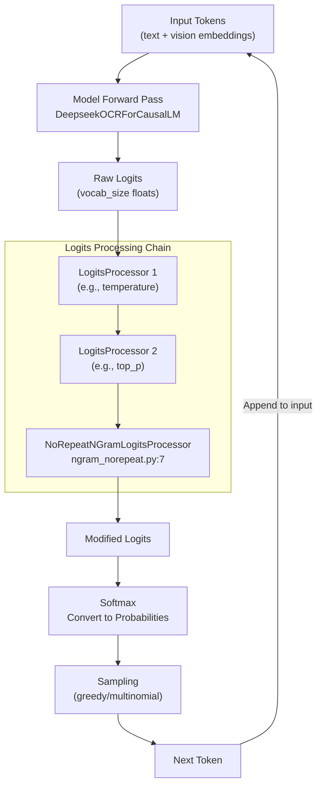
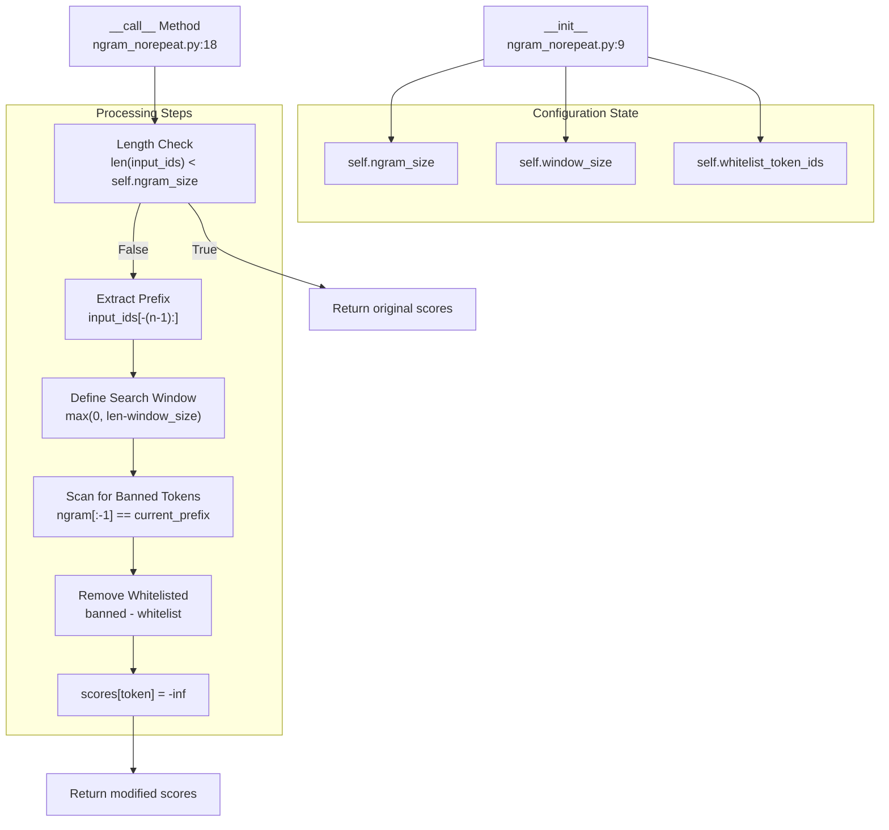

<!-- source: DeepWiki mcp.deepwiki.com · repo deepseek-ai/DeepSeek-OCR · page 5.2 Custom Logits Processors · fetched 2026-10-30 -->

# Custom Logits Processors

Relevant source files

The following files were used as context for generating this wiki page:

- [DeepSeek-OCR-master/DeepSeek-OCR-vllm/process/ngram_norepeat.py](DeepSeek-OCR-master/DeepSeek-OCR-vllm/process/ngram_norepeat.py)

This page provides a guide for implementing custom logits processors in DeepSeek-OCR. Logits processors allow developers to modify the output probability distribution during text generation, enabling fine-grained control over model behavior such as preventing repetition, enforcing constraints, or biasing outputs toward specific patterns.

## Overview

Logits processors are callable objects that intercept and modify the raw logit scores produced by the language model before they are converted to token probabilities. They operate on a per-token basis during autoregressive generation, allowing dynamic control over which tokens can be generated at each step.

### When to Use Logits Processors

Common use cases include:

- **Repetition Prevention**: Block n-grams that have already appeared in the output.
- **Format Enforcement**: Ensure outputs follow specific syntax (e.g., JSON, markdown).
- **Vocabulary Constraints**: Restrict generation to specific token subsets.
- **Quality Control**: Prevent degenerate outputs like excessive whitespace or repetitive table cells.

In DeepSeek-OCR, logits processors are particularly useful for OCR tasks where repetitive patterns, table cell duplications, or formula artifacts need to be suppressed.

Sources: [DeepSeek-OCR-master/DeepSeek-OCR-vllm/process/ngram_norepeat.py:7-40]()

## Logits Processor Pipeline

The following diagram shows how logits processors fit into the token generation pipeline, associating the high-level generation flow with the specific `NoRepeatNGramLogitsProcessor` entity.

**Figure 1: Generation Pipeline with Logits Processors**

Sources: [DeepSeek-OCR-master/DeepSeek-OCR-vllm/process/ngram_norepeat.py:7-40]()

## Interface Contract

All logits processors in this framework follow the interface derived from `transformers.LogitsProcessor`:

| Method | Signature | Purpose |
|--------|-----------|---------|
| `__init__` | `(ngram_size: int, ...)` | Initialize processor with configuration parameters [DeepSeek-OCR-master/DeepSeek-OCR-vllm/process/ngram_norepeat.py:9-16]() |
| `__call__` | `(input_ids: List[int], scores: torch.FloatTensor) -> torch.FloatTensor` | Process logits for a single generation step [DeepSeek-OCR-master/DeepSeek-OCR-vllm/process/ngram_norepeat.py:18-40]() |

### Input-Output Contract

**Inputs:**
- `input_ids`: List of token IDs generated so far (including prompt).
- `scores`: Raw logit tensor of shape `(vocab_size,)` for the next token.

**Output:**
- Modified logit tensor of shape `(vocab_size,)` with constraints applied.

**Requirements:**
- Must return a tensor with the same shape as input `scores`.
- Typically sets forbidden token scores to `-float("inf")` to prevent sampling [DeepSeek-OCR-master/DeepSeek-OCR-vllm/process/ngram_norepeat.py:38-38]().
- Should not modify the original `scores` tensor in-place; use `scores.clone()` [DeepSeek-OCR-master/DeepSeek-OCR-vllm/process/ngram_norepeat.py:36-36]().

Sources: [DeepSeek-OCR-master/DeepSeek-OCR-vllm/process/ngram_norepeat.py:7-40]()

## NoRepeatNGramLogitsProcessor: Reference Implementation

The `NoRepeatNGramLogitsProcessor` [DeepSeek-OCR-master/DeepSeek-OCR-vllm/process/ngram_norepeat.py:7-40]() serves as the primary example of a custom logits processor. It prevents repetitive n-gram patterns that commonly occur in OCR outputs.

### Architecture and Design

**Figure 2: NoRepeatNGramLogitsProcessor Logic Flow**

Sources: [DeepSeek-OCR-master/DeepSeek-OCR-vllm/process/ngram_norepeat.py:7-40]()

### Implementation Details

#### Initialization

The constructor validates parameters and stores configuration [DeepSeek-OCR-master/DeepSeek-OCR-vllm/process/ngram_norepeat.py:9-16]():

- `ngram_size`: The length of the n-gram to check for repetition. Must be a strictly positive integer [DeepSeek-OCR-master/DeepSeek-OCR-vllm/process/ngram_norepeat.py:10-11]().
- `window_size`: The lookback distance in the history to search for repeating n-grams [DeepSeek-OCR-master/DeepSeek-OCR-vllm/process/ngram_norepeat.py:12-13]().
- `whitelist_token_ids`: A set of token IDs that are exempt from being banned, even if they form a repeating n-gram [DeepSeek-OCR-master/DeepSeek-OCR-vllm/process/ngram_norepeat.py:16-16]().

#### Core Processing Logic

The `__call__` method implements the following algorithm:

1. **Length Check**: If the generated sequence is shorter than the target n-gram size, it returns the scores unchanged [DeepSeek-OCR-master/DeepSeek-OCR-vllm/process/ngram_norepeat.py:19-20]().
2. **Prefix Extraction**: It extracts the last `ngram_size - 1` tokens as the `current_prefix` [DeepSeek-OCR-master/DeepSeek-OCR-vllm/process/ngram_norepeat.py:22-22]().
3. **Windowed Search**: It defines a search range based on `window_size` to identify historical n-grams that match the `current_prefix` [DeepSeek-OCR-master/DeepSeek-OCR-vllm/process/ngram_norepeat.py:24-31]().
4. **Token Banning**: If a match is found, the token following that historical prefix is added to `banned_tokens` [DeepSeek-OCR-master/DeepSeek-OCR-vllm/process/ngram_norepeat.py:31-31]().
5. **Whitelist Application**: Tokens in the `whitelist_token_ids` are removed from the banned set [DeepSeek-OCR-master/DeepSeek-OCR-vllm/process/ngram_norepeat.py:33-33]().
6. **Logit Modification**: It clones the scores and sets the value for all `banned_tokens` to `-inf` [DeepSeek-OCR-master/DeepSeek-OCR-vllm/process/ngram_norepeat.py:35-38]().

Sources: [DeepSeek-OCR-master/DeepSeek-OCR-vllm/process/ngram_norepeat.py:18-40]()

## Creating Custom Processors

### Implementation Checklist

To create a custom logits processor within the DeepSeek-OCR ecosystem:

1.  **Inherit from `LogitsProcessor`**: Import from `transformers` [DeepSeek-OCR-master/DeepSeek-OCR-vllm/process/ngram_norepeat.py:2-7]().
2.  **State Management**: Define any required configuration (like `ngram_size` or `window_size`) in `__init__` [DeepSeek-OCR-master/DeepSeek-OCR-vllm/process/ngram_norepeat.py:9-16]().
3.  **Logit Transformation**:
    *   Accept `input_ids` and `scores` in `__call__` [DeepSeek-OCR-master/DeepSeek-OCR-vllm/process/ngram_norepeat.py:18-18]().
    *   Perform a `.clone()` on the scores before modification to avoid side effects [DeepSeek-OCR-master/DeepSeek-OCR-vllm/process/ngram_norepeat.py:36-36]().
    *   Modify scores using `torch` operations (e.g., setting values to `-float("inf")`) [DeepSeek-OCR-master/DeepSeek-OCR-vllm/process/ngram_norepeat.py:38-38]().

### Performance Considerations

*   **Windowing**: In `NoRepeatNGramLogitsProcessor`, the `window_size` parameter [DeepSeek-OCR-master/DeepSeek-OCR-vllm/process/ngram_norepeat.py:15-15]() is critical for performance. Searching the entire history of a long document is computationally expensive; a sliding window limits the `range(search_start, search_end)` loop [DeepSeek-OCR-master/DeepSeek-OCR-vllm/process/ngram_norepeat.py:28-28]().
*   **Whitelisting**: Use a `set` for `whitelist_token_ids` [DeepSeek-OCR-master/DeepSeek-OCR-vllm/process/ngram_norepeat.py:16-16]() to ensure O(1) lookup time when calculating `banned_tokens - self.whitelist_token_ids` [DeepSeek-OCR-master/DeepSeek-OCR-vllm/process/ngram_norepeat.py:33-33]().

Sources: [DeepSeek-OCR-master/DeepSeek-OCR-vllm/process/ngram_norepeat.py:1-40]()

---

