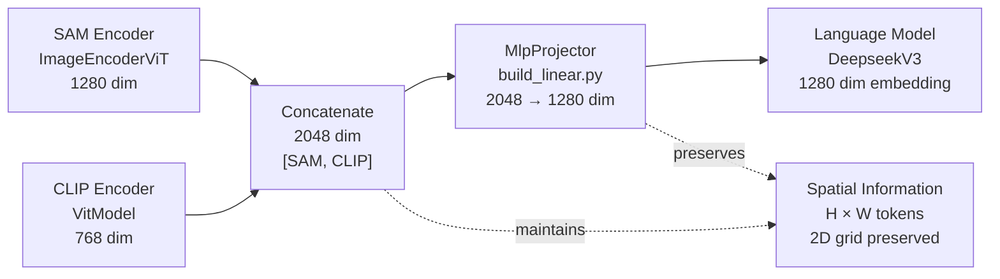
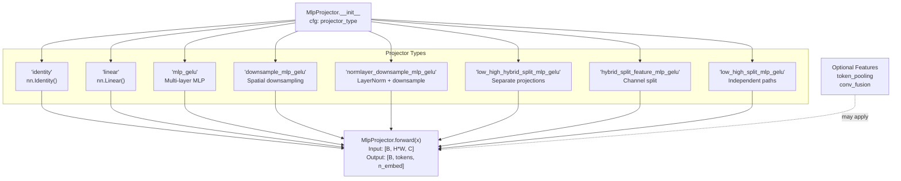

<!-- source: DeepWiki mcp.deepwiki.com · repo deepseek-ai/DeepSeek-OCR · page 5.3 Custom Projector Architectures · fetched 2026-10-30 -->

# Custom Projector Architectures

<details>
<summary>Relevant source files</summary>

The following files were used as context for generating this wiki page:

- [DeepSeek-OCR-master/DeepSeek-OCR-vllm/deepencoder/build_linear.py](DeepSeek-OCR-master/DeepSeek-OCR-vllm/deepencoder/build_linear.py)

</details>


## Purpose and Scope

This page provides a guide for developers implementing custom projector architectures in DeepSeek-OCR. Projectors are critical components that transform concatenated vision encoder features (typically 2048 dimensions from SAM + CLIP) into the language model's embedding space (typically 1280 dimensions). 

For understanding the architectural role of projectors in the overall system, see [Feature Projection](). For general model component reference, see [Model Components Reference]().

This guide covers:
- The projector's role in the multimodal pipeline
- Seven built-in projector types and their characteristics
- Configuration patterns and parameters
- Implementation patterns for custom projectors
- Advanced features like token pooling and feature fusion

---

## The Projector's Role in the Pipeline

Projectors bridge the vision and language modalities by transforming high-dimensional vision features into the language model's embedding space. This transformation must preserve spatial information while adapting to the target dimensionality.

Title: Vision-to-Language Projection Flow


**Sources:** [DeepSeek-OCR-master/DeepSeek-OCR-vllm/deepencoder/build_linear.py:1-175]()

---

## MlpProjector Class Structure

The `MlpProjector` class [DeepSeek-OCR-master/DeepSeek-OCR-vllm/deepencoder/build_linear.py:7-157]() implements all projector variants through a unified interface. The projector type is selected via `cfg.projector_type` [DeepSeek-OCR-master/DeepSeek-OCR-vllm/deepencoder/build_linear.py:15-88](), and the appropriate module architecture is constructed during initialization.

Title: MlpProjector Implementation Map


**Sources:** [DeepSeek-OCR-master/DeepSeek-OCR-vllm/deepencoder/build_linear.py:7-96]()

---

## Built-in Projector Types

The following table summarizes the projector types implemented in `MlpProjector`. Each type is optimized for different feature characteristics and computational requirements.

| Projector Type | Input Dimensions | Output Dimensions | Key Features | Use Case |
|----------------|------------------|-------------------|--------------|----------|
| `identity` | `input_dim` | `input_dim` | Pass-through [DeepSeek-OCR-master/DeepSeek-OCR-vllm/deepencoder/build_linear.py:15-16]() | Testing, debugging |
| `linear` | `input_dim` | `n_embed` | Single linear layer [DeepSeek-OCR-master/DeepSeek-OCR-vllm/deepencoder/build_linear.py:18-19]() | Fastest, baseline |
| `mlp_gelu` | `input_dim` | `n_embed` | Multi-layer MLP with GELU [DeepSeek-OCR-master/DeepSeek-OCR-vllm/deepencoder/build_linear.py:21-27]() | Standard feature mixing |
| `downsample_mlp_gelu` | `input_dim × ratio²` | `n_embed` | Spatial 4-to-1 concatenation [DeepSeek-OCR-master/DeepSeek-OCR-vllm/deepencoder/build_linear.py:43-52]() | Reduces token count |
| `normlayer_downsample_mlp_gelu` | `input_dim × ratio²` | `n_embed` | LayerNorm before projection [DeepSeek-OCR-master/DeepSeek-OCR-vllm/deepencoder/build_linear.py:29-41]() | Better training stability |
| `low_high_hybrid_split_mlp_gelu` | `[dim, dim]` | `n_embed` | Separate initial projections [DeepSeek-OCR-master/DeepSeek-OCR-vllm/deepencoder/build_linear.py:54-63]() | Multi-encoder handling |
| `hybrid_split_feature_mlp_gelu` | `[dim0, dim1]` | `n_embed` | Channel-based splitting [DeepSeek-OCR-master/DeepSeek-OCR-vllm/deepencoder/build_linear.py:65-75]() | Configurable channel split |
| `low_high_split_mlp_gelu` | `[dim, dim]` | `n_embed` | Independent processing paths [DeepSeek-OCR-master/DeepSeek-OCR-vllm/deepencoder/build_linear.py:77-85]() | Maximum independence |

**Sources:** [DeepSeek-OCR-master/DeepSeek-OCR-vllm/deepencoder/build_linear.py:15-88]()

---

## Configuration Parameters

The projector is configured via a `cfg` object. Required parameters vary by projector type.

### Core Parameters
- `cfg.projector_type`: String identifier [DeepSeek-OCR-master/DeepSeek-OCR-vllm/deepencoder/build_linear.py:15]().
- `cfg.input_dim`: Input feature dimension(s). Can be `int` or `list` [DeepSeek-OCR-master/DeepSeek-OCR-vllm/deepencoder/build_linear.py:166]().
- `cfg.n_embed`: Target output dimension [DeepSeek-OCR-master/DeepSeek-OCR-vllm/deepencoder/build_linear.py:19]().
- `cfg.depth`: Number of layers for MLP types (defaults to 1) [DeepSeek-OCR-master/DeepSeek-OCR-vllm/deepencoder/build_linear.py:22]().
- `cfg.downsample_ratio`: Spatial reduction factor [DeepSeek-OCR-master/DeepSeek-OCR-vllm/deepencoder/build_linear.py:33,143]().

**Sources:** [DeepSeek-OCR-master/DeepSeek-OCR-vllm/deepencoder/build_linear.py:9-95]()

---

## Detailed Type Explanations

### Downsampling Projectors

These projectors reduce spatial dimensions by concatenating neighboring tokens before projection. This is critical for high-resolution OCR tasks to manage the LLM's sequence length.

The `forward` pass implements spatial concatenation using `F.unfold` [DeepSeek-OCR-master/DeepSeek-OCR-vllm/deepencoder/build_linear.py:153]():

```python
# Spatial downsampling logic (simplified)
bs, hw, input_dim = x.shape
h = w = int((hw) ** 0.5)

# Handle padding for non-divisible dimensions
if h % self.cfg.downsample_ratio:
    pad = self.cfg.downsample_ratio - h % self.cfg.downsample_ratio
x = x.reshape(bs, h, w, input_dim)
if pad > 0:
    x = F.pad(x, (0, 0, 0, pad, 0, pad), "constant", 0)

# 4 to 1 concat (ratio=2)
x = x.permute(0, 3, 1, 2)  # B, C, H, W
x = F.unfold(x, kernel_size=self.cfg.downsample_ratio, stride=self.cfg.downsample_ratio)
x = x.permute(0, 2, 1) # B, HW//4, C*4
```

**Sources:** [DeepSeek-OCR-master/DeepSeek-OCR-vllm/deepencoder/build_linear.py:138-156]()

### Feature Split Projectors

DeepSeek-OCR often uses dual encoders (SAM for spatial details, CLIP for semantics). Split projectors allow for encoder-specific transformations.

- **`low_high_hybrid_split_mlp_gelu`**: Uses `self.high_up_proj` and `self.low_up_proj` [DeepSeek-OCR-master/DeepSeek-OCR-vllm/deepencoder/build_linear.py:56-57]() to project two separate input streams (e.g., SAM and CLIP) into half the target dimension each, then concatenates them [DeepSeek-OCR-master/DeepSeek-OCR-vllm/deepencoder/build_linear.py:122]().
- **`hybrid_split_feature_mlp_gelu`**: Takes a single concatenated input and splits it based on `cfg.input_dim` list [DeepSeek-OCR-master/DeepSeek-OCR-vllm/deepencoder/build_linear.py:125-126](), then applies separate projections [DeepSeek-OCR-master/DeepSeek-OCR-vllm/deepencoder/build_linear.py:127-128]().

**Sources:** [DeepSeek-OCR-master/DeepSeek-OCR-vllm/deepencoder/build_linear.py:54-75,118-130]()

---

## Advanced Features

### Token Pooling
When `cfg.token_pooling` is `True`, the projector performs a 2x2 spatial unfold and projects the result through `self.token_pooling_layer` [DeepSeek-OCR-master/DeepSeek-OCR-vllm/deepencoder/build_linear.py:90-91](). This happens at the very beginning of the `forward` pass [DeepSeek-OCR-master/DeepSeek-OCR-vllm/deepencoder/build_linear.py:98-113]().

### Feature Fusion
The `conv_fusion_high_low_features` flag enables a residual-style fusion [DeepSeek-OCR-master/DeepSeek-OCR-vllm/deepencoder/build_linear.py:93-94,115-116]():
```python
# Fusion logic
x = self.fusion_layer(x[:, 0]) + x[:, 1]
```

**Sources:** [DeepSeek-OCR-master/DeepSeek-OCR-vllm/deepencoder/build_linear.py:90-117]()

---

## FLOPs Calculation

The `get_flops_per_sample` static method provides a technical estimate of the projector's computational cost [DeepSeek-OCR-master/DeepSeek-OCR-vllm/deepencoder/build_linear.py:158-175]().

```python
@staticmethod
def get_flops_per_sample(cfg):
    if cfg.projector_type == "linear":
        fwd = 2 * cfg.input_dim * cfg.n_embed
    elif "mlp_gelu" in cfg.projector_type:
        # Account for downsampling expansion
        input_dim = input_dim * downsample_ratio * downsample_ratio
        fwd = 2 * input_dim * cfg.n_embed + (mlp_depth - 1) * 2 * cfg.n_embed * cfg.n_embed
    # ...
    return fwd * 3 # Estimate for forward + backward
```

**Sources:** [DeepSeek-OCR-master/DeepSeek-OCR-vllm/deepencoder/build_linear.py:158-172]()

---

## Implementation Guidelines for Custom Variants

To implement a new projector architecture:

1.  **Modify `__init__`**: Add a new branch to the `if cfg.projector_type` block [DeepSeek-OCR-master/DeepSeek-OCR-vllm/deepencoder/build_linear.py:15-88](). Define your `nn.Module` components.
2.  **Modify `forward`**: Add a corresponding branch in the `forward` method [DeepSeek-OCR-master/DeepSeek-OCR-vllm/deepencoder/build_linear.py:97-156](). 
3.  **Handle Spatial Dimensions**: If your projector changes the number of tokens (like downsampling), ensure the output is a flattened token sequence `[Batch, Tokens, Dimension]` [DeepSeek-OCR-master/DeepSeek-OCR-vllm/deepencoder/build_linear.py:154-156]().
4.  **Update FLOPs**: Add your logic to `get_flops_per_sample` [DeepSeek-OCR-master/DeepSeek-OCR-vllm/deepencoder/build_linear.py:158-175]() for accurate profiling.

**Sources:** [DeepSeek-OCR-master/DeepSeek-OCR-vllm/deepencoder/build_linear.py:7-175]()

---

