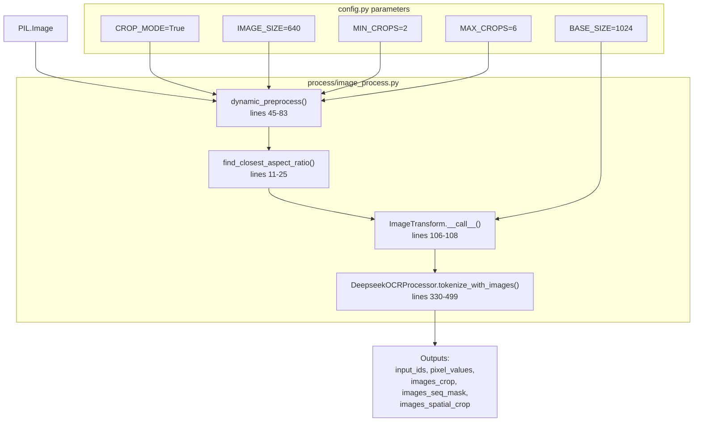
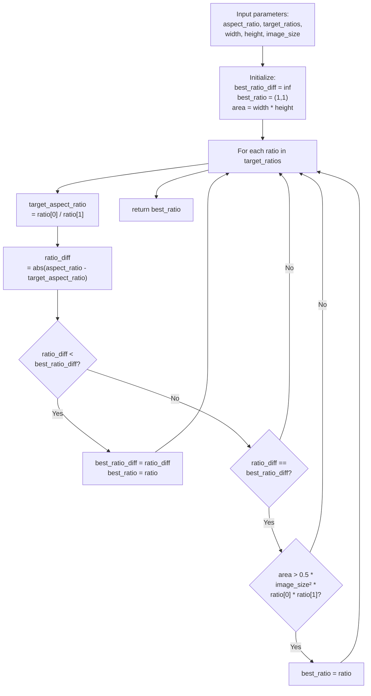
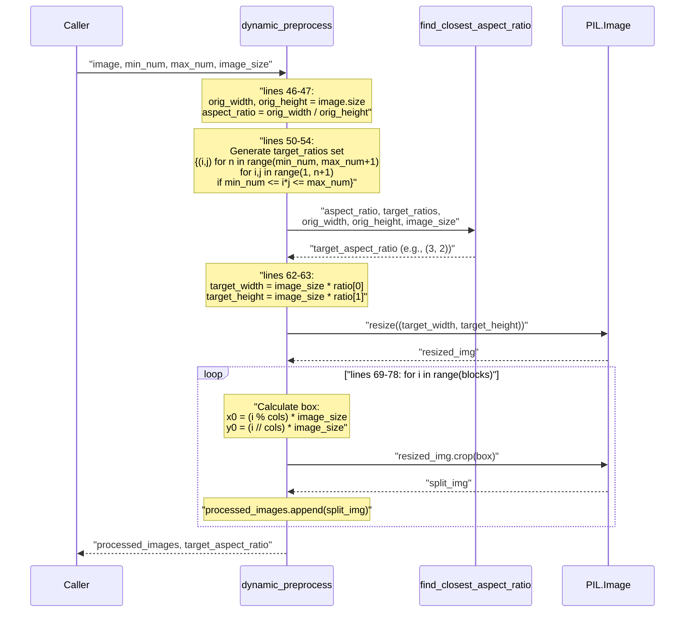
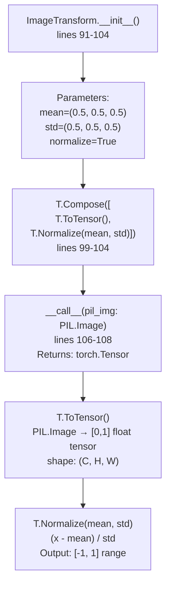
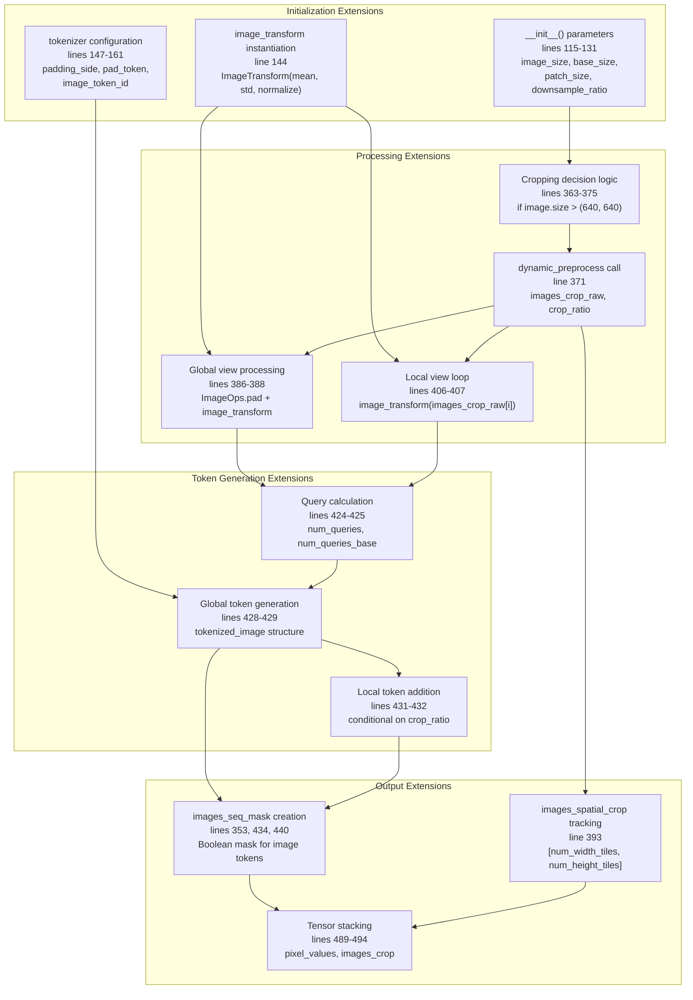
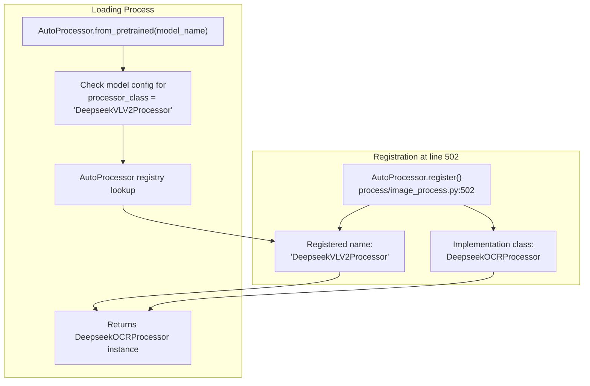

<!-- source: DeepWiki mcp.deepwiki.com · repo deepseek-ai/DeepSeek-OCR · page 5.4 Extending Image Processing · fetched 2026-10-30 -->

# Extending Image Processing

<details>
<summary>Relevant source files</summary>

The following files were used as context for generating this wiki page:

- [DeepSeek-OCR-master/DeepSeek-OCR-vllm/process/image_process.py](DeepSeek-OCR-master/DeepSeek-OCR-vllm/process/image_process.py)

</details>


This page provides guidance for developers who need to customize or extend the image preprocessing pipeline in DeepSeek-OCR. It covers the core components involved in transforming raw images into tokenized inputs suitable for the vision encoders, including dynamic cropping strategies, image normalization, and spatial tokenization.

For information about customizing vision encoder outputs after preprocessing, see [Custom Projector Architectures](#5.3). For details on post-processing model outputs, see [Output Post-Processing](#5.5).

## Overview of the Image Processing System

The image processing system in [DeepSeek-OCR-master/DeepSeek-OCR-vllm/process/image_process.py:1-503]() transforms PIL images into structured tensor inputs for the vision encoders. The pipeline consists of three main stages: dynamic preprocessing (adaptive tiling via `dynamic_preprocess`), image transformation (normalization via `ImageTransform`), and tokenization (spatial structure generation via `DeepseekOCRProcessor`).

**Image Processing Pipeline**



The system uses configuration parameters from [DeepSeek-OCR-master/DeepSeek-OCR-vllm/config.py:8-12]() to control processing behavior. When `CROP_MODE=True` and images exceed 640×640 pixels, `dynamic_preprocess()` at [DeepSeek-OCR-master/DeepSeek-OCR-vllm/process/image_process.py:45-83]() tiles the image. All image tiles are normalized through `ImageTransform` at [DeepSeek-OCR-master/DeepSeek-OCR-vllm/process/image_process.py:89-109](), then tokenized into structured sequences by `DeepseekOCRProcessor` at [DeepSeek-OCR-master/DeepSeek-OCR-vllm/process/image_process.py:111-502]().

**Sources**: [DeepSeek-OCR-master/DeepSeek-OCR-vllm/config.py:8-12](), [DeepSeek-OCR-master/DeepSeek-OCR-vllm/process/image_process.py:1-503]()

## Dynamic Preprocessing System

The dynamic preprocessing system adaptively tiles large images to balance detail preservation with computational efficiency. This is the first extension point for customizing how images are processed.

### Aspect Ratio Selection via find_closest_aspect_ratio

**Function: find_closest_aspect_ratio**



The `find_closest_aspect_ratio` function at [DeepSeek-OCR-master/DeepSeek-OCR-vllm/process/image_process.py:11-25]() selects the optimal tiling grid configuration (e.g., 2×3, 3×2, 4×2) by matching the input image's aspect ratio to candidate ratios in `target_ratios`.

**Algorithm Details**:
- **Line 16**: Calculates `target_aspect_ratio = ratio[0] / ratio[1]` for each candidate [DeepSeek-OCR-master/DeepSeek-OCR-vllm/process/image_process.py:16-16]().
- **Line 17**: Computes `ratio_diff = abs(aspect_ratio - target_aspect_ratio)` [DeepSeek-OCR-master/DeepSeek-OCR-vllm/process/image_process.py:17-17]().
- **Line 18-20**: Updates `best_ratio` if `ratio_diff` is smaller [DeepSeek-OCR-master/DeepSeek-OCR-vllm/process/image_process.py:18-20]().
- **Line 21-23**: For equal `ratio_diff`, prefers configurations where image area exceeds `0.5 * image_size * image_size * ratio[0] * ratio[1]`, ensuring sufficient coverage [DeepSeek-OCR-master/DeepSeek-OCR-vllm/process/image_process.py:21-23]().

**Sources**: [DeepSeek-OCR-master/DeepSeek-OCR-vllm/process/image_process.py:11-25]()

### Tile Generation via dynamic_preprocess

**Function: dynamic_preprocess**



The `dynamic_preprocess` function at [DeepSeek-OCR-master/DeepSeek-OCR-vllm/process/image_process.py:45-83]() implements adaptive tiling by determining the optimal grid configuration and extracting individual tiles.

**Process Breakdown**:
- **Lines 50-54**: Generates `target_ratios` set containing all valid (width, height) grid configurations between `min_num` and `max_num` tiles [DeepSeek-OCR-master/DeepSeek-OCR-vllm/process/image_process.py:50-54]().
- **Lines 57-58**: Calls `find_closest_aspect_ratio` to select the best grid [DeepSeek-OCR-master/DeepSeek-OCR-vllm/process/image_process.py:57-58]().
- **Lines 62-63**: Calculates `target_width = image_size * target_aspect_ratio[0]` and `target_height = image_size * target_aspect_ratio[1]` [DeepSeek-OCR-master/DeepSeek-OCR-vllm/process/image_process.py:62-63]().
- **Line 67**: Resizes image to target dimensions [DeepSeek-OCR-master/DeepSeek-OCR-vllm/process/image_process.py:67-67]().
- **Lines 69-78**: Crops resized image into `blocks = target_aspect_ratio[0] * target_aspect_ratio[1]` tiles using grid-based box coordinates [DeepSeek-OCR-master/DeepSeek-OCR-vllm/process/image_process.py:69-78]().
- **Lines 80-82**: Optionally appends a thumbnail view if `use_thumbnail=True` [DeepSeek-OCR-master/DeepSeek-OCR-vllm/process/image_process.py:80-82]().

**Sources**: [DeepSeek-OCR-master/DeepSeek-OCR-vllm/process/image_process.py:45-83]()

### Customizing Cropping Strategies

To implement a custom cropping strategy, you can extend or replace the `dynamic_preprocess` function:

| Extension Point | Location | Purpose |
|----------------|----------|---------|
| Target ratio generation | [DeepSeek-OCR-master/DeepSeek-OCR-vllm/process/image_process.py:32-36]() | Customize grid configurations |
| Aspect ratio matching | [DeepSeek-OCR-master/DeepSeek-OCR-vllm/process/image_process.py:39-40]() | Replace selection algorithm |
| Tile extraction | [DeepSeek-OCR-master/DeepSeek-OCR-vllm/process/image_process.py:69-78]() | Modify crop coordinates or overlap |
| Thumbnail generation | [DeepSeek-OCR-master/DeepSeek-OCR-vllm/process/image_process.py:80-82]() | Add/modify global thumbnail logic |

**Sources**: [DeepSeek-OCR-master/DeepSeek-OCR-vllm/process/image_process.py:45-83](), [DeepSeek-OCR-master/DeepSeek-OCR-vllm/config.py:8-12]()

## ImageTransform Component

The `ImageTransform` class at [DeepSeek-OCR-master/DeepSeek-OCR-vllm/process/image_process.py:89-109]() handles pixel-level normalization, converting PIL images to normalized tensors.

**ImageTransform Class Structure**



**Implementation Details**:
- **Lines 92-94**: Stores `mean`, `std`, and `normalize` as instance attributes [DeepSeek-OCR-master/DeepSeek-OCR-vllm/process/image_process.py:92-94]().
- **Line 99**: Creates `transform_pipelines` list starting with `T.ToTensor()` [DeepSeek-OCR-master/DeepSeek-OCR-vllm/process/image_process.py:99-99]().
- **Lines 101-102**: If `normalize=True`, appends `T.Normalize(mean, std)` to pipeline [DeepSeek-OCR-master/DeepSeek-OCR-vllm/process/image_process.py:101-102]().
- **Line 104**: Composes transforms into `self.transform` [DeepSeek-OCR-master/DeepSeek-OCR-vllm/process/image_process.py:104-104]().
- **Lines 106-108**: `__call__` applies the composed transform to input PIL images [DeepSeek-OCR-master/DeepSeek-OCR-vllm/process/image_process.py:106-108]().

The default normalization with mean/std of (0.5, 0.5, 0.5) maps pixel values from [0, 1] to [-1, 1], providing zero-centered inputs for the vision encoders.

**Sources**: [DeepSeek-OCR-master/DeepSeek-OCR-vllm/process/image_process.py:89-109]()

## DeepseekOCRProcessor Architecture

The `DeepseekOCRProcessor` class is the central component that orchestrates image preprocessing, tokenization, and spatial structure generation.

```mermaid
graph TB
    subgraph "DeepseekOCRProcessor Class Hierarchy"
        PM["ProcessorMixin<br/>(transformers)"]
        PROC["DeepseekOCRProcessor<br/>Main processor class"]
        
        PM --> PROC
    end
    
    subgraph "Key Attributes"
        TOK["tokenizer<br/>LlamaTokenizerFast"]
        IMG_TRANSFORM["image_transform<br/>ImageTransform instance"]
        IMG_SIZE["image_size=640<br/>base_size=1024"]
        PATCH["patch_size=16<br/>downsample_ratio=4"]
        SPECIAL_TOK["image_token_id<br/>pad_token_id"]
    end
    
    subgraph "Core Methods"
        TOKEN_WITH_IMG["tokenize_with_images()<br/>Main entry point"]
        PROCESS_ONE["process_one()<br/>Single image processing"]
        ENCODE["encode()<br/>Text encoding"]
        DECODE["decode()<br/>Text decoding"]
    end
    
    PROC --> TOK
    PROC --> IMG_TRANSFORM
    PROC --> IMG_SIZE
    PROC --> PATCH
    PROC --> SPECIAL_TOK
    
    PROC --> TOKEN_WITH_IMG
    PROC --> PROCESS_ONE
    PROC --> ENCODE
    PROC --> DECODE
    
    TOKEN_WITH_IMG -.-> "Returns tuple with<br/>input_ids, pixel_values,<br/>images_crop, spatial_crop"
```

**Class Structure**: The `DeepseekOCRProcessor` class at [DeepSeek-OCR-master/DeepSeek-OCR-vllm/process/image_process.py:111-502]() inherits from `ProcessorMixin` and implements the full preprocessing pipeline. It is registered with the `AutoProcessor` at [DeepSeek-OCR-master/DeepSeek-OCR-vllm/process/image_process.py:502]().

**Key Responsibilities**:
1. Coordinate image cropping via `dynamic_preprocess` [DeepSeek-OCR-master/DeepSeek-OCR-vllm/process/image_process.py:371-371]().
2. Apply transformations via `ImageTransform` [DeepSeek-OCR-master/DeepSeek-OCR-vllm/process/image_process.py:388-388]().
3. Generate spatial token sequences [DeepSeek-OCR-master/DeepSeek-OCR-vllm/process/image_process.py:428-432]().
4. Insert special tokens for multimodal integration [DeepSeek-OCR-master/DeepSeek-OCR-vllm/process/image_process.py:152-161]().

**Sources**: [DeepSeek-OCR-master/DeepSeek-OCR-vllm/process/image_process.py:111-502]()

### Tokenization with Spatial Structure

The `tokenize_with_images` method at [DeepSeek-OCR-master/DeepSeek-OCR-vllm/process/image_process.py:330-499]() generates structured token sequences that preserve 2D spatial relationships.

**Token Generation Formulas** (lines 424-435):
- `num_queries_base = ceil((BASE_SIZE / patch_size) / downsample_ratio)` = ceil((1024/16)/4) = 16 [DeepSeek-OCR-master/DeepSeek-OCR-vllm/process/image_process.py:425-425]().
- `num_queries = ceil((IMAGE_SIZE / patch_size) / downsample_ratio)` = ceil((640/16)/4) = 10 [DeepSeek-OCR-master/DeepSeek-OCR-vllm/process/image_process.py:424-424]().

**Spatial Token Structure**:
- **Global view tokens** (line 428): `([image_token_id] * 16 + [image_token_id]) * 16 + [image_token_id]` = 273 tokens (includes newline tokens) [DeepSeek-OCR-master/DeepSeek-OCR-vllm/process/image_process.py:428-429]().
- **Local tile tokens** (lines 431-432): `([image_token_id] * (10 * num_width_tiles) + [image_token_id]) * (10 * num_height_tiles)` per image [DeepSeek-OCR-master/DeepSeek-OCR-vllm/process/image_process.py:431-432]().

The newline tokens (same as `self.image_token_id`) at the end of each row maintain the 2D spatial grid structure in the flattened token sequence.

**Sources**: [DeepSeek-OCR-master/DeepSeek-OCR-vllm/process/image_process.py:330-499]()

## Extension Points in DeepseekOCRProcessor

The `DeepseekOCRProcessor` class provides multiple extension points for customization:

**Extension Points by Category**



**Key Extension Points**:

| Extension Point | Location | Purpose |
|----------------|----------|---------|
| `__init__` parameters | [DeepSeek-OCR-master/DeepSeek-OCR-vllm/process/image_process.py:115-131]() | Customize processor initialization |
| `image_transform` | [DeepSeek-OCR-master/DeepSeek-OCR-vllm/process/image_process.py:144]() | Replace normalization pipeline |
| Cropping decision | [DeepSeek-OCR-master/DeepSeek-OCR-vllm/process/image_process.py:363-375]() | Modify when/how to crop |
| `dynamic_preprocess` call | [DeepSeek-OCR-master/DeepSeek-OCR-vllm/process/image_process.py:371]() | Replace tiling algorithm |
| Global view processing | [DeepSeek-OCR-master/DeepSeek-OCR-vllm/process/image_process.py:386-388]() | Customize padding and transform |
| Local view processing | [DeepSeek-OCR-master/DeepSeek-OCR-vllm/process/image_process.py:406-407]() | Modify tile transformation |
| Token calculation | [DeepSeek-OCR-master/DeepSeek-OCR-vllm/process/image_process.py:424-425]() | Change token count formulas |
| Token generation | [DeepSeek-OCR-master/DeepSeek-OCR-vllm/process/image_process.py:428-432]() | Modify spatial structure |

**Sources**: [DeepSeek-OCR-master/DeepSeek-OCR-vllm/process/image_process.py:111-502]()

## Configuration Integration

All image processing behavior is controlled by configuration parameters in `config.py`.

### Configuration Parameters Reference

| Parameter | Location | Purpose | Default |
|-----------|----------|---------|---------|
| `BASE_SIZE` | [DeepSeek-OCR-master/DeepSeek-OCR-vllm/config.py:8]() | Global view resolution | 1024 |
| `IMAGE_SIZE` | [DeepSeek-OCR-master/DeepSeek-OCR-vllm/config.py:9]() | Local tile resolution | 640 |
| `CROP_MODE` | [DeepSeek-OCR-master/DeepSeek-OCR-vllm/config.py:10]() | Enable dynamic cropping | True |
| `MIN_CROPS` | [DeepSeek-OCR-master/DeepSeek-OCR-vllm/config.py:11]() | Minimum tiles in grid | 2 |
| `MAX_CROPS` | [DeepSeek-OCR-master/DeepSeek-OCR-vllm/config.py:12]() | Maximum tiles in grid | 6 |
| `PRINT_NUM_VIS_TOKENS` | [DeepSeek-OCR-master/DeepSeek-OCR-vllm/config.py:15]() | Debug token count | False |

**Usage in Code**: These parameters are imported and used throughout `image_process.py`:
- [DeepSeek-OCR-master/DeepSeek-OCR-vllm/process/image_process.py:9](): Import statement.
- [DeepSeek-OCR-master/DeepSeek-OCR-vllm/process/image_process.py:28](): Used in `count_tiles`.
- [DeepSeek-OCR-master/DeepSeek-OCR-vllm/process/image_process.py:45](): Used in `dynamic_preprocess`.
- [DeepSeek-OCR-master/DeepSeek-OCR-vllm/process/image_process.py:134-135](): Used in `DeepseekOCRProcessor.__init__`.
- [DeepSeek-OCR-master/DeepSeek-OCR-vllm/process/image_process.py:371](): Used in cropping logic.

**Sources**: [DeepSeek-OCR-master/DeepSeek-OCR-vllm/config.py:8-15](), [DeepSeek-OCR-master/DeepSeek-OCR-vllm/process/image_process.py:9]()

## Processor Registration

The processor must be registered with the HuggingFace `AutoProcessor` system for automatic loading.

**AutoProcessor Registration System**



The processor registration at [DeepSeek-OCR-master/DeepSeek-OCR-vllm/process/image_process.py:502]() enables automatic loading via `AutoProcessor.from_pretrained()`:

```python
AutoProcessor.register("DeepseekVLV2Processor", DeepseekOCRProcessor)
```

**Sources**: [DeepSeek-OCR-master/DeepSeek-OCR-vllm/process/image_process.py:502]()

## Summary

The image processing system provides several extension points:

1. **Dynamic Preprocessing**: Customize tiling via `dynamic_preprocess` or `find_closest_aspect_ratio`.
2. **Image Transformation**: Extend `ImageTransform` for custom normalization or augmentation.
3. **Tokenization**: Modify `DeepseekOCRProcessor.tokenize_with_images` for custom token generation.
4. **Configuration**: Add new parameters to `config.py` and integrate throughout the pipeline.

All extensions should maintain compatibility with the expected output format:
- `input_ids`: Token sequence with image token placeholders.
- `pixel_values`: Global view tensors [n_images, 3, BASE_SIZE, BASE_SIZE].
- `images_crop`: Local tile tensors [n_images, n_tiles, 3, IMAGE_SIZE, IMAGE_SIZE].
- `images_spatial_crop`: Grid dimensions [n_images, 2].
- `images_seq_mask`: Boolean mask marking image token positions.

**Sources**: [DeepSeek-OCR-master/DeepSeek-OCR-vllm/process/image_process.py:1-503](), [DeepSeek-OCR-master/DeepSeek-OCR-vllm/config.py:1-43]()

---

